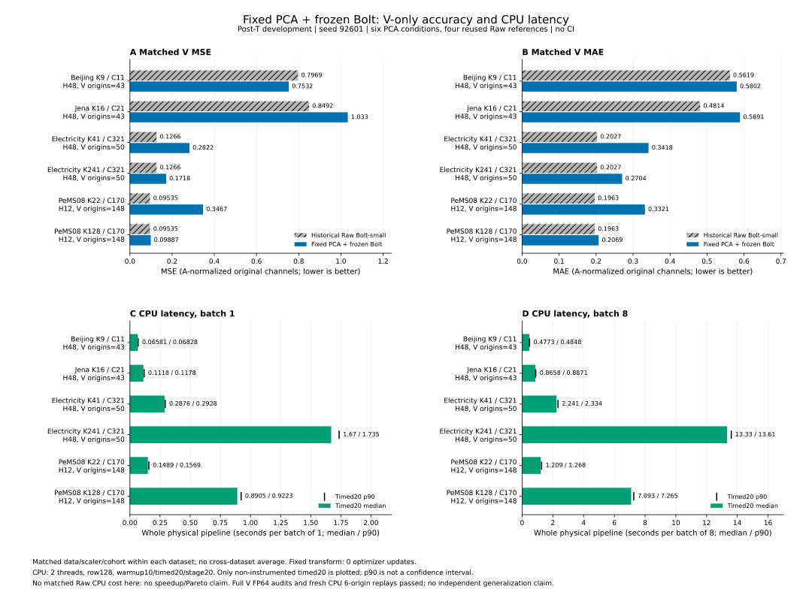
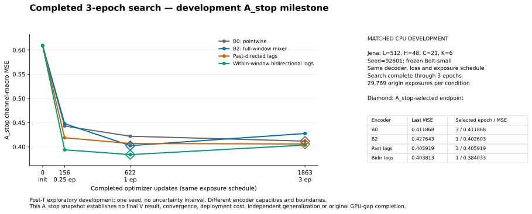

# 실제 결과 그림 색인

PARTIAL 결과다. V는 선택 구간이며, T는 기존에 잠근 방법만 추론했다. 모든 조건의 학습 완료나 독립 일반화를 주장하지 않는다. 원수치·조건·미완료 상태는 상세 보고서와 함께 읽는다.

## 후속 CPU 전체 V와 같은 프로토콜의 비용

[Jena 전체 수치·검산·비용·실패 보고서](postT_V_only_cpu_lag_20261016_v1/RESULTS_WITH_COST_KO.md)의7방법이다. 전체 V43 저장 예측의 재채점과 CPU6 재추론은 서로 다른 검사다. Raw 비용2조건은 FAILED여서 비용 점이 없다. 다른6방법×2batch의 warm10/timed20/separate-stage20을 실제 측정하고 원 trial을 독립 재집계했다. 그림의 min–max는 관측 범위이며 CI가 아니다. 세 그림의 PNG 원본을 실제 열어 가독성과 실패 표시를 확인했으며, GitHub에는 같은 수치의 SVG를 우선 게시한다.

[고정 PCA6의 별도 보고서](postT_V_only_cpu_fixed_pca_20261016_v1/RESULTS_WITH_COST_KO.md)도 실제 전수 V·FP64·CPU6 replay·비용12를 포함한다. 고정 PCA의 optimizer update0과 신경망 search3epoch를 같은 학습량으로 표현하지 않는다. 아래 검색 곡선은 당시 A_stop 기록이며 최신 전체 V 결과와 구분한다.

## 고정 PCA6의 같은 자료 오차와 CPU 비용

[원 집계6행·실제 검산·그림 결박](postT_V_only_cpu_fixed_pca_20261016_v1/RESULTS_WITH_COST_KO.md)을 제공한다. Beijing/Jena V43/H48, Electricity V50/H48, PeMS V148/H12를 구분한다. 자료 간 평균·동일 CPU Raw 대비 가속비는 없으며, PCA 고정 변환의 update0을 신경망 학습 완료로 세지 않는다. 생성한300dpi PNG를 실제 열어 글자·수치·범례의 가독성을 확인했다.

## 후속 CPU 검색 중간 기록

[3epoch 완료 보고서·16행 CSV·계약](postT_V_only_cpu_lag_20261016_v1/PROGRESS_E3_KO.md). 네 조건 모두 검색3epoch를 완료했고 선택 epoch는3/1/3/1이다. 완료 checkpoint4개와 event16개에서 독립 재구성한 CSV가 원 공개본과 byte 단위로 일치했다. PNG v2를 실제 열어 초기 tick·범례·표·선택점의 가독성을 확인했다. A_stop 선택 기록이며 네 조건의 최종 V·비용이나 충분 수렴을 증명하지 않는다.

[이전1epoch 중간 보고서·CSV·계약](postT_V_only_cpu_lag_20261016_v1/PROGRESS_E1_KO.md). 당시 검색 진행 상태의 snapshot을 보존했다. 최신 상태는 위3epoch 기록을 따르며, 어느 그림도 독립 일반화 검증을 뜻하지 않는다.

## 핵심 고정 비교

T 막대는 고정 9역할 ×4데이터셋의36행이며 전체46조건을 대체하지 않는다. 앞6개는 동일 G이며 Raw·LoRA·ridge는 별도 대조다. PeMS의 작은 평균 이득도 시간·horizon·패턴별 방향이 갈린다.

## 학습곡선 가독성 보완

기존 그림과 수치를 보존하고 같은 공개 CSV로 범례를 별도 열에 배치했다. 학습을 다시 하지 않았다. Beijing V 보완본을 실제 열어 겹침 해소를 확인했다.
- [learning_beijing_T_final.svg](diagnostics/learning_layout_readability_20261016_v1/snapshot_1792104606617359600/learning_beijing_T_final.svg)
- [learning_beijing_V_select.svg](diagnostics/learning_layout_readability_20261016_v1/snapshot_1792104606617359600/learning_beijing_V_select.svg)
- [learning_electricity_T_final.svg](diagnostics/learning_layout_readability_20261016_v1/snapshot_1792104606617359600/learning_electricity_T_final.svg)
- [learning_electricity_V_select.svg](diagnostics/learning_layout_readability_20261016_v1/snapshot_1792104606617359600/learning_electricity_V_select.svg)
- [learning_jena_T_final.svg](diagnostics/learning_layout_readability_20261016_v1/snapshot_1792104606617359600/learning_jena_T_final.svg)
- [learning_jena_V_select.svg](diagnostics/learning_layout_readability_20261016_v1/snapshot_1792104606617359600/learning_jena_V_select.svg)
- [learning_pems08_T_final.svg](diagnostics/learning_layout_readability_20261016_v1/snapshot_1792104606617359600/learning_pems08_T_final.svg)
- [learning_pems08_V_select.svg](diagnostics/learning_layout_readability_20261016_v1/snapshot_1792104606617359600/learning_pems08_V_select.svg)
- [learning_robin_V_select.svg](diagnostics/learning_layout_readability_20261016_v1/snapshot_1792104606617359600/learning_robin_V_select.svg)

## V: 405개 저장 예측 /71개 그림

각 PNG/SVG의 더 작은 한 형식만 게시한다. 양형식과 원본은 로컬 보존했으며 조건이나 수치 행을 제거하지 않았다.

### accuracy_by_k

상태: `AVAILABLE_PARTIAL_EVIDENCE`. Only actual checked forecasts; fixed references alone do not complete the registered K sweep. Training budgets/seeds remain distinct.

- [accuracy_beijing_primary_budget_0.25_92c7b53c.svg](figures/snapshot_20261015T222956Z_1792103396179587700/accuracy_beijing_primary_budget_0.25_92c7b53c.svg)
- [accuracy_beijing_primary_budget_1.0_92c7b53c.svg](figures/snapshot_20261015T222956Z_1792103396179587700/accuracy_beijing_primary_budget_1.0_92c7b53c.svg)
- [accuracy_beijing_primary_budget_3.0_92c7b53c.svg](figures/snapshot_20261015T222956Z_1792103396179587700/accuracy_beijing_primary_budget_3.0_92c7b53c.svg)
- [accuracy_beijing_primary_budget_Mcal_3.0_92c7b53c.svg](figures/snapshot_20261015T222956Z_1792103396179587700/accuracy_beijing_primary_budget_Mcal_3.0_92c7b53c.svg)
- [accuracy_beijing_primary_budget_Mcal_closed_form_92c7b53c.svg](figures/snapshot_20261015T222956Z_1792103396179587700/accuracy_beijing_primary_budget_Mcal_closed_form_92c7b53c.svg)
- [accuracy_beijing_secondary_budget_0.25_0ca4e73d.svg](figures/snapshot_20261015T222956Z_1792103396179587700/accuracy_beijing_secondary_budget_0.25_0ca4e73d.svg)
- [accuracy_beijing_secondary_budget_3.0_0ca4e73d.svg](figures/snapshot_20261015T222956Z_1792103396179587700/accuracy_beijing_secondary_budget_3.0_0ca4e73d.svg)
- [accuracy_electricity_primary_budget_0.25_8ee94962.svg](figures/snapshot_20261015T222956Z_1792103396179587700/accuracy_electricity_primary_budget_0.25_8ee94962.svg)
- [accuracy_electricity_primary_budget_1.0_8ee94962.svg](figures/snapshot_20261015T222956Z_1792103396179587700/accuracy_electricity_primary_budget_1.0_8ee94962.svg)
- [accuracy_electricity_primary_budget_3.0_8ee94962.png](figures/snapshot_20261015T222956Z_1792103396179587700/accuracy_electricity_primary_budget_3.0_8ee94962.png)
- [accuracy_electricity_primary_budget_Mcal_3.0_8ee94962.svg](figures/snapshot_20261015T222956Z_1792103396179587700/accuracy_electricity_primary_budget_Mcal_3.0_8ee94962.svg)
- [accuracy_electricity_primary_budget_Mcal_closed_form_8ee94962.svg](figures/snapshot_20261015T222956Z_1792103396179587700/accuracy_electricity_primary_budget_Mcal_closed_form_8ee94962.svg)
- [accuracy_jena_primary_budget_0.25_674debb6.svg](figures/snapshot_20261015T222956Z_1792103396179587700/accuracy_jena_primary_budget_0.25_674debb6.svg)
- [accuracy_jena_primary_budget_1.0_674debb6.svg](figures/snapshot_20261015T222956Z_1792103396179587700/accuracy_jena_primary_budget_1.0_674debb6.svg)
- [accuracy_jena_primary_budget_3.0_674debb6.png](figures/snapshot_20261015T222956Z_1792103396179587700/accuracy_jena_primary_budget_3.0_674debb6.png)
- [accuracy_jena_primary_budget_Mcal_3.0_674debb6.svg](figures/snapshot_20261015T222956Z_1792103396179587700/accuracy_jena_primary_budget_Mcal_3.0_674debb6.svg)
- [accuracy_jena_primary_budget_Mcal_closed_form_674debb6.svg](figures/snapshot_20261015T222956Z_1792103396179587700/accuracy_jena_primary_budget_Mcal_closed_form_674debb6.svg)
- [accuracy_jena_secondary_budget_0.25_0d89a325.svg](figures/snapshot_20261015T222956Z_1792103396179587700/accuracy_jena_secondary_budget_0.25_0d89a325.svg)
- [accuracy_jena_secondary_budget_3.0_0d89a325.svg](figures/snapshot_20261015T222956Z_1792103396179587700/accuracy_jena_secondary_budget_3.0_0d89a325.svg)
- [accuracy_pems08_primary_budget_0.25_72e2a201.svg](figures/snapshot_20261015T222956Z_1792103396179587700/accuracy_pems08_primary_budget_0.25_72e2a201.svg)
- [accuracy_pems08_primary_budget_1.0_72e2a201.svg](figures/snapshot_20261015T222956Z_1792103396179587700/accuracy_pems08_primary_budget_1.0_72e2a201.svg)
- [accuracy_pems08_primary_budget_3.0_72e2a201.png](figures/snapshot_20261015T222956Z_1792103396179587700/accuracy_pems08_primary_budget_3.0_72e2a201.png)
- [accuracy_pems08_primary_budget_Mcal_3.0_72e2a201.svg](figures/snapshot_20261015T222956Z_1792103396179587700/accuracy_pems08_primary_budget_Mcal_3.0_72e2a201.svg)
- [accuracy_pems08_primary_budget_Mcal_closed_form_72e2a201.svg](figures/snapshot_20261015T222956Z_1792103396179587700/accuracy_pems08_primary_budget_Mcal_closed_form_72e2a201.svg)
- [accuracy_robin_primary_budget_0.25_ebc5cb5d.svg](figures/snapshot_20261015T222956Z_1792103396179587700/accuracy_robin_primary_budget_0.25_ebc5cb5d.svg)

### matched_controls

상태: `AVAILABLE_PARTIAL_EVIDENCE`. Only exact cohort/scaler/seed and compatible budget pairs; missing or ambiguous counterparts stay pending.

- [matched_beijing.png](figures/snapshot_20261015T222956Z_1792103396179587700/matched_beijing.png)
- [matched_electricity.png](figures/snapshot_20261015T222956Z_1792103396179587700/matched_electricity.png)
- [matched_jena.png](figures/snapshot_20261015T222956Z_1792103396179587700/matched_jena.png)
- [matched_pems08.svg](figures/snapshot_20261015T222956Z_1792103396179587700/matched_pems08.svg)
- [matched_robin.png](figures/snapshot_20261015T222956Z_1792103396179587700/matched_robin.png)

### learning_diagnostics

상태: `AVAILABLE_PARTIAL_EVIDENCE`. Available immutable search/refit receipts, not inferred convergence. Closed-form ridge has no optimizer learning curve.

- [learning_beijing.svg](figures/snapshot_20261015T222956Z_1792103396179587700/learning_beijing.svg)
- [learning_electricity.svg](figures/snapshot_20261015T222956Z_1792103396179587700/learning_electricity.svg)
- [learning_jena.svg](figures/snapshot_20261015T222956Z_1792103396179587700/learning_jena.svg)
- [learning_pems08.svg](figures/snapshot_20261015T222956Z_1792103396179587700/learning_pems08.svg)
- [learning_robin.svg](figures/snapshot_20261015T222956Z_1792103396179587700/learning_robin.svg)

### cost_accuracy

상태: `AVAILABLE_PARTIAL_EVIDENCE`. Requires actual whole-pipeline trial receipts matched to forecast IDs; cached forecast runtime is never a deployment cost.

- [cost_beijing_B1_cuda.svg](figures/snapshot_20261015T222956Z_1792103396179587700/cost_beijing_B1_cuda.svg)
- [cost_beijing_B8_cuda.svg](figures/snapshot_20261015T222956Z_1792103396179587700/cost_beijing_B8_cuda.svg)
- [cost_electricity_B1_cuda.svg](figures/snapshot_20261015T222956Z_1792103396179587700/cost_electricity_B1_cuda.svg)
- [cost_electricity_B8_cuda.svg](figures/snapshot_20261015T222956Z_1792103396179587700/cost_electricity_B8_cuda.svg)
- [cost_jena_B1_cuda.svg](figures/snapshot_20261015T222956Z_1792103396179587700/cost_jena_B1_cuda.svg)
- [cost_jena_B8_cuda.svg](figures/snapshot_20261015T222956Z_1792103396179587700/cost_jena_B8_cuda.svg)
- [cost_memory_beijing_B1_cuda.svg](figures/snapshot_20261015T222956Z_1792103396179587700/cost_memory_beijing_B1_cuda.svg)
- [cost_memory_beijing_B8_cuda.svg](figures/snapshot_20261015T222956Z_1792103396179587700/cost_memory_beijing_B8_cuda.svg)
- [cost_memory_electricity_B1_cuda.svg](figures/snapshot_20261015T222956Z_1792103396179587700/cost_memory_electricity_B1_cuda.svg)
- [cost_memory_electricity_B8_cuda.svg](figures/snapshot_20261015T222956Z_1792103396179587700/cost_memory_electricity_B8_cuda.svg)
- [cost_memory_jena_B1_cuda.svg](figures/snapshot_20261015T222956Z_1792103396179587700/cost_memory_jena_B1_cuda.svg)
- [cost_memory_jena_B8_cuda.svg](figures/snapshot_20261015T222956Z_1792103396179587700/cost_memory_jena_B8_cuda.svg)
- [cost_memory_pems08_B1_cpu.svg](figures/snapshot_20261015T222956Z_1792103396179587700/cost_memory_pems08_B1_cpu.svg)
- [cost_memory_pems08_B1_cuda.svg](figures/snapshot_20261015T222956Z_1792103396179587700/cost_memory_pems08_B1_cuda.svg)
- [cost_memory_pems08_B8_cpu.svg](figures/snapshot_20261015T222956Z_1792103396179587700/cost_memory_pems08_B8_cpu.svg)
- [cost_memory_pems08_B8_cuda.svg](figures/snapshot_20261015T222956Z_1792103396179587700/cost_memory_pems08_B8_cuda.svg)
- [cost_pems08_B1_cpu.svg](figures/snapshot_20261015T222956Z_1792103396179587700/cost_pems08_B1_cpu.svg)
- [cost_pems08_B1_cuda.svg](figures/snapshot_20261015T222956Z_1792103396179587700/cost_pems08_B1_cuda.svg)
- [cost_pems08_B8_cpu.svg](figures/snapshot_20261015T222956Z_1792103396179587700/cost_pems08_B8_cpu.svg)
- [cost_pems08_B8_cuda.svg](figures/snapshot_20261015T222956Z_1792103396179587700/cost_pems08_B8_cuda.svg)
- [cost_raw_rows_beijing_B1_cuda.svg](figures/snapshot_20261015T222956Z_1792103396179587700/cost_raw_rows_beijing_B1_cuda.svg)
- [cost_raw_rows_beijing_B8_cuda.svg](figures/snapshot_20261015T222956Z_1792103396179587700/cost_raw_rows_beijing_B8_cuda.svg)
- [cost_raw_rows_jena_B1_cuda.svg](figures/snapshot_20261015T222956Z_1792103396179587700/cost_raw_rows_jena_B1_cuda.svg)
- [cost_raw_rows_pems08_B1_cuda.svg](figures/snapshot_20261015T222956Z_1792103396179587700/cost_raw_rows_pems08_B1_cuda.svg)
- [cost_raw_rows_pems08_B8_cuda.svg](figures/snapshot_20261015T222956Z_1792103396179587700/cost_raw_rows_pems08_B8_cuda.svg)

### lag_prefix_multik

상태: `AVAILABLE_PARTIAL_EVIDENCE`. Training exposure evidence and forecast evidence are separate; missing lag/prefix/multi-K inference remains pending.

- [lag_prefix_multik_beijing.png](figures/snapshot_20261015T222956Z_1792103396179587700/lag_prefix_multik_beijing.png)
- [lag_prefix_multik_electricity.svg](figures/snapshot_20261015T222956Z_1792103396179587700/lag_prefix_multik_electricity.svg)
- [lag_prefix_multik_pems08.svg](figures/snapshot_20261015T222956Z_1792103396179587700/lag_prefix_multik_pems08.svg)
- [lag_prefix_multik_robin.svg](figures/snapshot_20261015T222956Z_1792103396179587700/lag_prefix_multik_robin.svg)

### representative_traces

상태: `AVAILABLE_PARTIAL_EVIDENCE`. Fixed first/middle/last/seeded origins plus explicitly post-hoc anchor extremes; exact bounded plot data are private.

- [traces_beijing_primary_92c7b53c.svg](figures/snapshot_20261015T222956Z_1792103396179587700/traces_beijing_primary_92c7b53c.svg)
- [traces_beijing_secondary_0ca4e73d.svg](figures/snapshot_20261015T222956Z_1792103396179587700/traces_beijing_secondary_0ca4e73d.svg)
- [traces_electricity_primary_8ee94962.svg](figures/snapshot_20261015T222956Z_1792103396179587700/traces_electricity_primary_8ee94962.svg)
- [traces_jena_primary_674debb6.svg](figures/snapshot_20261015T222956Z_1792103396179587700/traces_jena_primary_674debb6.svg)
- [traces_jena_secondary_0d89a325.svg](figures/snapshot_20261015T222956Z_1792103396179587700/traces_jena_secondary_0d89a325.svg)
- [traces_pems08_primary_72e2a201.svg](figures/snapshot_20261015T222956Z_1792103396179587700/traces_pems08_primary_72e2a201.svg)
- [traces_robin_primary_ebc5cb5d.svg](figures/snapshot_20261015T222956Z_1792103396179587700/traces_robin_primary_ebc5cb5d.svg)

## T: 46개 잠금 예측 /52개 그림

각 PNG/SVG의 더 작은 한 형식만 게시한다. 양형식과 원본은 로컬 보존했으며 조건이나 수치 행을 제거하지 않았다.

### accuracy_by_k

상태: `AVAILABLE_PARTIAL_EVIDENCE`. Only actual checked forecasts; fixed references alone do not complete the registered K sweep. Training budgets/seeds remain distinct.

- [accuracy_beijing_primary_budget_0.25_2fdf3500.svg](figures/snapshot_20261015T223533Z_1792103733249252100/accuracy_beijing_primary_budget_0.25_2fdf3500.svg)
- [accuracy_beijing_primary_budget_3.0_2fdf3500.svg](figures/snapshot_20261015T223533Z_1792103733249252100/accuracy_beijing_primary_budget_3.0_2fdf3500.svg)
- [accuracy_beijing_primary_budget_Mcal_3.0_2fdf3500.svg](figures/snapshot_20261015T223533Z_1792103733249252100/accuracy_beijing_primary_budget_Mcal_3.0_2fdf3500.svg)
- [accuracy_beijing_primary_budget_Mcal_closed_form_2fdf3500.svg](figures/snapshot_20261015T223533Z_1792103733249252100/accuracy_beijing_primary_budget_Mcal_closed_form_2fdf3500.svg)
- [accuracy_electricity_primary_budget_0.25_13362e93.svg](figures/snapshot_20261015T223533Z_1792103733249252100/accuracy_electricity_primary_budget_0.25_13362e93.svg)
- [accuracy_electricity_primary_budget_1.0_13362e93.svg](figures/snapshot_20261015T223533Z_1792103733249252100/accuracy_electricity_primary_budget_1.0_13362e93.svg)
- [accuracy_electricity_primary_budget_Mcal_3.0_13362e93.svg](figures/snapshot_20261015T223533Z_1792103733249252100/accuracy_electricity_primary_budget_Mcal_3.0_13362e93.svg)
- [accuracy_electricity_primary_budget_Mcal_closed_form_13362e93.svg](figures/snapshot_20261015T223533Z_1792103733249252100/accuracy_electricity_primary_budget_Mcal_closed_form_13362e93.svg)
- [accuracy_jena_primary_budget_0.25_26d1f897.svg](figures/snapshot_20261015T223533Z_1792103733249252100/accuracy_jena_primary_budget_0.25_26d1f897.svg)
- [accuracy_jena_primary_budget_1.0_26d1f897.svg](figures/snapshot_20261015T223533Z_1792103733249252100/accuracy_jena_primary_budget_1.0_26d1f897.svg)
- [accuracy_jena_primary_budget_Mcal_3.0_26d1f897.svg](figures/snapshot_20261015T223533Z_1792103733249252100/accuracy_jena_primary_budget_Mcal_3.0_26d1f897.svg)
- [accuracy_jena_primary_budget_Mcal_closed_form_26d1f897.svg](figures/snapshot_20261015T223533Z_1792103733249252100/accuracy_jena_primary_budget_Mcal_closed_form_26d1f897.svg)
- [accuracy_pems08_primary_budget_0.25_d215443a.svg](figures/snapshot_20261015T223533Z_1792103733249252100/accuracy_pems08_primary_budget_0.25_d215443a.svg)
- [accuracy_pems08_primary_budget_1.0_d215443a.svg](figures/snapshot_20261015T223533Z_1792103733249252100/accuracy_pems08_primary_budget_1.0_d215443a.svg)
- [accuracy_pems08_primary_budget_Mcal_3.0_d215443a.svg](figures/snapshot_20261015T223533Z_1792103733249252100/accuracy_pems08_primary_budget_Mcal_3.0_d215443a.svg)
- [accuracy_pems08_primary_budget_Mcal_closed_form_d215443a.svg](figures/snapshot_20261015T223533Z_1792103733249252100/accuracy_pems08_primary_budget_Mcal_closed_form_d215443a.svg)

### matched_controls

상태: `PENDING`. Only exact cohort/scaler/seed and compatible budget pairs; missing or ambiguous counterparts stay pending.

### learning_diagnostics

상태: `AVAILABLE_PARTIAL_EVIDENCE`. Available immutable search/refit receipts, not inferred convergence. Closed-form ridge has no optimizer learning curve.

- [learning_beijing.svg](figures/snapshot_20261015T223533Z_1792103733249252100/learning_beijing.svg)
- [learning_electricity.svg](figures/snapshot_20261015T223533Z_1792103733249252100/learning_electricity.svg)
- [learning_jena.svg](figures/snapshot_20261015T223533Z_1792103733249252100/learning_jena.svg)
- [learning_pems08.svg](figures/snapshot_20261015T223533Z_1792103733249252100/learning_pems08.svg)

### cost_accuracy

상태: `AVAILABLE_PARTIAL_EVIDENCE`. Requires actual whole-pipeline trial receipts matched to forecast IDs; cached forecast runtime is never a deployment cost.

- [cost_beijing_B1_cuda.svg](figures/snapshot_20261015T223533Z_1792103733249252100/cost_beijing_B1_cuda.svg)
- [cost_beijing_B8_cuda.svg](figures/snapshot_20261015T223533Z_1792103733249252100/cost_beijing_B8_cuda.svg)
- [cost_electricity_B1_cuda.svg](figures/snapshot_20261015T223533Z_1792103733249252100/cost_electricity_B1_cuda.svg)
- [cost_electricity_B8_cuda.svg](figures/snapshot_20261015T223533Z_1792103733249252100/cost_electricity_B8_cuda.svg)
- [cost_jena_B1_cuda.svg](figures/snapshot_20261015T223533Z_1792103733249252100/cost_jena_B1_cuda.svg)
- [cost_jena_B8_cuda.svg](figures/snapshot_20261015T223533Z_1792103733249252100/cost_jena_B8_cuda.svg)
- [cost_memory_beijing_B1_cuda.svg](figures/snapshot_20261015T223533Z_1792103733249252100/cost_memory_beijing_B1_cuda.svg)
- [cost_memory_beijing_B8_cuda.svg](figures/snapshot_20261015T223533Z_1792103733249252100/cost_memory_beijing_B8_cuda.svg)
- [cost_memory_electricity_B1_cuda.svg](figures/snapshot_20261015T223533Z_1792103733249252100/cost_memory_electricity_B1_cuda.svg)
- [cost_memory_electricity_B8_cuda.svg](figures/snapshot_20261015T223533Z_1792103733249252100/cost_memory_electricity_B8_cuda.svg)
- [cost_memory_jena_B1_cuda.svg](figures/snapshot_20261015T223533Z_1792103733249252100/cost_memory_jena_B1_cuda.svg)
- [cost_memory_jena_B8_cuda.svg](figures/snapshot_20261015T223533Z_1792103733249252100/cost_memory_jena_B8_cuda.svg)
- [cost_memory_pems08_B1_cpu.svg](figures/snapshot_20261015T223533Z_1792103733249252100/cost_memory_pems08_B1_cpu.svg)
- [cost_memory_pems08_B1_cuda.svg](figures/snapshot_20261015T223533Z_1792103733249252100/cost_memory_pems08_B1_cuda.svg)
- [cost_memory_pems08_B8_cpu.svg](figures/snapshot_20261015T223533Z_1792103733249252100/cost_memory_pems08_B8_cpu.svg)
- [cost_memory_pems08_B8_cuda.svg](figures/snapshot_20261015T223533Z_1792103733249252100/cost_memory_pems08_B8_cuda.svg)
- [cost_pems08_B1_cpu.svg](figures/snapshot_20261015T223533Z_1792103733249252100/cost_pems08_B1_cpu.svg)
- [cost_pems08_B1_cuda.svg](figures/snapshot_20261015T223533Z_1792103733249252100/cost_pems08_B1_cuda.svg)
- [cost_pems08_B8_cpu.svg](figures/snapshot_20261015T223533Z_1792103733249252100/cost_pems08_B8_cpu.svg)
- [cost_pems08_B8_cuda.svg](figures/snapshot_20261015T223533Z_1792103733249252100/cost_pems08_B8_cuda.svg)
- [cost_raw_rows_beijing_B1_cuda.svg](figures/snapshot_20261015T223533Z_1792103733249252100/cost_raw_rows_beijing_B1_cuda.svg)
- [cost_raw_rows_beijing_B8_cuda.svg](figures/snapshot_20261015T223533Z_1792103733249252100/cost_raw_rows_beijing_B8_cuda.svg)
- [cost_raw_rows_jena_B1_cuda.svg](figures/snapshot_20261015T223533Z_1792103733249252100/cost_raw_rows_jena_B1_cuda.svg)
- [cost_raw_rows_pems08_B1_cuda.svg](figures/snapshot_20261015T223533Z_1792103733249252100/cost_raw_rows_pems08_B1_cuda.svg)
- [cost_raw_rows_pems08_B8_cuda.svg](figures/snapshot_20261015T223533Z_1792103733249252100/cost_raw_rows_pems08_B8_cuda.svg)

### lag_prefix_multik

상태: `AVAILABLE_PARTIAL_EVIDENCE`. Training exposure evidence and forecast evidence are separate; missing lag/prefix/multi-K inference remains pending.

- [lag_prefix_multik_beijing.svg](figures/snapshot_20261015T223533Z_1792103733249252100/lag_prefix_multik_beijing.svg)
- [lag_prefix_multik_electricity.svg](figures/snapshot_20261015T223533Z_1792103733249252100/lag_prefix_multik_electricity.svg)
- [lag_prefix_multik_pems08.svg](figures/snapshot_20261015T223533Z_1792103733249252100/lag_prefix_multik_pems08.svg)

### representative_traces

상태: `AVAILABLE_PARTIAL_EVIDENCE`. Fixed first/middle/last/seeded origins plus explicitly post-hoc anchor extremes; exact bounded plot data are private.

- [traces_beijing_primary_2fdf3500.svg](figures/snapshot_20261015T223533Z_1792103733249252100/traces_beijing_primary_2fdf3500.svg)
- [traces_electricity_primary_13362e93.svg](figures/snapshot_20261015T223533Z_1792103733249252100/traces_electricity_primary_13362e93.svg)
- [traces_jena_primary_26d1f897.svg](figures/snapshot_20261015T223533Z_1792103733249252100/traces_jena_primary_26d1f897.svg)
- [traces_pems08_primary_d215443a.svg](figures/snapshot_20261015T223533Z_1792103733249252100/traces_pems08_primary_d215443a.svg)

## 원수치와 복원

[SCORES](SCORES.csv), [비용 74조건 전사표](COST_MAIN4_FRESH_VALUES.csv), [재현 및 복원](REPRODUCE.md). 부속 JSON/CSV를 원바이트 gzip으로 게시한 항목은 각 manifest의 원경로·SHA를 따라 복원한다. 진단 통과를 성능 개선이나 새 독립 실험으로 세지 않는다.

## 게시 후 비용 실패 진단

[Electricity Raw parity 행렬·원수치](diagnostics/electricity_raw_parity_report_20261016_v1/REPORT_KO.md)는 같은 V 과거 입력의 배치1·8과 row 분할4종을 실제 재추론한 후속 진단이다. 기존 V405/T46 정확도 그림의 표본 수나 학습 완료 수에 더하지 않는다.
