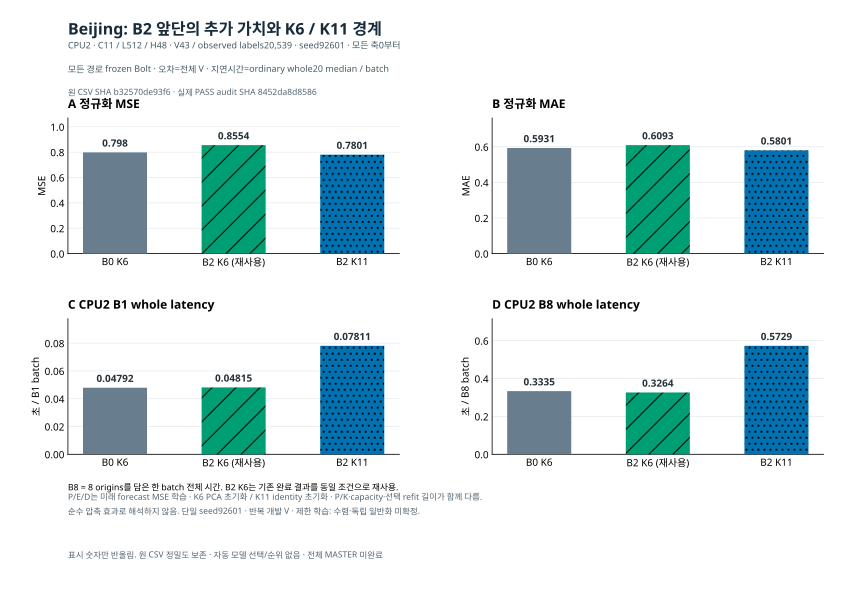
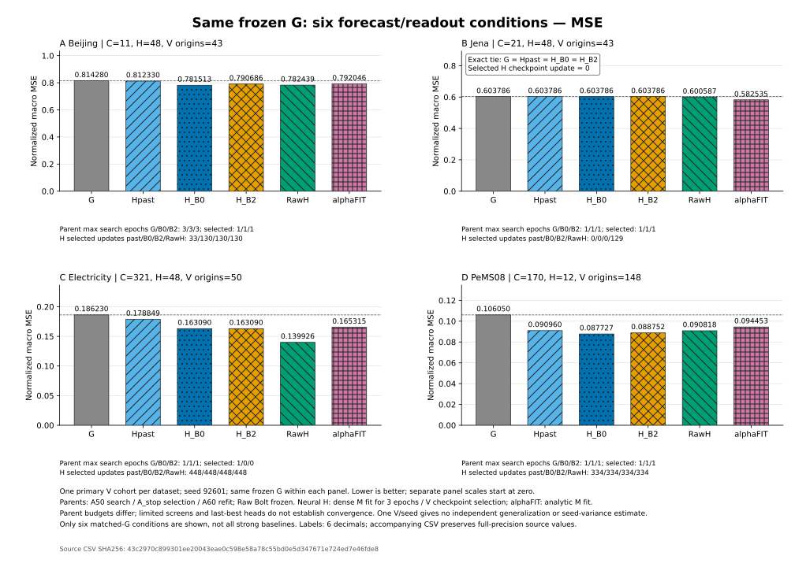
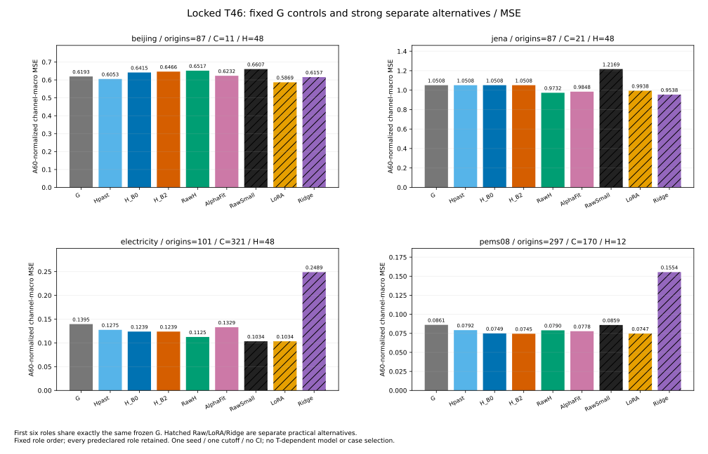

# 고정 TSFM의 다변량 적응 실험

**2026-10-17 남은 방법군 두 조건 완료:** [현재 판단·한계](priority_valid_family_20261016_v1/REMAINING_RESULT_STATUS_KO_v1.md) · [상세 MD](priority_valid_family_20261016_v1/REMAINING_FAMILY_KO_v1.md) · [원정밀도 CSV](priority_valid_family_20261016_v1/REMAINING_FAMILY_RESULTS_v1.csv) · [그림과 근거](priority_valid_family_20261016_v1/REMAINING_FAMILY_VISUALIZATION_KO_v1.md). Jena AdaPTS 저장소 port K6의 정규화 MSE0.736819는 기존 B2 0.683443보다 높았다. Beijing B4 K11은0.765187로 기존 B2 0.780057보다 소폭 낮았지만 B8 warm whole median은0.594887초로 B2 0.572880초보다 컸다. 자료 간 MSE 순위가 아닌 각 자료 안의 비교다. 신규2 fit·전체 V·별도 FP64·fresh CPU6·CPU2 B1/B8 비용4조건과 독립 검산·그림을 완료했다. 반복 개발 V·한 seed·제한 학습 및 구조 차이로 수렴·일반화·순수 구조 효과를 확정하지 않는다. **전체 MASTER는 미완료이며 주 후보 B2를 유지한다.** 다음 PeMS C32 Raw/G와 같은 조건의 B0/B2 비교는 아직 미입장이고 새 원격 게시 확인은 별도다.

과거 `parent_full_cpu`의 단일 PeMS V 충분통계는 [새 Git-history 원바이트 수동 복원 안내](publication_derivatives/git_history_v_stats_20261017_v1/README_KO.md)를 먼저 따른다. 이 파일에 한해 새 안내가 과거 서명 RESTORE_INDEX의 원공개경로 설명보다 우선한다. 과거 P2 감사 등 원 경로를 여는 소비자를 실행하기 전에 같은 원 경로로 복원해야 하며, 현재 새 N5의 canonical 입력이나 원 과학 문서는 바꾸지 않는다.

**2026-10-17 multi-K 부모 재개와 실제6출력 완료:** [판단·원수치·학습량·비용·그림](priority_multik_resume_20261016_v1/RESULT_STATUS_KO_v1.md). shared가 max-only prefix보다 K3/6/11 MSE가 낮았으나 fixed PCA보다 일관된 우위는 아니다. 두 refit/6fullV·FP64·CPU6/12CPU2비용을 검산했다. 주 B2 후보 대체·수렴·독립 일반화·전체 MASTER 완료를 주장하지 않는다.

**2026-10-17 Jena 방법군 비교 완료:** [현재 판단·원수치·새 비용과 그림](priority_valid_family_20261016_v1/RESULT_STATUS_KO_v1.md). LoRA MSE0.563923 / 기존 B2 0.683443 / B4 0.704353, B8 warm whole median1.142014 /0.327021 /0.346629초다. 같은 노출량에서 작은 K는 비용 이득과 정확도 격차를 함께 보였다. 신규2학습/전체 V·FP64·CPU6·4비용과 별도 B2 reference를 완료했다. 원 후처리·감사 실패 기록을 보존했고 반복 V·한 seed·수렴/독립 일반화 및 전체 MASTER 미완료를 구분한다.

**2026-10-17 Beijing 핵심 대조 완료:** [원수치·학습량·검산 보고](priority_valid_minima_20261016_v1/CORE_CONTRAST_KO_v1.md) · [그림과 근거](priority_valid_minima_20261016_v1/CORE_CONTRAST_VISUALIZATION_KO_v1.md). 같은 K6에서 B2 MSE0.855426은 B0 0.797966보다 높아 앞단의 추가 이득이 확인되지 않았다. B2 K11은0.780057로 낮았지만 B8 whole median은0.572880초로 K6 0.326401초보다 컸다. 새2 fit/fullV·독립 FP64·fresh CPU6·CPU2 네 비용/200trial 검산을 완료했고 기존 B2 K6는 정확한 조건으로 재사용했다. 단일seed·반복 V·P/K·초기화·용량/선택 학습량 차이가 있어 순수 압축효과·수렴·독립 일반화를 확정하지 않는다. **전체 MASTER는 미완료**다.

과거 재개 큐와 두 운송 메타데이터는 [원바이트 복원 안내](publication_derivatives/opaque_old_metadata_20261017_v1/README_RESTORE_KO_v1.md)를 따른다. 아래 준비·실행 중 문구는 각 작성 시점의 기록이다.

**최신 Beijing 최소 비교 완료:** [결과·원수치·학습 조건·독립 감사·그림](priority_valid_minima_20261016_v1/README_KO.md). 세 조건의 실제 전체 V43 추론·FP64 재채점·fresh CPU6·CPU2 B1/B8 비용을 완료했고, [nested PCA 비용 그림](priority_nested_cost_20261016_v1/VISUALIZATION_KO_v1.md)도 연결했다. 동일 개발 V와 한 seed에서 선택된 refit 길이가 다르므로 구조만의 효과·일반화·전체 MASTER 완료로 확대하지 않는다. 이전 P2 통계3개는 [exact 공개 복원](stats_packs/pack_numeric_priority_followup_20261016_v1/README_KO.md)을 먼저 수행한다. 아래 이전 snapshot의 준비/실행 중 표시는 당시 상태다.

**최신 우선 후속 완료:** [Jena 두 seed·PeMS08 같은 최종 표현의 no-Bolt 비교와 CPU 전체 비용](priority_core_followup_20261016_v1/README_KO.md). Jena B2의 B0 대비 MSE 감소는 두 seed에서 관찰됐으나 새 seed의 MAE 이득은 작았다. PeMS08은 부모와 head 모두 전체 V148을 CPU에서 평가했고, Bolt의 조건부 정확도 이득과 큰 비용을 함께 확인했다. 반복 개발 V·제한 학습 결과이며, 원 MASTER 전체 완료나 Ridge/G/LoRA 대비 우위는 아니다. 후순위 nested PCA 비용과 Beijing 최소3조건은 이 보고 시점에 준비만 완료했다. 아래는 과거 snapshot을 보존한다.

**2026-10-16 우선순위 변경 후 실제 Jena 핵심 검증:** [B2·동일 표현 no-Bolt·별도 학습 no-Bolt·Raw/Ridge/G/PCA/LoRA의 정확도·CPU 비용](priority_b2_validation_20261016_v1/README_KO.md). 기존 scheduler와 실제 학습2개를 중단하고 checkpoint10개를 보존했다. 새 직접 대조2개는 학습·전체 V·독립 재채점·CPU 재추론·비용까지 완료했다. B2는 B0·직접 대조보다 나았으나 ridge/G/LoRA 대비 전체 우위는 미확보다. PeMS08·추가 seed는 후속이며 기존 전체 큐는 자동 재개하지 않는다. 아래의 과거 진행 기록은 작성 시점 snapshot이다.

**추가 저장-V 진단:** [full-C PCA 가역성·6방법 재채점·270행 분해·그림](diagnostics/fullC_fixed_basis_diagnostic_20261016_v1/RESULTS_KO.md). 차원 축소가 없는 K=C에서도 Raw 대비 MSE 감소·MAE 증가가 함께 나타나 압축 손실과 좌표/예측 경로를 구분한다. 새 학습 완료나 TSFM 단독 원인 입증은 아니다.

[최신 core56 대응·진행 중15fit의 실제 포함 범위·잔여 exact ID](diagnostics/postT_core56_scope_20261016_v1/README_KO.md).

**후속 CPU 부분 결과 갱신:** [Jena4조건의 전체 V·독립 재채점·같은 CPU 비용·Raw 분할 진단](postT_V_only_cpu_lag_20261016_v1/RESULTS_WITH_COST_KO.md), [고정 PCA6조건의 V·CPU 비용](postT_V_only_cpu_fixed_pca_20261016_v1/RESULTS_WITH_COST_KO.md). Jena 네 조건은 전체 V43 FP64 재채점과 fresh CPU6 checkpoint replay를 통과했다. PCA6도 각각 전체 V·FP64·CPU6 replay가 완료됐고, 전체 비용 산술 감사24영수증/1200trial이 통과했다. Raw 비용 B1/B8은 원 row-parity guard 실패이며 숫자를 대신 넣지 않았다. 시간 혼합이 B0보다 나았지만 ridge/G 대비 추가 가치는 확보하지 못했다. 아래 원471행의 수치와 기존 검색 보고서는 역사적 snapshot으로 보존한다.

[Beijing 다중 K](postT_V_only_cpu_multik_20261016_v1/README_PREPARATION_KO.md)의 fixed nested3은 전체 V·독립 재채점·fresh CPU6 replay를 완료했다. 공유/max-K·독립 적합과 Beijing 시간/지연·Jena/B4/LoRA/표준 포트를 포함한 새15 fit·총22 V 산출물의 실행 큐는 최신 지시에 따라 중단됐다(실제 실행2개·미시작13개). probe12개 통과와 실제15개 학습 완료를 구분하며, 새 학습 전체의 비용은 아직 측정하지 않았다. 원 신경망 최소56조건의 any-device 대응은 현재19개/미충족37개이며 GPU-only8개와 구분한다. 후속 검산 PASS를 수렴·방법론 우위·독립 일반화나 원 계획 전체 완료로 해석하지 않는다.

**PARTIAL — 실행 결과 부분 공개·필수 학습 미완료.** 고정 Chronos-Bolt의 stream 수를 C에서 K로 줄일 때 시간 처리·채널 압축·예측 결합·지연·가변 K가 예측과 전체 비용에 무엇을 추가하는지 강한 native/Raw/LoRA 대안과 비교했다. 일부 결합 이득은 관찰됐지만 Beijing T에는 V의 개선이 유지되지 않았고 PeMS H_B2–LoRA T MSE 차이는약0.23%로 작다. 일반적 우월성·TSFM 유지의 필수성은 확정하지 못했다.

- [상세 결과·방법·다섯 축 판정](REPORT_KO.md) · [교수님 상담 핵심](PROFESSOR_BRIEF.md)
- [점수](SCORES.csv) · [비용](COST.csv) · [실행 범위](RUN_INDEX.csv) · [검산](AUDIT_REPORT.json) · [주장과 증거12행](CLAIM_EVIDENCE.csv)
- [최종 실제 그림 색인](PUBLIC_FIGURES_KO.md) · [재현/복원](REPRODUCE.md) · [미완료/재개 경계](RESUME.md)
- [후속 실제 집계·포장 감사](FINAL_POSTPROCESS_AUDIT.json) · [원바이트 복원 색인](RESTORE_INDEX_KO.md) — 원 AUDIT_REPORT의 당시 pending snapshot과 후속 완료를 구분한다.
- [최종 report snapshot](publication_derivatives/gzip_extra_aux_20261016_v1/files/item_2072.json.gz)
- [원 whole 감사](publication_derivatives/gzip_extra_aux_20261016_v1/files/item_0583.json.gz) · [제공 public entry 감사](publication_derivatives/gzip_extra_aux_20261016_v1/files/item_0592.json.gz)
- [core 비용 원trial 감사](publication_derivatives/gzip_extra_aux_20261016_v1/files/item_0290.json.gz) · [K20 비용 감사](publication_derivatives/gzip_extra_aux_20261016_v1/files/item_0505.json.gz)
- [T46 영수증](publication_derivatives/gzip_extra_aux_20261016_v1/files/item_0698.json.gz) · [선택 잠금](SELECTION_LOCK.json) · [E0 B55 개발검산](publication_derivatives/gzip_extra_aux_20261016_v1/files/item_0780.json.gz)
- [보호 경계 위반·복구](publication_derivatives/final_md_20261016_v2/docs/doc_0019.md)
- [실제52쌍 보조표](publication_derivatives/gzip_extra_aux_20261016_v2/files/item_0012.json.gz) · [사후 기술 해석](publication_derivatives/final_md_20261016_v2/docs/doc_0065.md)

실제 점수451행=V405+T46, 표준 배열499=V405+T46+M48, 공개 충분통계451와 legacy B55를 errors0로 검산했다. 선택 replay50(41fresh+9reuse)은 고유 replay70과 겹친다. core72는60실측/12실패, K전환20scope/3600trial은 완료다. fresh deep-G Hpast8은 미측정이고 Beijing 심화 LoRA 비용은 예산 admission을 통과하지 않아 숫자가 없다. GPU 누적43030.3865/43200초다. 실제 v3 그림은 V405/71stem·T46/52stem이며34/24CSV를 v2와 동일하게 유지했다. 원 T matched PENDING과 별도52쌍 사후 분해(원14와 독립합산0)를 구분한다. 모든 그림의 가독성 완료를 주장하지 않으며 [학습 보완9stem/18이미지](publication_derivatives/gzip_extra_aux_20261016_v2/files/item_0000.json.gz)와 최종 그림 색인은 실제 생성됐다. Beijing V 범례 분리를 실제 확인했고 전그림 시각검토 완료로 확대하지 않는다. 비용74행 전사 대사는 PASS, [aux2995 원바이트 전수·독립·반복 복원](publication_derivatives/gzip_extra_aux_20261016_v1/BUILD_RESULT.json)과 [추가77 복원](publication_derivatives/gzip_extra_aux_20261016_v2/BUILD_RESULT.json)도 PASS다. 두 묶음3072원파일36,797,468B→물리9,893,189B이고 최종 전체 게시 검증과 구분한다.

등록471행의 nonCOMPLETE192, neural56의 GPU3epoch 완료8/CPU fresh별도9, 전체 K32/40, E0 full28중 endpoint미완료19는 그대로 남는다. audit PASS·T46·K20 완료가 필수 학습을 채우지 않는다. 한 seed·한 T cutoff·미수렴/CP0와 지표 상충 때문에 보편 효과나 독립 일반화로 확대하지 않는다. 재개 참조439개는 미완료192와 이미 완료된 reference247의 합이며 미완료 수가 아니다.

실행 부분 완료 / 필수 학습 미완료 / 사용 가능한 수치 검산 PASS / 일반적 기여 미확정 / 원격 게시 여부는 이 문서를 포함한 Git 커밋으로 확인한다. 원 데이터·NPZ·weights·개인 경로는 공개하지 않고 집계 행·정밀도는 무손실 복원한다. 이 문서는 부분 공개 범위를 설명한다. 이 보고서 조립시점(게시전검사)에는 이번 산출물의 추가 commit/push가 미실행이었다. 최종 그림·상대 링크·원형 복원·용량·원격 main 확인은 게시 영수증을 따른다. 검증 전 remote SHA를 적거나 게시 완료로 표시하지 않는다.
