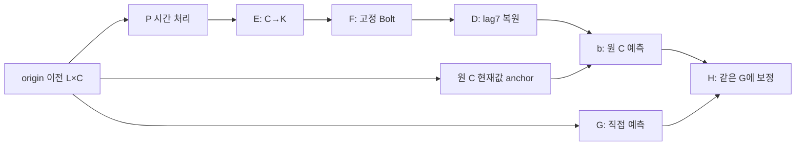

# 고정 TSFM의 압축·시간 처리·예측 결합 검증

**2026-10-16 우선순위 변경 후 실제 Jena 핵심 검증:** [B2·동일 표현 no-Bolt·별도 학습 no-Bolt·Raw/Ridge/G/PCA/LoRA의 정확도·CPU 비용](priority_b2_validation_20261016_v1/README_KO.md). 기존 scheduler와 실제 학습2개를 중단하고 checkpoint10개를 보존했다. 새 직접 대조2개는 학습·전체 V·독립 재채점·CPU 재추론·비용까지 완료했다. B2는 B0·직접 대조보다 나았으나 ridge/G/LoRA 대비 전체 우위는 미확보다. PeMS08·추가 seed는 후속이며 기존 전체 큐는 자동 재개하지 않는다. 아래의 과거 진행 기록은 작성 시점 snapshot이다.

**PARTIAL — 2026-10-16 07:58 KST 반영.** 공식 T46, E0 B55, 저장 예측·충분통계 감사, core/K 비용 검산과 실제 그림·52쌍 보조표를 묶은 부분 공개 범위다. 필수 학습 최소와 전체 연구는 미완료다. 이 보고서 조립시점(게시전검사)에는 이번 산출물의 추가 commit/push를 실행하지 않았다. 최종 게시·원형 복원·링크·용량 검증은 별도 영수증으로 확인한다.

현재 확인된 핵심은 **V에서 관찰한 결합 이득이 모든 잠금 후 T 구간에 유지되지는 않았고, PeMS의 압축-H 이득도 강한 LoRA와의 차이가 작다**는 것이다. 같은 G 대조에서 Beijing T의 H_B0/H_B2는 G보다 나빴고, PeMS에서는 H_B2가 유리했다. 시간 처리 B2의 일반적 필요성과 강한 대안 대비 전체 정확도–비용 이점은 아직 입증되지 않았다. 표현·잠재 예측·디코더 중 한 단계가 유일한 원인이라고 확정할 근거도 없다. 학습량과 checkpoint 선택의 미해결 상태가 함께 남아 있다.

최종 원수치는 [SCORES.csv](SCORES.csv), 비용은 [COST.csv](COST.csv), 실행 범위는 [RUN_INDEX.csv](RUN_INDEX.csv), 검산은 [AUDIT_REPORT.json](AUDIT_REPORT.json), [후속 실제 집계·포장 감사](FINAL_POSTPROCESS_AUDIT.json)와 [CLAIM_EVIDENCE.csv](CLAIM_EVIDENCE.csv), 복원은 [원바이트 복원 색인](RESTORE_INDEX_KO.md), 재개는 [RESUME.md](RESUME.md), 그림은 [PUBLIC_FIGURES_KO.md](PUBLIC_FIGURES_KO.md)로 연결한다. 실제 원수치 snapshot은 [최종 보고 manifest](publication_derivatives/gzip_extra_aux_20261016_v1/files/item_2072.json.gz)에 봉인돼 있다. 최종 게시 검증에서 canonical 경로 대사를 확인한다.

## 1. 무엇을 해결하려는 연구인가

TSFM은 여러 시계열에서 사전학습한 예측 규칙을 새 시계열에 활용하는 모델이다. 이번 F는 고정 Chronos-Bolt이며 각 stream을 단변량 시계열로 처리한다. 원 C채널을 각각 F에 넣는 Raw 대신, 허용된 과거에서 만든 K개 잠재 시계열을 예측하고 원 C채널로 복원할 때 실제로 유용한 정확도–비용 조건이 있는지가 질문이다.

PCA 분산 보존이나 입력 재구성만으로 미래 예측 적합성이 보장되지는 않는다. 현재 비교는 예측 손실로 P/E/D와 H를 학습하므로, 현재 결과 전체를 “재구성 목적을 썼기 때문에 실패했다”로 설명하는 것도 맞지 않는다. 현재값 anchor, 고정 F에 대한 좌표 호환성, 학습량, 잠재 미래 예측과 decoder의 역할을 나누어 판단한다. TSFM이 모든 native 대안보다 유리하다는 가정을 두지 않는다.

이번 캠페인의 원리는 시간 처리, 채널 압축, 예측 결합, 지연 압축, 가변 K다. TS2Vec·GTConvAE·ExoTiMER 전체 재현을 이번 비교의 완료 항목으로 추가하지 않는다. 과거 별도 캠페인의 실험은 정보·자산·손실·선택 조건이 정확히 같을 때만 재사용한다.

## 2. 방법과 학습되는 부분



B0는 P가 항등인 예측용 adapter다. E와 7시차 D는 학습 가능하고 PCA center는 고정 buffer다. B2는 시간·채널 residual mixing, B4는 다중 해상도 성분 혼합의 작은 원리 포트다. F의 가중치는 고정하지만 P/E 학습에는 F 입력 gradient와 activation이 필요하다. 따라서 외부 adapter가 역전파 메모리를 없애는 것은 아니다. 고정 PCA 경로는 optimizer 없는 중심화 투영·역변환이며, B0의 anchor·학습 decoder와 다른 대조다.

정규화 과거를 x, P/E 출력과 F 예측을 z와 f라 두면 실제 D는 z와 f를 이어 만든 7시차 잠재 변화량을 원 채널 현재값에 더한다. 시차 집합은 {0,1,2,4,8,16,32}다. 시간 앞단은 supplied past window 전체를 사용할 수 있어 B2/B4를 창 내부 prefix-causal 표현이라고 부르지 않는다.

직접 G는 channel-shared 과거→미래 innovation을 현재값에 더한다. 전역 결합은 `g + α(b−g)`이고 α=0,0.5,1과 M_cal 적합 계수를 비교한다. 조건부 H는 과거·g·b−g를 입력받아 G에 보정값을 더한다. Hpast는 같은 폭·용량에서 마지막 항을 기존 최근 과거 특징으로 바꾼 대조다. RawH는 같은 G/H에 원 C의 RawSmall 예측을 넣는다. 결합 학습 때 부모 예측을 캐시했다고 배포 F 비용을 0으로 세지 않는다.

지연 압축은 고정 lag의 선형 채널 혼합이다. causal7과 supplied past 안의 bidirectional7을 비교하며, directed graph 학습이나 인과 식별은 수행한 것으로 쓰지 않는다. 가변 K는 단일 E/D의 prefix 공동학습, 최대 K 모델 사후 절단, 독립 K 모델, nested PCA를 비교한다. 실제 호출 stream 수와 checkpoint 저장량·전환 비용을 별도로 기록한다.

구체적인 구현·이식 범위는 [방법 안내](publication_derivatives/final_md_20261016_v2/docs/doc_0004.md), [모델 규약](MODEL_IMPLEMENTATION_KO.md), [문헌 매핑](LITERATURE_MAPPING.md)을 따른다. 표준 혼합·LoRA·ordered prefix를 사용했다는 사실만으로 신규성을 주장하지 않는다.

F에서 사용하는 출력은 quantile0.5다. 그 값과 원 C의 MSE 목적이 자동으로 최적 정렬된다고 가정하지 않으며 D/H 이후의 원공간 출력을 원 확률분포의 median이라고 해석하지 않는다. 이 목적·좌표 호환성은 가능한 설명이지만 이번 수치만으로 원인으로 확정한 것은 아니다.

## 3. 정보 계약과 공정 비교

main4는 Beijing C11, Jena C21, Electricity C321, PeMS08 C170이다. 모든 입력은 origin 이전 512행이며 H는 앞 세 자료48, PeMS12다. 관측 간격은 Beijing/Electricity1시간, Jena10분, PeMS5분이다. 같은 512행과 같은 lag 숫자가 같은 물리 시간을 뜻하지 않는다. PeMS는 공식 NPZ에 실제 timestamp가 없어 elapsed index를 사용하며 1970 달력으로 설명하지 않는다. Robin은 짧은 보조 stress, M5는 접근·라이선스 차단이다.

시간 구간은 A_fit/A_stop/M_cal/V_select/T를 50/10/10/10/20으로 분리한다. 부모는 A_fit에서 search하고 A_stop으로 epoch를 고른 뒤 A60의 새 scaler/PCA/model로 fresh refit한다. M_cal은 고정 부모의 결합 학습에, V는 결합·최종 선택에 쓴다. 표준화 평균·표준편차는 허용 A 범위에만 적합하고, 창 결측은 창 시작 A 평균에서 과거 방향으로 채운다. T로 손실·K·epoch·방법을 다시 고르지 않는다.

주지표는 A60 정규화 target의 observed channel-macro MSE다. 채널별 관측 오차를 먼저 집계하고 유효 채널을 균등 평균한다. MAE와 원단위 보조지표도 보존하지만 주지표를 결과에 맞춰 바꾸지 않는다. MSE가 MAE보다 작은 값인 것은 제곱 오차와 절댓값 오차의 단위·크기가 다르기 때문에 가능하며, 그 관계만으로 계산 오류라고 판단하지 않는다. 자료 간 MSE를 평균해 전체 순위를 만들지 않는다.

같은 G/H 비교에서는 동일 자료·cohort·정규화·G artifact·seed·lr·head 용량과 학습 recipe를 고정했다. B0/B2의 E/D는 같은 클래스와 설정이지만 별도로 학습한 가중치다. A+M G/LoRA는 M까지 직접 학습한 강한 실용 대안이며, H와 노출·목적·최적화가 완전히 같은 통제 실험은 아니다. Ridge는 closed form이고 Raw는 optimizer가 없어 epoch 숫자로 동일 학습량을 주장하지 않는다.

## 4. 같은 G를 고정한 V 원수치

아래는 현재 저장 예측에서 독립 검산된 정규화 MSE다. 본문 표시만 소수9자리이며 정확한 원수치·ID·mask coverage는 [그림 원수치 CSV](publication_derivatives/gzip_extra_aux_20261016_v1/files/item_0301.csv.gz)에 있다. 새 모델을 실행해 만든 그림 수치가 아니다.

```text
Dataset       G           Hpast       H_B0        H_B2        RawH        AlphaFit
Beijing     0.814280395 0.812330290 0.781513471 0.790686260 0.782439323 0.792045666
Jena        0.603786477 0.603786477 0.603786477 0.603786477 0.600587380 0.582534731
Electricity 0.186229730 0.178848974 0.163089911 0.163089911 0.139925688 0.165315326
PeMS08      0.106050440 0.090959603 0.087727488 0.088752255 0.090817562 0.094452774
```

V origins/H/C는 Beijing43/48/11, Jena43/48/21, Electricity50/48/321, PeMS148/12/170이다. observed scalar target 수는 각각20,539·43,344·770,400·301,920이다. 이는 같은 G 비교의 cohort이며 자료별 표본수·시간 간격은 다르다.


[같은 G 원수치](publication_derivatives/gzip_extra_aux_20261016_v1/files/item_0301.csv.gz) · [실제 시각검토](publication_derivatives/gzip_extra_aux_20261016_v1/files/item_0302.json.gz) · [전체 그림 안내](PUBLIC_FIGURES_KO.md)


이 v2 렌더는 제목 겹침만 수정했고 generator source `502ce41b…` 및 실제 원수치의 동일성을 기록했다. 이전 렌더는 보존했다. 렌더 수정은 새로운 학습·추론·성능 개선이 아니다.

H_B2−H_B0 MSE는 Beijing +0.009172789, Jena0, Electricity0, PeMS +0.001024767이다. 현재 같은 G/H 비교에서 시간 B2가 주 MSE를 추가로 줄였다는 근거는 없다. PeMS MAE는 H_B2 0.186496346463, H_B0 0.187191613465로 반대 순서여서 지표 상충도 남긴다.

Beijing/Electricity/PeMS에서는 H_B2가 G와 Hpast보다 낮다. RawH는 H_B2보다 Beijing/Jena/Electricity에서 낮고 PeMS에서 높다. Jena는 단순 AlphaFit이 H 세 조건보다 낮다. 따라서 추가 예측 활용의 관찰과 시간 처리·압축의 필수성은 별도 판단이다.

Jena H_B0/H_B2/Hpast는 selected update0이고 G와 같은 출력이다. 부모 B2의 V MSE0.686401862는 B0 0.803309276보다 낮았지만 선택된 H에는 그 이득이 이어지지 않았다. Electricity B0/B2 부모는 selected epoch0·동일 출력이다. 이런 조건을 충분히 학습된 시간 표현의 구조적 한계로 확정하지 않는다.

## 5. 강한 실제 대안이 남기는 반례

```text
Reference             Beijing      Jena         Electricity  PeMS08
RawSmall              0.796878654 0.849194139 0.126620800 0.095354933
RawTiny               0.823919110 1.322755154 0.140791952 0.094063095
Ridge_A60             0.831541637 0.556646336 0.319373219 0.228995943
A-only LoRA           0.735095062 0.626266015 0.126620800 0.084724874
A+M LoRA025           0.731697680 0.599126121 0.124233516 0.083260132
A+M G3                0.798770967 0.597991469 0.172580876 0.092961254
```

정확한 조건과 원수치는 [강한 대조군 전체 CSV gzip](publication_derivatives/gzip_aux95_1792094747124151400/files/item_0094.csv.gz)와 [원본 복원 manifest](publication_derivatives/gzip_aux95_1792094747124151400/GZIP_MANIFEST.json)에 남긴다. 이 표의 각 recipe·학습 구간·선택 epoch 차이를 함께 읽어야 한다.

Beijing·PeMS의 LoRA는 H_B0/H_B2보다 주 MSE가 낮다. Jena ridge는 AlphaFit과 H보다 낮다. Electricity RawSmall은 모든 H보다 낮고 A+M LoRA도 강하다. 반면 PeMS의 압축-H는 같은 G의 RawH보다 MSE가 낮았다. 약한 G 하나를 이긴 사실만으로 TSFM 압축 방식이 가장 좋은 선택이라고 말할 수 없다.

Beijing full C bidirectional lag의 V MSE0.712109361은 강한 반례지만 무압축 조건이다. 이것을 K 축소의 성과로 쓰지 않는다. AdaPTS는 Bolt 호환 deterministic affine 원리 포트이며 원 논문 전체 재현이 아니다. Beijing3 시도 MSE0.833820258과 다른 자료0.25 screen을 구분한다.

## 6. 잠금 후 T46의 관찰: V 결론을 그대로 일반화하지 않는다

[공식 T46 완료 영수증](publication_derivatives/gzip_extra_aux_20261016_v1/files/item_0698.json.gz)은46개 모두 실제 추론 성공·실패0·보류0다. selection lock SHA `c3493746…a51f1`의 허용 ID46과 일치하고, T를 본 뒤 모델·K·epoch·방법을 바꾸지 않았다. 아래는 그46개 공식 manifest.score에서 읽은 A60 정규화 observed channel-macro MSE다. 표시만 소수9자리이며 이 초안에서 scorer나 모델을 재실행하지 않았다. **최종 whole postfinal 독립 FP64 재채점과 global SCORES 대사는 완료**됐다. 원수치 snapshot은451행(V405+T46), 입력 이슈0이며 저장 예측 표준499개(V405+T46+M48)와 공개 충분통계451개를 통과했다. 이는 저장값 검산이며 다른 시간·seed의 독립 일반화 검증이 아니다.

```text
Method       Beijing       Jena          Electricity   PeMS08
G            0.619307628 1.050767676 0.139538995 0.086125172
Hpast        0.605322500 1.050767676 0.127488153 0.079192146
H_B0         0.641482814 1.050767676 0.123855665 0.074898935
H_B2         0.646642153 1.050767676 0.123855665 0.074509947
RawH         0.651693207 0.973154114 0.112536529 0.078953837
AlphaFit     0.623247325 0.984842518 0.132947382 0.077798787
RawSmall     0.660687294 1.216879207 0.103405412 0.085931006
LoRA         0.586897832 0.993818351 0.103405412 0.074682225
Ridge        0.615655395 0.953763201 0.248944713 0.155396196
```


이 compact 그림은 선택 T46 안의 고정9역할×4자료=36행이며 [전수 원수치](publication_derivatives/gzip_extra_aux_20261016_v2/files/item_0002.csv.gz)와 [실제 시각검토](diagnostics/postfinal_T_comparison_figures_20261016_v1/snapshot_1792103119089196800/ROOT_VISUAL_REVIEW.json)를 보존한다. 그림에서 보이지 않는 나머지10개 T 조건도 공식46행에서 유지했다.

T origins/H/C는 Beijing87/48/11, Jena87/48/21, Electricity101/48/321, PeMS297/12/170이며 observed scalar 수는45,439·87,694·1,556,208·605,880이다. 같은 자료의 이 표 조건들은 cohort·mask·scaler를 공유한다. G artifact identity를 고정한 범위는 G·Hpast·H_B0·H_B2·RawH·AlphaFit 하위집합이다. 별도 RawSmall·LoRA·Ridge에는 이 G 부모가 없으며 동일 G 대조라고 부르지 않는다. 이 수치는 선택46 안의 결과이며 미실행 조건 전체의 순위가 아니다. V와 T는 서로 다른 시간 구간이므로 점수 크기를 단순히 빼서 모델 개선으로 해석하지 않는다.

Beijing에서는 H_B0 0.641482813755와 H_B2 0.646642153406가 G 0.619307627626보다 나빴다. Hpast 0.605322500227는 G보다 낮고 LoRA 0.586897832490가 이 표의 가장 낮은 MSE다. V에서 H가 G보다 좋았다는 관찰을 이 T 구간의 보편 결론으로 유지할 수 없다.

Jena에서는 ridge 0.953763201003, RawH 0.973154114097, AlphaFit 0.984842518363가 G/H_B0/H_B2/Hpast 1.050767676291보다 낮았다. H의 초기0 update 선택·부모 표현과 head 이용의 차이는 유지되며, 이 결과만으로 표현 자체가 미래 정보를 잃었다고 확정하지 않는다. Electricity에서는 RawSmall 0.103405411816와 CP0 LoRA 0.103405411581가 H_B0/H_B2 0.123855665141, RawH 0.112536529174보다 낮다. Raw와 CP0 LoRA의 극미한 수치차를 학습 이득으로 해석하지 않는다.

PeMS에서는 H_B2 0.074509946574가 H_B0 0.074898935015, RawH 0.078953836604, Hpast 0.079192145752, G 0.086125172137보다 낮았다. LoRA 0.074682225122와의 절대 차이는약0.000172279(LoRA 대비약0.23%)다. MAE도 H_B2 0.178224358944, LoRA 0.179436801286이다. 그러나 V의 H_B0 우위와 T의 H_B2 우위는 순서가 바뀌었고, 한 seed·한 시간 cutoff·CI 없는 관찰이다. 유의한 우월성·보편적 시간 처리 효과·실용 전체 비용 이득으로 확대하지 않는다.

선택된 E3 T MSE는 Beijing bidirectional quarter 0.731554837762, PeMS bidirectional quarter 0.093713353129다. E4 shared quarter와 독립 B0의 T는 Beijing 0.806106197357/0.807057829921, Electricity 0.196677302827/0.196677329629였다. E3/E4의 학습 노출·초기 선택·F stream 수 차이와 누락된 심화 조건이 남아 있어 이 작은 차이를 공정한 학습된 순서화·지연 효과로 판정하지 않는다. 해당 경로의 기능·검산과 연구 기여 판단을 구분한다.

T46이 실행됐다는 사실은 기존 strict 필수 학습 커버리지의 부족을 없애지 않는다. 잠금 자체도 `mandatory_coverage_complete=false`를 유지한다. T는 결과 보고에만 사용하고 사후 개선 선택에 되먹이지 않는다.


원단위 보조 평가는 [physical manifest](publication_derivatives/gzip_extra_aux_20261016_v1/files/item_0574.json.gz)의 T46·채널6075행·제외0 범위에서 완료됐다. 원 Task 열기·A60 재적합·추론/학습은0이며 주 정규화 MSE 선택은 바뀌지 않았다. PeMS의5분 flow count에서 H_B2의 native MAE16.6638553/RMSE25.9238125, LoRA16.9466958/26.6465838이었다. 서로 다른 물리 단위의 채널을 한 원단위 오차로 비교하거나 자료 간 평균으로 섞지 않는다.

고정 A_fit 패턴의 [T 그룹 평가](publication_derivatives/gzip_extra_aux_20261016_v1/files/item_0998.json.gz)는46예측·552그룹·168paired행이며 빈 그룹도 보존했다. [시간 블록 평가](publication_derivatives/gzip_extra_aux_20261016_v1/files/item_0691.json.gz)는46예측·14쌍·878블록이고 CI/유의성 검정은 하지 않았다. 기존 API는 부모/anchor 표현이 다른 G 대비 H·Hpast·Alpha·RawH 쌍 일부를 자동 제외했다. 추가 route_spec 연결로 수행한 아래52쌍을 원14쌍과 독립 표본으로 합산하지 않는다. 그룹·블록 분석은 같은 T의 서술 분석이며 새로운 독립 평가가 아니다.

### 6.1. 잠금된 역할의 52쌍 보고용 분해

[실제52쌍 결과](publication_derivatives/gzip_extra_aux_20261016_v2/files/item_0012.json.gz)는 verified52/failures0이며 전체52행·시간 block2990행·horizon156행·패턴624행·recipe32행을 보존했다. 방법·역할·checkpoint는 T 이전 선택 잠금에 고정됐지만, **52쌍 연결 명세는 T 관찰 뒤 보고 작업에서 정했다.** T 순위로 쌍을 빼거나 바꾸거나 새 모델을 선택하지 않았다. 공개 SSE/SAE/count와 target/mask/channel/origin descriptor·관측 수를 대사했으며 이 단계에서 원 target/NPZ/model을 다시 열거나 독립 재채점하지 않았다.

같은 G의 추가 효과와 대조는 [전체차이](publication_derivatives/gzip_extra_aux_20261016_v2/files/item_0009.csv.gz), [고정시간 block](publication_derivatives/gzip_extra_aux_20261016_v2/files/item_0014.csv.gz), [horizon](publication_derivatives/gzip_extra_aux_20261016_v2/files/item_0007.csv.gz), [A-only패턴](publication_derivatives/gzip_extra_aux_20261016_v2/files/item_0011.csv.gz), [학습·선택 recipe](publication_derivatives/gzip_extra_aux_20261016_v2/files/item_0013.csv.gz)로 연결한다. 동일 head 용량/LR/요청 예산과 동일 selected update는 다르며 Hpast에는 b route가 없다. AlphaFit은 closed-form, LoRA는 별도의 강한 대조다.

Beijing H_B2−G MSE는 +0.02733452577990416, H_B2−Hpast는 +0.04131965317873799다. Jena H_B0/H_B2/Hpast는 실제3epoch386update 후 CP0가 선택돼 G와 지표가 같았다. Electricity H_B2−G는 −0.015683330228900023이지만 H_B2−H_B0는0이고 H_B2−LoRA는 +0.02045025356032722다. PeMS H_B2−G는 −0.011615225562638321, H_B2−Hpast는 −0.0046821991780111585, H_B2−AlphaFit은 −0.0032888407981464802다.

PeMS H_B2−LoRA 전체 MSE는 −0.000172278547753804지만13개 시간 block 중5개는 낮고8개는 높다. 가까움 +0.0012387292125922902·중간 +0.0003473128213435231·먼구간 −0.0011375781124755154로 방향도 갈린다. 관측8개 패턴그룹 역시4:4다. H_B2−H_B0의 A-only delayed-crosschannel high/low 차이는 각각 −0.0008978265423762329/+0.00011984966072201445로 사후 가설과 일관된 관찰이 있으나 인과적 지연 효과·graph 필요성·일반화를 증명하지 않는다. [전52쌍 기술요약](publication_derivatives/gzip_extra_aux_20261016_v2/files/item_0006.csv.gz)과 [한계 해석](publication_derivatives/final_md_20261016_v2/docs/doc_0065.md)에 시간·패턴·지표 상충을 남겼다. block/그룹을 독립 표본으로 세거나 평균해 전체 macro를 대체하지 않았다.


## 7. 다섯 과학적 판정

1. **시간 P — 보류.** V의 같은 G/H MSE에서 B2 추가 개선은 없었고, T에서는 PeMS에서 H_B2가 H_B0보다 낮았으나 Beijing은 반대였다. 일부 부모 CP0와 Jena H0도 유지된다. 시간 구간에 따라 순서가 달라 현재 recipe의 P 필수성을 지지하는 일반적 근거는 부족하다. 충분 학습·순수 고정 E/D 효과까지 끝난 구조적 기각은 아니다.
2. **압축 예산 — 조건부.** 우선 B0/B2 K 최소28조건 V는 채웠다. PeMS 같은 G에서 압축-H가 RawH보다 낮은 사례가 있다. V에서는 LoRA가 H_B0/H_B2보다 강했으나, 잠금 후 T의 PeMS에서는 H_B2가 LoRA보다 MSE 약0.000172279 낮아 순서가 바뀌었다. 전체 비용 우위는 아직 확인되지 않았다. K=C에서도 F는 투영 좌표에 불변인 모델이 아니며 PCA와 anchored D 차이도 있어 정보 손실 하나로 설명하지 않는다.
3. **결합 보완성 — 조건부 유지.** 같은 G와 Hpast를 둔 비교에서 추가 예측이 유용한 V 조건과 PeMS T가 있으나 Beijing T에서는 H_B0/H_B2가 G보다 나빴다. Jena의 단순 혼합과 강한 native/LoRA 반례도 유지한다. 표준 ensemble 자체의 신규성을 주장하지 않는다.
4. **지연 일관성 — 보류.** Beijing/PeMS의 causal/bidirectional×quarter/half/C12 초기조건을 실행했다. 일부 양방향/fullC가 낮았지만 K·학습량·F 비용과 구분해야 한다. directed lagged graph와 인과성을 입증한 실험은 아니다.
5. **가변 K — 기능 확인, 실용성 보류.** 실제 prefix 출력과 K 전환의 일부 조건은 검증됐다. 모든 K에서 shared가 독립/nested PCA보다 좋지 않다. Beijing shared/max 새3epoch artifact는 budget으로 완성되지 않았고 Electricity는 초기 선택이다. 전체20 scope의3600 trial 비용 프로토콜과 원수치 검산은 완료됐다. 이 기능·측정 완료를 학습된 순서화 이득이나 전체 필수 학습 완료로 해석하지 않는다.

현재 제시할 수 있는 결과는 고정 단변량 F를 둘러싼 통제 비교와 실패 경계의 실증적 정리다. 학술적 신규성·최고 성능·보편적 정확도–비용 우월성은 미확정이다.

## 8. 학습·커버리지의 실제 한계

등록471행과 V405가 있다는 사실은 필수 학습 완료를 뜻하지 않는다. 최신 strict 장부는 E1 neural 최소56조건 중 GPU3epoch 검색 완료8개, CPU fresh9개를 별도 장치 조건으로 포함해도17개로 보고한다. GPU 기준48조건의3epoch가 남았다. 선택 refit epoch와 최대 search epoch는 다르며 3epoch 검색 완료도 수렴 증명이 아니다.

B0/B2 우선 K 최소는28/28 V, 등록 전체 K는32/40 V다. B4 quarter/C8/8, E3 우선12/12 V, secondary Beijing/Jena12개는 존재한다. 전체3seed, Electricity/PeMS secondary, 채널 subset, 모든 K, 장기 endpoint와 여러 심화 조건은 남았다. seed92602의 옛 E0를 이번 신규 캠페인의 반복 seed로 세지 않는다. Robin stress와 M5 차단을 주4자료의 성공/실패로 합치지 않는다.

옛 E0 원12는4800 endpoint 완료9·부분4291/4800 한 개·미시작2이며 추가 controls16은 미시작이다. 전체28은 완료9·부분1·미시작18이며4800endpoint 미완료19다. 9개도 수렴 완료가 아니다. 이후의 실제 B55 추론·scorer 확인은 학습 endpoint 추가가 아닌 별도 검산이다. [공식 E0 평가 registry](publication_derivatives/gzip_extra_aux_20261016_v1/files/item_0780.json.gz) SHA `b67252ae…3181`은9개 legacy ID의55 checkpoint를 실제 재추론·독립 재채점했고55개 모두 원 B curve와 MATCH(atol1e-7/rtol0)했다. 실제 F605호출·21,032streams, child327.50초였으며 wrapper 전체 B 구간은약331.48초였다. B는 이미 보았던 legacy 개발 구간(`historically_unseen=false`)이며 새 학습55개·독립 재학습·신규 T 일반화가 아니다. C/protected TEST를 평가하지 않은 것은 이 E0 B 실행의 범위이고, 아래 보조 smoke 사고의 세션 전체 접근 사실과 분리한다.

## 9. 검증 강도와 누출 판단

실제 정보 사용 개입 검사에서는 A60 통계/PCA4자료, V 과거 창12개, 선택 checkpoint24개의 P/E72비교에서 미래 복사본 값/mask를 바꿔도 결과가 같았다. [정보 경계 영수증](publication_derivatives/gzip_extra_aux_20261016_v1/files/item_0436.json.gz)의 범위에서 미래 의존성이 검출되지 않았다. F/D 전체 재실행이나 모든 누출 부재의 보편 증명은 아니다. legacy FP32 역변환 계보, NPZ 전체 멤버 역직렬화, F 사전학습 중복은 별도 한계다.

[최종 원 auditor 실행](publication_derivatives/gzip_extra_aux_20261016_v1/files/item_0583.json.gz)의 실제 파일 SHA는 `3707c98024497180fdc4a2f566b0c83d08bcf24e6e14f0961c8666fb8287c956`이다. 표준 저장 예측499개=V405+T46+private dense M48을 FP64 재채점했고 공개 충분통계451개와 legacy B55도 검산했다. errors0, global SCORES 대사 true, 입력2557개 불변이며 mandatory coverage는 false다. 출력의 expected-count fingerprint를 RESULT 파일 SHA로 혼동하지 않는다. 사후 RawH M 감사 계약은 별도 범위이고 표준499에 임의로 더하지 않는다.

[제공된 공개 감사 entry 실제 호출](publication_derivatives/gzip_extra_aux_20261016_v1/files/item_0592.json.gz)은 원 entry를 수정하지 않고451점수행과451gzip을 flat manifest452로 검산했다. 별도 임시 복원 후 삭제와 입력 불변을 확인했다. [공개 horizon 요약](publication_derivatives/gzip_extra_aux_20261016_v1/files/item_0596.json.gz)은451route·1353band를 전체 macro와 대사했다. H48은 [0,12)/[12,24)/[24,48), H12는 [0,3)/[3,6)/[6,12)다. 이는 충분통계 재집계이며 새 모델 추론이나 독립 일반화가 아니다.

[선택 checkpoint REPLAY50 영수증](publication_derivatives/gzip_extra_aux_20261016_v1/files/item_0699.json.gz)은50PASS·실패0이며41fresh+9exact재사용이다. 전체 영수증의 독립 replay 확인은 unique70이며 이50과 겹치므로 합산하지 않는다. 선택46은 exact PASS 범위 안에 있다. 저장값 재채점·checkpoint 실제 재추론·학습 재실행·timer 재측정은 서로 다르다. campaign CPU421 PASS는 이후 보조 helper 단독 검사까지 포함한 숫자가 아니다.

보호 경계는 세션 전체와 검사별 범위를 나눈다. 지정되지 않은 bare root pytest가 과거 Labour smoke를 실행한 [보조 사고 설명](publication_derivatives/final_md_20261016_v2/docs/doc_0019.md)과 [사고·복구 영수증](publication_derivatives/gzip_extra_aux_20261016_v1/files/item_0285.json.gz)을 보존한다. 이 경로는 Labour 전체 held-out 행까지 수치 역직렬화해 원자료 접근 계약을 어겼고, TRAIN origin에서 optimizer2회 후 실패했다. held-out 예측 점수·held-out gradient update는 없었다. 변경된 옛 결과2파일은 before/after를 보존하고 초기 HEAD byte로 복구했으며 원 사용자 dirty 작업은 보존했다. 새 INFORMS 자료·선택 모델·T 봉인은 바뀌지 않았다. 따라서 “이 세션은 어떤 보호 값도 읽지 않았다”라고 주장하지 않는다. 보수 GPU90초 charge 근거도 사고 영수증에 남겼으며 이 사고를 본 캠페인의 학습·검증 PASS로 세지 않는다.

## 10. 실제 비용과 무효·미측정 조건

main4 core72의 물리적 실행 조건은60 MEASURED/12 FAILED다(Beijing18/18, Jena14/18, Electricity10/18, PeMS18/18). 조건에는 fresh와 balanced가 있으므로 report137행·96고유 receipt와 같은 분모가 아니다. [core trial 독립 감사](publication_derivatives/gzip_extra_aux_20261016_v1/files/item_0290.json.gz)는137report행·96receipt·6850원 trial·274summary를 고정 atol1e-9/rtol1e-7로 통과했다. core의 mean/median/min/max/p90은 원 trial에서 독립 재계산했고 p90은 정렬값의 선형0.9 quantile이다. K20 감사는 median·개별 trial·ledger·resource-valid 범위 대사이며 K20 p90은 계산하지 않았다. 실패12에는 timed 숫자를 만들지 않았다.

다음은 동일 selected route의 **fresh_process_single_route**, timed20의 whole physical pipeline 값이다. RawSmall은 원 규칙의 rowsfull, 나머지는 rows128이다. `median_s/p90_s`는 초, `peak_reserved_MiB`는 해당 추론 worker의 CUDA reserved peak이며 학습 peak가 아니다. fresh는 별도 프로세스의 warmed 계측이고 load/activate/deactivate 또는 stage_probe 시간을 whole 값에 더하지 않는다. shared-residency balanced와 섞지 않는다. 그림의 표시 반올림과 달리 [74행 편집 비용표](COST_MAIN4_FRESH_VALUES.csv)는 report의 exact ID·CSV행·condition·receipt SHA를 보존한다. [74행 전사·binding 대사](publication_derivatives/gzip_extra_aux_20261016_v3/files/item_0001.json.gz)는 PASS이며 52 fresh 성공·2 exact 재사용·12실패·8미측정을 유지했다. 원 입력118과 공개 CSV byte SHA도 같았고 새 계측은 하지 않았다. 권위 있는 원137행은 [COSTS.csv](publication_derivatives/gzip_extra_aux_20261016_v1/files/item_2062.csv.gz)와 원 receipt다. 편집표의 원문 전사·binding 대사를 원137행 trial 재계산 감사와 구분한다.

```text
Dataset      Method    B   median_s    p90_s       peak_reserved_MiB  COSTS_line
Beijing      RawSmall 1   0.026418    0.029769                276.0  15
Beijing      RawSmall 8   0.053936    0.064749                312.0  23
Beijing      G        1   0.002202    0.002368                 22.0  16
Beijing      G        8   0.012031    0.012868                 22.0  24
Beijing      Hpast    1   NOT_MEASURED
Beijing      Hpast    8   NOT_MEASURED
Beijing      H_B0     1   0.039564    0.040756                260.0  17
Beijing      H_B0     8   0.085344    0.092620                260.0  25
Beijing      H_B2     1   0.039826    0.045478                260.0  18
Beijing      H_B2     8   0.087675    0.089807                260.0  26
Beijing      RawH     1   0.052869    0.056220                274.0  19
Beijing      RawH     8   0.105419    0.144075                306.0  27
Jena         RawSmall 1   0.025486    0.027860                260.0  56
Jena         RawSmall 8   FAILED_GATE
Jena         G        1   0.000932    0.000989                 22.0  57
Jena         G        8   0.001274    0.001341                 24.0  61
Jena         Hpast    1   NOT_MEASURED
Jena         Hpast    8   NOT_MEASURED
Jena         H_B0     1   0.042907    0.045877                264.0  58
Jena         H_B0     8   0.104503    0.109964                260.0  62
Jena         H_B2     1   0.043113    0.046916                264.0  59
Jena         H_B2     8   0.067665    0.121936                260.0  63
Jena         RawH     1   0.060365    0.067467                258.0  60
Jena         RawH     8   0.070358    0.082842                398.0  64
Electricity  RawSmall 1   FAILED_GATE
Electricity  RawSmall 8   FAILED_GATE
Electricity  G        1   0.001414    0.001546                 24.0  36
Electricity  G        8   0.009116    0.009611                 44.0  40
Electricity  Hpast    1   NOT_MEASURED
Electricity  Hpast    8   NOT_MEASURED
Electricity  H_B0     1   0.101937    0.186906                304.0  37
Electricity  H_B0     8   0.190522    0.202542                398.0  41
Electricity  H_B2     1   0.046041    0.105574                304.0  38
Electricity  H_B2     8   0.195064    0.205624                398.0  42
Electricity  RawH     1   0.083640    0.085925                602.0  39
Electricity  RawH     8   0.415453    0.417076               3370.0  43
PeMS08       RawSmall 1   0.059441    0.077414                398.0  126
PeMS08       RawSmall 8   0.219795    0.220905               1908.0  134
PeMS08       G        1   0.001164    0.001223                 22.0  127
PeMS08       G        8   0.005079    0.005487                 22.0  135
PeMS08       Hpast    1   NOT_MEASURED
PeMS08       Hpast    8   NOT_MEASURED
PeMS08       H_B0     1   0.105698    0.117430                260.0  128
PeMS08       H_B0     8   0.112075    0.119378                366.0  136
PeMS08       H_B2     1   0.109901    0.121378                260.0  129
PeMS08       H_B2     8   0.111800    0.114067                366.0  137
PeMS08       RawH     1   0.069577    0.084319                388.0  130
PeMS08       RawH     8   0.220369    0.221732               1906.0  138
```

아래 ID mapping과 CSV의 exact 행으로 값의 대상을 고정한다. 각 ID는 선택 T의 같은 route와 일치한다. 같은 자료의 G/H 하위집합만 같은 G 부모를 가지며 RawSmall에는 G가 없다.

```text
beijing RawSmall: primary_beijing_E1_RAW_BOLT_SMALL_k0_s92601
beijing G: primary_beijing_E1_DIRECT_G_k0_s92601__e1__e3
beijing Hpast: primary_beijing_E2_PAST_CONTROL_k0_s92601_G__xp_e3_4336644dd851
beijing H_B0: primary_beijing_E2_CONDITIONAL_k3_s92601_B0__xp_e3_4336644dd851
beijing H_B2: primary_beijing_E2_CONDITIONAL_k3_s92601_B2__xp_e3_4336644dd851
beijing RawH: primary_beijing_E2_CONDITIONAL_k0_s92601_RAW__xp_deep_g_raw_control_6a1e0351808b
jena RawSmall: primary_jena_E1_RAW_BOLT_SMALL_k0_s92601
jena G: primary_jena_E1_DIRECT_G_k0_s92601__e1
jena Hpast: primary_jena_E2_PAST_CONTROL_k0_s92601_G__xp_e1_1aaf055cbe2c
jena H_B0: primary_jena_E2_CONDITIONAL_k6_s92601_B0__xp_e1_1aaf055cbe2c
jena H_B2: primary_jena_E2_CONDITIONAL_k6_s92601_B2__xp_e1_1aaf055cbe2c
jena RawH: primary_jena_E2_CONDITIONAL_k0_s92601_RAW__xp_deep_g_raw_control_7943f4e9d13b
electricity RawSmall: primary_electricity_E1_RAW_BOLT_SMALL_k0_s92601
electricity G: primary_electricity_E1_DIRECT_G_k0_s92601__e1
electricity Hpast: primary_electricity_E2_PAST_CONTROL_k0_s92601_G__xp_e1_9549829e7a68
electricity H_B0: primary_electricity_E2_CONDITIONAL_k81_s92601_B0__xp_e1_9549829e7a68
electricity H_B2: primary_electricity_E2_CONDITIONAL_k81_s92601_B2__xp_e1_9549829e7a68
electricity RawH: primary_electricity_E2_CONDITIONAL_k0_s92601_RAW__xp_deep_g_raw_control_2a8965c95f86
pems08 RawSmall: primary_pems08_E1_RAW_BOLT_SMALL_k0_s92601
pems08 G: primary_pems08_E1_DIRECT_G_k0_s92601__e1
pems08 Hpast: primary_pems08_E2_PAST_CONTROL_k0_s92601_G__xp_e1_93c81fd937ea
pems08 H_B0: primary_pems08_E2_CONDITIONAL_k43_s92601_B0__xp_e1_93c81fd937ea
pems08 H_B2: primary_pems08_E2_CONDITIONAL_k43_s92601_B2__xp_e1_93c81fd937ea
pems08 RawH: primary_pems08_E2_CONDITIONAL_k0_s92601_RAW__xp_deep_g_raw_control_6d69e6bb44c5
```

정확한 deep-G Hpast4의 fresh B1/B8은 **NOT_MEASURED8**이다. 옛 PeMS의 초기 G Hpast 비용은 부모가 달라 대체하지 않았다. Raw four row variants full/32/8/4는 CSV에 모두 남겼고 가장 빠른 variant를 골라 비교하지 않았다. core 새 측정52개 fresh 성공·12fresh 실패, Hpast8미측정 및 옛 LoRA2보조가 이 편집 CSV의74행이며, balanced8개 물리 그룹은 여기 넣지 않았다. 원 COSTS.csv137행을 이74행으로 축소하지 않는다.

K가 작아졌다는 사실은 전체 latency 개선을 보장하지 않는다. 같은 PeMS B1 fresh whole-path에서 C170 RawSmall(rowsfull)의 median은0.05944069987162948초, K43 H_B2(rows128)는0.1099006999284029초였다. 이 비교는 같은 input/data/scaler를 사용한 전체 방법 경로이며 H에는 G·encoder·decoder·head 등이 포함된다. 순수 E 효과나 row-microbatch가 같은 통제 실험으로 주장하지 않는다. 원 선택 규칙의 rowsfull을 사용했고 모든 Raw variant 수치는 원137행에 보존했다. stream 수43/170을 속도비로 치환할 수 없다는 실제 반례다.


옛 PeMS LoRA fresh B1/B8은 current selected artifact/F/data/scaler/input/source가 exact 같고 [재사용 결속](diagnostics/pems_old_lora_reuse_20261016_v1/RESULT.json) 및 원 trial 감사도 통과했다. B1 median0.03804360004141927초/p90 0.03965282971039415초/reserved354MiB, B8 median0.26089254999533296초/p90 0.26799897020682695초/reserved374MiB다. 이것은 두 fresh 조건의 재사용이며 old balanced9-route와 new balanced5-route는 group mix가 달라 합치지 않는다. 옛 PeMS9 전체 artifact가 다르다는 일괄 표현은 사용하지 않는다. Beijing 심화 LoRA 새 비용은 최소240초 admission에 잔여169.6135초가 부족해 **NOT_EXECUTED**이며 추정 숫자를 넣지 않았다.

Jena Raw B8 네 실패를 원 gate로 다시 진단했다. full/32/8/4 실제 추론은 모두 성공했다. full 대비 물리 단위 max_abs는 rows32=0.00033546362828928977, rows8=0.0006754005880793557, rows4=0.001080640940926969였다. 기존 atol1e-5/rtol1e-4 조건을 통과하지 못했으므로 원 FAIL을 유지한다. OOM으로 확정하거나 tolerance를 사후 완화하지 않는다. 이 진단은 warmup/timed/stage를 하지 않았으므로 누락 비용 조건을 채우지 않는다. Electricity8건은 ROOT가 원 로그 SHA와 execution.json의 결속을 검증하고 원 Raw row parity gate의 AssertionError를 확인했다. helper가 OOM을 내부에서 흡수하고 false이면 상세 반환 dict를 저장하기 전에 raise하므로 variant별 수치차이·모든 추론 성공 여부·OOM의 상세 원인은 미확정이다. Jena처럼 네 variant 모두 추론 성공 뒤 수치 불일치라고 단정하지 않는다. [실제 Electricity gate 확인 영수증](publication_derivatives/gzip_extra_aux_20261016_v1/files/item_0250.json.gz) SHA `cf97157c59690868e08e9be0d7e075d2d5140356fea0804dd8293c77475016c1`은8건 모두 원 gate 실패와 상세 원인 미보존을 결박한다. 이 확인을 수치 불일치의 세부 원인 확정이나 OOM 배제로 바꾸어 쓰지 않는다.

K 전환은 [실제 최종 K20 감사](publication_derivatives/gzip_extra_aux_20261016_v1/files/item_0505.json.gz)의20scope·3600trial 모두 protocol/resource-valid다. 기존 exact1440과 fresh2160의 합이며 원20scope 순서를 유지했다. 옛 부분166(165valid/1invalid)은 [역사적 부분 묶음](diagnostics/publication_multik_historical_partial166_20261016_v1/bundle_1792101441341745500/MANIFEST.json)에 보존하고3600에 더하지 않는다. [fresh12 무손실 묶음](diagnostics/publication_multik_fresh_lossless_20261016_v1/bundle_20261016_actual_01/MANIFEST.json)은2160개 trial을 포함한 원2234파일의 모든 바이트·SHA·숫자 행을 별도 임시 복원·반복 복원했다. 전환 시간은 guard/계측 overhead가 포함된 instrumented transition+physical pipeline이며 순수 배포 시간으로 쓰지 않는다. K 비용20scope 완료는 shared/max의 미완료 학습이나 학습된 순서화의 가치까지 채우지 않는다.

중앙 GPU 누적은43030.3865/43200초, 잔여169.6135초다. 실제 학습·추론·감사·비용의 자원 회계와 성능 결론은 별도다. K/C를 속도비로 치환하지 않고 비용 실패를 예측 성능 실패나 학습 실패로 바꾸어 쓰지 않는다.

## 11. 현재 해결한 것과 남은 원인

해결한 것은 과거-only 정보 계약의 제한된 실검사, 원리별 실제 예측 경로, 같은 G/H와 RawH/past/alpha 대조, 강한 native/Raw/LoRA 반례, CP0·미수렴·재사용·부분 조건의 분리, 저장 예측499·공개 충분통계451·legacy B55·선택 replay50과 고유 replay70의 구분, core/K 비용 원 trial 검산과 무손실 보존이다. [CLAIM_EVIDENCE.csv](CLAIM_EVIDENCE.csv)는12개 주장과 허용 범위·반례를 연결한다.

남은 것은 학습된 P의 순수한 추가 가치, 압축·잠재 예측·D 중 병목의 확정, TSFM 유지의 필수성, 충분 학습·반복 seed·전체 최소 커버리지, 다른 시기 일반화, 미측정/실패 비용을 포함한 공정한 전체 비용 결론이다. 현재 결과를 학습 문제 하나나 방법의 불가능성 하나로 고정하지 않는다. 새 구조·대조학습·동적 그래프의 필요성을 이번 수치로 확정하지 않는다.

재개대장의 registered nonCOMPLETE는192이며 PARTIAL025124+PENDING54+BLOCKED9+BUDGET3+LT3 2다. E1 GPU3epoch 미달48은192의 부분집합이므로 더하지 않는다. CSV의56target과 CPU fresh9를 분리한다. 과거 reference union439는 미완료192와 이미 COMPLETE인 reference247을 함께 담으므로439개 미완료가 아니다. E0는 별도28중19 endpoint 미완료다. 정확한 ID/상태/참조 명령은 [RESUME_QUEUE.json](RESUME_QUEUE.json), [RESUME_COMMANDS.ps1](RESUME_COMMANDS.ps1), [RESUME.md](RESUME.md)에 남긴다. T를 이미 본 상태이므로 참조는 PRE_SELECTION_REFERENCE_ONLY이며 새 개발·별도 평가 설계와 자원 감사 전 학습을 자동 실행하지 않는다. 독립 원리의 실패를 다른 미실행 블록의 생략 근거로 쓰지 않는다.

## 12. 재현·게시 상태

기존 K8 원1490파일/trial1440, aux95 원95, T46 원46gzip66,658,848B/CSV467,747,715B/2,925,459행을 바이트 정확 복원·반복 대사했다. T46은5archive48,863,680B에 보존하며 원gzip·manifest·source39·registry·lock은 불변이다. [기존 복원](publication_derivatives/final_md_20261016_v2/docs/doc_0071.md), [T46 복원](publication_derivatives/final_md_20261016_v2/docs/doc_0010.md), [fresh12 복원](diagnostics/publication_multik_fresh_lossless_20261016_v1/bundle_20261016_actual_01/README_KO.md), [옛 부분166 복원](diagnostics/publication_multik_historical_partial166_20261016_v1/bundle_1792101441341745500/README_KO.md)을 구분한다. raw 배열·weights는 공개하지 않는다. 추가 [aux2995 원형 복원](publication_derivatives/gzip_extra_aux_20261016_v1/BUILD_RESULT.json)은 원31,709,263B를 gzip6,722,015B로 보존하고 별도 임시 전수2995·독립 전수2995·반복2995를 실제 PASS했다. [manifest](publication_derivatives/gzip_extra_aux_20261016_v1/GZIP_MANIFEST.json) SHA `db5969e9d992237beb275ecc705d5d13e7b00acefcc15bf41e4ec2b16ec5a00d`로 원바이트를 결속한다. metadata 포함 묶음9,074,088B의 저장 절감22,635,175B는 이 묶음 범위이고 최종 전체 공개 용량·원격 복원 성공은 별도 확인한다. 추가 [77파일의 전수·독립·반복 복원](publication_derivatives/gzip_extra_aux_20261016_v2/BUILD_RESULT.json)도 PASS했다. 두 추가 묶음 합3072원파일36,797,468B를 물리9,893,189B로 보존해26,904,279B를 절감했다. 실제 [원바이트 복원 색인](RESTORE_INDEX_KO.md)과 [후속 실제 집계·포장 감사](FINAL_POSTPROCESS_AUDIT.json)로 연결하되 최종 전체 게시 용량·원격 clone 검증은 별도다. 원 AUDIT_REPORT의 당시 pending 필드는 역사적 snapshot으로 보존하고 후속 실제 완료를 이 새 감사로 구분한다. 이 저장 검증과 독립 수치 검산도 서로 다른 영수증이다.

원 figure generator의 list diagnostic/cost namespace 오류와 원 V/T 부분 실패를 보존했다. namespace-only v2의 RED·신규6/기존20검사를 거쳐, 실제 layout v3 `report_figures_cost_namespace_layout_v3.py`(SHA `2bb7e52b0820233d373cb3f3bb990d1a15439ef3b2dadd0895ff2045c0bb22eb`)로 [V405/71stem](publication_derivatives/gzip_extra_aux_20261016_v2/files/item_0015.json.gz), [T46/52stem](publication_derivatives/gzip_extra_aux_20261016_v2/files/item_0051.json.gz)을 생성했다. 각각34/24개 원수치 CSV가 v2와 byte-identical이다. V의6그룹과 T의5개 available그룹/T matched PENDING을 보존했고, 별도52쌍 표가 원 PENDING을 소급해 성공으로 바꾸지 않는다. 대표 cost/Ttrace/accuracy/lag 그림은 실제 검토 범위이며 전체 그림 readability PASS를 주장하지 않는다. 학습 legend 겹침은 같은 공개 CSV4개를 유지한 [보완9stem/18이미지](publication_derivatives/gzip_extra_aux_20261016_v2/files/item_0000.json.gz)로 분리했다(V의5자료·T의4자료). [Beijing V 실제 검토](diagnostics/learning_layout_readability_20261016_v1/snapshot_1792104606617359600/ROOT_VISUAL_REVIEW.json)에서 범례 분리를 확인했고 다른 모든 그림을 전수 열어 보았다는 주장은 하지 않는다. 최종 공개 구성과 우선 학습 그림은 [PUBLIC_FIGURES_KO.md](PUBLIC_FIGURES_KO.md)에 연결한다. 원 PNG/SVG와 이전 snapshot은 로컬 보존한다.

실행은 부분 완료, 필수 학습은 미완료, 사용 가능한 원수치 검산은 PASS, 일반적 기여/우월성은 미확정, 원격 게시 여부는 이 문서를 포함한 Git 커밋으로 확인한다. 공개 승격 전 최종 source/config/data/scaler/checkpoint/cohort 바인딩, allowlist·파일 SHA·상대 링크·이미지·복원·privacy·실제 용량 및 canonical 경로를 확인하고 commit/remote main SHA를 검증해야 한다. 이 보고서 조립시점(게시전검사)에는 이번 산출물의 추가 commit/push가 미실행이었으며 원격 SHA를 추정하지 않는다.
