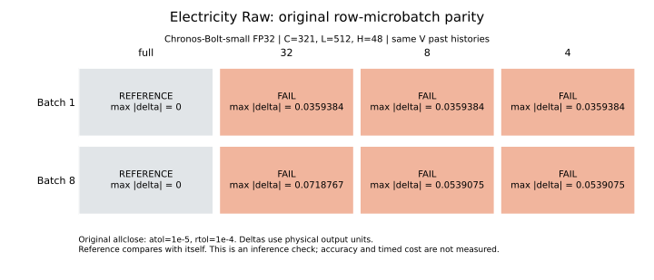

# Electricity Raw 비용 실패: 원 parity 반환 진단

[확인] 기존 비용 gate 실패 기록을 보존하고 같은 원 함수를 새 audit 작업에서 다시 실행했다. 원 공차, row 후보, 모델, 정규화, V 과거 입력 구성은 유지했다. 정답 생성·채점·학습은 수행하지 않았다.



## 실제 관찰

```text
batch  row_microbatch  status              max_abs
1      full           PASS                0.0
1      32             FAIL                0.03593835234642029
1      8              FAIL                0.03593835234642029
1      4              FAIL                0.03593835234642029
8      full           PASS                0.0
8      32             FAIL                0.07187670469284058
8      8              FAIL                0.05390752851963043
8      4              FAIL                0.05390752851963043
```

배치 1과 8의 원 successful_variants_parity는 각각 False, False다. 원 반환값과 전체 정밀도 수치는 아래 JSON과 CSV에 보존했다.

## 판정 범위

PASS 또는 FAIL 상태는 해당 variant의 실제 추론이 반환됐음을 뜻한다. FAIL은 처음 성공한 reference와 원 allclose 기준이 맞지 않았다는 의미다. BLOCKED_CUDA_OOM은 별도로 구분한다. 이 진단의 정상 종료는 비용 gate 통과나 예측 성능 개선을 뜻하지 않는다.

배치 분할에 따른 출력 차이의 연산 단계는 이 반환값만으로 확정하지 못한다. PyTorch 2.10 공식 문서는 배치 연산과 분할 연산의 부동소수점 결과가 비트 단위로 같다고 보장하지 않는다고 설명한다. 이는 가능한 설명의 근거이며, 이번 사례의 직접 원인 증명은 아니다. [공식 수치 정확도 문서](https://docs.pytorch.org/docs/2.10/notes/numerical_accuracy.html#batched-computations-or-slice-computations)

기존 실패 8건과 COST.csv는 변경하지 않았다. warmup, timed trial, stage trial은 모두 0회다. 학습 미완료 192조건과 그 안의 GPU 3 epoch 미달 48조건도 그대로다. 현재 T 잠금은 유지한다.

## 자원과 재현

새 audit GPU process-wall 정산은 62.677388429641724초다. 누적 43093.06391596794/43200초, 잔여 106.93608403205872초다. 독점 owner 아래 새 자식 작업만 실행했고 bounded wait와 종료·join 여유를 두었다.

입력은 기존 worker와 같은 V 구간의 과거 창이다. 원 safeFIT 자산 로더는 전체 자산을 역직렬화할 수 있으므로 T 행의 byte가 메모리에 올라오지 않았다고 주장하지 않는다. T target 생성·적합·선정·평가 호출은 없다.

[집계 CSV](PARITY_VARIANTS.csv), [생성 코드](../electricity_raw_parity_prepare_20261016_v1/render_report.py), [고정 실행 계획](../electricity_raw_parity_prepare_20261016_v1/PLAN.json)

[원 실제 진단 결과](../electricity_raw_parity_actual_1792111145896351600/RESULT.json), [배치 1 원 반환](../electricity_raw_parity_actual_1792111145896351600/RAW_PARITY_B1.json), [배치 8 원 반환](../electricity_raw_parity_actual_1792111145896351600/RAW_PARITY_B8.json)

[GPU audit 영수증](../electricity_raw_parity_prepare_20261016_v1/GPU_AUDIT.json), [전체 미완료와 재개 조건](../../RESUME.md)
