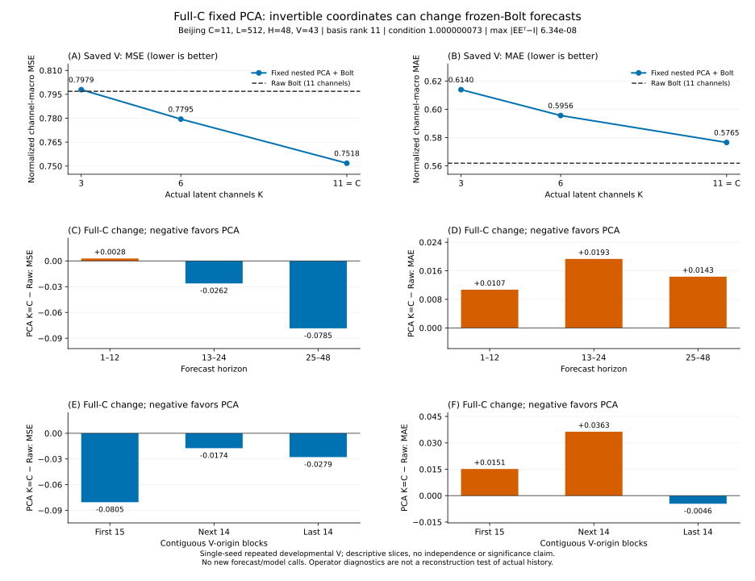

# Full-C PCA의 가역성과 예측 경로 차이

**[확인] Beijing의 전체11차원 PCA basis는 수치적으로 거의 직교하고 rank11이다. 그런데 같은 frozen Bolt를 거친 전체 K11 경로는 Raw보다 MSE가 낮고 MAE는 높다. 이 차이를 차원 축소로 인한 정보 손실 하나로 설명할 수 없다. 학습형 anchored decoder의 실패를 보여주는 비교도 아니다.**

이번 검사는 기존 V 충분통계6개와 작은 고정 basis/scaler만 읽었다. 새 학습·모델 추론·비용 측정을 추가하지 않았으며, 새로운 full fit 완료로 세지 않는다. [실제 결과](outputs_root_v1/RESULT.json), [전체 점수](outputs_root_v1/RESCORED_V.csv), [270행 쌍별 분해](outputs_root_v1/PAIRED_GROUPS.csv), [입력 결속](outputs_root_v1/INPUT_BINDINGS.json)을 함께 확인할 수 있다.



[그림 생성 코드](render_fixed_basis_diagnostic.py)·[입력/출력 SHA](figures_root_v1/FIGURE_BINDING.json). 300dpi PNG는 로컬에 보존하고 이 게시 묶음에는 SVG를 선택했다.

## 같은 평가 문제에서 무엇이 달랐나

Beijing/primary, L512/H48/C11, seed92601, developmental `V_select`의43 origins와20,539개 관측 정답이 대상이다. 여섯 방법의 data/scaler/cohort와 원 target/mask/origins/channel manifest 지문, 충분통계의 origin×channel×horizon-band key와 관측 count가 일치했다. 실제 basis의 A60 fit 끝은12622다. 새 고정 nested 결과는 CPU 실행이고, 과거 Raw/G/ridge 전체 V 실행의 장치·학습 경로까지 동일하다고 주장하지 않는다.

주지표는 A 정규화 **원 채널별** `sum(SSE)/sum(count)`를 먼저 구한 뒤11채널을 균등 평균한 MSE다. MAE도 같은 규칙이다. 모든 관측을 합친 pooled MSE나 origin별 점수의 단순 평균이 아니다. 시간·horizon slice에서도 이 규칙을 유지한다.

```text
방법                    정규화 MSE          정규화 MAE
Raw Bolt                0.7968786536971475  0.5618622043428347
초기 Direct G           0.8091814805925012  0.5993137650617376
기존 raw ridge          0.8315416367816169  0.6073577987792294
고정 nested PCA K3      0.7979250373047883  0.6139606908709884
고정 nested PCA K6      0.7794565960483854  0.5956357306323100
고정 nested PCA K11     0.7517899596417101  0.5765475116735715
```

G의 exact ID는 `primary_beijing_E1_DIRECT_G_k0_s92601`이다. 별도 심화한 deep-G 결과와 혼합하지 않았다. Raw/G/ridge는 같은 평가 문제의 기존 기준선이지만 G/ridge는 별도의 학습·특징·예측 경로다. 이 점수만으로 훈련 예산까지 통제한 우위를 선언하지 않는다.

K11은 Raw 대비 MSE가0.04508869405543736 낮아 약5.66% 개선됐고, MAE는0.014685307330736808 높아 약2.61% 악화됐다. K3의 MSE는 Raw보다 약0.00104638 높다. K6/11의 MSE가 개선됐다는 사실을 전반적인 예측 품질 개선으로 바꾸지 않는다. FP64 충분통계 합산 순서 때문에 기존 manifest와 마지막 자릿수가 조금 다를 수 있으며, 여섯 점수 모두 원 atol1e-9/rtol1e-7 범위에서 일치했다.

## K=C에서도 남는 차이

실제 저장 FP32 basis를 FP64로 계산한 결과다. 이 연산자는 실제 과거 관측 X를 읽거나 복원한 검사가 아니다.

```text
전체 basis rank                             11
2-norm condition number                    1.0000000727684264
K11: max abs(EᵀE − I)                      5.141091929949937e-8
K11: max abs(EEᵀ − I)                      6.336228031145197e-8
K11: Frobenius norm(EEᵀ − I)                1.4007892358063903e-7
K11: affine zero-offset max abs            1.3324657210933566e-9
K11: 결정론적 좌표 probe 복원 max abs         6.358412107942968e-8
K3/K6: projection rank                     3 / 6
K3/K6: Frobenius norm(E_K E_Kᵀ − I)         2.8284271247461903 / 2.2360679774997907
```

[원 `_FixedPCA`](../../fit_base.py)는 `F((x−center) E_K) E_Kᵀ + center`를 계산한다. [Raw](../../prediction_cache.py)는 `F(x)`다. 두 경로는 같은 canonical A60 mean/std를 사용하고, Raw model fingerprint를 nested의 동일 foundation/scaler/data로 재구성해 일치함을 확인했다. 원 [row forecaster](../../gpu_runtime.py)는 각 채널을 독립 시계열로 F에 전달하므로 전체 회전도 F가 입력받는 각 시계열의 모양을 바꾼다.

따라서 `EEᵀ≈I`는 **F를 거치기 전후 단순 선형 변환의 가역성**에 관한 진단이다. 비선형 row forecaster에 `F(xE)Eᵀ=F(x)`가 성립한다는 뜻은 아니다. K11에서는 차원 축소가 없는데도 점수 차이가 있으므로, 모든 차이를 “작은 K가 정보를 버려서”라고 해석할 근거가 부족하다. K3/6은 부분공간을 버리지만 실제 과거 자료의 분산 보존량·미래 정보 손실량을 이번 연산자 잔차로 측정한 것은 아니다.

또한 고정 `_FixedPCA`에는 [학습형 ForecastAdapter](../../networks.py)의 원 현재값 anchor·lag7 D가 없다. nested가 쓰는 복원은 고정 `E_Kᵀ`와 center다. 이 결과를 현재 학습 중인 anchored decoder의 문제로 합쳐 설명하지 않는다. 중심화·좌표 변환과 F의 상호작용, 과거 실행의 장치·수치 경로 차이까지 남아 있어 TSFM 하나만을 유일 원인으로 확정할 수 없다.

## 평균 개선은 어디에 있었나

다음은 Raw와 K11을 같은 key/count로 비교한 원 점수다. horizon은 0부터 시작하는 반열린 구간이며, 각 slice에서도 채널 균등 평균을 사용했다.

```text
horizon     Raw MSE       K11 MSE       Raw MAE       K11 MAE
[0,12)      0.406859851   0.409686229   0.370686042   0.381385096
[12,24)     0.757694829   0.731488184   0.550597545   0.569920766
[24,48)     1.011306956   0.932824671   0.662977282   0.677325927
```

초반12단계는 MSE와 MAE 모두 악화됐고, 뒤쪽 horizon의 MSE 개선이 전체 평균에 기여했다. MAE는 세 band 모두 악화됐다. 초반 band의 MSE는 K3 0.513978062088309, K6 0.4678242587936584로 K11보다 더 나빴고, MAE도 각각0.4610982453689681/0.43048831492997003으로 높았다. 즉 작은 K의 손해가 가까운 horizon에서도 보이지만, 원인이 어떤 잃어버린 신호인지까지 이 통계로 알 수는 없다.

시간순43 origins를15/14/14개의 서로 겹치지 않는 세 block으로 나눈 결과다.

```text
block       Raw MSE       K11 MSE       Raw MAE       K11 MAE
첫15        0.954157588   0.873627591   0.607067428   0.622209778
다음14      0.731400008   0.713964173   0.526780107   0.563092289
마지막14    0.651578828   0.623726728   0.532162836   0.527567146
```

세 block 모두 K11의 MSE가 낮지만 MAE는 앞의 두 block에서 높았다. block별 관측 count가7902/5265/7372로 다르고, 채널별 count도 다르므로 이 세 macro 점수의 단순 평균이 전체 macro 점수와 같을 필요는 없다. 인접 시계열 block은 독립 신뢰구간용 표본이 아니다.

채널별로는 K11의 MSE가11개 중6개, MAE가3개에서 개선됐다. 아래 delta는 **K11−Raw**이며 음수가 개선이다.

```text
채널       ΔMSE          ΔMAE
PM2.5     -0.160159347  -0.043454688
PM10      -0.275145723  -0.106261160
SO2       -0.063052249  +0.016896190
NO2       -0.170847276  -0.066780890
CO        -0.044416614  +0.033313199
O3        +0.014144325  +0.043504275
TEMP      +0.076622357  +0.095557670
PRES      +0.073798172  +0.072232882
DEWP      +0.057656293  +0.050028513
RAIN      +0.000643598  +0.019883881
WSPM      -0.005219170  +0.046618507
```

관측이 있는1293개 origin×channel×band 집계 cell 중 K11이 Raw보다 작았던 것은 SSE526개, SAE515개였다. Raw의 승리는 각각767개/778개였고 동률은0개였다. 이는 개별 예측점의 승률이 아니라 관측 count>0인 **band 집계행**의 비교다. 전체 MSE가 개선돼도 다수의 cell에서 이긴다는 뜻은 아니다. 원 잔차 분포나 개별 큰 오차의 개수를 이 충분통계에서 복원하지 않았으므로 “이상치만 해결했다”고 확정하지 않는다.

## 지금 판단할 수 있는 범위

[확인] full-C의 선형 가역성과 예측 품질은 구분해야 한다. 현재 자료에서는 full-C 회전 경로의 전체 MSE 감소가 horizon·채널·MAE 전반에 걸친 일관된 개선으로 이어지지 않았다. 작은 K 경로는 가까운 horizon의 손해가 더 컸다.

[추정·다음 판단] 압축 손실을 논하기 전에 동일 장치·배치·입출력 정규화에서 원 채널 항등 경로와 full-C 회전/중심화 경로를 비교할 필요가 있다. 이후 같은 E/F 조건의 고정 복원과 학습형 anchored D를 구분해야 압축·예측기·복원 단계의 책임을 좁힐 수 있다. 이 문서는 그 후속 실험의 실행 완료나 원 campaign의 필수 학습 완료를 주장하지 않는다.

이번 결과는 단일 seed·post-T 반복 V 탐색이다. 원 target/mask의 manifest 지문은 일치했지만, 이번 실행은 정답 배열이나 band 내부 개별 mask 위치를 독립 재구성하지 않았다. 저장 충분통계의 FP64 재채점과 basis 연산자 진단이며 새로운 prediction-array 감사·모델 수렴·인과 그래프·독립 일반화·최종 논문 방법론 성공의 증거가 아니다. 모든 모델 순위는 이 비교 조건과 불확실성 안에서만 해석한다.

## 실제 산출물 결속

ROOT가 명시 실행한 네 원 출력 파일의 byte SHA를 다시 확인했다. 입력35파일은 [결속 목록](outputs_root_v1/INPUT_BINDINGS.json)의 label/크기/SHA로 추적한다. private SPEC와 basis 원값은 공개하지 않는다. [감사 코드](audit_fixed_basis.py)와 [합성10검사](test_audit_fixed_basis.py)는 원 scientific source를 수정하지 않는다.

```text
RESULT.json
20eeeff2ff1c92beb32ca24f5bfc5d4f412ff06b65bc86e8226ed50370568ba9
RESCORED_V.csv
297272d22fca0be508e082dda7cd9010dc8457eee35b9f7d87198b4c651c3cff
PAIRED_GROUPS.csv
d5568938105eb172c6511b461226522d823a5b3e5c7dceace643fea2aed839d4
INPUT_BINDINGS.json
17e6a349f9ed187bb3198688f95b54dafdbc5033b1cea2e1c340fc1e18e9f412
```
