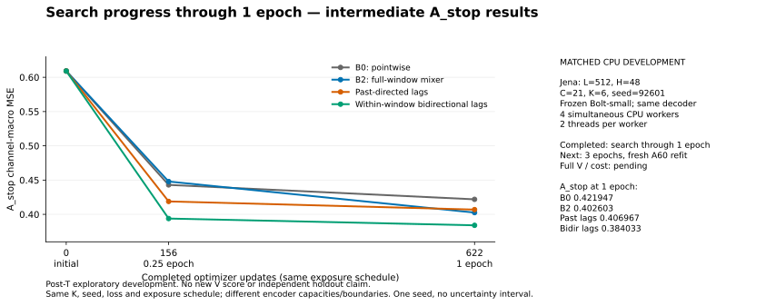

# Jena CPU 비교: 1 epoch까지의 실제 학습 중간 보고

**중간 기록이다.** 네 조건 모두 검색1 epoch·누적622 update·9923 origin 노출을 완료하고, 예정한3 epoch 검색을 계속 실행 중이다. 최종 checkpoint 선택·A60 새 적합·V43 추론·독립 재채점·checkpoint 재추론·배포 비용8조건은 아직 완료하지 않았다. 이 보고서는 최종 V 성능이나 연구 성공을 주장하지 않는다.

## 같은 조건에서 확인하는 질문

현재 시점 압축B0, 창 전체 시간 혼합B2, 과거 방향7지연, 창 내부 양방향7지연을 Jena의 동일 L512/H48/C21/K6/seed92601에서 비교한다. 같은 디코더·현재값 anchor·frozen Bolt-small·원 미래의 정규화 channel-macro MSE·A50/A_stop/A60 규칙과 update/노출 일정을 유지한다. 장치는 네 조건 모두 CPU이며, 각 worker는2 thread다. 자세한 차이와 계약은 [README](README_KO.md), [PLAN](PLAN.json), [등록](REGISTRY.csv)에 있다.

양방향 인코더도 예측 origin 이전의 같은 입력 창만 사용한다. 과거 방향 인코더와의 차이에는 tap 위치·경계조건·인코더 용량 차이가 있으므로 차이를 인과성 효과로 단정하지 않는다.

## 실제 완료한 검색 구간

```text
Encoder       A_stop@0     A_stop@0.25  A_stop@1     Updates@1
B0            0.609146790  0.442987429   0.421947032  622
B2            0.609146790  0.447932764   0.402603278  622
LAG_CAUSAL    0.609146790  0.418885567   0.406966662  622
LAG_BIDIR     0.609146790  0.393911805   0.384033462  622
```



- [정밀도 원수치 CSV](diagnostics/progress_through_e1_20261016_v1/SEARCH_CURVES_THROUGH_E1.csv).
- [완료 event·private checkpoint의 SHA와 계약](diagnostics/progress_through_e1_20261016_v1/EVIDENCE.json).
- [그림 바이트와 CSV 결합](diagnostics/progress_through_e1_20261016_v1/FIGURE_BINDING.json), [집계 CSV로 다시 그리는 코드](render_search_progress.py).

모든 조건이 초기보다 낮은 A_stop 오차를 보였다. B2는0.25 epoch에서 B0보다 높았지만1 epoch에서는 낮아졌다. 이 한 seed의 같은 검색 구간에서도 짧은 학습 순위가 달라졌으므로0.25 epoch 순위를 최종 결론으로 쓰지 않는다. 현재 오차가 더 낮아졌다는 사실은 수렴이나 독립 일반화를 증명하지 않는다.

1 epoch 이후 마지막3 epoch 검색이 끝나면 A_stop 규칙에 따라 epoch를 선택하고 A60에서 처음부터 새로 적합한다. 최종 비교 점수는 그 새 모델의 V43 예측으로 계산한다. 검색 도중의 이 A_stop 표를 V 점수와 직접 비교하지 않는다.

## 실행·검산·비용의 현재 상태

첫 actual CPU probe는 full-A50 손실 정규화에서16sample/1update를 수행했고, F logical/physical96 stream·4 call·유한 gradient와 frozen state 보존을 확인했다. probe 상태를 폐기한 뒤 네 학습을 새로 시작했다. [실제 probe 영수증](diagnostics/probe_1792112692673452900_B0/RESULT.json)은 학습 완료·V 평가·배포 비용 측정으로 세지 않는다.

한 worker의 첫 update는 약1.58초였고, 네 worker가 동시에 실행된0.25→1 구간은 update당 약2.63초였다. 이는 실제 검색 구간의 학습 시간이며 배포 추론 지연이 아니다. 이 속도와 이후 선택 epoch에 따른 refit 길이를 바탕으로 이번 네 조건·검산·비용·최종 게시에 처음 약2~4시간을 예상했다. 실행 경쟁·선택 epoch·실패 여부에 따라 달라질 수 있다.

저장 V43은 [독립 FP64 검산기](verify_cpu_outputs.py)로 채점하고, 선택 checkpoint는 원 API의 고정6 origin에서 실제 재추론할 예정이다. 실제 forward 여부와 기존 cache 재사용을 구분한다. [비용 준비 코드](prepare_cpu_costs.py)는4방법×batch1/8에 warmup10·timed20·stage20을 고정한다. 학습 종료 후 새 CPU 프로세스8개를 순차 실행하며, 기존 GPU 비용과 합쳐 같은 조건의 순위로 보고하지 않는다. 준비 코드의 합성 검사 통과는 아직 실제 검산·재추론·비용 실행 완료가 아니다.

또한 원 V가 없던 [고정 PCA6조건](../postT_V_only_cpu_fixed_pca_20261016_v1/README_KO.md)을 준비했다. 현재 실제 fit/V 실행은0이며 위 학습과 비용 측정 이후 순차 실행한다. PCA는 파라미터·optimizer update·학습 노출0의 고정 변환으로, 신경망3epoch 완료 수에 포함하지 않는다.

## 해석과 기존 캠페인 경계

이는 기존 T 결과를 이미 관측한 뒤의 별도 post-T 탐색적 V 전용 development다. 승인된 safeFIT 전체 역직렬화 계약을 유지하므로 T byte의 메모리 접근 자체가0이었다고 주장하지 않는다. 새 학습·선택·평가는 A50/A_stop/A60/V만 요청하며 새 T target 구성·적합·선택·채점은 하지 않는다. legacy 정규화와 반복 사용한 개발 자료의 한계도 유지한다.

원 source39·registry·selection lock·기존 SCORES/COST/T 결과는 보존했다. 원471행의 미완료192와 GPU3epoch 미달48을 이 새 CPU 진행으로 완료 처리하지 않는다. 전체 요구와 미완료 범위는 [원 RESUME](../RESUME.md)에 있다. Chronos-Bolt를 유지할 근거와 native/ridge/Raw보다 나은 추가 가치는 최종 V·동등 비교·전체 비용을 확인한 뒤 판단한다.
