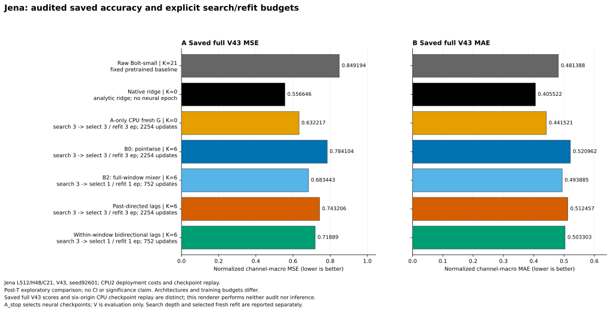
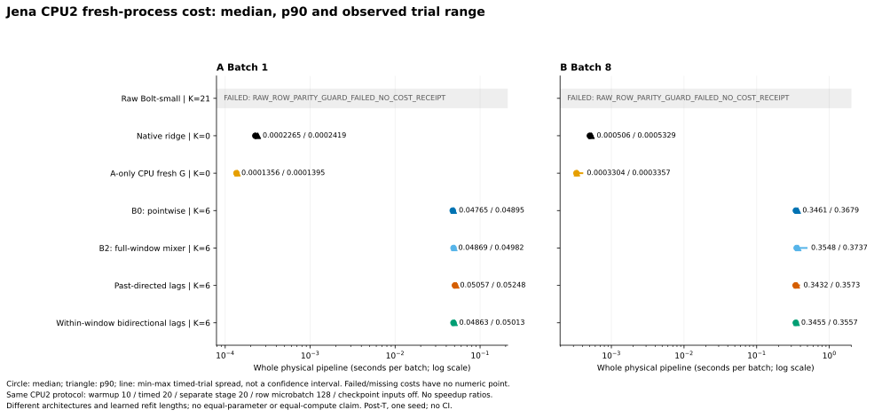
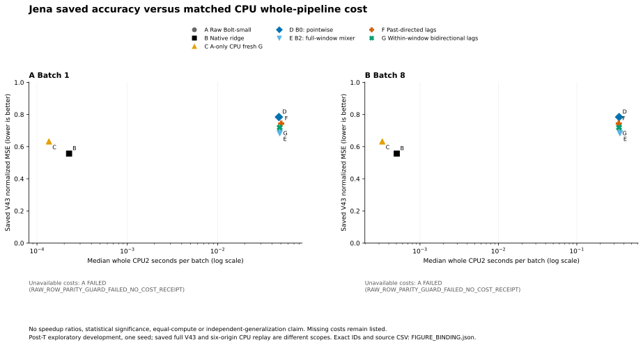

# Jena 표현학습: 검산된 정확도·CPU 비용과 Raw 분할 진단

**[확인] 시간 정보를 쓰는 세 표현(B2·LAG_CAUSAL·LAG_BIDIR)은 현재 시점 투영 B0보다 MSE·MAE가 낮았다. 다만 네 압축 조건 모두 같은 V43의 native ridge와 A-only CPU fresh G를 MSE·MAE 어느 쪽에서도 이기지 못했다. 네 조건 모두 Raw보다 MSE는 낮고 MAE는 높다.** 같은 CPU 프로토콜의 유효12개 비용 영수증도 검산했으며, ridge/G의 whole-pipeline 시간은 네 Bolt 연결 조건보다 낮았다. Raw의 비용2조건은 원 row-parity guard 실패로 숫자가 없다. 이 보고서는 해당 부분 범위의 최신 비용·진단 보고서이며 전체 연구 완료나 새 방법의 우위를 선언하지 않는다.

기존 [정확도 중심 보고서](RESULTS_KO.md), [1epoch 기록](PROGRESS_E1_KO.md), [검색3epoch 기록](PROGRESS_E3_KO.md)은 작성 시점의 역사적 snapshot으로 그대로 보존했다. 아래 수치의 명시 run ID·51열 원정밀도 집계는 [AGGREGATE.csv](diagnostics/final_cpu_comparison_input_root_20261016_v1/AGGREGATE.csv), 전체 근거와 SHA는 [SOURCE_BINDINGS.json](diagnostics/final_cpu_comparison_input_root_20261016_v1/SOURCE_BINDINGS.json)에 있다. 원 집계 당시 미확정이던 Raw의 분할별 원인은 아래의 후속 진단에서 따로 구분했다.

## 1. 무엇이 같은 조건이고 무엇이 다른가

Jena의 과거512행으로 미래48행을 예측하며, 원 채널21개, V43 origins, seed92601을 사용했다. 저장 예측7조건의 data/scaler/cohort와 target·observed·origin·channel ID 메타데이터가 같고, 주지표는 원 채널을 균등하게 보는 정규화 channel-macro MSE다. MAE도 같은 정규화 공간이다. 서로 다른 채널의 물리 단위를 섞은 평균을 원단위 오차로 표시하지 않는다.

B0/B2/LAG_CAUSAL/LAG_BIDIR는 잠재 폭6, 같은 frozen Bolt-small·선형 디코더·현재값 anchor·원 미래 정규화 MSE·AdamW lr0.001·effective16/micro4 조건이다. B0는 시점별 채널 투영, B2는 과거 창 전체의 시간 혼합, 지연 두 조건은7개 지연을 사용한다. 양방향은 **이미 관측한 과거 창 내부**의 연결이다. 이 비교가 인과관계나 directed lag graph의 실재를 증명하지는 않는다. 실행 계약은 [PLAN](PLAN.json), [REGISTRY](REGISTRY.csv), [runner](cpu_lag_runner.py)에 있다.

다섯 신경망(G와 네 표현)의 검색은 A50의9,923 legal origins에서0.25→1→3epoch까지 완료했고, A_stop으로 선택한 길이만큼 A60에서 처음부터 refit했다. 검색은 각각1,863 update/29,769 origin 노출이다. 선택한 길이와 모델 용량까지 동일하지는 않다.

```text
조건          선택/refit epoch  refit update  refit origin 노출
G             3                 2254          36060
B0            3                 2254          36060
B2            1                  752          12020
LAG_CAUSAL    3                 2254          36060
LAG_BIDIR     1                  752          12020
```

Raw는 고정 사전학습 모델, ridge는 원 A_stop alpha 선택을 따르는 해석적 적합이며 둘의 신경망 epoch는 해당없음·optimizer update0이다. G는 `primary_jena_E1_DIRECT_G_k0_s92601__cpu_fresh_e3`만 사용했고 다른 deep G 점수와 섞지 않았다. 전체 구조·F 입력 폭·파라미터 수·학습 연산량을 맞춘 비교라는 주장은 하지 않는다. 검색3epoch 완료나 마지막3epoch 선택은 충분 수렴의 증거가 아니다.

## 2. 예측에 무엇이 도움이 되었나

```text
방법                       정규화 MSE          정규화 MAE
Raw Bolt-small             0.8491941389472357    0.4813883402485757
Native ridge               0.5566463357048567    0.40552180175406594
A-only CPU fresh G         0.632217057436123     0.44152128982113786
B0                         0.7841039310324822    0.5209622100413023
B2                         0.6834428963980711    0.49388492449756366
LAG_CAUSAL                 0.7432064184643359    0.5124572203253038
LAG_BIDIR                  0.7188903475533631    0.5033025985012579
```

[확인] B2·과거 방향 지연·창 내부 양방향 지연은 B0보다 두 지표가 낮았다. 하지만 네 표현 모두 ridge/G보다 나빴고, 네 표현 중 단순 full-window mixer B2가 두 지연 구조보다 나았다. 따라서 시간 정보를 쓰는 표현의 가능성은 보이지만 지연 그래프의 필요성·복잡성의 이득은 아직 확보하지 못했다. B0 대비 개선은 구조·용량·선택된 refit 길이를 포함한 전체 조건의 차이이며 시간 정보 하나의 인과 효과로 분리되지 않는다.

[확인] 네 조건은 재구성 손실만으로 적합한 것이 아니라 frozen Bolt를 통과한 미래 예측 MSE로 학습했다. 그럼에도 강한 단순 기준선을 이기지 못했다. 따라서 이번 실패를 “입력 복원 목표였기 때문”만으로 설명하거나, 예측 목적 표현을 도입하면 문제가 해결된다고 결론 내릴 수 없다. 최적화 부족, 표현의 정보 손실, latent 미래 예측의 적합성, decoder 복원 중 어느 단계가 주원인인지는 추가 분리가 필요하다. negative 성능은 원 계획의 독립적인 최소 실험을 생략할 근거로 쓰지 않는다.



위 그림의 원 데이터는 [렌더러 입력 복사](diagnostics/final_cpu_comparison_root_20261016_v1/INPUT_SNAPSHOT.csv), 그림·source·입력 SHA는 [FIGURE_BINDING](diagnostics/final_cpu_comparison_root_20261016_v1/FIGURE_BINDING.json)이다. 300 dpi PNG 원본도 함께 보존하며, 본문은 SVG에 연결했다.

## 3. 같은 CPU 조건의 실제 배포 비용은 얼마였나

단위는 **초/배치(seconds per batch)**이며 sample당 시간이나 학습 시간이 아니다. CPU2 threads의 fresh-process single-route whole physical pipeline, batch1/8, warmup10·timed20·별도 instrumented stage20, row microbatch128, checkpoint inputs off 조건이다. 아래 median/p90은 [독립 산술 감사 AUDIT_RESULT](diagnostics/root_cpu_cost_arithmetic_20261016_v1/AUDIT_RESULT.json)의 `recomputed_summaries` 중 `phase=timed`, `stage_instrumentation=false`,20trial 값 그대로다. stage_probe 시간은 섞지 않았다.

```text
Batch1 / 단위: 초/배치
방법          median                   p90
RAW           FAILED                   해당없음
RAW_RIDGE     0.00022649997845292091   0.0002418997697532177
DIRECT_G      0.0001355998683720827    0.0001395300030708313
B0            0.04765265015885234      0.04894552999176085
B2            0.04868765012361109      0.04981682971119881
LAG_CAUSAL    0.0505663501098752       0.052484589908272025
LAG_BIDIR     0.048634300008416176     0.05013087010011077

Batch8 / 단위: 초/배치
방법          median                   p90
RAW           FAILED                   해당없음
RAW_RIDGE     0.0005060497205704451    0.000532870041206479
DIRECT_G      0.0003303999546915293    0.0003357000183314085
B0            0.34607005026191473      0.36788423000834886
B2            0.35482815001159906      0.37369590983726086
LAG_CAUSAL    0.3432335499674082       0.35734393000602727
LAG_BIDIR     0.3454676503315568       0.35566194001585244
```

유효12개 영수증은 총600개 저장 trial(각 warm10/timed20/stage20)의 phase·수치·카운터·artifact/source 메타데이터 검산을 통과했다. PCA 별도 namespace의12개까지 포함하면 전체 비용 산술 감사는24영수증/1,200행이지만, 이 표에는 Jena7조건 중 유효6방법×2batch만 포함했다. median/p90/min/max 원정밀도는 AGGREGATE.csv에 모두 남았고, 그림의 min–max는 관측 trial 범위이며 CI가 아니다. 비용 산술 감사가 실제 계측을 다시 수행하거나 quiet window·resource guard·fresh CPU parity를 자체 증명했다는 뜻은 아니다. 해당 실행·재추론 증거는 SOURCE_BINDINGS의 별도 proof와 구분한다.

[확인] 이번 CPU 조건에서는 ridge와 G가 네 Bolt 연결 조건보다 낮은 timed median을 보였다. Raw 시간은 없으므로 Raw 대비 가속비는 계산하지 않는다. GPU의 옛 비용과 합치거나 batch1을 batch8로 대입하지 않았고, 서로 다른 모델·학습량의 결과를 동일 연산량 공정 비교로 표현하지 않는다. 현재 결과는 정확도와 확인된 CPU 비용 양쪽에서 강한 단순 기준선보다 우위를 확보하지 못한 상태다.





## 4. Raw 재추론은 PASS인데 왜 비용은 FAILED인가

원 비용 worker는 Raw를 `full,32,8,4` 행 분할로 각각 추론한 뒤 고정 공차 `atol=1e-5, rtol=1e-4`의 **물리 출력** allclose를 검사한다. 이 guard에서 멈췄으므로 Raw B1/B8에는 timed20 비용 영수증이 없다. 기존 실패를 지우거나 공차를 완화하지 않았다. [B1 원 반환](diagnostics/raw_row_parity_root_20261016_v2_B1/RAW_PARITY_B1.json), [B8 원 반환](diagnostics/raw_row_parity_root_20261016_v2_B8/RAW_PARITY_B8.json)을 별도 보존했다.

후속 진단은 같은 model/scaler/과거 history에서 원4후보 함수를 그대로 실행하고, 상세 집계용 같은4후보 및 배포 row128·row128 repeat를 **별도 scope**로 추론했다. batch당 최대10 forward이며 새 비용 계측이나 독립 실험10회가 아니다. 결과는 다음과 같다. `norm max`는 물리 출력 차이를 원 A60 채널 std로 나눈 진단값으로, 원 물리 공차를 대체한 지표가 아니다.

```text
batch  row       원/상세 gate  실패 셀/전체 셀  최대 물리 차이          norm max                   F calls
1      full      PASS          0/1008            0.0                     0.0                        1
1      32        PASS          0/1008            0.0                     0.0                        1
1      8         FAIL          1/1008            0.0001857351617218228   1.1920928955078125e-06     3
1      4         FAIL          1/1008            0.0001857351617218228   9.5367431640625e-07        6
1      128       PASS          0/1008            0.0                     0.0                        1
8      full      PASS          0/8064            0.0                     0.0                        1
8      32        FAIL          13/8064           0.0006150166518636979   2.86102294921875e-06       6
8      8         FAIL          12/8064           0.0006150166518636979   2.86102294921875e-06       21
8      4         FAIL          12/8064           0.0006150166518636979   2.86102294921875e-06       42
8      128       FAIL          1/8064            0.0002026201764238067   7.152557373046875e-07      2
```

[확인] B1에서는 rows8/4가 각1셀, B8에서는 rows32/8/4가 각각13/12/12셀에서 원 공차를 넘었다. 추가 배포 row128도 B8에서1셀 실패했지만, 같은 row128을 다시 실행한 출력은 양 batch에서 첫 row128과 byte 차이0이었다. 모든 진단 출력은 finite였고 각 row의 실제 logical·physical streams는 B1=21/B8=168, F 호출 수는 실제 분할과 일치했다. source39·원 registry/lock·과거 history·scaler·frozen weight hash 보존과 route close도 기록했다.

관측한 정규화 차이의 최대는 **2.86102294921875e-06(약2.861e-6)**이다. 작은 차이라는 사실만으로 원 guard를 무시하거나 비용 FAILED를 PASS로 바꾸지 않는다. 이번 rerun에서는 OOM 없이 행 분할별 출력 수치 차이로 guard 실패를 재현했지만, 어느 연산·커널이 차이를 만들었는지, 모든 과거 실패가 같은 원인이었는지는 미확정이다. 이 소수 history의 차이로 전체 정확도 성능 격차를 설명했다고도 하지 않는다.

Raw의 fresh CPU6 checkpoint parity PASS는 **6개 선택 V origins와 저장 checkpoint의 일치**를 확인한 별도 검사다. 비용 history의 batch1/8·행 분할·물리 allclose와 입력 구성 및 검사 공간이 달라 두 상태는 구분해야 한다. 상세 근거: [B1 RESULT](diagnostics/raw_row_parity_root_20261016_v2_B1/RESULT.json)·[채널별 ROW_DETAILS](diagnostics/raw_row_parity_root_20261016_v2_B1/ROW_DETAILS_B1.json), [B8 RESULT](diagnostics/raw_row_parity_root_20261016_v2_B8/RESULT.json)·[채널별 ROW_DETAILS](diagnostics/raw_row_parity_root_20261016_v2_B8/ROW_DETAILS_B8.json). 원 공차의 rtol 기준은 NumPy의 두번째 인자인 predicted 값이다.

## 5. 검산·재현과 남은 연구 판단

기존 Raw/ridge/G의 현재 manifest SHA는 [원 FP64 감사](../audits/audit_1792101640838866500/PREDICTION_AUDITS.json)의 exact run/V43 PASS와 일치한다. 신규 네 조건의 전체 V43 FP64 rescore4와 fresh CPU6 checkpoint replay4, 기준선3의 fresh CPU6 replay3도 별도 PASS다. 저장 전체 V43 검산은 새 전체 V43 모델 추론이 아니고, CPU6 replay는 전체 V43 재추론이 아니다. Raw의 옛 저장 full-V 장치는 manifest에 개별 기록되어 있지 않으며, CSV의 `device=cpu`는 이번 배포 비용과 checkpoint replay에 대한 값이다. 7조건 모두의 새 CPU full-V 실행을 주장하지 않는다.

- 신규4 검산·재추론: [B0 FP64](diagnostics/root_cpu_sequential_v1_j01_lag_rescore/RESULT.json) / [CPU6](diagnostics/root_cpu_sequential_v1_j02_lag_replay/RESULT.json), [B2 FP64](diagnostics/root_cpu_sequential_v1_j03_lag_rescore/RESULT.json) / [CPU6](diagnostics/root_cpu_sequential_v1_j04_lag_replay/RESULT.json), [과거 지연 FP64](diagnostics/root_cpu_sequential_v1_j05_lag_rescore/RESULT.json) / [CPU6](diagnostics/root_cpu_sequential_v1_j06_lag_replay/RESULT.json), [양방향 지연 FP64](diagnostics/root_cpu_sequential_v1_j07_lag_rescore/RESULT.json) / [CPU6](diagnostics/root_cpu_sequential_v1_j08_lag_replay/RESULT.json).
- 기준선 새 CPU6: [Raw](diagnostics/root_reference_CPU_phase3_v1_00_replay/CPU_REPLAY_RESULT.json), [ridge](diagnostics/root_reference_CPU_phase3_v1_01_replay/CPU_REPLAY_RESULT.json), [원채널 CPU G](diagnostics/root_reference_CPU_phase3_v1_02_replay/CPU_REPLAY_RESULT.json).
- 별도 최소 비교: [고정 PCA6 최신 비용 보고서](../postT_V_only_cpu_fixed_pca_20261016_v1/RESULTS_WITH_COST_KO.md), 원 미완료 요구와 재개 참조는 [RESUME](../RESUME.md)에 있다.

이 결과는 post-T의 탐색적 V 재사용, 단일 seed·단일 시간 분할이다. CI·통계적 유의성·독립 일반화·실제 인과 그래프·충분 수렴·FrozenBolt의 필수성이나 새 논문 기여를 확보했다는 주장은 아직 할 수 없다. 이번 작업에서 새 TEST/T target 적합·선택·평가는 요청하지 않았고 원 source39/registry/선택 lock을 유지했다. 원 safeFIT loader의 전체 archive에 옛 T bytes가 물리적으로 포함될 수 있다는 이력은 별도로 보존한다.

원 연구 전체는 **PARTIAL**이다. 이 snapshot의 core56 과학 조건 대응은19개, 남은37개이며 원 GPU 장부와 any-device CPU 보강 대응을 구분한다. M5 자산 차단 등 미실행 경로가 남아 있다. 별도로 시작한15 fresh fit과 그 뒤 확장할 V 산출물은 이 보고서의 완료 수에 넣지 않았다. 새22V 전체 완료나 원471행의 미완료192개 해결을 선행 선언하지 않는다. 현재 검산된 부분 결과를 main에 게시하는 절차와 원 연구·학습 최소 요건 충족도 서로 다른 상태다.
