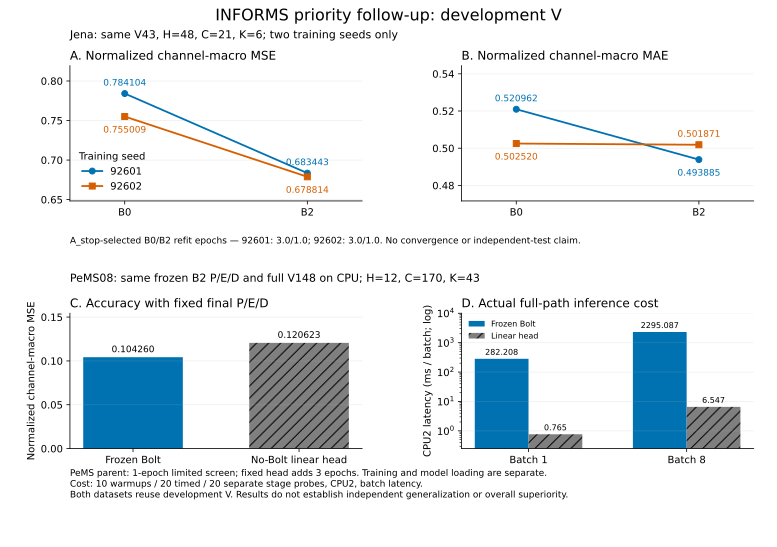

# B2 우선 검증 후속 결과

**공개 통계 복원 먼저:** 아래 P2 보고서를 다시 생성하려면 [무손실 통계3개 안내](../stats_packs/pack_numeric_priority_followup_20261016_v1/README_KO.md)를 따라 해당 manifest만 복원한다. 원 CSV의 모든 행·토큰·개행 및 gzip 바이트 SHA를 보존했고, 두 fresh destination에서 공개 reader로 실제 복원을 확인했다. `parent_full_cpu` 통계는 이 pack에 포함되지 않으며 원 경로에 그대로 있다. [전체 복원 인덱스](../RESTORE_INDEX_KO.md)의 역사적 전체 archive 명령을 이 P2 재현에 실행할 필요는 없다.

```powershell
python -B research/informs_broad_validation_20261015_v1/stats_pack_numeric.py restore --manifest research/informs_broad_validation_20261015_v1/stats_packs/pack_numeric_priority_followup_20261016_v1/MANIFEST.json --destination .
```


[최종 한국어 결과](RESULTS_KO_v2.md) · [원수치](RESULTS_v2.csv) · [학습량·학습비용](TRAINING_COST_v2.csv) · [입력 결속](REPORT_INPUT_BINDINGS_v2.json)



Jena 두 seed와 PeMS 동일 장치 전체 V148을 다룬 개발 결과다. 원 MASTER 전체 완료·독립 일반화·수렴을 주장하지 않는다. 기존 [PeMS v1 snapshot](PEMS_RESULTS_KO_v1.md)과 [P1 보고](../priority_b2_validation_20261016_v1/INFORMS_METHOD_STATUS_KO.md)는 당시 범위를 보존한다.

재현은 stdlib [builder](build_followup_report.py)의 명시 --execute를 사용한다. 기본 호출은 입력읽기·쓰기0이다. 기존 v2 출력이 있으면 덮지 않고 거부하며, 새 부모 전체CPU 추론과 별도FP64 rescore PASS가 없으면 결과를 만들지 않는다. 그림 생성과 게시 검사는 ROOT의 별도 단계다.

새 출력이 없는 checkout의 저장소 root에서 실행 예:

```powershell
python -B research/informs_broad_validation_20261015_v1/priority_core_followup_20261016_v1/build_followup_report.py --execute --public-root research/informs_broad_validation_20261015_v1 --parent-plan priority_core_followup_20261016_v1/PARENT_FULL_CPU_PLAN.json --parent-inference-result priority_core_followup_20261016_v1/diagnostics/pems_parent_full_cpu_inference_root_v1/RESULT.json --parent-rescore-result priority_core_followup_20261016_v1/diagnostics/pems_parent_full_cpu_rescore_root_v1/RESULT.json
```
