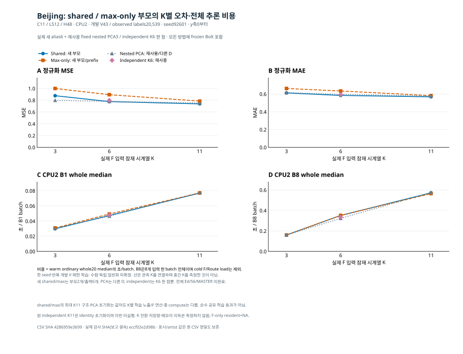

# Beijing multi-K 시각자료

[실험 보고](MULTIK_RESUME_KO_v1.md) · [원정밀도 CSV](MULTIK_RESUME_RESULTS_v1.csv) · [보고 결속](MULTIK_RESUME_BINDINGS_v1.json) · [원 감사](INDEPENDENT_MULTIK_RESUME_AUDIT_ROOT_v1.json) · [그림 결속](MULTIK_RESUME_FIGURE_BINDINGS_v1.json)

같은 Beijing C11/L512/H48·seed92601·CPU2·반복 개발 V43/20539 관측 라벨이다. shared와 max-only는 이번 저장점 재개 부모2개에서 나온6개 출력이며, fixed nested PCA3과 independent K6 한 점은 기존 결과를 재사용했다. 독립 K3/K11은 미실행이다. 선은 실제 K3/6/11 관측값을 연결할 뿐 중간 K를 측정하거나 보간 성능을 입증하지 않는다. 모든 방법은 Bolt를 포함한다.

네 패널은 원 CSV의 normalized channel-macro MSE·MAE, CPU2 B1/B8 ordinary whole20 median을 그대로 복사한다. y축0부터이고 CI·seed 분산·유의성·p90는 추가하지 않았다. B8은8개 입력 한 batch의 전체 초 단위 시간이며8로 나누지 않는다. warm whole 비용은 physical history/mask부터 원 C 미래·inverse/CPU 반환까지이고 기존 F pool cold load/Route loading은 제외한다.

고정 PCA는 basis transpose 복원으로 학습 가능한 lag7 D/current anchor와 다르다. shared/max는 최대 K11 부모 구조와 PCA 초기화를 공유하지만 K별 감독·노출·F 연산 배분이 달라 동등 총 compute나 공유 학습만의 순수 효과를 보장하지 않는다. 원 independent K11의 identity 초기화는 shared/max PCA와 다르며 이번 independent K11 결과는 없다. 선택 refit3 endpoint·제한 학습·한 seed와 반복 개발 V이므로 충분 수렴·독립 일반화는 미확정이다.

search 재구축 호출 시간을 과거 search 전체 wall로 표시하지 않았으며 unknown unsaved progress는 원 보고에 남긴다. 부모 BASE.full_V_completed=false를 변경하지 않는다. K 전환·저장량·메모리 효과는 측정하지 않았고 최대 K11 E/D가 유지된다. F-only resident bytes는 NA이며 전체 Route weights/RSS로 대체하지 않는다. 원 N7 receipt에 미기록인 raw F 합계/proofmap/output dtype도 추정하지 않는다. 전체 E4/56/MASTER 미완료다.

이 renderer는 완료 보고 CSV와 결속 JSON만 수치 입력으로 사용했다. 감사 JSON·원 통계/trial·원자료·모델/Task/NPZ/CP는 새로 해석하지 않았다. source/helper와 두 보고 입력의 전후 SHA, 실제16 artist/40개 y값을 대사한다. 공개 SVG/MD/결속 JSON과 private PNG를 CreateNew로 만들며 그림 실패는 독립 실험을 중단하는 gate가 아니다. 새 학습·추론·비용 측정·프로세스 제어·Git/network는0이다.
