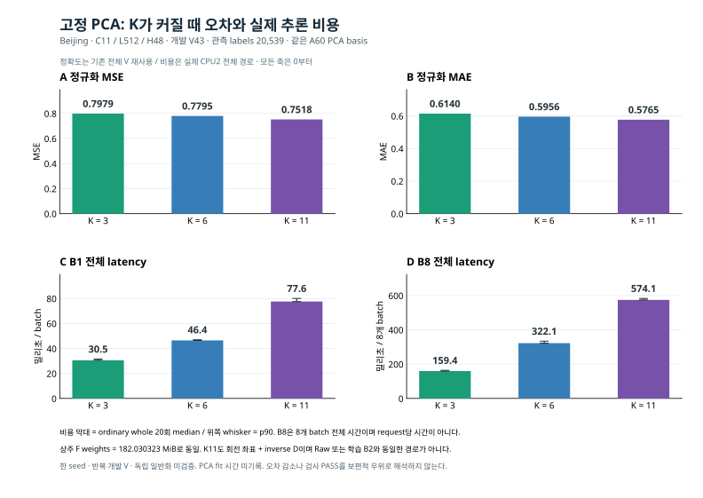

# N3 고정 PCA K 비교 시각자료

[원정밀도 CSV](RESULTS_WITH_COST_v1.csv) · [원 보고](RESULTS_WITH_COST_KO_v1.md) · [독립 비용 검산](INDEPENDENT_COST_REVIEW_ROOT_v1.json) · [그림 결속](FIGURE_BINDINGS_v1.json) · [생성 코드](plot_nested_cost.py)

같은 A60 basis의 PCA K3/6/11에서 기존 전체 V43의 MSE·MAE와 이미 측정된 CPU2 B1/B8 전체 경로 latency를 표시했다. 막대는 ordinary whole20 median, 위쪽 whisker는 p90이다. B8은8개 batch 전체 시간이며 request당 시간으로 나누지 않았다. 표시 숫자만 반올림했고 CSV는 바꾸지 않았다.

이 개발 V에서는 K가 클수록 오차가 작고 latency는 길다. F 상주 weights는182.030323 MiB로 같아 입력 stream 감소를 backbone weights 경량화로 해석하지 않는다. K11도 회전된 좌표에서 Bolt를 거쳐 inverse D로 돌아오는 경로로 Raw/B2와 동일하지 않다. 한 seed·반복 개발 V이며 독립 일반화와 최종 방법 우위를 검증하지 않았다. 학습 optimizer0회와 PCA 제조 시간0초는 다르며 PCA fit 시간은 미기록이다.

기존 공개 집계3행·독립 감사6조건·보고 입력 결속만 읽었다. 새 학습·추론·모델/Task/NPZ·원자료/target·비용 재측정·네트워크·Git 작업은0이다. SVG만 게시용이고 PNG는 로컬 미리보기다. 기본 호출은 입력읽기·쓰기0, 명시 --execute는 새 출력만 허용한다.
