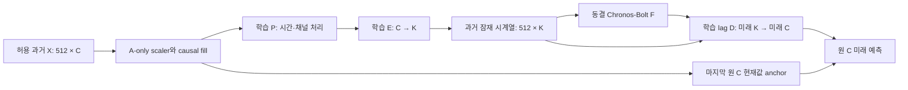

# 최근 연구 판단과 PeMS C32 학습 진행 스냅샷

작성 시각(UTC): `2026-10-17T04:40:04.492233+00:00`. **완료 결과와 학습 중 상태를 분리한 중간 보고서**다. 마지막 완료 Raw/G 결과는 commit `6c905e71afca91741bf17d73e5568eb366e8881f`에 게시돼 있다. 새 B0/B2의 최종 성능·선택 모델·fresh refit·전체 V 재채점·재추론·비용은 아직 완료되지 않았다. 아래의 과거 수치는 연결한 기존 보고서의 값이며 새 독립 평가가 아니다.

현재 B0/B2는 같은 C32/K8/L512/H12·seed92601에서 각각 **search 0.25 epoch / 132 optimizer update / 2,102 exposure** 저장점을 확인했다. 실제로 계산이 계속되고 있으므로 이 저장점이 현재 진행량 전부라는 뜻은 아니다. [시각이 고정된 진행 기록](B0_B2_PROGRESS_SNAPSHOT_20261017_v1.json)을 함께 본다. 보호 T 접근·중단·추가 모델 실행 없이 코드와 이 상태만 게시했다.

추가 공개 코드: [감사](audit_b0_b2.py) · [보고서 생성](build_b0_b2_report.py) · [그림 생성](plot_b0_b2_v2.py) · [검사 범위와 준비 당시 상태](B0_B2_VISUALIZATION_PREPARATION_KO_v2.md). 선택한 공개 코드의 합성 단위검사 33개는 PASS이며 과학 파이프라인의 실제 통과를 뜻하지 않는다. 그림 생성 코드는 준비됐지만 새 B0/B2 수치의 그림은 아직 생성하지 않았다.

다음 그림은 **이미 완료·검산한 Raw/G만** 표시한다. 새 B0/B2의 성능으로 읽으면 안 된다.


① B2의 실제 계산 구조와 frozen F 연결은 확인됐다. ② B0 대비 추가 가치는 Jena 두 seed에서 관찰됐지만 Beijing K6에서는 반대였으므로 일반적 이득은 미확정이다. ③ 고정 표현의 선형 직접 head보다 나은 조건부 예측 이득은 있지만 G/Ridge/LoRA 전체를 앞서거나 Bolt가 필수라는 근거는 없다. ④ 작은 K는 일부 대안보다 warm 전체 추론 비용을 낮췄으나 정확도 손해·상주 F 비용·학습량 차이가 남는다. ⑤ 필요한 후속만 명시적으로 실행했고 원 전체 MASTER/56조건 완주 큐는 중지·미완료 상태다. 현재 승인된 C32 B0/B2 두 fit은 별도로 진행 중이며 전체 큐를 자동 재개한 것이 아니다.

## 1. B2 후보의 계산 구조는 유효한가?

[P1 계산·판단 보고](../priority_b2_validation_20261016_v1/INFORMS_METHOD_STATUS_KO.md)와 [계약](../priority_b2_validation_20261016_v1/METHOD_CONTRACT.md)에 따르면, Jena P0에서 `[8,512,21] → [8,512,6] → [8,48,6] → [8,48,21]`과 실제48 streams를 확인했다. F 입력의 역전파, P/E/D의 유한·비영 기울기, F requires_grad=false·parameter grad 부재·실행 전후 hash 보존이 근거다. P0의 optimizer update는0이므로 이 검사만으로 학습 성공이나 수렴을 주장하지 않는다.



P/E/D는 **원채널 미래 예측 MSE**로 학습한다. 현재 부진을 “재구성 목적이 미래 예측에 맞지 않아서”라고 설명할 수 없다. 같은 이유로 구현 검사를 통과했다는 사실이 학습 충분성이나 방법의 한계를 확정하지도 않는다. B0는 P가 항등이지만 F와 lag D를 통해 전체 과거를 사용한다. B0를 과거 시간정보가 전혀 없는 예측기로 부르면 안 된다.

원 C 현재값이 별도로 우회하므로 모든 정보가 K만 통과하거나 시스템 통신량·메모리가 C/K로 줄었다고 주장하지 않는다. 한 원점의 미래 값/mask 교란에서 과거 입력·최종 출력 불변을 확인했지만, 원 TRAIN 정규화 및 upstream 전처리 계보까지 독립적으로 무누출이라고 증명한 것은 아니다. 과거 창 내부 bidirectional 처리는 origin 이후 미래 정답 사용과 다르지만 시점별 strictly causal 표현의 증거도 아니다.

## 2. B0보다 추가 가치가 있는가?

Jena는 같은 C21/K6/L512/H48·A60 scaler·V43/관측43344·원 target/mask/origin/channel에서 다음 결과를 보였다. seed92601은 [P1 원정밀도 MD](../priority_b2_validation_20261016_v1/INFORMS_METHOD_STATUS_KO.md), seed92602는 [P2 MD 표시 정밀도](../priority_core_followup_20261016_v1/RESULTS_KO_v2.md)를 그대로 인용했다. 후자의 생략 자릿수를 추정하지 않는다.

```text
Jena seed   B0 MSE                B2 MSE                B0/B2 선택 refit
92601       0.7841039310324822    0.6834428963980711     3 / 1 epoch
92602       0.755008778           0.678813925            3 / 1 epoch
```

두 번째 seed의 MAE는 B0 `0.502520209`, B2 `0.501871227`로 이득이 작았다. 두 seed도 같은 반복 개발 V를 사용한다. 추가 P와 모수 용량·선택 refit 노출이 함께 달라 시간혼합 하나의 인과 효과나 독립 일반화로 해석하지 않는다.

반대로 [Beijing core 보고](../priority_valid_minima_20261016_v1/CORE_CONTRAST_KO_v1.md)의 같은 C11/L512/H48·seed92601·V43/관측20539·CPU2 대조에서는 B2 K6가 B0보다 나빴다.

```text
Beijing 경로   MSE                  MAE                  B8 warm whole 초/batch
B0 K6          0.79796643709754878   0.59313931444669032   0.33349604997783899
B2 K6          0.85542616112982017   0.60925171824727109   0.32640055008232594
B2 K11         0.7800566838351507    0.58014338541429433   0.57287984993308783
```

선택 refit은 각각3/1/.25epoch다. K6 PCA 초기화와 K11 identity 초기화, P·용량·선택 학습량이 함께 다르므로 K6의 오차 증가를 순수 정보 압축 손실로 단정하지 않는다. C=K11에서는 채널 수 압축을 했다고 말할 수 없다. [지연 encoder 최소 비교](../priority_valid_minima_20261016_v1/RESULTS_KO_v1.md)의 causal/bidir MSE `0.8026140272 / 0.7478236255`는 같은 seed·반복 V의 조건부 결과이며 directed graph나 대조학습 필요성을 검증한 실험이 아니다.

## 3. 직접 head/G/Ridge/LoRA와 비교해 Bolt를 유지할 근거가 있는가?

Jena R5a는 정확한 B2 최종 P/E/D·scaler를 고정하고 전체 Z[512,6]에 공유 Linear(512,48)을 넣었다. head만 추가3epoch 학습한 MSE는 `0.7378513781149217`이다. R5b는 같은 형태의 P/E/head/D를 fresh로 함께 학습한 별도 모델이며 MSE는 `0.7201979035862862`다. B2 `0.6834428963980711`이 둘보다 낮지만 R5b를 동일 표현 실험으로 합치거나 두 선형 대조로 모든 직접 예측기를 대표하면 안 된다. [직접 대조 계약과 결과](../priority_b2_validation_20261016_v1/INFORMS_METHOD_STATUS_KO.md)

같은 MD의 Jena native Ridge/G MSE는 `0.5566463357048567 / 0.632217057436123`이다. 최신 실제 CPU LoRA MSE `0.56392294174335067`도 B2보다 낮았다. Ridge는 32블록 평균+현재값의 FP64 닫힌해이며 모든 ridge 대안을 대표하지 않는다. 신경망의 수렴 미확정 표현을 ridge의 optimizer 수렴 문제로 옮기지 않는다.

[PeMS 전체 CPU148 후속](../priority_core_followup_20261016_v1/RESULTS_KO_v2.md)은 C170/K43/H12·관측301920·같은 checkpoint/scaler/축에서 부모 MSE `0.104259697`, 고정 표현 head `0.12062289`를 보고했다(MD 표시 정밀도). head는 전체 Z[512,43]와 같은 D/anchor를 쓰고 추가3epoch 학습했다. 부모는 제한1epoch 학습이며 PeMS joint no-Bolt는 하지 않았다. 이 결과는 Bolt용 고정 표현·고정 D 아래의 선형 head 진단이고 Bolt의 보편적 필요성을 확정하지 않는다.

## 4. 정확도와 전체 비용에서 무엇을 주장할 수 있는가?

작은 K 경로가 더 적은 F streams를 처리한다는 사실과 실제 warm 전체 시간 이득은 관측됐다. 하지만 K/C를 속도비로 쓰거나 F 메모리가 K배 줄었다고 하지 않는다. [최신 Jena 방법군](../priority_valid_family_20261016_v1/INITIAL_FAMILY_KO_v1.md), [기존 B2의 새 동조건 비용](../priority_valid_family_20261016_v1/B2_REFERENCE_VALIDATION_KO_v1.md), [나머지 방법군](../priority_valid_family_20261016_v1/REMAINING_FAMILY_KO_v1.md)의 수치는 다음과 같다.

```text
Jena 경로          MSE                  B8 warm whole 초/batch
B2 K6 재사용       0.6834428963980711    0.32702095014974475
LoRA r8 / C21      0.56392294174335067   1.1420140000991523
B4 K6             0.70435308018904963   0.34662930015474558
AdaPTS port K6     0.73681898480041197   0.32289890013635159
```

Jena B2/B4/LoRA는 search3/refit1·같은 update/exposure를 사용했지만 LoRA는 F폭21·lr1e-4·effective F 적응, B2/B4는 K6·lr1e-3·frozen F다. 동등 모수·동등 F 연산 비교는 아니다. AdaPTS는 affine LinearPort/RevIN=False/patch1의 원리 이식이며 원 논문 전체 재현이 아니다. 원 PCA 초기화·학습 lag D/anchor를 쓰는 B2와 decoder 조건도 다르다. Beijing B4 K11은 MSE `0.76518717862032881`, B8 `0.59488734998740256`초로 B2 K11보다 정확도는 조금 낫고 B8 비용은 더 컸다.

Ridge/G의 과거 호환 CPU2 B8 기록은 `0.0005060497205704451 / 0.0003303999546915293`초다. 이는 신규 동시 paired benchmark나 새3GiB 공정성 검증 완료로 바꾸지 않는다. PeMS C170 부모/head B8은 `2.2950869500637054 / 0.006547349970787764`초였다. 학습·부모 표현 취득·head 추가 학습·Route load·F pool cold load·warm 추론을 하나의 시간으로 섞지 않는다.

### PeMS C32: 실제 Raw/G 기준선은 확보, B0/B2는 대기

[Raw/G 상세 보고](RAW_G_KO_v1.md)와 [현재 판단](RESULT_STATUS_KO_v1.md)은 ID 해시만으로 고른 같은 C32/L512/H12·seed92601·A60 scaler·V148·target/mask/origin에서 다음 수치를 검증했다. 활성32채널·실제 관측56832라벨이며 공개 band 통계14208행/route와 라벨 수는 다르다. 이번 PeMS 계약은 유한한 0을 관측값으로 취급한다. 관측 개수가 0인 채널은 오차 0으로 대입하지 않으며, 원자료에서 0이 숨은 결측 코드인지에 관한 전처리 계보는 미확정이다. 대기 중인 B0/B2의 관측 수를 이 표에서 미리 복사하지 않는다.

```text
C32 경로     MSE                  MAE                  B1 median 초/batch       B8 median 초/batch
Raw Bolt     0.09051378995956519   0.19521148986641665   0.20499334996566176      1.7010823499877006
Direct G     0.08146537281056535   0.18577497673500085   0.00013439985923469067   0.000370049849152565
B0 K8        학습 중·결과 미생성      학습 중·결과 미생성      학습 중·결과 미생성          학습 중·결과 미생성
B2 K8        학습 중·결과 미생성      학습 중·결과 미생성      학습 중·결과 미생성          학습 중·결과 미생성
```

G는 각 채널의 전체512과거에 공유512→32→12 GELU MLP와 현재값 anchor를 적용하며 교차채널 혼합과 foundation이 없다. Raw는 optimizer0, G는 search1577 update/25215 exposures·선택3epoch의 fresh refit1911 update/30570 exposures로 UNDERTRAINED_OR_BUDGET_LIMIT다. G가 더 정확하고 빨랐다는 관측은 유효하지만 구조·학습량이 달라 foundation 단독의 인과 효과는 아니다. C32의 새3epoch와 과거 C170의1epoch를 C만의 공정 대조로 합치지 않는다. B0/B2 K8 실제 결과가 있어야 압축과 B2의 추가 가치를 좁혀 판단할 수 있다.

비용은 CPU2 physical 입력→채움/정규화→실제 예측·복원→FP64 inverse·CPU 반환까지의 한 batch 전체다. B8은8로나누지 않는다. warm10/timed20/별도 intrusive stage20이며 cold model load는 whole timer 밖이다. stage 합=whole을 주장하지 않는다. 실제 Route weights·관측 guard RSS·학습 peak·F-only resident는 다른 범위다. G에 F memory/hash를 만들지 않고 F-only resident·parameter numel 미기록은 NA로 남긴다. no-F나 미기록 계수0을 process RSS0으로 해석하지 않는다.

## 5. 어떤 작업을 재개했고 무엇을 후순위/차단으로 남겼는가?

실제 완료 증거가 있는 후속은 P0 및 Jena R5a/b, Jena 추가 seed92602 B0/B2, PeMS 고정 head와 동일 부모 전체 CPU148, Beijing K6 세 encoder·B0 K6/B2 K11 core, Jena B2 reference 검산/비용, N5 네 recipe, nested PCA 비용6조건과 N7 두 부모의 명시적 refit 재개·여섯 출력이다. N7은 search를 새로 학습하지 않은 두 refit/여섯 alias이며 독립 학습6개가 아니다. [multi-K 보고](../priority_multik_resume_20261016_v1/MULTIK_RESUME_KO_v1.md)의 K6 shared/max MSE는 `0.77593374618427613 / 0.89339392127061457`, K11은 `0.73747267151816664 / 0.78469638401417197`였다. shared가 fixed PCA보다 모든 K에서 좋지는 않았으며 초기화·K별 감독/노출/총 F 연산·선택 학습량을 통제한 순수 공유 효과로 해석하지 않는다.

C32 Raw/G는 두 fit 경로(학습은 G만), saved full-V FP64두건·fresh CPU6두건·Raw batch parity두건·단독 비용4조건/200trial을 완료했다. **C32 B0/B2 K8은 작성 시 학습 중·결과 미생성**이며 그 결과·실제 종료·검산·비용·보고는 완료 수에 넣지 않았다. 실제 종료 후 별도 결과 보고서에 원값·선택 학습량·실패 또는 부분 완료와 재개 조건을 기록한다. 좋은 결과가 나올 때까지 구조를 바꾸거나 주지표를 바꾸지 않는다.

원 전체 MASTER/56조건·다른 K/C·독립 K3/K11·Jena full-C·추가 자료/seed·충분 학습·동등 총예산·전환 비용 등은 미완료다. 과거19/56 등 snapshot을 최신 완료 수로 다시 쓰지 않는다. 이미 중단한 큰 큐나 보호 T 평가는 자동 재개하지 않으며, 현재 명시 입장 작업과 구분한다. 실제 이후 추가 실행은 원 목적·남은 자원·봉인 조건 안에서 ROOT가 별도 결정한다.

[M5 자산 근거](../DATA_ASSET_REVIEW_KO.md)에 따르면 로컬 승인 자산이 없고 공식 Kaggle 무인증 API 요청이 HTTP401이었다. 이는 해당 자료의 접근/사용권 미확정 경로만 BLOCKED_ACCESS_OR_LICENSE로 남기는 근거이며, 사용권이 없다고 확정하거나 접근 가능한 다른 블록까지 막는 사유가 아니다. 우회 mirror·자동 약관 동의·없는 자료 추정으로 메우지 않는다.

## 최종 문장에 남길 경계

지금 설명할 수 있는 것은 **예측 목적의 P/E를 통해 고정 Bolt의 입력을 K개 시계열로 제한하고 lag D/원 C anchor로 복원하는 구현과, 대조별 정확도–실제 warm 비용의 조건부 교환관계**다. B2의 일관된 추가 가치·Bolt의 일반적 필요성·새 그래프/대조학습의 필요성·학술적 신규성·충분 수렴·독립 일반화는 아직 미확정이다. 나쁜 결과를 모두 학습 부족으로 면책하지도, 제한 학습 한 번으로 방법의 근본 한계를 확정하지도 않는다. upstream 미래 보간/전처리 계보는 UNKNOWN이다. 경계 검사·FP64·CPU6·audit PASS를 성능 개선이나 새 독립 평가로 바꾸지 않는다.

