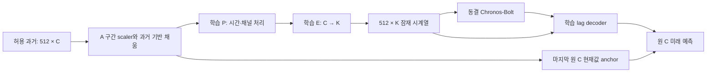
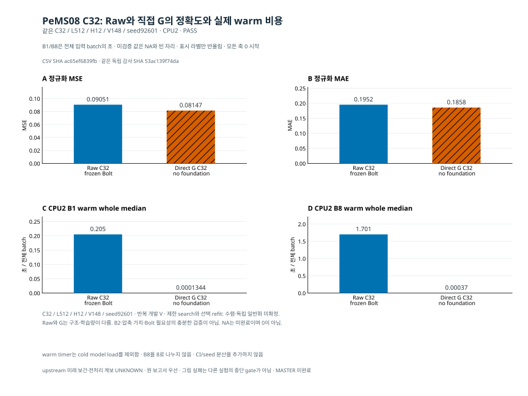

# B2 우선 검증의 최종 판단 — PeMS C32 B0/B2는 예산 종료로 미완료

이 보고서는 **이번 우선 검증에서 무엇을 말할 수 있는가**에 대한 판단이다. 원 전체 MASTER와 모든 실험의 완료 보고가 아니다. 기존 완료 보고와 실제 종료 JSON을 대사했으며 새 모델 실행·예측·통계 재집계·비용 측정은 하지 않았다. 기존 중간 보고와 원 결과는 작성 시점의 기록으로 보존한다.

**실험 전체 완료가 아니라, 이번 허용 경로를 정직하게 종료하고 미실행·미완료를 남기는 보고**다. 작성 시점에 원격 검증된 마지막 code/status snapshot은 `5b582c9af64adc371f6326a44a048af5a87f4922`다. 이 보고서의 실제 main 게시 성공을 미리 주장하지 않는다.

1. **B2의 계산 구조는 구현됐지만 모든 자료에서의 효능까지 입증된 것은 아니다.** Jena P0에서 실제 K개 입력, 동결 F와 앞단 역전파를 확인했다. 이번 PeMS C32의 partial search에서도 diagnostics 관측 파일에 F 입력의 유한·비영 gradient callback이 B0 3386회, B2 3382회 기록됐다. 이것을 모수별 기울기 검증이나 최종 성능 검증으로 확대하지 않는다.
2. **B0보다 B2가 항상 낫다는 근거는 없다.** Jena 두 seed의 MSE는 개선됐지만 Beijing K6에서는 악화됐다. 새 PeMS C32 대조는 search 도중 예산으로 종료돼 이 질문의 새 최종 답을 만들지 못했다.
3. **일부 고정 표현·선형 직접 head 대조에서 Bolt의 이득은 있었지만, Bolt의 일반적 필요성은 미확정이다.** 직접 G·Ridge·LoRA가 더 나은 기존 정확도도 있다. 서로 다른 조건을 합쳐 보편적 우열로 만들지 않는다.
4. **작은 K의 조건부 warm 추론 비용 이득은 관측됐지만 전체 효율 우위는 아니다.** 정확도 손해, 동일 F의 상주 비용, 학습량·cold load·모듈 차이가 남는다. 실제 C32 Raw/G에서는 단순 직접 G가 더 정확하고 빨랐다.
5. **기존 완료 후속과 새 C32 B0/B2의 미완료를 구분해야 한다.** 이번 두 fit은 `BUDGET_LIMIT_PRESERVED`, 후처리 8개는 미실행, 새 정확도·비용 행은 0이다. 재개는 저장점과 원 계약을 지키는 엔지니어링·학습 충분성 확인부터 필요하며, 새 방법을 자동 추가하는 근거가 아니다.

## 1. 지금 말할 수 있는 방법론과 아직 말할 수 없는 것

[계산 계약](../priority_b2_validation_20261016_v1/METHOD_CONTRACT.md)과 [Jena 우선 검증](../priority_b2_validation_20261016_v1/INFORMS_METHOD_STATUS_KO.md)의 후보는 다음과 같다.

P/E/D는 **원채널 미래 예측 MSE**로 학습한다. 그러므로 현재 결과를 모두 “재구성 학습이라 예측 표현을 못 배웠다”로 설명하면 실제 목적함수와 맞지 않는다. PCA는 일부 경로의 초기화이며 학습된 E/D 전체를 고정 PCA 방법으로 부르지 않는다. B0는 P가 항등이지만 F와 lag D를 통해 과거 창을 사용한다. B0를 시간정보가 없는 예측기로 설명하는 것도 부정확하다.

[확인] Jena P0은 `[8,512,21] → [8,512,6] → [8,48,6] → [8,48,21]`, 실제 F 입력 48 streams, F 입력의 역전파, P/E/D의 유한·비영 기울기, F의 requires_grad=false·parameter grad 부재·전후 hash 보존을 보고했다. optimizer update0의 연결 검사이므로 학습 성공이나 수렴 증거는 아니다. 한 원점의 미래 값/mask 교란에서 과거 입력·출력 불변을 확인했지만 원 TRAIN 정규화와 upstream 전처리까지 독립적으로 무누출임을 증명하지 않았다. 허용된 과거 창 안의 bidirectional 처리는 origin 이후 정답 사용과 다르며 시점별 strictly causal 표현의 증거와도 다르다.

[방법군의 전처리 계보 기록](../priority_valid_family_20261016_v1/INITIAL_FAMILY_KO_v1.md)에는 기존 quarter screen/probe의 full-loader 및 Jena legacy 전체 TRAIN 정규화 ancestry가 남는다. 이번 prefix 경계 검사는 그 과거 계보를 지우지 않는다. upstream 미래 보간·전처리의 인과성도 `UNKNOWN`이다.

원 C의 현재값 anchor가 별도로 우회한다. 따라서 모든 정보가 K만 통과하거나 전체 시스템 통신량·메모리가 C/K로 줄었다고 말하지 않는다. 교수님께 설명할 수 있는 범위는 **예측 목적의 시간·채널 처리와 C→K 표현을 고정 TSFM 앞에 붙였을 때, 단순 port·직접 예측기와 비교해 어떤 정확도–실제 비용의 교환관계가 생기는지 검증한 후보**다. 학술적 신규성·일관된 추가 가치·범용 우월성은 아직 별도 근거가 필요하다.

## 2. B0 대비 B2의 추가 가치는 자료와 조건에 따라 달랐다

[확인] Jena의 같은 C21/K6/L512/H48·A60 scaler·V43/관측43344·target/mask/origin/channel 대조에서 seed92601의 B0/B2 MSE는 `0.7841039310324822 / 0.6834428963980711`이었다. [추가 seed92602](../priority_core_followup_20261016_v1/RESULTS_KO_v2.md)는 MD 표시 정밀도로 `0.755008778 / 0.678813925`였다. 선택 fresh refit은 두 seed 모두 B0 3epoch, B2 1epoch다. 두 번째 seed의 MAE는 `0.502520209 / 0.501871227`로 차이가 작았다. 생략된 자릿수를 새로 만들지 않는다.

반대로 [Beijing core](../priority_valid_minima_20261016_v1/CORE_CONTRAST_KO_v1.md)의 같은 C11/L512/H48·seed92601·V43/관측20539 대조에서 B0 K6 MSE/MAE는 `0.79796643709754878 / 0.59313931444669032`, B2 K6는 `0.85542616112982017 / 0.60925171824727109`였다. B2 K11은 `0.7800566838351507 / 0.58014338541429433`이었다. 선택 refit은 각각 3/1/.25epoch다. K6 PCA 초기화와 K11 identity 초기화, P·용량·선택 학습량이 함께 달라 순수 압축 손실이나 P 하나의 인과 효과로 분해할 수 없다. K=C11은 채널 수 압축이 아니다. [지연 encoder 비교](../priority_valid_minima_20261016_v1/RESULTS_KO_v1.md)의 causal/bidir MSE `0.8026140272 / 0.7478236255`도 같은 seed·반복 V의 조건부 결과다.

[판단] 시간·채널 처리의 가능성을 버릴 근거도, 항상 필요하다고 정할 근거도 충분하지 않다. 추가 P, 모수 수, 학습·선택 노출이 함께 달랐고 V를 반복 개발에 사용했다. 이 결과가 대조학습이나 동적 directed graph의 필요성을 검증한 것은 아니다.

## 3. Bolt를 유지할 근거는 제한된 대조 안에서만 있다

[Jena 직접 예측 대조](../priority_b2_validation_20261016_v1/INFORMS_METHOD_STATUS_KO.md)의 R5a는 최종 B2 P/E/D와 scaler를 고정하고 전체 Z[512,6]에 공유 Linear(512,48)을 추가3epoch 학습했다. MSE는 `0.7378513781149217`이다. R5b는 같은 구조의 P/E/head/D를 fresh로 함께 학습한 별도 모델이며 `0.7201979035862862`였다. 부모 B2의 `0.6834428963980711`이 둘보다 낮았다는 관측은 유효하다. 다만 같은 최종 표현 비교와 같은 구조의 별도 학습을 합치거나 이 두 선형 head로 모든 직접 예측기를 대표하지 않는다.

같은 Jena 보고의 native Ridge/G MSE는 `0.5566463357048567 / 0.632217057436123`이었다. [실제 CPU LoRA](../priority_valid_family_20261016_v1/INITIAL_FAMILY_KO_v1.md)의 MSE `0.56392294174335067`도 B2보다 낮았다. Ridge는 32블록 평균+현재값의 FP64 닫힌해 대안이며 모든 ridge를 대표하지 않는다. LoRA는 내부 adapter를 학습하고 effective F가 달라지는 경로다. 원 base hash 복원과 모든 effective F 동결을 같은 말로 쓰지 않는다.

[PeMS C170 고정 표현 후속](../priority_core_followup_20261016_v1/RESULTS_KO_v2.md)은 같은 checkpoint/scaler/축·H12·관측301920에서 부모 MSE `0.104259697`, 전체 Z[512,43]와 같은 D/anchor를 쓴 head `0.12062289`를 보고했다. 이는 MD 표시 정밀도이며 부모는 제한1epoch, head는 추가3epoch다. PeMS의 joint no-Bolt 모델을 검증한 결과로 바꾸지 않는다.

[판단] “고정 Bolt를 통과하는 이 표현·decoder가 특정 선형 대조보다 나았다”는 설명은 가능하다. “foundation이 있어야 예측된다”, “단순 G보다 우수하다”, “학습 문제를 해결했다”는 결론은 현재 자료가 지지하지 않는다. 신경망의 수렴 미확정을 Ridge의 optimizer 수렴 문제로 옮기지도 않는다.

## 4. 정확도와 실제 비용은 함께 봐야 한다

[Jena 방법군](../priority_valid_family_20261016_v1/INITIAL_FAMILY_KO_v1.md)과 [동조건 B2 reference 비용](../priority_valid_family_20261016_v1/B2_REFERENCE_VALIDATION_KO_v1.md)에서 B2 K6의 CPU2 B8 warm whole 중앙값은 `0.32702095014974475`초/batch, LoRA r8/C21은 `1.1420140000991523`초/batch였다. 정확도는 앞에서 본 것처럼 LoRA가 나았다. B4 K6는 MSE `0.70435308018904963`·B8 `0.34662930015474558`초, [AdaPTS port K6](../priority_valid_family_20261016_v1/REMAINING_FAMILY_KO_v1.md)는 `0.73681898480041197`·`0.32289890013635159`초였다. 방법 순위를 합산한 표가 아니라 각 대조의 손익을 보여주는 근거다.

Jena B2/B4/LoRA는 search3/refit1과 같은 update/exposure였지만 LoRA는 F폭21·lr1e-4·effective F 적응이고 B2/B4는 K6·lr1e-3·동결 F다. 동등 모수·동등 F 연산은 아니다. AdaPTS도 affine LinearPort/RevIN=False/patch1의 원리 이식이며 원 논문 전체 재현이 아니다. 과거 Ridge/G CPU2 B8 기록 `0.0005060497205704451 / 0.0003303999546915293`초는 새 동시 paired benchmark나 새 RSS cap의 공정성 검증으로 승격하지 않는다.

이번 [C32 Raw/G 상세 결과](RAW_G_KO_v1.md)는 더 직접적인 반례다. 같은 ID 해시 선택 C32/L512/H12·seed92601·A60 scaler·V148·target/mask/origin에서 Raw MSE/MAE는 `0.09051378995956519 / 0.19521148986641665`, G는 `0.08146537281056535 / 0.18577497673500085`였다. CPU2 B1 중앙값은 Raw/G `0.20499334996566176 / 0.00013439985923469067`초/batch, B8은 `1.7010823499877006 / 0.000370049849152565`초/batch였다. 두 경로의 실제 관측은 각각56832라벨이다. 이번 PeMS 계약은 유한한 0을 관측값으로 취급하지만 upstream에서 0이 숨은 결측 코드였는지는 미확정이다.

G는 각 채널의 전체512과거에 공유512→32→12 GELU MLP와 현재값 anchor를 적용하며 교차채널 혼합과 F가 없다. Raw는 optimizer0, G는 search1577 update/25215 exposure·선택3epoch fresh refit1911 update/30570 exposure이고 `UNDERTRAINED_OR_BUDGET_LIMIT`다. G가 더 정확하고 빨랐다는 관측을 구조·학습량이 같은 foundation 단독의 인과 효과로 바꾸지 않는다. 과거 C170의 제한1epoch와 새 C32의3epoch도 C만의 대조가 아니다.

위 그림과 [시각자료 설명](RAW_G_VISUALIZATION_KO_v1.md)은 **기존 Raw/G만** 보여준다. 새 B0/B2 성능 막대를 추가하지 않았다. 비용은 physical 입력→전처리→실제 예측·복원→FP64 inverse·CPU 반환의 batch 전체이며 B8을8로 나누지 않는다. warm10/timed20/별도 intrusive stage20, cold model load는 timer 밖이다. stage 합과 whole을 같다고 주장하지 않는다. Route weights·guard RSS·학습 peak·F-only resident도 구분하며 G에 F hash나 resident 값을 만들어 넣지 않는다.

## 5. 새 PeMS C32 B0/B2는 무엇까지 했고 왜 미완료인가?

[B0 실제 종료 영수증](diagnostics/pems_c32_b0_k8_fit_root_v1/RESULT.json)과 [B2 실제 종료 영수증](diagnostics/pems_c32_b2_k8_fit_root_v1/RESULT.json)은 모두 `BUDGET_LIMIT_PRESERVED`, phase=`search`다. B0는847 optimizer update/13541 exposure·actual_epochs `1.6110648423557405`, B2는846/13525·`1.609161213563355`를 기록했다. 완료된 평가 endpoint는 둘 다0/.25/1epoch다. event_000003의 epoch=3은 **도달하려던 목표**이며3epoch 완료를 뜻하지 않는다.

native summary의 provisional selected_epoch는1이고 A_stop MSE는 B0 `0.10704020116595192`, B2 `0.0957040665116243`이다. 이는 search 선택용 A_stop 값이다. 미생성 final-V MSE·선택 fresh refit의 성능이 아니며 Raw/G의 V 결과와 비교하지 않는다. 이 값으로 B2의 최종 우위나 새로운 epoch 선택을 선언하지 않는다. 학습 모수 수도 B0 2048, B2 37472로 구조·용량 차이가 있다.

[확인] 두 outer의 error_class와 postflight_error_class는 null, 원 source39/immutable9 보존은 true다. 원 F 계약 hash와 종료 F hash가 같은 값으로 기록됐다. [B0 진단 관측](diagnostics/pems_c32_b0_k8_fit_root_v1/F_BACKWARD_OBSERVATION.json)과 [B2 진단 관측](diagnostics/pems_c32_b2_k8_fit_root_v1/F_BACKWARD_OBSERVATION.json)은 각각233bytes이며 trainable F input tensor·callback·finite·nonzero count가 각각3386/3382로 일치한다. F_parameter_gradients_allowed는false다. native source의 실제 forward hook은 requires_grad인 F 입력 context에 gradient hook을 달고, partial 반환 후에도 이 관측을 diagnostics에 저장한다. 따라서 이번 partial search에서도 동결 F 입력으로 유한·비영 기울기가 전달된 native 기록은 있다. P/E/D의 각 모수 기울기를 전부 검증했다거나 학습 완료·수렴·최종 V 성능을 확인했다는 증거는 아니다. 완료 BASE_FIT_RECEIPT는 없으며 Jena P0와 이번 PeMS의 증거 범위를 각각 유지한다. 예산 종료가 확인됐다는 사실만으로 학습 부족이 유일한 성능 원인이거나 방법의 한계가 해소됐다고 단정하지 않는다.

native 학습 F logical streams는 B0 `108328`, B2 `108200`으로 각 exposure×K8에 맞는다. A_stop 처리도 포함한 F session streams는 `111880 / 111752`다. 이는 K8 실행 counter의 일관성을 확인하는 metadata이며 전체 V 예측이나 독립 input-gradient 검사로 바꾸지 않는다. wrapper 실측 wall은 `6607.436097621918 / 6604.955097913742`초다. 병렬 두 작업의 값을 합쳐 campaign 경과시간으로 쓰거나 CPU process time·B1/B8 배포 추론 비용으로 쓰지 않는다.

이번 두 조건에는 final selected bundle·fresh A60 refit·전체 V 예측이 없다. ROOT는 실제 guard/closure와 PID 생성 시각을 대사해 한 fit group의 두 worker와 관측 owner6개의 반환을 확인했다. 이어 metadata 조립·감사까지 포함한 3개 guard의 관측 PID 11개가 모두 종료됐음을 별도로 확인했다. native dispatch는 `PARTIAL_PEMS_B0_B2_FITS_PRESERVED`, POST는 `PARTIAL_PEMS_B0_B2_POST_PRESERVED`로 보존됐다. POST의 steps/attempts는0, rescore2·CPU6 replay2·B1/B8 cost4는 `FIT_NOT_COMPLETE_PRESERVED`로 skip8이며 해당 guard를 만들지 않았다.

[실제 독립 감사](INDEPENDENT_PEMS_B0_B2_AUDIT_ROOT_v1.json)는 `NOT_COMPLETE_AUDIT_EVIDENCE_REJECTED`, 새 accuracy rows0·cost0·trial0이며 exit2로 종료됐다. source48 보존·입력 SHA 불변과 실제 종료 증거 대사가 된 것과 완성된 정확도/비용 감사를 통과한 것은 다르다. reference_rows도0이다. 이는 기존 Raw/G 완료 결과가 무효라는 뜻이 아니라 이번 감사에서 새 B0/B2와 matched 비교 행을 만들지 못했다는 뜻이다. B0/B2 관측 라벨 수를 기존 Raw/G의56832에서 복사하거나 미실행 비용을0으로 넣지 않는다. canonical builder·plot을 우회해 성공 MD/CSV/새 성능그림을 만들지 않는다.

원 종료 근거의 SHA는 B0 `a75492ce64a022697ae0d1f154794f77690868329094c39bba9e96cb7b3b18f0`, B2 `6300d52e164d961303bf98f5144aee5156cea240d314d8659491e412e632b47d`, 감사 `c3b575f01f420eda0dd3aeafd2ba2f9a69ac3f0afe3ca2443ed146798a03f6b6`다. [종료 시점 진행 metadata](B0_B2_TERMINAL_PROGRESS_20261017_v2.json)는 search 저장점·미완료·skip을 함께 기록한다. 기존 [학습 중 snapshot](INTERIM_METHOD_STATUS_KO_20261017_v1.md)은 당시 저장점의 기록으로 보존한다. 그 문서의 “진행 중”을 최신 실행 상태로 계속 읽으면 안 된다.

## 보존한 것과 재개에 필요한 조건

ROOT metadata로 확인한 각 search의 `checkpoint_000003.pt`는 원 위치에 보존됐다. B0는68988bytes, B2는646660bytes이며 서로 다른 원 SHA로 고정돼 있다. 이 보고서는 checkpoint tensor를 열지 않았으며 파일명 index3을 checkpoint 개수3이나 epoch3 완료로 해석하지 않는다. 하위 `_stage`/training API는 contract를 확인하고 model·optimizer·sampler·Torch RNG 상태를 복원하는 코드 경로를 갖는다. 그러나 현재 C32 native CLI는 기존 run/prediction/claim을 발견하면 fresh 실행을 거절하며 **검증된 C32 resume CLI는 없다**. 저장점 존재가 실제·동일 궤적 재개 성공을 뜻하지 않는다.

재개가 유효한 다음 작업이 된다면 먼저 아래 접점을 확인해야 한다. 이것은 보고서의 제안이며 새 학습을 자동 실행한 것이 아니다.

1. 원 source·PLAN·data/model/scaler/초기화 계약·저장점의 원 bytes를 고정하고, 별도 새 resume 진입점이 원 optimizer·sampler 진행 위치·RNG를 실제로 복원하는지 작은 엔지니어링 검사를 한다. 기존 fresh fit 명령을 다시 돌리거나 run을 이름만 바꿔 덮지 않는다.
2. 원 search endpoint0/.25/1/3·A_stop 선택 규칙·fresh A60 refit·원 MSE 주지표를 유지할 수 있는지 확인한다. 이번 예산 때문에1epoch를 임의 최종 endpoint로 바꾸거나 search checkpoint를 final bundle로 재분류하지 않는다.
3. 원 잔여 자원 안에 resume·refit·실제 V·FP64·CPU6·단독 B1/B8 비용·검산/보고를 담을 수 있는지 먼저 판단한다. 담기지 않으면 미완료와 필요한 추가 시간·자원을 기록하며 기존 한도를 초기화하지 않는다. 원한도 확대나 검증 성공을 이 보고서가 승인하거나 보장하지 않는다.
4. 충분 학습 조건의 비교를 만들 수 있을 때 같은 C32 계약에서 B0−B2와 기존 Raw/G 재사용 가능성을 확인한다. 그전까지 대조학습·새 graph·가변 K·추가 모듈·새 자료를 자동으로 붙이지 않는다.

## 남은 시간과 보류한 독립 후보

[추정] 같은 CPU2 조건의 이번 search 기록을 단순 비례하면 B0는 남은 730 update, B2는731 update에 각각 약95분이 더 필요하다. 계산은 search 전체 목표1577 update에서 실제847/846을 뺀 뒤, 관측6589.28/6586.46초를 각847/846 update로 나눈 평균을 곱한 것이다. A_stop 평가와 초기화가 섞인 거친 예측이므로 새 benchmark나 완료 ETA가 아니다. 원 worker 마감16:35:50까지 남은 시간에는 재개 구현·검증과 보고도 포함돼 이 search 추정량만으로도 여유가 없다.

fresh A60 refit은 실제 선택0/.25/1/3epoch에 따라 달라 아직 길이를 정할 수 없다. 같은 평균으로만 가늠하면 학습 update 기준0/160/637/1911개, 약0/21/83/248분이다. 이후 실제 V·FP64·CPU6·단독 B1/B8 비용·검산·게시가 추가된다. 따라서 재개 진입점이 이미 안전하게 구현됐다는 가정에서도 추가 CPU wall은 search 약95분에 refit과 검증 시간을 더해야 한다. 이것은 기존 상한을 늘리거나 새 자원을 승인한 문장이 아니다. 검증된 재개 CLI 구현 시간과 정확한 완료 시간은 현재 미확정이다. 동시 최대2모델·각CPU2/RSS3GiB·GPU0 조건을 바꿀 근거도 이번 실행에서 얻지 않았다.

기존 완료 조건을 제외한 별도 준비 후보는 아래와 같다.

    N9  Beijing independent B0 K3    준비된 native CLI/PLAN 있음, 현재 미입장
    N9  Beijing independent B0 K11   준비된 native CLI/PLAN 있음, 현재 미입장
    N8  Jena B2 K21                  준비된 native CLI/PLAN 있음, 현재 미입장

세 조건은 기존 승인 범위에 있으나 최초 실제 입장은 각각 N9 K6와 N8 Beijing K11만이었다. 나머지는 잔여 자원 재평가 대상으로 남았다. 기존 N9 K6 fit은 약127분이었고, 이것을 K 비율로 나눠 다른 조건의 완료시간이라고 말할 수 없다. 현재 세 조건의 별도 CPU probe·완주시간 근거와 새 입장/SPEC은 없다. 추가 실험이 이미 실행됐다고 표시하지 않으며, 원 마감 안에 실행·검산·보고까지 가능한 근거와 명시 큐 없이 자동 시작하지 않는다. 이 보류는 다른 경로의 음성 성능을 이유로 해당 원리를 폐기한 것이 아니다.

PeMS C32 continuation에는 별도 호환 재개·계보 감사가 없고, M5는 자산·접근 계약이 미확정이다. 과거 pre-selection/full-loader 명령은 보호 T 잠금·prefix 계약과 맞지 않는 부분이 있어 자동 재개하지 않는다. 전체 MASTER의 잔여와 이번 우선 검증의 실행·중단·근거 보고를 별개 상태로 남긴다.

기존 완료 후속에는 Jena R5a/b·추가 seed, PeMS 고정 head/동일 부모 CPU148, Beijing encoder/core, Jena 방법군·B2 reference 비용, nested PCA 비용과 [multi-K 두 부모 refit/여섯 출력](../priority_multik_resume_20261016_v1/MULTIK_RESUME_KO_v1.md), 이번 Raw/G가 있다. multi-K의 여섯 출력은 독립 학습6개가 아니며 모든 K에서 shared가 이긴 것도 아니다. C32 B0/B2는 **새 학습 두 조건을 시도했으나 최종 결과를 얻지 못한 상태**다. 원 MASTER/전체56조건·추가 K/seed/자료·독립 일반화·충분 수렴·동등 총예산 검증은 미완료이고 큰 큐나 보호 T 평가를 자동 재개하지 않는다. [M5 자산 경로](../DATA_ASSET_REVIEW_KO.md)의 접근/사용권 미확정은 그 경로에만 남는다.

교수님께 전달할 판단은 다음 정도로 좁히는 것이 타당하다. **예측 MSE로 학습한 C→K 입력 적응과 lag decoder를 고정 Bolt에 실제 연결했고, 구현·표현 고정 대조·방법군 비용을 확인했다. 추가 시간·채널 처리의 이득은 자료 의존적이며 단순 직접 예측기를 넘는 보편적 이득은 아직 없다. 새 PeMS 핵심 대조는 예산 종료로 평가 전 단계에 남았으므로, 지금은 새 알고리즘보다 재개 가능성과 충분 학습 조건을 먼저 확인해야 한다.** 원인 미확정을 학습 문제나 방법의 근본 한계 중 하나로 미리 결론내리지 않는다.
