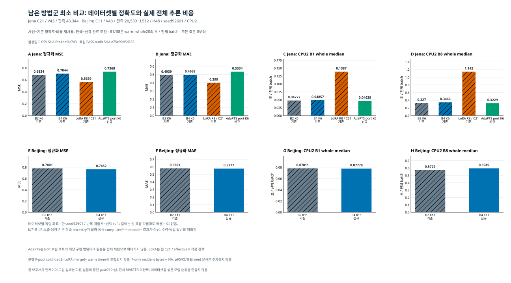

# 남은 방법군: 데이터셋별 시각자료

[실험 보고](REMAINING_FAMILY_KO_v1.md) · [원정밀도 CSV](REMAINING_FAMILY_RESULTS_v1.csv) · [그림 결속](REMAINING_FAMILY_FIGURE_BINDINGS_v1.json) · [코드](plot_remaining_family_v2.py) · [실제 독립 감사](INDEPENDENT_REMAINING_FAMILY_AUDIT_ROOT_v1.json)

Jena는 기존 B2 K6/B4 K6/LoRA R8와 신규 AdaPTS Bolt port K6를, Beijing은 기존 B2 K11과 신규 B4 K11을 표시했다. 기존 네 행의 정확도·비용은 재사용이며 새 독립 학습이나 재측정이 아니다. 각 데이터셋은 독립 좌표이고 표시는 명시한 역할 순서다. 사선은 재사용, 단색은 신규이다. 두 데이터셋을 합친 MSE 순위를 만들지 않는다.

MSE가 주지표이며 MAE와 CPU2 B1/B8 ordinary whole20 median을 함께 표시했다. B8은 8개 입력 batch 전체의 초이며 8로 나누지 않았다. 모든 축은 0부터이며 표시 라벨만 반올림했다. 8개 panel의 artist24개 값은 CSV의 원 수치와 정확히 대사했다. p90·CI·seed 분산을 새로 추가하지 않았다.

데이터셋별 독립 좌표 · 한 seed92601 / 반복 개발 V · 선택 refit 길이는 원 표를 따름(0도 허용) · CI 없음. K/F 폭·LR·노출·용량·기존 학습 ancestry가 달라 동등 compute/순수 encoder 효과가 아님. 수렴·독립 일반화 미확정.

jena/B2_K6_REFERENCE: selected refit 1.0 epoch, 752 updates, 12020 exposures; jena/LORA_R8_C21_REFERENCE: selected refit 1.0 epoch, 752.0 updates, 12020.0 exposures; jena/B4_K6_REFERENCE: selected refit 1.0 epoch, 752.0 updates, 12020.0 exposures; jena/ADAPTS_BOLT_PORT_K6: selected refit 3.0 epoch, 2254 updates, 36060 exposures; beijing/B2_K11_REFERENCE: selected refit 0.25 epoch, 189.0 updates, 3016.0 exposures; beijing/B4_K11: selected refit 0.25 epoch, 189 updates, 3016 exposures.

AdaPTS는 현재 Bolt 호환 포트 구현 범위의 최소 비교이고 원논문 전체 충실 재현으로 확대하지 않는다. LoRA는 원 C21 stream/effective F 적응 경로여서 K6 압축과 F 폭·모수·연산이 다르다. LR·초기화·선택 refit 길이(0도 허용)·실제 노출·학습 ancestry는 원 표의 조건을 그대로 유지한다. 동등 compute, 동일 표현/디코더, 순수 encoder의 인과 효과 또는 수렴·독립 일반화를 주장하지 않는다.

warm whole timer에는 모델/F-pool cold load 및 LoRA merge 준비가 포함되지 않는다. F-only resident bytes는 별도 미기록(NA)이며 Route 전체 weights/RSS로 대입하지 않는다. 그림을 위해 새 통계/trial 재집계, Task/원자료/NPZ/CP/모델 해석, 학습·추론·비용 재측정·프로세스 제어·Git·network를 수행하지 않았다. SVG는 공개용이며 PNG는 private preview이다. 보고서가 먼저이며 그림 실패는 다른 경로를 중단하는 gate가 아니다. 전체 MASTER는 미완료다.
