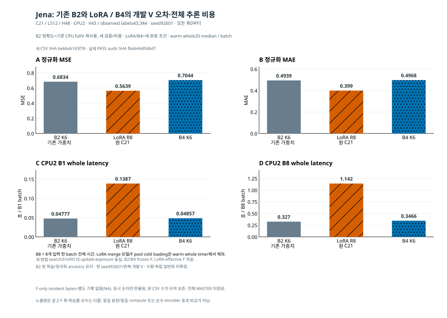

# Jena 초기 방법군: 현재 판단과 남은 작업

[확인] **이번 반복 개발 V에서는 LoRA가 더 정확했고, 작은 K의 B2는 더 빨랐다. B4가 B2에 추가 정확도 이득을 보이지 않았다.** 신규 LoRA R8·B4 K6의 학습/전체 V, 저장 예측 FP64 재채점, 선택 checkpoint의 fresh CPU6, 단독 CPU2 B1/B8 비용과 원 trial 검산을 완료했다. 기존 B2는 정확도를 재사용하고 별도로 검증·비용을 측정했다. 전체 MASTER는 미완료다.



[신규 학습·원수치·조건](INITIAL_FAMILY_KO_v1.md) · [신규 두 조건 CSV](INITIAL_FAMILY_RESULTS_v1.csv) · [B2 재사용·새 검증/비용](B2_REFERENCE_VALIDATION_KO_v1.md) · [B2 비용 CSV](B2_REFERENCE_COSTS_v1.csv) · [독립 감사](INDEPENDENT_INITIAL_FAMILY_RECOVERY_AUDIT_ROOT_v2.json) · [그림/12개 원값 결속](INITIAL_FAMILY_VISUALIZATION_KO_v1.md)

```text
방법         F 실제 폭  MSE                  MAE                  B1 초/batch           B8 초/batch
B2 재사용    6          0.6834428963980711   0.49388492449756366  0.047770299948751926  0.32702095014974475
LoRA R8      21         0.5639229417433507   0.3990099292123415   0.13867014995776117   1.1420140000991523
B4           6          0.7043530801890496   0.49675056670884404  0.04856874980032444  0.3466293001547456
```

[확인] 같은 Jena C21/L512/H48·seed92601·A50/A_stop/fresh A60·scaler·V43/43344 관측 라벨이다. 세 방법 모두 search3/refit1, search/refit1863/752 update·29769/12020 exposure다. LoRA는 원 C21을 사용하고 effective F를 적응하며 lr1e-4다. B2/B4는 K6와 frozen F, lr1e-3다. 동일 노출량을 동일 F 연산·모수·학습률·같은 표현/decoder로 해석하지 않는다.

[확인] 본 표의 B2 비용은 **이번 새 CPU2/RSS3GiB quiet reference 비용**이다. 신규 두 조건 보고서 말미의 원4GiB 비용 ancestry 경고는 과거 비용에 대한 것이며, 새 reference 비용을 미실행으로 뜻하지 않는다. 세 방법의 B1/B8 ordinary timed20 median을 제시했다. warm10과 별도 intrusive stage20은 분리했고 B8은8개 입력 한 batch 전체 시간이다. 모델/F pool cold load·LoRA merge는 whole timer 밖이다. F-only resident bytes는 별도 미측정 NA이며 전체 Route weights/RSS로 대신하지 않는다. 순차 측정한 한 장비의20trial이 통계적 유의성·배포 전 구간 비용이나 전체 Raw/G/Ridge Pareto를 입증하지 않는다.

[확인] 새 두 조건의 충분통계5418행과43344개의 같은 V 라벨을 검산했고, 실제200trial·8summary·40개 원정밀도 수치가 일치했다. 비용 F 합계12150 streams/250calls다. B2 reference는 별도2709행·100trial·4summary를 검산했다. full V는 저장 예측 재채점이고 checkpoint 재추론은6 origin의4+2 batch다. 검사 통과를 새 독립 일반화로 세지 않는다. 제한 학습의 수렴과 기존 전체 TRAIN 정규화/full-loader ancestry는 미확정·상속 한계로 남는다.

원 후처리의 경로키 오류로 원 wrapper가 PARTIAL/false4/null guard를 남긴 기록과, LoRA4열/B4 6열 차이를 놓친 첫 감사의 실패를 보존했다. 별도 복구는 미실행 비용4개만 실행했고 학습·validation을 반복하지 않았다. [실패 감사](INDEPENDENT_INITIAL_FAMILY_RECOVERY_AUDIT_ROOT_v1.json)와 새 감사/입력 SHA가 모두 남아 있다. 이 실행상의 판정 오류를 표현 학습 실패 원인으로 설명하지 않는다.

현재의 판단은 **작은 K의 비용 이득과 정확도 격차를 함께 보고해야 한다**는 것이다. 이번 묶음은 Bolt 없는 직접 대조를 새로 학습한 실험이 아니다. 기존 [Jena no-Bolt 우선 검증](../priority_b2_validation_20261016_v1/README_KO.md), [추가 seed·PeMS 동일 표현 비교](../priority_core_followup_20261016_v1/README_KO.md)와 구분한다. B2/B4의 새 모듈이나 학습 길이를 결과가 좋아질 때까지 자동 추가하지 않는다.

다음 유효 작업은 원 Beijing shared/max-only multi-K 두 부모를 마지막 정상 CP0에서 명시적으로 재개하는 것이다. 신규 search를 반복하지 않고 실제 refit 완료 후 K3/6/11의6개 출력·FP64·CPU6·단독 B1/B8을 각각 검증한다. [원칙/저장점·재개 조건](../priority_multik_resume_20261016_v1/README_PREPARATION_KO.md)의 현재 표시는 준비 상태이며 이번 두 family 완료가 그 작업을 채우지는 않는다. 원본/백업 checkpoint, optimizer·sampler·Torch CPU RNG를 보존하지만 미저장 진행량과 중단 없는 실행의 bitwise 동일성은 미확인이다. 실제 새 PLAN·입장·현재 자원 확인을 결속하기 전 자동 실행하지 않는다.

Jena AdaPTS·Beijing B4, 독립 K3/K11, PeMS 채널 subset, Jena full-C, 다른 필수 자료/장기 학습·동등 budget·원 전체 비용은 완료로 표시하지 않는다. M5는 자산·권한 확인 경로만 보류이며 다른 원리는 계속 별도로 판단한다. 보호 T 신규 평가·선택, 기존 큰15/56/all-K 큐 자동 재시작, 설치·자원 확대·PPT/PDF는 수행하지 않았다. 게시 전 문서이므로 실제 push 확인은 containing commit과 별도 원격 SHA 영수증을 따른다.
