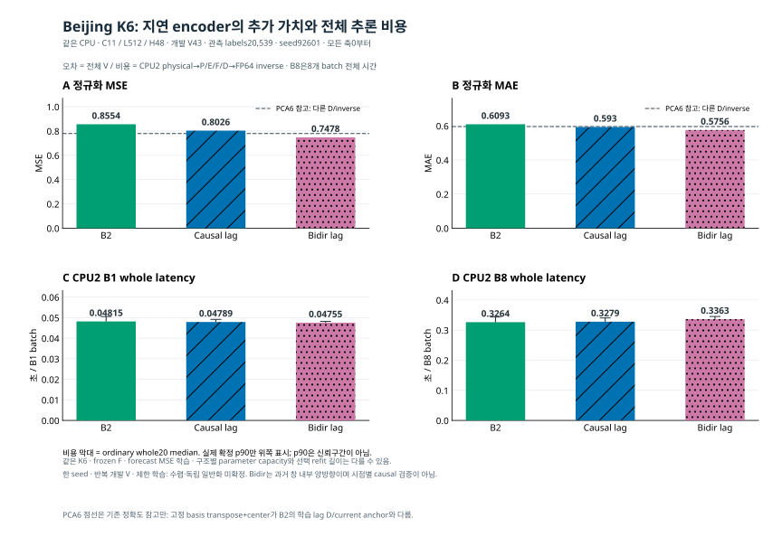

# Beijing K6 후순위 검증

[확인] 기존 승인 최소 비교 B2·causal lag·bidirectional lag의 실제 학습·전체 V43 추론·독립 FP64 재채점·fresh CPU6 checkpoint 재추론·CPU2 단독 전체 비용을 완료했다. **전체 MASTER·수렴·독립 일반화는 미완료다.**

[한국어 결과](RESULTS_KO_v1.md) · [원정밀도 CSV](RESULTS_WITH_COST_v1.csv) · [독립 산술 감사](INDEPENDENT_ARITHMETIC_REVIEW_ROOT_v1.json) · [실제 입력/출력 SHA](REPORT_INPUT_BINDINGS_v1.json) · [그림 조건/단위](VISUALIZATION_KO_v1.md)

같은 반복 개발 V와 seed92601에서 MSE는 B2 0.8554261611298202, causal 0.8026140271504644, bidirectional 0.7478236254727697이다. 검색 최대 일정은 같지만 선택 refit 길이는 각각1/.25/3epoch여서 encoder 구조만의 효과로 단정할 수 없다. bidirectional은 예측 origin 이전 과거 창 내부 처리이며 시점별 causal 표현이나 directed graph를 검증한 것이 아니다. 충분 학습 여부도 미확정이다.

비용 B1/B8의 단위는 **한 batch 전체 초**다. B8은8개 origin으로 구성한 한 batch이며 8개 batch의 합이나 origin당 시간이 아니다. median/p90은 저장된20회 ordinary whole 측정의 요약이다. PCA6는 고정 basis inverse+center를 사용한 참고로 학습 lag decoder/current anchor와 조건이 다르며, Raw/G의 추론 장치 미기록을 동등 CPU 비교로 채우지 않았다.

[고정 nested PCA K3/6/11 비용 그림](../priority_nested_cost_20261016_v1/VISUALIZATION_KO_v1.md) · [기존 Jena/PeMS 우선 검증](../priority_core_followup_20261016_v1/README_KO.md) · [실행 계획](PLAN.json) · [실행 코드](beijing_minimum_runner.py) · [감사 코드](independent_beijing_audit.py) · [보고 생성 코드](build_beijing_report.py) · [그림 코드](plot_beijing.py)

원자료·예측 NPZ·모델 checkpoint는 공개하지 않는다. 보고의 통과 검사는 계산·증거의 일관성을 확인한 범위이며 방법의 일반적 우월성을 뜻하지 않는다. 이전 중단 대형 큐를 자동 재시작하지 않았고, 남은 기존 후순위는 별도 명시 입장과 원 마감·자원·T 잠금을 따른다.
