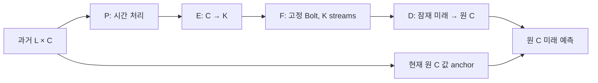

# 방법과 비교를 읽는 순서

이 문서는 모델의 역할과 판단 기준을 설명한다. 실제 완료 범위·점수·비용·게시 상태는 실행 영수증과 최종 결과 보고서에서 확인해야 한다. 학습 전 초기값, 제한된 선별 학습, 충분 수렴을 구분한다.

## 먼저 설명할 연구 질문

시계열 파운데이션 모델(TSFM)은 여러 시계열에서 미리 학습한 예측 규칙을 새 시계열에 활용하는 모델이다. 이번에 사용하는 고정 Chronos-Bolt는 각 입력 stream을 단변량 시계열로 예측한다. C개 채널을 그대로 넣는 Raw와, 과거 정보에서 만든 K개 잠재 시계열을 넣는 경로를 비교한다. **적은 F 입력으로 원 C개 채널의 미래를 예측할 때, 정확도와 전체 추론비용을 함께 만족하는 조건이 있는가**가 질문이다. F를 붙이면 반드시 좋아진다는 가정은 두지 않는다.

외부 표현을 학습할 이유도 이 질문 안에 있다. 분산을 많이 보존하는 PCA가 고정 F에 예측하기 쉬운 시계열을 제공한다는 보장은 없다. 반대로 PCA보다 나았다는 사실만으로 표현학습의 효과를 입증할 수도 없다. 현재값 anchor, decoder, 초기화, 학습량이 달라졌는지 먼저 확인한다. 압축의 정보 손실과 고정 단변량 예측기의 좌표 호환성은 별개의 문제다.

## 한 origin에서 실제로 사용하는 정보

입력은 origin 이전 L행이다. 각 채널의 평균·표준편차는 허용 A 범위에서만 적합한다. 과거 창의 결측은 창 시작에서 A 평균으로 초기화한 뒤 과거 방향으로 채운다. 입력 창 밖의 추가 과거나 미래 정답을 몰래 주지 않는다. 구체적인 자산·시간 경계와 계보 한계는 [데이터 계약](../../../DATA_CONTRACT.json), [실제 정보 경계 검사](doc_0003.md)에 있다.

B0의 P는 항등이다. 학습 adapter 경로에서 E와 7시차 D는 학습 가능하고 PCA center는 buffer다. B2/B4의 P도 학습한다. F의 가중치는 고정하지만, E/P를 학습할 때 F를 지나는 입력 gradient와 activation은 필요하다. 따라서 외부 adapter라는 이유만으로 역전파 메모리가 사라지는 것은 아니다. 반면 고정 PCA 경로는 optimizer 없이 중심화 투영과 역변환을 사용하며, B0의 현재값 anchor·학습 D와 같은 경로가 아니다.

이 구조는 **F에 들어가는 stream 수를 K로 줄이는 것**이다. 전체 시스템의 입력 정보를 K개 값으로 제한하는 주장은 아니다. 원 C개의 현재값을 anchor에 사용하고, G/H 경로도 원 C개 과거를 사용한다. F 행 수의 감소와 전체 파이프라인의 실제 시간·메모리를 별도로 측정한다.

## 무엇을 바꾼 대조인가

- **B0와 B2/B4:** 같은 K, decoder 클래스, 손실, 허용 과거와 학습 설정에서 시간 처리 모듈의 추가 가치를 본다. 서로 따로 학습한 E/D의 가중치까지 같다는 뜻은 아니다. B2/B4는 공급된 과거 창 전체를 사용하므로 창 안의 prefix causal 표현이라고 부르지 않는다.
- **지연 압축:** 매 시점에 같은 채널 혼합 가중치를 적용한다. 과거 방향 7시차와 창 내부 양방향 7시차를 비교한다. 양방향 대조가 뒤쪽의 과거 행을 쓴다는 사실과 origin 이후 정답 누출은 구별한다. 같은 lag 숫자도 데이터의 시간 간격에 따라 다른 물리적 길이다.
- **G-only와 결합:** G는 현재값에 작은 직접 미래 예측을 더하는 channel-shared 모델이며 F를 호출하지 않는다. 전역 계수 결합은 M에서 적합한 `g + α(b−g)`다. 조건부 H는 과거·g·b−g를 받아 G에 보정값을 더한다. 같은 폭의 past-control에서는 b−g 자리에 이미 주어진 과거 특징을 넣는다. 따라서 단순히 파라미터를 추가한 효과와 Bolt 예측을 추가한 효과를 나누어 볼 수 있다.
- **가변 K:** 하나의 E/D에서 여러 K prefix를 학습하는 모델, 최대 K 전용 모델의 사후 절단, K별 독립 학습, nested PCA를 비교한다. prefix 추론에서는 실제 K개 stream만 호출한다. 공통 full-PCA 초기화와 독립 K=C의 항등 초기화 차이도 함께 보고한다.
- **Raw·LoRA·작은 직접 모델:** 더 작은 Raw 백본, 병합 LoRA, G/direct 예측기가 유리할 가능성을 그대로 남긴다. AdaPTS와 TSMixer/TimeMixer는 [이식 범위](../../../LITERATURE_MAPPING.md)가 명시된 비교이며 원 논문 전체 재현으로 부르지 않는다.

상세한 trainable 대상·축·수명 관리는 [모델 구현](../../../MODEL_IMPLEMENTATION_KO.md)에 있다. LoRA는 base 가중치를 고정하고 q/v의 저랭크 adapter를 학습한다. 배포 측정에서는 병합 예측의 parity와 원 base 복구를 확인한다.

## 점수와 학습을 함께 판단하는 기준

부모 모델은 A_fit 학습과 A_stop 선택 후 선택 epoch 수로 A60 통계·PCA·모델을 새로 만들어 재적합한다. M 결합과 A+M 강한 대조는 역할이 다르고 V 선택을 사용하므로 부모 학습과 분리한다. 데이터 구간, K, seed, 학습률, 최대 epoch, 실제 노출, 선택 checkpoint와 정규화를 비교표에서 함께 확인한다. 같은 epoch라도 A와 M의 origin 수가 다르면 update·노출·총학습비용은 같지 않다.

주지표는 A60 정규화 좌표에서 관측 target을 채널별로 집계한 macro MSE다. MAE와 원단위 보조지표도 남긴다. F의 입력별 출력은 quantile 0.5지만, D나 H를 거친 원공간 예측을 원 확률분포의 median이라고 해석하지 않는다. 물리 단위가 다른 센서들의 합산 오차를 단일한 물리량으로 해석하지 않는다.

CP0가 선택되면 초기 모델이 최종 artifact다. 해당 조건의 비교 이득을 시간 표현의 **학습 효과**라고 부를 수 없다. 마지막 checkpoint가 계속 최선이면 수렴 실패로 확정하지 않고 학습 미해결로 남긴다. 선별 실험의 음성 결과도 다른 원리의 최소 실험을 중단하는 근거로 쓰지 않는다.

## 결과가 허용하는 결론의 범위

저장 예측의 독립 재채점, 공개 충분통계 재집계, 선택 checkpoint의 실제 재추론, 독립 재학습은 서로 다른 검증이다. [검증 규약](../../../AUDIT_PROTOCOL_KO.md)과 실제 영수증에서 각각의 수를 확인한다. 정보 경계 검사 통과는 성능 개선이나 모든 누출의 부재를 뜻하지 않는다. legacy 데이터의 전처리 계보와 TSFM 사전학습 중복 여부도 한계로 남는다.

정확도–비용 주장은 [전체 배포 경로 실측](../../../COST_PROTOCOL_KO.md)이 있는 동일 scope끼리만 한다. K/C를 속도비로 대신 쓰거나, 결합을 계산할 때 저장 부모 예측을 읽었다는 이유로 배포 F 비용을 0으로 세지 않는다. 최종 T는 선택을 잠근 뒤 평가하며 이후의 모델 수정·재선정에 쓰지 않는다.

이번 비교만으로 Chronos-Bolt의 필수성을 확정하지 않는다. G/direct와의 비교는 실용적인 반례이지만, 동일하게 고정한 P/E/D에서 학습한 native 예측기와 F를 교체한 대조까지 모두 끝났다는 뜻은 아니다. 해당 범위가 새 캠페인에서 미실행이면 그대로 남긴다. 알려진 예측 결합이나 prefix 학습을 사용했다는 사실도 학술적 신규성의 증명이 아니다.
