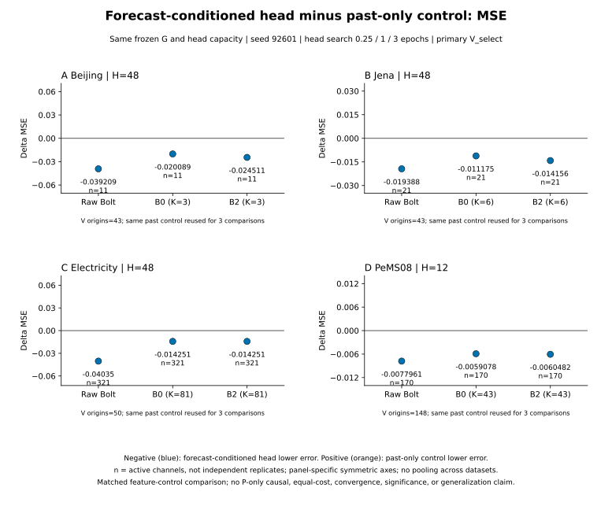
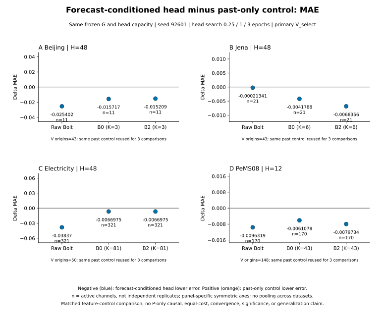

# 예측 특징과 추가 과거 특징의 같은 G·동일 용량 비교

[MSE 그림](../../../diagnostics/forecast_vs_past_matched_20261016T002025_final/MSE.svg) · [벡터 MSE](../../../diagnostics/forecast_vs_past_matched_20261016T002025_final/MSE.svg) · [MAE 그림](../../../diagnostics/forecast_vs_past_matched_20261016T002025_final/MAE.svg) · [벡터 MAE](../../../diagnostics/forecast_vs_past_matched_20261016T002025_final/MAE.svg) · [전체 원수치](../../gzip_extra_aux_20261016_v1/files/item_0430.csv.gz) · [144 패턴 원수치](../../gzip_extra_aux_20261016_v1/files/item_0431.csv.gz) · [검증 증빙](../../gzip_aux95_1792094747124151400/files/item_0065.json.gz) · [입력 SHA](../../gzip_extra_aux_20261016_v1/files/item_0429.json.gz) · [재현 코드](../../../diagnostics/forecast_vs_past_matched_20261016T002025_final/reproduce.py)

[확인] 기존 channel_patterns.py:424는 CONDITIONAL과 PAST_CONTROL에도 b·g 전체 부모 서명 일치를 요구해 의도한 비교를 누락했다. networks.py:339–346의 control=True는 b의 shape만 확인하고 값을 사용하지 않으며 최근 H 과거−현재값을 특징으로 쓴다. postfit.py:214–215는 control의 b=g로 지정한다. 이번 별도 진단은 기존 코드를 바꾸지 않고 정확한 G 부모가 같은 쌍을 공개 metadata로 엄격히 검증했다. CONDITIONAL−ALPHA_FIT의 전체 부모 동일 요구는 변경하지 않았다.

예측 head 입력은 같은 과거 입력·g−현재값에 b−g를 추가하며, control은 마지막 부분을 최근 H 과거−현재값으로 교체한다. 같은 G, hidden32, L+2H 입력, head parameter 수, 초기 weights SHA, seed92601, lr0.001, micro4/effective16, 실제 3epoch/updates/노출/기원빈도를 맞춘 비교다. 실제 V 선택 checkpoint는 각자 선택되어 selected_updates와 weights/hash가 다를 수 있다. 최초 Raw/B0 quarter-K/B2 quarter-K만 선택했고 후속 deep 결과는 포함하지 않았다.

366개 독립 prediction 감사 중 해당 16개 V manifest의 exact SHA와 PASS를 확인했다. 타깃·observed mask·origin·channel ID의 shape/dtype/SHA, cohort/data/scaler와 학습 계약, A60에 고정된 부모의 경계·역할을 검증했다. 개별 head artifact, 모델, NPZ 또는 원자료를 열지 않았다. 저장 채널 오류 CSV의 gzip을 실제 해제해 원 byte SHA를 확인하고, 채널별 (SSE_left−SSE_right)/count 및 (SAE_left−SAE_right)/count를 math.fsum으로 활성 채널에 균등 평균했다. 전체 delta는 두 V manifest 점수 차이와 절대 허용오차 1e−9 이내인지 확인했다. 패턴은 기존 A_fit snapshot의 low/high/NA를 재사용했고 빈 그룹은 None(빈 CSV 값)으로 유지했다.

이는 같은 G와 동일 head 용량 아래 예측 차이 특징과 추가 과거 특징의 대조다. P만의 인과효과, 비용 동등, 충분 수렴, 독립 일반화나 통계적 유의성을 의미하지 않는다. 자료별 PAST_CONTROL 하나를 세 번 참조하므로 12개를 독립 반복으로 세면 안 된다. n은 활성 채널수다. 각 자료의 H·정규화가 달라 자료 간 평균을 계산하지 않는다. 데이터별 대칭 축·0선과 색각 안전 청색/주황 및 부호 수치로 표시한다. 과거 특징의 observed exact-zero 그룹은 간헐 수요의 증명이 아니며 Jena의 legacy FP32 역정규화 한계도 남는다.

재현은 같은 campaign 위치에서 reproduce.py --output 새폴더로 실행한다. source·98개 공개 metadata/CSV 입력 SHA를 고정하며 기존 결과는 덮어쓰지 않는다. 새 학습·추론·F·GPU·T 접근은 하지 않는다. PNG 300dpi와 SVG를 함께 제공한다.
