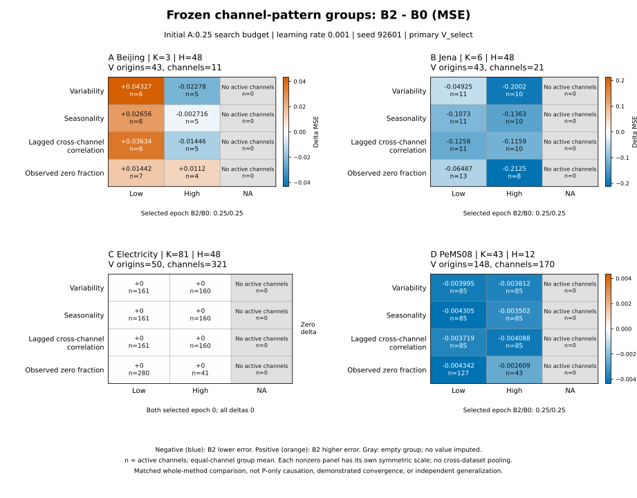
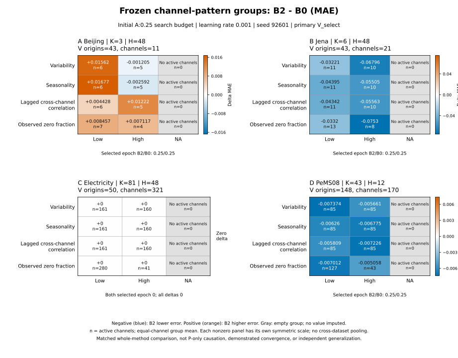

# 초기 quarter-K B2−B0의 고정 채널 패턴별 차이

[MSE PNG](../../../diagnostics/pattern_figures_20261016T001007_final/MSE.svg) · [MSE SVG](../../../diagnostics/pattern_figures_20261016T001007_final/MSE.svg) · [MAE PNG](../../../diagnostics/pattern_figures_20261016T001007_final/MAE.svg) · [MAE SVG](../../../diagnostics/pattern_figures_20261016T001007_final/MAE.svg) · [반올림하지 않은 원수치 CSV](../../gzip_extra_aux_20261016_v1/files/item_0563.csv.gz) · [재현 스크립트](../../../diagnostics/pattern_figures_20261016T001007_final/reproduce.py) · [결박 manifest](../../gzip_extra_aux_20261016_v1/files/item_0564.json.gz)

[확인] 초기 primary E1 B2/B0의 Beijing K=3, Jena K=6, Electricity K=81, PeMS08 K=43만 선택했다. seed=92601, 등록 search budget A:0.25, learning rate=0.001이 같고, 실제 left/right ID를 고정해 후속 G1·장기학습 결과를 포함하지 않았다. 타깃·관측 mask·origin·channel ID의 배열 SHA, cohort, data SHA와 scaler SHA가 각 쌍에서 일치하는 공개 V manifest를 확인했다. 이 그림을 만들 때 배열 파일은 열지 않았다.

CSV의 delta_mse/delta_mae 문자열과 활성 채널수는 기존 PAIRED_GROUP_DIFFERENCES.csv에서 반올림 없이 복사했다. 왼쪽/오른쪽 group MSE·MAE, 실제 선택 epoch, H, V origin 수, mask SHA를 함께 보존했다. delta는 FP64 채널별 오차 차이의 균등평균이므로 CSV의 두 group 평균을 다시 빼지 않았다. 새 재평가·추론·학습이 아닌 저장 V의 기술 분석이다.

각 패널의 low/high/NA는 A_fit에만 적합해 고정한 네 패턴의 그룹이다. n은 V에서 적어도 한 관측 타깃이 있는 활성 채널수이고 독립 반복수나 독립 표본수가 아니다. 48셀 중 16개의 NA는 빈 그룹이며 수치를 0으로 대체하지 않았다. Low/high 채널은 서로 겹치지 않지만 같은 채널이 서로 다른 패턴 행에 반복된다. Observed zero fraction은 간헐 수요를 증명하지 않는다. Jena의 legacy 정규화 자료에서 역변환 FP32의 물리적 exact-zero 보존은 제한된다.

Electricity는 두 방법 모두 선택 epoch 0.0이며 모든 차이가 실제 0이다. 나머지는 양쪽 선택 epoch 0.25이다. 이는 등록 budget이 같다는 사실과 별개이며, Electricity 결과로 학습된 B2의 효과가 없다고 단정할 수 없다. 실제 update 수는 원 group CSV에서 비어 있어 추정해 채우지 않았다.

음수는 B2의 오차 감소, 양수는 증가다. 0 중심의 색각 안전 청색/주황 팔레트와 부호·원수치 주석을 함께 써 회색조에서도 판독 가능하게 했다. 0이 아닌 패널은 각자 대칭 색 범위를 쓰고 Electricity는 색 차이가 없어 별도 색 막대를 생략했다. 자료별 H·정규화·단위가 달라 자료 간 평균이나 색 강도 비교를 하지 않는다. 불확실성 구간이나 유의성 별표는 산출하지 않았다.

같은 recipe/K/cohort/mask 아래 전체 B2와 B0의 차이다. P만의 인과효과, 충분 수렴, 독립적인 일반화 검증으로 해석하면 안 된다. 단일 seed의 초기 짧은 search budget이라는 한계가 있다. 이 파일은 뒤에 도착하는 deep V를 자동 포함하지 않는다.

재현: 이 폴더의 reproduce.py를 원 campaign R 위치에서 실행한다. 기본값은 기존 산출물 덮어쓰기를 거부하므로 새 폴더를 --output으로 지정한다. 입력은 manifest에 결박된 공개 saved-V group CSV와 JSON metadata뿐이며 모델·원자료·F·T에 접근하지 않는다. CUDA=-1, CPU thread=2를 설정한다. PNG는 3840×3000, 300 dpi이고 SVG도 함께 제공한다.
