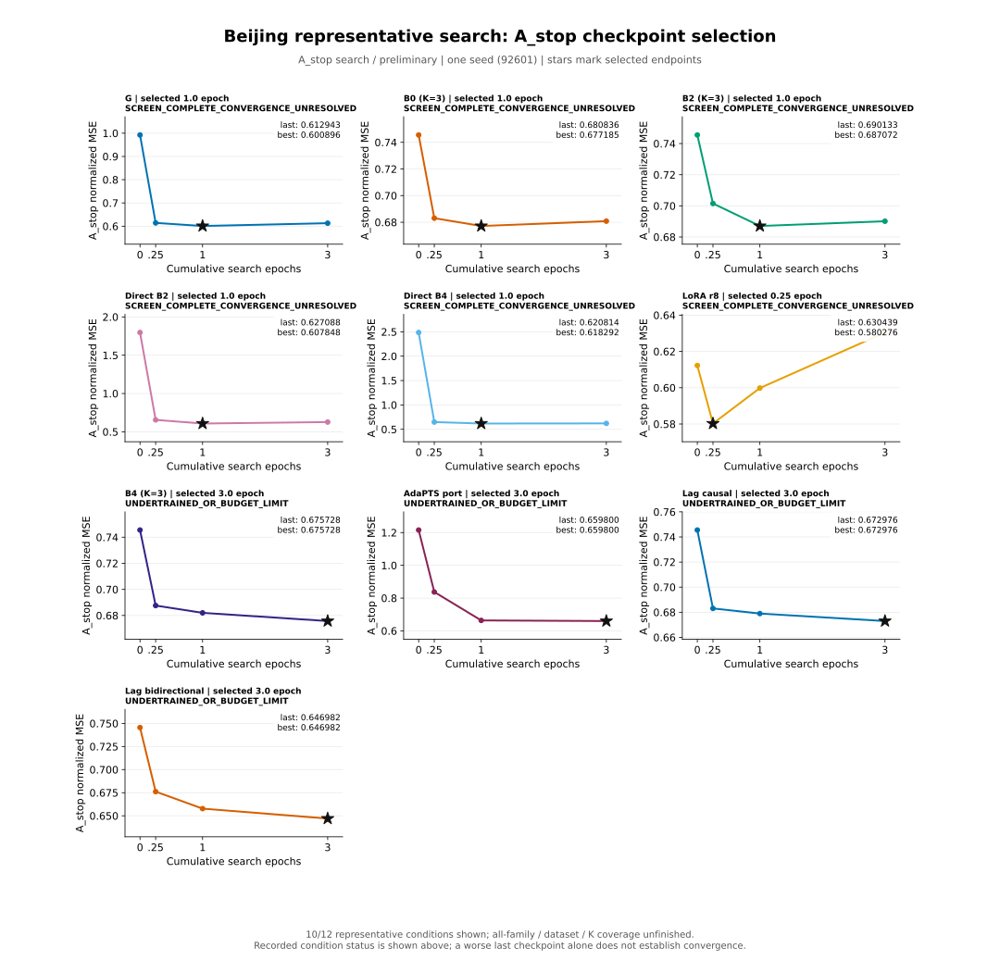
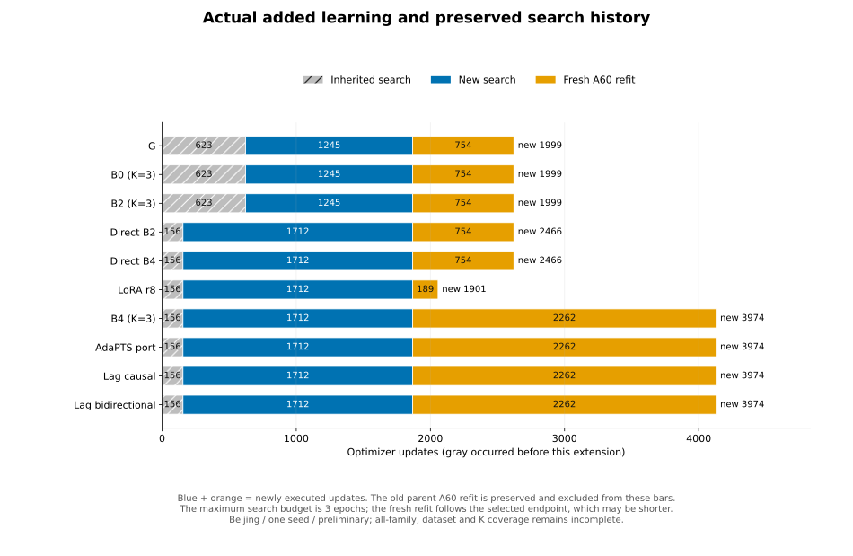
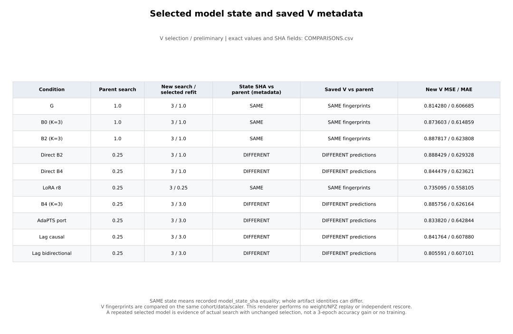

# 대표 학습 결과: 완료10 / 계획12

[완료 범위와 누락2조건의 이유](doc_0079.md)를 먼저 읽어 주세요. 아래 그림은 Beijing·seed92601의 실제 완료10조건만 표시합니다.

# Beijing 대표 학습 심화: 입력 봉인 그림

[확인] 완료된 대표 조건의 공개 search CURVE·BASE·learning-extension·V manifest만 읽었다. 최대 검색량 3 epoch와 A_stop이 선택한 refit 길이는 다르다. `ACCOUNTING.csv`는 inherited search, 이번 신규 search, 새 A60 refit, 보존한 이전 refit을 구분하며 이전 refit은 그림 막대에 더하지 않는다. 동일 origin 반복 노출을 새 독립 데이터로 세지 않는다.

G/B0/B2의 기존 1 epoch 부모와 새 3 epoch 검색은 선택된 model_state_sha·scaler와 저장 V fingerprints가 같은 경우를 표시한다. 이는 실제 추가 검색 및 fresh refit을 하지 않았다는 뜻이 아니다. 새 bundle은 run/spec/search 계약을 포함해 달라질 수 있다. model_state SHA는 가중치 재열람 없이 기록을 비교한 것이므로 독립 checkpoint replay를 했다는 뜻도 아니다. V가 없으면 TRAIN_ONLY이며 0점이나 실패로 대체하지 않는다.

마지막 checkpoint가 선택된 checkpoint보다 나쁘다는 이유로 수렴을 판정하지 않는다. 각 조건의 실제 training_status를 그대로 유지하며, UNDERTRAINED_OR_BUDGET_LIMIT 등 다른 상태를 하나의 문구로 바꾸지 않는다. 이번 그림은 Beijing 한 seed의 선택 단계 중간 결과다. 모든 가족·자료·K의 최소 학습 완료나 독립 TEST 일반화 증거가 아니다.

모든 원수치는 CURVES.csv·ACCOUNTING.csv·COMPARISONS.csv에 전체 정밀도로 저장했다. INPUT_BUNDLE.json에는 읽은 공개 메타데이터의 정확한 문자열과 SHA가 있어 원 프로젝트 자산 없이 다시 그릴 수 있다. INPUTS_SHA256.json은 부재했던 V도 명시한다. REPRODUCIBILITY_CHECK.json은 봉인 입력을 두 번 독립 파싱하고 PNG/SVG/CSV를 새 경로에 두 번 생성해 바이트 SHA가 일치했는지 기록한다. 이는 모델 재학습·추론·독립 오차 재계산 검사와 다르다.

재현: `python -X utf8 -u generate.py --input-bundle INPUT_BUNDLE.json --output-parent <새_출력_부모>`

나중에 전체 대표 12조건을 포착하려면 `--public-root <campaign> --run-id <완료된_ID>`를 각 ID에 반복하고 새 --output-parent를 지정한다. 미완료 fit은 오류로 멈추며, 기존 결과를 덮어쓰지 않는다. 완성된 입력 묶음을 재현할 때에는 원 V가 나중에 추가돼도 이전 그림이 바뀌지 않는다.

V3는 일반 predictions 및 ordered_predictions의 두 실제 canonical 위치를 exact run/split/cohort/선택 artifact로 검사하고, 유일한 경로와 SHA map을 INPUT_BUNDLE에 봉인한다. load_tables는 그 map만 읽으며 당시 없던 V를 이후 live 파일로 보충하지 않는다. ordered metadata의 parent_artifact_sha256와 일반 metadata의 artifact_sha256를 각각 검사한다. reused_prediction_cache가 기록되지 않으면 None/UNKNOWN으로 보존한다.

표시 family는 봉인한 registry scientific row와 SOURCE spec을 대조한다. E4의 underlying BASE family B0는 full-C PCA/ordered 모델 구현을 뜻하며, 실제 k_grid가 [3,6,11]인지 [11]인지 확인해 Shared ordered K와 Max-K trained를 구분한다. underlying family 수치는 바꾸지 않는다. 전체 registry mutable byte는 고정하지 않고 선택한 scientific row만 전후 동일성을 확인한다.

V2 봉인 입력도 읽을 수 있으며, 그 입력에 기록되지 않은 ordered V는 소급 추정하지 않는다. backward 재현의 숫자·그림 동일성 여부는 별도의 V3 검산 proof에서 명시한다. 새 전체 대표 그림 생성은 실제 완료 조건과 ROOT trigger 이후에만 수행한다.
