# 실험 시각화 스냅샷

이 디렉터리는 실제 저장 예측의 FP64 재채점·관측 마스크·원점·채널·참조 SHA 검산 후 만든 파생 그림이다.
학습 재실행·모델 선택·독립 일반화 검증을 수행한 결과가 아니다. V는 선택용 예비 결과이며 미실행 그룹은 manifest에 PENDING으로 남긴다.

- `accuracy_by_k`: AVAILABLE_PARTIAL_EVIDENCE — Only actual checked forecasts; fixed references alone do not complete the registered K sweep. Training budgets/seeds remain distinct.

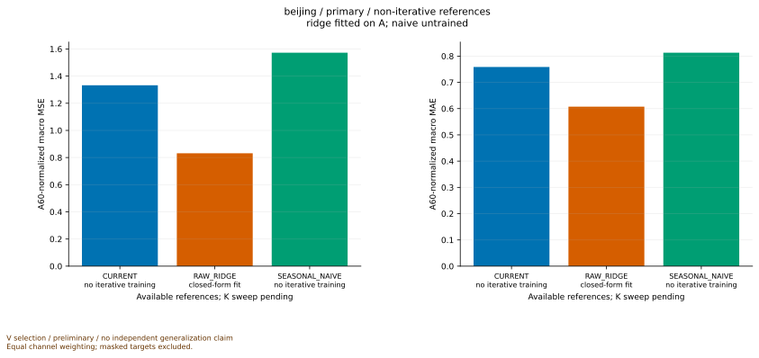

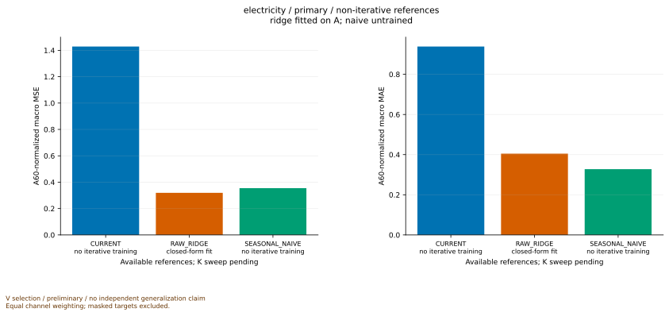

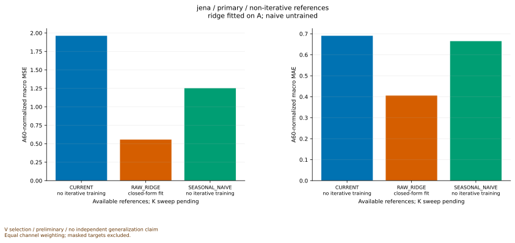

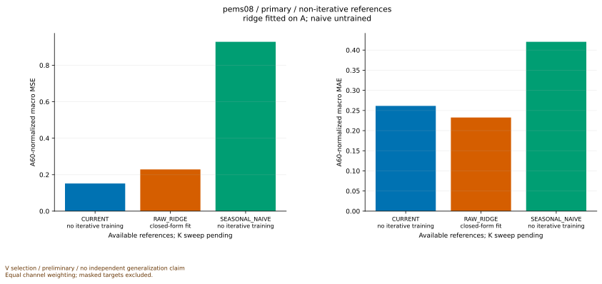

- `matched_controls`: PENDING — Only exact cohort/scaler/seed and compatible budget pairs; missing or ambiguous counterparts stay pending.
- `learning_diagnostics`: AVAILABLE_PARTIAL_EVIDENCE — Available immutable search/refit receipts, not inferred convergence. Closed-form ridge has no optimizer learning curve.

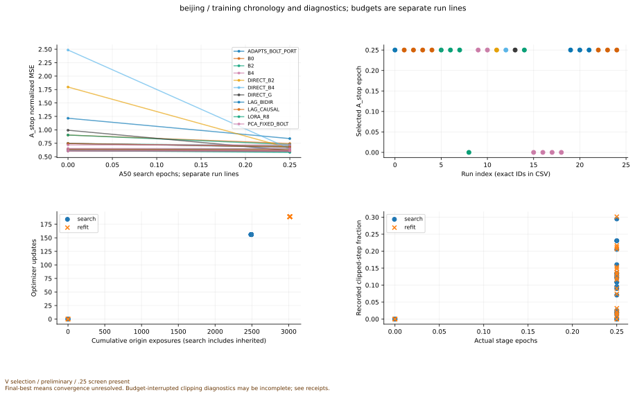

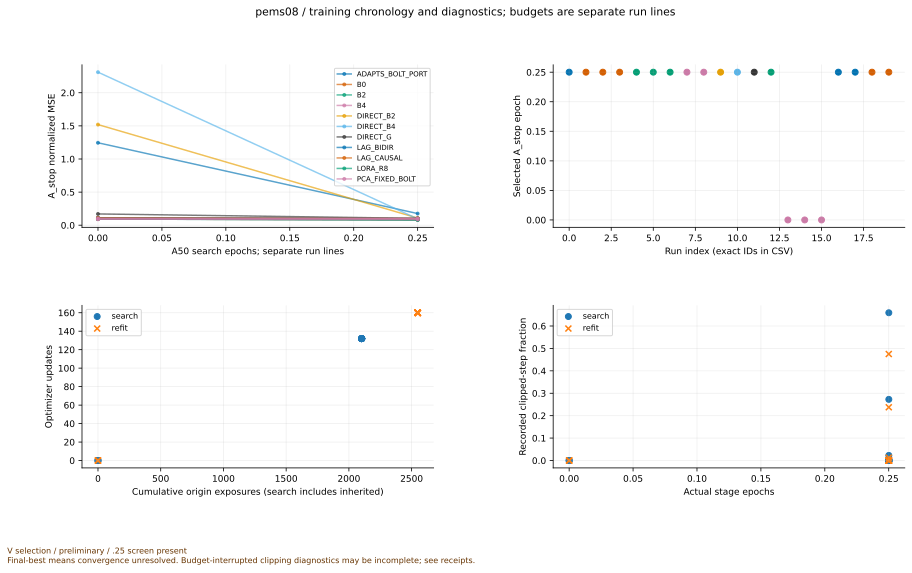

- `cost_accuracy`: PENDING — Requires actual whole-pipeline trial receipts matched to forecast IDs; cached forecast runtime is never a deployment cost.
- `lag_prefix_multik`: AVAILABLE_PARTIAL_EVIDENCE — Training exposure evidence and forecast evidence are separate; missing lag/prefix/multi-K inference remains pending.

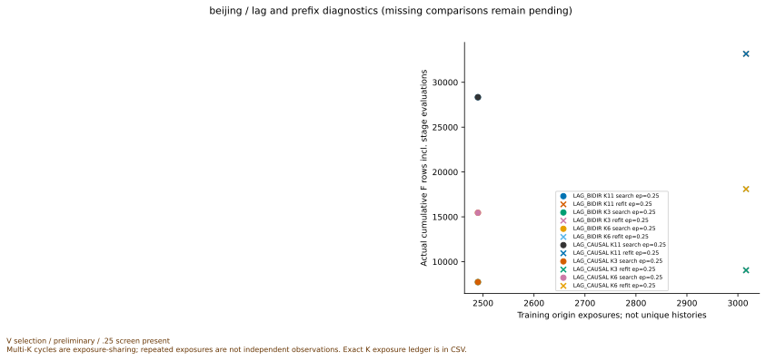

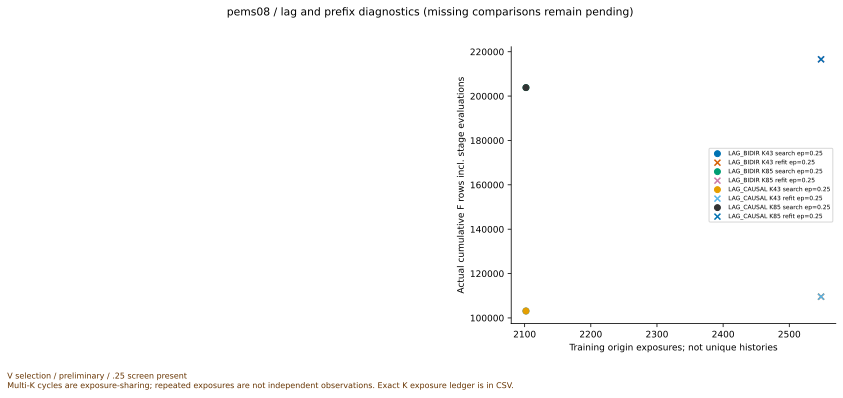

- `representative_traces`: AVAILABLE_PARTIAL_EVIDENCE — Fixed first/middle/last/seeded origins plus explicitly post-hoc anchor extremes; exact bounded plot data are private.

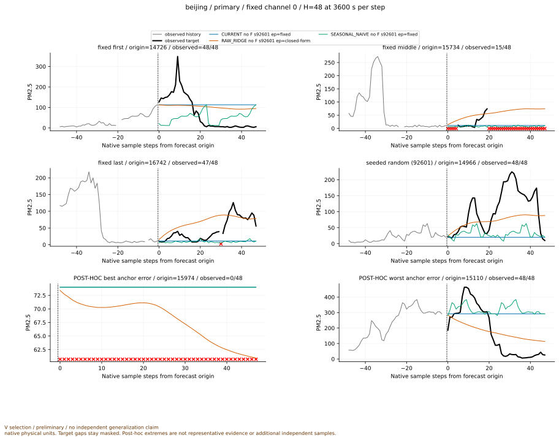

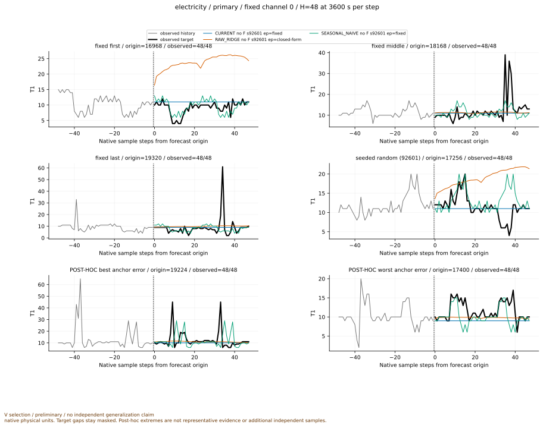

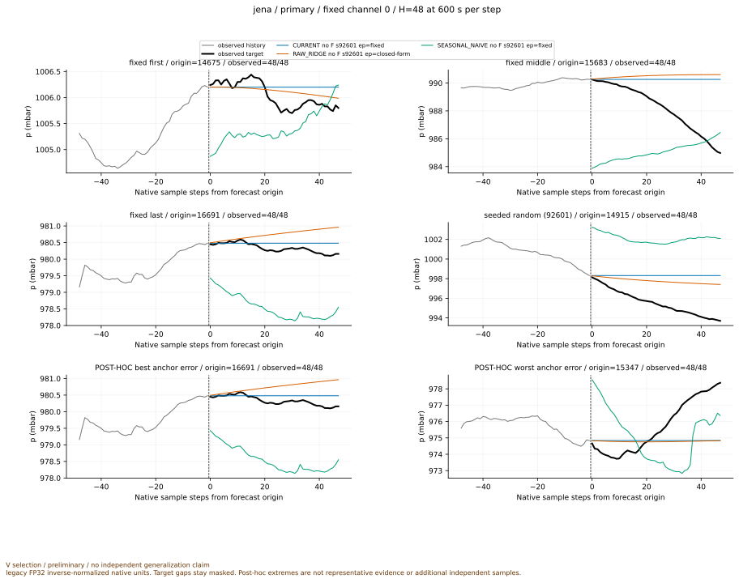

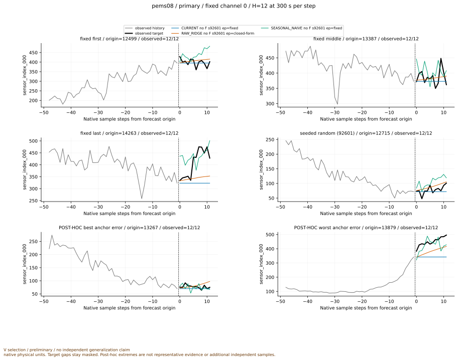

## 집계 원수치와 검산 연결

검산을 통과한 저장 예측 12개, 제외 입력 0개다. 전체 registry 감사와 학습 재실행을 수행한 수치가 아니다.

대표 사례의 정확한 제한된 plot data는 private cache에만 저장하며 공개 CSV에는 전체 원자료나 대표 사례의 시계열 배열을 넣지 않는다.

- [accuracy_beijing_primary_budget_fixed_no_optimizer_92c7b53c.csv](../../gzip_extra_aux_20261016_v1/files/item_0769.csv.gz)
- [accuracy_beijing_primary_budget_fixed_no_optimizer_92c7b53c.svg](../../../figures/snapshot_20261015T092412Z_1792056252745543800/accuracy_beijing_primary_budget_fixed_no_optimizer_92c7b53c.svg)
- [accuracy_electricity_primary_budget_fixed_no_optimizer_8ee94962.csv](../../gzip_extra_aux_20261016_v1/files/item_0770.csv.gz)
- [accuracy_electricity_primary_budget_fixed_no_optimizer_8ee94962.svg](../../../figures/snapshot_20261015T092412Z_1792056252745543800/accuracy_electricity_primary_budget_fixed_no_optimizer_8ee94962.svg)
- [accuracy_jena_primary_budget_fixed_no_optimizer_674debb6.csv](../../gzip_extra_aux_20261016_v1/files/item_0771.csv.gz)
- [accuracy_jena_primary_budget_fixed_no_optimizer_674debb6.svg](../../../figures/snapshot_20261015T092412Z_1792056252745543800/accuracy_jena_primary_budget_fixed_no_optimizer_674debb6.svg)
- [accuracy_pems08_primary_budget_fixed_no_optimizer_72e2a201.csv](../../gzip_extra_aux_20261016_v1/files/item_0772.csv.gz)
- [accuracy_pems08_primary_budget_fixed_no_optimizer_72e2a201.svg](../../../figures/snapshot_20261015T092412Z_1792056252745543800/accuracy_pems08_primary_budget_fixed_no_optimizer_72e2a201.svg)
- [lag_prefix_multik_beijing.svg](../../../figures/snapshot_20261015T092412Z_1792056252745543800/lag_prefix_multik_beijing.svg)
- [lag_prefix_multik_exposure.csv](../../gzip_extra_aux_20261016_v1/files/item_0773.csv.gz)
- [lag_prefix_multik_pems08.svg](../../../figures/snapshot_20261015T092412Z_1792056252745543800/lag_prefix_multik_pems08.svg)
- [learning_beijing.svg](../../../figures/snapshot_20261015T092412Z_1792056252745543800/learning_beijing.svg)
- [learning_curves.csv](../../gzip_extra_aux_20261016_v1/files/item_0774.csv.gz)
- [learning_pems08.svg](../../../figures/snapshot_20261015T092412Z_1792056252745543800/learning_pems08.svg)
- [traces_beijing_primary_92c7b53c.svg](../../../figures/snapshot_20261015T092412Z_1792056252745543800/traces_beijing_primary_92c7b53c.svg)
- [traces_electricity_primary_8ee94962.svg](../../../figures/snapshot_20261015T092412Z_1792056252745543800/traces_electricity_primary_8ee94962.svg)
- [traces_jena_primary_674debb6.svg](../../../figures/snapshot_20261015T092412Z_1792056252745543800/traces_jena_primary_674debb6.svg)
- [traces_pems08_primary_72e2a201.svg](../../../figures/snapshot_20261015T092412Z_1792056252745543800/traces_pems08_primary_72e2a201.svg)
- [training_diagnostics.csv](../../gzip_extra_aux_20261016_v1/files/item_0775.csv.gz)
- [verified_scores.csv](../../gzip_extra_aux_20261016_v1/files/item_0776.csv.gz)
- [FIGURE_MANIFEST.json](../../gzip_extra_aux_20261016_v1/files/item_0768.json.gz)
