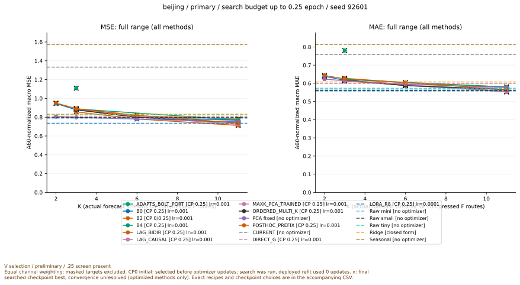
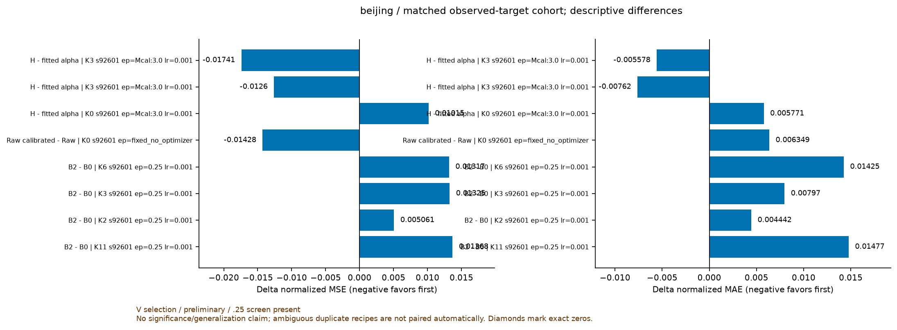
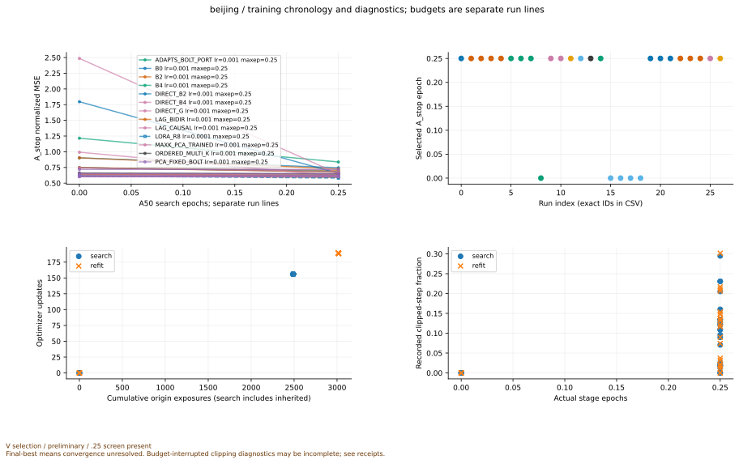
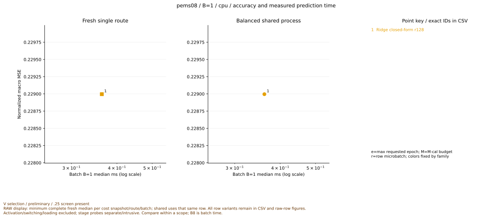
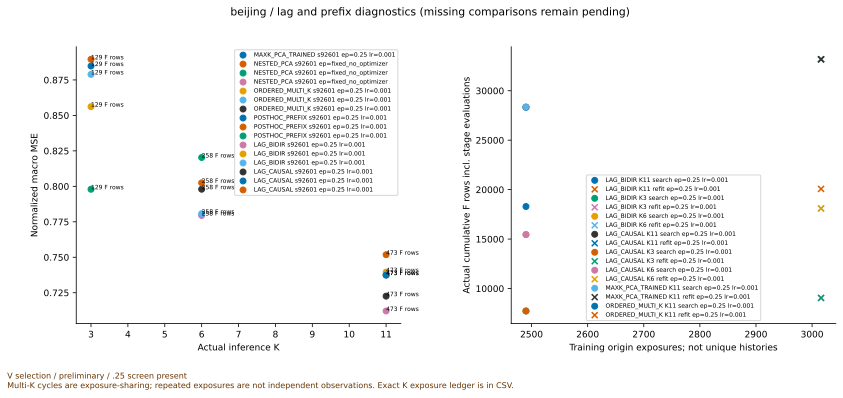
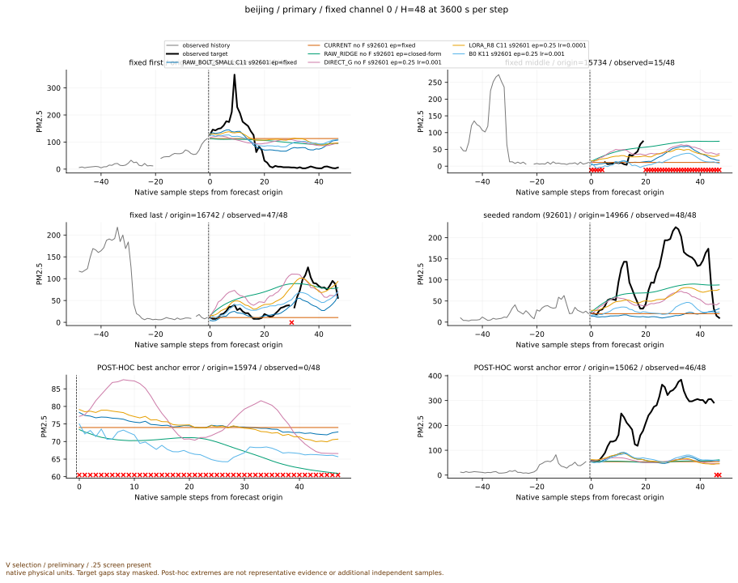

# INFORMS 전체 실험 중간 검산 보고서

작성 시점: 2026-10-16T06:58:02+09:00. 상태: **PARTIAL**. 이 snapshot 생성은 학습·실험 완료 선언이 아니다.

## 먼저 답할 수 있는 것과 아직 답할 수 없는 것

[확인] 등록 471개 중 저장된 예측을 독립 FP64로 검산한 V route는 405개, T route는 46개다. 실행 상태, 학습 노출량, 숫자 유효성, 연구적 가치, main 게시 상태를 별도로 기록했다.

과거 입력만으로 만든 표현이 실제 미래 타깃을 더 잘 예측하는지는 동일 데이터·K·seed·학습량 비교로 판단한다. 재구성 성공, 누출 검사 통과, 학습 receipt 생성만으로 예측 개선이나 독립 일반화를 주장하지 않는다. 현재 결과가 나쁘더라도 짧은 screen·마지막 checkpoint 최적·추가 하강 징후가 있으면 방법의 수렴 후 한계로 결론내릴 수 없다.

## 데이터와 비교 계약

입력은 과거 512 step만 사용한다. 새 캠페인의 허용 prefix를 시간순 A_fit 50% / A_stop 10% / M_cal 10% / V_select 10% / T_final 20%로 나눈다. 하이퍼파라미터/epoch는 A_stop, 결합 파라미터는 M_cal, 방법 선택은 V_select에서 정한다. A50 search 뒤 선택 epoch를 새 A60 scaler와 초기화로 refit한다. M의 dense origin과 V/T의 horizon-stride origin을 섞지 않는다. 주지표는 관측 mask를 적용한 A60 정규화 원 채널 macro MSE이며 MAE도 함께 기록한다.

G나 잔차 anchor는 원 C 채널을 읽을 수 있으므로 F에 K행만 넣었다고 전체 파이프라인이 K개의 정보만 사용한다고 부르지 않는다. 공정성은 동일 목표·분할·mask·scaler·seed·학습 상한과 전체 비용을 함께 확인해야 한다. 고정 모델의 추론 시간과 cache 읽기 시간은 구분한다.

새 T는 과거 보호 TEST와 별개이며, 기존 자료를 허용 prefix 내부에서 다시 분할한 것이다. Beijing/Jena/Robin 등에는 연구자가 이전에 본 데이터가 포함돼 독립적으로 처음 본 일반화 검증이라 주장할 수 없다. Jena/Robin의 일부 원 단위 값은 기존 FP32 역정규화 계보를 가진다. Electricity는 표준 321채널 hourly source를 쓰며 보호 cutoff 뒤 타깃을 열지 않는다. PeMS08에는 실제 달력 timestamp가 없어 경과 step/초 축을 사용한다. M5 공식 접근은 401과 로컬 자산 부재로 BLOCKED이며 비공식 우회·동의는 수행하지 않는다.

과거 정보 사용 계약의 단위 검사와 foundation model의 사전학습 데이터 계보는 별개다. 이 캠페인은 사전학습 corpus와 평가 자료의 중복 여부를 독립 감사하지 않았으며, 중복이 있다고도 없다고도 주장하지 않는다. F 내부에서는 quantile 0.5 출력을 사용하지만 decoder·결합을 거친 원 C 채널 출력이 조건부 중앙값이라는 보장은 없다. 따라서 최종 출력은 deterministic point forecast로 표시하고 F의 point 선택을 별도 필드에 기록한다.

## 상태를 서로 구분한 집계

```json
{
  "execution_status": {
    "BLOCKED_ACCESS_OR_LICENSE": 9,
    "BUDGET_LIMIT": 3,
    "COMPLETE_VALID": 279,
    "PARTIAL_SCREEN025": 124,
    "PARTIAL_SCREEN_LT3": 2,
    "PENDING_QUEUE": 54
  },
  "training_status": {
    "CLOSED_FORM_A_ONLY": 5,
    "CLOSED_FORM_M_CAL_ONLY": 4,
    "LIMITED_SCREEN": 158,
    "NOT_STARTED": 63,
    "NO_TRAINING": 177,
    "SCREENED_NOT_CONVERGENCE_PROVEN": 18,
    "SCREEN_COMPLETE_CONVERGENCE_UNRESOLVED": 11,
    "UNDERTRAINED_LAST_CHECKPOINT_BEST": 18,
    "UNDERTRAINED_OR_BUDGET_LIMIT": 17
  },
  "validity_status": {
    "NOT_CHECKED": 63,
    "NOT_COMPLETE": 1,
    "PENDING_INDEPENDENT_VALIDATION": 407
  },
  "scientific_status": {
    "UNASSESSED": 471
  },
  "publication_status": {
    "NOT_PUBLISHED": 471
  }
}
```

위 집계는 registry에 기록된 상태이며 보고서가 쓰거나 승격하지 않았다. 독립 숫자 재검산은 별도 집계다. 독립 검산 score 행 451개, 검산 배제 입력 0개. registry PENDING과 숫자 PASS가 동시에 있으면 숫자는 보존하되 전체 캠페인 감사·완료로 바꾸지 않는다.

## E0: 기존 미해결 학습의 연장

대상 ledger 12개. 실제 새 endpoint receipt가 있는 대상은 9개다. 과거 2400 update의 weights와 Adam state를 재사용하더라도 당시 RNG/sampler가 없어 최초 연장을 RESTARTED_NOT_EXACT_RESUME로 표시한다. 새 연장 구간의 full carry checkpoint와 exact resume는 별도 계약이다. B는 개발 데이터이며 새 V/T 일반화 수치와 합치지 않는다. 4800/9600/19200 완료, 마지막 최적 여부, 학습 곡선, 실제 저장 checkpoint B replay를 모두 확인해야 수렴 논의를 좁힐 수 있다.

[E0 전체 ledger](../../gzip_extra_aux_20261016_v1/files/item_2065.csv.gz) · [E0 별도 재검산 수치](../../gzip_extra_aux_20261016_v1/files/item_2064.csv.gz)

## E1: 독립 K 압축·시간 인코더·직접 예측·LoRA·고정 PCA의 실제 예측 비교

등록 211개, 완료 fit receipt 142개, 독립 검산 V ID 169개, T ID 22개.

- `primary_beijing_E1_DIRECT_G_k0_s92601__e1__e3` · T_final · K=0 · lr=0.001 · max epoch=3.0 / selected=1.0 · MSE=0.619307628, MAE=0.496913714, 관측=45439, origin=87 · SCREEN_COMPLETE_CONVERGENCE_UNRESOLVED
- `primary_beijing_E1_LORA_R8_k0_s92601__e3` · T_final · K=0 · lr=0.0001 · max epoch=3.0 / selected=0.25 · MSE=0.586897832, MAE=0.465685416, 관측=45439, origin=87 · SCREEN_COMPLETE_CONVERGENCE_UNRESOLVED
- `primary_beijing_E1_RAW_BOLT_SMALL_k0_s92601` · T_final · K=0 · lr=None · max epoch=None / selected=None · MSE=0.660687294, MAE=0.487336674, 관측=45439, origin=87 · NO_TRAINING_FIXED_RULE_OR_PRETRAINED
- `primary_beijing_E1_RAW_RIDGE_k0_s92601` · T_final · K=0 · lr=None · max epoch=None / selected=None · MSE=0.615655395, MAE=0.493339495, 관측=45439, origin=87 · CLOSED_FORM_ALL_LEGAL_A_ORIGINS
- `primary_beijing_E1_B0_k3_s92601` · T_final · K=3 · lr=0.001 · max epoch=0.25 / selected=0.25 · MSE=0.80705783, MAE=0.550300867, 관측=45439, origin=87 · LIMITED_SCREEN
- `primary_beijing_E1_B0_k3_s92601__e1__e3` · T_final · K=3 · lr=0.001 · max epoch=3.0 / selected=1.0 · MSE=0.796190218, MAE=0.549761748, 관측=45439, origin=87 · SCREEN_COMPLETE_CONVERGENCE_UNRESOLVED
- `primary_beijing_E1_CURRENT_k0_s92601` · V_select · K=0 · lr=None · max epoch=None / selected=None · MSE=1.33226861, MAE=0.758527512, 관측=20539, origin=43 · NO_TRAINING_FIXED_RULE_OR_PRETRAINED
- `primary_beijing_E1_DIRECT_B2_k0_s92601` · V_select · K=0 · lr=0.001 · max epoch=0.25 / selected=0.25 · MSE=0.851100543, MAE=0.625820368, 관측=20539, origin=43 · LIMITED_SCREEN
- `primary_beijing_E1_DIRECT_B2_k0_s92601__e3` · V_select · K=0 · lr=0.001 · max epoch=3.0 / selected=1.0 · MSE=0.888429437, MAE=0.629327909, 관측=20539, origin=43 · SCREEN_COMPLETE_CONVERGENCE_UNRESOLVED
- `primary_beijing_E1_DIRECT_B4_k0_s92601` · V_select · K=0 · lr=0.001 · max epoch=0.25 / selected=0.25 · MSE=0.83173959, MAE=0.626744305, 관측=20539, origin=43 · LIMITED_SCREEN
- `primary_beijing_E1_DIRECT_B4_k0_s92601__e3` · V_select · K=0 · lr=0.001 · max epoch=3.0 / selected=1.0 · MSE=0.844478577, MAE=0.623620994, 관측=20539, origin=43 · SCREEN_COMPLETE_CONVERGENCE_UNRESOLVED
- `primary_beijing_E1_DIRECT_G_k0_s92601` · V_select · K=0 · lr=0.001 · max epoch=0.25 / selected=0.25 · MSE=0.809181481, MAE=0.599313765, 관측=20539, origin=43 · LIMITED_SCREEN
- `primary_beijing_E1_DIRECT_G_k0_s92601__e1` · V_select · K=0 · lr=0.001 · max epoch=1.0 / selected=1.0 · MSE=0.814280395, MAE=0.606685092, 관측=20539, origin=43 · LIMITED_SCREEN
- `primary_beijing_E1_DIRECT_G_k0_s92601__e1__e3` · V_select · K=0 · lr=0.001 · max epoch=3.0 / selected=1.0 · MSE=0.814280395, MAE=0.606685092, 관측=20539, origin=43 · SCREEN_COMPLETE_CONVERGENCE_UNRESOLVED
- `secondary_beijing_E1_DIRECT_G_k0_s92601` · V_select · K=0 · lr=0.001 · max epoch=3.0 / selected=1.0 · MSE=0.391721328, MAE=0.373010989, 관측=18390, origin=35 · SCREEN_COMPLETE_CONVERGENCE_UNRESOLVED
- `secondary_beijing_E1_LORA_k0_s92601` · V_select · K=0 · lr=0.0001 · max epoch=0.25 / selected=0.25 · MSE=0.354678371, MAE=0.33432175, 관측=18390, origin=35 · LIMITED_SCREEN
- `primary_beijing_E1_LORA_R8_k0_s92601` · V_select · K=0 · lr=0.0001 · max epoch=0.25 / selected=0.25 · MSE=0.735095062, MAE=0.558104933, 관측=20539, origin=43 · LIMITED_SCREEN
- `primary_beijing_E1_LORA_R8_k0_s92601__e3` · V_select · K=0 · lr=0.0001 · max epoch=3.0 / selected=0.25 · MSE=0.735095062, MAE=0.558104933, 관측=20539, origin=43 · SCREEN_COMPLETE_CONVERGENCE_UNRESOLVED
- `secondary_beijing_E1_RAW_k0_s92601` · V_select · K=0 · lr=None · max epoch=None / selected=None · MSE=0.370408298, MAE=0.337650363, 관측=18390, origin=35 · TRAINING_RECEIPT_NOT_VERIFIED
- `primary_beijing_E1_RAW_BOLT_MINI_k0_s92601` · V_select · K=0 · lr=None · max epoch=None / selected=None · MSE=0.789237008, MAE=0.562855818, 관측=20539, origin=43 · NO_TRAINING_FIXED_RULE_OR_PRETRAINED
- `primary_beijing_E1_RAW_BOLT_SMALL_k0_s92601` · V_select · K=0 · lr=None · max epoch=None / selected=None · MSE=0.796878654, MAE=0.561862204, 관측=20539, origin=43 · NO_TRAINING_FIXED_RULE_OR_PRETRAINED
- `primary_beijing_E1_RAW_BOLT_TINY_k0_s92601` · V_select · K=0 · lr=None · max epoch=None / selected=None · MSE=0.82391911, MAE=0.572737059, 관측=20539, origin=43 · NO_TRAINING_FIXED_RULE_OR_PRETRAINED
- `primary_beijing_E1_RAW_RIDGE_k0_s92601` · V_select · K=0 · lr=None · max epoch=None / selected=None · MSE=0.831541637, MAE=0.607357799, 관측=20539, origin=43 · CLOSED_FORM_ALL_LEGAL_A_ORIGINS
- `primary_beijing_E1_SEASONAL_NAIVE_k0_s92601` · V_select · K=0 · lr=None · max epoch=None / selected=None · MSE=1.57230973, MAE=0.812945557, 관측=20539, origin=43 · NO_TRAINING_FIXED_RULE_OR_PRETRAINED
- `primary_beijing_E1_B0_k2_s92601` · V_select · K=2 · lr=0.001 · max epoch=0.25 / selected=0.25 · MSE=0.945155644, MAE=0.638832034, 관측=20539, origin=43 · LIMITED_SCREEN
- `primary_beijing_E1_B2_k2_s92601` · V_select · K=2 · lr=0.001 · max epoch=0.25 / selected=0.25 · MSE=0.950216678, MAE=0.643274328, 관측=20539, origin=43 · LIMITED_SCREEN
- `primary_beijing_E1_PCA_FIXED_BOLT_k2_s92601` · V_select · K=2 · lr=0.001 · max epoch=0.25 / selected=0.0 · MSE=0.805443922, MAE=0.622971528, 관측=20539, origin=43 · LIMITED_SCREEN
- `primary_beijing_E1_ADAPTS_BOLT_PORT_k3_s92601` · V_select · K=3 · lr=0.001 · max epoch=0.25 / selected=0.25 · MSE=1.10822361, MAE=0.780313572, 관측=20539, origin=43 · LIMITED_SCREEN
- `primary_beijing_E1_ADAPTS_BOLT_PORT_k3_s92601__e3` · V_select · K=3 · lr=0.001 · max epoch=3.0 / selected=3.0 · MSE=0.833820258, MAE=0.64284399, 관측=20539, origin=43 · UNDERTRAINED_OR_BUDGET_LIMIT
- `primary_beijing_E1_B0_k3_s92601` · V_select · K=3 · lr=0.001 · max epoch=0.25 / selected=0.25 · MSE=0.878072755, MAE=0.616107602, 관측=20539, origin=43 · LIMITED_SCREEN
- `primary_beijing_E1_B0_k3_s92601__e1` · V_select · K=3 · lr=0.001 · max epoch=1.0 / selected=1.0 · MSE=0.873603451, MAE=0.614858658, 관측=20539, origin=43 · LIMITED_SCREEN
- `primary_beijing_E1_B0_k3_s92601__e1__e3` · V_select · K=3 · lr=0.001 · max epoch=3.0 / selected=1.0 · MSE=0.873603451, MAE=0.614858658, 관측=20539, origin=43 · SCREEN_COMPLETE_CONVERGENCE_UNRESOLVED
- `secondary_beijing_E1_B0_k3_s92601` · V_select · K=3 · lr=0.001 · max epoch=0.25 / selected=0.25 · MSE=0.615142358, MAE=0.401441419, 관측=18390, origin=35 · LIMITED_SCREEN
- `primary_beijing_E1_B2_k3_s92601` · V_select · K=3 · lr=0.001 · max epoch=0.25 / selected=0.25 · MSE=0.89132364, MAE=0.624077685, 관측=20539, origin=43 · LIMITED_SCREEN
- `primary_beijing_E1_B2_k3_s92601__e1` · V_select · K=3 · lr=0.001 · max epoch=1.0 / selected=1.0 · MSE=0.887817124, MAE=0.623807711, 관측=20539, origin=43 · LIMITED_SCREEN
- `primary_beijing_E1_B2_k3_s92601__e1__e3` · V_select · K=3 · lr=0.001 · max epoch=3.0 / selected=1.0 · MSE=0.887817124, MAE=0.623807711, 관측=20539, origin=43 · SCREEN_COMPLETE_CONVERGENCE_UNRESOLVED
- `secondary_beijing_E1_B2_k3_s92601` · V_select · K=3 · lr=0.001 · max epoch=0.25 / selected=0.25 · MSE=0.622193375, MAE=0.419148833, 관측=18390, origin=35 · LIMITED_SCREEN
- `primary_beijing_E1_B4_k3_s92601` · V_select · K=3 · lr=0.001 · max epoch=0.25 / selected=0.25 · MSE=0.888029502, MAE=0.62114258, 관측=20539, origin=43 · LIMITED_SCREEN
- `primary_beijing_E1_B4_k3_s92601__e3` · V_select · K=3 · lr=0.001 · max epoch=3.0 / selected=3.0 · MSE=0.885756414, MAE=0.626164007, 관측=20539, origin=43 · UNDERTRAINED_OR_BUDGET_LIMIT
- `secondary_beijing_E1_B4_k3_s92601` · V_select · K=3 · lr=0.001 · max epoch=0.25 / selected=0.25 · MSE=0.616026991, MAE=0.414608259, 관측=18390, origin=35 · LIMITED_SCREEN
- `primary_beijing_E1_PCA_FIXED_BOLT_k3_s92601` · V_select · K=3 · lr=0.001 · max epoch=0.25 / selected=0.0 · MSE=0.797925078, MAE=0.613960699, 관측=20539, origin=43 · LIMITED_SCREEN
- `primary_beijing_E1_B0_k6_s92601` · V_select · K=6 · lr=0.001 · max epoch=0.25 / selected=0.25 · MSE=0.79830748, MAE=0.588675979, 관측=20539, origin=43 · LIMITED_SCREEN
- `primary_beijing_E1_B2_k6_s92601` · V_select · K=6 · lr=0.001 · max epoch=0.25 / selected=0.0 · MSE=0.811474775, MAE=0.602923912, 관측=20539, origin=43 · LIMITED_SCREEN
- `primary_beijing_E1_PCA_FIXED_BOLT_k6_s92601` · V_select · K=6 · lr=0.001 · max epoch=0.25 / selected=0.0 · MSE=0.779456612, MAE=0.595635727, 관측=20539, origin=43 · LIMITED_SCREEN
- `primary_beijing_E1_B0_k11_s92601` · V_select · K=11 · lr=0.001 · max epoch=0.25 / selected=0.25 · MSE=0.767528589, MAE=0.565352358, 관측=20539, origin=43 · LIMITED_SCREEN
- `primary_beijing_E1_B2_k11_s92601` · V_select · K=11 · lr=0.001 · max epoch=0.25 / selected=0.25 · MSE=0.781207007, MAE=0.580121335, 관측=20539, origin=43 · LIMITED_SCREEN
- `primary_beijing_E1_B4_k11_s92601` · V_select · K=11 · lr=0.001 · max epoch=0.25 / selected=0.25 · MSE=0.770311126, MAE=0.579558228, 관측=20539, origin=43 · LIMITED_SCREEN
- `primary_beijing_E1_PCA_FIXED_BOLT_k11_s92601` · V_select · K=11 · lr=0.001 · max epoch=0.25 / selected=0.0 · MSE=0.751789975, MAE=0.576547506, 관측=20539, origin=43 · LIMITED_SCREEN
- `primary_electricity_E1_DIRECT_G_k0_s92601__e1` · T_final · K=0 · lr=0.001 · max epoch=1.0 / selected=1.0 · MSE=0.139538995, MAE=0.252385313, 관측=1556208, origin=101 · LIMITED_SCREEN
- `primary_electricity_E1_LORA_R8_k0_s92601` · T_final · K=0 · lr=0.0001 · max epoch=0.25 / selected=0.0 · MSE=0.103405412, MAE=0.195641732, 관측=1556208, origin=101 · LIMITED_SCREEN
- `primary_electricity_E1_RAW_BOLT_SMALL_k0_s92601` · T_final · K=0 · lr=None · max epoch=None / selected=None · MSE=0.103405412, MAE=0.195641732, 관측=1556208, origin=101 · NO_TRAINING_FIXED_RULE_OR_PRETRAINED
- `primary_electricity_E1_RAW_RIDGE_k0_s92601` · T_final · K=0 · lr=None · max epoch=None / selected=None · MSE=0.248944713, MAE=0.36586236, 관측=1556208, origin=101 · CLOSED_FORM_ALL_LEGAL_A_ORIGINS
- `primary_electricity_E1_B0_k81_s92601` · T_final · K=81 · lr=0.001 · max epoch=0.25 / selected=0.0 · MSE=0.19667733, MAE=0.317796972, 관측=1556208, origin=101 · LIMITED_SCREEN
- `primary_electricity_E1_B0_k81_s92601__e1` · T_final · K=81 · lr=0.001 · max epoch=1.0 / selected=0.0 · MSE=0.19667733, MAE=0.317796972, 관측=1556208, origin=101 · LIMITED_SCREEN
- `primary_electricity_E1_CURRENT_k0_s92601` · V_select · K=0 · lr=None · max epoch=None / selected=None · MSE=1.4287276, MAE=0.938421336, 관측=770400, origin=50 · NO_TRAINING_FIXED_RULE_OR_PRETRAINED
- `primary_electricity_E1_DIRECT_B2_k0_s92601` · V_select · K=0 · lr=0.001 · max epoch=0.25 / selected=0.25 · MSE=0.175512282, MAE=0.271569862, 관측=770400, origin=50 · LIMITED_SCREEN
- `primary_electricity_E1_DIRECT_B2_k0_s92601__cpu_fresh_e3` · V_select · K=0 · lr=0.001 · max epoch=3.0 / selected=1.0 · MSE=0.155337495, MAE=0.249945802, 관측=770400, origin=50 · SCREEN_COMPLETE_CONVERGENCE_UNRESOLVED
- `primary_electricity_E1_DIRECT_B4_k0_s92601` · V_select · K=0 · lr=0.001 · max epoch=0.25 / selected=0.25 · MSE=0.180609234, MAE=0.276648124, 관측=770400, origin=50 · LIMITED_SCREEN
- `primary_electricity_E1_DIRECT_B4_k0_s92601__cpu_fresh_e3` · V_select · K=0 · lr=0.001 · max epoch=3.0 / selected=1.0 · MSE=0.157920322, MAE=0.252922141, 관측=770400, origin=50 · SCREEN_COMPLETE_CONVERGENCE_UNRESOLVED
- `primary_electricity_E1_DIRECT_G_k0_s92601` · V_select · K=0 · lr=0.001 · max epoch=0.25 / selected=0.25 · MSE=0.227510958, MAE=0.316987727, 관측=770400, origin=50 · LIMITED_SCREEN
- `primary_electricity_E1_DIRECT_G_k0_s92601__cpu_fresh_e3` · V_select · K=0 · lr=0.001 · max epoch=3.0 / selected=3.0 · MSE=0.173395121, MAE=0.262822068, 관측=770400, origin=50 · UNDERTRAINED_OR_BUDGET_LIMIT
- `primary_electricity_E1_DIRECT_G_k0_s92601__e1` · V_select · K=0 · lr=0.001 · max epoch=1.0 / selected=1.0 · MSE=0.18622973, MAE=0.278415843, 관측=770400, origin=50 · LIMITED_SCREEN
- `primary_electricity_E1_LORA_R8_k0_s92601` · V_select · K=0 · lr=0.0001 · max epoch=0.25 / selected=0.0 · MSE=0.1266208, MAE=0.202700572, 관측=770400, origin=50 · LIMITED_SCREEN
- `primary_electricity_E1_RAW_BOLT_MINI_k0_s92601` · V_select · K=0 · lr=None · max epoch=None / selected=None · MSE=0.133686375, MAE=0.209727634, 관측=770400, origin=50 · NO_TRAINING_FIXED_RULE_OR_PRETRAINED
- `primary_electricity_E1_RAW_BOLT_SMALL_k0_s92601` · V_select · K=0 · lr=None · max epoch=None / selected=None · MSE=0.1266208, MAE=0.202700572, 관측=770400, origin=50 · NO_TRAINING_FIXED_RULE_OR_PRETRAINED
- `primary_electricity_E1_RAW_BOLT_TINY_k0_s92601` · V_select · K=0 · lr=None · max epoch=None / selected=None · MSE=0.140791952, MAE=0.218419538, 관측=770400, origin=50 · NO_TRAINING_FIXED_RULE_OR_PRETRAINED
- `primary_electricity_E1_RAW_RIDGE_k0_s92601` · V_select · K=0 · lr=None · max epoch=None / selected=None · MSE=0.319373219, MAE=0.404823318, 관측=770400, origin=50 · CLOSED_FORM_ALL_LEGAL_A_ORIGINS
- `primary_electricity_E1_SEASONAL_NAIVE_k0_s92601` · V_select · K=0 · lr=None · max epoch=None / selected=None · MSE=0.354740153, MAE=0.327438711, 관측=770400, origin=50 · NO_TRAINING_FIXED_RULE_OR_PRETRAINED
- `primary_electricity_E1_B0_k41_s92601` · V_select · K=41 · lr=0.001 · max epoch=0.25 / selected=0.25 · MSE=0.245329169, MAE=0.346223373, 관측=770400, origin=50 · LIMITED_SCREEN
- `primary_electricity_E1_B2_k41_s92601` · V_select · K=41 · lr=0.001 · max epoch=0.25 / selected=0.25 · MSE=0.24336791, MAE=0.344653684, 관측=770400, origin=50 · LIMITED_SCREEN
- `primary_electricity_E1_ADAPTS_BOLT_PORT_k81_s92601` · V_select · K=81 · lr=0.001 · max epoch=0.25 / selected=0.25 · MSE=0.338231605, MAE=0.388694478, 관측=770400, origin=50 · LIMITED_SCREEN
- `primary_electricity_E1_B0_k81_s92601` · V_select · K=81 · lr=0.001 · max epoch=0.25 / selected=0.0 · MSE=0.211588738, MAE=0.31970345, 관측=770400, origin=50 · LIMITED_SCREEN
- `primary_electricity_E1_B0_k81_s92601__e1` · V_select · K=81 · lr=0.001 · max epoch=1.0 / selected=0.0 · MSE=0.211588738, MAE=0.31970345, 관측=770400, origin=50 · LIMITED_SCREEN
- `primary_electricity_E1_B0_k81_s92601__lr0001_e1` · V_select · K=81 · lr=0.0001 · max epoch=1.0 / selected=1.0 · MSE=0.208265215, MAE=0.315902069, 관측=770400, origin=50 · LIMITED_SCREEN
- `primary_electricity_E1_B2_k81_s92601` · V_select · K=81 · lr=0.001 · max epoch=0.25 / selected=0.0 · MSE=0.211588738, MAE=0.31970345, 관측=770400, origin=50 · LIMITED_SCREEN
- `primary_electricity_E1_B2_k81_s92601__e1` · V_select · K=81 · lr=0.001 · max epoch=1.0 / selected=0.0 · MSE=0.211588738, MAE=0.31970345, 관측=770400, origin=50 · LIMITED_SCREEN
- `primary_electricity_E1_B2_k81_s92601__lr0001_e1` · V_select · K=81 · lr=0.0001 · max epoch=1.0 / selected=1.0 · MSE=0.20770427, MAE=0.31565159, 관측=770400, origin=50 · LIMITED_SCREEN
- `primary_electricity_E1_B4_k81_s92601` · V_select · K=81 · lr=0.001 · max epoch=0.25 / selected=0.0 · MSE=0.211588738, MAE=0.31970345, 관측=770400, origin=50 · LIMITED_SCREEN
- `primary_electricity_E1_PCA_FIXED_BOLT_k81_s92601` · V_select · K=81 · lr=0.001 · max epoch=0.25 / selected=0.0 · MSE=0.258246664, MAE=0.328378676, 관측=770400, origin=50 · LIMITED_SCREEN
- `primary_electricity_E1_B0_k161_s92601` · V_select · K=161 · lr=0.001 · max epoch=0.25 / selected=0.0 · MSE=0.175995315, MAE=0.286012118, 관측=770400, origin=50 · LIMITED_SCREEN
- `primary_electricity_E1_B2_k161_s92601` · V_select · K=161 · lr=0.001 · max epoch=0.25 / selected=0.0 · MSE=0.175995315, MAE=0.286012118, 관측=770400, origin=50 · LIMITED_SCREEN
- `primary_electricity_E1_PCA_FIXED_BOLT_k161_s92601` · V_select · K=161 · lr=0.001 · max epoch=0.25 / selected=0.0 · MSE=0.2165872, MAE=0.310082441, 관측=770400, origin=50 · LIMITED_SCREEN
- `primary_electricity_E1_B0_k321_s92601` · V_select · K=321 · lr=0.001 · max epoch=0.25 / selected=0.0 · MSE=0.1266208, MAE=0.202700572, 관측=770400, origin=50 · LIMITED_SCREEN
- `primary_electricity_E1_B2_k321_s92601` · V_select · K=321 · lr=0.001 · max epoch=0.25 / selected=0.0 · MSE=0.1266208, MAE=0.202700572, 관측=770400, origin=50 · LIMITED_SCREEN
- `primary_electricity_E1_B4_k321_s92601` · V_select · K=321 · lr=0.001 · max epoch=0.25 / selected=0.0 · MSE=0.1266208, MAE=0.202700572, 관측=770400, origin=50 · LIMITED_SCREEN
- `primary_electricity_E1_PCA_FIXED_BOLT_k321_s92601` · V_select · K=321 · lr=0.001 · max epoch=0.25 / selected=0.0 · MSE=0.138391687, MAE=0.231582904, 관측=770400, origin=50 · LIMITED_SCREEN
- `primary_jena_E1_DIRECT_G_k0_s92601__e1` · T_final · K=0 · lr=0.001 · max epoch=1.0 / selected=1.0 · MSE=1.05076768, MAE=0.501964299, 관측=87694, origin=87 · LIMITED_SCREEN
- `primary_jena_E1_LORA_R8_k0_s92601` · T_final · K=0 · lr=0.0001 · max epoch=0.25 / selected=0.25 · MSE=0.993818351, MAE=0.448812761, 관측=87694, origin=87 · LIMITED_SCREEN
- `primary_jena_E1_RAW_BOLT_SMALL_k0_s92601` · T_final · K=0 · lr=None · max epoch=None / selected=None · MSE=1.21687921, MAE=0.510121753, 관측=87694, origin=87 · NO_TRAINING_FIXED_RULE_OR_PRETRAINED
- `primary_jena_E1_RAW_RIDGE_k0_s92601` · T_final · K=0 · lr=None · max epoch=None / selected=None · MSE=0.953763201, MAE=0.452681032, 관측=87694, origin=87 · CLOSED_FORM_ALL_LEGAL_A_ORIGINS
- `primary_jena_E1_B0_k6_s92601__e1` · T_final · K=6 · lr=0.001 · max epoch=1.0 / selected=1.0 · MSE=1.12310451, MAE=0.528663567, 관측=87694, origin=87 · LIMITED_SCREEN
- `primary_jena_E1_CURRENT_k0_s92601` · V_select · K=0 · lr=None · max epoch=None / selected=None · MSE=1.96216398, MAE=0.690624502, 관측=43344, origin=43 · NO_TRAINING_FIXED_RULE_OR_PRETRAINED
- `primary_jena_E1_DIRECT_B2_k0_s92601` · V_select · K=0 · lr=0.001 · max epoch=0.25 / selected=0.25 · MSE=0.646401897, MAE=0.484632259, 관측=43344, origin=43 · LIMITED_SCREEN
- `primary_jena_E1_DIRECT_B2_k0_s92601__cpu_fresh_e3` · V_select · K=0 · lr=0.001 · max epoch=3.0 / selected=3.0 · MSE=0.664891332, MAE=0.484111668, 관측=43344, origin=43 · UNDERTRAINED_OR_BUDGET_LIMIT
- `primary_jena_E1_DIRECT_B4_k0_s92601` · V_select · K=0 · lr=0.001 · max epoch=0.25 / selected=0.25 · MSE=0.646369189, MAE=0.489772195, 관측=43344, origin=43 · LIMITED_SCREEN
- `primary_jena_E1_DIRECT_B4_k0_s92601__cpu_fresh_e3` · V_select · K=0 · lr=0.001 · max epoch=3.0 / selected=1.0 · MSE=0.597979555, MAE=0.470731306, 관측=43344, origin=43 · SCREEN_COMPLETE_CONVERGENCE_UNRESOLVED
- `primary_jena_E1_DIRECT_G_k0_s92601` · V_select · K=0 · lr=0.001 · max epoch=0.25 / selected=0.25 · MSE=0.654561526, MAE=0.441909919, 관측=43344, origin=43 · LIMITED_SCREEN
- `primary_jena_E1_DIRECT_G_k0_s92601__cpu_fresh_e3` · V_select · K=0 · lr=0.001 · max epoch=3.0 / selected=3.0 · MSE=0.632217057, MAE=0.44152129, 관측=43344, origin=43 · UNDERTRAINED_OR_BUDGET_LIMIT
- `primary_jena_E1_DIRECT_G_k0_s92601__e1` · V_select · K=0 · lr=0.001 · max epoch=1.0 / selected=1.0 · MSE=0.603786477, MAE=0.438727296, 관측=43344, origin=43 · LIMITED_SCREEN
- `secondary_jena_E1_DIRECT_G_k0_s92601` · V_select · K=0 · lr=0.001 · max epoch=3.0 / selected=1.0 · MSE=0.584238803, MAE=0.450883838, 관측=34272, origin=34 · SCREEN_COMPLETE_CONVERGENCE_UNRESOLVED
- `secondary_jena_E1_LORA_k0_s92601` · V_select · K=0 · lr=0.0001 · max epoch=0.25 / selected=0.25 · MSE=0.591926131, MAE=0.429666869, 관측=34272, origin=34 · LIMITED_SCREEN
- `primary_jena_E1_LORA_R8_k0_s92601` · V_select · K=0 · lr=0.0001 · max epoch=0.25 / selected=0.25 · MSE=0.626266015, MAE=0.416788307, 관측=43344, origin=43 · LIMITED_SCREEN
- `secondary_jena_E1_RAW_k0_s92601` · V_select · K=0 · lr=None · max epoch=None / selected=None · MSE=0.815917102, MAE=0.48523367, 관측=34272, origin=34 · TRAINING_RECEIPT_NOT_VERIFIED
- `primary_jena_E1_RAW_BOLT_MINI_k0_s92601` · V_select · K=0 · lr=None · max epoch=None / selected=None · MSE=0.93479976, MAE=0.501505946, 관측=43344, origin=43 · NO_TRAINING_FIXED_RULE_OR_PRETRAINED
- `primary_jena_E1_RAW_BOLT_SMALL_k0_s92601` · V_select · K=0 · lr=None · max epoch=None / selected=None · MSE=0.849194139, MAE=0.48138834, 관측=43344, origin=43 · NO_TRAINING_FIXED_RULE_OR_PRETRAINED
- `primary_jena_E1_RAW_BOLT_TINY_k0_s92601` · V_select · K=0 · lr=None · max epoch=None / selected=None · MSE=1.32275515, MAE=0.585564066, 관측=43344, origin=43 · NO_TRAINING_FIXED_RULE_OR_PRETRAINED
- `primary_jena_E1_RAW_RIDGE_k0_s92601` · V_select · K=0 · lr=None · max epoch=None / selected=None · MSE=0.556646336, MAE=0.405521802, 관측=43344, origin=43 · CLOSED_FORM_ALL_LEGAL_A_ORIGINS
- `primary_jena_E1_SEASONAL_NAIVE_k0_s92601` · V_select · K=0 · lr=None · max epoch=None / selected=None · MSE=1.25226641, MAE=0.665101577, 관측=43344, origin=43 · NO_TRAINING_FIXED_RULE_OR_PRETRAINED
- `primary_jena_E1_B0_k5_s92601` · V_select · K=5 · lr=0.001 · max epoch=0.25 / selected=0.25 · MSE=0.8414212, MAE=0.539806185, 관측=43344, origin=43 · LIMITED_SCREEN
- `primary_jena_E1_B2_k5_s92601` · V_select · K=5 · lr=0.001 · max epoch=0.25 / selected=0.25 · MSE=0.725087391, MAE=0.4971393, 관측=43344, origin=43 · LIMITED_SCREEN
- `primary_jena_E1_PCA_FIXED_BOLT_k5_s92601` · V_select · K=5 · lr=0.001 · max epoch=0.25 / selected=0.0 · MSE=1.0789213, MAE=0.648034182, 관측=43344, origin=43 · LIMITED_SCREEN
- `primary_jena_E1_ADAPTS_BOLT_PORT_k6_s92601` · V_select · K=6 · lr=0.001 · max epoch=0.25 / selected=0.25 · MSE=1.18432582, MAE=0.698207828, 관측=43344, origin=43 · LIMITED_SCREEN
- `primary_jena_E1_B0_k6_s92601` · V_select · K=6 · lr=0.001 · max epoch=0.25 / selected=0.25 · MSE=0.818831246, MAE=0.538156591, 관측=43344, origin=43 · LIMITED_SCREEN
- `primary_jena_E1_B0_k6_s92601__e1` · V_select · K=6 · lr=0.001 · max epoch=1.0 / selected=1.0 · MSE=0.803309276, MAE=0.524531236, 관측=43344, origin=43 · LIMITED_SCREEN
- `secondary_jena_E1_B0_k6_s92601` · V_select · K=6 · lr=0.001 · max epoch=0.25 / selected=0.25 · MSE=0.689634953, MAE=0.494346355, 관측=34272, origin=34 · LIMITED_SCREEN
- `primary_jena_E1_B2_k6_s92601` · V_select · K=6 · lr=0.001 · max epoch=0.25 / selected=0.25 · MSE=0.697714062, MAE=0.488920646, 관측=43344, origin=43 · LIMITED_SCREEN
- `primary_jena_E1_B2_k6_s92601__e1` · V_select · K=6 · lr=0.001 · max epoch=1.0 / selected=1.0 · MSE=0.686401862, MAE=0.49179861, 관측=43344, origin=43 · LIMITED_SCREEN
- `secondary_jena_E1_B2_k6_s92601` · V_select · K=6 · lr=0.001 · max epoch=0.25 / selected=0.25 · MSE=0.610331128, MAE=0.475720575, 관측=34272, origin=34 · LIMITED_SCREEN
- `primary_jena_E1_B4_k6_s92601` · V_select · K=6 · lr=0.001 · max epoch=0.25 / selected=0.25 · MSE=0.686784727, MAE=0.496787685, 관측=43344, origin=43 · LIMITED_SCREEN
- `secondary_jena_E1_B4_k6_s92601` · V_select · K=6 · lr=0.001 · max epoch=0.25 / selected=0.25 · MSE=0.631206365, MAE=0.492450908, 관측=34272, origin=34 · LIMITED_SCREEN
- `primary_jena_E1_PCA_FIXED_BOLT_k6_s92601` · V_select · K=6 · lr=0.001 · max epoch=0.25 / selected=0.0 · MSE=1.07948864, MAE=0.642719116, 관측=43344, origin=43 · LIMITED_SCREEN
- `primary_jena_E1_B0_k11_s92601` · V_select · K=11 · lr=0.001 · max epoch=0.25 / selected=0.25 · MSE=0.752521851, MAE=0.511572416, 관측=43344, origin=43 · LIMITED_SCREEN
- `primary_jena_E1_B2_k11_s92601` · V_select · K=11 · lr=0.001 · max epoch=0.25 / selected=0.25 · MSE=0.643487096, MAE=0.469096276, 관측=43344, origin=43 · LIMITED_SCREEN
- `primary_jena_E1_PCA_FIXED_BOLT_k11_s92601` · V_select · K=11 · lr=0.001 · max epoch=0.25 / selected=0.0 · MSE=1.03849028, MAE=0.595885544, 관측=43344, origin=43 · LIMITED_SCREEN
- `primary_jena_E1_B0_k21_s92601` · V_select · K=21 · lr=0.001 · max epoch=0.25 / selected=0.25 · MSE=0.732203406, MAE=0.491360542, 관측=43344, origin=43 · LIMITED_SCREEN
- `primary_jena_E1_B2_k21_s92601` · V_select · K=21 · lr=0.001 · max epoch=0.25 / selected=0.25 · MSE=0.630834274, MAE=0.448161681, 관측=43344, origin=43 · LIMITED_SCREEN
- `primary_jena_E1_B4_k21_s92601` · V_select · K=21 · lr=0.001 · max epoch=0.25 / selected=0.25 · MSE=0.655985745, MAE=0.465146726, 관측=43344, origin=43 · LIMITED_SCREEN
- `primary_jena_E1_PCA_FIXED_BOLT_k21_s92601` · V_select · K=21 · lr=0.001 · max epoch=0.25 / selected=0.0 · MSE=1.03279983, MAE=0.58903987, 관측=43344, origin=43 · LIMITED_SCREEN
- `primary_pems08_E1_DIRECT_G_k0_s92601__e1` · T_final · K=0 · lr=0.001 · max epoch=1.0 / selected=1.0 · MSE=0.0861251721, MAE=0.186303388, 관측=605880, origin=297 · LIMITED_SCREEN
- `primary_pems08_E1_LORA_R8_k0_s92601` · T_final · K=0 · lr=0.0001 · max epoch=0.25 / selected=0.25 · MSE=0.0746822251, MAE=0.179436801, 관측=605880, origin=297 · LIMITED_SCREEN
- `primary_pems08_E1_RAW_BOLT_SMALL_k0_s92601` · T_final · K=0 · lr=None · max epoch=None / selected=None · MSE=0.0859310064, MAE=0.193416768, 관측=605880, origin=297 · NO_TRAINING_FIXED_RULE_OR_PRETRAINED
- `primary_pems08_E1_RAW_RIDGE_k0_s92601` · T_final · K=0 · lr=None · max epoch=None / selected=None · MSE=0.155396196, MAE=0.219331504, 관측=605880, origin=297 · CLOSED_FORM_ALL_LEGAL_A_ORIGINS
- `primary_pems08_E1_B0_k43_s92601__e1` · T_final · K=43 · lr=0.001 · max epoch=1.0 / selected=1.0 · MSE=0.092030427, MAE=0.204989318, 관측=605880, origin=297 · LIMITED_SCREEN
- `primary_pems08_E1_CURRENT_k0_s92601` · V_select · K=0 · lr=None · max epoch=None / selected=None · MSE=0.151754157, MAE=0.261442994, 관측=301920, origin=148 · NO_TRAINING_FIXED_RULE_OR_PRETRAINED
- `primary_pems08_E1_DIRECT_B2_k0_s92601` · V_select · K=0 · lr=0.001 · max epoch=0.25 / selected=0.25 · MSE=0.143619369, MAE=0.235336116, 관측=301920, origin=148 · LIMITED_SCREEN
- `primary_pems08_E1_DIRECT_B2_k0_s92601__cpu_fresh_e3` · V_select · K=0 · lr=0.001 · max epoch=3.0 / selected=3.0 · MSE=0.118813176, MAE=0.209498395, 관측=301920, origin=148 · UNDERTRAINED_OR_BUDGET_LIMIT
- `primary_pems08_E1_DIRECT_B4_k0_s92601` · V_select · K=0 · lr=0.001 · max epoch=0.25 / selected=0.25 · MSE=0.135199264, MAE=0.232761755, 관측=301920, origin=148 · LIMITED_SCREEN
- `primary_pems08_E1_DIRECT_B4_k0_s92601__cpu_fresh_e3_retry1` · V_select · K=0 · lr=0.001 · max epoch=3.0 / selected=3.0 · MSE=0.125481805, MAE=0.218670503, 관측=301920, origin=148 · UNDERTRAINED_OR_BUDGET_LIMIT
- `primary_pems08_E1_DIRECT_G_k0_s92601` · V_select · K=0 · lr=0.001 · max epoch=0.25 / selected=0.25 · MSE=0.116123892, MAE=0.208799194, 관측=301920, origin=148 · LIMITED_SCREEN
- `primary_pems08_E1_DIRECT_G_k0_s92601__cpu_fresh_e3` · V_select · K=0 · lr=0.001 · max epoch=3.0 / selected=3.0 · MSE=0.0993884698, MAE=0.189054279, 관측=301920, origin=148 · UNDERTRAINED_OR_BUDGET_LIMIT
- `primary_pems08_E1_DIRECT_G_k0_s92601__e1` · V_select · K=0 · lr=0.001 · max epoch=1.0 / selected=1.0 · MSE=0.10605044, MAE=0.196226558, 관측=301920, origin=148 · LIMITED_SCREEN
- `primary_pems08_E1_LORA_R8_k0_s92601` · V_select · K=0 · lr=0.0001 · max epoch=0.25 / selected=0.25 · MSE=0.0847248737, MAE=0.181742605, 관측=301920, origin=148 · LIMITED_SCREEN
- `primary_pems08_E1_RAW_BOLT_MINI_k0_s92601` · V_select · K=0 · lr=None · max epoch=None / selected=None · MSE=0.0970461744, MAE=0.198622522, 관측=301920, origin=148 · NO_TRAINING_FIXED_RULE_OR_PRETRAINED
- `primary_pems08_E1_RAW_BOLT_SMALL_k0_s92601` · V_select · K=0 · lr=None · max epoch=None / selected=None · MSE=0.0953549334, MAE=0.196333829, 관측=301920, origin=148 · NO_TRAINING_FIXED_RULE_OR_PRETRAINED
- `primary_pems08_E1_RAW_BOLT_TINY_k0_s92601` · V_select · K=0 · lr=None · max epoch=None / selected=None · MSE=0.0940630949, MAE=0.193733332, 관측=301920, origin=148 · NO_TRAINING_FIXED_RULE_OR_PRETRAINED
- `primary_pems08_E1_RAW_RIDGE_k0_s92601` · V_select · K=0 · lr=None · max epoch=None / selected=None · MSE=0.228995943, MAE=0.232532032, 관측=301920, origin=148 · CLOSED_FORM_ALL_LEGAL_A_ORIGINS
- `primary_pems08_E1_SEASONAL_NAIVE_k0_s92601` · V_select · K=0 · lr=None · max epoch=None / selected=None · MSE=0.928649328, MAE=0.420548527, 관측=301920, origin=148 · NO_TRAINING_FIXED_RULE_OR_PRETRAINED
- `primary_pems08_E1_B0_k22_s92601` · V_select · K=22 · lr=0.001 · max epoch=0.25 / selected=0.25 · MSE=0.112406684, MAE=0.219258108, 관측=301920, origin=148 · LIMITED_SCREEN
- `primary_pems08_E1_B2_k22_s92601` · V_select · K=22 · lr=0.001 · max epoch=0.25 / selected=0.25 · MSE=0.108804465, MAE=0.213874418, 관측=301920, origin=148 · LIMITED_SCREEN
- `primary_pems08_E1_ADAPTS_BOLT_PORT_k43_s92601` · V_select · K=43 · lr=0.001 · max epoch=0.25 / selected=0.25 · MSE=0.52711781, MAE=0.376919705, 관측=301920, origin=148 · LIMITED_SCREEN
- `primary_pems08_E1_B0_k43_s92601` · V_select · K=43 · lr=0.001 · max epoch=0.25 / selected=0.25 · MSE=0.108664484, MAE=0.217539113, 관측=301920, origin=148 · LIMITED_SCREEN
- `primary_pems08_E1_B0_k43_s92601__e1` · V_select · K=43 · lr=0.001 · max epoch=1.0 / selected=1.0 · MSE=0.105338534, MAE=0.212696673, 관측=301920, origin=148 · LIMITED_SCREEN
- `primary_pems08_E1_B2_k43_s92601` · V_select · K=43 · lr=0.001 · max epoch=0.25 / selected=0.25 · MSE=0.104761057, MAE=0.21102152, 관측=301920, origin=148 · LIMITED_SCREEN
- `primary_pems08_E1_B2_k43_s92601__e1` · V_select · K=43 · lr=0.001 · max epoch=1.0 / selected=1.0 · MSE=0.104259699, MAE=0.205841794, 관측=301920, origin=148 · LIMITED_SCREEN
- `primary_pems08_E1_B4_k43_s92601` · V_select · K=43 · lr=0.001 · max epoch=0.25 / selected=0.25 · MSE=0.104639737, MAE=0.210808412, 관측=301920, origin=148 · LIMITED_SCREEN
- `primary_pems08_E1_PCA_FIXED_BOLT_k43_s92601` · V_select · K=43 · lr=0.001 · max epoch=0.25 / selected=0.0 · MSE=0.128892143, MAE=0.240536275, 관측=301920, origin=148 · LIMITED_SCREEN
- `primary_pems08_E1_B0_k85_s92601` · V_select · K=85 · lr=0.001 · max epoch=0.25 / selected=0.25 · MSE=0.101019827, MAE=0.210927594, 관측=301920, origin=148 · LIMITED_SCREEN
- `primary_pems08_E1_B2_k85_s92601` · V_select · K=85 · lr=0.001 · max epoch=0.25 / selected=0.25 · MSE=0.0971898196, MAE=0.204274446, 관측=301920, origin=148 · LIMITED_SCREEN
- `primary_pems08_E1_PCA_FIXED_BOLT_k85_s92601` · V_select · K=85 · lr=0.001 · max epoch=0.25 / selected=0.0 · MSE=0.105593833, MAE=0.216068329, 관측=301920, origin=148 · LIMITED_SCREEN
- `primary_pems08_E1_B0_k170_s92601` · V_select · K=170 · lr=0.001 · max epoch=0.25 / selected=0.25 · MSE=0.0880160755, MAE=0.191633477, 관측=301920, origin=148 · LIMITED_SCREEN
- `primary_pems08_E1_B2_k170_s92601` · V_select · K=170 · lr=0.001 · max epoch=0.25 / selected=0.25 · MSE=0.087006943, MAE=0.187061953, 관측=301920, origin=148 · LIMITED_SCREEN
- `primary_pems08_E1_B4_k170_s92601` · V_select · K=170 · lr=0.001 · max epoch=0.25 / selected=0.25 · MSE=0.0903812195, MAE=0.190826939, 관측=301920, origin=148 · LIMITED_SCREEN
- `primary_pems08_E1_PCA_FIXED_BOLT_k170_s92601` · V_select · K=170 · lr=0.001 · max epoch=0.25 / selected=0.0 · MSE=0.0957161524, MAE=0.201606389, 관측=301920, origin=148 · LIMITED_SCREEN
- `primary_robin_E1_CURRENT_k0_s92601` · V_select · K=0 · lr=None · max epoch=None / selected=None · MSE=0.977684209, MAE=0.508712464, 관측=2448, origin=3 · NO_TRAINING_FIXED_RULE_OR_PRETRAINED
- `primary_robin_E1_DIRECT_B2_k0_s92601` · V_select · K=0 · lr=0.001 · max epoch=0.25 / selected=0.25 · MSE=1.59660589, MAE=0.836300627, 관측=2448, origin=3 · LIMITED_SCREEN
- `primary_robin_E1_DIRECT_B4_k0_s92601` · V_select · K=0 · lr=0.001 · max epoch=0.25 / selected=0.25 · MSE=1.61883525, MAE=0.858994486, 관측=2448, origin=3 · LIMITED_SCREEN
- `primary_robin_E1_DIRECT_G_k0_s92601` · V_select · K=0 · lr=0.001 · max epoch=0.25 / selected=0.25 · MSE=0.790889868, MAE=0.516258046, 관측=2448, origin=3 · LIMITED_SCREEN
- `primary_robin_E1_LORA_R8_k0_s92601` · V_select · K=0 · lr=0.0001 · max epoch=0.25 / selected=0.25 · MSE=0.206559655, MAE=0.215042492, 관측=2448, origin=3 · LIMITED_SCREEN
- `primary_robin_E1_RAW_BOLT_MINI_k0_s92601` · V_select · K=0 · lr=None · max epoch=None / selected=None · MSE=0.115384854, MAE=0.189977914, 관측=2448, origin=3 · NO_TRAINING_FIXED_RULE_OR_PRETRAINED
- `primary_robin_E1_RAW_BOLT_SMALL_k0_s92601` · V_select · K=0 · lr=None · max epoch=None / selected=None · MSE=0.205557871, MAE=0.214719231, 관측=2448, origin=3 · NO_TRAINING_FIXED_RULE_OR_PRETRAINED
- `primary_robin_E1_RAW_BOLT_TINY_k0_s92601` · V_select · K=0 · lr=None · max epoch=None / selected=None · MSE=0.0807956775, MAE=0.169170415, 관측=2448, origin=3 · NO_TRAINING_FIXED_RULE_OR_PRETRAINED
- `primary_robin_E1_RAW_RIDGE_k0_s92601` · V_select · K=0 · lr=None · max epoch=None / selected=None · MSE=1.13303697, MAE=0.604881318, 관측=2448, origin=3 · CLOSED_FORM_ALL_LEGAL_A_ORIGINS
- `primary_robin_E1_SEASONAL_NAIVE_k0_s92601` · V_select · K=0 · lr=None · max epoch=None / selected=None · MSE=0.409427754, MAE=0.264359567, 관측=2448, origin=3 · NO_TRAINING_FIXED_RULE_OR_PRETRAINED
- `primary_robin_E1_B0_k4_s92601` · V_select · K=4 · lr=0.001 · max epoch=0.25 / selected=0.25 · MSE=0.339890244, MAE=0.416783337, 관측=2448, origin=3 · LIMITED_SCREEN
- `primary_robin_E1_B2_k4_s92601` · V_select · K=4 · lr=0.001 · max epoch=0.25 / selected=0.25 · MSE=0.340946147, MAE=0.414748283, 관측=2448, origin=3 · LIMITED_SCREEN
- `primary_robin_E1_PCA_FIXED_BOLT_k4_s92601` · V_select · K=4 · lr=0.001 · max epoch=0.25 / selected=0.0 · MSE=1.02056429, MAE=0.630868968, 관측=2448, origin=3 · LIMITED_SCREEN
- `primary_robin_E1_ADAPTS_BOLT_PORT_k5_s92601` · V_select · K=5 · lr=0.001 · max epoch=0.25 / selected=0.25 · MSE=1.35505883, MAE=0.748266676, 관측=2448, origin=3 · LIMITED_SCREEN
- `primary_robin_E1_B0_k5_s92601` · V_select · K=5 · lr=0.001 · max epoch=0.25 / selected=0.0 · MSE=0.304512559, MAE=0.407319556, 관측=2448, origin=3 · LIMITED_SCREEN
- `primary_robin_E1_B2_k5_s92601` · V_select · K=5 · lr=0.001 · max epoch=0.25 / selected=0.0 · MSE=0.304512559, MAE=0.407319556, 관측=2448, origin=3 · LIMITED_SCREEN
- `primary_robin_E1_B4_k5_s92601` · V_select · K=5 · lr=0.001 · max epoch=0.25 / selected=0.0 · MSE=0.304512559, MAE=0.407319556, 관측=2448, origin=3 · LIMITED_SCREEN
- `primary_robin_E1_PCA_FIXED_BOLT_k5_s92601` · V_select · K=5 · lr=0.001 · max epoch=0.25 / selected=0.0 · MSE=0.953585724, MAE=0.656909153, 관측=2448, origin=3 · LIMITED_SCREEN
- `primary_robin_E1_B0_k9_s92601` · V_select · K=9 · lr=0.001 · max epoch=0.25 / selected=0.0 · MSE=0.255228204, MAE=0.360988919, 관측=2448, origin=3 · LIMITED_SCREEN
- `primary_robin_E1_B2_k9_s92601` · V_select · K=9 · lr=0.001 · max epoch=0.25 / selected=0.0 · MSE=0.255228204, MAE=0.360988919, 관측=2448, origin=3 · LIMITED_SCREEN
- `primary_robin_E1_PCA_FIXED_BOLT_k9_s92601` · V_select · K=9 · lr=0.001 · max epoch=0.25 / selected=0.0 · MSE=0.816488582, MAE=0.660039425, 관측=2448, origin=3 · LIMITED_SCREEN
- `primary_robin_E1_B0_k13_s92601` · V_select · K=13 · lr=0.001 · max epoch=0.25 / selected=0.0 · MSE=0.23742255, MAE=0.341882533, 관측=2448, origin=3 · LIMITED_SCREEN
- `primary_robin_E1_B2_k13_s92601` · V_select · K=13 · lr=0.001 · max epoch=0.25 / selected=0.0 · MSE=0.23742255, MAE=0.341882533, 관측=2448, origin=3 · LIMITED_SCREEN
- `primary_robin_E1_PCA_FIXED_BOLT_k13_s92601` · V_select · K=13 · lr=0.001 · max epoch=0.25 / selected=0.0 · MSE=0.312887218, MAE=0.411885345, 관측=2448, origin=3 · LIMITED_SCREEN
- `primary_robin_E1_B0_k17_s92601` · V_select · K=17 · lr=0.001 · max epoch=0.25 / selected=0.0 · MSE=0.20555787, MAE=0.214719231, 관측=2448, origin=3 · LIMITED_SCREEN
- `primary_robin_E1_B2_k17_s92601` · V_select · K=17 · lr=0.001 · max epoch=0.25 / selected=0.0 · MSE=0.20555787, MAE=0.214719231, 관측=2448, origin=3 · LIMITED_SCREEN
- `primary_robin_E1_B4_k17_s92601` · V_select · K=17 · lr=0.001 · max epoch=0.25 / selected=0.0 · MSE=0.20555787, MAE=0.214719231, 관측=2448, origin=3 · LIMITED_SCREEN
- `primary_robin_E1_PCA_FIXED_BOLT_k17_s92601` · V_select · K=17 · lr=0.001 · max epoch=0.25 / selected=0.0 · MSE=0.227247745, MAE=0.32696158, 관측=2448, origin=3 · LIMITED_SCREEN

## E2: 동일 frozen 부모에서 α, 조건부 결합, 과거 대조, Raw 보정과 A+M 재학습을 분리

등록 199개, 완료 fit receipt 88개, 독립 검산 V ID 196개, T ID 20개.

M에서 캐시 부모 예측으로 H를 학습한 비용의 F=0은 배포 F=0을 뜻하지 않는다. 동일 부모 SHA·M/V·loss·checkpoint 선택을 맞춘 비교만 차이로 해석한다. Raw 보정, G 단독, A+M 재학습, α=0/0.5/1은 각기 다른 가설을 검사한다. 제안 head가 더 좋아도 전체 경로 비용과 단순 대안 차이가 남아 있다.

- `primary_beijing_E2_CONDITIONAL_k0_s92601_RAW__xp_deep_g_raw_control_6a1e0351808b` · T_final · K=0 · lr=0.001 · max epoch=3.0 / selected=None · MSE=0.651693207, MAE=0.504412132, 관측=45439, origin=87 · SCREENED_NOT_CONVERGENCE_PROVEN
- `primary_beijing_E2_PAST_CONTROL_k0_s92601_G__xp_e3_4336644dd851` · T_final · K=0 · lr=0.001 · max epoch=3.0 / selected=None · MSE=0.6053225, MAE=0.496408015, 관측=45439, origin=87 · SCREENED_NOT_CONVERGENCE_PROVEN
- `primary_beijing_E2_ALPHA_FIT_k3_s92601_B2__xp_e3_4336644dd851` · T_final · K=3 · lr=None · max epoch=None / selected=None · MSE=0.623247325, MAE=0.493962446, 관측=45439, origin=87 · NO_TRAINING
- `primary_beijing_E2_CONDITIONAL_k3_s92601_B0__xp_e3_4336644dd851` · T_final · K=3 · lr=0.001 · max epoch=3.0 / selected=None · MSE=0.641482814, MAE=0.50695438, 관측=45439, origin=87 · SCREENED_NOT_CONVERGENCE_PROVEN
- `primary_beijing_E2_CONDITIONAL_k3_s92601_B2__xp_e3_4336644dd851` · T_final · K=3 · lr=0.001 · max epoch=3.0 / selected=None · MSE=0.646642153, MAE=0.509073888, 관측=45439, origin=87 · SCREENED_NOT_CONVERGENCE_PROVEN
- `primary_beijing_E2_ALPHA0_k0_s92601_RAW_BOLT_SMALL` · V_select · K=0 · lr=None · max epoch=None / selected=None · MSE=0.809181481, MAE=0.599313765, 관측=20539, origin=43 · NO_TRAINING
- `primary_beijing_E2_ALPHA05_k0_s92601_RAW_BOLT_SMALL` · V_select · K=0 · lr=None · max epoch=None / selected=None · MSE=0.750810639, MAE=0.562162253, 관측=20539, origin=43 · NO_TRAINING
- `primary_beijing_E2_ALPHA1_k0_s92601_RAW_BOLT_SMALL` · V_select · K=0 · lr=None · max epoch=None / selected=None · MSE=0.796878654, MAE=0.561862204, 관측=20539, origin=43 · NO_TRAINING
- `primary_beijing_E2_ALPHA_FIT_k0_s92601_RAW_BOLT_SMALL` · V_select · K=0 · lr=None · max epoch=None / selected=None · MSE=0.757883988, MAE=0.570253419, 관측=20539, origin=43 · NO_TRAINING
- `primary_beijing_E2_CONDITIONAL_k0_s92601_RAW` · V_select · K=0 · lr=0.001 · max epoch=3.0 / selected=None · MSE=0.768031239, MAE=0.576023946, 관측=20539, origin=43 · SCREENED_NOT_CONVERGENCE_PROVEN
- `primary_beijing_E2_CONDITIONAL_k0_s92601_RAW__xp_deep_g_raw_control_6a1e0351808b` · V_select · K=0 · lr=0.001 · max epoch=3.0 / selected=None · MSE=0.782439323, MAE=0.591380394, 관측=20539, origin=43 · SCREENED_NOT_CONVERGENCE_PROVEN
- `primary_beijing_E2_G_REFIT_APLUSM_k0_s92601_G` · V_select · K=0 · lr=0.001 · max epoch=0.25 / selected=0.25 · MSE=0.803678986, MAE=0.599552048, 관측=20539, origin=43 · LIMITED_SCREEN
- `primary_beijing_E2_G_REFIT_APLUSM_k0_s92601_G__e3` · V_select · K=0 · lr=0.001 · max epoch=3.0 / selected=3.0 · MSE=0.798770967, MAE=0.591919251, 관측=20539, origin=43 · UNDERTRAINED_OR_BUDGET_LIMIT
- `primary_beijing_E2_LORA_REFIT_APLUSM_k0_s92601_LORA` · V_select · K=0 · lr=0.0001 · max epoch=0.25 / selected=0.25 · MSE=0.73169768, MAE=0.55803534, 관측=20539, origin=43 · LIMITED_SCREEN
- `primary_beijing_E2_PAST_CONTROL_k0_s92601_G` · V_select · K=0 · lr=0.001 · max epoch=3.0 / selected=None · MSE=0.807239912, MAE=0.60142631, 관측=20539, origin=43 · SCREENED_NOT_CONVERGENCE_PROVEN
- `primary_beijing_E2_PAST_CONTROL_k0_s92601_G__xp_e3_4336644dd851` · V_select · K=0 · lr=0.001 · max epoch=3.0 / selected=None · MSE=0.81233029, MAE=0.601015667, 관측=20539, origin=43 · SCREENED_NOT_CONVERGENCE_PROVEN
- `primary_beijing_E2_RAW_CALIBRATED_k0_s92601_RAW` · V_select · K=0 · lr=None · max epoch=None / selected=None · MSE=0.782593921, MAE=0.568211284, 관측=20539, origin=43 · CLOSED_FORM_M_CAL_ONLY
- `primary_beijing_E2_ALPHA0_k3_s92601_B0` · V_select · K=3 · lr=None · max epoch=None / selected=None · MSE=0.809181481, MAE=0.599313765, 관측=20539, origin=43 · NO_TRAINING
- `primary_beijing_E2_ALPHA0_k3_s92601_B2` · V_select · K=3 · lr=None · max epoch=None / selected=None · MSE=0.809181481, MAE=0.599313765, 관측=20539, origin=43 · NO_TRAINING
- `primary_beijing_E2_ALPHA0_k3_s92601_B2__xp_e3_4336644dd851` · V_select · K=3 · lr=None · max epoch=None / selected=None · MSE=0.814280395, MAE=0.606685092, 관측=20539, origin=43 · NO_TRAINING
- `primary_beijing_E2_ALPHA0_k3_s92601_B4` · V_select · K=3 · lr=None · max epoch=None / selected=None · MSE=0.809181481, MAE=0.599313765, 관측=20539, origin=43 · NO_TRAINING
- `primary_beijing_E2_ALPHA05_k3_s92601_B0` · V_select · K=3 · lr=None · max epoch=None / selected=None · MSE=0.789198345, MAE=0.580570328, 관측=20539, origin=43 · NO_TRAINING
- `primary_beijing_E2_ALPHA05_k3_s92601_B2` · V_select · K=3 · lr=None · max epoch=None / selected=None · MSE=0.808443897, MAE=0.590049528, 관측=20539, origin=43 · NO_TRAINING
- `primary_beijing_E2_ALPHA05_k3_s92601_B2__xp_e3_4336644dd851` · V_select · K=3 · lr=None · max epoch=None / selected=None · MSE=0.792440733, MAE=0.58652725, 관측=20539, origin=43 · NO_TRAINING
- `primary_beijing_E2_ALPHA05_k3_s92601_B4` · V_select · K=3 · lr=None · max epoch=None / selected=None · MSE=0.805320387, MAE=0.587608776, 관측=20539, origin=43 · NO_TRAINING
- `primary_beijing_E2_ALPHA1_k3_s92601_B0` · V_select · K=3 · lr=None · max epoch=None / selected=None · MSE=0.878072755, MAE=0.616107602, 관측=20539, origin=43 · NO_TRAINING
- `primary_beijing_E2_ALPHA1_k3_s92601_B2` · V_select · K=3 · lr=None · max epoch=None / selected=None · MSE=0.89132364, MAE=0.624077685, 관측=20539, origin=43 · NO_TRAINING
- `primary_beijing_E2_ALPHA1_k3_s92601_B2__xp_e3_4336644dd851` · V_select · K=3 · lr=None · max epoch=None / selected=None · MSE=0.887817124, MAE=0.623807711, 관측=20539, origin=43 · NO_TRAINING
- `primary_beijing_E2_ALPHA1_k3_s92601_B4` · V_select · K=3 · lr=None · max epoch=None / selected=None · MSE=0.888029502, MAE=0.62114258, 관측=20539, origin=43 · NO_TRAINING
- `primary_beijing_E2_ALPHA_FIT_k3_s92601_B0` · V_select · K=3 · lr=None · max epoch=None / selected=None · MSE=0.799752584, MAE=0.593329939, 관측=20539, origin=43 · NO_TRAINING
- `primary_beijing_E2_ALPHA_FIT_k3_s92601_B2` · V_select · K=3 · lr=None · max epoch=None / selected=None · MSE=0.800137761, MAE=0.591795213, 관측=20539, origin=43 · NO_TRAINING
- `primary_beijing_E2_ALPHA_FIT_k3_s92601_B2__xp_e3_4336644dd851` · V_select · K=3 · lr=None · max epoch=None / selected=None · MSE=0.792045666, MAE=0.592586063, 관측=20539, origin=43 · NO_TRAINING
- `primary_beijing_E2_ALPHA_FIT_k3_s92601_B4` · V_select · K=3 · lr=None · max epoch=None / selected=None · MSE=0.799336644, MAE=0.591241702, 관측=20539, origin=43 · NO_TRAINING
- `primary_beijing_E2_CONDITIONAL_k3_s92601_B0` · V_select · K=3 · lr=0.001 · max epoch=3.0 / selected=None · MSE=0.787150946, MAE=0.585709777, 관측=20539, origin=43 · SCREENED_NOT_CONVERGENCE_PROVEN
- `primary_beijing_E2_CONDITIONAL_k3_s92601_B0__xp_e3_4336644dd851` · V_select · K=3 · lr=0.001 · max epoch=3.0 / selected=None · MSE=0.781513471, MAE=0.584508872, 관측=20539, origin=43 · SCREENED_NOT_CONVERGENCE_PROVEN
- `primary_beijing_E2_CONDITIONAL_k3_s92601_B2` · V_select · K=3 · lr=0.001 · max epoch=3.0 / selected=None · MSE=0.78272878, MAE=0.586217471, 관측=20539, origin=43 · SCREENED_NOT_CONVERGENCE_PROVEN
- `primary_beijing_E2_CONDITIONAL_k3_s92601_B2__xp_e3_4336644dd851` · V_select · K=3 · lr=0.001 · max epoch=3.0 / selected=None · MSE=0.79068626, MAE=0.59263215, 관측=20539, origin=43 · SCREENED_NOT_CONVERGENCE_PROVEN
- `primary_beijing_E2_LEGACY_RESIDUAL_k3_s92601_B2` · V_select · K=3 · lr=0.001 · max epoch=3.0 / selected=None · MSE=0.871724733, MAE=0.616461686, 관측=20539, origin=43 · SCREENED_NOT_CONVERGENCE_PROVEN
- `primary_beijing_E2_ALPHA0_k6_s92601_B0` · V_select · K=6 · lr=None · max epoch=None / selected=None · MSE=0.809181481, MAE=0.599313765, 관측=20539, origin=43 · NO_TRAINING
- `primary_beijing_E2_ALPHA0_k6_s92601_B2` · V_select · K=6 · lr=None · max epoch=None / selected=None · MSE=0.809181481, MAE=0.599313765, 관측=20539, origin=43 · NO_TRAINING
- `primary_beijing_E2_ALPHA05_k6_s92601_B0` · V_select · K=6 · lr=None · max epoch=None / selected=None · MSE=0.762378963, MAE=0.571582771, 관측=20539, origin=43 · NO_TRAINING
- `primary_beijing_E2_ALPHA05_k6_s92601_B2` · V_select · K=6 · lr=None · max epoch=None / selected=None · MSE=0.756586902, MAE=0.574592618, 관측=20539, origin=43 · NO_TRAINING
- `primary_beijing_E2_ALPHA1_k6_s92601_B0` · V_select · K=6 · lr=None · max epoch=None / selected=None · MSE=0.79830748, MAE=0.588675979, 관측=20539, origin=43 · NO_TRAINING
- `primary_beijing_E2_ALPHA1_k6_s92601_B2` · V_select · K=6 · lr=None · max epoch=None / selected=None · MSE=0.811474775, MAE=0.602923912, 관측=20539, origin=43 · NO_TRAINING
- `primary_beijing_E2_ALPHA_FIT_k6_s92601_B0` · V_select · K=6 · lr=None · max epoch=None / selected=None · MSE=0.775702409, MAE=0.580290605, 관측=20539, origin=43 · NO_TRAINING
- `primary_beijing_E2_ALPHA_FIT_k6_s92601_B2` · V_select · K=6 · lr=None · max epoch=None / selected=None · MSE=0.7757807, MAE=0.583531383, 관측=20539, origin=43 · NO_TRAINING
- `primary_beijing_E2_ALPHA0_k11_s92601_B0` · V_select · K=11 · lr=None · max epoch=None / selected=None · MSE=0.809181481, MAE=0.599313765, 관측=20539, origin=43 · NO_TRAINING
- `primary_beijing_E2_ALPHA0_k11_s92601_B2` · V_select · K=11 · lr=None · max epoch=None / selected=None · MSE=0.809181481, MAE=0.599313765, 관측=20539, origin=43 · NO_TRAINING
- `primary_beijing_E2_ALPHA05_k11_s92601_B0` · V_select · K=11 · lr=None · max epoch=None / selected=None · MSE=0.753637412, MAE=0.566647024, 관측=20539, origin=43 · NO_TRAINING
- `primary_beijing_E2_ALPHA05_k11_s92601_B2` · V_select · K=11 · lr=None · max epoch=None / selected=None · MSE=0.765538842, MAE=0.575799315, 관측=20539, origin=43 · NO_TRAINING
- `primary_beijing_E2_ALPHA1_k11_s92601_B0` · V_select · K=11 · lr=None · max epoch=None / selected=None · MSE=0.767528589, MAE=0.565352358, 관측=20539, origin=43 · NO_TRAINING
- `primary_beijing_E2_ALPHA1_k11_s92601_B2` · V_select · K=11 · lr=None · max epoch=None / selected=None · MSE=0.781207007, MAE=0.580121335, 관측=20539, origin=43 · NO_TRAINING
- `primary_beijing_E2_ALPHA_FIT_k11_s92601_B0` · V_select · K=11 · lr=None · max epoch=None / selected=None · MSE=0.755199161, MAE=0.567906887, 관측=20539, origin=43 · NO_TRAINING
- `primary_beijing_E2_ALPHA_FIT_k11_s92601_B2` · V_select · K=11 · lr=None · max epoch=None / selected=None · MSE=0.764441687, MAE=0.574987513, 관측=20539, origin=43 · NO_TRAINING
- `primary_electricity_E2_CONDITIONAL_k0_s92601_RAW__xp_deep_g_raw_control_2a8965c95f86` · T_final · K=0 · lr=0.001 · max epoch=3.0 / selected=None · MSE=0.112536529, MAE=0.215507604, 관측=1556208, origin=101 · UNDERTRAINED_LAST_CHECKPOINT_BEST
- `primary_electricity_E2_PAST_CONTROL_k0_s92601_G__xp_e1_9549829e7a68` · T_final · K=0 · lr=0.001 · max epoch=3.0 / selected=None · MSE=0.127488153, MAE=0.235938178, 관측=1556208, origin=101 · UNDERTRAINED_LAST_CHECKPOINT_BEST
- `primary_electricity_E2_ALPHA_FIT_k81_s92601_B2__xp_e1_9549829e7a68` · T_final · K=81 · lr=None · max epoch=None / selected=None · MSE=0.132947382, MAE=0.248061222, 관측=1556208, origin=101 · NO_TRAINING
- `primary_electricity_E2_CONDITIONAL_k81_s92601_B0__xp_e1_9549829e7a68` · T_final · K=81 · lr=0.001 · max epoch=3.0 / selected=None · MSE=0.123855665, MAE=0.233580275, 관측=1556208, origin=101 · UNDERTRAINED_LAST_CHECKPOINT_BEST
- `primary_electricity_E2_CONDITIONAL_k81_s92601_B2__xp_e1_9549829e7a68` · T_final · K=81 · lr=0.001 · max epoch=3.0 / selected=None · MSE=0.123855665, MAE=0.233580275, 관측=1556208, origin=101 · UNDERTRAINED_LAST_CHECKPOINT_BEST
- `primary_electricity_E2_ALPHA0_k0_s92601_RAW_BOLT_SMALL` · V_select · K=0 · lr=None · max epoch=None / selected=None · MSE=0.227510958, MAE=0.316987727, 관측=770400, origin=50 · NO_TRAINING
- `primary_electricity_E2_ALPHA05_k0_s92601_RAW_BOLT_SMALL` · V_select · K=0 · lr=None · max epoch=None / selected=None · MSE=0.14741729, MAE=0.239789994, 관측=770400, origin=50 · NO_TRAINING
- `primary_electricity_E2_ALPHA1_k0_s92601_RAW_BOLT_SMALL` · V_select · K=0 · lr=None · max epoch=None / selected=None · MSE=0.1266208, MAE=0.202700572, 관측=770400, origin=50 · NO_TRAINING
- `primary_electricity_E2_ALPHA_FIT_k0_s92601_RAW_BOLT_SMALL` · V_select · K=0 · lr=None · max epoch=None / selected=None · MSE=0.126076697, MAE=0.202838746, 관측=770400, origin=50 · NO_TRAINING
- `primary_electricity_E2_CONDITIONAL_k0_s92601_RAW` · V_select · K=0 · lr=0.001 · max epoch=3.0 / selected=None · MSE=0.148054049, MAE=0.24049344, 관측=770400, origin=50 · UNDERTRAINED_LAST_CHECKPOINT_BEST
- `primary_electricity_E2_CONDITIONAL_k0_s92601_RAW__xp_deep_g_raw_control_2a8965c95f86` · V_select · K=0 · lr=0.001 · max epoch=3.0 / selected=None · MSE=0.139925688, MAE=0.229034671, 관측=770400, origin=50 · UNDERTRAINED_LAST_CHECKPOINT_BEST
- `primary_electricity_E2_G_REFIT_APLUSM_k0_s92601_G` · V_select · K=0 · lr=0.001 · max epoch=0.25 / selected=0.25 · MSE=0.225703186, MAE=0.316234854, 관측=770400, origin=50 · LIMITED_SCREEN
- `primary_electricity_E2_G_REFIT_APLUSM_k0_s92601_G__e3` · V_select · K=0 · lr=0.001 · max epoch=3.0 / selected=3.0 · MSE=0.172580876, MAE=0.261227911, 관측=770400, origin=50 · UNDERTRAINED_OR_BUDGET_LIMIT
- `primary_electricity_E2_LORA_REFIT_APLUSM_k0_s92601_LORA` · V_select · K=0 · lr=0.0001 · max epoch=0.25 / selected=0.25 · MSE=0.124233516, MAE=0.202732917, 관측=770400, origin=50 · LIMITED_SCREEN
- `primary_electricity_E2_PAST_CONTROL_k0_s92601_G` · V_select · K=0 · lr=0.001 · max epoch=3.0 / selected=None · MSE=0.188403594, MAE=0.278863917, 관측=770400, origin=50 · UNDERTRAINED_LAST_CHECKPOINT_BEST
- `primary_electricity_E2_PAST_CONTROL_k0_s92601_G__xp_e1_9549829e7a68` · V_select · K=0 · lr=0.001 · max epoch=3.0 / selected=None · MSE=0.178848974, MAE=0.267261833, 관측=770400, origin=50 · UNDERTRAINED_LAST_CHECKPOINT_BEST
- `primary_electricity_E2_RAW_CALIBRATED_k0_s92601_RAW` · V_select · K=0 · lr=None · max epoch=None / selected=None · MSE=0.127366021, MAE=0.205273587, 관측=770400, origin=50 · CLOSED_FORM_M_CAL_ONLY
- `primary_electricity_E2_ALPHA0_k81_s92601_B0` · V_select · K=81 · lr=None · max epoch=None / selected=None · MSE=0.227510958, MAE=0.316987727, 관측=770400, origin=50 · NO_TRAINING
- `primary_electricity_E2_ALPHA0_k81_s92601_B2` · V_select · K=81 · lr=None · max epoch=None / selected=None · MSE=0.227510958, MAE=0.316987727, 관측=770400, origin=50 · NO_TRAINING
- `primary_electricity_E2_ALPHA0_k81_s92601_B2__xp_e1_9549829e7a68` · V_select · K=81 · lr=None · max epoch=None / selected=None · MSE=0.18622973, MAE=0.278415843, 관측=770400, origin=50 · NO_TRAINING
- `primary_electricity_E2_ALPHA0_k81_s92601_B4` · V_select · K=81 · lr=None · max epoch=None / selected=None · MSE=0.227510958, MAE=0.316987727, 관측=770400, origin=50 · NO_TRAINING
- `primary_electricity_E2_ALPHA05_k81_s92601_B0` · V_select · K=81 · lr=None · max epoch=None / selected=None · MSE=0.178753534, MAE=0.283552903, 관측=770400, origin=50 · NO_TRAINING
- `primary_electricity_E2_ALPHA05_k81_s92601_B2` · V_select · K=81 · lr=None · max epoch=None / selected=None · MSE=0.178753534, MAE=0.283552903, 관측=770400, origin=50 · NO_TRAINING
- `primary_electricity_E2_ALPHA05_k81_s92601_B2__xp_e1_9549829e7a68` · V_select · K=81 · lr=None · max epoch=None / selected=None · MSE=0.16584408, MAE=0.268979109, 관측=770400, origin=50 · NO_TRAINING
- `primary_electricity_E2_ALPHA05_k81_s92601_B4` · V_select · K=81 · lr=None · max epoch=None / selected=None · MSE=0.178753534, MAE=0.283552903, 관측=770400, origin=50 · NO_TRAINING
- `primary_electricity_E2_ALPHA1_k81_s92601_B0` · V_select · K=81 · lr=None · max epoch=None / selected=None · MSE=0.211588738, MAE=0.31970345, 관측=770400, origin=50 · NO_TRAINING
- `primary_electricity_E2_ALPHA1_k81_s92601_B2` · V_select · K=81 · lr=None · max epoch=None / selected=None · MSE=0.211588738, MAE=0.31970345, 관측=770400, origin=50 · NO_TRAINING
- `primary_electricity_E2_ALPHA1_k81_s92601_B2__xp_e1_9549829e7a68` · V_select · K=81 · lr=None · max epoch=None / selected=None · MSE=0.211588738, MAE=0.31970345, 관측=770400, origin=50 · NO_TRAINING
- `primary_electricity_E2_ALPHA1_k81_s92601_B4` · V_select · K=81 · lr=None · max epoch=None / selected=None · MSE=0.211588738, MAE=0.31970345, 관측=770400, origin=50 · NO_TRAINING
- `primary_electricity_E2_ALPHA_FIT_k81_s92601_B0` · V_select · K=81 · lr=None · max epoch=None / selected=None · MSE=0.178543437, MAE=0.284739992, 관측=770400, origin=50 · NO_TRAINING
- `primary_electricity_E2_ALPHA_FIT_k81_s92601_B2` · V_select · K=81 · lr=None · max epoch=None / selected=None · MSE=0.178543437, MAE=0.284739992, 관측=770400, origin=50 · NO_TRAINING
- `primary_electricity_E2_ALPHA_FIT_k81_s92601_B2__xp_e1_9549829e7a68` · V_select · K=81 · lr=None · max epoch=None / selected=None · MSE=0.165315326, MAE=0.264662092, 관측=770400, origin=50 · NO_TRAINING
- `primary_electricity_E2_ALPHA_FIT_k81_s92601_B4` · V_select · K=81 · lr=None · max epoch=None / selected=None · MSE=0.178543437, MAE=0.284739992, 관측=770400, origin=50 · NO_TRAINING
- `primary_electricity_E2_CONDITIONAL_k81_s92601_B0` · V_select · K=81 · lr=0.001 · max epoch=3.0 / selected=None · MSE=0.174152815, MAE=0.272166399, 관측=770400, origin=50 · UNDERTRAINED_LAST_CHECKPOINT_BEST
- `primary_electricity_E2_CONDITIONAL_k81_s92601_B0__xp_e1_9549829e7a68` · V_select · K=81 · lr=0.001 · max epoch=3.0 / selected=None · MSE=0.163089911, MAE=0.256928587, 관측=770400, origin=50 · UNDERTRAINED_LAST_CHECKPOINT_BEST
- `primary_electricity_E2_CONDITIONAL_k81_s92601_B2` · V_select · K=81 · lr=0.001 · max epoch=3.0 / selected=None · MSE=0.174152815, MAE=0.272166399, 관측=770400, origin=50 · UNDERTRAINED_LAST_CHECKPOINT_BEST
- `primary_electricity_E2_CONDITIONAL_k81_s92601_B2__xp_e1_9549829e7a68` · V_select · K=81 · lr=0.001 · max epoch=3.0 / selected=None · MSE=0.163089911, MAE=0.256928587, 관측=770400, origin=50 · UNDERTRAINED_LAST_CHECKPOINT_BEST
- `primary_electricity_E2_LEGACY_RESIDUAL_k81_s92601_B2` · V_select · K=81 · lr=0.001 · max epoch=3.0 / selected=None · MSE=0.19040182, MAE=0.299976963, 관측=770400, origin=50 · UNDERTRAINED_LAST_CHECKPOINT_BEST
- `primary_electricity_E2_ALPHA0_k161_s92601_B0` · V_select · K=161 · lr=None · max epoch=None / selected=None · MSE=0.227510958, MAE=0.316987727, 관측=770400, origin=50 · NO_TRAINING
- `primary_electricity_E2_ALPHA0_k161_s92601_B2` · V_select · K=161 · lr=None · max epoch=None / selected=None · MSE=0.227510958, MAE=0.316987727, 관측=770400, origin=50 · NO_TRAINING
- `primary_electricity_E2_ALPHA05_k161_s92601_B0` · V_select · K=161 · lr=None · max epoch=None / selected=None · MSE=0.167685706, MAE=0.271066435, 관측=770400, origin=50 · NO_TRAINING
- `primary_electricity_E2_ALPHA05_k161_s92601_B2` · V_select · K=161 · lr=None · max epoch=None / selected=None · MSE=0.167685706, MAE=0.271066435, 관측=770400, origin=50 · NO_TRAINING
- `primary_electricity_E2_ALPHA1_k161_s92601_B0` · V_select · K=161 · lr=None · max epoch=None / selected=None · MSE=0.175995315, MAE=0.286012118, 관측=770400, origin=50 · NO_TRAINING
- `primary_electricity_E2_ALPHA1_k161_s92601_B2` · V_select · K=161 · lr=None · max epoch=None / selected=None · MSE=0.175995315, MAE=0.286012118, 관측=770400, origin=50 · NO_TRAINING
- `primary_electricity_E2_ALPHA_FIT_k161_s92601_B0` · V_select · K=161 · lr=None · max epoch=None / selected=None · MSE=0.16304426, MAE=0.269785527, 관측=770400, origin=50 · NO_TRAINING
- `primary_electricity_E2_ALPHA_FIT_k161_s92601_B2` · V_select · K=161 · lr=None · max epoch=None / selected=None · MSE=0.16304426, MAE=0.269785527, 관측=770400, origin=50 · NO_TRAINING
- `primary_electricity_E2_ALPHA0_k321_s92601_B0` · V_select · K=321 · lr=None · max epoch=None / selected=None · MSE=0.227510958, MAE=0.316987727, 관측=770400, origin=50 · NO_TRAINING
- `primary_electricity_E2_ALPHA0_k321_s92601_B2` · V_select · K=321 · lr=None · max epoch=None / selected=None · MSE=0.227510958, MAE=0.316987727, 관측=770400, origin=50 · NO_TRAINING
- `primary_electricity_E2_ALPHA05_k321_s92601_B0` · V_select · K=321 · lr=None · max epoch=None / selected=None · MSE=0.14741729, MAE=0.239789994, 관측=770400, origin=50 · NO_TRAINING
- `primary_electricity_E2_ALPHA05_k321_s92601_B2` · V_select · K=321 · lr=None · max epoch=None / selected=None · MSE=0.14741729, MAE=0.239789994, 관측=770400, origin=50 · NO_TRAINING
- `primary_electricity_E2_ALPHA1_k321_s92601_B0` · V_select · K=321 · lr=None · max epoch=None / selected=None · MSE=0.1266208, MAE=0.202700572, 관측=770400, origin=50 · NO_TRAINING
- `primary_electricity_E2_ALPHA1_k321_s92601_B2` · V_select · K=321 · lr=None · max epoch=None / selected=None · MSE=0.1266208, MAE=0.202700572, 관측=770400, origin=50 · NO_TRAINING
- `primary_electricity_E2_ALPHA_FIT_k321_s92601_B0` · V_select · K=321 · lr=None · max epoch=None / selected=None · MSE=0.126076697, MAE=0.202838746, 관측=770400, origin=50 · NO_TRAINING
- `primary_electricity_E2_ALPHA_FIT_k321_s92601_B2` · V_select · K=321 · lr=None · max epoch=None / selected=None · MSE=0.126076697, MAE=0.202838746, 관측=770400, origin=50 · NO_TRAINING
- `primary_jena_E2_CONDITIONAL_k0_s92601_RAW__xp_deep_g_raw_control_7943f4e9d13b` · T_final · K=0 · lr=0.001 · max epoch=3.0 / selected=None · MSE=0.973154114, MAE=0.468666258, 관측=87694, origin=87 · SCREENED_NOT_CONVERGENCE_PROVEN
- `primary_jena_E2_PAST_CONTROL_k0_s92601_G__xp_e1_1aaf055cbe2c` · T_final · K=0 · lr=0.001 · max epoch=3.0 / selected=None · MSE=1.05076768, MAE=0.501964299, 관측=87694, origin=87 · SCREENED_NOT_CONVERGENCE_PROVEN
- `primary_jena_E2_ALPHA_FIT_k6_s92601_B2__xp_e1_1aaf055cbe2c` · T_final · K=6 · lr=None · max epoch=None / selected=None · MSE=0.984842518, MAE=0.472099788, 관측=87694, origin=87 · NO_TRAINING
- `primary_jena_E2_CONDITIONAL_k6_s92601_B0__xp_e1_1aaf055cbe2c` · T_final · K=6 · lr=0.001 · max epoch=3.0 / selected=None · MSE=1.05076768, MAE=0.501964299, 관측=87694, origin=87 · SCREENED_NOT_CONVERGENCE_PROVEN
- `primary_jena_E2_CONDITIONAL_k6_s92601_B2__xp_e1_1aaf055cbe2c` · T_final · K=6 · lr=0.001 · max epoch=3.0 / selected=None · MSE=1.05076768, MAE=0.501964299, 관측=87694, origin=87 · SCREENED_NOT_CONVERGENCE_PROVEN
- `primary_jena_E2_ALPHA0_k0_s92601_RAW_BOLT_SMALL` · V_select · K=0 · lr=None · max epoch=None / selected=None · MSE=0.654561526, MAE=0.441909919, 관측=43344, origin=43 · NO_TRAINING
- `primary_jena_E2_ALPHA05_k0_s92601_RAW_BOLT_SMALL` · V_select · K=0 · lr=None · max epoch=None / selected=None · MSE=0.661574158, MAE=0.431744552, 관측=43344, origin=43 · NO_TRAINING
- `primary_jena_E2_ALPHA1_k0_s92601_RAW_BOLT_SMALL` · V_select · K=0 · lr=None · max epoch=None / selected=None · MSE=0.849194139, MAE=0.48138834, 관측=43344, origin=43 · NO_TRAINING
- `primary_jena_E2_ALPHA_FIT_k0_s92601_RAW_BOLT_SMALL` · V_select · K=0 · lr=None · max epoch=None / selected=None · MSE=0.637701598, MAE=0.431569275, 관측=43344, origin=43 · NO_TRAINING
- `primary_jena_E2_CONDITIONAL_k0_s92601_RAW` · V_select · K=0 · lr=0.001 · max epoch=3.0 / selected=None · MSE=0.604959174, MAE=0.432310205, 관측=43344, origin=43 · SCREENED_NOT_CONVERGENCE_PROVEN
- `primary_jena_E2_CONDITIONAL_k0_s92601_RAW__xp_deep_g_raw_control_7943f4e9d13b` · V_select · K=0 · lr=0.001 · max epoch=3.0 / selected=None · MSE=0.60058738, MAE=0.434708431, 관측=43344, origin=43 · SCREENED_NOT_CONVERGENCE_PROVEN
- `primary_jena_E2_G_REFIT_APLUSM_k0_s92601_G` · V_select · K=0 · lr=0.001 · max epoch=0.25 / selected=0.25 · MSE=0.623891152, MAE=0.441879275, 관측=43344, origin=43 · LIMITED_SCREEN
- `primary_jena_E2_G_REFIT_APLUSM_k0_s92601_G__e3` · V_select · K=0 · lr=0.001 · max epoch=3.0 / selected=3.0 · MSE=0.597991469, MAE=0.431791985, 관측=43344, origin=43 · UNDERTRAINED_OR_BUDGET_LIMIT
- `primary_jena_E2_LORA_REFIT_APLUSM_k0_s92601_LORA` · V_select · K=0 · lr=0.0001 · max epoch=0.25 / selected=0.25 · MSE=0.599126121, MAE=0.401362816, 관측=43344, origin=43 · LIMITED_SCREEN
- `primary_jena_E2_PAST_CONTROL_k0_s92601_G` · V_select · K=0 · lr=0.001 · max epoch=3.0 / selected=None · MSE=0.624347394, MAE=0.432523614, 관측=43344, origin=43 · SCREENED_NOT_CONVERGENCE_PROVEN
- `primary_jena_E2_PAST_CONTROL_k0_s92601_G__xp_e1_1aaf055cbe2c` · V_select · K=0 · lr=0.001 · max epoch=3.0 / selected=None · MSE=0.603786477, MAE=0.438727296, 관측=43344, origin=43 · SCREENED_NOT_CONVERGENCE_PROVEN
- `primary_jena_E2_RAW_CALIBRATED_k0_s92601_RAW` · V_select · K=0 · lr=None · max epoch=None / selected=None · MSE=0.847848649, MAE=0.487098478, 관측=43344, origin=43 · CLOSED_FORM_M_CAL_ONLY
- `primary_jena_E2_ALPHA0_k6_s92601_B0` · V_select · K=6 · lr=None · max epoch=None / selected=None · MSE=0.654561526, MAE=0.441909919, 관측=43344, origin=43 · NO_TRAINING
- `primary_jena_E2_ALPHA0_k6_s92601_B2` · V_select · K=6 · lr=None · max epoch=None / selected=None · MSE=0.654561526, MAE=0.441909919, 관측=43344, origin=43 · NO_TRAINING
- `primary_jena_E2_ALPHA0_k6_s92601_B2__xp_e1_1aaf055cbe2c` · V_select · K=6 · lr=None · max epoch=None / selected=None · MSE=0.603786477, MAE=0.438727296, 관측=43344, origin=43 · NO_TRAINING
- `primary_jena_E2_ALPHA0_k6_s92601_B4` · V_select · K=6 · lr=None · max epoch=None / selected=None · MSE=0.654561526, MAE=0.441909919, 관측=43344, origin=43 · NO_TRAINING
- `primary_jena_E2_ALPHA05_k6_s92601_B0` · V_select · K=6 · lr=None · max epoch=None / selected=None · MSE=0.663962876, MAE=0.45368437, 관측=43344, origin=43 · NO_TRAINING
- `primary_jena_E2_ALPHA05_k6_s92601_B2` · V_select · K=6 · lr=None · max epoch=None / selected=None · MSE=0.626984192, MAE=0.437763122, 관측=43344, origin=43 · NO_TRAINING
- `primary_jena_E2_ALPHA05_k6_s92601_B2__xp_e1_1aaf055cbe2c` · V_select · K=6 · lr=None · max epoch=None / selected=None · MSE=0.581947448, MAE=0.431081319, 관측=43344, origin=43 · NO_TRAINING
- `primary_jena_E2_ALPHA05_k6_s92601_B4` · V_select · K=6 · lr=None · max epoch=None / selected=None · MSE=0.621499029, MAE=0.440428845, 관측=43344, origin=43 · NO_TRAINING
- `primary_jena_E2_ALPHA1_k6_s92601_B0` · V_select · K=6 · lr=None · max epoch=None / selected=None · MSE=0.818831246, MAE=0.538156591, 관측=43344, origin=43 · NO_TRAINING
- `primary_jena_E2_ALPHA1_k6_s92601_B2` · V_select · K=6 · lr=None · max epoch=None / selected=None · MSE=0.697714062, MAE=0.488920646, 관측=43344, origin=43 · NO_TRAINING
- `primary_jena_E2_ALPHA1_k6_s92601_B2__xp_e1_1aaf055cbe2c` · V_select · K=6 · lr=None · max epoch=None / selected=None · MSE=0.686401862, MAE=0.49179861, 관측=43344, origin=43 · NO_TRAINING
- `primary_jena_E2_ALPHA1_k6_s92601_B4` · V_select · K=6 · lr=None · max epoch=None / selected=None · MSE=0.686784727, MAE=0.496787685, 관측=43344, origin=43 · NO_TRAINING
- `primary_jena_E2_ALPHA_FIT_k6_s92601_B0` · V_select · K=6 · lr=None · max epoch=None / selected=None · MSE=0.64112899, MAE=0.434908011, 관측=43344, origin=43 · NO_TRAINING
- `primary_jena_E2_ALPHA_FIT_k6_s92601_B2` · V_select · K=6 · lr=None · max epoch=None / selected=None · MSE=0.624617804, MAE=0.432448939, 관측=43344, origin=43 · NO_TRAINING
- `primary_jena_E2_ALPHA_FIT_k6_s92601_B2__xp_e1_1aaf055cbe2c` · V_select · K=6 · lr=None · max epoch=None / selected=None · MSE=0.582534731, MAE=0.431535304, 관측=43344, origin=43 · NO_TRAINING
- `primary_jena_E2_ALPHA_FIT_k6_s92601_B4` · V_select · K=6 · lr=None · max epoch=None / selected=None · MSE=0.62043434, MAE=0.433897979, 관측=43344, origin=43 · NO_TRAINING
- `primary_jena_E2_CONDITIONAL_k6_s92601_B0` · V_select · K=6 · lr=0.001 · max epoch=3.0 / selected=None · MSE=0.613172834, MAE=0.42834482, 관측=43344, origin=43 · SCREENED_NOT_CONVERGENCE_PROVEN
- `primary_jena_E2_CONDITIONAL_k6_s92601_B0__xp_e1_1aaf055cbe2c` · V_select · K=6 · lr=0.001 · max epoch=3.0 / selected=None · MSE=0.603786477, MAE=0.438727296, 관측=43344, origin=43 · SCREENED_NOT_CONVERGENCE_PROVEN
- `primary_jena_E2_CONDITIONAL_k6_s92601_B2` · V_select · K=6 · lr=0.001 · max epoch=3.0 / selected=None · MSE=0.610191276, MAE=0.425688053, 관측=43344, origin=43 · SCREENED_NOT_CONVERGENCE_PROVEN
- `primary_jena_E2_CONDITIONAL_k6_s92601_B2__xp_e1_1aaf055cbe2c` · V_select · K=6 · lr=0.001 · max epoch=3.0 / selected=None · MSE=0.603786477, MAE=0.438727296, 관측=43344, origin=43 · SCREENED_NOT_CONVERGENCE_PROVEN
- `primary_jena_E2_LEGACY_RESIDUAL_k6_s92601_B2` · V_select · K=6 · lr=0.001 · max epoch=3.0 / selected=None · MSE=0.689565378, MAE=0.497290755, 관측=43344, origin=43 · SCREENED_NOT_CONVERGENCE_PROVEN
- `primary_jena_E2_ALPHA0_k11_s92601_B0` · V_select · K=11 · lr=None · max epoch=None / selected=None · MSE=0.654561526, MAE=0.441909919, 관측=43344, origin=43 · NO_TRAINING
- `primary_jena_E2_ALPHA0_k11_s92601_B2` · V_select · K=11 · lr=None · max epoch=None / selected=None · MSE=0.654561526, MAE=0.441909919, 관측=43344, origin=43 · NO_TRAINING
- `primary_jena_E2_ALPHA05_k11_s92601_B0` · V_select · K=11 · lr=None · max epoch=None / selected=None · MSE=0.633006962, MAE=0.443598248, 관측=43344, origin=43 · NO_TRAINING
- `primary_jena_E2_ALPHA05_k11_s92601_B2` · V_select · K=11 · lr=None · max epoch=None / selected=None · MSE=0.600639857, MAE=0.428828734, 관측=43344, origin=43 · NO_TRAINING
- `primary_jena_E2_ALPHA1_k11_s92601_B0` · V_select · K=11 · lr=None · max epoch=None / selected=None · MSE=0.752521851, MAE=0.511572416, 관측=43344, origin=43 · NO_TRAINING
- `primary_jena_E2_ALPHA1_k11_s92601_B2` · V_select · K=11 · lr=None · max epoch=None / selected=None · MSE=0.643487096, MAE=0.469096276, 관측=43344, origin=43 · NO_TRAINING
- `primary_jena_E2_ALPHA_FIT_k11_s92601_B0` · V_select · K=11 · lr=None · max epoch=None / selected=None · MSE=0.628355559, MAE=0.431685757, 관측=43344, origin=43 · NO_TRAINING
- `primary_jena_E2_ALPHA_FIT_k11_s92601_B2` · V_select · K=11 · lr=None · max epoch=None / selected=None · MSE=0.602386725, MAE=0.426752796, 관측=43344, origin=43 · NO_TRAINING
- `primary_jena_E2_ALPHA0_k21_s92601_B0` · V_select · K=21 · lr=None · max epoch=None / selected=None · MSE=0.654561526, MAE=0.441909919, 관측=43344, origin=43 · NO_TRAINING
- `primary_jena_E2_ALPHA0_k21_s92601_B2` · V_select · K=21 · lr=None · max epoch=None / selected=None · MSE=0.654561526, MAE=0.441909919, 관측=43344, origin=43 · NO_TRAINING
- `primary_jena_E2_ALPHA05_k21_s92601_B0` · V_select · K=21 · lr=None · max epoch=None / selected=None · MSE=0.614225444, MAE=0.427687448, 관측=43344, origin=43 · NO_TRAINING
- `primary_jena_E2_ALPHA05_k21_s92601_B2` · V_select · K=21 · lr=None · max epoch=None / selected=None · MSE=0.583885838, MAE=0.413922293, 관측=43344, origin=43 · NO_TRAINING
- `primary_jena_E2_ALPHA1_k21_s92601_B0` · V_select · K=21 · lr=None · max epoch=None / selected=None · MSE=0.732203406, MAE=0.491360542, 관측=43344, origin=43 · NO_TRAINING
- `primary_jena_E2_ALPHA1_k21_s92601_B2` · V_select · K=21 · lr=None · max epoch=None / selected=None · MSE=0.630834274, MAE=0.448161681, 관측=43344, origin=43 · NO_TRAINING
- `primary_jena_E2_ALPHA_FIT_k21_s92601_B0` · V_select · K=21 · lr=None · max epoch=None / selected=None · MSE=0.609497607, MAE=0.422095107, 관측=43344, origin=43 · NO_TRAINING
- `primary_jena_E2_ALPHA_FIT_k21_s92601_B2` · V_select · K=21 · lr=None · max epoch=None / selected=None · MSE=0.583309975, MAE=0.414490151, 관측=43344, origin=43 · NO_TRAINING
- `primary_pems08_E2_CONDITIONAL_k0_s92601_RAW__xp_deep_g_raw_control_6d69e6bb44c5` · T_final · K=0 · lr=0.001 · max epoch=3.0 / selected=None · MSE=0.0789538366, MAE=0.184196725, 관측=605880, origin=297 · UNDERTRAINED_LAST_CHECKPOINT_BEST
- `primary_pems08_E2_PAST_CONTROL_k0_s92601_G__xp_e1_93c81fd937ea` · T_final · K=0 · lr=0.001 · max epoch=3.0 / selected=None · MSE=0.0791921458, MAE=0.184377005, 관측=605880, origin=297 · UNDERTRAINED_LAST_CHECKPOINT_BEST
- `primary_pems08_E2_ALPHA_FIT_k43_s92601_B2__xp_e1_93c81fd937ea` · T_final · K=43 · lr=None · max epoch=None / selected=None · MSE=0.0777987874, MAE=0.17913847, 관측=605880, origin=297 · NO_TRAINING
- `primary_pems08_E2_CONDITIONAL_k43_s92601_B0__xp_e1_93c81fd937ea` · T_final · K=43 · lr=0.001 · max epoch=3.0 / selected=None · MSE=0.074898935, MAE=0.180295082, 관측=605880, origin=297 · UNDERTRAINED_LAST_CHECKPOINT_BEST
- `primary_pems08_E2_CONDITIONAL_k43_s92601_B2__xp_e1_93c81fd937ea` · T_final · K=43 · lr=0.001 · max epoch=3.0 / selected=None · MSE=0.0745099466, MAE=0.178224359, 관측=605880, origin=297 · UNDERTRAINED_LAST_CHECKPOINT_BEST
- `primary_pems08_E2_ALPHA0_k0_s92601_RAW_BOLT_SMALL` · V_select · K=0 · lr=None · max epoch=None / selected=None · MSE=0.116123892, MAE=0.208799194, 관측=301920, origin=148 · NO_TRAINING
- `primary_pems08_E2_ALPHA05_k0_s92601_RAW_BOLT_SMALL` · V_select · K=0 · lr=None · max epoch=None / selected=None · MSE=0.0940020253, MAE=0.192300673, 관측=301920, origin=148 · NO_TRAINING
- `primary_pems08_E2_ALPHA1_k0_s92601_RAW_BOLT_SMALL` · V_select · K=0 · lr=None · max epoch=None / selected=None · MSE=0.0953549334, MAE=0.196333829, 관측=301920, origin=148 · NO_TRAINING
- `primary_pems08_E2_ALPHA_FIT_k0_s92601_RAW_BOLT_SMALL` · V_select · K=0 · lr=None · max epoch=None / selected=None · MSE=0.0926417414, MAE=0.191387691, 관측=301920, origin=148 · NO_TRAINING
- `primary_pems08_E2_CONDITIONAL_k0_s92601_RAW` · V_select · K=0 · lr=0.001 · max epoch=3.0 / selected=None · MSE=0.090820586, MAE=0.191645045, 관측=301920, origin=148 · UNDERTRAINED_LAST_CHECKPOINT_BEST
- `primary_pems08_E2_CONDITIONAL_k0_s92601_RAW__xp_deep_g_raw_control_6d69e6bb44c5` · V_select · K=0 · lr=0.001 · max epoch=3.0 / selected=None · MSE=0.090817562, MAE=0.190052706, 관측=301920, origin=148 · UNDERTRAINED_LAST_CHECKPOINT_BEST
- `primary_pems08_E2_G_REFIT_APLUSM_k0_s92601_G` · V_select · K=0 · lr=0.001 · max epoch=0.25 / selected=0.25 · MSE=0.108961947, MAE=0.205816332, 관측=301920, origin=148 · LIMITED_SCREEN
- `primary_pems08_E2_G_REFIT_APLUSM_k0_s92601_G__e3` · V_select · K=0 · lr=0.001 · max epoch=3.0 / selected=3.0 · MSE=0.0929612544, MAE=0.187914658, 관측=301920, origin=148 · UNDERTRAINED_OR_BUDGET_LIMIT
- `primary_pems08_E2_LORA_REFIT_APLUSM_k0_s92601_LORA` · V_select · K=0 · lr=0.0001 · max epoch=0.25 / selected=0.25 · MSE=0.0832601324, MAE=0.179926052, 관측=301920, origin=148 · LIMITED_SCREEN
- `primary_pems08_E2_PAST_CONTROL_k0_s92601_G` · V_select · K=0 · lr=0.001 · max epoch=3.0 / selected=None · MSE=0.0986166605, MAE=0.201276912, 관측=301920, origin=148 · UNDERTRAINED_LAST_CHECKPOINT_BEST
- `primary_pems08_E2_PAST_CONTROL_k0_s92601_G__xp_e1_93c81fd937ea` · V_select · K=0 · lr=0.001 · max epoch=3.0 / selected=None · MSE=0.0909596031, MAE=0.189806636, 관측=301920, origin=148 · UNDERTRAINED_LAST_CHECKPOINT_BEST
- `primary_pems08_E2_RAW_CALIBRATED_k0_s92601_RAW` · V_select · K=0 · lr=None · max epoch=None / selected=None · MSE=0.0951289004, MAE=0.195395384, 관측=301920, origin=148 · CLOSED_FORM_M_CAL_ONLY
- `primary_pems08_E2_ALPHA0_k43_s92601_B0` · V_select · K=43 · lr=None · max epoch=None / selected=None · MSE=0.116123892, MAE=0.208799194, 관측=301920, origin=148 · NO_TRAINING
- `primary_pems08_E2_ALPHA0_k43_s92601_B2` · V_select · K=43 · lr=None · max epoch=None / selected=None · MSE=0.116123892, MAE=0.208799194, 관측=301920, origin=148 · NO_TRAINING
- `primary_pems08_E2_ALPHA0_k43_s92601_B2__xp_e1_93c81fd937ea` · V_select · K=43 · lr=None · max epoch=None / selected=None · MSE=0.10605044, MAE=0.196226558, 관측=301920, origin=148 · NO_TRAINING
- `primary_pems08_E2_ALPHA0_k43_s92601_B4` · V_select · K=43 · lr=None · max epoch=None / selected=None · MSE=0.116123892, MAE=0.208799194, 관측=301920, origin=148 · NO_TRAINING
- `primary_pems08_E2_ALPHA05_k43_s92601_B0` · V_select · K=43 · lr=None · max epoch=None / selected=None · MSE=0.0979263638, MAE=0.198885472, 관측=301920, origin=148 · NO_TRAINING
- `primary_pems08_E2_ALPHA05_k43_s92601_B2` · V_select · K=43 · lr=None · max epoch=None / selected=None · MSE=0.0980860597, MAE=0.197176794, 관측=301920, origin=148 · NO_TRAINING
- `primary_pems08_E2_ALPHA05_k43_s92601_B2__xp_e1_93c81fd937ea` · V_select · K=43 · lr=None · max epoch=None / selected=None · MSE=0.0942125582, MAE=0.188472817, 관측=301920, origin=148 · NO_TRAINING
- `primary_pems08_E2_ALPHA05_k43_s92601_B4` · V_select · K=43 · lr=None · max epoch=None / selected=None · MSE=0.0981783706, MAE=0.1976814, 관측=301920, origin=148 · NO_TRAINING
- `primary_pems08_E2_ALPHA1_k43_s92601_B0` · V_select · K=43 · lr=None · max epoch=None / selected=None · MSE=0.108664484, MAE=0.217539113, 관측=301920, origin=148 · NO_TRAINING
- `primary_pems08_E2_ALPHA1_k43_s92601_B2` · V_select · K=43 · lr=None · max epoch=None / selected=None · MSE=0.104761057, MAE=0.21102152, 관측=301920, origin=148 · NO_TRAINING
- `primary_pems08_E2_ALPHA1_k43_s92601_B2__xp_e1_93c81fd937ea` · V_select · K=43 · lr=None · max epoch=None / selected=None · MSE=0.104259699, MAE=0.205841794, 관측=301920, origin=148 · NO_TRAINING
- `primary_pems08_E2_ALPHA1_k43_s92601_B4` · V_select · K=43 · lr=None · max epoch=None / selected=None · MSE=0.104639737, MAE=0.210808412, 관측=301920, origin=148 · NO_TRAINING
- `primary_pems08_E2_ALPHA_FIT_k43_s92601_B0` · V_select · K=43 · lr=None · max epoch=None / selected=None · MSE=0.0981607388, MAE=0.198690965, 관측=301920, origin=148 · NO_TRAINING
- `primary_pems08_E2_ALPHA_FIT_k43_s92601_B2` · V_select · K=43 · lr=None · max epoch=None / selected=None · MSE=0.097777028, MAE=0.197285616, 관측=301920, origin=148 · NO_TRAINING
- `primary_pems08_E2_ALPHA_FIT_k43_s92601_B2__xp_e1_93c81fd937ea` · V_select · K=43 · lr=None · max epoch=None / selected=None · MSE=0.0944527743, MAE=0.188090013, 관측=301920, origin=148 · NO_TRAINING
- `primary_pems08_E2_ALPHA_FIT_k43_s92601_B4` · V_select · K=43 · lr=None · max epoch=None / selected=None · MSE=0.0978265711, MAE=0.197810819, 관측=301920, origin=148 · NO_TRAINING
- `primary_pems08_E2_CONDITIONAL_k43_s92601_B0` · V_select · K=43 · lr=0.001 · max epoch=3.0 / selected=None · MSE=0.0927088616, MAE=0.195169108, 관측=301920, origin=148 · UNDERTRAINED_LAST_CHECKPOINT_BEST
- `primary_pems08_E2_CONDITIONAL_k43_s92601_B0__xp_e1_93c81fd937ea` · V_select · K=43 · lr=0.001 · max epoch=3.0 / selected=None · MSE=0.087727488, MAE=0.187191613, 관측=301920, origin=148 · UNDERTRAINED_LAST_CHECKPOINT_BEST
- `primary_pems08_E2_CONDITIONAL_k43_s92601_B2` · V_select · K=43 · lr=0.001 · max epoch=3.0 / selected=None · MSE=0.0925684197, MAE=0.193303536, 관측=301920, origin=148 · UNDERTRAINED_LAST_CHECKPOINT_BEST
- `primary_pems08_E2_CONDITIONAL_k43_s92601_B2__xp_e1_93c81fd937ea` · V_select · K=43 · lr=0.001 · max epoch=3.0 / selected=None · MSE=0.0887522553, MAE=0.186496346, 관측=301920, origin=148 · UNDERTRAINED_LAST_CHECKPOINT_BEST
- `primary_pems08_E2_LEGACY_RESIDUAL_k43_s92601_B2` · V_select · K=43 · lr=0.001 · max epoch=3.0 / selected=None · MSE=0.0951022225, MAE=0.200223127, 관측=301920, origin=148 · UNDERTRAINED_LAST_CHECKPOINT_BEST
- `primary_pems08_E2_ALPHA0_k85_s92601_B0` · V_select · K=85 · lr=None · max epoch=None / selected=None · MSE=0.116123892, MAE=0.208799194, 관측=301920, origin=148 · NO_TRAINING
- `primary_pems08_E2_ALPHA0_k85_s92601_B2` · V_select · K=85 · lr=None · max epoch=None / selected=None · MSE=0.116123892, MAE=0.208799194, 관측=301920, origin=148 · NO_TRAINING
- `primary_pems08_E2_ALPHA05_k85_s92601_B0` · V_select · K=85 · lr=None · max epoch=None / selected=None · MSE=0.0946059116, MAE=0.195294965, 관측=301920, origin=148 · NO_TRAINING
- `primary_pems08_E2_ALPHA05_k85_s92601_B2` · V_select · K=85 · lr=None · max epoch=None / selected=None · MSE=0.0944981492, MAE=0.193641872, 관측=301920, origin=148 · NO_TRAINING
- `primary_pems08_E2_ALPHA1_k85_s92601_B0` · V_select · K=85 · lr=None · max epoch=None / selected=None · MSE=0.101019827, MAE=0.210927594, 관측=301920, origin=148 · NO_TRAINING
- `primary_pems08_E2_ALPHA1_k85_s92601_B2` · V_select · K=85 · lr=None · max epoch=None / selected=None · MSE=0.0971898196, MAE=0.204274446, 관측=301920, origin=148 · NO_TRAINING
- `primary_pems08_E2_ALPHA_FIT_k85_s92601_B0` · V_select · K=85 · lr=None · max epoch=None / selected=None · MSE=0.0937534821, MAE=0.195864686, 관측=301920, origin=148 · NO_TRAINING
- `primary_pems08_E2_ALPHA_FIT_k85_s92601_B2` · V_select · K=85 · lr=None · max epoch=None / selected=None · MSE=0.0927390971, MAE=0.194143599, 관측=301920, origin=148 · NO_TRAINING
- `primary_pems08_E2_ALPHA0_k170_s92601_B0` · V_select · K=170 · lr=None · max epoch=None / selected=None · MSE=0.116123892, MAE=0.208799194, 관측=301920, origin=148 · NO_TRAINING
- `primary_pems08_E2_ALPHA0_k170_s92601_B2` · V_select · K=170 · lr=None · max epoch=None / selected=None · MSE=0.116123892, MAE=0.208799194, 관측=301920, origin=148 · NO_TRAINING
- `primary_pems08_E2_ALPHA05_k170_s92601_B0` · V_select · K=170 · lr=None · max epoch=None / selected=None · MSE=0.0891468005, MAE=0.187720485, 관측=301920, origin=148 · NO_TRAINING
- `primary_pems08_E2_ALPHA05_k170_s92601_B2` · V_select · K=170 · lr=None · max epoch=None / selected=None · MSE=0.0906541826, MAE=0.186612103, 관측=301920, origin=148 · NO_TRAINING
- `primary_pems08_E2_ALPHA1_k170_s92601_B0` · V_select · K=170 · lr=None · max epoch=None / selected=None · MSE=0.0880160755, MAE=0.191633477, 관측=301920, origin=148 · NO_TRAINING
- `primary_pems08_E2_ALPHA1_k170_s92601_B2` · V_select · K=170 · lr=None · max epoch=None / selected=None · MSE=0.087006943, MAE=0.187061953, 관측=301920, origin=148 · NO_TRAINING
- `primary_pems08_E2_ALPHA_FIT_k170_s92601_B0` · V_select · K=170 · lr=None · max epoch=None / selected=None · MSE=0.0854287932, MAE=0.186117736, 관측=301920, origin=148 · NO_TRAINING
- `primary_pems08_E2_ALPHA_FIT_k170_s92601_B2` · V_select · K=170 · lr=None · max epoch=None / selected=None · MSE=0.0858562338, MAE=0.183782312, 관측=301920, origin=148 · NO_TRAINING

## E3: 과거 범위의 인과 지연과 양방향 시간 혼합의 유용성·표현 일관성 비교

등록 32개, 완료 fit receipt 20개, 독립 검산 V ID 20개, T ID 2개.

과거 창 내부의 bidirectional 접근이나 prefix 변화는 미래 타깃 누출과 다르다. 시점별 과거 전용 표현 일관성, 예측 오차, 지연 패턴의 추가 효용을 분리한다. 다른 채널 lag 상관은 A_fit에서 측정한 연관성이며 인과효과나 추가 예측력의 증거가 아니다. 대조학습·동적 그래프 필요성은 단순 대조와의 실제 차이가 있어야 주장할 수 있다.

- `primary_beijing_E3_LAG_BIDIR_k3_s92601__e3` · T_final · K=3 · lr=0.001 · max epoch=3.0 / selected=3.0 · MSE=0.731554838, MAE=0.545002215, 관측=45439, origin=87 · UNDERTRAINED_OR_BUDGET_LIMIT
- `primary_beijing_E3_LAG_BIDIR_k3_s92601` · V_select · K=3 · lr=0.001 · max epoch=0.25 / selected=0.25 · MSE=0.856169258, MAE=0.612371982, 관측=20539, origin=43 · LIMITED_SCREEN
- `primary_beijing_E3_LAG_BIDIR_k3_s92601__e3` · V_select · K=3 · lr=0.001 · max epoch=3.0 / selected=3.0 · MSE=0.80559116, MAE=0.607101215, 관측=20539, origin=43 · UNDERTRAINED_OR_BUDGET_LIMIT
- `primary_beijing_E3_LAG_CAUSAL_k3_s92601` · V_select · K=3 · lr=0.001 · max epoch=0.25 / selected=0.25 · MSE=0.884804018, MAE=0.617889629, 관측=20539, origin=43 · LIMITED_SCREEN
- `primary_beijing_E3_LAG_CAUSAL_k3_s92601__e3` · V_select · K=3 · lr=0.001 · max epoch=3.0 / selected=3.0 · MSE=0.841763779, MAE=0.607879927, 관측=20539, origin=43 · UNDERTRAINED_OR_BUDGET_LIMIT
- `primary_beijing_E3_LAG_BIDIR_k6_s92601` · V_select · K=6 · lr=0.001 · max epoch=0.25 / selected=0.25 · MSE=0.780749893, MAE=0.589080048, 관측=20539, origin=43 · LIMITED_SCREEN
- `primary_beijing_E3_LAG_CAUSAL_k6_s92601` · V_select · K=6 · lr=0.001 · max epoch=0.25 / selected=0.25 · MSE=0.802449784, MAE=0.593068657, 관측=20539, origin=43 · LIMITED_SCREEN
- `primary_beijing_E3_LAG_BIDIR_k11_s92601` · V_select · K=11 · lr=0.001 · max epoch=0.25 / selected=0.25 · MSE=0.712109361, MAE=0.556085089, 관측=20539, origin=43 · LIMITED_SCREEN
- `primary_beijing_E3_LAG_CAUSAL_k11_s92601` · V_select · K=11 · lr=0.001 · max epoch=0.25 / selected=0.25 · MSE=0.722562917, MAE=0.551931218, 관측=20539, origin=43 · LIMITED_SCREEN
- `primary_pems08_E3_LAG_BIDIR_k43_s92601` · T_final · K=43 · lr=0.001 · max epoch=0.25 / selected=0.25 · MSE=0.0937133531, MAE=0.207229281, 관측=605880, origin=297 · LIMITED_SCREEN
- `primary_pems08_E3_LAG_BIDIR_k43_s92601` · V_select · K=43 · lr=0.001 · max epoch=0.25 / selected=0.25 · MSE=0.108421464, MAE=0.216197808, 관측=301920, origin=148 · LIMITED_SCREEN
- `primary_pems08_E3_LAG_CAUSAL_k43_s92601` · V_select · K=43 · lr=0.001 · max epoch=0.25 / selected=0.25 · MSE=0.107694027, MAE=0.215335555, 관측=301920, origin=148 · LIMITED_SCREEN
- `primary_pems08_E3_LAG_BIDIR_k85_s92601` · V_select · K=85 · lr=0.001 · max epoch=0.25 / selected=0.25 · MSE=0.102400352, MAE=0.211845947, 관측=301920, origin=148 · LIMITED_SCREEN
- `primary_pems08_E3_LAG_CAUSAL_k85_s92601` · V_select · K=85 · lr=0.001 · max epoch=0.25 / selected=0.25 · MSE=0.101522145, MAE=0.21015706, 관측=301920, origin=148 · LIMITED_SCREEN
- `primary_pems08_E3_LAG_BIDIR_k170_s92601` · V_select · K=170 · lr=0.001 · max epoch=0.25 / selected=0.25 · MSE=0.0965473171, MAE=0.206881042, 관측=301920, origin=148 · LIMITED_SCREEN
- `primary_pems08_E3_LAG_CAUSAL_k170_s92601` · V_select · K=170 · lr=0.001 · max epoch=0.25 / selected=0.25 · MSE=0.0970605698, MAE=0.205729132, 관측=301920, origin=148 · LIMITED_SCREEN
- `primary_robin_E3_LAG_BIDIR_k5_s92601` · V_select · K=5 · lr=0.001 · max epoch=0.25 / selected=0.0 · MSE=0.304512559, MAE=0.407319556, 관측=2448, origin=3 · LIMITED_SCREEN
- `primary_robin_E3_LAG_CAUSAL_k5_s92601` · V_select · K=5 · lr=0.001 · max epoch=0.25 / selected=0.0 · MSE=0.304512559, MAE=0.407319556, 관측=2448, origin=3 · LIMITED_SCREEN
- `primary_robin_E3_LAG_BIDIR_k9_s92601` · V_select · K=9 · lr=0.001 · max epoch=0.25 / selected=0.0 · MSE=0.255228204, MAE=0.360988919, 관측=2448, origin=3 · LIMITED_SCREEN
- `primary_robin_E3_LAG_CAUSAL_k9_s92601` · V_select · K=9 · lr=0.001 · max epoch=0.25 / selected=0.0 · MSE=0.255228204, MAE=0.360988919, 관측=2448, origin=3 · LIMITED_SCREEN
- `primary_robin_E3_LAG_BIDIR_k17_s92601` · V_select · K=17 · lr=0.001 · max epoch=0.25 / selected=0.0 · MSE=0.20555787, MAE=0.214719231, 관측=2448, origin=3 · LIMITED_SCREEN
- `primary_robin_E3_LAG_CAUSAL_k17_s92601` · V_select · K=17 · lr=0.001 · max epoch=0.25 / selected=0.0 · MSE=0.20555787, MAE=0.214719231, 관측=2448, origin=3 · LIMITED_SCREEN

## E4: 한 checkpoint의 ordered prefix와 독립 K·max-only·nested PCA의 효율 비교

등록 26개, 완료 fit receipt 4개, 독립 검산 V ID 20개, T ID 2개.

공유 max-K 학습과 독립 K 학습은 각 K의 노출량 및 PCA 초기화가 다를 수 있다. nested PCA와 prefix decoder의 실제 K-row F 추론을 별도로 확인한다. 검색 update가 같아도 GPU 시간이나 K별 노출이 같다고 부르지 않는다. 사후 잘라낸 max-only prefix와 학습 중 모든 K를 본 ordered model을 구분한다.

- `primary_beijing_E4_ORDERED_MULTI_K_k11_s92601__prefix_k3` · T_final · K=3 · lr=0.001 · max epoch=0.25 / selected=0.25 · MSE=0.806106197, MAE=0.550190926, 관측=45439, origin=87 · LIMITED_SCREEN
- `primary_beijing_E4_NESTED_PCA_k3_s92601` · V_select · K=3 · lr=None · max epoch=None / selected=None · MSE=0.797925078, MAE=0.613960699, 관측=20539, origin=43 · NO_TRAINING_FIXED_RULE_OR_PRETRAINED
- `primary_beijing_E4_ORDERED_MULTI_K_k11_s92601__prefix_k3` · V_select · K=3 · lr=0.001 · max epoch=0.25 / selected=0.25 · MSE=0.878905394, MAE=0.618113785, 관측=20539, origin=43 · LIMITED_SCREEN
- `primary_beijing_E4_POSTHOC_PREFIX_k3_s92601` · V_select · K=3 · lr=0.001 · max epoch=0.25 / selected=0.25 · MSE=0.889539548, MAE=0.627512771, 관측=20539, origin=43 · LIMITED_SCREEN
- `primary_beijing_E4_NESTED_PCA_k6_s92601` · V_select · K=6 · lr=None · max epoch=None / selected=None · MSE=0.779456612, MAE=0.595635727, 관측=20539, origin=43 · NO_TRAINING_FIXED_RULE_OR_PRETRAINED
- `primary_beijing_E4_ORDERED_MULTI_K_k11_s92601__prefix_k6` · V_select · K=6 · lr=0.001 · max epoch=0.25 / selected=0.25 · MSE=0.797958721, MAE=0.587087287, 관측=20539, origin=43 · LIMITED_SCREEN
- `primary_beijing_E4_POSTHOC_PREFIX_k6_s92601` · V_select · K=6 · lr=0.001 · max epoch=0.25 / selected=0.25 · MSE=0.82032193, MAE=0.603576452, 관측=20539, origin=43 · LIMITED_SCREEN
- `primary_beijing_E4_MAXK_PCA_TRAINED_k11_s92601` · V_select · K=11 · lr=0.001 · max epoch=0.25 / selected=0.25 · MSE=0.737438411, MAE=0.565201355, 관측=20539, origin=43 · LIMITED_SCREEN
- `primary_beijing_E4_NESTED_PCA_k11_s92601` · V_select · K=11 · lr=None · max epoch=None / selected=None · MSE=0.751789975, MAE=0.576547506, 관측=20539, origin=43 · NO_TRAINING_FIXED_RULE_OR_PRETRAINED
- `primary_beijing_E4_ORDERED_MULTI_K_k11_s92601` · V_select · K=11 · lr=0.001 · max epoch=0.25 / selected=0.25 · MSE=0.739527657, MAE=0.56545598, 관측=20539, origin=43 · LIMITED_SCREEN
- `primary_beijing_E4_POSTHOC_PREFIX_k11_s92601` · V_select · K=11 · lr=0.001 · max epoch=0.25 / selected=0.25 · MSE=0.737438411, MAE=0.565201355, 관측=20539, origin=43 · LIMITED_SCREEN
- `primary_electricity_E4_ORDERED_MULTI_K_k321_s92601__prefix_k81` · T_final · K=81 · lr=0.001 · max epoch=0.25 / selected=0.0 · MSE=0.196677303, MAE=0.317796951, 관측=1556208, origin=101 · LIMITED_SCREEN
- `primary_electricity_E4_NESTED_PCA_k81_s92601` · V_select · K=81 · lr=None · max epoch=None / selected=None · MSE=0.258246664, MAE=0.328378676, 관측=770400, origin=50 · NO_TRAINING_FIXED_RULE_OR_PRETRAINED
- `primary_electricity_E4_ORDERED_MULTI_K_k321_s92601__prefix_k81` · V_select · K=81 · lr=0.001 · max epoch=0.25 / selected=0.0 · MSE=0.21158872, MAE=0.319703437, 관측=770400, origin=50 · LIMITED_SCREEN
- `primary_electricity_E4_POSTHOC_PREFIX_k81_s92601` · V_select · K=81 · lr=0.001 · max epoch=0.25 / selected=0.0 · MSE=0.21158872, MAE=0.319703437, 관측=770400, origin=50 · LIMITED_SCREEN
- `primary_electricity_E4_NESTED_PCA_k161_s92601` · V_select · K=161 · lr=None · max epoch=None / selected=None · MSE=0.2165872, MAE=0.310082441, 관측=770400, origin=50 · NO_TRAINING_FIXED_RULE_OR_PRETRAINED
- `primary_electricity_E4_ORDERED_MULTI_K_k321_s92601__prefix_k161` · V_select · K=161 · lr=0.001 · max epoch=0.25 / selected=0.0 · MSE=0.175995295, MAE=0.286012101, 관측=770400, origin=50 · LIMITED_SCREEN
- `primary_electricity_E4_POSTHOC_PREFIX_k161_s92601` · V_select · K=161 · lr=0.001 · max epoch=0.25 / selected=0.0 · MSE=0.175995295, MAE=0.286012101, 관측=770400, origin=50 · LIMITED_SCREEN
- `primary_electricity_E4_MAXK_PCA_TRAINED_k321_s92601` · V_select · K=321 · lr=0.001 · max epoch=0.25 / selected=0.0 · MSE=0.138391702, MAE=0.231582912, 관측=770400, origin=50 · LIMITED_SCREEN
- `primary_electricity_E4_NESTED_PCA_k321_s92601` · V_select · K=321 · lr=None · max epoch=None / selected=None · MSE=0.138391686, MAE=0.231582904, 관측=770400, origin=50 · NO_TRAINING_FIXED_RULE_OR_PRETRAINED
- `primary_electricity_E4_ORDERED_MULTI_K_k321_s92601` · V_select · K=321 · lr=0.001 · max epoch=0.25 / selected=0.0 · MSE=0.138391702, MAE=0.231582912, 관측=770400, origin=50 · LIMITED_SCREEN
- `primary_electricity_E4_POSTHOC_PREFIX_k321_s92601` · V_select · K=321 · lr=0.001 · max epoch=0.25 / selected=0.0 · MSE=0.138391702, MAE=0.231582912, 관측=770400, origin=50 · LIMITED_SCREEN

## 같은 조건에서 확인한 차이

엄격한 조건 키로 묶인 비교 52개. 음수 ΔMSE는 compared 방법의 MSE 감소를 뜻한다. 불확실성: 현재 seed·origin 표본의 범위이며 유의성, 다중 비교 보정, 독립 unseen 데이터의 재현을 주장하지 않는다. 같은 조건 짝이 없으면 데이터 간 평균이나 가장 좋은 seed로 대신하지 않았다.

[조건과 원수치 전체](../../gzip_extra_aux_20261016_v1/files/item_2069.csv.gz)

학습률은 실제 SOURCE/CONTROL_SOURCE spec 또는 fit receipt에서 읽는다. 학습 모델 간 비교는 같은 기록 LR만 묶으며 LR가 확인되지 않은 학습 모델은 원수치를 유지하고 matched 비교에서 제외해 INPUT_ISSUES에 표시한다. 닫힌 형식 α는 optimizer LR가 적용되지 않는 기준선이므로 동일 frozen 부모를 요구하고 비교 head의 실제 LR를 별도 기록한다.

- `primary_beijing_E1_B2_k11_s92601` − `primary_beijing_E1_B0_k11_s92601`: ΔMSE=+0.0136784172, ΔMAE=+0.0147689769 (V_select, K=11, seed=92601, max epoch=0.25, lr=0.001, equal_recorded_iterative_LR).
- `primary_beijing_E1_B4_k11_s92601` − `primary_beijing_E1_B0_k11_s92601`: ΔMSE=+0.0027825363, ΔMAE=+0.0142058696 (V_select, K=11, seed=92601, max epoch=0.25, lr=0.001, equal_recorded_iterative_LR).
- `primary_beijing_E3_LAG_BIDIR_k11_s92601` − `primary_beijing_E3_LAG_CAUSAL_k11_s92601`: ΔMSE=-0.0104535558, ΔMAE=+0.00415387112 (V_select, K=11, seed=92601, max epoch=0.25, lr=0.001, equal_recorded_iterative_LR).
- `primary_beijing_E1_B2_k3_s92601` − `primary_beijing_E1_B0_k3_s92601`: ΔMSE=+0.013250885, ΔMAE=+0.00797008268 (V_select, K=3, seed=92601, max epoch=0.25, lr=0.001, equal_recorded_iterative_LR).
- `primary_beijing_E1_B4_k3_s92601` − `primary_beijing_E1_B0_k3_s92601`: ΔMSE=+0.00995674686, ΔMAE=+0.00503497757 (V_select, K=3, seed=92601, max epoch=0.25, lr=0.001, equal_recorded_iterative_LR).
- `primary_beijing_E3_LAG_BIDIR_k3_s92601` − `primary_beijing_E3_LAG_CAUSAL_k3_s92601`: ΔMSE=-0.0286347599, ΔMAE=-0.0055176464 (V_select, K=3, seed=92601, max epoch=0.25, lr=0.001, equal_recorded_iterative_LR).
- `primary_beijing_E1_B2_k6_s92601` − `primary_beijing_E1_B0_k6_s92601`: ΔMSE=+0.0131672953, ΔMAE=+0.0142479327 (V_select, K=6, seed=92601, max epoch=0.25, lr=0.001, equal_recorded_iterative_LR).
- `primary_beijing_E3_LAG_BIDIR_k6_s92601` − `primary_beijing_E3_LAG_CAUSAL_k6_s92601`: ΔMSE=-0.0216998916, ΔMAE=-0.00398860875 (V_select, K=6, seed=92601, max epoch=0.25, lr=0.001, equal_recorded_iterative_LR).
- `primary_electricity_E1_B2_k321_s92601` − `primary_electricity_E1_B0_k321_s92601`: ΔMSE=+0, ΔMAE=+0 (V_select, K=321, seed=92601, max epoch=0.25, lr=0.001, equal_recorded_iterative_LR).
- `primary_electricity_E1_B4_k321_s92601` − `primary_electricity_E1_B0_k321_s92601`: ΔMSE=+0, ΔMAE=+0 (V_select, K=321, seed=92601, max epoch=0.25, lr=0.001, equal_recorded_iterative_LR).
- `primary_electricity_E1_B2_k161_s92601` − `primary_electricity_E1_B0_k161_s92601`: ΔMSE=+0, ΔMAE=+0 (V_select, K=161, seed=92601, max epoch=0.25, lr=0.001, equal_recorded_iterative_LR).
- `primary_electricity_E1_B2_k81_s92601` − `primary_electricity_E1_B0_k81_s92601`: ΔMSE=+0, ΔMAE=+0 (V_select, K=81, seed=92601, max epoch=0.25, lr=0.001, equal_recorded_iterative_LR).
- `primary_electricity_E1_B4_k81_s92601` − `primary_electricity_E1_B0_k81_s92601`: ΔMSE=+0, ΔMAE=+0 (V_select, K=81, seed=92601, max epoch=0.25, lr=0.001, equal_recorded_iterative_LR).
- `primary_beijing_E1_B2_k3_s92601__e1__e3` − `primary_beijing_E1_B0_k3_s92601__e1__e3`: ΔMSE=+0.0142136727, ΔMAE=+0.00894905232 (V_select, K=3, seed=92601, max epoch=3.0, lr=0.001, equal_recorded_iterative_LR).
- `primary_beijing_E1_B4_k3_s92601__e3` − `primary_beijing_E1_B0_k3_s92601__e1__e3`: ΔMSE=+0.012152963, ΔMAE=+0.0113053488 (V_select, K=3, seed=92601, max epoch=3.0, lr=0.001, equal_recorded_iterative_LR).
- `primary_beijing_E3_LAG_BIDIR_k3_s92601__e3` − `primary_beijing_E3_LAG_CAUSAL_k3_s92601__e3`: ΔMSE=-0.0361726194, ΔMAE=-0.00077871193 (V_select, K=3, seed=92601, max epoch=3.0, lr=0.001, equal_recorded_iterative_LR).
- `primary_beijing_E1_B2_k2_s92601` − `primary_beijing_E1_B0_k2_s92601`: ΔMSE=+0.00506103405, ΔMAE=+0.00444229384 (V_select, K=2, seed=92601, max epoch=0.25, lr=0.001, equal_recorded_iterative_LR).
- `primary_beijing_E1_B2_k3_s92601__e1` − `primary_beijing_E1_B0_k3_s92601__e1`: ΔMSE=+0.0142136727, ΔMAE=+0.00894905232 (V_select, K=3, seed=92601, max epoch=1.0, lr=0.001, equal_recorded_iterative_LR).
- `primary_electricity_E1_B2_k41_s92601` − `primary_electricity_E1_B0_k41_s92601`: ΔMSE=-0.00196125978, ΔMAE=-0.00156968845 (V_select, K=41, seed=92601, max epoch=0.25, lr=0.001, equal_recorded_iterative_LR).
- `primary_electricity_E1_B2_k81_s92601__lr0001_e1` − `primary_electricity_E1_B0_k81_s92601__lr0001_e1`: ΔMSE=-0.000560945491, ΔMAE=-0.000250478731 (V_select, K=81, seed=92601, max epoch=1.0, lr=0.0001, equal_recorded_iterative_LR).
- `primary_electricity_E1_B2_k81_s92601__e1` − `primary_electricity_E1_B0_k81_s92601__e1`: ΔMSE=+0, ΔMAE=+0 (V_select, K=81, seed=92601, max epoch=1.0, lr=0.001, equal_recorded_iterative_LR).
- `primary_jena_E1_B2_k6_s92601` − `primary_jena_E1_B0_k6_s92601`: ΔMSE=-0.121117185, ΔMAE=-0.0492359451 (V_select, K=6, seed=92601, max epoch=0.25, lr=0.001, equal_recorded_iterative_LR).
- `primary_jena_E1_B4_k6_s92601` − `primary_jena_E1_B0_k6_s92601`: ΔMSE=-0.132046519, ΔMAE=-0.0413689063 (V_select, K=6, seed=92601, max epoch=0.25, lr=0.001, equal_recorded_iterative_LR).
- `primary_jena_E1_B2_k11_s92601` − `primary_jena_E1_B0_k11_s92601`: ΔMSE=-0.109034755, ΔMAE=-0.0424761405 (V_select, K=11, seed=92601, max epoch=0.25, lr=0.001, equal_recorded_iterative_LR).
- `primary_jena_E1_B2_k21_s92601` − `primary_jena_E1_B0_k21_s92601`: ΔMSE=-0.101369132, ΔMAE=-0.0431988614 (V_select, K=21, seed=92601, max epoch=0.25, lr=0.001, equal_recorded_iterative_LR).
- `primary_jena_E1_B4_k21_s92601` − `primary_jena_E1_B0_k21_s92601`: ΔMSE=-0.0762176609, ΔMAE=-0.0262138164 (V_select, K=21, seed=92601, max epoch=0.25, lr=0.001, equal_recorded_iterative_LR).
- `primary_jena_E1_B2_k5_s92601` − `primary_jena_E1_B0_k5_s92601`: ΔMSE=-0.116333808, ΔMAE=-0.0426668853 (V_select, K=5, seed=92601, max epoch=0.25, lr=0.001, equal_recorded_iterative_LR).
- `primary_jena_E1_B2_k6_s92601__e1` − `primary_jena_E1_B0_k6_s92601__e1`: ΔMSE=-0.116907414, ΔMAE=-0.0327326259 (V_select, K=6, seed=92601, max epoch=1.0, lr=0.001, equal_recorded_iterative_LR).
- `primary_pems08_E1_B2_k43_s92601` − `primary_pems08_E1_B0_k43_s92601`: ΔMSE=-0.00390342751, ΔMAE=-0.00651759293 (V_select, K=43, seed=92601, max epoch=0.25, lr=0.001, equal_recorded_iterative_LR).
- `primary_pems08_E1_B4_k43_s92601` − `primary_pems08_E1_B0_k43_s92601`: ΔMSE=-0.00402474733, ΔMAE=-0.00673070082 (V_select, K=43, seed=92601, max epoch=0.25, lr=0.001, equal_recorded_iterative_LR).
- `primary_pems08_E3_LAG_BIDIR_k43_s92601` − `primary_pems08_E3_LAG_CAUSAL_k43_s92601`: ΔMSE=+0.000727437448, ΔMAE=+0.000862252986 (V_select, K=43, seed=92601, max epoch=0.25, lr=0.001, equal_recorded_iterative_LR).
- `primary_pems08_E1_B2_k170_s92601` − `primary_pems08_E1_B0_k170_s92601`: ΔMSE=-0.00100913257, ΔMAE=-0.00457152443 (V_select, K=170, seed=92601, max epoch=0.25, lr=0.001, equal_recorded_iterative_LR).
- `primary_pems08_E1_B4_k170_s92601` − `primary_pems08_E1_B0_k170_s92601`: ΔMSE=+0.00236514402, ΔMAE=-0.00080653809 (V_select, K=170, seed=92601, max epoch=0.25, lr=0.001, equal_recorded_iterative_LR).
- `primary_pems08_E3_LAG_BIDIR_k170_s92601` − `primary_pems08_E3_LAG_CAUSAL_k170_s92601`: ΔMSE=-0.000513252725, ΔMAE=+0.00115191024 (V_select, K=170, seed=92601, max epoch=0.25, lr=0.001, equal_recorded_iterative_LR).
- `primary_pems08_E1_B2_k22_s92601` − `primary_pems08_E1_B0_k22_s92601`: ΔMSE=-0.00360221925, ΔMAE=-0.00538369012 (V_select, K=22, seed=92601, max epoch=0.25, lr=0.001, equal_recorded_iterative_LR).
- `primary_pems08_E1_B2_k43_s92601__e1` − `primary_pems08_E1_B0_k43_s92601__e1`: ΔMSE=-0.00107883487, ΔMAE=-0.00685487917 (V_select, K=43, seed=92601, max epoch=1.0, lr=0.001, equal_recorded_iterative_LR).
- `primary_pems08_E1_B2_k85_s92601` − `primary_pems08_E1_B0_k85_s92601`: ΔMSE=-0.00383000752, ΔMAE=-0.00665314792 (V_select, K=85, seed=92601, max epoch=0.25, lr=0.001, equal_recorded_iterative_LR).
- `primary_pems08_E3_LAG_BIDIR_k85_s92601` − `primary_pems08_E3_LAG_CAUSAL_k85_s92601`: ΔMSE=+0.000878207408, ΔMAE=+0.00168888745 (V_select, K=85, seed=92601, max epoch=0.25, lr=0.001, equal_recorded_iterative_LR).
- `primary_robin_E1_B2_k5_s92601` − `primary_robin_E1_B0_k5_s92601`: ΔMSE=+0, ΔMAE=+0 (V_select, K=5, seed=92601, max epoch=0.25, lr=0.001, equal_recorded_iterative_LR).
- `primary_robin_E1_B4_k5_s92601` − `primary_robin_E1_B0_k5_s92601`: ΔMSE=+0, ΔMAE=+0 (V_select, K=5, seed=92601, max epoch=0.25, lr=0.001, equal_recorded_iterative_LR).
- `primary_robin_E3_LAG_BIDIR_k5_s92601` − `primary_robin_E3_LAG_CAUSAL_k5_s92601`: ΔMSE=+0, ΔMAE=+0 (V_select, K=5, seed=92601, max epoch=0.25, lr=0.001, equal_recorded_iterative_LR).
- `primary_robin_E1_B2_k13_s92601` − `primary_robin_E1_B0_k13_s92601`: ΔMSE=+0, ΔMAE=+0 (V_select, K=13, seed=92601, max epoch=0.25, lr=0.001, equal_recorded_iterative_LR).
- `primary_robin_E1_B2_k17_s92601` − `primary_robin_E1_B0_k17_s92601`: ΔMSE=+0, ΔMAE=+0 (V_select, K=17, seed=92601, max epoch=0.25, lr=0.001, equal_recorded_iterative_LR).
- `primary_robin_E1_B4_k17_s92601` − `primary_robin_E1_B0_k17_s92601`: ΔMSE=+0, ΔMAE=+0 (V_select, K=17, seed=92601, max epoch=0.25, lr=0.001, equal_recorded_iterative_LR).
- `primary_robin_E3_LAG_BIDIR_k17_s92601` − `primary_robin_E3_LAG_CAUSAL_k17_s92601`: ΔMSE=+0, ΔMAE=+0 (V_select, K=17, seed=92601, max epoch=0.25, lr=0.001, equal_recorded_iterative_LR).
- `primary_robin_E1_B2_k4_s92601` − `primary_robin_E1_B0_k4_s92601`: ΔMSE=+0.0010559033, ΔMAE=-0.00203505414 (V_select, K=4, seed=92601, max epoch=0.25, lr=0.001, equal_recorded_iterative_LR).
- `primary_robin_E1_B2_k9_s92601` − `primary_robin_E1_B0_k9_s92601`: ΔMSE=+0, ΔMAE=+0 (V_select, K=9, seed=92601, max epoch=0.25, lr=0.001, equal_recorded_iterative_LR).
- `primary_robin_E3_LAG_BIDIR_k9_s92601` − `primary_robin_E3_LAG_CAUSAL_k9_s92601`: ΔMSE=+0, ΔMAE=+0 (V_select, K=9, seed=92601, max epoch=0.25, lr=0.001, equal_recorded_iterative_LR).
- `secondary_beijing_E1_B2_k3_s92601` − `secondary_beijing_E1_B0_k3_s92601`: ΔMSE=+0.0070510166, ΔMAE=+0.0177074144 (V_select, K=3, seed=92601, max epoch=0.25, lr=0.001, equal_recorded_iterative_LR).
- `secondary_beijing_E1_B4_k3_s92601` − `secondary_beijing_E1_B0_k3_s92601`: ΔMSE=+0.000884632783, ΔMAE=+0.01316684 (V_select, K=3, seed=92601, max epoch=0.25, lr=0.001, equal_recorded_iterative_LR).
- `secondary_jena_E1_B2_k6_s92601` − `secondary_jena_E1_B0_k6_s92601`: ΔMSE=-0.0793038257, ΔMAE=-0.0186257791 (V_select, K=6, seed=92601, max epoch=0.25, lr=0.001, equal_recorded_iterative_LR).
- `secondary_jena_E1_B4_k6_s92601` − `secondary_jena_E1_B0_k6_s92601`: ΔMSE=-0.0584285881, ΔMAE=-0.00189544664 (V_select, K=6, seed=92601, max epoch=0.25, lr=0.001, equal_recorded_iterative_LR).

## 비용과 불확실성

실제 trial을 다시 집계한 비용 조건 137개, 저장 checkpoint V replay 검산 70개. 비용이 없으면 정확도–비용 우위를 주장하지 않는다. fresh process B=1/8 전체 물리 입력→전처리→P/E/F/D→역변환→CPU 출력과 shared-F balanced 비용을 분리한다. 최소 10 warmup·20 timed·20 stage trial, Raw row chunk 및 LoRA merge/unmerge parity가 필요하다. RSS/VRAM은 공유와 독점 범위가 다르며 학습 peak와 추론 peak도 다르다.

종료 lease의 GPU process-wall 누계 43030.387초. 닫히지 않은 live 구간 추정 0.000초는 종료 누계에 포함하지 않았다. process-wall은 실제 GPU 연산 시간/사용률과 다르다. 잔여 추정은 저장 시점 값이며 다음 작업의 독립 승인이나 완수 보장이 아니다.

## 실패와 남은 확인

이번 compiler 배제/검사 이슈 0개. 원인별 파일은 [INPUT_ISSUES.csv](../../../reports/snapshot_20261015T215213Z_1792101133423713300/INPUT_ISSUES.csv)에 남겼다. 실패한 실행과 이전 실패 감사는 지우지 않고 [EVIDENCE_INVENTORY.csv](../../gzip_extra_aux_20261016_v1/files/item_2066.csv.gz)에 보존했다. 숫자 부재는 실패한 연구 가설과 구분한다. 지연·다중 K·결합을 앞 성능이 낮다는 이유로 생략한 것으로 표시하지 않으며, 실행되지 않은 경로는 그대로 미실행이다.

현 단계에서 필요한 순서는 남은 최소 fit/추론과 1/3 epoch 학습량 확인 → 동일 부모/학습량의 E2/E3/E4 비교 → 실제 비용·checkpoint replay → 독립 수치·registry 감사 → V와 비용 근거를 동결한 뒤 허용 route의 T 실행이다. 대조학습·동적 그래프·Chronos-Bolt 유지 근거는 단순 과거 예측기, 고정/학습 압축, G 및 보정 대조의 실제 정확도·전체 비용을 넘어서야 한다. 아직 없는 결과를 가정해 필요성·불필요성을 결론내리지 않는다.

## 검증된 시각 자료

모든 output 파일 SHA가 맞는 최신 완결 저장 snapshot을 연결했다. 그림 snapshot 자체의 split은 `V_select`이며 현재 보고서와 생성 시점이 다를 수 있다. 완결 저장은 전체 실험 완료를 뜻하지 않는다.

[그림 설명](../../../diagnostics/historical_figure_links_20261016_v1/README_KO.md)

accuracy_by_k · AVAILABLE_PARTIAL_EVIDENCE



matched_controls · AVAILABLE_PARTIAL_EVIDENCE



learning_diagnostics · AVAILABLE_PARTIAL_EVIDENCE



cost_accuracy · AVAILABLE_PARTIAL_EVIDENCE



lag_prefix_multik · AVAILABLE_PARTIAL_EVIDENCE



representative_traces · AVAILABLE_PARTIAL_EVIDENCE




## 출처·재현 자료

[전 조건 원수치](../../gzip_extra_aux_20261016_v1/files/item_2075.csv.gz) · [데이터·K별 coverage](../../gzip_extra_aux_20261016_v1/files/item_2063.csv.gz) · [학습 receipt 목록](../../gzip_extra_aux_20261016_v1/files/item_2067.csv.gz) · [비용 재집계](../../gzip_extra_aux_20261016_v1/files/item_2062.csv.gz) · [replay 검산](../../gzip_extra_aux_20261016_v1/files/item_2071.csv.gz) · [재개 명령](../../../reports/snapshot_20261015T215213Z_1792101133423713300/RESUME_COMMANDS.ps1)

- [AdaPTS 공식 원본](https://github.com/abenechehab/AdaPTS/tree/8bf57c7ee3b97bfd3f1852ad8dc8d0695a806278) · pin `8bf57c7ee3b97bfd3f1852ad8dc8d0695a806278`. 포팅의 원리 출처이며 공식 수치 재현 완료 주장은 아니다.
- [Google TSMixer 공식 원본](https://github.com/google-research/google-research/tree/5b09c22d73a9d35eb6c5d2a99b95677a45053466) · pin `5b09c22d73a9d35eb6c5d2a99b95677a45053466`. 포팅의 원리 출처이며 공식 수치 재현 완료 주장은 아니다.
- [TimeMixer 공식 원본](https://github.com/kwuking/TimeMixer/tree/e24610583b36fdd8c76cc17a8df4e65759a5f460) · pin `e24610583b36fdd8c76cc17a8df4e65759a5f460`. 포팅의 원리 출처이며 공식 수치 재현 완료 주장은 아니다.
- [실제 데이터 계약](../../../DATA_CONTRACT.json)
- [고정 실험 설정](../../../CONFIG_LOCK.json)
- [검증 모델 자산](../../../MODEL_ASSETS.json)

원본 데이터·타깃 배열·모델 weights·인증 토큰·개인 상담 원문은 이 보고서에 복사하지 않았다. main 게시 상태는 registry에서 읽은 사실만 제시하며 보고서 생성이 push나 원격 SHA 검증을 뜻하지 않는다.
