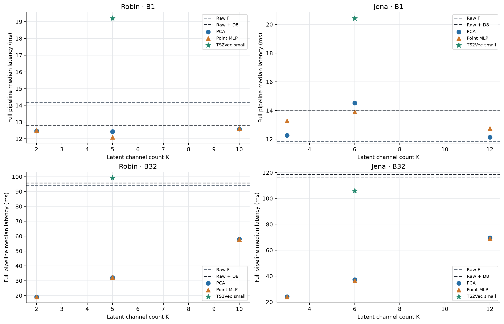
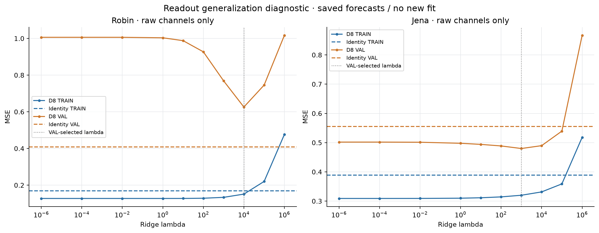
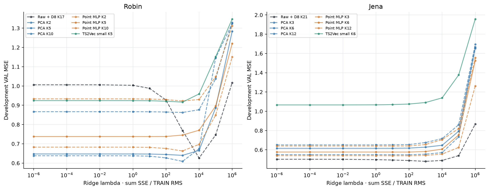

# 동결 TSFM: K·표현·미래 디코더의 비용–오차 재검토

2026-10-11. `[확인]`은 실행 결과·소스·원문 근거이며 `[판단]`은 연구 해석과 다음 설계 제안이다. 첨부 문서의 설명을 작업 지시로 취급하지 않았다.

**[확인] 압축의 가치는 자료·K·batch·평가 지표에 따라 달랐다. 복잡한 시간 표현을 추가하는 것만으로 좋은 TSFM 입력이 되지는 않았다.**

- Robin: 최저 MSE 압축 경로인 PCA K10도 Raw F보다 MSE가 49.0% 높았다. 사전에 둔 MSE 증가5/10/20% 조건을 만족하는 압축 경로가 없다.
- Jena: Point MLP K6는 Raw F보다 MSE 3.89%, MAE 19.38% 증가. B32는 3.18배 빠르고 CUDA peak allocated는 56.43% 낮았다. MSE5% 허용은 두 seed 평균 기준이다.
- Jena: Point MLP K12의 MSE는 Raw F보다 3.16% 낮지만 MAE는 14.20% 높았다. 원채널+같은 D8 경로는 이 압축 경로보다 MSE가 더 낮다.
- 공식 TS2Vec의 경량 설정은 두 자료의 같은 K에서 PCA·MLP보다 MSE와 MAE가 높았고, 전체 추론도 두 간단한 표현보다 오래 걸렸다.

**[판단] 문제를 ‘PCA 손실 복구’에서 ‘비압축 기준선의 오차를 기준으로 어느 표현·K가 전체 비용 제약을 만족하는가’로 좁힌다.** 아직 새로운 알고리즘의 효과나 LEVEL 전체의 우월성을 입증한 단계는 아니다.

## 비교 계약

[확인] Robin C17/K2·5·10, Jena C21/K3·6·12, context512/horizon48, seed92601/92602. 같은 TRAIN 통계·관측 마스크·VAL origins·동결 ChronosBolt·FORECAST_RIDGE_D8을 사용했다. ‘같은 디코더’는 구조·입력 시차8·미래 원채널 목표·TRAIN512 origins·RMS 규격화·10개λ·VAL 선택 규칙이 같다는 뜻이다. 좌표계가 다른 E마다 D 계수는 다시 적합한다. K가 달라지면 D 계수 수도 달라진다.

[확인] Raw F는 E/D 없이 원래 TSFM 예측을 사용한다. Raw + D8은 E identity/K=C인 통제 대조다. 두 기준선을 모두 남겨 압축과 readout 적응을 구분했다. Raw + D8 대비 개선이 Raw F 대비 개선을 뜻하지 않으며, E 교체의 순수 인과효과를 분리했다고도 할 수 없다.

[확인] 새K MLP8fits는 fresh180epoch/2880updates씩 완료했다. 중간K MLP4checkpoint는 직전180epoch 연구에서 검증 후 재사용했다. PCA는 TRAIN covariance 기반 closed form. TS2Vec4fits는 공식 crop/mask·hierarchical contrastive loss·AdamW·SWA를 유지해2880updates씩 학습했다. 최종 D8은 미래 정답 latent 대신 실제 F의 TRAIN 예측을 입력으로 받았다. F 역전파·새 TEST 평가·G 학습은0이다.

[확인] 시점별 MLP도 L512 출력 시퀀스를 F에 전달하며 D8도 시차 입력을 읽는다. ‘시점별 인코더’는 전체 경로가 시간을 보지 않는다는 뜻이 아니다. 직전 연구의 MLP/작은 causal CNN 대조는 인코더에 최대8lag를 추가하는 가치를 물었다. 이번 TS2Vec 대조는 학습 목적·용량·문맥·입력 pool도 달라 순수 시간 효과 실험이 아니다.

## 같은 VAL에서의 오차

[확인] TRAIN 통계로 표준화한 값에서 관측 마스크를 적용한 채널 macro 평균. Robin30/Jena371 origins. 학습형은 두 seed의 loss 평균이며 예측 ensemble이나 신뢰구간이 아니다. Δ는 Raw F 대비 증가율이다. 모든 지표는 낮을수록 좋다.

### Robin

```text
Path                       K/C       MSE       MAE     ΔMSE%    ΔMAE%
Raw F                     1.000  0.408587  0.339458     +0.00    +0.00
Raw + D8                  1.000  0.625913  0.538596    +53.19   +58.66
PCA K2                    0.118  0.862482  0.664474   +111.09   +95.75
PCA K5                    0.294  0.640041  0.543818    +56.65   +60.20
PCA K10                   0.588  0.608757  0.535271    +48.99   +57.68
Point MLP K2              0.118  0.921989  0.682787   +125.65  +101.14
Point MLP K5              0.294  0.737326  0.603841    +80.46   +77.88
Point MLP K10             0.588  0.659881  0.572109    +61.50   +68.54
TS2Vec small K5           0.294  0.916280  0.711931   +124.26  +109.73
```

### Jena

```text
Path                       K/C       MSE       MAE     ΔMSE%    ΔMAE%
Raw F                     1.000  0.555062  0.373929     +0.00    +0.00
Raw + D8                  1.000  0.479848  0.374178    -13.55    +0.07
PCA K3                    0.143  0.650588  0.504914    +17.21   +35.03
PCA K6                    0.286  0.615096  0.477219    +10.82   +27.62
PCA K12                   0.571  0.548308  0.431978     -1.22   +15.52
Point MLP K3              0.143  0.639017  0.489223    +15.13   +30.83
Point MLP K6              0.286  0.576672  0.446385     +3.89   +19.38
Point MLP K12             0.571  0.537516  0.427033     -3.16   +14.20
TS2Vec small K6           0.286  1.065816  0.706973    +92.02   +89.07
```

[판단] Jena의 MSE 개선을 모든 오차의 개선으로 표현하면 안 된다. Raw F는 중앙값 예측, D는 제곱오차 ridge로 적합한다. 목표 차이는 MSE/MAE 교환을 설명할 후보지만 이번 진단으로 유일한 원인임을 입증하지는 않았다.

## 실제 전체 추론 비용

[확인] RTX4070/torch2.10.0+cu128, 각 dataset/경로/seed/batch를 새 process에서 실행했다. 52cases·warmup5·timed20, 총1040 timed/260 warmup 실행. 표준화→전송→E→F median48→causal D8→CPU 출력·CUDA sync 포함. startup/import/model load/디스크/window 추출·초기 결측 탐지/채점/hash는 제외한다. 현재 CPU↔GPU 왕복과 CPU FP64 D를 포함하며 최적화된 fused deployment 비용이 아니다.

[확인] 아래 학습형 시간은 seed별20회 median의 평균, 메모리는 seed별 allocator 최고값/관측 RSS 최고값의 평균이다. 전체 GPU 사용량이나 학습 메모리 최고값이 아니다. RSS는 목표2ms 간격의 관측 최고값, MiB=bytes/2^20. CUDA allocated와 reserved는 별개이며 합산하지 않는다. B1/B32의 p95와 모든 원시 timing은 benchmark.json에 있다.

### Robin

```text
Path                       B1 ms   B32 ms  B32 speed   CUDA MiB  RSS MiB   E weights   D coeff
Raw F                      14.15    93.97     1.00x    775.36  1364.64          0         0
Raw + D8                   12.77    95.77     0.98x    775.36  1369.19          0      2601
PCA K2                     12.47    19.12     4.91x    259.54  1390.62         34       306
PCA K5                     12.43    32.15     2.92x    362.87  1392.47         85       765
PCA K10                    12.58    58.00     1.62x    533.08  1392.91        170      1530
Point MLP K2               12.50    19.16     4.90x    259.55  1388.60       2489       306
Point MLP K5               12.10    32.28     2.91x    362.94  1399.13       2530       765
Point MLP K10              12.61    57.90     1.62x    533.09  1400.17       2619      1530
TS2Vec small K5            19.21    99.13     0.95x    362.98  1476.32       5402       765
```

### Jena

```text
Path                       B1 ms   B32 ms  B32 speed   CUDA MiB  RSS MiB   E weights   D coeff
Raw F                      11.83   115.79     1.00x    910.69  1370.99          0         0
Raw + D8                   14.03   118.73     0.98x    912.07  1376.17          0      3969
PCA K3                     12.27    24.12     4.80x    293.73  1397.77         63       567
PCA K6                     14.53    37.16     3.12x    396.81  1399.39        126      1134
PCA K12                    12.14    69.48     1.67x    602.46  1400.62        252      2268
Point MLP K3               13.28    23.92     4.84x    293.75  1396.07       3072       567
Point MLP K6               13.91    36.39     3.18x    396.82  1397.73       3132      1134
Point MLP K12              12.75    69.11     1.68x    602.47  1405.90       3201      2268
TS2Vec small K6            20.43   105.84     1.09x    396.86  1490.26       5566      1134
```

[확인] E weights는 PCA의 저장된 C×K basis 계수 또는 학습형 encoder 단일 net 변수 수이며 공통 F 변수는 제외했다. TS2Vec native 객체는 training net과 SWA net을 함께 유지해 실제 resident E weight가 표 수의2배다. D 계수는9KC개다. B32에서 PCA/MLP의 K 감소는 큰 속도·CUDA 메모리 이익을 보였으나 B1의 이익은 자료별로 달랐다. 모든 압축 경로의 관측 CPU RSS는 Raw F보다 높았다. ‘전체 메모리가 절반’이라는 주장은 성립하지 않는다.

[확인] TS2Vec small B32는 Robin99.13ms/Jena105.84ms. Raw F93.97/115.79ms와 비슷한 규모이며 같은K MLP32.28/36.39ms보다 오래 걸렸다. CUDA 메모리 절감은 남아 있지만 큰 오차 증가와 함께 봐야 한다. 이 비용은 native causal rolling export 구현의 비용이며 TS2Vec 알고리즘의 최적 배포 비용을 판정한 것이 아니다.




## 허용 오차를 정하면 무엇이 남는가

[확인] 사전 고정 MSE5/10/20%를 모두 보였으며 사용자 선호를 하나로 가정하지 않았다. Raw F 기준 Jena5/10%에서는 MLP K6가 이번 B32 측정의 가장 빠른 후보다.20%에서는 MLP K3가 가장 빠르다. Robin은 세 조건 모두 후보가 없다. Raw + D8 기준으로는 Jena5/10% 후보가 없고20%에서 K12 PCA/MLP만 남는다. 평균 MSE 조건만으로 MAE 또는 seed별 안정성 조건을 만족했다고 할 수 없다.

[확인] Jena MLP K6의 seed92601/92602 MSE는0.589245/0.564099로 Raw F 대비 각각 약6.16%/1.63% 증가한다. 평균3.89%이므로5% 조건은 평균 수준의 개발 관찰이다. K12 MLP 두 seed도 MAE는 Raw F보다 높았다. 같은 VAL로 여러K·λ·checkpoint를 선택했으므로 이 경계를 독립 TEST 보장으로 제시하지 않는다.

## 디코더 자체의 진단

[확인] 기존 저장 raw-C 예측과 계수만 재계산했으며 새 fit/F 호출은 없다. identity VAL 예측은 Raw F 저장 배열과 완전히 같다. 따라서 원채널 대조의 input/origin/스케일 불일치로 설명할 근거는 발견되지 않았다.

```text
Data     Identity TRAIN  D8 TRAIN    Identity VAL   D8 VAL     λ
robin         0.169016   0.151228       0.408587  0.625913    10000
jena          0.389094   0.320001       0.555062  0.479848     1000
```

[판단] Robin의 D8은 TRAIN MSE를 줄이고 VAL MSE를 악화시켰다. 현재 readout의 일반화 실패가 드러났으며 압축을 하지 않아도 발생한다. 이것만으로 overfitting·분포 변화·shrinkage 중 한 원인을 확정할 수 없다. Jena는 TRAIN과VAL MSE가 모두 줄었고 VAL MAE는 거의 같았다. D8 효과를 자료 전체에 일률적으로 주장할 수 없다.



[확인] 초기7개λ에 공통[1e-6,1e5,1e6]을 더한 최종10개를 모든K/방법에 동일 적용했다. baseline20개 D의 최종 선택은 내부값이며 초기7개 선택과 같다. Jena TS2Vec 두 seed만1e-6 하한 선택이다.1e-4 대비 MSE 변화는 각각 약1.09e-7로 작다. 최적λ를 완전히 bracket했다고는 할 수 없으나 이 미세한 확장으로 방법 순위는 바뀌지 않았다. 추가 확장은 하지 않았다.



## 교수님 제안과 다른 압축기의 실행 상태

[확인] PCA만 실행한 상태가 아니다. 이전 동일 D 연구에서 PCA-free LINEAR_POINT·LINEAR_TIME·MLP_POINT·TCN_TIME·GRAPH_TIME_NL을 실제 실행했다. 직전180epoch 연구에서도 MLP/작은 causal CNN을8freshfits로 비교했고 두 자료의 평균에서 CNN이 MLP를 넘지 못했다. 이는 당시 같은grid의 결과이며 이번 확대grid에 CNN을 재적합한 결과는 아니다. 과거 PCA 초기화 lag/graph-time 변형도 실행했다.

[확인] 이번에는 교수님 후보인 TS2Vec 공식 revision b0088e14a99706c05451316dc6db8d3da9351163을 직접 실행했다. hidden16/depth3/K5·6/2880updates/finalSWA의 작은 설정이다. 공식 기본 대형 architecture의 논문 성능 재현이 아니다. encode는 causal=True + sliding_length1 + padding200. depth3의 실제 마지막 출력은 과거 최대30lag를 읽고201시점 창을 계산한다. Robin TRAIN pool은 canonical1945 중1433(512제외), Jena는25648 전체다. MLP의 알려진 pre-TRAIN history 사용과 native pool 경계, objective/optimizer/문맥/용량/샘플순서/VAL E 선택 차이를 명시했다. 같은 update 수는 같은 계산 예산이 아니다.

[판단] 현재 결과는 이 작은 설정·현재 자료·선형 D8·frozen F 연결의 결과다. TS2Vec 원문은 표현→ridge 미래 예측을 사용하며, 임의의 표현 좌표를 frozen scalar F가 예측하는 경로를 보장하지 않는다. 이번 실패를 TS2Vec 일반 예측 능력의 반증이나 contrastive 목적/시간정보 하나의 효과로 귀속하지 않는다. [TS2Vec 논문](https://ojs.aaai.org/index.php/AAAI/article/view/20881), [공식 API](https://github.com/zhihanyue/ts2vec/blob/b0088e14a99706c05451316dc6db8d3da9351163/ts2vec.py)

[확인] GTConvAE 원형은 미실행이다. 원형은 시간 축을 줄이며 공간 노드를 유지하므로 현재 L512 보존·C→K에 연결하려면 pooling·projection·causal export·D 연결을 변경해야 한다. 이전 graph-time 변형을 GTConvAE 재현으로 부르지 않는다. product graph의 결합 계수는 미지의 채널쌍별 directed lag graph 발견과도 다르다. 공식 구현은 제한된 검색에서 확인하지 못했으며 없다고 단정하지 않는다. [GTConvAE 원문](https://proceedings.mlr.press/v198/sabbaqi22a/sabbaqi22a.pdf)

[확인] GTConvAE·TS2Vec·causal TCN-AE·dynamic/lag AE·DCA·DAPC·CoST·TNC의8계열과 TRMF/GDFM, AdaPTS/LatentTSF 선행은 문헌·공식 코드 조사에서 검토했다. DCA/DAPC/CoST/TNC/TRMF/GDFM 원형/AdaPTS/LatentTSF는 현재 benchmark에 실행하지 않았다. [후보별 출력·학습·변경 조건](context/level_encoder_contract_20261010/METHODS_KO.md), [이번 TS2Vec 선정과 설정](METHOD_CHOICE_KO.md).

## 좁힌 문제 정의와 기여 후보

**[판단] Problem:** 동결 ChronosBolt의 비압축 예측과 readout 적응 기준선을 유지하면서, C→K 입력 축소가 목표batch의 전체 추론 비용을 줄이고 지정한 MSE/MAE 손실 한도를 만족하는 조건을 찾는다. 현재 근거는 두 자료의 반복 VAL prototype이다. C를 사용하지 못한다는 전제를 세울 근거는 없다.

**[판단] Question 1:** 원채널 미래 readout 적응 자체가 원래 예측을 개선하거나 훼손하는가? Robin과Jena가 다른 답을 주었으므로 이를 먼저 진단한다.

**[판단] Question 2:** 같은 D 계약에서 표현/K/batch를 바꾸면 MSE·MAE·전체 latency·CUDA/RSS 경계가 어떻게 달라지는가? Jena의 MSE 평균5% 조건에서K6 비용 이익은 남지만 MAE 손실도 크다. Robin의20% 조건에는 이익을 주장할 후보가 없다.

**[판단] Question 3:** 시간·자기지도 표현의 추가 비용이 간단한 표현보다 유효한 미래 정보를 전달하는가? 직전 작은CNN 및 이번 TS2Vec 설정은 평균 우위를 지지하지 않았다. directed lag 관계를 실제 식별한 실험은 아니다.

**[판단] Contribution 후보:** (1) Raw F와Raw + D8을 유지해 readout 효용과 압축 경로 효용을 구분한 대조, (2) 재구성/표현학습 품질과 동결 scalar predictor 적합성을 혼동하지 않는 실패 진단, (3) F 역전파 없이 학습한 경로의 K·batch별 전체 비용과 지표별 손실 조건 분석. 각각은 현재 실증·설계 근거이며 새로운 알고리즘 기여나 완성된 논문 신규성을 뜻하지 않는다.

[확인] E→frozen univariate FM→D와 선형/비선형 latent adapter는 [AdaPTS](https://proceedings.mlr.press/v267/benechehab25a.html)와 직접 겹친다. PCA를AE로 교체하거나K를 줄이는 것만으로 신규성을 주장할 수 없다. LEVEL의G·다른backbone·LoRA/HEAD/작은backbone까지의 우월성은 이번에 검증하지 않았다.

**[판단] 다음 우선순위:** 목표 batch와 MSE/MAE 손실 조건을 고정하고 Robin의 raw readout 일반화 문제를 먼저 해결할 설계를 정한다. 예를 들어 원채널 통제에서 identity를 기준으로 잔차만 ridge 적합하고 identity 후보를 보존하는 비교는 원래 예측을 훼손하는 원인을 좁힐 수 있다. 이는 아직 실행하지 않은 후속 설계이며 압축 추론에서C채널 F를 추가 호출하는 제안은 아니다. 압축용 D의 기준 경로는 별도로 설계해야 한다. 그 다음 필요가 남을 때 DCA/DAPC처럼 예측정보 목적 후보 하나를 선택하거나 GTConvAE-inspired 변경을 명시해 대조한다. 현재 결과만으로 더 많은 encoder sweep을 곧바로 늘릴 근거는 약하다.

## 한계·실행·검증

[확인] 단일 장비·한backbone·두자료(C17/21)·두seed·반복VAL 개발 결과다. Robin30 origins와 겹치는 창의 유효 표본수, checkpoint/λ/K/후보 선택의 반복사용, timing order/process variability를 한정한다. TEST 일반화·학습 수렴·대규모 고차원 자료의 효과를 입증하지 않았다. B32 Robin은VAL30개에 첫2개를 반복해 batch32를 맞췄다. 마지막 latent 대체 진단은 별도로 학습한 no-F baseline이 아니므로 F의 필요성을 판정하지 않는다.

[확인] 과학 실행 중 두 파일 처리 실패를 보존했다. attempt1은 progress atomic replace의WinError5, attempt2는 __pycache__ 정리와 storage walk가 겹친WinError3다. 완료5E+100ridge를 byte-SHA 검증 후 재사용하고 남은3E+100ridge만 실행했다. 실패한 부분 trajectory는 선택에 쓰지 않았다. I/O 복구 전후 과학 helper AST는 같으며 source/seal/archive가 남아 있다. 물리fit starts14/완료12, fresh 성공34560updates, 실패 포함35904..35935updates, 총240ridge다. 중간K 재사용4fits는 이번 새 학습수에 중복 계산하지 않았다.

[확인] 실패 포함 baseline stage wall 694.29s, TS2Vec stage wall 404.18s, 합1098.46s. process CPU 합2808.14s. 조사·구현·검증·benchmark·보고서 시간을 합친 작업시간은 아니다. baseline 과학 receipt의 stage_peak_rss_bytes_max는 각stage 종료/실패 snapshot 최대이며 연속 RSS peak로 해석하지 않는다. 추론 표의 RSS 관측 최고값과도 다르다.

[확인] 독립 검증 2518 checks PASS/실패0. warning2는 Jena TS2Vec λ하한이다. 최초 검증의 no-TEST 문자열 오탐과 미작성 보존 after receipt를 바로잡았고 실패출력·이전 verifier도 보존했다. 과학 source/결과를 수정해 검증을 통과시킨 것이 아니다. 이전4662artifact와GitHEAD를 보존했으며 history는 append-only다.

근거: [protocol.json](protocol.json), [method_protocol.json](method_protocol.json), [result.json](result.json), [method_result.json](method_result.json), [benchmark.json](benchmark.json), [summary.json](summary.json), [verification.json](verification.json), [parent_preservation.after.json](parent_preservation.after.json), [recovery_source_diff.json](recovery_source_diff.json).
