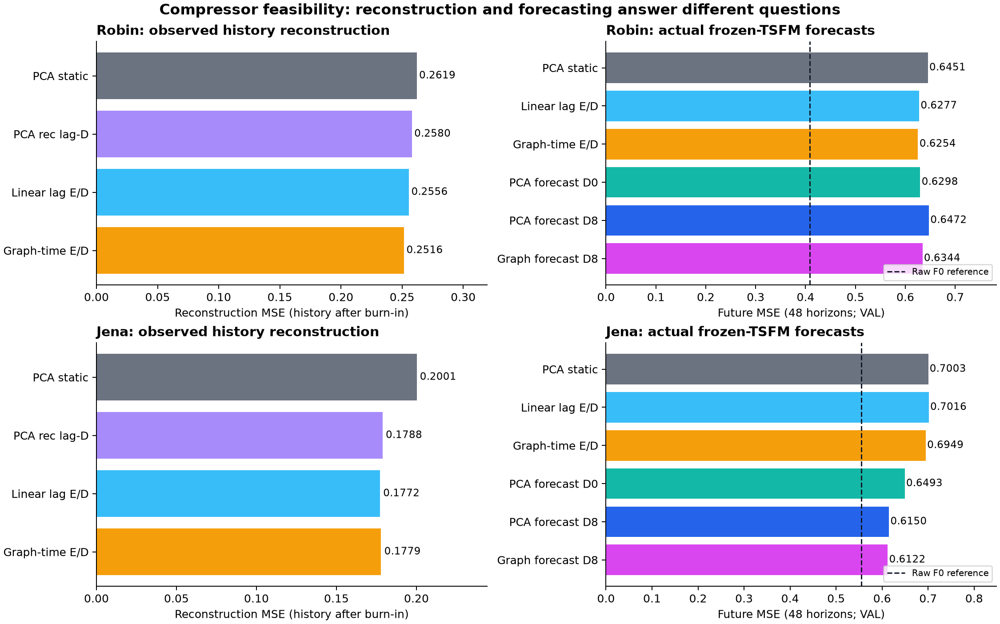
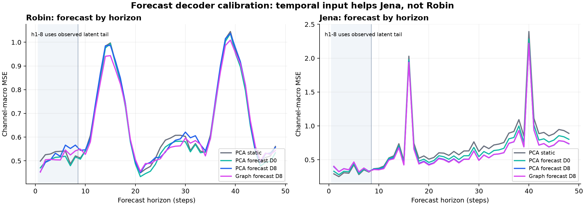
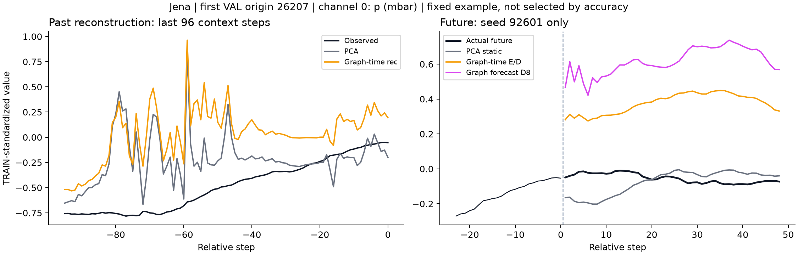

# Compressor 가능성 탐색: 지금 가장 유용한 연구 질문

2026-10-10. **[판단] 붙여넣은 검토 글의 핵심 진단에는 동의한다. 다만 다음 단계에서 방법 전체의 우월성을 먼저 요구하기보다, 압축–예측–복원의 연결에서 실제로 개선할 수 있는 부분을 하나씩 확인하는 편이 맞다.** 이번에는 그 판단을 세 번의 작은 TRAIN/VAL 실험으로 확인했다. PCA를 최종 방법으로 고정하지 않았다.

**[확인] 지금 가장 뚜렷한 신호는 Jena에서 ‘재구성용 디코더를 실제 TSFM 예측 출력에 맞추는 것’의 효과다. 그래프형 압축기도 실행 가능했고 Robin에서 소폭의 개선을 보였지만, 그래프 자체의 필요성은 아직 확인되지 않았다.** 이것은 연구를 포기할 결과가 아니라, 다음 질문을 좁힐 수 있는 초기 근거다.

## 붙여넣은 글에 대한 의견

좋은 부분은 네 가지다. 연구 목적과 PCA·잔차 모듈이라는 수단을 구분한 점, 재구성 정확도로 실제 예측의 유용성을 대신 판단하지 않은 점, 동결 가중치와 본체 역전파 제거를 구분한 점, 교수님이 추천한 모델도 실제 입출력 계약을 확인해야 한다고 한 점이다.

**[판단] 다만 ‘왜 정보 배분이 표준 적응보다 유리한가’는 전체 연구를 평가할 질문이지 첫 compressor 가능성 실험의 통과 조건은 아니다.** 첫 단계에서 작은 백본·LoRA·출력 헤드·새 압축기를 모두 이겨야 한다고 요구하면 아직 설명하지 못한 연결을 찾기 어렵다. 우선 같은 K에서 무엇이 변하는지 측정하고, 필요한 구성만 남긴 뒤 전체 정확도–비용 비교로 돌아가면 된다.

과거 v18의 자원 STOP도 압축기가 불가능하다는 결과가 아니다. 그 작업은 예측 손실을 인코더까지 전달하는 별도 계약에서 학습 시작 전에 중단됐다. 이번에 실행한 재구성 학습과 디코더 선형 적합은 그 작업을 재개하거나 같은 비교를 완성한 것이 아니다.

## 원문에서 가져온 원리

**[확인: 원문] GTConvAE는 주어진 공간 그래프와 시간 연산을 결합하는 오토인코더다. 원형의 압축은 주로 시간축이며 노드 수를 유지한다.** 현재 필요한 C→K 시계열 압축에 그대로 붙는 모델은 아니다. 이번 구현은 그 원리에서 가져온 작은 graph-time encoder이며, 원 논문 재현 또는 미지의 방향성 지연 그래프 발견이라고 부르지 않는다. [GTConvAE 원문](https://proceedings.mlr.press/v198/sabbaqi22a.html)

**[확인: 원문] TS2Vec는 시점별 표현을 자기지도 학습하고, 원문의 예측은 그 표현을 릿지 회귀에 연결한다. 별도의 재구성 디코더는 제공하지 않는다.** 소수 K의 표현을 frozen TSFM에 연결하려면 작은 병목과 디코더를 추가해야 하므로 첫 비교에서는 변경을 더 적게 도입하는 시간형 AE를 택했다. TS2Vec 계열이 부적합하다는 판정은 아니다. [TS2Vec 원문](https://ojs.aaai.org/index.php/AAAI/article/view/20881)

**[확인: 원문] 동적요인 모형은 같은 잠재 요인이 서로 다른 지연으로 여러 관측에 나타나는 표현을 다룬다.** 이것은 적은 동적 요인과 높은 동시점 행렬 랭크가 함께 존재할 수 있다는 설계 단서다. PCA가 모든 시차 정보를 버린다는 주장이나 현재 자료의 진짜 생성 과정이 그렇다는 증거는 아니다. [GDFM 저자 원고](https://lippi.ws/SC/Forecasting.pdf)

**[확인: 원문] TRMF는 잠재 요인의 자기 과거에 대한 예측 구조를 정규화한다.** 이후 각 latent를 독립적으로 처리하는 TSFM에 맞는 표현을 학습할 단서가 된다. 이번에는 재구성 효과와 목적함수 효과를 섞지 않기 위해 추가하지 않았다. 적용한다면 latent 스케일을 줄여 손실만 낮추는 문제와 간단한 예측기만으로 충분한지 함께 확인해야 한다. [TRMF 원문](https://www.cs.utexas.edu/~inderjit/public_papers/trmf_nips16.pdf)

**[확인: 원문] 학습형 E/D 사이에 frozen 단변량 FM을 넣는 구조는 AdaPTS와 직접 겹친다.** ‘PCA를 AE로 교체했다’ 또는 ‘latent에 TSFM을 적용했다’만으로 새 기여를 주장하지 않는다. 현재 남길 질문은 시간 정보가 필요한 복원과, 큰 모델을 통과하는 역전파 없이 실제 예측 출력에 적응하는 경로다. 완전한 신규성 검토는 이후 필요하다. [AdaPTS 원문](https://proceedings.mlr.press/v267/benechehab25a.html)

## 실제 실행한 비교

**[확인] Robin C17/K5, Jena C21/K6에서 과거512·미래48, FP32, frozen Chronos-Bolt-small을 사용했다.** 잠재 시계열 K개를 각자 같은 TSFM으로 예측했다. 외부 잔차 보정기 G는 넣지 않아 압축–예측–복원 경로를 직접 측정했다.

첫 회차는 고정 PCA E/D, PCA E+과거8개 latent를 읽는 D, 학습형 선형 시간 E/D, graph-time E+같은 시간 D다. 두 학습형 family를 자료별 두 시드로 학습해 neural8회, PCA 시간 D의 reconstruction ridge는 lambda3×자료2=6회 적합했다. 학습형 E는 PCA로 초기화했으나 현재 시점의 변환도 학습했다. 따라서 순수한 encoder 시차 효과만 분리한 비교는 아니다.

E/D는 TRAIN의 실제 관측 timestamp 재구성으로 학습했다. 입력 결측을 채웠더라도 원 관측 마스크가 false인 값은 정답에 포함하지 않았다. 같은 canonical history를 사용했고, encoder가 더 긴 과거를 읽지 않았다. 그래프는 TRAIN pairwise 관측의 동시점 절대 상관 top3로 만들었다. 이 그래프가 최적이거나 지연 관계를 발견한다고 전제하지 않았다.

선택은 전체 VAL history 재구성 MSE의 최소값이며 epoch0도 포함했다. 모든 재구성 점수에서 앞16개를 제외했다. VAL history에는 TRAIN tail 과거도 포함되므로 재구성 점수는 독립 평가가 아니다. 미래 점수는 VAL 미래의 실제 관측 목표만 평가했다.

후속 회차는 기존 E를 모두 고정한 채 실제 TRAIN TSFM 예측으로 D만 적합했다. 자료별 같은512 TRAIN origins를 seed92603으로 중복 없이 뽑아 PCA와 학습형 E 네 개에 똑같이 적용했다. D는 과거8개 latent와 현재 예측 latent를 읽는 선형 필터이며, lambda3의 선택은 VAL 미래 MSE로 했다. ridge30회, 신규 neural0이다. 첫 회차의 재구성 선택과 후속 회차의 예측 선택은 다른 학습 절차다.

마지막으로 PCA에서 같은512 origins·lambda·선택 조건으로 현재 예측 latent만 읽는 D0를 적합했다. 두 자료 ridge6회다. **총 neural8, ridge42, TEST 접근·평가0회**다. 큰 TSFM의 가중치는 변하지 않았고 gradient가 생기지 않았으며 본체 역전파를 하지 않았다.

## 무엇이 실제로 달라졌나

아래는 채널별 관측 오차를 평균한 VAL MSE다. 학습형 구성은 두 시드의 손실 평균이며 예측 앙상블이 아니다. MAE와 각 시드·horizon의 원 점수도 [summary.json](summary.json), [result.json](result.json), [decoder_probe_result.json](decoder_probe_result.json)에 있다.

```text
구성                                      Robin        Jena
고정 PCA E/D                              0.645080     0.700274
PCA E + 재구성 학습 시간 D8                 0.643105     0.701384
선형 시간 E/D, 재구성 학습                  0.627665     0.701606
그래프–시간 E/D, 재구성 학습                0.625404     0.694948
PCA E + 실제 예측으로 학습한 D0             0.629762     0.649307
PCA E + 실제 예측으로 학습한 D8             0.647210     0.615043
선형 시간 E + 실제 예측으로 학습한 D8       0.628813     0.616187
그래프–시간 E + 실제 예측으로 학습한 D8     0.634371     0.612247
원채널 frozen TSFM, 참고                    0.408587     0.555062
```



**[확인] Robin에서 graph-time 재구성 학습 구성은 PCA 대비 미래 MSE 약3.05% 감소했다.** 두 시드는 0.623454와 0.627354다. 선형 시간 구성도 평균0.627665로 비슷했고 MAE는 선형형이 더 낮았다. 그래프가 있어야 하는 효과라고 판단할 단계는 아니다. 예측용 D8 보정은 평균0.634371로 오히려 나빠졌다. PCA에서도 D0가 D8보다 좋았다.

**[확인] Jena에서 재구성 개선의 대부분은 decoder만 바꿔도 생겼다.** history MSE는 PCA0.200145 → PCA+재구성D8 0.178824 → graph-time 평균0.177914였다. 그래프형의 약11.1% 재구성 개선 중 대부분을 이미 PCA+시간 D가 설명한다. 하지만 이 PCA+재구성D8의 미래 MSE는 0.701384로 PCA보다 약간 나빴다. 재구성 개선을 미래 유용성의 대리 지표로 사용하기 어렵다는 실제 관찰이다.

**[확인] Jena에서는 실제 TSFM 출력으로 학습한 D8이 유용했다.** graph-time의 미래 MSE는0.694948→0.612247(약11.90% 감소), PCA도0.700274→0.615043(약12.17% 감소)였다. 보정 후 graph-time 두 시드는0.613726/0.610767로 PCA+D8보다 모두 낮았지만, 평균 추가 이득은 약0.45%로 작다. 가장 큰 개선을 그래프형 E의 독자적인 성과로 돌리면 안 된다.

**[확인] Jena의 시간 입력 효과는 미래 초반에만 생기지 않았다.** 같은 PCA에서 D0→D8이 전체 MSE를0.649307→0.615043(약5.28%) 줄였고, 예측9–48번째에서도0.712278→0.664702(약6.68%)로 줄었다. 이 구간의 D는 예측된 latent들만 읽으므로 관측 latent tail을 직접 복사한 이득만으로 설명할 수 없다. 다만 시간 입력과 decoder 함수 용량을 함께 늘린 비교이며, 실제 채널 간 지연을 식별했다는 증거는 아니다.



**[확인] TSFM을 쓰는 가치는 현재 압축 경로 안에서는 남아 있다.** 보정된 graph-time E/D에서 Jena의 latent-last 대조는 평균 MSE 약0.9205, TSFM은0.6122였다. Robin에서는 각각 약1.3670과0.6344다. 이것은 같은 E/D에 마지막 latent 반복을 넣은 대조이며, 별도로 미래 손실에 학습한 AR·NLinear보다 낫다는 증거는 아니다.

**[확인] 개선은 모든 사례에 동일하지 않다.** Jena의 graph-time+D8은 전체 VAL에서21채널 중19개 채널 MSE가 PCA보다 낮았지만 VPmax·풍향은 나빴다. 전체 채널 비교는 summary의 `channel_diagnostics`에 있다. 아래의 첫 VAL origin·채널0은 성능을 보고 고르지 않은 예시다. 이 한 사례에서는 graph-time의 기압 예측이 나쁘다. 평균 개선과 개별 구간의 개선을 구분해야 한다.



**[확인] 원채널 frozen TSFM은 이번 압축 경로들보다 정확했다.** 이 반례는 함께 남긴다. 이번 목표는 compressor 활용 가능성의 초기 탐색이므로 이 사실만으로 후보를 탈락시키지 않는다. 압축이 실제 선택할 방법이라는 주장은 전체 비용과 추가 자료의 확인 후에 판단한다.

## 문제 정의와 기여를 어떻게 잡을까

**[문제 정의안] 적은 수의 잠재 시계열을 독립적인 frozen TSFM으로 예측할 때, 과거 관측을 복원하도록 학습한 decoder는 미래의 예측 latent에도 적절한가? 시간 정보를 사용하는 복원과 실제 예측 출력에 대한 적응은 어느 자료에서 도움이 되는가?**

이 문장은 교수님의 compressor 제안을 유지하면서 실제로 발견한 연결을 묻는다. ‘채널 지연 정보가 모든 성능 저하의 원인이다’, ‘그래프가 필수다’, ‘PCA를 버려야 한다’는 전제를 두지 않는다.

**[기여 후보] 본체 역전파 없이 사용할 수 있는 압축–예측–시간 복원의 학습 절차와, 재구성 개선이 미래 개선으로 옮겨지는 조건을 보여주는 분석.** 현 단계에서 확보한 것은 이를 시험할 구현과 작은 개발 근거다. 독립적인 새 방법의 기여가 완성됐다고 판단하지 않는다. AdaPTS와 기존 temporal/dynamic-factor decoder를 더 좁게 대조해야 한다.

다음 비교는 하나만 먼저 하는 것이 좋다. **같은 D8을 고정한 비교에서 현재 시점만 학습하는 E와 시간 E를 비교**해, encoder의 시차 처리에도 추가 가치가 있는지 보자. 현재 좋은 결과에는 PCA 좌표의 학습 적응과 시간 처리 효과가 함께 들어 있다. 이것을 확인한 뒤 그래프가 필요하면 graph-free 용량 대조 또는 graph 구성의 시차 정보를 검토하면 된다.

Jena에서는 복원 경로를 우선 탐색하고, Robin에서는 이미 나온 작은 learned-E 신호를 유지한다. 한 자료에 잘 맞는 decoder를 모든 자료에 강제하지 않는다. TRMF형 잠재 예측성 손실은 후속 선택지이며 첫 성과를 내기 위한 필수 조건으로 늘리지 않는다. G 재결합도 이 경로를 고른 다음에 한다.

## 비용·검증·범위

RTX4070/FP32에서 첫 회차 wall81.17초, forecast-D 회차23.60초, D0 회차7.86초였다. **세 실행의 wall 합계112.63초**이며 neural 학습+VAL 선택 단계 합계는33.37초다. 자료 읽기·코드 작성·문헌 검토·검증·그림 작성 시간은 포함하지 않는다. 짧은 회차가 가능했다는 측정이며 장기 대규모 학습의 시간 예측은 아니다.

학습형 E/D의 변수 수는 Robin 선형1530/graph868, Jena 선형2268/graph1278이었다. 학습 단계 GPU 최대 할당은약219–226MiB였다. 이 측정에는 같은 프로세스에 이미 적재한 frozen 본체도 포함한다. 원채널 학습법의 과거 수치와 직접 비용 비교를 완료한 것은 아니다.

full VAL 재현에서 기존 PCA latent cache와 온라인 예측은 모두 tolerance를 통과했다(최대 절대차 Robin1.91e-6, Jena9.54e-6). 두 자료의 전체 future 원시 예측을 별도 CPU 코드로 다시 채점했고, MSE/MAE와 horizon그룹이 기록값에1e-10 이내로 일치했다. 선택 epoch, lambda, 소스·체크포인트·예측 파일 SHA, frozen 본체 전후 SHA도 확인했다. [첫 회차 검증](verification.json), [forecast-D 검증](decoder_probe_verification.json), [D0 재채점](summary.json)

첫 두 자료·두 시드·한 압축률과 lag8의 탐색이다. Robin의8step은8시간, Jena는80분이므로 같은 물리 지연을 비교한 것은 아니다. lambda는 모두 주어진 세 값 중 선택했다. D8 보정에서 선택된 lambda는 모두 그리드 상한1이었다. PCA D0는 Robin0.0001, Jena1이 선택됐다. 이는 최적 정규화 강도를 찾았다는 뜻이 아니다. 신규 TEST 평가를 하지 않았고 VAL을 선택에 사용했으므로 독립 확인·통계적 우월성으로 읽지 않는다.

원 첨부·기존 연구 소스와 결과는 수정하지 않았다. 새 산출물은 이 연구 폴더 및 `.cache/level_lag_compressor_pilot_20261010/`에 있다. 커밋·푸시 또는 교수님께 외부 메시지 전송은 하지 않았다.
