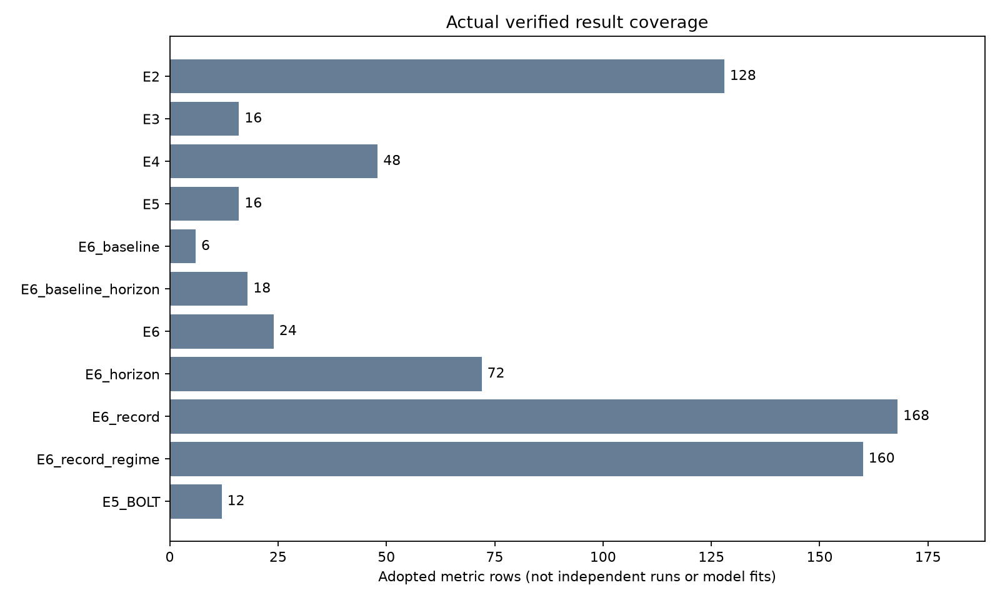

# 과거 전용 표현·지연 그래프 실험: 최종 결과

[확인] 승인한 gate 기준의 핵심 실행, 저장 예측의 독립 재계산, 해시 연결 검사를 마쳤다. 현재 요청의 실행 중 작업은 없다. 이전 LEVEL 작업의 전체 완료를 뜻하지 않는다.

- [한국어 상세 결과](final_report_v5_20261012/REPORT_KO_v5.md)
- [교수님 공유용 초안](final_report_v5_20261012/PROFESSOR_SUMMARY_KO_v5.md)
- [원수치 CSV](final_report_v5_20261012/raw_metrics_v5.csv)
- [추론 비용 CSV](final_report_v5_20261012/cost_closure_timing_v5.csv)
- [실제 최종 상태](STATUS_FINAL_v5.json)
- [실행·실패·재사용 원장](RUNS_FINAL_v5.jsonl)
- [최종 독립 검산](receipts/final_proof_v5_20261012_1948/FINAL_VERIFY_v3.json)
- [보고서 근거 manifest](final_report_v5_20261012/MANIFEST_v5.json)
- [보고서 생성 비용의 종료 원장](final_report_v5_20261012/REPORT_GENERATION_RECEIPT_v5.json)

핵심 판단은 상세 보고서의 첫 여섯 답에 있다. 미래 경계 검사 32개에서 예측 변화는 0이었다. FULL 대비 PREFIX는 8개 중 원공간 MSE 5개, 정규화 MSE 7개에서 낮아졌다. 이 결과는 반복 VAL 개발 진단이며 독립 일반화 검증이 아니다.

Jena에서는 CROSS_NOW의 MSE 18,314가 ALL_LAG의 24,790보다 낮아, 다른 채널의 지연 정보가 현재 정보에 더하는 효용은 확보하지 못했다. Robin의 contrast는 REC보다 두 seed 모두 좋지만, MSE 636·684는 단순 SELF 512보다 높다. Jena 갱신 그래프는 seed에 따라 SELF 대비 개선 방향이 바뀐다. Bolt는 조건부 후보로 유지하며, d320 결과는 차원 확장이라는 점을 함께 판단한다.

Robin E6는 E2의 `NO_LINEAR_32LAG_SIGNAL` gate 때문에 실행하지 않았다. LSTM은 사전의 두 seed Jena d16 gate 중 joint92601 조건을 통과하지 못해 실행하지 않았다. 대형 인코더 재학습, 보호된 TEST 사용, commit/push는 수행하지 않았다.

최종 그림은 본 보고서 7개와 아래 범위 표시 개선판 1개로 총 8개다. 범위 표시의 행 수는 독립 표본 수나 모델 fit 수가 아니다. 기존 manifest는 보존했고, 개선판의 CSV·이미지 해시는 [별도 receipt](final_report_v5_20261012/COVERAGE_READABILITY_RECEIPT_v1.json)에 묶었다.

실패 이력도 보존했다. E2 원 실행의 파일 접근 오류는 완료 부분을 보존한 후 남은 부분으로 이어갔다. E34 준비 guard의 Path/string 비교 오류와 E6 합성 변화 자료의 빈 TUNE 변화 이후 구간 직렬화 오류는 새 attempt에서 고쳤다. 비용 측정의 Robin 정밀도 차이는 TF32·microbatch 재생으로 분리하고 맞춘 조건을 재측정했다. 최종 검산 v3의 probe 정규화 기준 오류, v4의 진단 상태 집계 오류, 보고 v4의 E6 child SHA 연결 누락도 원본과 실패 proof를 남기고 새 버전에서 수정했다. 학습 결과를 유리하게 다시 고르지 않았다.

후속 판단에는 같은 유효 과거 길이를 가진 raw predictor 대조, 더 많은 seed와 독립 자료, 압축 차원과 비용의 별도 검증이 필요하다. 현 결과만으로 대비학습·그래프 계열 전체를 기각하거나 LEVEL 성능 개선을 주장하지 않는다.
