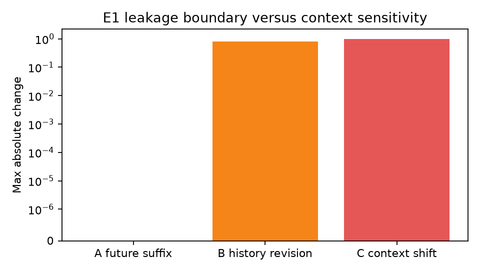
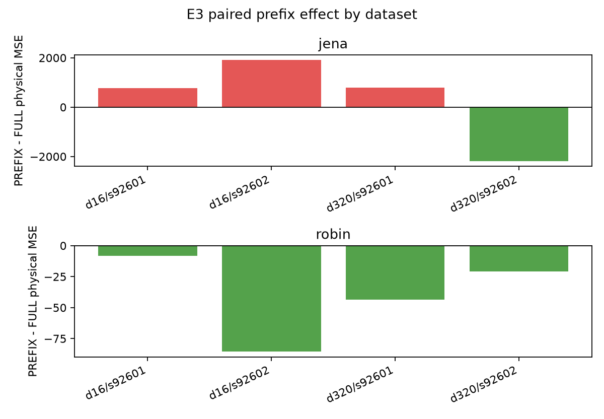
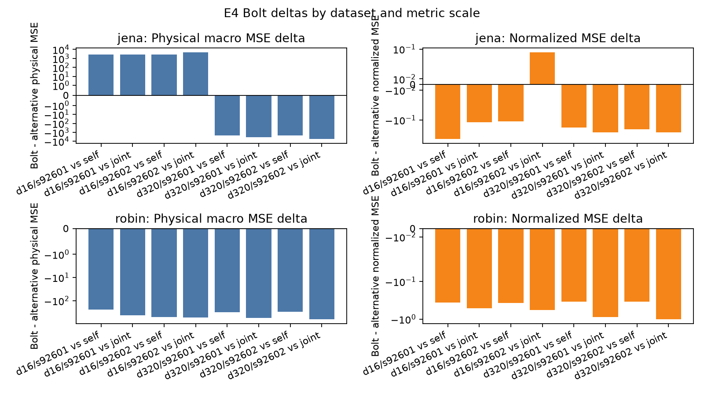
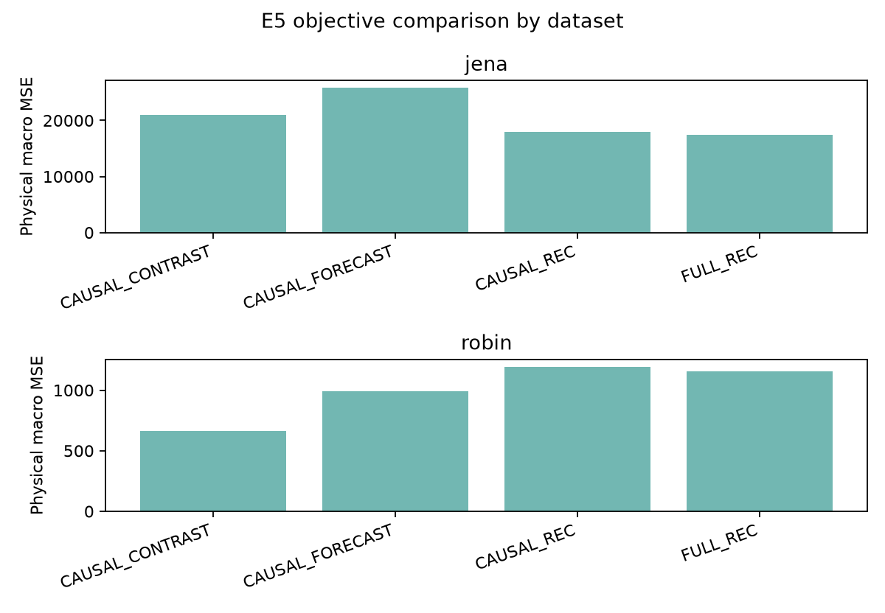
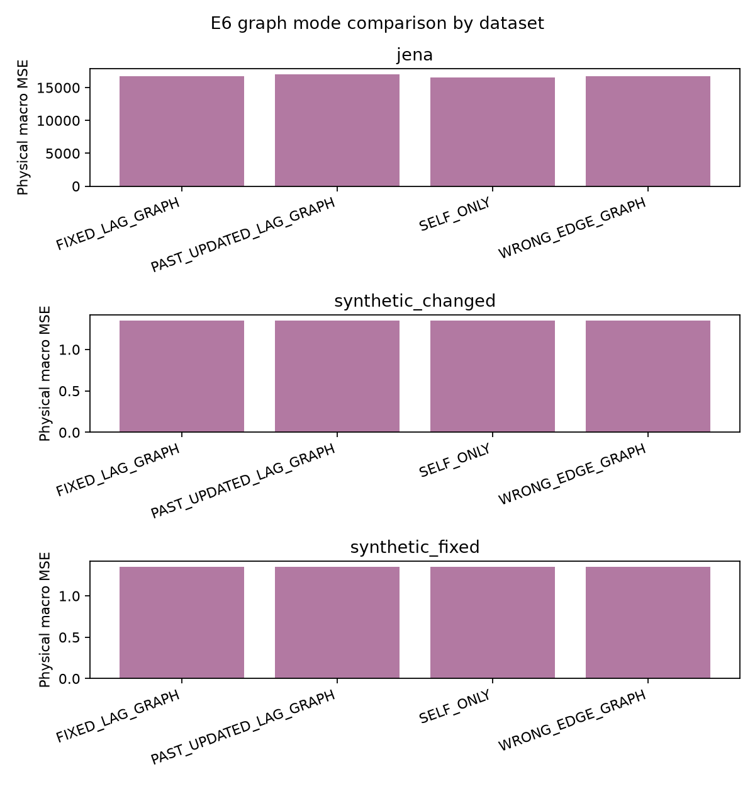

# 과거 전용 표현·지연 그래프 실험 결과

[확인] `past_only_representation_experiments_CLI_20261012.md`의 gate 기준으로 E1→E2→E3/E4→E5/E6를 실행하고, 저장 예측·원수치·파일 해시를 검산했다. 핵심 실행은 완료했고 Robin E6와 선택적 LSTM은 사전 gate에 따라 미실행으로 남겼다. 이 보고서의 대상은 과거 전용 표현과 지연 그래프의 가능성 진단이다. 기존 LEVEL 작업의 전체 완료나 성능 개선을 뜻하지 않는다.

## 1. 실제 미래 정보 누출이 있었는가?

[확인] 채택한 16개 동결 모델 경로의 forecast-boundary 검사 32개에서 예측 origin `o` 이후 데이터를 바꿔도 cold feature와 cold prediction의 최대 변화는 모두 **0**이었다. cold/warm prediction 차이는 `1.0728836e-6`으로 사전 허용치 `1e-4` 이하였다. 이 검사 범위에서는 실제 미래 `o:`의 유입이 관측되지 않았다.

반면, 과거 창 내부의 뒤쪽 문맥을 바꾸는 B/C 검사에서는 기존 TS2Vec 표현 변화가 최대 `0.8209215`/`0.9757228`이었다. 이는 과거 시점 표현이 그 이후의 **관측된 과거 문맥**에 의해 갱신될 수 있다는 뜻이다. 미래 예측 경계 `o` 이후 누출과 구별해야 한다. 새 causal encoder 12개의 anchor 256 과거 전용 검사도 변화 0을 확인했지만, 이 검사는 B 검사이며 모든 배포 경로의 A 검사를 대체하지 않는다.

**불확실성·다음 판단:** E1은 구현의 정보 경계 검사를 통과한 것이다. 성능 개선이나 독립 일반화 검증으로 해석하지 않는다. 실제 배포용 경로를 바꾸면 그 경로의 cold-loader 경계 검사가 다시 필요하다.



## 2. 시점별 과거 전용 표현이 예측을 개선했는가?

[확인] 같은 동결 encoder에서 FULL 추출과 PREFIX 추출을 비교한 8개 조건 중, PREFIX의 원공간 MSE가 낮은 조건은 **5/8**, 정규화 MSE가 낮은 조건은 **7/8**이었다. 각 추출 방식의 decoder는 같은 구조·학습 예산으로 별도 학습했다. 아래 값은 동일 VAL 예측 대상에서 계산한 결과다.

```text
자료   차원  seed   FULL MSE    PREFIX MSE  PREFIX−FULL MSE  정규화 MSE 차이
Jena     16  92601    5967.553     6747.800        +780.247       -0.156629
Jena     16  92602    9781.747    11687.711       +1905.963       +0.083410
Jena    320  92601    6662.169     7447.606        +785.437       -0.005645
Jena    320  92602    9774.543     7579.326       -2195.217       -0.074559
Robin    16  92601     548.521      540.243          -8.278       -0.016960
Robin    16  92602     490.662      405.142         -85.521       -0.069773
Robin   320  92601     356.020      312.264         -43.755       -0.048605
Robin   320  92602     333.183      312.418         -20.765       -0.018263
```

**비교 조건·불확실성:** E3/E4는 사전에 허용한 `DIAG_SUBSET`으로 FIT 64, TUNE 32, VAL 최대 32개 origin을 사용했다. 기존 encoder는 과거 TRAIN_ALL 학습과 VAL 개발 노출이 있는 동결 자산이다. Jena/Robin 두 자료, 차원 16/320, seed 92601/92602의 반복 VAL 진단이며 독립 검증 자료에서의 결과가 아니다. `d=320`은 원 채널 수 21/17보다 커서 **차원 확장**이다. PREFIX 추출 자체가 고정된 전역 online 표현의 안정성을 증명하지도 않는다.

**다음 판단:** 과거 전용 추출은 구현 가능하고 Robin에서는 두 차원·두 seed 모두 개선됐지만, Jena의 원공간 결과는 혼재다. 이를 보편적인 예측 개선이나 압축·경량화 효과로 주장할 수 없다.



## 3. 다른 채널의 지연 정보가 실제로 유용했는가?

[확인] E2의 선형 진단은 자기 채널의 0~32 lag(`SELF`), 여기에 다른 채널의 현재 관측값을 더한 조건(`CROSS_NOW`), 모든 채널의 0~32 lag(`ALL_LAG`)을 비교했다. 모든 신규 통계·계수는 FIT에서 적합하고 ridge 규제는 동일 TUNE 기준으로 선택했다.

```text
자료   조건         원공간 MSE  원공간 MAE  정규화 MSE  정규화 MAE
Jena   SELF          25563.570      47.063      1.254876      0.606400
Jena   CROSS_NOW     18314.169      43.644      1.012070      0.525665
Jena   ALL_LAG       24789.802      43.938      1.115126      0.536789
Jena   PERSISTENCE   51614.950      63.561      1.579101      0.637237
Robin  SELF            512.196      12.369      0.844783      0.612346
Robin  CROSS_NOW      2013.269      26.815      2.818025      1.226784
Robin  ALL_LAG        1440.162      21.554      1.826891      0.978166
Robin  PERSISTENCE    1833.407      18.494      1.308464      0.691486
```

Jena의 ALL_LAG는 SELF보다 MSE가 `773.768` 낮고, 사전 4개 블록 중 3개에서 해당 gate를 통과했다. 그러나 CROSS_NOW가 ALL_LAG보다 MSE가 `6475.633` 낮다. 따라서 **다른 채널의 현재 정보에 더해 지연 정보를 쓰는 증분 효용은 확보하지 못했다.** Robin에서는 ALL_LAG가 SELF보다 MSE `927.966`, MAE `9.184` 높았고 4개 블록 모두 음성으로 `NO_LINEAR_32LAG_SIGNAL`이었다.

합성 자료 30개 기록에서는 ALL−SELF MSE 평균 차이가 고정 지연 `-0.00130682`, 변화 지연 `-0.00068060`, 무관 채널 `+0.00002857`이었다. 고정·변화 지연은 각각 10/10 기록에서 원공간 MSE가 낮았지만, 무관 채널에서도 4/10은 낮았고 3/10은 gate를 통과했다. 예측 길이 48에서는 심어 놓은 짧은 지연 신호가 희석될 수 있다.

**불확실성·다음 판단:** 선형 32-lag 진단의 음성 결과가 비선형 채널 의존성의 부재를 증명하지 않는다. 다만 현재 실자료에서 지연 그래프의 필요성은 확보하지 못했다. 후속 비교의 우선 대조군은 단순 CROSS_NOW와 자기 채널 lag이며, Jena E6 실행 gate 통과와 지연 증분 효용의 입증은 구별한다.


## 4. 표현·잠재 미래 예측·디코더 중 어디에 문제가 남았는가?

[확인] E4에서는 **각 case의 동일 PREFIX encoder와 선택된 동일 decoder**를 고정하고, latent persistence·latent SELF ridge·latent JOINT ridge·동결 Chronos-Bolt를 연결했다. 이를 통해 예측기를 바꿨을 때 결과가 달라지는지 비교했다. 예를 들어 Jena d320, seed 92601의 원공간 MSE는 다음과 같다.

```text
조건                                      원공간 MSE
LATENT_PERSISTENCE                          28955.455
LATENT_SELF_RIDGE                            9679.093
LATENT_JOINT_RIDGE                          10981.206
BOLT_LATENT                                 7447.606
REFERENCE_LATENT_DIAGNOSTIC                   700.974
DIRECT_RAW_RIDGE                             6110.354
```

8개 case에서 Bolt의 원공간 MSE는 SELF·JOINT보다 각각 6/8에서 낮았다. 그러나 Jena d16의 두 seed에서는 SELF·JOINT보다 높았고, latent MSE·정규화 원공간 MSE·물리 단위 원공간 MSE의 순위도 일치하지 않았다. 작은 latent 오차가 decoder와 채널별 단위를 거친 뒤 같은 순위로 이어지지는 않는다.

**불확실성:** REFERENCE는 실제 미래의 latent label을 decoder에 넣는 분리 진단이다. 배포할 수 있는 예측기, 성능 상한/하한, 또는 순수한 decoder-only 잔차가 아니다. 원공간 오차의 항등식 `P−y=(P−REF)+(REF−y)`에는 교차항 상쇄가 가능하다. 이 결과만으로 “decoder가 유일한 원인”이라고 말할 수 없다.

**다음 판단:** 문제는 표현의 보존성, latent 미래 예측, decoder의 오차 전달에 함께 남는다. 다음 실험에서는 동일한 유효 과거 길이와 readout 용량을 가진 raw predictor를 두고, decoder의 작은 latent perturbation에 대한 원공간 민감도를 채널별로 확인하는 것이 먼저다.



## 5. 대조학습과 동적 그래프가 필요한가, 단순 대안으로 충분한가?

[확인] E5는 작은 encoder의 FULL_REC, CAUSAL_REC, CAUSAL_CONTRAST, CAUSAL_FORECAST를 두 자료·두 seed에서 각각 600 update 학습했다. 동일 초기화·batch 순서를 사용하고, 공통 latent→원 채널 direct ridge로 평가했다. 아래는 seed별 원공간 MSE다.

```text
자료   목적              seed 92601  seed 92602
Jena   FULL_REC           17198.312   17793.192
Jena   CAUSAL_REC         18428.008   17519.657
Jena   CAUSAL_CONTRAST    21328.153   20701.939
Jena   CAUSAL_FORECAST    25749.831   25892.494
Robin  FULL_REC            1407.616     899.604
Robin  CAUSAL_REC          1014.459    1374.737
Robin  CAUSAL_CONTRAST      636.137     683.654
Robin  CAUSAL_FORECAST     1088.234     900.264
```

Jena에서는 REC가 contrast·forecast보다 두 seed 모두 낮았다. Robin에서는 contrast가 REC보다 두 seed 모두 개선됐지만, contrast의 MSE/MAE `636.137/16.050`, `683.654/16.084`는 단순 raw SELF의 `512.196/12.369`보다 모두 높았다. 따라서 대조학습에 일부 효용은 있지만 단순 대안보다 필요한 방법이라는 근거는 확보하지 못했다.

**E5 비교 한계:** causal encoder의 receptive field는 63이다. 마지막 33개 latent를 사용하는 readout은 원자료 기준 약 95시점에 의존할 수 있어 E2 raw33과 완전히 같은 정보 조건이 아니다. Forecast 목적은 마지막 RF63을, reconstruction 목적은 512 위치를 사용하므로 동일 600 update가 같은 target 노출·gradient·FLOPs·수렴을 뜻하지 않는다. Robin에는 서로 겹치지 않는 FIT 창이 2개뿐이며 TUNE 길이 399가 context 512보다 짧아 encoder 목적의 TUNE 곡선은 계산 불가 사유를 남겼다. 공통 TUNE readout/probe 비교는 수행했다.

아래 그림은 두 seed의 평균 MSE 요약이다. 개별 seed의 변동은 위 표를 함께 확인해야 한다.



[확인] E6는 동일 작은 encoder·학습 예산에서 SELF_ONLY, FIT 고정 lag graph, 과거 prefix로 갱신하는 lag graph, 잘못 연결한 graph를 비교했다. Jena와 고정/변화 지연 합성 자료에서 총 24개 조건을 실행했다. Jena의 원공간 MSE는 다음과 같다.

```text
그래프 조건               seed 92601  seed 92602
SELF_ONLY                   16951.780   16152.395
FIXED_LAG_GRAPH             17343.470   16069.102
PAST_UPDATED_LAG_GRAPH      18262.746   15744.889
WRONG_EDGE_GRAPH            17184.484   16218.326
UPDATED−SELF                 +1310.965    -407.506
```

갱신 graph는 한 seed에서 나빠지고 다른 seed에서 좋아졌다. 합성 자료에서는 MSE 약 `1.3507`(고정), `1.3471`(변화) 부근의 매우 작은 차이가 나타났으며, 안정적인 graph 이득은 확보하지 못했다. 합성 E6의 pooled FIT budget과 일치하는 raw baseline은 저장했으나, 각 기록에 별도 FIT budget을 주는 E2와 단순 횡비교하지 않는다.

**E6 비교 한계:** SELF_ONLY neural encoder도 모든 원 채널을 섞으며, 다른 채널을 보지 않는 대조군이 아니다. 합성 자료의 `d=16`은 원 채널 6보다 큰 확장이다. 갱신 graph는 매 origin의 과거 창 안에서 초기화·갱신하며, 달력 시간을 따라 상태를 계속 유지하는 전역 online graph가 아니다. 학습된 연결을 물리적 인과 관계로 해석하지 않는다.

**다음 판단:** 현재 조건에서는 대조학습과 동적 graph의 필요성이 입증되지 않았다. 단순 대안으로 설명되지 않는 증분 효용부터 확인해야 한다. 이 결과를 대조학습·graph 방법군 전체의 기각으로 확장할 수 없다. Robin E6는 사전 E2 음성 gate에 따라 미실행이며, E6 모델 실패로 기록하지 않는다.

아래 그림은 자료·graph별 두 seed 평균을 요약한다. Jena 갱신 graph의 반대 방향 결과는 평균으로 가려질 수 있으므로 위 seed별 표를 기준으로 판단한다.



## 6. Chronos-Bolt를 유지할 근거가 있는가?

[확인] E4에서는 Bolt가 SELF·JOINT latent ridge보다 원공간 MSE 6/8에서 낮았으므로, Jena d16의 부정 결과 하나로 전부 폐기할 근거는 부족하다. 그러나 `d=320` 개선 사례는 차원 확장이며, Bolt는 context 512·기존 사전학습, native ridge는 마지막 latent33·FIT 감독 학습을 사용한다. 표현, 정보 길이, 학습 용량이 모두 일치하는 비교는 아니다.

새 E5 Jena encoder에는 REC와 TUNE에서 고른 non-REC인 contrast를 두 seed에서 Bolt로 연결했다. 같은 encoder의 direct C readout과 비교한 원공간 결과는 아래와 같다. Bolt에는 선택된 probe decoder를 고정했고, direct readout은 decoder를 사용하지 않는다.

```text
목적     seed   direct MSE  direct MAE   Bolt MSE   Bolt MAE
REC      92601   18428.008      45.871  18141.961     41.726
REC      92602   17519.657      43.689  18324.001     41.747
contrast 92601   21328.153      47.828  28466.582     54.043
contrast 92602   20701.939      50.331  25446.024     53.412
```

REC에서는 MAE가 두 seed 모두 낮아졌지만 MSE는 한 seed만 낮아졌다. Contrast에서는 MSE·MAE 모두 두 seed에서 나빠졌다. TUNE에서의 non-REC 선택도 contrast `25374.696` < forecast `28998.013`이라는 고정 기준으로 이뤄졌으며, REC의 `23228.252`보다 높았다. VAL 성적이 좋은 목적을 사후 선택하지 않았다.

**불확실성·다음 판단:** Bolt는 조건부 후보로 유지한다. 대조학습 encoder를 붙이면 항상 이득이 난다는 주장이나, 압축/경량화 때문에 Bolt가 필요하다는 주장은 현재 성립하지 않는다. 유효 과거 길이·원 채널 readout 용량을 맞춘 비교와 실제 추가 비용을 함께 확인해야 채택을 결정할 수 있다.

## 데이터·평가 계약

[확인] context `L=512`, 예측 길이 `H=48`, origin `o`의 입력은 `[o−512:o]`, label은 `[o:o+48]`이다. index 구간은 오른쪽 끝을 제외한다.

```text
자료   형태         시간 간격  TRAIN         FIT           TUNE           VAL
Jena   35135×21      600초     [0,26207)     [0,20965)     [20965,26207)  [26207,35135)
Robin   3312×17     3600초     [528,2520)    [528,2121)    [2121,2520)    [2568,3312)
```

신규 E2/E5/E6의 fill·scaler·계수·고정 graph는 FIT에서만 학습했다. TUNE은 선택에 사용했고 FIT+TUNE 재적합은 하지 않았다. 동결 기존 encoder를 쓰는 E1/E3/E4는 기존 `TRAIN_ALL_FROZEN_DIAGNOSTIC` 정규화 계약을 그대로 보존했고, 새 decoder/ridge는 FIT로 적합했다. **신규 FIT-only 실험과 기존 동결 자산의 노출 조건을 같은 것으로 말하지 않는다.**

신규 선형·목적·graph 비교는 FIT 최대 256, TUNE 최대 64, full VAL Jena 371/Robin 30 origin이다. E3/E4의 사전 비용 fallback은 FIT 64/TUNE 32/VAL 최대 32다. Ridge λ는 `[1e-4, 1e-2, 1, 1e2, 1e4]`, 목적은 mean SSE + λ‖w‖², intercept는 비규제다. 구현 α는 `nλ`이며 관측 output mask별로 적합했다. 선택은 TUNE 물리 단위 channel-macro MSE와 고정 tie 순서를 사용했다.

주 지표는 각 자료 내부의 물리 단위 channel-macro MSE/MAE다. 단위가 다른 채널이 섞이므로 정규화 companion을 함께 표시하고, 서로 다른 자료의 물리 MSE를 합쳐 순위를 만들지 않는다. 보조 정규화 지표로 주 지표를 사후 교체하지 않는다. 보호된 TEST를 사용하지 않았고, VAL은 반복 개발 진단이며 독립 일반화 검증은 아직 수행하지 않았다.

## 실제 실행 범위와 조건부 미실행

```text
블록    실제 완료 범위
E1      16개 동결 모델 경로, forecast-boundary 검사 32개
E2      실제 자료 2개 + 합성 기록 30개, 4방법의 논리 비교 128개
E3/E4   자료 2 × 차원 2 × seed 2 = DIAG case 8개, 새 decoder 16개
E5      자료 2 × 학습 목적 4 × seed 2 = encoder 16개, 공통 probe decoder 16개
E5Bolt  Jena REC/contrast × seed 2 = 동결 Bolt 연결 4개
E6      Jena/고정합성/변화합성 × graph 4 × seed 2 = 학습 조건 24개
비용    E2·E3/E4·E5·E6·Bolt의 실제 추론 타이머 및 정밀도 parity 검사
```

완료된 neural optimizer group은 **72개**, 각각 600 update로 총 **43,200 update**다. 이는 독립 자료 수나 수렴 증명이 아니다. 원수치 CSV의 **668행**에는 방법 비교·진단·보조 지표가 포함돼 독립 fit 668개를 뜻하지 않는다.


범위 그림의 원본 [07_actual_coverage.png](final_report_v5_20261012/figures/07_actual_coverage.png)도 보존했다. 개선판 08의 source CSV·이미지 해시는 [별도 receipt](final_report_v5_20261012/COVERAGE_READABILITY_RECEIPT_v1.json)에 연결했으며 기존 manifest를 바꾸지 않았다. 원본 7개와 개선판 1개, 총 **8개 그림**이다.

Robin E6는 E2 `NO_LINEAR_32LAG_SIGNAL` 때문에 `NOT_APPLICABLE_WITH_REASON`이다. 선택적 LSTM은 Jena d16 두 seed에서 요구한 strict reference/joint gate 중 seed 92601의 JOINT < SELF 조건이 실패해 미실행이다. 두 항목은 해당 조건의 보류이며 방법군 자체의 실패 판정이 아니다. 독립적으로 가능한 Robin E5·합성 E6 등은 실행했다.

## 실제 비용과 재생 정밀도

[확인] 완료 원장 기준 CPU-only job wall은 `3431.177초`(57.19분), GPU phase 1 job wall은 `1980.849초`(33.01분), phase 2는 `1256.616초`(20.94분)이다. CPU 값에는 [보고서 생성 39.501초 종료 receipt](final_report_v5_20261012/REPORT_GENERATION_RECEIPT_v5.json)가 포함된다. GPU job wall에는 그 프로세스 안의 CPU 작업도 포함된다. 병렬 실행이 있어 이 수치를 합산한 값은 전체 경과 시간이 아니며, 기존 LEVEL 작업의 사용량도 포함하지 않는다.

추론 비용은 warm-up 5회 뒤 20회 측정했고 batch 1/32를 분리했다. CPU/GPU 장비·batch·자료·timer 경계가 다르므로 하나의 속도 순위로 합치지 않는다. 추가 비용 측정의 범위는 E2 16행, E4 72행, E5 32행이다. E4의 cached native head는 8 case 모두 측정했지만 full PREFIX native pipeline은 **Jena d320 seed 92601만 대표 측정**했다. E3/Bolt의 기존 타이머는 정규화 C 출력의 CPU 전달까지, 추가 native 타이머는 물리 단위 inverse까지 포함했다. 모델 로딩·디스크·guard 비용은 타이머 밖이다.

Robin의 초기 E5 비용 재생에서 정밀도 mismatch 16행이 발생했다. 원 결과와 실패 기록을 보존하고 TF32·microbatch를 분리 확인한 후, 실제 parity가 맞는 microbatch 8 조건의 Robin 16행을 다시 측정했다. Jena 16행은 새 측정이 아닌 SHA-bound 재사용이다. 수정된 비용 parity flag는 0이며, 원래 TF32 상태가 기록되지 않았다는 불확실성은 남긴다. False 정밀도 대조의 mismatch flag 3개도 보존했으므로 모든 역사적 parity 행이 통과했다는 뜻은 아니다. 비용 재생으로 모델을 다시 학습하거나 VAL 점수를 새로 골라내지 않았다.

전체 timing·device·재사용 여부는 [추론 비용 CSV](final_report_v5_20261012/cost_closure_timing_v5.csv)와 결과 JSON에서 확인할 수 있다. 비용은 추론 경로와 비교 조건을 검산한 결과이며 경량화 입증으로 바꾸어 말하지 않는다.

## 검산 근거와 읽을 파일

[확인] 최종 독립 검산의 핵심 section 상태는 PASS이고, 현재 보고서의 SHA 연결은 **3429/3429 PASS**, 완료 과학 case의 제외 수는 **0**이다. E3/E4 8 case, E5 16조건, E6 24조건, Bolt 4연결의 저장 예측과 metric·원장·source pin을 확인했다. 이는 기존 로컬 자산을 대상으로 수행한 검산 기록이다.

- [상세 한국어 보고서 v5](final_report_v5_20261012/REPORT_KO_v5.md): 여섯 답, case별 원수치, 조건과 불확실성.
- [교수님 공유용 요약 v5](final_report_v5_20261012/PROFESSOR_SUMMARY_KO_v5.md).
- [원수치 CSV 668행](final_report_v5_20261012/raw_metrics_v5.csv).
- [최종 독립 검산 JSON](receipts/final_proof_v5_20261012_1948/FINAL_VERIFY_v3.json): 파일명의 `v3`는 보존한 출력 형식명이고 실제 검산 generator는 `final_verify_v5.py`다.
- [보고서 근거 manifest](final_report_v5_20261012/MANIFEST_v5.json), [최종 evidence](EVIDENCE_FINAL_v5.json), [최종 상태](STATUS_FINAL_v5.json).
- [실행·실패·재사용 원장](RUNS_FINAL_v5.jsonl), [최종 결과 INDEX](INDEX_FINAL_v5.md).
- [승인 지시문 사본](APPROVED_INSTRUCTIONS.md), [데이터·자산 사전 점검](ASSETS_AND_PREFLIGHT.json), [기존 저장 자산의 채택 근거](ADOPTION_EVIDENCE_v2.json).
- [이번 게시 범위·재현 자산 안내](PUBLICATION_KO.md): 게시 파일과 로컬 자산을 구별하고 실행 전 검사 방법을 안내한다.

실패 이력도 남겼다. E2 파일 접근 오류는 완료 부분을 보존해 나머지만 이어갔고, E34 준비 Path/string guard 오류와 E6 변화 합성 자료의 빈 구간 직렬화 오류는 새 attempt에서 수정했다. 검산 v3의 probe 정규화 기준 오류, v4의 진단 상태 집계 오류, 보고 v4의 E6 child SHA 연결 누락은 실패 원본을 보존한 뒤 새 버전으로 고쳤다. 결과가 좋아지도록 학습 조건이나 채택 기준을 변경하지 않았다.

Jena E5 기존 dispatch의 실제 OS 종료 코드는 독립 관측하지 못했다. 저장된 현재 작업 모델·결과·종료 resource ledger와 원수치는 검산했지만, 관측하지 않은 종료 코드를 0이라고 주장하지 않는다. 그 구분은 최종 evidence와 채택 근거에 남아 있다.

## 코드와 재현 조건

주요 코드는 아래에서 볼 수 있다. 실행에는 원 지시문의 데이터 계약·gate·자원 제한과 local checkpoint 존재 검사가 필요하다.

- [공통 데이터·평가 계약](common.py), [모델 입출력](models_io.py), [작은 neural encoder](model_neural.py), [자산 점검](preflight.py).
- [E1 정보 사용 검사](e1.py), [E2 lag 비교](e2.py), [합성 자료 생성](synthetic.py).
- [E3/E4 추출·예측기 비교](e34.py), [E3/E4 잔여 실행 wrapper v2](e34_remaining_v2.py).
- [E5 목적 비교](e5.py), [Robin E5 wrapper v2](e5_robin_v2.py), [E5 Bolt 연결](e5_bolt_v2.py).
- [E6 graph 비교 v2](e6_v2.py), [Jena E6 CPU 준비/GPU 학습 wrapper](e6_staged_jena.py).
- [추가 비용·정밀도 재생 v2](cost_closure_v2.py), [최종 검산 v5](final_verify_v5.py), [보고서 생성 v5](final_report_v5.py), [범위 그림 개선판](coverage_readable_v1.py).
- [기존 TS2Vec 자산 추출에 필요한 동반 source](../professor_compressor_followup_20261012_run01/ts2_export_followup.py): 코드 의존성 하나를 함께 게시하며, 기존 LEVEL 결과의 전체 게시·재개를 뜻하지 않는다.

GitHub에는 코드·보고서·그림·원수치와 검산 메타데이터를 게시한다. 원 데이터, 대형 pretrained/frozen checkpoint, 학습 checkpoint, 저장 예측 `.npz/.npy`는 로컬 자산이며 이 보고서에서 다운로드 링크를 만들지 않는다. 따라서 **fresh clone만으로 저장 예측의 수치 검산이나 학습 재현이 가능한 패키지는 아니다.** 관련 자산을 원 사전 점검·manifest의 SHA 및 데이터 계약에 맞게 준비해야 한다. 누락 자산은 BLOCKED로 처리해야 하며 보호된 TEST를 대신 읽거나 다른 checkpoint를 같은 것으로 간주해서는 안 된다. 역사적 provenance JSON의 원 로컬 절대 경로는 파일 해시를 보존하기 위해 수정하지 않았다.

기존 `REPORT_KO.md`, `STATUS.json`, 초기 attempt와 보고 v3/v4는 당시 기록이다. 최신 과학 결론은 이 README와 `final_report_v5_20261012`를 기준으로 읽는다. sealed v5 원기록의 `commit/push=0`, 상세 보고서 첫 문장의 “commit/push는 하지 않는다”는 실험·보고 종료 당시 회차의 상태와 범위다. 이후 사용자가 이번 코드·보고서·그림의 main 게시를 별도로 승인했으며, 게시 작업 때문에 원 실험 기록을 소급 수정하지 않았다. 게시 과정에서 TEST 접근·대규모 모델 재학습·중단한 LEVEL 재개는 수행하지 않는다.

## 좁혀진 문제 정의와 후속 판단

[판단] 현재 근거에 맞는 질문은 “채널을 압축하면 TSFM이 좋아지는가”보다 **“동일한 유효 과거 정보와 평가 계약에서, 시점별 과거 전용 표현·latent predictor·decoder가 각각 어떤 오차와 비용을 추가하는가”**에 가깝다. 실행 가능한 과거 전용 표현과 경계 검사, 동일 decoder에서의 예측기 분리, 현재 교차 채널 정보와 지연 정보의 대조, 목적·graph별 혼재 및 실패 결과를 재검산 가능한 자료로 남긴 것이 현재 성과다. 새로운 방법의 우수성·경량화·독립 일반화 기여는 아직 확보하지 못했다.

다음 판단에 필요한 것은 유효 과거 길이가 같은 raw predictor 대조, 더 많은 seed와 독립 자료, `d<C`에서의 표현 손실·예측 성능·실제 비용의 별도 검증이다. 이 후속 작업은 이번 게시에서 새로 실행하지 않았다.
