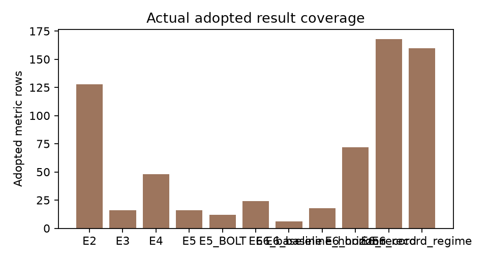

# Past-only representation diagnosis final report v5

이 보고서는 현재 저장소에 실제 존재하는 파일만 채택했다. 보호된 TEST 접근, 새 과학 실행, 모델 추론, plan/gate 생성, commit/push는 하지 않는다.

## 핵심 6문항 답

### 1. 실제 미래 정보 누출이 있었는가?

- 답: 채택된 E1 forecast-boundary 검사 범위에서는 material future leakage가 보이지 않는다.
- 불확실성: A forecast-boundary만 누출 판정에 사용한다. B/C within-history/context 변화는 별도 민감도이며, 모든 배포 경로를 증명하지 않는다.
- 다음 판단: E1은 통과로 두되 성능 개선·일반화 검증으로 말하지 않는다.
- 원수치:
```json
{
  "test_count": 32,
  "cold_feature": 0.0,
  "cold_prediction": 0.0,
  "cold_warm_prediction": 1.0728836059570312e-06,
  "leak_threshold_from_e1_py": 0.0001,
  "material_future_leak_detected": false
}
```

### 2. 시점별 과거 전용 표현이 예측을 개선했는가?

- 답: 현재 실제 FULL-vs-PREFIX paired case 8개에서는 PREFIX가 physical MSE를 낮춘 경우 5개, 높인 경우 3개이고, normalized MSE는 낮춘 경우 7개, 높인 경우 1개다.
- 불확실성: E3/E4 adopted files only; VAL development diagnostic.
- 다음 판단: 현재 채택 case 범위 안에서만 해석하고, 다른 예산·데이터 조건으로 확장하지 않는다.
- 원수치:
```json
{
  "FULL_vs_PREFIX_pairs": [
    {
      "dataset": "jena",
      "dim": 16,
      "seed": 92601,
      "FULL_mse": 5967.552513868256,
      "PREFIX_mse": 6747.799617968461,
      "PREFIX_minus_FULL_mse": 780.2471041002045,
      "FULL_mae": 30.178789886206772,
      "PREFIX_mae": 30.47488778217001,
      "PREFIX_minus_FULL_mae": 0.2960978959632392,
      "FULL_normalized_mse": 0.7004827396942302,
      "PREFIX_normalized_mse": 0.5438537089797114,
      "PREFIX_minus_FULL_normalized_mse": -0.15662903071451884
    },
    {
      "dataset": "jena",
      "dim": 16,
      "seed": 92602,
      "FULL_mse": 9781.747333101099,
      "PREFIX_mse": 11687.710752245799,
      "PREFIX_minus_FULL_mse": 1905.9634191447003,
      "FULL_mae": 38.419039092832996,
      "PREFIX_mae": 39.58518068763091,
      "PREFIX_minus_FULL_mae": 1.1661415947979137,
      "FULL_normalized_mse": 0.4831142524561484,
      "PREFIX_normalized_mse": 0.5665244271870108,
      "PREFIX_minus_FULL_normalized_mse": 0.08341017473086237
    },
    {
      "dataset": "jena",
      "dim": 320,
      "seed": 92601,
      "FULL_mse": 6662.168945362683,
      "PREFIX_mse": 7447.606115890222,
      "PREFIX_minus_FULL_mse": 785.4371705275389,
      "FULL_mae": 27.453239265322363,
      "PREFIX_mae": 28.6329746680047,
      "PREFIX_minus_FULL_mae": 1.1797354026823363,
      "FULL_normalized_mse": 0.3771330213630626,
      "PREFIX_normalized_mse": 0.3714878236083542,
      "PREFIX_minus_FULL_normalized_mse": -0.005645197754708398
    },
    {
      "dataset": "jena",
      "dim": 320,
      "seed": 92602,
      "FULL_mse": 9774.542566973096,
      "PREFIX_mse": 7579.325763496863,
      "PREFIX_minus_FULL_mse": -2195.2168034762326,
      "FULL_mae": 35.16197208588307,
      "PREFIX_mae": 29.745463363163026,
      "PREFIX_minus_FULL_mae": -5.416508722720046,
      "FULL_normalized_mse": 0.4733736240543138,
      "PREFIX_normalized_mse": 0.3988141376171535,
      "PREFIX_minus_FULL_normalized_mse": -0.07455948643716032
    },
    {
      "dataset": "robin",
      "dim": 16,
      "seed": 92601,
      "FULL_mse": 548.5212157887183,
      "PREFIX_mse": 540.2427719595865,
      "PREFIX_minus_FULL_mse": -8.278443829131788,
      "FULL_mae": 13.439591330387234,
      "PREFIX_mae": 13.41398170257316,
      "PREFIX_minus_FULL_mae": -0.025609627814073832,
      "FULL_normalized_mse": 0.8298123771119881,
      "PREFIX_normalized_mse": 0.8128521768734874,
      "PREFIX_minus_FULL_normalized_mse": -0.016960200238500645
    },
    {
      "dataset": "robin",
      "dim": 16,
      "seed": 92602,
      "FULL_mse": 490.66230006038836,
      "PREFIX_mse": 405.141504722405,
      "PREFIX_minus_FULL_mse": -85.52079533798337,
      "FULL_mae": 14.030341058852626,
      "PREFIX_mae": 12.54235166139852,
      "PREFIX_minus_FULL_mae": -1.4879893974541059,
      "FULL_normalized_mse": 0.823509797189974,
      "PREFIX_normalized_mse": 0.7537372126561256,
      "PREFIX_minus_FULL_normalized_mse": -0.06977258453384838
    },
    {
      "dataset": "robin",
      "dim": 320,
      "seed": 92601,
      "FULL_mse": 356.0196759882544,
      "PREFIX_mse": 312.2644191433287,
      "PREFIX_minus_FULL_mse": -43.75525684492567,
      "FULL_mae": 10.48639323300396,
      "PREFIX_mae": 9.537293958332803,
      "PREFIX_minus_FULL_mae": -0.9490992746711573,
      "FULL_normalized_mse": 0.5765325965326403,
      "PREFIX_normalized_mse": 0.5279274871037396,
      "PREFIX_minus_FULL_normalized_mse": -0.04860510942890073
    },
    {
      "dataset": "robin",
      "dim": 320,
      "seed": 92602,
      "FULL_mse": 333.1825788501465,
      "PREFIX_mse": 312.41757032739275,
      "PREFIX_minus_FULL_mse": -20.76500852275376,
      "FULL_mae": 9.96670044405398,
      "PREFIX_mae": 9.78137563650125,
      "PREFIX_minus_FULL_mae": -0.18532480755273006,
      "FULL_normalized_mse": 0.5399294422948703,
      "PREFIX_normalized_mse": 0.5216662626119382,
      "PREFIX_minus_FULL_normalized_mse": -0.018263179682932118
    }
  ],
  "paired_summary_by_dataset_dim": {
    "jena:d16": {
      "n_pairs": 2,
      "prefix_better_mse_count": 0,
      "prefix_worse_mse_count": 2,
      "delta_mse_range": [
        780.2471041002045,
        1905.9634191447003
      ],
      "delta_normalized_mse_range": [
        -0.15662903071451884,
        0.08341017473086237
      ],
      "seeds": [
        "92601",
        "92602"
      ]
    },
    "jena:d320": {
      "n_pairs": 2,
      "prefix_better_mse_count": 1,
      "prefix_worse_mse_count": 1,
      "delta_mse_range": [
        -2195.2168034762326,
        785.4371705275389
      ],
      "delta_normalized_mse_range": [
        -0.07455948643716032,
        -0.005645197754708398
      ],
      "seeds": [
        "92601",
        "92602"
      ]
    },
    "robin:d16": {
      "n_pairs": 2,
      "prefix_better_mse_count": 2,
      "prefix_worse_mse_count": 0,
      "delta_mse_range": [
        -85.52079533798337,
        -8.278443829131788
      ],
      "delta_normalized_mse_range": [
        -0.06977258453384838,
        -0.016960200238500645
      ],
      "seeds": [
        "92601",
        "92602"
      ]
    },
    "robin:d320": {
      "n_pairs": 2,
      "prefix_better_mse_count": 2,
      "prefix_worse_mse_count": 0,
      "delta_mse_range": [
        -43.75525684492567,
        -20.76500852275376
      ],
      "delta_normalized_mse_range": [
        -0.04860510942890073,
        -0.018263179682932118
      ],
      "seeds": [
        "92601",
        "92602"
      ]
    }
  },
  "E5_vs_E2_Jena_baseline": {
    "status": "AVAILABLE",
    "interpretation": "Compares E5 latent33 direct-ridge readout against E2 raw lag baselines on Jena VAL. Targets, masks and FIT/TUNE/VAL split hashes are checked where child files expose them, but E5's last-E readout has RF63 support over the last33 embeddings, so the raw support can cover about 95 ticks; E2 raw33 uses a different feature contract. This is not a pure compression-only causal comparison.",
    "E2_raw33_baselines": {
      "SELF_LAG": {
        "mse": 25563.570223600087,
        "mae": 47.063061772726975
      },
      "SELF_LAG_PLUS_CROSS_NOW": {
        "mse": 18314.16921096852,
        "mae": 43.64353392371226
      },
      "ALL_CHANNEL_LAG": {
        "mse": 24789.80239406877,
        "mae": 43.93828819994339
      },
      "ALL_minus_SELF": {
        "mse_diff": -773.7678295313162,
        "mae_diff": -3.1247735727835817
      },
      "CROSS_NOW_minus_SELF": {
        "mse_diff": -7249.401012631566,
        "mae_diff": -3.419527849014713
      }
    },
    "E5_latent33_condition_means": {
      "CAUSAL_CONTRAST": {
        "n": 2,
        "dataset": [
          "jena"
        ],
        "condition": [
          "CAUSAL_CONTRAST"
        ],
        "mean_mse": 21015.046103047374,
        "mean_mae": 49.07948289274378,
        "mean_normalized_mse": 1.9323652649524237,
        "mean_normalized_mae": 0.9600850445699628,
        "seeds": [
          "92601",
          "92602"
        ]
      },
      "CAUSAL_FORECAST": {
        "n": 2,
        "dataset": [
          "jena"
        ],
        "condition": [
          "CAUSAL_FORECAST"
        ],
        "mean_mse": 25821.162416262297,
        "mean_mae": 52.44802752581784,
        "mean_normalized_mse": 1.7515631389813788,
        "mean_normalized_mae": 0.8783638115638146,
        "seeds": [
          "92601",
          "92602"
        ]
      },
      "CAUSAL_REC": {
        "n": 2,
        "dataset": [
          "jena"
        ],
        "condition": [
          "CAUSAL_REC"
        ],
        "mean_mse": 17973.832336891403,
        "mean_mae": 44.7798565488182,
        "mean_normalized_mse": 1.0696554364780122,
        "mean_normalized_mae": 0.6081121206439442,
        "seeds": [
          "92601",
          "92602"
        ]
      },
      "FULL_REC": {
        "n": 2,
        "dataset": [
          "jena"
        ],
        "condition": [
          "FULL_REC"
        ],
        "mean_mse": 17495.751951803693,
        "mean_mae": 43.99926008393025,
        "mean_normalized_mse": 1.0838062995594684,
        "mean_normalized_mae": 0.6123328312617622,
        "seeds": [
          "92601",
          "92602"
        ]
      }
    },
    "scope_check": {
      "E2_split_samples": {
        "fit": {
          "origins": 256,
          "horizon_rows": 12288,
          "unique_target_timestamps": 12288,
          "minimum_overlap": 1,
          "maximum_overlap": 1,
          "overlap_count_histogram": {
            "1": 12288
          },
          "interpretation": "Origins and overlapping horizon rows are not independent sample counts"
        },
        "tune": {
          "origins": 64,
          "horizon_rows": 3072,
          "unique_target_timestamps": 3072,
          "minimum_overlap": 1,
          "maximum_overlap": 1,
          "overlap_count_histogram": {
            "1": 3072
          },
          "interpretation": "Origins and overlapping horizon rows are not independent sample counts"
        },
        "val": {
          "origins": 371,
          "horizon_rows": 17808,
          "unique_target_timestamps": 8928,
          "minimum_overlap": 1,
          "maximum_overlap": 2,
          "overlap_count_histogram": {
            "1": 48,
            "2": 8880
          },
          "interpretation": "Origins and overlapping horizon rows are not independent sample counts"
        }
      },
      "E2_normalization_fit_scope": "FIT_ONLY",
      "E2_origin_hashes": {
        "fit": "5b6a51fc7adcc609f32dafb3095c8aeab9fd85a08faa7be2a2c118c8c6a6b4a7",
        "tune": "ec015d0c3cf056c9b715eaeed7d847320292601d066efc0ec49523e28b8f4dea",
        "val": "6493583a54ec2a350be4834e88642b893b182985cfa6b85b7eb52393d6f8f09b"
      },
      "E2_target_hashes": {
        "fit": "0c3bf0ca4614889092e17d6c0e06a8df3d2e0112c2243c23996ea8f38f0dea0a",
        "tune": "24b1d0eea1bada415c11832a2f82ae45e881f93ad4cf108e72f0c024119ad893",
        "val": "b7929035d6221b182ecb481625258adfcfaacf41e540912c7edb2fdbaeda093a"
      },
      "E2_mask_hashes": {
        "fit": "9e616be4efadf1ae09d48821ccc19de96f7a75932ad4f12cf256a068480303db",
        "tune": "7f0a371dc08a28be87e8f073e72fdb591667a908ef735feeb852b05a5bf3e30f",
        "val": "d84ff070985890a564002333b2ee6e3652d254714b58ed5b1d20d1203e4f7a1c"
      },
      "condition_hash_checks": [
        {
          "condition": "FULL_REC",
          "seed": 92601,
          "path": "E:\\CODING\\proj\\hierarchical-tsfm-peft\\research\\past_only_repr_diagnosis_20261012\\results\\E5_jena_balanced600_cpu_v1\\FULL_REC_s92601\\RESULT.json",
          "hash_ok": {
            "fit_origins": true,
            "tune_origins": true,
            "val_origins": true,
            "val_target": true,
            "val_mask": true
          },
          "feature_scaler_scope": "FIT_ONLY_PER_OBSERVED_OUTPUT_GROUP",
          "row_counts": {
            "fit": 256,
            "tune": 64,
            "val": 371
          },
          "lambda": 1.0
        },
        {
          "condition": "CAUSAL_REC",
          "seed": 92601,
          "path": "E:\\CODING\\proj\\hierarchical-tsfm-peft\\research\\past_only_repr_diagnosis_20261012\\results\\E5_jena_balanced600_cpu_v1\\CAUSAL_REC_s92601\\RESULT.json",
          "hash_ok": {
            "fit_origins": true,
            "tune_origins": true,
            "val_origins": true,
            "val_target": true,
            "val_mask": true
          },
          "feature_scaler_scope": "FIT_ONLY_PER_OBSERVED_OUTPUT_GROUP",
          "row_counts": {
            "fit": 256,
            "tune": 64,
            "val": 371
          },
          "lambda": 1.0
        },
        {
          "condition": "CAUSAL_CONTRAST",
          "seed": 92601,
          "path": "E:\\CODING\\proj\\hierarchical-tsfm-peft\\research\\past_only_repr_diagnosis_20261012\\results\\E5_jena_balanced600_cpu_v1\\CAUSAL_CONTRAST_s92601\\RESULT.json",
          "hash_ok": {
            "fit_origins": true,
            "tune_origins": true,
            "val_origins": true,
            "val_target": true,
            "val_mask": true
          },
          "feature_scaler_scope": "FIT_ONLY_PER_OBSERVED_OUTPUT_GROUP",
          "row_counts": {
            "fit": 256,
            "tune": 64,
            "val": 371
          },
          "lambda": 1.0
        },
        {
          "condition": "CAUSAL_FORECAST",
          "seed": 92601,
          "path": "E:\\CODING\\proj\\hierarchical-tsfm-peft\\research\\past_only_repr_diagnosis_20261012\\results\\E5_jena_balanced600_cpu_v1\\CAUSAL_FORECAST_s92601\\RESULT.json",
          "hash_ok": {
            "fit_origins": true,
            "tune_origins": true,
            "val_origins": true,
            "val_target": true,
            "val_mask": true
          },
          "feature_scaler_scope": "FIT_ONLY_PER_OBSERVED_OUTPUT_GROUP",
          "row_counts": {
            "fit": 256,
            "tune": 64,
            "val": 371
          },
          "lambda": 1.0
        },
        {
          "condition": "FULL_REC",
          "seed": 92602,
          "path": "E:\\CODING\\proj\\hierarchical-tsfm-peft\\research\\past_only_repr_diagnosis_20261012\\results\\E5_jena_balanced600_cpu_v1\\FULL_REC_s92602\\RESULT.json",
          "hash_ok": {
            "fit_origins": true,
            "tune_origins": true,
            "val_origins": true,
            "val_target": true,
            "val_mask": true
          },
          "feature_scaler_scope": "FIT_ONLY_PER_OBSERVED_OUTPUT_GROUP",
          "row_counts": {
            "fit": 256,
            "tune": 64,
            "val": 371
          },
          "lambda": 1.0
        },
        {
          "condition": "CAUSAL_REC",
          "seed": 92602,
          "path": "E:\\CODING\\proj\\hierarchical-tsfm-peft\\research\\past_only_repr_diagnosis_20261012\\results\\E5_jena_balanced600_cpu_v1\\CAUSAL_REC_s92602\\RESULT.json",
          "hash_ok": {
            "fit_origins": true,
            "tune_origins": true,
            "val_origins": true,
            "val_target": true,
            "val_mask": true
          },
          "feature_scaler_scope": "FIT_ONLY_PER_OBSERVED_OUTPUT_GROUP",
          "row_counts": {
            "fit": 256,
            "tune": 64,
            "val": 371
          },
          "lambda": 1.0
        },
        {
          "condition": "CAUSAL_CONTRAST",
          "seed": 92602,
          "path": "E:\\CODING\\proj\\hierarchical-tsfm-peft\\research\\past_only_repr_diagnosis_20261012\\results\\E5_jena_balanced600_cpu_v1\\CAUSAL_CONTRAST_s92602\\RESULT.json",
          "hash_ok": {
            "fit_origins": true,
            "tune_origins": true,
            "val_origins": true,
            "val_target": true,
            "val_mask": true
          },
          "feature_scaler_scope": "FIT_ONLY_PER_OBSERVED_OUTPUT_GROUP",
          "row_counts": {
            "fit": 256,
            "tune": 64,
            "val": 371
          },
          "lambda": 0.01
        },
        {
          "condition": "CAUSAL_FORECAST",
          "seed": 92602,
          "path": "E:\\CODING\\proj\\hierarchical-tsfm-peft\\research\\past_only_repr_diagnosis_20261012\\results\\E5_jena_balanced600_cpu_v1\\CAUSAL_FORECAST_s92602\\RESULT.json",
          "hash_ok": {
            "fit_origins": true,
            "tune_origins": true,
            "val_origins": true,
            "val_target": true,
            "val_mask": true
          },
          "feature_scaler_scope": "FIT_ONLY_PER_OBSERVED_OUTPUT_GROUP",
          "row_counts": {
            "fit": 256,
            "tune": 64,
            "val": 371
          },
          "lambda": 1.0
        }
      ],
      "all_checked_conditions_share_val_origin_target_mask": true
    },
    "caution": "SELF_LAG_PLUS_CROSS_NOW is often stronger than ALL_CHANNEL_LAG in current Jena VAL. Do not conflate compression with raw feature expansion or d320 capacity changes."
  }
}
```

### 3. 다른 채널의 지연 정보가 실제로 유용했는가?

- 답: 혼재다. Jena real VAL에서 cross-now가 ALL-lag보다 강한 구간이 있어 delayed increment 자체는 아직 입증되지 않았다.
- 불확실성: synthetic gate label과 raw MSE sign은 다른 기준이다. 반복 VAL 진단이며 test 일반화가 아니다.
- 다음 판단: cross-now, self-lag, all-lag를 분리해서 보고하고, delayed graph의 추가 가치는 E6 matched 결과가 PASS일 때만 주장한다.
- 원수치:
```json
{
  "real_summary": {
    "jena": {
      "SELF_LAG": {
        "mse": 25563.570223600087,
        "mae": 47.063061772726975
      },
      "SELF_LAG_PLUS_CROSS_NOW": {
        "mse": 18314.16921096852,
        "mae": 43.64353392371226
      },
      "ALL_CHANNEL_LAG": {
        "mse": 24789.80239406877,
        "mae": 43.93828819994339
      },
      "ALL_minus_SELF": {
        "mse_diff": -773.7678295313162,
        "mae_diff": -3.1247735727835817
      },
      "CROSS_NOW_minus_SELF": {
        "mse_diff": -7249.401012631566,
        "mae_diff": -3.419527849014713
      },
      "split_samples": {
        "fit": {
          "origins": 256,
          "horizon_rows": 12288,
          "unique_target_timestamps": 12288,
          "minimum_overlap": 1,
          "maximum_overlap": 1,
          "overlap_count_histogram": {
            "1": 12288
          },
          "interpretation": "Origins and overlapping horizon rows are not independent sample counts"
        },
        "tune": {
          "origins": 64,
          "horizon_rows": 3072,
          "unique_target_timestamps": 3072,
          "minimum_overlap": 1,
          "maximum_overlap": 1,
          "overlap_count_histogram": {
            "1": 3072
          },
          "interpretation": "Origins and overlapping horizon rows are not independent sample counts"
        },
        "val": {
          "origins": 371,
          "horizon_rows": 17808,
          "unique_target_timestamps": 8928,
          "minimum_overlap": 1,
          "maximum_overlap": 2,
          "overlap_count_histogram": {
            "1": 48,
            "2": 8880
          },
          "interpretation": "Origins and overlapping horizon rows are not independent sample counts"
        }
      },
      "origin_hashes": {
        "fit": "5b6a51fc7adcc609f32dafb3095c8aeab9fd85a08faa7be2a2c118c8c6a6b4a7",
        "tune": "ec015d0c3cf056c9b715eaeed7d847320292601d066efc0ec49523e28b8f4dea",
        "val": "6493583a54ec2a350be4834e88642b893b182985cfa6b85b7eb52393d6f8f09b"
      },
      "target_hashes": {
        "fit": "0c3bf0ca4614889092e17d6c0e06a8df3d2e0112c2243c23996ea8f38f0dea0a",
        "tune": "24b1d0eea1bada415c11832a2f82ae45e881f93ad4cf108e72f0c024119ad893",
        "val": "b7929035d6221b182ecb481625258adfcfaacf41e540912c7edb2fdbaeda093a"
      },
      "mask_hashes": {
        "fit": "9e616be4efadf1ae09d48821ccc19de96f7a75932ad4f12cf256a068480303db",
        "tune": "7f0a371dc08a28be87e8f073e72fdb591667a908ef735feeb852b05a5bf3e30f",
        "val": "d84ff070985890a564002333b2ee6e3652d254714b58ed5b1d20d1203e4f7a1c"
      },
      "shared_arrays": {
        "path": "E:\\CODING\\proj\\hierarchical-tsfm-peft\\.cache\\past_only_repr_diagnosis_20261012\\e2\\run01_jena\\shared_targets_and_ridge_states.npz",
        "sha256": "a7fbcda6c61f270ebb1097cfd163c5e34f37bf5ca41e2ce7f0876e2bc70f8f93",
        "array_hashes": {
          "mean": "995c92f6c77ff69db780458d7623162c0190515c0c793414831b885e1cde8668",
          "std": "1a2b001cf48f6e82cd15378ffa9bb55f4c9610b17e5f05f524ca082afdd34cef",
          "SELF_LAG_origin_paired_mse_difference_from_SELF": "4fe273f1e9efb9d6b4ed4b2c760b2bb6741e6d532b4583a37a91787986db6a62",
          "SELF_LAG_origin_paired_mae_difference_from_SELF": "4fe273f1e9efb9d6b4ed4b2c760b2bb6741e6d532b4583a37a91787986db6a62",
          "SELF_LAG_PLUS_CROSS_NOW_origin_paired_mse_difference_from_SELF": "7ab81c6f1bbd9eb774058cd5f39c5e5b03e394aae69d9ae91fd204114688ada6",
          "SELF_LAG_PLUS_CROSS_NOW_origin_paired_mae_difference_from_SELF": "be775e47dc889b0e92544984b811d72fe7e4424025d6395ae98ebfea319e6ff8",
          "ALL_CHANNEL_LAG_origin_paired_mse_difference_from_SELF": "7829a2a2fa0700683dc90c432f57eb38124937e8e88ddecaa827e8ad4795406e",
          "ALL_CHANNEL_LAG_origin_paired_mae_difference_from_SELF": "7d171aaf38eb3e3c08057345f9abd5565b4a18cc7451626402ccbc7ec6ae8684",
          "PERSISTENCE_origin_paired_mse_difference_from_SELF": "91af83b435bdafd5588471de09aa5a1d1f31bf3f00f59c070701ec5b7c67b8d5",
          "PERSISTENCE_origin_paired_mae_difference_from_SELF": "e5346ea9c21f6427f65306e7e114f203f4cc755e0a84c6d74b3bb3acd76730af",
          "fit_origins": "5b6a51fc7adcc609f32dafb3095c8aeab9fd85a08faa7be2a2c118c8c6a6b4a7",
          "fit_target": "0c3bf0ca4614889092e17d6c0e06a8df3d2e0112c2243c23996ea8f38f0dea0a",
          "fit_mask": "9e616be4efadf1ae09d48821ccc19de96f7a75932ad4f12cf256a068480303db",
          "fit_target_timestamps": "c54edcafedc0cf55faa2a999040626e411d152470083208f000435d01345f21c",
          "fit_actual_target_times": "8dafc0081addedc1a65ed76b99c59f9f5bd18e9d905e3c6ff96a5becde9d4416",
          "tune_origins": "ec015d0c3cf056c9b715eaeed7d847320292601d066efc0ec49523e28b8f4dea",
          "tune_target": "24b1d0eea1bada415c11832a2f82ae45e881f93ad4cf108e72f0c024119ad893",
          "tune_mask": "7f0a371dc08a28be87e8f073e72fdb591667a908ef735feeb852b05a5bf3e30f",
          "tune_target_timestamps": "db71d0eef77ec528183eff682abd2723163f9b1ca23486fc00159a1e89be814a",
          "tune_actual_target_times": "c519b9073f5001d1452f93654481bf6690e0dbb45ef207397353f227d637ddf7",
          "val_origins": "6493583a54ec2a350be4834e88642b893b182985cfa6b85b7eb52393d6f8f09b",
          "val_target": "b7929035d6221b182ecb481625258adfcfaacf41e540912c7edb2fdbaeda093a",
          "val_mask": "d84ff070985890a564002333b2ee6e3652d254714b58ed5b1d20d1203e4f7a1c",
          "val_target_timestamps": "d64d263468c5e7b039b92ca40e062e987a0e83944609a2bbaa5e9abd964444e8",
          "val_actual_target_times": "e072bbda1722f773d3d31bcbc3a339acdf76d8559bf2a16314c24bb4d527984e",
          "SELF_LAG_0_outputs": "a6188d5bd086b0306a4462fa1cd07c7dee0ba124f7717c648ea11cbae6187218",
          "SELF_LAG_0_valid_fit_rows": "2661920f2409dd6c8adeb0c44972959f232b6429afa913845d0fd95e7e768234",
          "SELF_LAG_0_feature_mean": "81e5346091a64a14be3647c243105a485f443ae187045d19666fd1a9ba8f0867",
          "SELF_LAG_0_feature_std": "ab881b8e4dbab5d0884788e6eee8286fc0980d20502df69b2aa2e99291f7d219",
          "SELF_LAG_0_target_mean": "9aece35e71cdbc8a04a930cc3331ea9a2e2b0c42b61dc1f804748643d72700fa",
          "SELF_LAG_0_train_standardized": "c95bf0394a692b1ad513c12368b05b7a5f97c8b9716349c6a3af6c29ef041a63",
          "SELF_LAG_0_coefficient": "cc9e1210220361d0e4d6c6bcc6860743b77a6003929fe277397dd8d61ad1e752",
          "SELF_LAG_1_outputs": "bfcd2007ed581d1d7e96b131e04317a9ab6de059b74cc91401806b61e2edc5ac",
          "SELF_LAG_1_valid_fit_rows": "2661920f2409dd6c8adeb0c44972959f232b6429afa913845d0fd95e7e768234",
          "SELF_LAG_1_feature_mean": "7196b33a493de3c004a2b072d7bea55df0be3ecc20457cd40944ce9b7d861517",
          "SELF_LAG_1_feature_std": "8f8c9ed1f07555511e0894ff70ffee29fb76c0d5a683e887995c42fb1f70984b",
          "SELF_LAG_1_target_mean": "1ac2e87accd911b1b9ad0f7116f0c310edb66e8248226700af72ec18d0926863",
          "SELF_LAG_1_train_standardized": "7ac5601fe1ea5bb194782d83346402e8aa9323683143d83ee7b57c191798bfdd",
          "SELF_LAG_1_coefficient": "071d1058d0d83ca003f412b30661ed277ef59bb8686da8f0e4a1ff2fd01bfb6f",
          "SELF_LAG_2_outputs": "d9c4a316fe309153e5be50de5a5238aa5c237882ba489cf3fd03ee78a97be81c",
          "SELF_LAG_2_valid_fit_rows": "2661920f2409dd6c8adeb0c44972959f232b6429afa913845d0fd95e7e768234",
          "SELF_LAG_2_feature_mean": "94947f7ff1e765ff3ad20db08b64aa5d83a8ea1ad6a00ef38f36a44bde23778b",
          "SELF_LAG_2_feature_std": "d748fefb82f8a70f075deec02292e8fcbb5ca9f1fcbbd6adb9dcfe103abe8c6e",
          "SELF_LAG_2_target_mean": "e5acd20ae54d206fcfe917e7827d4c2f9b2ce677ae46945dc488446e02116308",
          "SELF_LAG_2_train_standardized": "68079835023a44bffc55342f4e91ff29982bec54f0c242e5171d105cd8a77e40",
          "SELF_LAG_2_coefficient": "7d8b4568e9a89a5785eecb2c11e037e8190c8fe19bd2c6ed903a8f9aae2f102f",
          "SELF_LAG_3_outputs": "74932e4996b2fd99bb981766022ccbb3a83f4ad0bb14048b449c55f90e9698b3",
          "SELF_LAG_3_valid_fit_rows": "2661920f2409dd6c8adeb0c44972959f232b6429afa913845d0fd95e7e768234",
          "SELF_LAG_3_feature_mean": "e600928e957a2e2981f85101b14c4de3a5a171cd6cb1d85a2b47e5ce00241531",
          "SELF_LAG_3_feature_std": "3ddf01a4e2680f36c6fbe1c0c5a0d12f7b278a6f9a28ceb37fc4bc68ca083a2e",
          "SELF_LAG_3_target_mean": "d8b59e3e52b997e951a3370ba03b83dc9ea970de4715d8129de59b63b91b0b7b",
          "SELF_LAG_3_train_standardized": "41629176923280741415f09e313baa4227ef7f85e2b73fc33d81b3eac2d7e2c1",
          "SELF_LAG_3_coefficient": "684dc2b8db422bdb4402aa3d9249f461729abad81c6aef7ae8c02445b44871c6",
          "SELF_LAG_4_outputs": "44dbbcb052b5a01b3c7e049e9174a8f86f026d6b8897655eae59a135767c46b7",
          "SELF_LAG_4_valid_fit_rows": "2661920f2409dd6c8adeb0c44972959f232b6429afa913845d0fd95e7e768234",
          "SELF_LAG_4_feature_mean": "10581dd22649481575e82acf7d95a5f804a3b6e58c9a73c915c216d505fe7221",
          "SELF_LAG_4_feature_std": "503c48d1339bbe45712c804a2f47c6f3c3efe8cb2aff4f9e3c2c8b1772571087",
          "SELF_LAG_4_target_mean": "b55dc37274fc21e3c064bccc33e836b56feeffd12377e3dac9e9bdbab5b71407",
          "SELF_LAG_4_train_standardized": "b41be65474e5d9c0aed5ee84dfe43d538806eb9da9979d2961cbbf10880cf0e6",
          "SELF_LAG_4_coefficient": "0e2c2931b89c0f4f8ebd3f83d902f9e43591b17e130ec22a49ea4c5fc2dbd62b",
          "SELF_LAG_5_outputs": "8a04ae09068cfa5b9a870c113ff214293cddfcb4dc076a8869a5dc03d2d1922c",
          "SELF_LAG_5_valid_fit_rows": "2661920f2409dd6c8adeb0c44972959f232b6429afa913845d0fd95e7e768234",
          "SELF_LAG_5_feature_mean": "dab272d495147c10151160a8084cb681aec9a39e8fe929e613cf291c9e3b0064",
          "SELF_LAG_5_feature_std": "34f047478e84c25a92290fe72a820797859bb62bef9e0869829f9208b486590a",
          "SELF_LAG_5_target_mean": "2a605dfaa75652d2683e6ee4bffb5a97c1728dbb66cd9e2a2f2be82aaf861b2c",
          "SELF_LAG_5_train_standardized": "8ab28fa67bfa1229521a3aea145ae4e3da4e182973f09a2a1e146d02a162c0e6",
          "SELF_LAG_5_coefficient": "6881fa79ff40b72ba9962b16537e23d1d1fa928966cb462bb3031ffcec65d151",
          "SELF_LAG_6_outputs": "65cb5937ff5513eeeb7b9966f5cf99cfc6b60bda84161b492d0f0d9ef681be36",
          "SELF_LAG_6_valid_fit_rows": "2661920f2409dd6c8adeb0c44972959f232b6429afa913845d0fd95e7e768234",
          "SELF_LAG_6_feature_mean": "d7807e1450c89dc6d0897da37f62e5561cf7ebb20c5fe8a5b03a55ad6f13fb78",
          "SELF_LAG_6_feature_std": "03e07f773114c9f7318daa7891edcabaece5daeab0c5035922ab0767c1dd8c91",
          "SELF_LAG_6_target_mean": "06dae533539b94522b85d620a56480586f1d71bcb8cf613fed665c79386f9c30",
          "SELF_LAG_6_train_standardized": "c6df4a13e6e786d6043612e2105c56d7bbb38f430e94e273bce47455784c5503",
          "SELF_LAG_6_coefficient": "00f42f5042f54e4bd67e251d2fc1954b53b4057c5824ccef982c165bf174bcc5",
          "SELF_LAG_7_outputs": "56c7e0ed9ee49185a1b264a8b283406262e1d40052acf4e44816c7f223bea284",
          "SELF_LAG_7_valid_fit_rows": "2661920f2409dd6c8adeb0c44972959f232b6429afa913845d0fd95e7e768234",
          "SELF_LAG_7_feature_mean": "9aa0fdb2236567ec9735c81d7aed6ec43e3affb798392fb1e9fccf9010683ab4",
          "SELF_LAG_7_feature_std": "ced11dbd525d8bb138f5b8e9fc822bfcb6cd26d14f9b99c32c68d440451358fb",
          "SELF_LAG_7_target_mean": "32805fef02c4d1c3ae6975b68538658f320d698a45889a4b4eab69ee01bf526b",
          "SELF_LAG_7_train_standardized": "b715844393c9443a6a1a364e1264c7045551bb2c332fcfddfd7d6e973d858dbf",
          "SELF_LAG_7_coefficient": "76a8681a69611ad7460eb8e806aeca1b4ed520063e2d88a9a5fd2a466ca93088",
          "SELF_LAG_8_outputs": "6e58d0276e1de9dc81b2cf818b66b6f0e6feac44811ce457198c0ccdc6c9428a",
          "SELF_LAG_8_valid_fit_rows": "2661920f2409dd6c8adeb0c44972959f232b6429afa913845d0fd95e7e768234",
          "SELF_LAG_8_feature_mean": "fca5a1a41f3399ffe834950f36d8c7cf9fd33f2538cac47026d956c354189ce9",
          "SELF_LAG_8_feature_std": "cf051254ed6d2e8d9ec537d11fa1f75a16ce61ab7fee52311b2ee2135c97e84c",
          "SELF_LAG_8_target_mean": "a697e5db72a8cd4223534ee16b3b471ec3191612f354cac37f9bfa21b0c717a3",
          "SELF_LAG_8_train_standardized": "3d7f5bbbdc2e252f215fc34a3265a6ea05f0744addc8d630228741bcb5540ee1",
          "SELF_LAG_8_coefficient": "4a125a8640ce5f7af31fc2c8730807f29ff66c6237fe75bb7f96b75b17b698d4",
          "SELF_LAG_9_outputs": "d467493ea9c2e2a9aa3484629da6a5f18535574deb3f3c8a3306f758c63909d0",
          "SELF_LAG_9_valid_fit_rows": "2661920f2409dd6c8adeb0c44972959f232b6429afa913845d0fd95e7e768234",
          "SELF_LAG_9_feature_mean": "3631c60a2617df37db0c5dbbc65e57827590670fc6c939f9f8aeb671e6b528c0",
          "SELF_LAG_9_feature_std": "5e35fcac33ea76a8869d51b93b6a1e9c196b25142def53dc9718b3ce63380562",
          "SELF_LAG_9_target_mean": "74f6438b31ce75617073978e16a69aa18fa69ebff7c628499b80f5f35633935c",
          "SELF_LAG_9_train_standardized": "08fdcb6bde8ddb062ef99ee1110770604693bc40d13dc6543b0e55c972951bf8",
          "SELF_LAG_9_coefficient": "db3738bbfaf09a42c2bb54366474b05255a029070a3af299a3da1dd333d29740",
          "SELF_LAG_10_outputs": "d731f01a53ba2d663d6186fa7c72174c431dcb4d5f1380c0e765fa06245ad31c",
          "SELF_LAG_10_valid_fit_rows": "2661920f2409dd6c8adeb0c44972959f232b6429afa913845d0fd95e7e768234",
          "SELF_LAG_10_feature_mean": "8d85f12a6993ca3091daaab10f287cdc08fd41bdb75b721eeb70a2db5041fbb5",
          "SELF_LAG_10_feature_std": "2a66e5ee260b6ac23f08cde07a2318d21c8f822787f5cfcdd17369341ad19dc3",
          "SELF_LAG_10_target_mean": "f31a9d41561880230e5bbdf0fe781c520ff2df87c17d8f7c1318ff65a7bcb340",
          "SELF_LAG_10_train_standardized": "ae2605699dc3a16a5732cd159179cff7bc277ea38ebf5e8ef44abf80cb5f79b1",
          "SELF_LAG_10_coefficient": "08535d8df2db96c847bc1b8ff8c5880b7bde6e9ec3faf1808b3df670ee5f3642",
          "SELF_LAG_11_outputs": "cdca7730f0d12381433c716db8e2f3ed68e207bb86b19212736aefeb5d496a65",
          "SELF_LAG_11_valid_fit_rows": "2661920f2409dd6c8adeb0c44972959f232b6429afa913845d0fd95e7e768234",
          "SELF_LAG_11_feature_mean": "faf04737b30c14ad3bc7e409e3e0e0628ea3e20cb35d07ef5e48093228c3cc52",
          "SELF_LAG_11_feature_std": "cbabaf5960e284fb54ad329cc51aeb58c1ae20c82c1e600595d15326238aec06",
          "SELF_LAG_11_target_mean": "37fc9019998232eafab515bd0d0106536bbad4fb36539562b3d5d916bd388b74",
          "SELF_LAG_11_train_standardized": "70e5568f79f9211336a4a36980b680e1b0d940cbc54634277ae047a4305d4a91",
          "SELF_LAG_11_coefficient": "9915fcc1a4cfabb0d610cca56b41041bcab0b3489bf6677401531d3c15ba0494",
          "SELF_LAG_12_outputs": "2b07b9c1cf254d3673f6c2d96ed73d4d37eea853636cb72d2fde6b0ea6cc3f4f",
          "SELF_LAG_12_valid_fit_rows": "2661920f2409dd6c8adeb0c44972959f232b6429afa913845d0fd95e7e768234",
          "SELF_LAG_12_feature_mean": "fe3cca9654cfc07b683f3993b73455938fcb75b61f8df1ee21ebb73b66a30dde",
          "SELF_LAG_12_feature_std": "2a3de91b0e813e5e2d574235b035dbeba95f1cdd6c7be2cd8d3e62de08f672d7",
          "SELF_LAG_12_target_mean": "cf7e1b49da9a0b7c12d2a378a611374524727807ae07a2f7b4996ed7d961bee2",
          "SELF_LAG_12_train_standardized": "5173f1bca4eb0cf344ec90207508db67422666480943e588bcb4292e369aabd9",
          "SELF_LAG_12_coefficient": "a753f80255b71b38f6ce1b33b70119e06269560a03ec8678a09bf466a341535e",
          "SELF_LAG_13_outputs": "f641cd5c6fb228296923e83c2ec83ff711b72fc8d47d99e09bb9fafe26ea3f43",
          "SELF_LAG_13_valid_fit_rows": "2661920f2409dd6c8adeb0c44972959f232b6429afa913845d0fd95e7e768234",
          "SELF_LAG_13_feature_mean": "8317bc73a40d71d7c47c000e03bad8518f4785034fe3d2970dd1445950a90aac",
          "SELF_LAG_13_feature_std": "069a0e610ff360d23931b0cffb2b114cd3df507304df13dc6058b68e41424d50",
          "SELF_LAG_13_target_mean": "44a9ff4ed87f6d90af77a9453d10b6a6ab84c05472c7e79691ea6b0fdcdf257e",
          "SELF_LAG_13_train_standardized": "3c62a04041075108f4e12ccd8126e6d5c4f1d8ea9c56a2662060dac0e47f4d26",
          "SELF_LAG_13_coefficient": "6aec30eae7f54108db3df65e75400cff32613dcf7112859fe87d300baec502e6",
          "SELF_LAG_14_outputs": "221d8965747d2cf4abb9483c3b35534b315c2ecf5519661849def9bb46bccfbc",
          "SELF_LAG_14_valid_fit_rows": "2661920f2409dd6c8adeb0c44972959f232b6429afa913845d0fd95e7e768234",
          "SELF_LAG_14_feature_mean": "5352b352283695dd4606b879e263e46ad6411008ac5f815185a9d8c5e6e7ce06",
          "SELF_LAG_14_feature_std": "4e7bba538893b542dffa666ecb941b9a5899947900d70a7f38102832ac502897",
          "SELF_LAG_14_target_mean": "e4705376e2880570b4fdbc6787741148ae91282ffee5a5708f78b2b837bb3ed6",
          "SELF_LAG_14_train_standardized": "0ae735d48fcdb1491ce410d847d36c00dcd052d13bf925a20adf1f9836833ce2",
          "SELF_LAG_14_coefficient": "33392b18985c0bfd0bb655c05145453187e31805bc36214d81baa83ca20378f1",
          "SELF_LAG_15_outputs": "e20489001b8d5f642a4d3e80b061506a8df31396c117aaba1c724f9ce7f5a1f8",
          "SELF_LAG_15_valid_fit_rows": "2661920f2409dd6c8adeb0c44972959f232b6429afa913845d0fd95e7e768234",
          "SELF_LAG_15_feature_mean": "d77b7251c47809eeeed2eb9552ebb37624dba249e8671d89149b7e74c4c6b63f",
          "SELF_LAG_15_feature_std": "2fa9617bd706d3dd52392f00b2eeba155666c15947d0c4875d4afcddc2000c9d",
          "SELF_LAG_15_target_mean": "eebe536b2952fcf88fb346218e7cb2364aa65ee40bf4065b5c2452ecd0357eef",
          "SELF_LAG_15_train_standardized": "1ed40dfd45114de6fdd82d4461f683ca6b3fbbe24e296bc61a8b724e744a0176",
          "SELF_LAG_15_coefficient": "e6d6ac6527f2febeea4eec2e2831236d1155c0d650139da3e3048b800cc2a424",
          "SELF_LAG_16_outputs": "411aa92fc1645d9c6f0549123b72a1fac407c897bc3f5cc44d56f4d3b45b2437",
          "SELF_LAG_16_valid_fit_rows": "2661920f2409dd6c8adeb0c44972959f232b6429afa913845d0fd95e7e768234",
          "SELF_LAG_16_feature_mean": "a04004925177de21a48096366aaad26d16f7ff9c4cf326e13d046a58dc56624f",
          "SELF_LAG_16_feature_std": "99bb11996a1abe905efa79964ae7feceb70eacd5d2178f1f194665d2e19ae64a",
          "SELF_LAG_16_target_mean": "409b8e54fb6e4c488318a8178d0b6a0e83ba7558500ba004b9b05883668d710e",
          "SELF_LAG_16_train_standardized": "d7b928fd603ddbc805bf8c7c9023a6d326658388a53fc510260e48d15387caeb",
          "SELF_LAG_16_coefficient": "8b09199c602e109d9b25a32583af6d4a37e7ce7bf15d1968907d5f8246c88d30",
          "SELF_LAG_17_outputs": "fc35dae8e26990203b5005a7bf1a5e0ad912cf5f0da373d8647c81069c3d680c",
          "SELF_LAG_17_valid_fit_rows": "2661920f2409dd6c8adeb0c44972959f232b6429afa913845d0fd95e7e768234",
          "SELF_LAG_17_feature_mean": "d1c33ff6b9aa12048bd6a6135e324eecd20fe98464da5cdd2598d78fe71f4e5f",
          "SELF_LAG_17_feature_std": "c8ab5f5850f50b8c809b396fa4e4f3e4917524414515a54a428d522b1f34f32a",
          "SELF_LAG_17_target_mean": "f496684b3260272fcfa09bb5195ab219f451dcbedb88ec52f068f45468ecc584",
          "SELF_LAG_17_train_standardized": "9e403d7da6eb73e9cb76cbeafdcb1cbf640032fbac46a235c8791d8675351767",
          "SELF_LAG_17_coefficient": "04bc99630ca20bece44e0017a77ccbf4a1a689f96503a89baa50d4af45d0e3dd",
          "SELF_LAG_18_outputs": "c1b908e9c2cc9721730298fe1a588b1fbba8869cb427bc9fa59f2ce638ed59c3",
          "SELF_LAG_18_valid_fit_rows": "2661920f2409dd6c8adeb0c44972959f232b6429afa913845d0fd95e7e768234",
          "SELF_LAG_18_feature_mean": "28fca3bc6eaebf59b6dc4c9f6fa50dad6d8240915fac3c63e9260545bb7a25f3",
          "SELF_LAG_18_feature_std": "b68a3bcf844a5774acdda1286e67c49b91a08cf380ba54aa12f33138499ffe5f",
          "SELF_LAG_18_target_mean": "efa1f08a5c019ce0e45e65ef942e9c02707771d00d2b98dda264df3d24e1d5ac",
          "SELF_LAG_18_train_standardized": "352c3a70444be1e907645f55efc3142de2373ca6d91d429dc19999761bed74de",
          "SELF_LAG_18_coefficient": "d1640e578bee7257c772847a4b4fcf9aa8166c5e090276cd5cb73c5b52088286",
          "SELF_LAG_19_outputs": "9c16f37399c5ead6c47e0d33ed6ec627132c3d130872217badc2ce4a1198a582",
          "SELF_LAG_19_valid_fit_rows": "62190058232664fbfdb58cacc1adc12dddd43646a347c602cc67193b2026cdf0",
          "SELF_LAG_19_feature_mean": "a6fa6dc775069f56527e4bfb99369c8304e3cb16f4fd0137082cd08a531bba2d",
          "SELF_LAG_19_feature_std": "61a5ccdf8814f92b1f787865e7c70111f4df72d53840d9defc2a3ab271db6723",
          "SELF_LAG_19_target_mean": "1005a399c5f89b871723fa160ad08082a71624c1b5618336f07f0ab538101e1c",
          "SELF_LAG_19_train_standardized": "41e045ddda6281b5033a28be003603a798adcfecb30c1e930cea2f956e9946ed",
          "SELF_LAG_19_coefficient": "77fc347c2452ed19e849edff93cd130d09029bd499ce902bc4dde27dfa233cbf",
          "SELF_LAG_20_outputs": "f40b89f5ca05c3eb62f920ca3996c573e47af6961dae7a64767125392e50fd7a",
          "SELF_LAG_20_valid_fit_rows": "d785df8ffad73be99265f9cadcc5ccb8f4f05f8798455d76469888efca6d9eac",
          "SELF_LAG_20_feature_mean": "13a300451a017995a3f1e1f5d62e1ddc994212e75c81991f93ee246bd077a68d",
          "SELF_LAG_20_feature_std": "63f61b3058c153dcfb4b0b16584dff21f2447e78ab3c10062c895509d5977c7f",
          "SELF_LAG_20_target_mean": "1839b9c22e0de0c4bb9157e938a45558f53062a911ad4ff31583bf0d10ff6d39",
          "SELF_LAG_20_train_standardized": "4e3e052b42fd529b09838c6547f806b54b564f7fc128002f46bfe04d2e1e9667",
          "SELF_LAG_20_coefficient": "02d9b375677c8da6a9abf788e0b4baea7e52828eae934996a9847f248b2658a6",
          "SELF_LAG_21_outputs": "6316319a67d44d1d7f7517bfc90bd260f63926b9d1d63e3034af37cca659c9a1",
          "SELF_LAG_21_valid_fit_rows": "2661920f2409dd6c8adeb0c44972959f232b6429afa913845d0fd95e7e768234",
          "SELF_LAG_21_feature_mean": "c2d4ed5b57337813d50a0de2f59a67e22196210062f8ebad55f21e0e66521bfc",
          "SELF_LAG_21_feature_std": "9cac8a23c00d2e20a192fca08f39016e43f69eca07b859fc1e6b1dc54cb47b9f",
          "SELF_LAG_21_target_mean": "4e6f9f52372d3359c39dc8bda06074bf492a78c4243456af9a0ca63273707548",
          "SELF_LAG_21_train_standardized": "14f5d6755cff3875c10d5277953fc5f8f7faa47cdc89ff4442466c7495da88e9",
          "SELF_LAG_21_coefficient": "dc937dbbe29146c3963ca3d5283425aee0e0521182725eee35a62d2172439230",
          "SELF_LAG_22_outputs": "203ae01ef03a682109746a5f2f6754f1f803049eda46b8b1bf52296ca416a1ee",
          "SELF_LAG_22_valid_fit_rows": "2661920f2409dd6c8adeb0c44972959f232b6429afa913845d0fd95e7e768234",
          "SELF_LAG_22_feature_mean": "21e1e7094dd565073e784994ba4b3c682638fac65b7f740c5ff347667aa3ea34",
          "SELF_LAG_22_feature_std": "bc890794c696f2f24e44583dfe6076ba3f87e058c7fa5ce4aec1bbd88e8d4e27",
          "SELF_LAG_22_target_mean": "6281ef162acfc90261b73bc10ab7803339ec46d148e646d9d762516c4bc8c9e0",
          "SELF_LAG_22_train_standardized": "074cfdebbfdecd684641fff277bf8c2127a7947f92f488bea5e12a4d3e36c85b",
          "SELF_LAG_22_coefficient": "2e63dac4c08a4b2862bf31b3370d599897c481360350037798b5df8bccadb3f3",
          "SELF_LAG_PLUS_CROSS_NOW_0_outputs": "a6188d5bd086b0306a4462fa1cd07c7dee0ba124f7717c648ea11cbae6187218",
          "SELF_LAG_PLUS_CROSS_NOW_0_valid_fit_rows": "2661920f2409dd6c8adeb0c44972959f232b6429afa913845d0fd95e7e768234",
          "SELF_LAG_PLUS_CROSS_NOW_0_feature_mean": "af0197c7c03c7a928134f92bd34c87d38f68627f021657ba5993b9483e5146c4",
          "SELF_LAG_PLUS_CROSS_NOW_0_feature_std": "1e9e4fd97c60f643dd3e3615f425d5bde0594ae51ddf5b5f8db08f76074b51e1",
          "SELF_LAG_PLUS_CROSS_NOW_0_target_mean": "9aece35e71cdbc8a04a930cc3331ea9a2e2b0c42b61dc1f804748643d72700fa",
          "SELF_LAG_PLUS_CROSS_NOW_0_train_standardized": "7596f5acd2f7a67663955198b2d3ca39ee3a2f9e31c1d18514dee2326b08db2d",
          "SELF_LAG_PLUS_CROSS_NOW_0_coefficient": "24cce33b2a7a90adef13fd363f9b62a3c288439725caaeecec7a6e3aad21cd24",
          "SELF_LAG_PLUS_CROSS_NOW_1_outputs": "bfcd2007ed581d1d7e96b131e04317a9ab6de059b74cc91401806b61e2edc5ac",
          "SELF_LAG_PLUS_CROSS_NOW_1_valid_fit_rows": "2661920f2409dd6c8adeb0c44972959f232b6429afa913845d0fd95e7e768234",
          "SELF_LAG_PLUS_CROSS_NOW_1_feature_mean": "6af6defcf9d58a3b66aaa51c7eed95275fe7df4ae07e0a6986be34d80e76f187",
          "SELF_LAG_PLUS_CROSS_NOW_1_feature_std": "735b893801c97f35ce73fc76e1414196a8a9136a091a2a03e7b36cc04b3738b6",
          "SELF_LAG_PLUS_CROSS_NOW_1_target_mean": "1ac2e87accd911b1b9ad0f7116f0c310edb66e8248226700af72ec18d0926863",
          "SELF_LAG_PLUS_CROSS_NOW_1_train_standardized": "e788f7549bc06076d236aa58e02d54289aee4f3727554c4803544d4ac8f9bf7a",
          "SELF_LAG_PLUS_CROSS_NOW_1_coefficient": "f4fbf80846daa3ffbc42a390aaed6e638bb2822f902f62209b01310d0407159c",
          "SELF_LAG_PLUS_CROSS_NOW_2_outputs": "d9c4a316fe309153e5be50de5a5238aa5c237882ba489cf3fd03ee78a97be81c",
          "SELF_LAG_PLUS_CROSS_NOW_2_valid_fit_rows": "2661920f2409dd6c8adeb0c44972959f232b6429afa913845d0fd95e7e768234",
          "SELF_LAG_PLUS_CROSS_NOW_2_feature_mean": "5421dceb6bf18a23910ba8f7334d0fbb33ed8523694973e8ca3db8785f0e90fd",
          "SELF_LAG_PLUS_CROSS_NOW_2_feature_std": "17d50c3bc7b83c2ac861e180444dd0217628e86fbd83f6328667e6967a6a8dd6",
          "SELF_LAG_PLUS_CROSS_NOW_2_target_mean": "e5acd20ae54d206fcfe917e7827d4c2f9b2ce677ae46945dc488446e02116308",
          "SELF_LAG_PLUS_CROSS_NOW_2_train_standardized": "47a880673bc9e857c4f6d63ec8406d121418b37854f56bb885692ca39f514c13",
          "SELF_LAG_PLUS_CROSS_NOW_2_coefficient": "a6ea2ab6b231b60125f1ad3b8bd33faae3cb4ebf54ab51133ed5c44c26ff983a",
          "SELF_LAG_PLUS_CROSS_NOW_3_outputs": "74932e4996b2fd99bb981766022ccbb3a83f4ad0bb14048b449c55f90e9698b3",
          "SELF_LAG_PLUS_CROSS_NOW_3_valid_fit_rows": "2661920f2409dd6c8adeb0c44972959f232b6429afa913845d0fd95e7e768234",
          "SELF_LAG_PLUS_CROSS_NOW_3_feature_mean": "aa128ba7f10cd73738b9be1b28418cfa7258e56272464f63fc1796655fb354bd",
          "SELF_LAG_PLUS_CROSS_NOW_3_feature_std": "e04de5c457ab9c9a14d2b77c90dbf747e87c8cae4af56c7c1ab1df6cbe1d15c5",
          "SELF_LAG_PLUS_CROSS_NOW_3_target_mean": "d8b59e3e52b997e951a3370ba03b83dc9ea970de4715d8129de59b63b91b0b7b",
          "SELF_LAG_PLUS_CROSS_NOW_3_train_standardized": "d3b7ee53812f0fb2f6e49a23ef4118e22d64bd70e12e2c2cd9f0056e3ddac6a9",
          "SELF_LAG_PLUS_CROSS_NOW_3_coefficient": "e762c4174636316e1ea284bb58213419ccf00740cd744cc22280b730e22b89c1",
          "SELF_LAG_PLUS_CROSS_NOW_4_outputs": "44dbbcb052b5a01b3c7e049e9174a8f86f026d6b8897655eae59a135767c46b7",
          "SELF_LAG_PLUS_CROSS_NOW_4_valid_fit_rows": "2661920f2409dd6c8adeb0c44972959f232b6429afa913845d0fd95e7e768234",
          "SELF_LAG_PLUS_CROSS_NOW_4_feature_mean": "b1bcefc4be0f3584fbcbb54b16bc0349784268a1274170beac0f5a361767e115",
          "SELF_LAG_PLUS_CROSS_NOW_4_feature_std": "77289095398122a8c77b292793c10d2c099c39bfb02be51c9cb969ba104cba85",
          "SELF_LAG_PLUS_CROSS_NOW_4_target_mean": "b55dc37274fc21e3c064bccc33e836b56feeffd12377e3dac9e9bdbab5b71407",
          "SELF_LAG_PLUS_CROSS_NOW_4_train_standardized": "7493457c7a3125d7691b9afd4761093386d68741fa4a93a4043a8378bb395c32",
          "SELF_LAG_PLUS_CROSS_NOW_4_coefficient": "c4792ececc46405f7e614e8144919f673a0049387c5bcdb39855a1955061b853",
          "SELF_LAG_PLUS_CROSS_NOW_5_outputs": "8a04ae09068cfa5b9a870c113ff214293cddfcb4dc076a8869a5dc03d2d1922c",
          "SELF_LAG_PLUS_CROSS_NOW_5_valid_fit_rows": "2661920f2409dd6c8adeb0c44972959f232b6429afa913845d0fd95e7e768234",
          "SELF_LAG_PLUS_CROSS_NOW_5_feature_mean": "e10788646fd9d6cb5c7cae9c3176e5907a579932d34f272d0b2c5d7de6306c9f",
          "SELF_LAG_PLUS_CROSS_NOW_5_feature_std": "47c85b0d893698f518d9d7d417a99df7385f778c57873ed640625cb3402bec52",
          "SELF_LAG_PLUS_CROSS_NOW_5_target_mean": "2a605dfaa75652d2683e6ee4bffb5a97c1728dbb66cd9e2a2f2be82aaf861b2c",
          "SELF_LAG_PLUS_CROSS_NOW_5_train_standardized": "17351df43d7456a46293781e123d2afae169179d27dff85958fe8247558cd606",
          "SELF_LAG_PLUS_CROSS_NOW_5_coefficient": "b20ad7f5428dc501767c4641faf0224c1756472033d9b9adf66f65afaced990f",
          "SELF_LAG_PLUS_CROSS_NOW_6_outputs": "65cb5937ff5513eeeb7b9966f5cf99cfc6b60bda84161b492d0f0d9ef681be36",
          "SELF_LAG_PLUS_CROSS_NOW_6_valid_fit_rows": "2661920f2409dd6c8adeb0c44972959f232b6429afa913845d0fd95e7e768234",
          "SELF_LAG_PLUS_CROSS_NOW_6_feature_mean": "089efb2051cf5989692f1378305d95a6c734da5cc5601f1ac8788e686f632157",
          "SELF_LAG_PLUS_CROSS_NOW_6_feature_std": "12d56218f05a7b726d34d70bd90119dd3c1c19021b3eba2b31e78af04ba7295d",
          "SELF_LAG_PLUS_CROSS_NOW_6_target_mean": "06dae533539b94522b85d620a56480586f1d71bcb8cf613fed665c79386f9c30",
          "SELF_LAG_PLUS_CROSS_NOW_6_train_standardized": "ea57e868967c40f39edb7cc29c401eb7440beb65d86958f302ed4e3c730f9f4a",
          "SELF_LAG_PLUS_CROSS_NOW_6_coefficient": "eea76bc1a8652ecb9fff1c55ce71aaa77737aca9ee26f8372c15a3ec250cafae",
          "SELF_LAG_PLUS_CROSS_NOW_7_outputs": "56c7e0ed9ee49185a1b264a8b283406262e1d40052acf4e44816c7f223bea284",
          "SELF_LAG_PLUS_CROSS_NOW_7_valid_fit_rows": "2661920f2409dd6c8adeb0c44972959f232b6429afa913845d0fd95e7e768234",
          "SELF_LAG_PLUS_CROSS_NOW_7_feature_mean": "f690455459d2c9d16070ec256719e84068daad8a685e545b013a4b954a21fe50",
          "SELF_LAG_PLUS_CROSS_NOW_7_feature_std": "68bc74cc01424e5d45138b0ac15c692c2396673c79db967aa11a6f56c22c061f",
          "SELF_LAG_PLUS_CROSS_NOW_7_target_mean": "32805fef02c4d1c3ae6975b68538658f320d698a45889a4b4eab69ee01bf526b",
          "SELF_LAG_PLUS_CROSS_NOW_7_train_standardized": "480dc3cf4d6a1b53510bff9f9cae95a6360fe3d64f340951df4d7e03fceccddf",
          "SELF_LAG_PLUS_CROSS_NOW_7_coefficient": "6fc72be92f8011cd0964ada48349c49296fa92bb53b03bda704d6d4a25561ad6",
          "SELF_LAG_PLUS_CROSS_NOW_8_outputs": "6e58d0276e1de9dc81b2cf818b66b6f0e6feac44811ce457198c0ccdc6c9428a",
          "SELF_LAG_PLUS_CROSS_NOW_8_valid_fit_rows": "2661920f2409dd6c8adeb0c44972959f232b6429afa913845d0fd95e7e768234",
          "SELF_LAG_PLUS_CROSS_NOW_8_feature_mean": "80902583e7261fd458a2d119740d91b337a7b4aa1a4f8a17bd999d7216cd1f53",
          "SELF_LAG_PLUS_CROSS_NOW_8_feature_std": "95c01388982ac198683beb1e977b2439c5d9d88f1db9d1c77677c6abd6e58748",
          "SELF_LAG_PLUS_CROSS_NOW_8_target_mean": "a697e5db72a8cd4223534ee16b3b471ec3191612f354cac37f9bfa21b0c717a3",
          "SELF_LAG_PLUS_CROSS_NOW_8_train_standardized": "6c3d53b5ef2161b7b6333c876e28a5fdef45cd5f7c03324533963cba48d953b6",
          "SELF_LAG_PLUS_CROSS_NOW_8_coefficient": "0cf16d0bf5461a7bfff2248c91d3f5ee899606ad9b9698635dd9b6e96cc3bdc9",
          "SELF_LAG_PLUS_CROSS_NOW_9_outputs": "d467493ea9c2e2a9aa3484629da6a5f18535574deb3f3c8a3306f758c63909d0",
          "SELF_LAG_PLUS_CROSS_NOW_9_valid_fit_rows": "2661920f2409dd6c8adeb0c44972959f232b6429afa913845d0fd95e7e768234",
          "SELF_LAG_PLUS_CROSS_NOW_9_feature_mean": "feefd29c628381626b9683d22210ff72a187376b82011a2595553c8a20f65e2e",
          "SELF_LAG_PLUS_CROSS_NOW_9_feature_std": "d3deb7877e978311b8563272fe1b8141f5b872ea20df4f2a6efead4f508a0be1",
          "SELF_LAG_PLUS_CROSS_NOW_9_target_mean": "74f6438b31ce75617073978e16a69aa18fa69ebff7c628499b80f5f35633935c",
          "SELF_LAG_PLUS_CROSS_NOW_9_train_standardized": "73afcce80f795fe6d3c2aa8ae5c17e37a629ee81d25a44a57aa5b32d5f84683b",
          "SELF_LAG_PLUS_CROSS_NOW_9_coefficient": "aef7be28a38d22565b11e604e16d863c7627f036666c293901d0f7721baf7476",
          "SELF_LAG_PLUS_CROSS_NOW_10_outputs": "d731f01a53ba2d663d6186fa7c72174c431dcb4d5f1380c0e765fa06245ad31c",
          "SELF_LAG_PLUS_CROSS_NOW_10_valid_fit_rows": "2661920f2409dd6c8adeb0c44972959f232b6429afa913845d0fd95e7e768234",
          "SELF_LAG_PLUS_CROSS_NOW_10_feature_mean": "4a5971e04c9ac6ac4fac636968b6c90003eb176e650b4f0bfb10a90cc803bff0",
          "SELF_LAG_PLUS_CROSS_NOW_10_feature_std": "d382f6e89bbf7c7ae5a1cdbe6ff093a81a93c3f42677fc86bb44a418bcf3fb94",
          "SELF_LAG_PLUS_CROSS_NOW_10_target_mean": "f31a9d41561880230e5bbdf0fe781c520ff2df87c17d8f7c1318ff65a7bcb340",
          "SELF_LAG_PLUS_CROSS_NOW_10_train_standardized": "f865b1358405fbdceaf430562202893ddd5ea70b236634b81db22e3f87b352de",
          "SELF_LAG_PLUS_CROSS_NOW_10_coefficient": "0da0e7ad59352b0be037833ad8d68a1e0262a0e6b08957975e85946658bc3fe1",
          "SELF_LAG_PLUS_CROSS_NOW_11_outputs": "cdca7730f0d12381433c716db8e2f3ed68e207bb86b19212736aefeb5d496a65",
          "SELF_LAG_PLUS_CROSS_NOW_11_valid_fit_rows": "2661920f2409dd6c8adeb0c44972959f232b6429afa913845d0fd95e7e768234",
          "SELF_LAG_PLUS_CROSS_NOW_11_feature_mean": "3fc1d375cac5a7d97dfe3e6a2e48bb62fecb83922ae2ceef1557443825fbfa08",
          "SELF_LAG_PLUS_CROSS_NOW_11_feature_std": "58bec569911f29c4efb321e66ff9b744adff153190069f51b8dde0cfe2ddc94e",
          "SELF_LAG_PLUS_CROSS_NOW_11_target_mean": "37fc9019998232eafab515bd0d0106536bbad4fb36539562b3d5d916bd388b74",
          "SELF_LAG_PLUS_CROSS_NOW_11_train_standardized": "15c70cf1605aecfaab15fd52cc0386d52bde7d7f46e2041af92647a0923d923a",
          "SELF_LAG_PLUS_CROSS_NOW_11_coefficient": "54a7b91d092c97e8211636beaf4aa7fec4750f442a2099d61f0a996dca63f123",
          "SELF_LAG_PLUS_CROSS_NOW_12_outputs": "2b07b9c1cf254d3673f6c2d96ed73d4d37eea853636cb72d2fde6b0ea6cc3f4f",
          "SELF_LAG_PLUS_CROSS_NOW_12_valid_fit_rows": "2661920f2409dd6c8adeb0c44972959f232b6429afa913845d0fd95e7e768234",
          "SELF_LAG_PLUS_CROSS_NOW_12_feature_mean": "1de8bfa35e1011014de1a7659d979b5bee40b3a4f7e37b91d084e2b3c5195f42",
          "SELF_LAG_PLUS_CROSS_NOW_12_feature_std": "668282c240d405429095d565d46f6e900e87a98d7aeccc2f871915d421ea1c33",
          "SELF_LAG_PLUS_CROSS_NOW_12_target_mean": "cf7e1b49da9a0b7c12d2a378a611374524727807ae07a2f7b4996ed7d961bee2",
          "SELF_LAG_PLUS_CROSS_NOW_12_train_standardized": "5930573fdc7eb068acaf1e3bef41ce7a7a8b6e5f74f11575e8d2ef729b63f554",
          "SELF_LAG_PLUS_CROSS_NOW_12_coefficient": "00c0d25007712254bc185d932689b904fd216799a0cc6db82885d9fa3423f93a",
          "SELF_LAG_PLUS_CROSS_NOW_13_outputs": "f641cd5c6fb228296923e83c2ec83ff711b72fc8d47d99e09bb9fafe26ea3f43",
          "SELF_LAG_PLUS_CROSS_NOW_13_valid_fit_rows": "2661920f2409dd6c8adeb0c44972959f232b6429afa913845d0fd95e7e768234",
          "SELF_LAG_PLUS_CROSS_NOW_13_feature_mean": "2a2385e4aa62674e2964d16eae9d17cf7ebf79309b55cb6983c842fe179e41bc",
          "SELF_LAG_PLUS_CROSS_NOW_13_feature_std": "006d6eb866a338524fe57f52e0e44a3c38e70988ce9324693c8cff75543a9303",
          "SELF_LAG_PLUS_CROSS_NOW_13_target_mean": "44a9ff4ed87f6d90af77a9453d10b6a6ab84c05472c7e79691ea6b0fdcdf257e",
          "SELF_LAG_PLUS_CROSS_NOW_13_train_standardized": "17979f2bdfed55bbf8ba24c8a1ad3b159e036b5f231ec50bd574f9a2a0f0037d",
          "SELF_LAG_PLUS_CROSS_NOW_13_coefficient": "5b2bf2ce4194cae8357f68a5b2e07586dfb1b84ae5d17c46e0fcc406ff16d6f3",
          "SELF_LAG_PLUS_CROSS_NOW_14_outputs": "221d8965747d2cf4abb9483c3b35534b315c2ecf5519661849def9bb46bccfbc",
          "SELF_LAG_PLUS_CROSS_NOW_14_valid_fit_rows": "2661920f2409dd6c8adeb0c44972959f232b6429afa913845d0fd95e7e768234",
          "SELF_LAG_PLUS_CROSS_NOW_14_feature_mean": "8757605abad2d8d021c269ec0032b5a9c1ae054af8129e91fd168d323e81a04b",
          "SELF_LAG_PLUS_CROSS_NOW_14_feature_std": "0c3e55e544a21ca54d238959580587b870847fc53c37498ace8620ebe8555175",
          "SELF_LAG_PLUS_CROSS_NOW_14_target_mean": "e4705376e2880570b4fdbc6787741148ae91282ffee5a5708f78b2b837bb3ed6",
          "SELF_LAG_PLUS_CROSS_NOW_14_train_standardized": "768aa3b98fa4a4441ea624013e5dad1f602a7c0a1898be329d033b8703a326be",
          "SELF_LAG_PLUS_CROSS_NOW_14_coefficient": "2d0accbebb73a222bb73572f13655cf06acd846455505d82b134fa4fdd2d0fe4",
          "SELF_LAG_PLUS_CROSS_NOW_15_outputs": "e20489001b8d5f642a4d3e80b061506a8df31396c117aaba1c724f9ce7f5a1f8",
          "SELF_LAG_PLUS_CROSS_NOW_15_valid_fit_rows": "2661920f2409dd6c8adeb0c44972959f232b6429afa913845d0fd95e7e768234",
          "SELF_LAG_PLUS_CROSS_NOW_15_feature_mean": "700132e471e1786e3735a41c6fa08e3e87db67125771c125ea963e47a4615cc9",
          "SELF_LAG_PLUS_CROSS_NOW_15_feature_std": "286e2e0bb334fdd99bb5ce290dc32568c7f2964873a64a1b240d207843ee8fd7",
          "SELF_LAG_PLUS_CROSS_NOW_15_target_mean": "eebe536b2952fcf88fb346218e7cb2364aa65ee40bf4065b5c2452ecd0357eef",
          "SELF_LAG_PLUS_CROSS_NOW_15_train_standardized": "f83234d440938af7b1b6ba1d39f0a852b9da49c817d937a8e364c13993f6e875",
          "SELF_LAG_PLUS_CROSS_NOW_15_coefficient": "53eb573eeeb9da0791d4c15de12d3587400c991c7fde222662258599b9129db8",
          "SELF_LAG_PLUS_CROSS_NOW_16_outputs": "411aa92fc1645d9c6f0549123b72a1fac407c897bc3f5cc44d56f4d3b45b2437",
          "SELF_LAG_PLUS_CROSS_NOW_16_valid_fit_rows": "2661920f2409dd6c8adeb0c44972959f232b6429afa913845d0fd95e7e768234",
          "SELF_LAG_PLUS_CROSS_NOW_16_feature_mean": "13822175d2e2f1b293aaea4545c1e86a3dc384909a886a507bd12d4d4301b06a",
          "SELF_LAG_PLUS_CROSS_NOW_16_feature_std": "d98530c4274548325aa64b5bffdb085754d98aa92b1ec729b175d93b33044756",
          "SELF_LAG_PLUS_CROSS_NOW_16_target_mean": "409b8e54fb6e4c488318a8178d0b6a0e83ba7558500ba004b9b05883668d710e",
          "SELF_LAG_PLUS_CROSS_NOW_16_train_standardized": "99a43047f994ab7f09c75189a039087da1c5b2f4ea2baa8069bade3524ae1221",
          "SELF_LAG_PLUS_CROSS_NOW_16_coefficient": "e78c22597e31096e9104991ee695802bc0b7402cc5adeb20b06fdf1b2d696fdc",
          "SELF_LAG_PLUS_CROSS_NOW_17_outputs": "fc35dae8e26990203b5005a7bf1a5e0ad912cf5f0da373d8647c81069c3d680c",
          "SELF_LAG_PLUS_CROSS_NOW_17_valid_fit_rows": "2661920f2409dd6c8adeb0c44972959f232b6429afa913845d0fd95e7e768234",
          "SELF_LAG_PLUS_CROSS_NOW_17_feature_mean": "7edb7f505dc9e4b0b5200ae816ed96cf32dc082f9aa099478a1c18b78d012f76",
          "SELF_LAG_PLUS_CROSS_NOW_17_feature_std": "5d7cd8660809345395c7c953735cda1b9fc79907ada8da8142b6294cd702b537",
          "SELF_LAG_PLUS_CROSS_NOW_17_target_mean": "f496684b3260272fcfa09bb5195ab219f451dcbedb88ec52f068f45468ecc584",
          "SELF_LAG_PLUS_CROSS_NOW_17_train_standardized": "0c8d16e110d03dfade2c3078ebea7f6f7404cf8ef6ffd2292ea8c0ba7e0addca",
          "SELF_LAG_PLUS_CROSS_NOW_17_coefficient": "0aa2a92d39d87ac6be4eadb8a2c8f72dc16ee43461cf1c9b5b8c93b0bcaec73c",
          "SELF_LAG_PLUS_CROSS_NOW_18_outputs": "c1b908e9c2cc9721730298fe1a588b1fbba8869cb427bc9fa59f2ce638ed59c3",
          "SELF_LAG_PLUS_CROSS_NOW_18_valid_fit_rows": "2661920f2409dd6c8adeb0c44972959f232b6429afa913845d0fd95e7e768234",
          "SELF_LAG_PLUS_CROSS_NOW_18_feature_mean": "15c3400b0c98046ab2d6e61df5de4ddba020cad64d2e274f4d8a65f909fa86f2",
          "SELF_LAG_PLUS_CROSS_NOW_18_feature_std": "5f2323cfb3dd4b222687cd7982ac25c3fde6838e5d86625d00173219fc9116a5",
          "SELF_LAG_PLUS_CROSS_NOW_18_target_mean": "efa1f08a5c019ce0e45e65ef942e9c02707771d00d2b98dda264df3d24e1d5ac",
          "SELF_LAG_PLUS_CROSS_NOW_18_train_standardized": "2521df483b561b26cd6ff41ac8a4e3e0122aea9678e03aa5a5f882bb2878633e",
          "SELF_LAG_PLUS_CROSS_NOW_18_coefficient": "716cef74c06ed811872406e7ff0014c4f6cb469004336d671f0ed901ccd61b3d",
          "SELF_LAG_PLUS_CROSS_NOW_19_outputs": "9c16f37399c5ead6c47e0d33ed6ec627132c3d130872217badc2ce4a1198a582",
          "SELF_LAG_PLUS_CROSS_NOW_19_valid_fit_rows": "62190058232664fbfdb58cacc1adc12dddd43646a347c602cc67193b2026cdf0",
          "SELF_LAG_PLUS_CROSS_NOW_19_feature_mean": "04a18f544ace9f48e0d7d14f5d1c97c88d84130d9ce1e3a99c1e1fd052bd993c",
          "SELF_LAG_PLUS_CROSS_NOW_19_feature_std": "9b5495f1ff22c1902a1edf33a88d698089667a837a86ea8f3c41f22a510a4be9",
          "SELF_LAG_PLUS_CROSS_NOW_19_target_mean": "1005a399c5f89b871723fa160ad08082a71624c1b5618336f07f0ab538101e1c",
          "SELF_LAG_PLUS_CROSS_NOW_19_train_standardized": "69abbefaf7e67a9a2b9cab903c230d6b45ab5e37c8c0e3d91b756b37fa2802d5",
          "SELF_LAG_PLUS_CROSS_NOW_19_coefficient": "9366f722222b5b32032aaa752c28f73a4aa2bfdf8899ab3cdeeb16c08866bc39",
          "SELF_LAG_PLUS_CROSS_NOW_20_outputs": "f40b89f5ca05c3eb62f920ca3996c573e47af6961dae7a64767125392e50fd7a",
          "SELF_LAG_PLUS_CROSS_NOW_20_valid_fit_rows": "d785df8ffad73be99265f9cadcc5ccb8f4f05f8798455d76469888efca6d9eac",
          "SELF_LAG_PLUS_CROSS_NOW_20_feature_mean": "dd3d8e106fe6a8e09b1af4b6f5008204ff00afc182122be19ddc35477f74a4cb",
          "SELF_LAG_PLUS_CROSS_NOW_20_feature_std": "c3cbc5c2c7d7d59c93e7bf71cd29f8d7373d223e2694dce796e9b2c929226df4",
          "SELF_LAG_PLUS_CROSS_NOW_20_target_mean": "1839b9c22e0de0c4bb9157e938a45558f53062a911ad4ff31583bf0d10ff6d39",
          "SELF_LAG_PLUS_CROSS_NOW_20_train_standardized": "a8eb1e641f093537dfad5a956b748a4b8ed54b03682aef1faf4b30554068fb8f",
          "SELF_LAG_PLUS_CROSS_NOW_20_coefficient": "7a0700199dc32bc75a41df6e9cff3d7b3476b52661d64d004a49142fce49c71d",
          "SELF_LAG_PLUS_CROSS_NOW_21_outputs": "6316319a67d44d1d7f7517bfc90bd260f63926b9d1d63e3034af37cca659c9a1",
          "SELF_LAG_PLUS_CROSS_NOW_21_valid_fit_rows": "2661920f2409dd6c8adeb0c44972959f232b6429afa913845d0fd95e7e768234",
          "SELF_LAG_PLUS_CROSS_NOW_21_feature_mean": "39ae450a5532166c2c02e82445b5913d330b66ecef31c602a573e8bce6fe82de",
          "SELF_LAG_PLUS_CROSS_NOW_21_feature_std": "d44d930721cc9e85e8e217dfc32578eb21bb921b62c49162fba1a53ddfd23144",
          "SELF_LAG_PLUS_CROSS_NOW_21_target_mean": "4e6f9f52372d3359c39dc8bda06074bf492a78c4243456af9a0ca63273707548",
          "SELF_LAG_PLUS_CROSS_NOW_21_train_standardized": "683d3cd7357fb28468e47fd6135624924e57c124ae5afc84f6cc0c7038de4453",
          "SELF_LAG_PLUS_CROSS_NOW_21_coefficient": "d8ca8da37299d380972c11702a0ba49146ad50b67f052024f8a4ab05c8d759fd",
          "SELF_LAG_PLUS_CROSS_NOW_22_outputs": "203ae01ef03a682109746a5f2f6754f1f803049eda46b8b1bf52296ca416a1ee",
          "SELF_LAG_PLUS_CROSS_NOW_22_valid_fit_rows": "2661920f2409dd6c8adeb0c44972959f232b6429afa913845d0fd95e7e768234",
          "SELF_LAG_PLUS_CROSS_NOW_22_feature_mean": "78eefb1b56e54f828065b5f118b9f65faff889296c04792e259d6f99928d6c24",
          "SELF_LAG_PLUS_CROSS_NOW_22_feature_std": "8ed0be3a5289263f3a1d281a03bb801f2eddc58963f5bf8e9da2bf5d3db378f9",
          "SELF_LAG_PLUS_CROSS_NOW_22_target_mean": "6281ef162acfc90261b73bc10ab7803339ec46d148e646d9d762516c4bc8c9e0",
          "SELF_LAG_PLUS_CROSS_NOW_22_train_standardized": "d155244dfb7c60e52bb4c021c5f4390ad4434c0e7d0ac463219f1595dd3c3f1b",
          "SELF_LAG_PLUS_CROSS_NOW_22_coefficient": "e37a89fca9c7d2532a12b9385325aee14a8b74c87594f2ba4424068c210e4289",
          "ALL_CHANNEL_LAG_0_outputs": "eb045168042db07b46dc54ab71120667f1fd1a1dcb7a4b6eff94023413c36560",
          "ALL_CHANNEL_LAG_0_valid_fit_rows": "2661920f2409dd6c8adeb0c44972959f232b6429afa913845d0fd95e7e768234",
          "ALL_CHANNEL_LAG_0_feature_mean": "e49a4e36853e39672a55847835b79ebf4dde7223661e1e6aadf2449d63ade072",
          "ALL_CHANNEL_LAG_0_feature_std": "3be5a27904409cd4cf6970bf581830ca5202e26c9a0c50c76df4fbed493248a2",
          "ALL_CHANNEL_LAG_0_target_mean": "d473f2a1e359c8693203214d109d0b9f9e767cb1c23f76877629759cabe3bea0",
          "ALL_CHANNEL_LAG_0_train_standardized": "108fed6a85ced510811c2e6877a76c4069477a9782baef74e274e7dcec72a564",
          "ALL_CHANNEL_LAG_0_dual": "26106028d890bdd2ba15a5692206fb789dcba8e5308a17e3eea3506b047e17e8",
          "ALL_CHANNEL_LAG_1_outputs": "9c16f37399c5ead6c47e0d33ed6ec627132c3d130872217badc2ce4a1198a582",
          "ALL_CHANNEL_LAG_1_valid_fit_rows": "62190058232664fbfdb58cacc1adc12dddd43646a347c602cc67193b2026cdf0",
          "ALL_CHANNEL_LAG_1_feature_mean": "d0b8153712aa8ee170d071c50a75401d67153c760bfd8f1e819bedca2da22fe6",
          "ALL_CHANNEL_LAG_1_feature_std": "8168763761ea4f535e37816b1b6998308609e29f030050b4047b1f460bda43dd",
          "ALL_CHANNEL_LAG_1_target_mean": "1005a399c5f89b871723fa160ad08082a71624c1b5618336f07f0ab538101e1c",
          "ALL_CHANNEL_LAG_1_train_standardized": "801cf8db314a214fe5ff108702ec21352bb14fd9751917466190eff414ac3161",
          "ALL_CHANNEL_LAG_1_dual": "4d6f5d3f1c35193ec85e79e29c92fd955e617526dfd0594fa56ca42ba6acaae1",
          "ALL_CHANNEL_LAG_2_outputs": "f40b89f5ca05c3eb62f920ca3996c573e47af6961dae7a64767125392e50fd7a",
          "ALL_CHANNEL_LAG_2_valid_fit_rows": "d785df8ffad73be99265f9cadcc5ccb8f4f05f8798455d76469888efca6d9eac",
          "ALL_CHANNEL_LAG_2_feature_mean": "c620f89c3aa3f7e9cad1981b75eb2c3f2d7a83c94683c10696f1ea233cfe790a",
          "ALL_CHANNEL_LAG_2_feature_std": "f0cefe1c02b94ff4b856d443c9446d5864842e7fe73d499312b1b1d6963f7afd",
          "ALL_CHANNEL_LAG_2_target_mean": "1839b9c22e0de0c4bb9157e938a45558f53062a911ad4ff31583bf0d10ff6d39",
          "ALL_CHANNEL_LAG_2_train_standardized": "ee50af58393b4928e71abd9bd41204f0c1b0762412aaf048175f8e88a694b9c2",
          "ALL_CHANNEL_LAG_2_dual": "2eaa0faa8c73ff4ac37b79639419c412d75ccd1e52a4f1bd67f491c543f1b01b"
        }
      },
      "normalization_fit_scope": "FIT_ONLY"
    },
    "robin": {
      "SELF_LAG": {
        "mse": 512.1963008143722,
        "mae": 12.369288203529447
      },
      "SELF_LAG_PLUS_CROSS_NOW": {
        "mse": 2013.2690226714894,
        "mae": 26.815398126325658
      },
      "ALL_CHANNEL_LAG": {
        "mse": 1440.1620081142162,
        "mae": 21.55369618685185
      },
      "ALL_minus_SELF": {
        "mse_diff": 927.965707299844,
        "mae_diff": 9.184407983322405
      },
      "CROSS_NOW_minus_SELF": {
        "mse_diff": 1501.0727218571174,
        "mae_diff": 14.44610992279621
      },
      "split_samples": {
        "fit": {
          "origins": 256,
          "horizon_rows": 12288,
          "unique_target_timestamps": 1081,
          "minimum_overlap": 1,
          "maximum_overlap": 12,
          "overlap_count_histogram": {
            "1": 9,
            "2": 8,
            "3": 8,
            "4": 8,
            "5": 8,
            "6": 8,
            "7": 8,
            "8": 8,
            "9": 8,
            "10": 8,
            "11": 153,
            "12": 847
          },
          "interpretation": "Origins and overlapping horizon rows are not independent sample counts"
        },
        "tune": {
          "origins": 64,
          "horizon_rows": 3072,
          "unique_target_timestamps": 399,
          "minimum_overlap": 1,
          "maximum_overlap": 9,
          "overlap_count_histogram": {
            "1": 11,
            "2": 12,
            "3": 10,
            "4": 12,
            "5": 10,
            "6": 12,
            "7": 11,
            "8": 129,
            "9": 192
          },
          "interpretation": "Origins and overlapping horizon rows are not independent sample counts"
        },
        "val": {
          "origins": 30,
          "horizon_rows": 1440,
          "unique_target_timestamps": 744,
          "minimum_overlap": 1,
          "maximum_overlap": 2,
          "overlap_count_histogram": {
            "1": 48,
            "2": 696
          },
          "interpretation": "Origins and overlapping horizon rows are not independent sample counts"
        }
      },
      "origin_hashes": {
        "fit": "db58ec09a892cd5bd9a932d268351c646aa10542f9dfb2d89fa3bdf2694d2cc1",
        "tune": "e131da45c7670183aafb89adadae732ee54fe7d456464f7358c277b569b74e4a",
        "val": "1364df723f7c92c3f2bb41a52c573eed3fa8572b8f8753cc4971e5312678feea"
      },
      "target_hashes": {
        "fit": "6c638760d15e9a9515d41f09759a0bc596e26f16c5b6c10edd891cfb39d11fb4",
        "tune": "34045674caf75714691d14f6228d32d9941b347f26ee381b52fd9693da4c16ba",
        "val": "81df8b94dbe5841fb44d8c3de5c922a77fe69c246903c7807c028cd70862e851"
      },
      "mask_hashes": {
        "fit": "eb335430768d889bc761daebe5f1ce3c0ecaa214705883b11fffc14987a46194",
        "tune": "15c6be8d35a1b570daee1e577caf32a2f3b411a14436f58ee94a0cd3cc64d88e",
        "val": "16a31211fa1f6943b322db67dd0212ba8bb763e8a4abbc22a4df6cf82c4adab5"
      },
      "shared_arrays": {
        "path": "E:\\CODING\\proj\\hierarchical-tsfm-peft\\.cache\\past_only_repr_diagnosis_20261012\\e2\\run01_robin\\shared_targets_and_ridge_states.npz",
        "sha256": "5355ebc24cbbb5739c4b7a70d9a69264a007df4230aca7ad511a8bde001d02d7",
        "array_hashes": {
          "mean": "5f0fb86492a7ea9de924b63e9803c447f8267a726ab9f1a17ec1c2b5708b05b8",
          "std": "52a999032d58ae49d1632a76eb9b665f25cf7b91b789401b80f94b6cceced550",
          "SELF_LAG_origin_paired_mse_difference_from_SELF": "2dfba633817046c7f559ed4b93076048435f7e1a90f14eb8035c04b9ebae2537",
          "SELF_LAG_origin_paired_mae_difference_from_SELF": "2dfba633817046c7f559ed4b93076048435f7e1a90f14eb8035c04b9ebae2537",
          "SELF_LAG_PLUS_CROSS_NOW_origin_paired_mse_difference_from_SELF": "27d29ff3d99b504dc588792b3f5e78559ed9f5e9a8948a9082fd063628289709",
          "SELF_LAG_PLUS_CROSS_NOW_origin_paired_mae_difference_from_SELF": "35921aac488ccb729b788fb7998d27176d7d2b06372568c5e7092f0530ddd402",
          "ALL_CHANNEL_LAG_origin_paired_mse_difference_from_SELF": "60085dc664885bba42a2931400140040b470e1fa5cb7c480d43817b6ceaa754e",
          "ALL_CHANNEL_LAG_origin_paired_mae_difference_from_SELF": "61bcd9d8b7871d753d82dcb05fc016a401098a63d0228bbf161b10af563b699a",
          "PERSISTENCE_origin_paired_mse_difference_from_SELF": "3009ebc087bc2f641e059e7f66584e6a7021181cf1514d1e23e39db41b691bc7",
          "PERSISTENCE_origin_paired_mae_difference_from_SELF": "cf8c03a90ca61ff0c7905664ed644aea91ab9db9bc95a956c3e95b6207054ee9",
          "fit_origins": "db58ec09a892cd5bd9a932d268351c646aa10542f9dfb2d89fa3bdf2694d2cc1",
          "fit_target": "6c638760d15e9a9515d41f09759a0bc596e26f16c5b6c10edd891cfb39d11fb4",
          "fit_mask": "eb335430768d889bc761daebe5f1ce3c0ecaa214705883b11fffc14987a46194",
          "fit_target_timestamps": "29828886ab248d75a1e18769d0a2f70e53d5bef73ccd4392c3dc88acfc24014b",
          "fit_actual_target_times": "ca2a2da07d6e41b49c2e84763d7afe2aa0a1e40f81356ce223266df33e8775ea",
          "tune_origins": "e131da45c7670183aafb89adadae732ee54fe7d456464f7358c277b569b74e4a",
          "tune_target": "34045674caf75714691d14f6228d32d9941b347f26ee381b52fd9693da4c16ba",
          "tune_mask": "15c6be8d35a1b570daee1e577caf32a2f3b411a14436f58ee94a0cd3cc64d88e",
          "tune_target_timestamps": "3cf81200ee5593a6d0e0458caf27f18fa1504ec19230e76db1abc43e84422385",
          "tune_actual_target_times": "4859e7d7831f841b4e1bdfc658097b81a28291621f297b7f93e5c496500222ad",
          "val_origins": "1364df723f7c92c3f2bb41a52c573eed3fa8572b8f8753cc4971e5312678feea",
          "val_target": "81df8b94dbe5841fb44d8c3de5c922a77fe69c246903c7807c028cd70862e851",
          "val_mask": "16a31211fa1f6943b322db67dd0212ba8bb763e8a4abbc22a4df6cf82c4adab5",
          "val_target_timestamps": "d54312172866beec839e2b51860b4d25e93b214da60e926ae32a01ab18fe442e",
          "val_actual_target_times": "7cadf5ecedbe48ea2ae294f4311c1b8139558f5a2c345c4cac3ba338a7afee6a",
          "SELF_LAG_0_outputs": "2ed227284de391fa31f35a094e8b0dadd81efd89f71543e9a8f7e9147f3512a1",
          "SELF_LAG_0_valid_fit_rows": "2661920f2409dd6c8adeb0c44972959f232b6429afa913845d0fd95e7e768234",
          "SELF_LAG_0_feature_mean": "d5c07db0c4fb9d4f507b97e758bd8cfb72a26b7b1aa710e5eefae95a719444b4",
          "SELF_LAG_0_feature_std": "af559db314dd922b58c8cbb9de559e25ec1b535d036136659fdca7a11b7e92d1",
          "SELF_LAG_0_target_mean": "c2d3e5cf8b93e627b92e9c50e7439fb88855602bfe941ea43f329d8900a12bfa",
          "SELF_LAG_0_train_standardized": "9b1ee8ed86ae277c721d4a5632a3f53ca347d548d261224f9cedc958508646cc",
          "SELF_LAG_0_coefficient": "879c96c9e93f2965158671a37ee3f5eff606a5935fb622ec5a679468907dff16",
          "SELF_LAG_1_outputs": "23a20b5eba539ce5406558ab2bc2bfb9416f35a6628e061603c73fe83cd7bda3",
          "SELF_LAG_1_valid_fit_rows": "2661920f2409dd6c8adeb0c44972959f232b6429afa913845d0fd95e7e768234",
          "SELF_LAG_1_feature_mean": "9e0d6d2f4c154f0e6cdd5011c813a0f435da588093f4d18c060aec69f49adf19",
          "SELF_LAG_1_feature_std": "13b91ff2c32a40ccc63c6dcfc83b9c0d46b18c6cfdf2366910fe15d24895f54e",
          "SELF_LAG_1_target_mean": "ef0733a665c27e9bc4f5d4ce3855ecb3b2e173992eeb63106f22927b31a2152c",
          "SELF_LAG_1_train_standardized": "d719d736ce917ae8d44c57a0b9d49e5871b3e81137f645fb123f1e977f37dff9",
          "SELF_LAG_1_coefficient": "6ccf7c3163e41ab626829023557b14c8715ba18549a600b64dc0bfe0fd46d5fc",
          "SELF_LAG_2_outputs": "3ad0e947f0eb32ecfe2092baa137d85683d8c230dd977ca7f6846a4c07157a8e",
          "SELF_LAG_2_valid_fit_rows": "2661920f2409dd6c8adeb0c44972959f232b6429afa913845d0fd95e7e768234",
          "SELF_LAG_2_feature_mean": "c9a5fc21e1fbbc48f13741c9e75f9b27d5a3a33dff1da3266ec3e30295b78ee5",
          "SELF_LAG_2_feature_std": "e6ed466983bc24d993b405599004fee8ed30192f8c8d714175e1d5eb29481ce6",
          "SELF_LAG_2_target_mean": "d8a980b58c98a8bea2a357a2db2340cc9b0868818b959edda55ef57f7168fb39",
          "SELF_LAG_2_train_standardized": "5b277165dfed4ba1e300a7f78d1b1c74ab6727d7bef6e5d459b26cebf2e0f6fe",
          "SELF_LAG_2_coefficient": "25811d85c286e64ed766f0fb787b9146e1dd87fd941bb3e53988b10c2390dd3c",
          "SELF_LAG_3_outputs": "4ec40212a40098daa7599a2e3cd19c84077d3c4a85ab9eff54a268d80930a52f",
          "SELF_LAG_3_valid_fit_rows": "2661920f2409dd6c8adeb0c44972959f232b6429afa913845d0fd95e7e768234",
          "SELF_LAG_3_feature_mean": "173df502f994526acf576932ca391fd1ab5c060392f06f89fe6a4ba0d7d85e0a",
          "SELF_LAG_3_feature_std": "a7e098c4103cb9af8c49efa5232b18d6c7a1aa794bfd08bf719ae1105b825673",
          "SELF_LAG_3_target_mean": "2a9cac72ab0653ef4a4c638f0ba96f80bab761b119395097dd82d43f8373ba9b",
          "SELF_LAG_3_train_standardized": "6cf0c4981dd5706dff636547851bebc6ccb96726031772bd5ae9052f2e693ff9",
          "SELF_LAG_3_coefficient": "f98705658360f28b9898427775e14614fbaf21c1ab57108c55e14a558e0d6a61",
          "SELF_LAG_4_outputs": "0e06b99c9295677cc29426aa72e7bd7afb5416565da108f15c5d0a490ee81cd8",
          "SELF_LAG_4_valid_fit_rows": "2661920f2409dd6c8adeb0c44972959f232b6429afa913845d0fd95e7e768234",
          "SELF_LAG_4_feature_mean": "5b8932e097a480faa32f0df876d87d1afa6c00ec325dfcd90de3197249554e83",
          "SELF_LAG_4_feature_std": "d6869a1a408bac6915937c3b266ff4f829c73ecdc68460ec077d54796d0cec67",
          "SELF_LAG_4_target_mean": "536b64282262c488196f5ffc407366891bc0e8aa916b9b0e6284f0bc07621978",
          "SELF_LAG_4_train_standardized": "cff36fe860f5e4513df1726e9dae854296fb360489ea113bd6f192fc5b854de4",
          "SELF_LAG_4_coefficient": "c4c0a73cf19cea1bf5eab930f0cfdde6488576048d9caa52f76f98a4353123fe",
          "SELF_LAG_5_outputs": "a554f0e23eb3959a03200620256c58cd9f2226e3633f72c863a65ff23a27ba67",
          "SELF_LAG_5_valid_fit_rows": "2661920f2409dd6c8adeb0c44972959f232b6429afa913845d0fd95e7e768234",
          "SELF_LAG_5_feature_mean": "c91429341383527b44f7725fe1f0248f484ee4a87b780f45a0e2283b16753dff",
          "SELF_LAG_5_feature_std": "5cc8f56fcf9489c14aa8df4ef08ff7cfee32f6049d97586595523830e9e0f62a",
          "SELF_LAG_5_target_mean": "e96d3c9c12ea5a8816fe670009ff20442d584e84e6325eb530ad7f1097fb6f36",
          "SELF_LAG_5_train_standardized": "775a8d09f20499bea24c02420c2f8f5ab1ad7ec652fd2c87400b8984200b6781",
          "SELF_LAG_5_coefficient": "b273b224ab46d16397aad02938196e6c4494d12461d1abfd68bae3db6641aefc",
          "SELF_LAG_6_outputs": "6b4f98d52aa761931c731d97eb88f85717261805c8da0164c3b43d1c68c9fac0",
          "SELF_LAG_6_valid_fit_rows": "2661920f2409dd6c8adeb0c44972959f232b6429afa913845d0fd95e7e768234",
          "SELF_LAG_6_feature_mean": "5db353b344b707eb4fa41938d0e11b6af903c9e054a06c54710209fb30e6263e",
          "SELF_LAG_6_feature_std": "53a23f5cc33441554e9ca073b794eb6af33245791ec3241a0873cf706c1fb7a7",
          "SELF_LAG_6_target_mean": "a90af0f3e6ea253a1db94d1520d71fee86f899a43e91e525bb39983c7226c6df",
          "SELF_LAG_6_train_standardized": "5159bfe7dde59a180afe56c5edfdd9046dd5ac8c92c51810cf9b6ee57b627afc",
          "SELF_LAG_6_coefficient": "da8b92f16c60abaf32419bee8b6193100dcdc77b03768d49617a59b0290a8cb2",
          "SELF_LAG_7_outputs": "fb2aaa5ff9604c1793a3c0e1152fb5af701567a029d6ff6ccf330104e959bd3f",
          "SELF_LAG_7_valid_fit_rows": "2661920f2409dd6c8adeb0c44972959f232b6429afa913845d0fd95e7e768234",
          "SELF_LAG_7_feature_mean": "4aa4f541864f7344f5cf9183efaa6631b24b757ef78f486d89a7068b4f025e81",
          "SELF_LAG_7_feature_std": "50390942e05379a708c8a1efab92a6a6b7d546aec2b9a140e7697ec259208830",
          "SELF_LAG_7_target_mean": "e7b83b09be9df0fe581c5b34999bada03471475ce89c4bf947615a0cd14b8a74",
          "SELF_LAG_7_train_standardized": "789160bf9e72849b3c540ad1bf3a0129700fe51f3636e73eff71e331809f2178",
          "SELF_LAG_7_coefficient": "3ff5c0da6ae45bc5202137720f523e2c39de932d2f340d7fe4d8d38a7cfdce35",
          "SELF_LAG_8_outputs": "ca66218af8194d0e8ccd499343a6a64a0a6206cd7a10d78c5f04a4557864ad97",
          "SELF_LAG_8_valid_fit_rows": "2661920f2409dd6c8adeb0c44972959f232b6429afa913845d0fd95e7e768234",
          "SELF_LAG_8_feature_mean": "5693e36296f540366f4f9e92d482678d0b13b85850e20a83b6f6bb9443aa5aac",
          "SELF_LAG_8_feature_std": "86eaa1e5340694bf0d0fa78fcb684f4b4fd34466f53590e4eae9e44a8c211496",
          "SELF_LAG_8_target_mean": "5b6a7ab4a04e0d269e42281551191cca9f05f60c5b69ce464228b41d71b1c272",
          "SELF_LAG_8_train_standardized": "78a8c8323cd99243762e7664209dccaaf421988e21baf262f29bfd9fd6d47818",
          "SELF_LAG_8_coefficient": "41ed49dd3950dabe80c4b42e4af4c587b60e0e1961ade8dded3b86fae4529680",
          "SELF_LAG_9_outputs": "71db66347919c6fded354e4f07f8a0f196e2cd76b4561f241db5a4030de8bfb2",
          "SELF_LAG_9_valid_fit_rows": "2661920f2409dd6c8adeb0c44972959f232b6429afa913845d0fd95e7e768234",
          "SELF_LAG_9_feature_mean": "9c093460c1905f7fc5b8bbda9977c064ba0b18424821850a43f6966fa6b2efd8",
          "SELF_LAG_9_feature_std": "ce8d485db0bf0e8acda56541977dafa06057dbf407181be627cc0bd2fab43526",
          "SELF_LAG_9_target_mean": "7f75f1f7265569dec1847b9fecb9d31b6bc64582979f7f98743b10dd69c5aec8",
          "SELF_LAG_9_train_standardized": "6d159ba6007039ad021b02f1d89f76317765975bd3aaaf63af47aacf8d65f5c9",
          "SELF_LAG_9_coefficient": "ad9b299edce1c4b3ebe953fca095d08180addb5ce2fbcd3d429a2b2f1fd9f37b",
          "SELF_LAG_10_outputs": "0675dadeeba372cef46ca2d3b0c7eb0073b3a9bc774476db1f925723b63eff7a",
          "SELF_LAG_10_valid_fit_rows": "2661920f2409dd6c8adeb0c44972959f232b6429afa913845d0fd95e7e768234",
          "SELF_LAG_10_feature_mean": "aba0eba87c90f957d06689538628844c79f5868093a8442f4b2ec3a64e2a6a59",
          "SELF_LAG_10_feature_std": "8333cb650215bce42cad0f4ccf4128cee4b9d97cf369ba4d5f228fd6aa17bc38",
          "SELF_LAG_10_target_mean": "7be25b7f8172a39d7659c1ac032cc98b957809f4733ee022f2405a7999a7a591",
          "SELF_LAG_10_train_standardized": "94bc0c6d84b44617b0506267a8ce2d06d3877e8e6230fa47bd546d39e922d001",
          "SELF_LAG_10_coefficient": "3525d35ac6d74c584b7a6a6679cc915d6cb483245559d17ba1b663709853c744",
          "SELF_LAG_11_outputs": "cce4f53e229df153ab3edd534a00a72d5727ace6d2e7e380711edf3a21eb5e8e",
          "SELF_LAG_11_valid_fit_rows": "2661920f2409dd6c8adeb0c44972959f232b6429afa913845d0fd95e7e768234",
          "SELF_LAG_11_feature_mean": "feb25b11fd89664a5de5e88fe601143afcd29f685b68485e241f6cf90e16856c",
          "SELF_LAG_11_feature_std": "3d943c86d058b9613459e58738f923572706de695aa73d1f0673efdece762c23",
          "SELF_LAG_11_target_mean": "09c64ec1bc2f83189d10feb3bc4d5a6f46fcf16fda5dc768f65f955cd576e9b7",
          "SELF_LAG_11_train_standardized": "912dc264f82e465e21f4b0f3c86c1fdc168ee457fcf23fb05b72d9c89dc91477",
          "SELF_LAG_11_coefficient": "6f2b76986ec1ebf1d64704712cb74aad562b1c7d1e6fec67af7a04561345f898",
          "SELF_LAG_12_outputs": "b4be076236da07c8a1827ba8a3ebc8963ef56dafc3fe35d45b52d1fb00b49bbd",
          "SELF_LAG_12_valid_fit_rows": "2661920f2409dd6c8adeb0c44972959f232b6429afa913845d0fd95e7e768234",
          "SELF_LAG_12_feature_mean": "cd34b0089c730732effb76230c27c5ebc297cd5fe6e351ce769302a896428dba",
          "SELF_LAG_12_feature_std": "6190daad561e1880ffb4c36d026a77c8214d92d3362e08842b502ec0d3259164",
          "SELF_LAG_12_target_mean": "4b79ce7ead81adb5010591286f3aa88c079934284ce8814948188a4f0c9449f1",
          "SELF_LAG_12_train_standardized": "e7e68e5afb53eb9a28ae08506c1cffe5c2280683c5944faac03a37a3444d2cd8",
          "SELF_LAG_12_coefficient": "7d7b6996fdad078efa7307a26c80e4cbb225f79635fdfe51db2e299dda774e12",
          "SELF_LAG_13_outputs": "e19043f18f6a2ebf9f6cd5c81909b6b6bb2ec6106c9c73a972400a009d691726",
          "SELF_LAG_13_valid_fit_rows": "2661920f2409dd6c8adeb0c44972959f232b6429afa913845d0fd95e7e768234",
          "SELF_LAG_13_feature_mean": "3e8c2a345da6ced32d505737f718a168afa8c5d02ec954591675012268700231",
          "SELF_LAG_13_feature_std": "9278a171bb82fa394a2c360ef611e8812d111287cb891e84a2fa9fc92424f76b",
          "SELF_LAG_13_target_mean": "2984a460291994eee8394eeb7b03234ce5fcf631a236c402e9bd9004512fe375",
          "SELF_LAG_13_train_standardized": "2f6e462c309cf302b44b549c3488094df28a0d92b726cfc73b3a28168c6c603b",
          "SELF_LAG_13_coefficient": "a525844f1835d9f812a91157532c81a14798eef31cbffa2e861a402a70d864e0",
          "SELF_LAG_14_outputs": "ab7b423fcd2ec2cfa2957b3ecc9b18dba92a6cf874a2b27902ef08826f361747",
          "SELF_LAG_14_valid_fit_rows": "2661920f2409dd6c8adeb0c44972959f232b6429afa913845d0fd95e7e768234",
          "SELF_LAG_14_feature_mean": "f7c5247280567449774064e835801a0c791341f986def2f3831cabcb0e61cbba",
          "SELF_LAG_14_feature_std": "1190d7a09f21078235e280eae5c63654136075ddc1c73fdf9d4c7c1fd77a0955",
          "SELF_LAG_14_target_mean": "310a9df4ecfca78a390f76093e218e6432a1ba4c48573c54061a92f9a4977c59",
          "SELF_LAG_14_train_standardized": "50e825e483c1f70c792c9be478fe860ac0f8fb3b2361282a824bc44e439b4d52",
          "SELF_LAG_14_coefficient": "2a22df4b7b7a12d7a4c2f9488bcbc35f9a3c1634e335ac6da9ef27f381196d1f",
          "SELF_LAG_15_outputs": "6270e7405ae01fba0313ea187e30b83e3f0dfca1c2db39903e3f852e00c88c91",
          "SELF_LAG_15_valid_fit_rows": "2661920f2409dd6c8adeb0c44972959f232b6429afa913845d0fd95e7e768234",
          "SELF_LAG_15_feature_mean": "df102711676f7d7bcb4727219e734e761d6274975ed22be9b39442aa48d48399",
          "SELF_LAG_15_feature_std": "be15d480204a700f3d3ebfea3d5b69bb6fb24945ed6d19422076660ee9618480",
          "SELF_LAG_15_target_mean": "53aa9f00ef16c95dba57606ba624e37ee424971aef99f7b072d485f0a5bb3829",
          "SELF_LAG_15_train_standardized": "ab42d57324976fb3ba99d3068aa477f998d40552f7efbbfcd0abe7cd95a235e6",
          "SELF_LAG_15_coefficient": "f459925981593f41042be4284b41379200bf7e1de922f9d0cd37ea5c5dbfee1c",
          "SELF_LAG_16_outputs": "0fa99567e14dd82d65247e080df8f4fbe5efef08f29631e4a5d4e0446f2c2d50",
          "SELF_LAG_16_valid_fit_rows": "2661920f2409dd6c8adeb0c44972959f232b6429afa913845d0fd95e7e768234",
          "SELF_LAG_16_feature_mean": "329677d020ce396cdf751d81b90c2fd86c8996ebf8d2be31047fb8752291a6f8",
          "SELF_LAG_16_feature_std": "42b988cb2dcbced437cad4f0326e158d2bdf5444e51857c85c600477adfde3c1",
          "SELF_LAG_16_target_mean": "7759681e62c709d58606ec9f44e07ce9b2b58ccd47bcf6827cc2e3ec7f16c49c",
          "SELF_LAG_16_train_standardized": "8b0b7d68c2e6ae078ad8cbc09d718a852c14981d27edd49b5e7f7be63b96ca86",
          "SELF_LAG_16_coefficient": "62b9e82bad89ee9abb890b2ff48bf3cf7a7ca97b223b18fc1115222766da8389",
          "SELF_LAG_PLUS_CROSS_NOW_0_outputs": "2ed227284de391fa31f35a094e8b0dadd81efd89f71543e9a8f7e9147f3512a1",
          "SELF_LAG_PLUS_CROSS_NOW_0_valid_fit_rows": "2661920f2409dd6c8adeb0c44972959f232b6429afa913845d0fd95e7e768234",
          "SELF_LAG_PLUS_CROSS_NOW_0_feature_mean": "cda85a9835de838f56589c6ea3d5be7656e95f9da3f2c8ec8b30324b10c903bc",
          "SELF_LAG_PLUS_CROSS_NOW_0_feature_std": "c4c4b1c423e364d874d76e642e0928cd07b226d8126b2b5c1fde07589cb18003",
          "SELF_LAG_PLUS_CROSS_NOW_0_target_mean": "c2d3e5cf8b93e627b92e9c50e7439fb88855602bfe941ea43f329d8900a12bfa",
          "SELF_LAG_PLUS_CROSS_NOW_0_train_standardized": "80bf1f4143f13ace57aa21b884f631ccb292a24d16d8460f699ca3c88e35589f",
          "SELF_LAG_PLUS_CROSS_NOW_0_coefficient": "d78be6e0a51bef0c6fe2d46c74404b7e927d04f78a7c434f8b17183cbb1e5323",
          "SELF_LAG_PLUS_CROSS_NOW_1_outputs": "23a20b5eba539ce5406558ab2bc2bfb9416f35a6628e061603c73fe83cd7bda3",
          "SELF_LAG_PLUS_CROSS_NOW_1_valid_fit_rows": "2661920f2409dd6c8adeb0c44972959f232b6429afa913845d0fd95e7e768234",
          "SELF_LAG_PLUS_CROSS_NOW_1_feature_mean": "c9168a6ab3388ca608235af1fc6e22df1732213496a08d2791b0a1a43efef098",
          "SELF_LAG_PLUS_CROSS_NOW_1_feature_std": "dd104bfe58c55f5894b32c49fe9ebd5e620a9af86e73aae6b113d60b64756793",
          "SELF_LAG_PLUS_CROSS_NOW_1_target_mean": "ef0733a665c27e9bc4f5d4ce3855ecb3b2e173992eeb63106f22927b31a2152c",
          "SELF_LAG_PLUS_CROSS_NOW_1_train_standardized": "50e0e4d9e54b9a5fbb218ac223d968667ad301e5cd7ab48c4c38d2c8eae293f4",
          "SELF_LAG_PLUS_CROSS_NOW_1_coefficient": "df86b03671006be36d2b3e06d5d01b807a15245f33a5966cea86d10cc73b6f2c",
          "SELF_LAG_PLUS_CROSS_NOW_2_outputs": "3ad0e947f0eb32ecfe2092baa137d85683d8c230dd977ca7f6846a4c07157a8e",
          "SELF_LAG_PLUS_CROSS_NOW_2_valid_fit_rows": "2661920f2409dd6c8adeb0c44972959f232b6429afa913845d0fd95e7e768234",
          "SELF_LAG_PLUS_CROSS_NOW_2_feature_mean": "3507a3eea973c278f7574e5289e0bba568ae0f6070a24bfd77bf3422ab48bd31",
          "SELF_LAG_PLUS_CROSS_NOW_2_feature_std": "08ff6002a957465d260a8ce4f932a7420cdf1ae30fb474be3355e94571c8bdf8",
          "SELF_LAG_PLUS_CROSS_NOW_2_target_mean": "d8a980b58c98a8bea2a357a2db2340cc9b0868818b959edda55ef57f7168fb39",
          "SELF_LAG_PLUS_CROSS_NOW_2_train_standardized": "030492bc8954b532bfe0d28a6a4ba579fb9e690c84b81af26c98ac8819ef4329",
          "SELF_LAG_PLUS_CROSS_NOW_2_coefficient": "f74e5ffdea100ec24aab57bef1274eafc7c7cc354bdca13b54cd54c2198307d1",
          "SELF_LAG_PLUS_CROSS_NOW_3_outputs": "4ec40212a40098daa7599a2e3cd19c84077d3c4a85ab9eff54a268d80930a52f",
          "SELF_LAG_PLUS_CROSS_NOW_3_valid_fit_rows": "2661920f2409dd6c8adeb0c44972959f232b6429afa913845d0fd95e7e768234",
          "SELF_LAG_PLUS_CROSS_NOW_3_feature_mean": "6ed59bf6cc2a1fb2a471ab2a5380685ff860c7fe1df917542be1f295b013036c",
          "SELF_LAG_PLUS_CROSS_NOW_3_feature_std": "8158aaf9f827f15585cdb672b487dc514f1a3f12f2aa47d5882ddcccd79062f6",
          "SELF_LAG_PLUS_CROSS_NOW_3_target_mean": "2a9cac72ab0653ef4a4c638f0ba96f80bab761b119395097dd82d43f8373ba9b",
          "SELF_LAG_PLUS_CROSS_NOW_3_train_standardized": "1453a00cd9b83007dfc4c1bf3a479a33f2f9ddd6cdabb1b735f8e786a7fdd7d7",
          "SELF_LAG_PLUS_CROSS_NOW_3_coefficient": "ca12c0e5a92969a7c472764d25d14c83750caed4b9024b15cc7bdfe093e9e4a3",
          "SELF_LAG_PLUS_CROSS_NOW_4_outputs": "0e06b99c9295677cc29426aa72e7bd7afb5416565da108f15c5d0a490ee81cd8",
          "SELF_LAG_PLUS_CROSS_NOW_4_valid_fit_rows": "2661920f2409dd6c8adeb0c44972959f232b6429afa913845d0fd95e7e768234",
          "SELF_LAG_PLUS_CROSS_NOW_4_feature_mean": "2549e04a60500d8a6c8cbbd378b805ef394ed857e968a7042d4b15ab926e38c1",
          "SELF_LAG_PLUS_CROSS_NOW_4_feature_std": "e9a072f36f08f6d0470a535b621dc95b386f44e903b179d56943e8c2e35d5aae",
          "SELF_LAG_PLUS_CROSS_NOW_4_target_mean": "536b64282262c488196f5ffc407366891bc0e8aa916b9b0e6284f0bc07621978",
          "SELF_LAG_PLUS_CROSS_NOW_4_train_standardized": "ce712f5d209f3ae91f9b9623ba3efca8413c0d73c088a0b3c80b612406bb6ac3",
          "SELF_LAG_PLUS_CROSS_NOW_4_coefficient": "c8ea97695e02b31cd146a6350631a8d340e3541d88a4ef279804d778e638f76e",
          "SELF_LAG_PLUS_CROSS_NOW_5_outputs": "a554f0e23eb3959a03200620256c58cd9f2226e3633f72c863a65ff23a27ba67",
          "SELF_LAG_PLUS_CROSS_NOW_5_valid_fit_rows": "2661920f2409dd6c8adeb0c44972959f232b6429afa913845d0fd95e7e768234",
          "SELF_LAG_PLUS_CROSS_NOW_5_feature_mean": "b462522c8cf4f40ea1a915d7eb37123cc54882a3b89a18c8b9ae5177ed06e431",
          "SELF_LAG_PLUS_CROSS_NOW_5_feature_std": "28b1703a8b2769b251737a0e0d458bc58e17c45d9566a6fbe0546d4289fb8d59",
          "SELF_LAG_PLUS_CROSS_NOW_5_target_mean": "e96d3c9c12ea5a8816fe670009ff20442d584e84e6325eb530ad7f1097fb6f36",
          "SELF_LAG_PLUS_CROSS_NOW_5_train_standardized": "79387285c707a1aa78b7973a5fff528f8e7927588522763655624ffc6fe50345",
          "SELF_LAG_PLUS_CROSS_NOW_5_coefficient": "d15c451a9a920d6625103e6afe9a4e8a17b9ed4f632b8a2d61b0bc63e8b3c157",
          "SELF_LAG_PLUS_CROSS_NOW_6_outputs": "6b4f98d52aa761931c731d97eb88f85717261805c8da0164c3b43d1c68c9fac0",
          "SELF_LAG_PLUS_CROSS_NOW_6_valid_fit_rows": "2661920f2409dd6c8adeb0c44972959f232b6429afa913845d0fd95e7e768234",
          "SELF_LAG_PLUS_CROSS_NOW_6_feature_mean": "f5f0f44b6e77c6e8f6a16483babc22a6797461df94cbb9ce9f4fde1e51eafadd",
          "SELF_LAG_PLUS_CROSS_NOW_6_feature_std": "4bb66aff9b8da10ddd3ed64a5a8a01ae8f0ff49cb27036f7c15534a9b170f28c",
          "SELF_LAG_PLUS_CROSS_NOW_6_target_mean": "a90af0f3e6ea253a1db94d1520d71fee86f899a43e91e525bb39983c7226c6df",
          "SELF_LAG_PLUS_CROSS_NOW_6_train_standardized": "3f41f305439a8d69058575b01c2331aa1427acdbe299c67ba1206b6afb21c796",
          "SELF_LAG_PLUS_CROSS_NOW_6_coefficient": "c0d2b801f2f2238f6f794660201f80809a3051321be5ffefe2a658f3ce5f545a",
          "SELF_LAG_PLUS_CROSS_NOW_7_outputs": "fb2aaa5ff9604c1793a3c0e1152fb5af701567a029d6ff6ccf330104e959bd3f",
          "SELF_LAG_PLUS_CROSS_NOW_7_valid_fit_rows": "2661920f2409dd6c8adeb0c44972959f232b6429afa913845d0fd95e7e768234",
          "SELF_LAG_PLUS_CROSS_NOW_7_feature_mean": "ca316a728a7e0725c88857ba56f21f71db345abe3ed811c812667bf3fc710934",
          "SELF_LAG_PLUS_CROSS_NOW_7_feature_std": "75516b0351a0c2476c04a2639b412b4e1f1b7ae6f49ed44665d4eb64576ae242",
          "SELF_LAG_PLUS_CROSS_NOW_7_target_mean": "e7b83b09be9df0fe581c5b34999bada03471475ce89c4bf947615a0cd14b8a74",
          "SELF_LAG_PLUS_CROSS_NOW_7_train_standardized": "6e818eed6243ac604ff46feb36387113c536a3db41c66b565513405dc40a5815",
          "SELF_LAG_PLUS_CROSS_NOW_7_coefficient": "bb6b2ac3b1200728bb89795253f67e85c2210cc7a9072383286b0ab50dddb7ad",
          "SELF_LAG_PLUS_CROSS_NOW_8_outputs": "ca66218af8194d0e8ccd499343a6a64a0a6206cd7a10d78c5f04a4557864ad97",
          "SELF_LAG_PLUS_CROSS_NOW_8_valid_fit_rows": "2661920f2409dd6c8adeb0c44972959f232b6429afa913845d0fd95e7e768234",
          "SELF_LAG_PLUS_CROSS_NOW_8_feature_mean": "84bbc7c2f03ac051128d7ade3c56a595ed7620847eb25b68a3e00eba415900e4",
          "SELF_LAG_PLUS_CROSS_NOW_8_feature_std": "7515de61149afd377e96351753b5dffaf12d764621f527ee7b64d53d5cdbf7d2",
          "SELF_LAG_PLUS_CROSS_NOW_8_target_mean": "5b6a7ab4a04e0d269e42281551191cca9f05f60c5b69ce464228b41d71b1c272",
          "SELF_LAG_PLUS_CROSS_NOW_8_train_standardized": "776a1c60a6fc2fda96dbc005779c7ec2a8f13aa00f110a29074244c651b3608f",
          "SELF_LAG_PLUS_CROSS_NOW_8_coefficient": "3bdf217a62e8e928b7e1b2b6541de1fb5446c06de0f06e240a2b6261c8406ae7",
          "SELF_LAG_PLUS_CROSS_NOW_9_outputs": "71db66347919c6fded354e4f07f8a0f196e2cd76b4561f241db5a4030de8bfb2",
          "SELF_LAG_PLUS_CROSS_NOW_9_valid_fit_rows": "2661920f2409dd6c8adeb0c44972959f232b6429afa913845d0fd95e7e768234",
          "SELF_LAG_PLUS_CROSS_NOW_9_feature_mean": "979b2d615c1c5e79195cd1ab38ff7a5c555269ba1b5c8a7fc8723868ba43415a",
          "SELF_LAG_PLUS_CROSS_NOW_9_feature_std": "7ef653032b0319cad3a2093e5b1621b032cb68152b8ad47629412667db9e23fa",
          "SELF_LAG_PLUS_CROSS_NOW_9_target_mean": "7f75f1f7265569dec1847b9fecb9d31b6bc64582979f7f98743b10dd69c5aec8",
          "SELF_LAG_PLUS_CROSS_NOW_9_train_standardized": "8f4eb501621371048bdb6be0225de0964197f3f3c5f7599caf7092a6c29bf655",
          "SELF_LAG_PLUS_CROSS_NOW_9_coefficient": "f2ab53ae0cf43c3e9a506d6b299c0f166be2d414f3636bf0ea47e9c938eb42b8",
          "SELF_LAG_PLUS_CROSS_NOW_10_outputs": "0675dadeeba372cef46ca2d3b0c7eb0073b3a9bc774476db1f925723b63eff7a",
          "SELF_LAG_PLUS_CROSS_NOW_10_valid_fit_rows": "2661920f2409dd6c8adeb0c44972959f232b6429afa913845d0fd95e7e768234",
          "SELF_LAG_PLUS_CROSS_NOW_10_feature_mean": "d570dbe98078f5124faa0bba854afae1d7fe062e504aadf6eb53e21a76d84fa0",
          "SELF_LAG_PLUS_CROSS_NOW_10_feature_std": "853740b60aa3f1233449699647a4470828268628a14ba11385d007cb78d64024",
          "SELF_LAG_PLUS_CROSS_NOW_10_target_mean": "7be25b7f8172a39d7659c1ac032cc98b957809f4733ee022f2405a7999a7a591",
          "SELF_LAG_PLUS_CROSS_NOW_10_train_standardized": "bc27b24a600bee6ed629bb08001b3acecb164c77e09aa35a76b2e750dfb1e74a",
          "SELF_LAG_PLUS_CROSS_NOW_10_coefficient": "e5888576174a44f1e2568f7a22c39e70e5eee77ba8b405a1037943ceb412174f",
          "SELF_LAG_PLUS_CROSS_NOW_11_outputs": "cce4f53e229df153ab3edd534a00a72d5727ace6d2e7e380711edf3a21eb5e8e",
          "SELF_LAG_PLUS_CROSS_NOW_11_valid_fit_rows": "2661920f2409dd6c8adeb0c44972959f232b6429afa913845d0fd95e7e768234",
          "SELF_LAG_PLUS_CROSS_NOW_11_feature_mean": "331d362e37d23e896310a18d9db940afe26b56f8bdc20ffeb36d004e5e8dec76",
          "SELF_LAG_PLUS_CROSS_NOW_11_feature_std": "1848baa20c5c3bad4dcd3a49f2a5ef6596750ab4fe845b84c63f0bbf05354860",
          "SELF_LAG_PLUS_CROSS_NOW_11_target_mean": "09c64ec1bc2f83189d10feb3bc4d5a6f46fcf16fda5dc768f65f955cd576e9b7",
          "SELF_LAG_PLUS_CROSS_NOW_11_train_standardized": "8ee67f6208896a6576bbc9444d158ba477fac757fc0b03e6742fbb93935182e2",
          "SELF_LAG_PLUS_CROSS_NOW_11_coefficient": "ac000deac852a1d880f820a5567aa58f89f79eedd0ed6e9a2cb9150343e96fa9",
          "SELF_LAG_PLUS_CROSS_NOW_12_outputs": "b4be076236da07c8a1827ba8a3ebc8963ef56dafc3fe35d45b52d1fb00b49bbd",
          "SELF_LAG_PLUS_CROSS_NOW_12_valid_fit_rows": "2661920f2409dd6c8adeb0c44972959f232b6429afa913845d0fd95e7e768234",
          "SELF_LAG_PLUS_CROSS_NOW_12_feature_mean": "db0cc5f88bad20c80e54a01db50452fee60eecc35ad54863985fb3f190efacbf",
          "SELF_LAG_PLUS_CROSS_NOW_12_feature_std": "78ae00a13a44b957c0a8727044994c794819f0c9f07d6e7c992e2e3066f7365f",
          "SELF_LAG_PLUS_CROSS_NOW_12_target_mean": "4b79ce7ead81adb5010591286f3aa88c079934284ce8814948188a4f0c9449f1",
          "SELF_LAG_PLUS_CROSS_NOW_12_train_standardized": "a15f61e16c80e1557f8665c58b764d3d437374d502de755ee31d77584c9ad231",
          "SELF_LAG_PLUS_CROSS_NOW_12_coefficient": "95aba218860b7a7aa449ee213c37242257ebb9a9724eb2d877bf42af31e7440f",
          "SELF_LAG_PLUS_CROSS_NOW_13_outputs": "e19043f18f6a2ebf9f6cd5c81909b6b6bb2ec6106c9c73a972400a009d691726",
          "SELF_LAG_PLUS_CROSS_NOW_13_valid_fit_rows": "2661920f2409dd6c8adeb0c44972959f232b6429afa913845d0fd95e7e768234",
          "SELF_LAG_PLUS_CROSS_NOW_13_feature_mean": "8bc23bfc74dfeb9302eea710db2791a848fabf9c73c7e4895577558eeb22492e",
          "SELF_LAG_PLUS_CROSS_NOW_13_feature_std": "bd3e12e509d71e44be650ef50f01c6f0c72066c89d8aac0fe5bd1df89e86a4c3",
          "SELF_LAG_PLUS_CROSS_NOW_13_target_mean": "2984a460291994eee8394eeb7b03234ce5fcf631a236c402e9bd9004512fe375",
          "SELF_LAG_PLUS_CROSS_NOW_13_train_standardized": "d2867083589ed05bc2d2b546d249119c8b32b3f701fa1318e853b2e34b96c6a5",
          "SELF_LAG_PLUS_CROSS_NOW_13_coefficient": "01dbc7560f01e51c2816ecb292342165bf7a899c785e98bf37b53521c8224489",
          "SELF_LAG_PLUS_CROSS_NOW_14_outputs": "ab7b423fcd2ec2cfa2957b3ecc9b18dba92a6cf874a2b27902ef08826f361747",
          "SELF_LAG_PLUS_CROSS_NOW_14_valid_fit_rows": "2661920f2409dd6c8adeb0c44972959f232b6429afa913845d0fd95e7e768234",
          "SELF_LAG_PLUS_CROSS_NOW_14_feature_mean": "1edc38bcb6b8152fdb1098fc9f0a449911f8e83d3b10067c01cd808cf5c2de1a",
          "SELF_LAG_PLUS_CROSS_NOW_14_feature_std": "1da96a7d53a18cb171c7f8e67d5d76b089692e97bd44530dc6ca2aa4c0709bb4",
          "SELF_LAG_PLUS_CROSS_NOW_14_target_mean": "310a9df4ecfca78a390f76093e218e6432a1ba4c48573c54061a92f9a4977c59",
          "SELF_LAG_PLUS_CROSS_NOW_14_train_standardized": "48649283c8a4b3fe43a4eefd745d0760301e03a871664538403750b174e326b7",
          "SELF_LAG_PLUS_CROSS_NOW_14_coefficient": "df101ea0d867f1d1a0721b7d798b27f9539c1ecdcd4c824bda71330fe7413241",
          "SELF_LAG_PLUS_CROSS_NOW_15_outputs": "6270e7405ae01fba0313ea187e30b83e3f0dfca1c2db39903e3f852e00c88c91",
          "SELF_LAG_PLUS_CROSS_NOW_15_valid_fit_rows": "2661920f2409dd6c8adeb0c44972959f232b6429afa913845d0fd95e7e768234",
          "SELF_LAG_PLUS_CROSS_NOW_15_feature_mean": "111ab394d9706f25dc91eaeccdc2ad240ca211204491a32dd21484bbceabd493",
          "SELF_LAG_PLUS_CROSS_NOW_15_feature_std": "abd7403c0eb5be0408799353e9151a3df0cbecf63ade2f0626a17b2e44c93eec",
          "SELF_LAG_PLUS_CROSS_NOW_15_target_mean": "53aa9f00ef16c95dba57606ba624e37ee424971aef99f7b072d485f0a5bb3829",
          "SELF_LAG_PLUS_CROSS_NOW_15_train_standardized": "0440890fbb7adce7f2c0d860bdff4276d0af81b732a1696d90904ce985ed2ee9",
          "SELF_LAG_PLUS_CROSS_NOW_15_coefficient": "9fb926101ea25f5188f064ab7d824c62d9df6330b0c90d92c1f3def3bbbf3ccc",
          "SELF_LAG_PLUS_CROSS_NOW_16_outputs": "0fa99567e14dd82d65247e080df8f4fbe5efef08f29631e4a5d4e0446f2c2d50",
          "SELF_LAG_PLUS_CROSS_NOW_16_valid_fit_rows": "2661920f2409dd6c8adeb0c44972959f232b6429afa913845d0fd95e7e768234",
          "SELF_LAG_PLUS_CROSS_NOW_16_feature_mean": "9518cb53ace75fed724e4caecd4cde07ced5f05ef82b2bc31acb73097890a1fd",
          "SELF_LAG_PLUS_CROSS_NOW_16_feature_std": "251ee126069dd2504653058413e9abea15b7b4b4c1567dc154ab60ba316128ed",
          "SELF_LAG_PLUS_CROSS_NOW_16_target_mean": "7759681e62c709d58606ec9f44e07ce9b2b58ccd47bcf6827cc2e3ec7f16c49c",
          "SELF_LAG_PLUS_CROSS_NOW_16_train_standardized": "bb9122826fd98010401b084529e4dfe6565b434da1816c4b212095a420351a24",
          "SELF_LAG_PLUS_CROSS_NOW_16_coefficient": "54087b69a69e64e19d1e9b0522644c0455a9db8afc7ae53add49d7da7de9a527",
          "ALL_CHANNEL_LAG_0_outputs": "d8c03c06731cb1d0bd08236498b7e005f42dd2507ce70cc77f1265a2301000e6",
          "ALL_CHANNEL_LAG_0_valid_fit_rows": "2661920f2409dd6c8adeb0c44972959f232b6429afa913845d0fd95e7e768234",
          "ALL_CHANNEL_LAG_0_feature_mean": "78b144e64c8bcddc1819e238669ab3251cce067757dbe2fcb1064498aee39c98",
          "ALL_CHANNEL_LAG_0_feature_std": "b29b11eeed45181560886e6b0bb77761676986623dd14be1bf1f7feebcbb968f",
          "ALL_CHANNEL_LAG_0_target_mean": "31612772334e8e5c5c7db3fc7cc69549705553924555ed3468b2fbded779bd71",
          "ALL_CHANNEL_LAG_0_train_standardized": "db1262736918076dd50e31427e61f47a945d2338c5c585f142886516e1200751",
          "ALL_CHANNEL_LAG_0_dual": "1f46be4f12cfe62c142f8caa511b3aaf43d53362118829c6c5711f49e0ac0962"
        }
      },
      "normalization_fit_scope": "FIT_ONLY"
    }
  },
  "synthetic_gate_label_summary": {
    "unrelated": {
      "n": 10,
      "NO_LINEAR_32LAG_SIGNAL": 7,
      "LAG_SIGNAL": 2,
      "LAG_SIGNAL_MSE_ONLY": 1
    },
    "fixed": {
      "n": 10,
      "LAG_SIGNAL": 10
    },
    "changed": {
      "n": 10,
      "LAG_SIGNAL": 8,
      "NO_LINEAR_32LAG_SIGNAL": 2
    }
  },
  "synthetic_mse_better_summary": {
    "unrelated": {
      "n": 10,
      "all_lag_mse_better": 4
    },
    "fixed": {
      "n": 10,
      "all_lag_mse_better": 10
    },
    "changed": {
      "n": 10,
      "all_lag_mse_better": 10
    }
  }
}
```

### 4. 표현·잠재 미래 예측·디코더 중 어디에 문제가 남았는가?

- 답: E4 case별로 latent MSE 순위와 decoded raw MSE 순위가 달라질 수 있어 F 정확도만으로 설명하면 부족하다.
- 불확실성: REFERENCE_LATENT_DIAGNOSTIC은 미래 latent label을 쓰는 분리 진단이며 deployable lower bound가 아니다. same-target decomposition을 하더라도 q/r/2qr 항은 서술적 항등식이고, r을 decoder-only 책임으로 돌리면 안 된다. restricted_full_observed_raw_mse는 mask population을 맞춘 보조 진단이며 primary raw score를 대체하지 않는다.
- 다음 판단: decoder-only 개선과 latent predictor 개선을 분리해 유지한다.
- 원수치:
```json
{
  "e34_reference_latent_is_diagnostic_not_bound": true,
  "E4_case_table": [
    {
      "dataset": "jena",
      "dim": 16,
      "seed": 92601,
      "LATENT_SELF_RIDGE_mse": 3991.16068342179,
      "LATENT_SELF_RIDGE_mae": 26.45799815582548,
      "LATENT_SELF_RIDGE_normalized_mse": 1.115066864222171,
      "LATENT_SELF_RIDGE_latent_mse": 0.2110991521308113,
      "LATENT_SELF_RIDGE_restricted_full_observed_raw_mse": 3991.16068342179,
      "LATENT_JOINT_RIDGE_mse": 4087.290552621094,
      "LATENT_JOINT_RIDGE_mae": 26.920742644940983,
      "LATENT_JOINT_RIDGE_normalized_mse": 0.6660263511571622,
      "LATENT_JOINT_RIDGE_latent_mse": 0.17689638349221434,
      "LATENT_JOINT_RIDGE_restricted_full_observed_raw_mse": 4087.290552621094,
      "REFERENCE_LATENT_DIAGNOSTIC_mse": 2195.939665783899,
      "REFERENCE_LATENT_DIAGNOSTIC_mae": 19.295984027053223,
      "REFERENCE_LATENT_DIAGNOSTIC_normalized_mse": 0.2741906768732666,
      "REFERENCE_LATENT_DIAGNOSTIC_latent_mse": null,
      "REFERENCE_LATENT_DIAGNOSTIC_restricted_full_observed_raw_mse": null,
      "BOLT_LATENT_mse": 6747.799617968461,
      "BOLT_LATENT_mae": 30.47488778217001,
      "BOLT_LATENT_normalized_mse": 0.5438537089797114,
      "BOLT_LATENT_latent_mse": 0.14637109682817045,
      "BOLT_LATENT_restricted_full_observed_raw_mse": 6747.799617968461,
      "DIRECT_RAW_RIDGE_mse": 6208.170096331862,
      "DIRECT_RAW_RIDGE_mae": 32.342326089266734,
      "DIRECT_RAW_RIDGE_normalized_mse": 0.7522078120203887,
      "DIRECT_RAW_RIDGE_latent_mse": null,
      "DIRECT_RAW_RIDGE_restricted_full_observed_raw_mse": null,
      "LATENT_PERSISTENCE_mse": 30632.508444751857,
      "LATENT_PERSISTENCE_mae": 60.45789272125579,
      "LATENT_PERSISTENCE_normalized_mse": 0.7795124411721523,
      "LATENT_PERSISTENCE_latent_mse": 0.3011535248228851,
      "LATENT_PERSISTENCE_restricted_full_observed_raw_mse": 30632.508444751857
    },
    {
      "dataset": "jena",
      "dim": 16,
      "seed": 92602,
      "LATENT_SELF_RIDGE_mse": 8929.755373275555,
      "LATENT_SELF_RIDGE_mae": 35.7258786649602,
      "LATENT_SELF_RIDGE_normalized_mse": 0.6783322301714153,
      "LATENT_SELF_RIDGE_latent_mse": 0.21912488154489496,
      "LATENT_SELF_RIDGE_restricted_full_observed_raw_mse": 8929.755373275555,
      "LATENT_JOINT_RIDGE_mse": 6979.118521467373,
      "LATENT_JOINT_RIDGE_mae": 29.677787303272712,
      "LATENT_JOINT_RIDGE_normalized_mse": 0.49314989812226095,
      "LATENT_JOINT_RIDGE_latent_mse": 0.1524484640142354,
      "LATENT_JOINT_RIDGE_restricted_full_observed_raw_mse": 6979.118521467373,
      "REFERENCE_LATENT_DIAGNOSTIC_mse": 1448.3316909645332,
      "REFERENCE_LATENT_DIAGNOSTIC_mae": 14.904130237171598,
      "REFERENCE_LATENT_DIAGNOSTIC_normalized_mse": 0.23392679228789265,
      "REFERENCE_LATENT_DIAGNOSTIC_latent_mse": null,
      "REFERENCE_LATENT_DIAGNOSTIC_restricted_full_observed_raw_mse": null,
      "BOLT_LATENT_mse": 11687.710752245799,
      "BOLT_LATENT_mae": 39.58518068763091,
      "BOLT_LATENT_normalized_mse": 0.5665244271870108,
      "BOLT_LATENT_latent_mse": 0.15926258757503403,
      "BOLT_LATENT_restricted_full_observed_raw_mse": 11687.710752245799,
      "DIRECT_RAW_RIDGE_mse": 7865.482408942496,
      "DIRECT_RAW_RIDGE_mae": 34.96525707512445,
      "DIRECT_RAW_RIDGE_normalized_mse": 0.5917380252700708,
      "DIRECT_RAW_RIDGE_latent_mse": null,
      "DIRECT_RAW_RIDGE_restricted_full_observed_raw_mse": null,
      "LATENT_PERSISTENCE_mse": 29753.92144772762,
      "LATENT_PERSISTENCE_mae": 58.22278245865342,
      "LATENT_PERSISTENCE_normalized_mse": 0.917145343686585,
      "LATENT_PERSISTENCE_latent_mse": 0.33734973837939153,
      "LATENT_PERSISTENCE_restricted_full_observed_raw_mse": 29753.92144772762
    },
    {
      "dataset": "jena",
      "dim": 320,
      "seed": 92601,
      "LATENT_SELF_RIDGE_mse": 9679.092695059571,
      "LATENT_SELF_RIDGE_mae": 34.045994195626456,
      "LATENT_SELF_RIDGE_normalized_mse": 0.5688802458115244,
      "LATENT_SELF_RIDGE_latent_mse": 0.041181282419040746,
      "LATENT_SELF_RIDGE_restricted_full_observed_raw_mse": 9679.092695059571,
      "LATENT_JOINT_RIDGE_mse": 10981.205524797442,
      "LATENT_JOINT_RIDGE_mae": 39.556414218034476,
      "LATENT_JOINT_RIDGE_normalized_mse": 0.6786383781353722,
      "LATENT_JOINT_RIDGE_latent_mse": 0.043520057026211575,
      "LATENT_JOINT_RIDGE_restricted_full_observed_raw_mse": 10981.205524797442,
      "REFERENCE_LATENT_DIAGNOSTIC_mse": 700.9741304188155,
      "REFERENCE_LATENT_DIAGNOSTIC_mae": 9.041319660683403,
      "REFERENCE_LATENT_DIAGNOSTIC_normalized_mse": 0.03704443157461842,
      "REFERENCE_LATENT_DIAGNOSTIC_latent_mse": null,
      "REFERENCE_LATENT_DIAGNOSTIC_restricted_full_observed_raw_mse": null,
      "BOLT_LATENT_mse": 7447.606115890222,
      "BOLT_LATENT_mae": 28.6329746680047,
      "BOLT_LATENT_normalized_mse": 0.3714878236083542,
      "BOLT_LATENT_latent_mse": 0.02292113563752856,
      "BOLT_LATENT_restricted_full_observed_raw_mse": 7447.606115890222,
      "DIRECT_RAW_RIDGE_mse": 6110.35371506618,
      "DIRECT_RAW_RIDGE_mae": 30.512148726947448,
      "DIRECT_RAW_RIDGE_normalized_mse": 0.5724186649854721,
      "DIRECT_RAW_RIDGE_latent_mse": null,
      "DIRECT_RAW_RIDGE_restricted_full_observed_raw_mse": null,
      "LATENT_PERSISTENCE_mse": 28955.454606532396,
      "LATENT_PERSISTENCE_mae": 50.85295387469951,
      "LATENT_PERSISTENCE_normalized_mse": 0.8207352277801386,
      "LATENT_PERSISTENCE_latent_mse": 0.04160708950715044,
      "LATENT_PERSISTENCE_restricted_full_observed_raw_mse": 28955.454606532396
    },
    {
      "dataset": "jena",
      "dim": 320,
      "seed": 92602,
      "LATENT_SELF_RIDGE_mse": 9834.746432616468,
      "LATENT_SELF_RIDGE_mae": 34.534751555479,
      "LATENT_SELF_RIDGE_normalized_mse": 0.6370942021886583,
      "LATENT_SELF_RIDGE_latent_mse": 0.033781415336360844,
      "LATENT_SELF_RIDGE_restricted_full_observed_raw_mse": 9834.746432616468,
      "LATENT_JOINT_RIDGE_mse": 13044.891833363348,
      "LATENT_JOINT_RIDGE_mae": 42.034072103718096,
      "LATENT_JOINT_RIDGE_normalized_mse": 0.7045115639859215,
      "LATENT_JOINT_RIDGE_latent_mse": 0.045510592963968415,
      "LATENT_JOINT_RIDGE_restricted_full_observed_raw_mse": 13044.891833363348,
      "REFERENCE_LATENT_DIAGNOSTIC_mse": 720.5429146356365,
      "REFERENCE_LATENT_DIAGNOSTIC_mae": 10.343277700808256,
      "REFERENCE_LATENT_DIAGNOSTIC_normalized_mse": 0.04496046711165019,
      "REFERENCE_LATENT_DIAGNOSTIC_latent_mse": null,
      "REFERENCE_LATENT_DIAGNOSTIC_restricted_full_observed_raw_mse": null,
      "BOLT_LATENT_mse": 7579.325763496863,
      "BOLT_LATENT_mae": 29.745463363163026,
      "BOLT_LATENT_normalized_mse": 0.3988141376171535,
      "BOLT_LATENT_latent_mse": 0.0250347360586698,
      "BOLT_LATENT_restricted_full_observed_raw_mse": 7579.325763496863,
      "DIRECT_RAW_RIDGE_mse": 15597.303475686851,
      "DIRECT_RAW_RIDGE_mae": 46.92614849127526,
      "DIRECT_RAW_RIDGE_normalized_mse": 0.8643598858955124,
      "DIRECT_RAW_RIDGE_latent_mse": null,
      "DIRECT_RAW_RIDGE_restricted_full_observed_raw_mse": null,
      "LATENT_PERSISTENCE_mse": 29092.839483456602,
      "LATENT_PERSISTENCE_mae": 50.57064167001273,
      "LATENT_PERSISTENCE_normalized_mse": 0.8471150761485879,
      "LATENT_PERSISTENCE_latent_mse": 0.04444957676013544,
      "LATENT_PERSISTENCE_restricted_full_observed_raw_mse": 29092.839483456602
    },
    {
      "dataset": "robin",
      "dim": 16,
      "seed": 92601,
      "LATENT_SELF_RIDGE_mse": 784.931668775618,
      "LATENT_SELF_RIDGE_mae": 15.668973451073652,
      "LATENT_SELF_RIDGE_normalized_mse": 1.1744436964725526,
      "LATENT_SELF_RIDGE_latent_mse": 0.2763549855029964,
      "LATENT_SELF_RIDGE_restricted_full_observed_raw_mse": 784.931668775618,
      "LATENT_JOINT_RIDGE_mse": 967.3392731376728,
      "LATENT_JOINT_RIDGE_mae": 17.532371096770746,
      "LATENT_JOINT_RIDGE_normalized_mse": 1.3288118948602996,
      "LATENT_JOINT_RIDGE_latent_mse": 0.30930867870807505,
      "LATENT_JOINT_RIDGE_restricted_full_observed_raw_mse": 967.3392731376728,
      "REFERENCE_LATENT_DIAGNOSTIC_mse": 416.67070585202697,
      "REFERENCE_LATENT_DIAGNOSTIC_mae": 11.992525946256382,
      "REFERENCE_LATENT_DIAGNOSTIC_normalized_mse": 0.5522837361620029,
      "REFERENCE_LATENT_DIAGNOSTIC_latent_mse": null,
      "REFERENCE_LATENT_DIAGNOSTIC_restricted_full_observed_raw_mse": null,
      "BOLT_LATENT_mse": 540.2427719595865,
      "BOLT_LATENT_mae": 13.41398170257316,
      "BOLT_LATENT_normalized_mse": 0.8128521768734874,
      "BOLT_LATENT_latent_mse": 0.10464411680787468,
      "BOLT_LATENT_restricted_full_observed_raw_mse": 540.2427719595865,
      "DIRECT_RAW_RIDGE_mse": 1063.8002444178185,
      "DIRECT_RAW_RIDGE_mae": 18.487446400991757,
      "DIRECT_RAW_RIDGE_normalized_mse": 1.3762822079633488,
      "DIRECT_RAW_RIDGE_latent_mse": null,
      "DIRECT_RAW_RIDGE_restricted_full_observed_raw_mse": null,
      "LATENT_PERSISTENCE_mse": 2192.8012229891,
      "LATENT_PERSISTENCE_mae": 22.14042950216072,
      "LATENT_PERSISTENCE_normalized_mse": 1.6507673997229648,
      "LATENT_PERSISTENCE_latent_mse": 0.3270568600973478,
      "LATENT_PERSISTENCE_restricted_full_observed_raw_mse": 2192.8012229891
    },
    {
      "dataset": "robin",
      "dim": 16,
      "seed": 92602,
      "LATENT_SELF_RIDGE_mse": 913.7085455695802,
      "LATENT_SELF_RIDGE_mae": 18.27123553513312,
      "LATENT_SELF_RIDGE_normalized_mse": 1.1242262488472818,
      "LATENT_SELF_RIDGE_latent_mse": 0.15212724225179095,
      "LATENT_SELF_RIDGE_restricted_full_observed_raw_mse": 913.7085455695802,
      "LATENT_JOINT_RIDGE_mse": 946.0392272476946,
      "LATENT_JOINT_RIDGE_mae": 17.574066126716684,
      "LATENT_JOINT_RIDGE_normalized_mse": 1.3214205259707323,
      "LATENT_JOINT_RIDGE_latent_mse": 0.26348991546809714,
      "LATENT_JOINT_RIDGE_restricted_full_observed_raw_mse": 946.0392272476946,
      "REFERENCE_LATENT_DIAGNOSTIC_mse": 272.40137287216254,
      "REFERENCE_LATENT_DIAGNOSTIC_mae": 10.506506171530367,
      "REFERENCE_LATENT_DIAGNOSTIC_normalized_mse": 0.46089182581985116,
      "REFERENCE_LATENT_DIAGNOSTIC_latent_mse": null,
      "REFERENCE_LATENT_DIAGNOSTIC_restricted_full_observed_raw_mse": null,
      "BOLT_LATENT_mse": 405.141504722405,
      "BOLT_LATENT_mae": 12.54235166139852,
      "BOLT_LATENT_normalized_mse": 0.7537372126561256,
      "BOLT_LATENT_latent_mse": 0.12066799768444494,
      "BOLT_LATENT_restricted_full_observed_raw_mse": 405.141504722405,
      "DIRECT_RAW_RIDGE_mse": 1154.1746168591255,
      "DIRECT_RAW_RIDGE_mae": 19.039156477527985,
      "DIRECT_RAW_RIDGE_normalized_mse": 1.3853767336550855,
      "DIRECT_RAW_RIDGE_latent_mse": null,
      "DIRECT_RAW_RIDGE_restricted_full_observed_raw_mse": null,
      "LATENT_PERSISTENCE_mse": 1468.84989109241,
      "LATENT_PERSISTENCE_mae": 19.916191261286052,
      "LATENT_PERSISTENCE_normalized_mse": 1.4782547686016898,
      "LATENT_PERSISTENCE_latent_mse": 0.2961865848116876,
      "LATENT_PERSISTENCE_restricted_full_observed_raw_mse": 1468.84989109241
    },
    {
      "dataset": "robin",
      "dim": 320,
      "seed": 92601,
      "LATENT_SELF_RIDGE_mse": 625.2012532704047,
      "LATENT_SELF_RIDGE_mae": 13.158826016269478,
      "LATENT_SELF_RIDGE_normalized_mse": 0.8691046458228321,
      "LATENT_SELF_RIDGE_latent_mse": 0.0641305188278739,
      "LATENT_SELF_RIDGE_restricted_full_observed_raw_mse": 625.2012532704047,
      "LATENT_JOINT_RIDGE_mse": 876.6101389997439,
      "LATENT_JOINT_RIDGE_mae": 16.67967046828441,
      "LATENT_JOINT_RIDGE_normalized_mse": 1.4045730485444285,
      "LATENT_JOINT_RIDGE_latent_mse": 0.07665461284392869,
      "LATENT_JOINT_RIDGE_restricted_full_observed_raw_mse": 876.6101389997439,
      "REFERENCE_LATENT_DIAGNOSTIC_mse": 39.98245885597603,
      "REFERENCE_LATENT_DIAGNOSTIC_mae": 3.7583283644096523,
      "REFERENCE_LATENT_DIAGNOSTIC_normalized_mse": 0.06864617763337443,
      "REFERENCE_LATENT_DIAGNOSTIC_latent_mse": null,
      "REFERENCE_LATENT_DIAGNOSTIC_restricted_full_observed_raw_mse": null,
      "BOLT_LATENT_mse": 312.2644191433287,
      "BOLT_LATENT_mae": 9.537293958332803,
      "BOLT_LATENT_normalized_mse": 0.5279274871037396,
      "BOLT_LATENT_latent_mse": 0.030224338665126315,
      "BOLT_LATENT_restricted_full_observed_raw_mse": 312.2644191433287,
      "DIRECT_RAW_RIDGE_mse": 1010.7526282843809,
      "DIRECT_RAW_RIDGE_mae": 18.286888948593155,
      "DIRECT_RAW_RIDGE_normalized_mse": 1.5120081482022396,
      "DIRECT_RAW_RIDGE_latent_mse": null,
      "DIRECT_RAW_RIDGE_restricted_full_observed_raw_mse": null,
      "LATENT_PERSISTENCE_mse": 1869.6730139724446,
      "LATENT_PERSISTENCE_mae": 19.28863854604998,
      "LATENT_PERSISTENCE_normalized_mse": 1.5198346059509067,
      "LATENT_PERSISTENCE_latent_mse": 0.06270363780778052,
      "LATENT_PERSISTENCE_restricted_full_observed_raw_mse": 1869.6730139724446
    },
    {
      "dataset": "robin",
      "dim": 320,
      "seed": 92602,
      "LATENT_SELF_RIDGE_mse": 609.5066897619974,
      "LATENT_SELF_RIDGE_mae": 13.313872042493106,
      "LATENT_SELF_RIDGE_normalized_mse": 0.8677182834047941,
      "LATENT_SELF_RIDGE_latent_mse": 0.06339641138654892,
      "LATENT_SELF_RIDGE_restricted_full_observed_raw_mse": 609.5066897619974,
      "LATENT_JOINT_RIDGE_mse": 945.7166371157031,
      "LATENT_JOINT_RIDGE_mae": 16.71218267566238,
      "LATENT_JOINT_RIDGE_normalized_mse": 1.532673247710961,
      "LATENT_JOINT_RIDGE_latent_mse": 0.0816125538391453,
      "LATENT_JOINT_RIDGE_restricted_full_observed_raw_mse": 945.7166371157031,
      "REFERENCE_LATENT_DIAGNOSTIC_mse": 58.85809596456614,
      "REFERENCE_LATENT_DIAGNOSTIC_mae": 4.547337466848442,
      "REFERENCE_LATENT_DIAGNOSTIC_normalized_mse": 0.08226853770743688,
      "REFERENCE_LATENT_DIAGNOSTIC_latent_mse": null,
      "REFERENCE_LATENT_DIAGNOSTIC_restricted_full_observed_raw_mse": null,
      "BOLT_LATENT_mse": 312.41757032739275,
      "BOLT_LATENT_mae": 9.78137563650125,
      "BOLT_LATENT_normalized_mse": 0.5216662626119382,
      "BOLT_LATENT_latent_mse": 0.032937493304719366,
      "BOLT_LATENT_restricted_full_observed_raw_mse": 312.41757032739275,
      "DIRECT_RAW_RIDGE_mse": 1105.5805037663608,
      "DIRECT_RAW_RIDGE_mae": 18.55861114664282,
      "DIRECT_RAW_RIDGE_normalized_mse": 1.7248920061468636,
      "DIRECT_RAW_RIDGE_latent_mse": null,
      "DIRECT_RAW_RIDGE_restricted_full_observed_raw_mse": null,
      "LATENT_PERSISTENCE_mse": 1726.8002042960925,
      "LATENT_PERSISTENCE_mae": 18.81053154345821,
      "LATENT_PERSISTENCE_normalized_mse": 1.4225060649073678,
      "LATENT_PERSISTENCE_latent_mse": 0.06033021718489051,
      "LATENT_PERSISTENCE_restricted_full_observed_raw_mse": 1726.8002042960925
    }
  ],
  "latent_raw_ranking_reversal": [
    {
      "dataset": "jena",
      "dim": 16,
      "seed": 92601,
      "rows": [
        {
          "method": "BOLT_LATENT",
          "latent_mse": 0.14637109682817045,
          "reported_raw_mse": 6747.799617968461,
          "reported_raw_normalized_mse": 0.5438537089797114,
          "restricted_full_observed_raw_mse": 6747.799617968461,
          "restricted_status": "AVAILABLE_DIAGNOSTIC_ONLY"
        },
        {
          "method": "LATENT_SELF_RIDGE",
          "latent_mse": 0.2110991521308113,
          "reported_raw_mse": 3991.16068342179,
          "reported_raw_normalized_mse": 1.115066864222171,
          "restricted_full_observed_raw_mse": 3991.16068342179,
          "restricted_status": "AVAILABLE_DIAGNOSTIC_ONLY"
        },
        {
          "method": "LATENT_JOINT_RIDGE",
          "latent_mse": 0.17689638349221434,
          "reported_raw_mse": 4087.290552621094,
          "reported_raw_normalized_mse": 0.6660263511571622,
          "restricted_full_observed_raw_mse": 4087.290552621094,
          "restricted_status": "AVAILABLE_DIAGNOSTIC_ONLY"
        },
        {
          "method": "LATENT_PERSISTENCE",
          "latent_mse": 0.3011535248228851,
          "reported_raw_mse": 30632.508444751857,
          "reported_raw_normalized_mse": 0.7795124411721523,
          "restricted_full_observed_raw_mse": 30632.508444751857,
          "restricted_status": "AVAILABLE_DIAGNOSTIC_ONLY"
        }
      ],
      "bolt_pairwise_channel_deltas": [
        {
          "other": "LATENT_SELF_RIDGE",
          "physical_mse_delta_bolt_minus_other": 2756.6389345466705,
          "normalized_mse_delta_bolt_minus_other": -0.5712131552424596,
          "physical_channel_win_count_bolt": 14,
          "normalized_channel_win_count_bolt": 14,
          "channel_count": 21,
          "largest_physical_delta_channels": [
            {
              "index": 18,
              "column": "max. PAR (µmol/m²/s)",
              "physical_mse_delta_bolt_minus_other": 27362.926624643016,
              "normalized_mse_delta_bolt_minus_other": 0.09487967880315958
            },
            {
              "index": 17,
              "column": "PAR (µmol/m²/s)",
              "physical_mse_delta_bolt_minus_other": 22959.01250033457,
              "normalized_mse_delta_bolt_minus_other": 0.13202921623565841
            },
            {
              "index": 16,
              "column": "SWDR (W/m²)",
              "physical_mse_delta_bolt_minus_other": 5881.7373176827905,
              "normalized_mse_delta_bolt_minus_other": 0.12728118656508103
            },
            {
              "index": 13,
              "column": "wd (deg)",
              "physical_mse_delta_bolt_minus_other": 3606.8759120845807,
              "normalized_mse_delta_bolt_minus_other": 0.5061468713113564
            },
            {
              "index": 10,
              "column": "rho (g/m**3)",
              "physical_mse_delta_bolt_minus_other": -954.3094276328337,
              "normalized_mse_delta_bolt_minus_other": -0.689759678759128
            }
          ]
        },
        {
          "other": "LATENT_JOINT_RIDGE",
          "physical_mse_delta_bolt_minus_other": 2660.5090653473667,
          "normalized_mse_delta_bolt_minus_other": -0.12217264217745083,
          "physical_channel_win_count_bolt": 16,
          "normalized_channel_win_count_bolt": 16,
          "channel_count": 21,
          "largest_physical_delta_channels": [
            {
              "index": 18,
              "column": "max. PAR (µmol/m²/s)",
              "physical_mse_delta_bolt_minus_other": 32033.384091045395,
              "normalized_mse_delta_bolt_minus_other": 0.11107427296117191
            },
            {
              "index": 17,
              "column": "PAR (µmol/m²/s)",
              "physical_mse_delta_bolt_minus_other": 24387.958860396982,
              "normalized_mse_delta_bolt_minus_other": 0.14024658474958596
            },
            {
              "index": 15,
              "column": "raining (s)",
              "physical_mse_delta_bolt_minus_other": -8565.291210703517,
              "normalized_mse_delta_bolt_minus_other": -0.5091804334455416
            },
            {
              "index": 16,
              "column": "SWDR (W/m²)",
              "physical_mse_delta_bolt_minus_other": 5613.439064507283,
              "normalized_mse_delta_bolt_minus_other": 0.12147519421738576
            },
            {
              "index": 13,
              "column": "wd (deg)",
              "physical_mse_delta_bolt_minus_other": 2639.5642613531836,
              "normalized_mse_delta_bolt_minus_other": 0.3704056457397329
            }
          ]
        }
      ],
      "latent_rank": [
        "BOLT_LATENT",
        "LATENT_JOINT_RIDGE",
        "LATENT_SELF_RIDGE",
        "LATENT_PERSISTENCE"
      ],
      "reported_raw_rank": [
        "LATENT_SELF_RIDGE",
        "LATENT_JOINT_RIDGE",
        "BOLT_LATENT",
        "LATENT_PERSISTENCE"
      ],
      "restricted_full_observed_raw_rank": [
        "LATENT_SELF_RIDGE",
        "LATENT_JOINT_RIDGE",
        "BOLT_LATENT",
        "LATENT_PERSISTENCE"
      ],
      "ranking_reversal_reported_raw": true,
      "ranking_reversal_restricted_raw": true,
      "interpretation": "Same-D diagnostic only; if reversal remains under restricted full-observed raw mask, F accuracy alone is insufficient, but this still is not D-only causal proof."
    },
    {
      "dataset": "jena",
      "dim": 16,
      "seed": 92602,
      "rows": [
        {
          "method": "BOLT_LATENT",
          "latent_mse": 0.15926258757503403,
          "reported_raw_mse": 11687.710752245799,
          "reported_raw_normalized_mse": 0.5665244271870108,
          "restricted_full_observed_raw_mse": 11687.710752245799,
          "restricted_status": "AVAILABLE_DIAGNOSTIC_ONLY"
        },
        {
          "method": "LATENT_SELF_RIDGE",
          "latent_mse": 0.21912488154489496,
          "reported_raw_mse": 8929.755373275555,
          "reported_raw_normalized_mse": 0.6783322301714153,
          "restricted_full_observed_raw_mse": 8929.755373275555,
          "restricted_status": "AVAILABLE_DIAGNOSTIC_ONLY"
        },
        {
          "method": "LATENT_JOINT_RIDGE",
          "latent_mse": 0.1524484640142354,
          "reported_raw_mse": 6979.118521467373,
          "reported_raw_normalized_mse": 0.49314989812226095,
          "restricted_full_observed_raw_mse": 6979.118521467373,
          "restricted_status": "AVAILABLE_DIAGNOSTIC_ONLY"
        },
        {
          "method": "LATENT_PERSISTENCE",
          "latent_mse": 0.33734973837939153,
          "reported_raw_mse": 29753.92144772762,
          "reported_raw_normalized_mse": 0.917145343686585,
          "restricted_full_observed_raw_mse": 29753.92144772762,
          "restricted_status": "AVAILABLE_DIAGNOSTIC_ONLY"
        }
      ],
      "bolt_pairwise_channel_deltas": [
        {
          "other": "LATENT_SELF_RIDGE",
          "physical_mse_delta_bolt_minus_other": 2757.955378970244,
          "normalized_mse_delta_bolt_minus_other": -0.11180780298440451,
          "physical_channel_win_count_bolt": 13,
          "normalized_channel_win_count_bolt": 13,
          "channel_count": 21,
          "largest_physical_delta_channels": [
            {
              "index": 18,
              "column": "max. PAR (µmol/m²/s)",
              "physical_mse_delta_bolt_minus_other": 36505.26926668041,
              "normalized_mse_delta_bolt_minus_other": 0.12658033362699878
            },
            {
              "index": 17,
              "column": "PAR (µmol/m²/s)",
              "physical_mse_delta_bolt_minus_other": 19414.497986952156,
              "normalized_mse_delta_bolt_minus_other": 0.11164595573942715
            },
            {
              "index": 16,
              "column": "SWDR (W/m²)",
              "physical_mse_delta_bolt_minus_other": 7616.22826994414,
              "normalized_mse_delta_bolt_minus_other": 0.16481568321778078
            },
            {
              "index": 13,
              "column": "wd (deg)",
              "physical_mse_delta_bolt_minus_other": -3662.878073051177,
              "normalized_mse_delta_bolt_minus_other": -0.5140055742329559
            },
            {
              "index": 15,
              "column": "raining (s)",
              "physical_mse_delta_bolt_minus_other": -1920.3185702082174,
              "normalized_mse_delta_bolt_minus_other": -0.11415707731822744
            }
          ]
        },
        {
          "other": "LATENT_JOINT_RIDGE",
          "physical_mse_delta_bolt_minus_other": 4708.592230778426,
          "normalized_mse_delta_bolt_minus_other": 0.07337452906474984,
          "physical_channel_win_count_bolt": 11,
          "normalized_channel_win_count_bolt": 11,
          "channel_count": 21,
          "largest_physical_delta_channels": [
            {
              "index": 18,
              "column": "max. PAR (µmol/m²/s)",
              "physical_mse_delta_bolt_minus_other": 56088.82881019154,
              "normalized_mse_delta_bolt_minus_other": 0.1944854208656999
            },
            {
              "index": 17,
              "column": "PAR (µmol/m²/s)",
              "physical_mse_delta_bolt_minus_other": 32236.634563458552,
              "normalized_mse_delta_bolt_minus_other": 0.18538155955680125
            },
            {
              "index": 16,
              "column": "SWDR (W/m²)",
              "physical_mse_delta_bolt_minus_other": 10356.902935299113,
              "normalized_mse_delta_bolt_minus_other": 0.22412406277991237
            },
            {
              "index": 15,
              "column": "raining (s)",
              "physical_mse_delta_bolt_minus_other": 509.4707920506644,
              "normalized_mse_delta_bolt_minus_other": 0.03028648584747029
            },
            {
              "index": 13,
              "column": "wd (deg)",
              "physical_mse_delta_bolt_minus_other": -461.1181239883699,
              "normalized_mse_delta_bolt_minus_other": -0.06470794259546486
            }
          ]
        }
      ],
      "latent_rank": [
        "LATENT_JOINT_RIDGE",
        "BOLT_LATENT",
        "LATENT_SELF_RIDGE",
        "LATENT_PERSISTENCE"
      ],
      "reported_raw_rank": [
        "LATENT_JOINT_RIDGE",
        "LATENT_SELF_RIDGE",
        "BOLT_LATENT",
        "LATENT_PERSISTENCE"
      ],
      "restricted_full_observed_raw_rank": [
        "LATENT_JOINT_RIDGE",
        "LATENT_SELF_RIDGE",
        "BOLT_LATENT",
        "LATENT_PERSISTENCE"
      ],
      "ranking_reversal_reported_raw": false,
      "ranking_reversal_restricted_raw": false,
      "interpretation": "Same-D diagnostic only; if reversal remains under restricted full-observed raw mask, F accuracy alone is insufficient, but this still is not D-only causal proof."
    },
    {
      "dataset": "jena",
      "dim": 320,
      "seed": 92601,
      "rows": [
        {
          "method": "BOLT_LATENT",
          "latent_mse": 0.02292113563752856,
          "reported_raw_mse": 7447.606115890222,
          "reported_raw_normalized_mse": 0.3714878236083542,
          "restricted_full_observed_raw_mse": 7447.606115890222,
          "restricted_status": "AVAILABLE_DIAGNOSTIC_ONLY"
        },
        {
          "method": "LATENT_SELF_RIDGE",
          "latent_mse": 0.041181282419040746,
          "reported_raw_mse": 9679.092695059571,
          "reported_raw_normalized_mse": 0.5688802458115244,
          "restricted_full_observed_raw_mse": 9679.092695059571,
          "restricted_status": "AVAILABLE_DIAGNOSTIC_ONLY"
        },
        {
          "method": "LATENT_JOINT_RIDGE",
          "latent_mse": 0.043520057026211575,
          "reported_raw_mse": 10981.205524797442,
          "reported_raw_normalized_mse": 0.6786383781353722,
          "restricted_full_observed_raw_mse": 10981.205524797442,
          "restricted_status": "AVAILABLE_DIAGNOSTIC_ONLY"
        },
        {
          "method": "LATENT_PERSISTENCE",
          "latent_mse": 0.04160708950715044,
          "reported_raw_mse": 28955.454606532396,
          "reported_raw_normalized_mse": 0.8207352277801386,
          "restricted_full_observed_raw_mse": 28955.454606532396,
          "restricted_status": "AVAILABLE_DIAGNOSTIC_ONLY"
        }
      ],
      "bolt_pairwise_channel_deltas": [
        {
          "other": "LATENT_SELF_RIDGE",
          "physical_mse_delta_bolt_minus_other": -2231.486579169349,
          "normalized_mse_delta_bolt_minus_other": -0.19739242220317021,
          "physical_channel_win_count_bolt": 19,
          "normalized_channel_win_count_bolt": 19,
          "channel_count": 21,
          "largest_physical_delta_channels": [
            {
              "index": 18,
              "column": "max. PAR (µmol/m²/s)",
              "physical_mse_delta_bolt_minus_other": -27547.510524458266,
              "normalized_mse_delta_bolt_minus_other": -0.09551971597675785
            },
            {
              "index": 17,
              "column": "PAR (µmol/m²/s)",
              "physical_mse_delta_bolt_minus_other": -9929.676753658408,
              "normalized_mse_delta_bolt_minus_other": -0.05710208207180012
            },
            {
              "index": 13,
              "column": "wd (deg)",
              "physical_mse_delta_bolt_minus_other": -4367.788605694648,
              "normalized_mse_delta_bolt_minus_other": -0.6129244760636807
            },
            {
              "index": 16,
              "column": "SWDR (W/m²)",
              "physical_mse_delta_bolt_minus_other": -3516.641754628021,
              "normalized_mse_delta_bolt_minus_other": -0.07610036105756843
            },
            {
              "index": 15,
              "column": "raining (s)",
              "physical_mse_delta_bolt_minus_other": -1237.9498107319087,
              "normalized_mse_delta_bolt_minus_other": -0.07359233697022949
            }
          ]
        },
        {
          "other": "LATENT_JOINT_RIDGE",
          "physical_mse_delta_bolt_minus_other": -3533.59940890722,
          "normalized_mse_delta_bolt_minus_other": -0.307150554527018,
          "physical_channel_win_count_bolt": 21,
          "normalized_channel_win_count_bolt": 21,
          "channel_count": 21,
          "largest_physical_delta_channels": [
            {
              "index": 18,
              "column": "max. PAR (µmol/m²/s)",
              "physical_mse_delta_bolt_minus_other": -25969.697976826006,
              "normalized_mse_delta_bolt_minus_other": -0.0900487234136334
            },
            {
              "index": 17,
              "column": "PAR (µmol/m²/s)",
              "physical_mse_delta_bolt_minus_other": -20159.099019926223,
              "normalized_mse_delta_bolt_minus_other": -0.11592789181240631
            },
            {
              "index": 15,
              "column": "raining (s)",
              "physical_mse_delta_bolt_minus_other": -15802.572114977116,
              "normalized_mse_delta_bolt_minus_other": -0.9394146897972223
            },
            {
              "index": 13,
              "column": "wd (deg)",
              "physical_mse_delta_bolt_minus_other": -8471.021993121965,
              "normalized_mse_delta_bolt_minus_other": -1.1887243649492045
            },
            {
              "index": 16,
              "column": "SWDR (W/m²)",
              "physical_mse_delta_bolt_minus_other": -3389.5337538801687,
              "normalized_mse_delta_bolt_minus_other": -0.0733497331569877
            }
          ]
        }
      ],
      "latent_rank": [
        "BOLT_LATENT",
        "LATENT_SELF_RIDGE",
        "LATENT_PERSISTENCE",
        "LATENT_JOINT_RIDGE"
      ],
      "reported_raw_rank": [
        "BOLT_LATENT",
        "LATENT_SELF_RIDGE",
        "LATENT_JOINT_RIDGE",
        "LATENT_PERSISTENCE"
      ],
      "restricted_full_observed_raw_rank": [
        "BOLT_LATENT",
        "LATENT_SELF_RIDGE",
        "LATENT_JOINT_RIDGE",
        "LATENT_PERSISTENCE"
      ],
      "ranking_reversal_reported_raw": false,
      "ranking_reversal_restricted_raw": false,
      "interpretation": "Same-D diagnostic only; if reversal remains under restricted full-observed raw mask, F accuracy alone is insufficient, but this still is not D-only causal proof."
    },
    {
      "dataset": "jena",
      "dim": 320,
      "seed": 92602,
      "rows": [
        {
          "method": "BOLT_LATENT",
          "latent_mse": 0.0250347360586698,
          "reported_raw_mse": 7579.325763496863,
          "reported_raw_normalized_mse": 0.3988141376171535,
          "restricted_full_observed_raw_mse": 7579.325763496863,
          "restricted_status": "AVAILABLE_DIAGNOSTIC_ONLY"
        },
        {
          "method": "LATENT_SELF_RIDGE",
          "latent_mse": 0.033781415336360844,
          "reported_raw_mse": 9834.746432616468,
          "reported_raw_normalized_mse": 0.6370942021886583,
          "restricted_full_observed_raw_mse": 9834.746432616468,
          "restricted_status": "AVAILABLE_DIAGNOSTIC_ONLY"
        },
        {
          "method": "LATENT_JOINT_RIDGE",
          "latent_mse": 0.045510592963968415,
          "reported_raw_mse": 13044.891833363348,
          "reported_raw_normalized_mse": 0.7045115639859215,
          "restricted_full_observed_raw_mse": 13044.891833363348,
          "restricted_status": "AVAILABLE_DIAGNOSTIC_ONLY"
        },
        {
          "method": "LATENT_PERSISTENCE",
          "latent_mse": 0.04444957676013544,
          "reported_raw_mse": 29092.839483456602,
          "reported_raw_normalized_mse": 0.8471150761485879,
          "restricted_full_observed_raw_mse": 29092.839483456602,
          "restricted_status": "AVAILABLE_DIAGNOSTIC_ONLY"
        }
      ],
      "bolt_pairwise_channel_deltas": [
        {
          "other": "LATENT_SELF_RIDGE",
          "physical_mse_delta_bolt_minus_other": -2255.420669119605,
          "normalized_mse_delta_bolt_minus_other": -0.2382800645715048,
          "physical_channel_win_count_bolt": 16,
          "normalized_channel_win_count_bolt": 16,
          "channel_count": 21,
          "largest_physical_delta_channels": [
            {
              "index": 17,
              "column": "PAR (µmol/m²/s)",
              "physical_mse_delta_bolt_minus_other": -25619.113896565003,
              "normalized_mse_delta_bolt_minus_other": -0.14732652221183606
            },
            {
              "index": 18,
              "column": "max. PAR (µmol/m²/s)",
              "physical_mse_delta_bolt_minus_other": -13480.227288009504,
              "normalized_mse_delta_bolt_minus_other": -0.046742068089595745
            },
            {
              "index": 16,
              "column": "SWDR (W/m²)",
              "physical_mse_delta_bolt_minus_other": -7014.319300715782,
              "normalized_mse_delta_bolt_minus_other": -0.151790334221502
            },
            {
              "index": 15,
              "column": "raining (s)",
              "physical_mse_delta_bolt_minus_other": -896.338273329382,
              "normalized_mse_delta_bolt_minus_other": -0.053284575117972466
            },
            {
              "index": 10,
              "column": "rho (g/m**3)",
              "physical_mse_delta_bolt_minus_other": -185.55907835490262,
              "normalized_mse_delta_bolt_minus_other": -0.13411917415055222
            }
          ]
        },
        {
          "other": "LATENT_JOINT_RIDGE",
          "physical_mse_delta_bolt_minus_other": -5465.566069866485,
          "normalized_mse_delta_bolt_minus_other": -0.305697426368768,
          "physical_channel_win_count_bolt": 21,
          "normalized_channel_win_count_bolt": 21,
          "channel_count": 21,
          "largest_physical_delta_channels": [
            {
              "index": 18,
              "column": "max. PAR (µmol/m²/s)",
              "physical_mse_delta_bolt_minus_other": -60896.13442698723,
              "normalized_mse_delta_bolt_minus_other": -0.21115452731697082
            },
            {
              "index": 17,
              "column": "PAR (µmol/m²/s)",
              "physical_mse_delta_bolt_minus_other": -23244.757414280975,
              "normalized_mse_delta_bolt_minus_other": -0.13367243127973477
            },
            {
              "index": 15,
              "column": "raining (s)",
              "physical_mse_delta_bolt_minus_other": -13387.54759701738,
              "normalized_mse_delta_bolt_minus_other": -0.7958488507208908
            },
            {
              "index": 16,
              "column": "SWDR (W/m²)",
              "physical_mse_delta_bolt_minus_other": -9789.492213792524,
              "normalized_mse_delta_bolt_minus_other": -0.2118452592047474
            },
            {
              "index": 13,
              "column": "wd (deg)",
              "physical_mse_delta_bolt_minus_other": -6997.185688223713,
              "normalized_mse_delta_bolt_minus_other": -0.9819033867492404
            }
          ]
        }
      ],
      "latent_rank": [
        "BOLT_LATENT",
        "LATENT_SELF_RIDGE",
        "LATENT_PERSISTENCE",
        "LATENT_JOINT_RIDGE"
      ],
      "reported_raw_rank": [
        "BOLT_LATENT",
        "LATENT_SELF_RIDGE",
        "LATENT_JOINT_RIDGE",
        "LATENT_PERSISTENCE"
      ],
      "restricted_full_observed_raw_rank": [
        "BOLT_LATENT",
        "LATENT_SELF_RIDGE",
        "LATENT_JOINT_RIDGE",
        "LATENT_PERSISTENCE"
      ],
      "ranking_reversal_reported_raw": false,
      "ranking_reversal_restricted_raw": false,
      "interpretation": "Same-D diagnostic only; if reversal remains under restricted full-observed raw mask, F accuracy alone is insufficient, but this still is not D-only causal proof."
    },
    {
      "dataset": "robin",
      "dim": 16,
      "seed": 92601,
      "rows": [
        {
          "method": "BOLT_LATENT",
          "latent_mse": 0.10464411680787468,
          "reported_raw_mse": 540.2427719595865,
          "reported_raw_normalized_mse": 0.8128521768734874,
          "restricted_full_observed_raw_mse": 540.2427719595865,
          "restricted_status": "AVAILABLE_DIAGNOSTIC_ONLY"
        },
        {
          "method": "LATENT_SELF_RIDGE",
          "latent_mse": 0.2763549855029964,
          "reported_raw_mse": 784.931668775618,
          "reported_raw_normalized_mse": 1.1744436964725526,
          "restricted_full_observed_raw_mse": 784.931668775618,
          "restricted_status": "AVAILABLE_DIAGNOSTIC_ONLY"
        },
        {
          "method": "LATENT_JOINT_RIDGE",
          "latent_mse": 0.30930867870807505,
          "reported_raw_mse": 967.3392731376728,
          "reported_raw_normalized_mse": 1.3288118948602996,
          "restricted_full_observed_raw_mse": 967.3392731376728,
          "restricted_status": "AVAILABLE_DIAGNOSTIC_ONLY"
        },
        {
          "method": "LATENT_PERSISTENCE",
          "latent_mse": 0.3270568600973478,
          "reported_raw_mse": 2192.8012229891,
          "reported_raw_normalized_mse": 1.6507673997229648,
          "restricted_full_observed_raw_mse": 2192.8012229891,
          "restricted_status": "AVAILABLE_DIAGNOSTIC_ONLY"
        }
      ],
      "bolt_pairwise_channel_deltas": [
        {
          "other": "LATENT_SELF_RIDGE",
          "physical_mse_delta_bolt_minus_other": -244.6888968160315,
          "normalized_mse_delta_bolt_minus_other": -0.3615915195990652,
          "physical_channel_win_count_bolt": 17,
          "normalized_channel_win_count_bolt": 17,
          "channel_count": 17,
          "largest_physical_delta_channels": [
            {
              "index": 2,
              "column": "Robin_office_Antonina",
              "physical_mse_delta_bolt_minus_other": -1847.152472649328,
              "normalized_mse_delta_bolt_minus_other": -0.34498611858504824
            },
            {
              "index": 15,
              "column": "Robin_office_Wai",
              "physical_mse_delta_bolt_minus_other": -814.6600683599045,
              "normalized_mse_delta_bolt_minus_other": -0.10856234219728988
            },
            {
              "index": 8,
              "column": "Robin_office_Maryann",
              "physical_mse_delta_bolt_minus_other": -587.3439276855296,
              "normalized_mse_delta_bolt_minus_other": -0.34432709733403205
            },
            {
              "index": 4,
              "column": "Robin_office_Donald",
              "physical_mse_delta_bolt_minus_other": -174.27813310211013,
              "normalized_mse_delta_bolt_minus_other": -0.13217597340616427
            },
            {
              "index": 11,
              "column": "Robin_office_Serena",
              "physical_mse_delta_bolt_minus_other": -167.03560598729877,
              "normalized_mse_delta_bolt_minus_other": -0.4366953114784349
            }
          ]
        },
        {
          "other": "LATENT_JOINT_RIDGE",
          "physical_mse_delta_bolt_minus_other": -427.0965011780862,
          "normalized_mse_delta_bolt_minus_other": -0.5159597179868122,
          "physical_channel_win_count_bolt": 15,
          "normalized_channel_win_count_bolt": 15,
          "channel_count": 17,
          "largest_physical_delta_channels": [
            {
              "index": 2,
              "column": "Robin_office_Antonina",
              "physical_mse_delta_bolt_minus_other": -3506.721300907606,
              "normalized_mse_delta_bolt_minus_other": -0.6549378990158037
            },
            {
              "index": 15,
              "column": "Robin_office_Wai",
              "physical_mse_delta_bolt_minus_other": -2068.397877529427,
              "normalized_mse_delta_bolt_minus_other": -0.27563659610367586
            },
            {
              "index": 8,
              "column": "Robin_office_Maryann",
              "physical_mse_delta_bolt_minus_other": -599.871709128918,
              "normalized_mse_delta_bolt_minus_other": -0.3516714416535251
            },
            {
              "index": 11,
              "column": "Robin_office_Serena",
              "physical_mse_delta_bolt_minus_other": -357.3089887447234,
              "normalized_mse_delta_bolt_minus_other": -0.9341431131235405
            },
            {
              "index": 16,
              "column": "Robin_office_Zelma",
              "physical_mse_delta_bolt_minus_other": -305.8863654657461,
              "normalized_mse_delta_bolt_minus_other": -1.6206133193226353
            }
          ]
        }
      ],
      "latent_rank": [
        "BOLT_LATENT",
        "LATENT_SELF_RIDGE",
        "LATENT_JOINT_RIDGE",
        "LATENT_PERSISTENCE"
      ],
      "reported_raw_rank": [
        "BOLT_LATENT",
        "LATENT_SELF_RIDGE",
        "LATENT_JOINT_RIDGE",
        "LATENT_PERSISTENCE"
      ],
      "restricted_full_observed_raw_rank": [
        "BOLT_LATENT",
        "LATENT_SELF_RIDGE",
        "LATENT_JOINT_RIDGE",
        "LATENT_PERSISTENCE"
      ],
      "ranking_reversal_reported_raw": false,
      "ranking_reversal_restricted_raw": false,
      "interpretation": "Same-D diagnostic only; if reversal remains under restricted full-observed raw mask, F accuracy alone is insufficient, but this still is not D-only causal proof."
    },
    {
      "dataset": "robin",
      "dim": 16,
      "seed": 92602,
      "rows": [
        {
          "method": "BOLT_LATENT",
          "latent_mse": 0.12066799768444494,
          "reported_raw_mse": 405.141504722405,
          "reported_raw_normalized_mse": 0.7537372126561256,
          "restricted_full_observed_raw_mse": 405.141504722405,
          "restricted_status": "AVAILABLE_DIAGNOSTIC_ONLY"
        },
        {
          "method": "LATENT_SELF_RIDGE",
          "latent_mse": 0.15212724225179095,
          "reported_raw_mse": 913.7085455695802,
          "reported_raw_normalized_mse": 1.1242262488472818,
          "restricted_full_observed_raw_mse": 913.7085455695802,
          "restricted_status": "AVAILABLE_DIAGNOSTIC_ONLY"
        },
        {
          "method": "LATENT_JOINT_RIDGE",
          "latent_mse": 0.26348991546809714,
          "reported_raw_mse": 946.0392272476946,
          "reported_raw_normalized_mse": 1.3214205259707323,
          "restricted_full_observed_raw_mse": 946.0392272476946,
          "restricted_status": "AVAILABLE_DIAGNOSTIC_ONLY"
        },
        {
          "method": "LATENT_PERSISTENCE",
          "latent_mse": 0.2961865848116876,
          "reported_raw_mse": 1468.84989109241,
          "reported_raw_normalized_mse": 1.4782547686016898,
          "restricted_full_observed_raw_mse": 1468.84989109241,
          "restricted_status": "AVAILABLE_DIAGNOSTIC_ONLY"
        }
      ],
      "bolt_pairwise_channel_deltas": [
        {
          "other": "LATENT_SELF_RIDGE",
          "physical_mse_delta_bolt_minus_other": -508.56704084717524,
          "normalized_mse_delta_bolt_minus_other": -0.37048903619115625,
          "physical_channel_win_count_bolt": 17,
          "normalized_channel_win_count_bolt": 17,
          "channel_count": 17,
          "largest_physical_delta_channels": [
            {
              "index": 15,
              "column": "Robin_office_Wai",
              "physical_mse_delta_bolt_minus_other": -3447.5146194837034,
              "normalized_mse_delta_bolt_minus_other": -0.4594189518007212
            },
            {
              "index": 2,
              "column": "Robin_office_Antonina",
              "physical_mse_delta_bolt_minus_other": -3029.0531578578616,
              "normalized_mse_delta_bolt_minus_other": -0.5657254960683026
            },
            {
              "index": 8,
              "column": "Robin_office_Maryann",
              "physical_mse_delta_bolt_minus_other": -857.8650845499936,
              "normalized_mse_delta_bolt_minus_other": -0.5029186486035846
            },
            {
              "index": 7,
              "column": "Robin_office_Lindsay",
              "physical_mse_delta_bolt_minus_other": -499.32343050676775,
              "normalized_mse_delta_bolt_minus_other": -0.3916716086214288
            },
            {
              "index": 4,
              "column": "Robin_office_Donald",
              "physical_mse_delta_bolt_minus_other": -201.1202751088215,
              "normalized_mse_delta_bolt_minus_other": -0.1525335842308957
            }
          ]
        },
        {
          "other": "LATENT_JOINT_RIDGE",
          "physical_mse_delta_bolt_minus_other": -540.8977225252896,
          "normalized_mse_delta_bolt_minus_other": -0.5676833133146068,
          "physical_channel_win_count_bolt": 16,
          "normalized_channel_win_count_bolt": 16,
          "channel_count": 17,
          "largest_physical_delta_channels": [
            {
              "index": 15,
              "column": "Robin_office_Wai",
              "physical_mse_delta_bolt_minus_other": -4096.151779846119,
              "normalized_mse_delta_bolt_minus_other": -0.5458569374644149
            },
            {
              "index": 2,
              "column": "Robin_office_Antonina",
              "physical_mse_delta_bolt_minus_other": -3767.9671324586357,
              "normalized_mse_delta_bolt_minus_other": -0.7037298298743287
            },
            {
              "index": 8,
              "column": "Robin_office_Maryann",
              "physical_mse_delta_bolt_minus_other": -449.6723907764589,
              "normalized_mse_delta_bolt_minus_other": -0.26361794158084584
            },
            {
              "index": 11,
              "column": "Robin_office_Serena",
              "physical_mse_delta_bolt_minus_other": -264.6828991568504,
              "normalized_mse_delta_bolt_minus_other": -0.6919828883898851
            },
            {
              "index": 16,
              "column": "Robin_office_Zelma",
              "physical_mse_delta_bolt_minus_other": -204.09172379031764,
              "normalized_mse_delta_bolt_minus_other": -1.0812961966708763
            }
          ]
        }
      ],
      "latent_rank": [
        "BOLT_LATENT",
        "LATENT_SELF_RIDGE",
        "LATENT_JOINT_RIDGE",
        "LATENT_PERSISTENCE"
      ],
      "reported_raw_rank": [
        "BOLT_LATENT",
        "LATENT_SELF_RIDGE",
        "LATENT_JOINT_RIDGE",
        "LATENT_PERSISTENCE"
      ],
      "restricted_full_observed_raw_rank": [
        "BOLT_LATENT",
        "LATENT_SELF_RIDGE",
        "LATENT_JOINT_RIDGE",
        "LATENT_PERSISTENCE"
      ],
      "ranking_reversal_reported_raw": false,
      "ranking_reversal_restricted_raw": false,
      "interpretation": "Same-D diagnostic only; if reversal remains under restricted full-observed raw mask, F accuracy alone is insufficient, but this still is not D-only causal proof."
    },
    {
      "dataset": "robin",
      "dim": 320,
      "seed": 92601,
      "rows": [
        {
          "method": "BOLT_LATENT",
          "latent_mse": 0.030224338665126315,
          "reported_raw_mse": 312.2644191433287,
          "reported_raw_normalized_mse": 0.5279274871037396,
          "restricted_full_observed_raw_mse": 312.2644191433287,
          "restricted_status": "AVAILABLE_DIAGNOSTIC_ONLY"
        },
        {
          "method": "LATENT_SELF_RIDGE",
          "latent_mse": 0.0641305188278739,
          "reported_raw_mse": 625.2012532704047,
          "reported_raw_normalized_mse": 0.8691046458228321,
          "restricted_full_observed_raw_mse": 625.2012532704047,
          "restricted_status": "AVAILABLE_DIAGNOSTIC_ONLY"
        },
        {
          "method": "LATENT_JOINT_RIDGE",
          "latent_mse": 0.07665461284392869,
          "reported_raw_mse": 876.6101389997439,
          "reported_raw_normalized_mse": 1.4045730485444285,
          "restricted_full_observed_raw_mse": 876.6101389997439,
          "restricted_status": "AVAILABLE_DIAGNOSTIC_ONLY"
        },
        {
          "method": "LATENT_PERSISTENCE",
          "latent_mse": 0.06270363780778052,
          "reported_raw_mse": 1869.6730139724446,
          "reported_raw_normalized_mse": 1.5198346059509067,
          "restricted_full_observed_raw_mse": 1869.6730139724446,
          "restricted_status": "AVAILABLE_DIAGNOSTIC_ONLY"
        }
      ],
      "bolt_pairwise_channel_deltas": [
        {
          "other": "LATENT_SELF_RIDGE",
          "physical_mse_delta_bolt_minus_other": -312.93683412707594,
          "normalized_mse_delta_bolt_minus_other": -0.3411771587190925,
          "physical_channel_win_count_bolt": 17,
          "normalized_channel_win_count_bolt": 17,
          "channel_count": 17,
          "largest_physical_delta_channels": [
            {
              "index": 2,
              "column": "Robin_office_Antonina",
              "physical_mse_delta_bolt_minus_other": -2165.67775999909,
              "normalized_mse_delta_bolt_minus_other": -0.4044759465680542
            },
            {
              "index": 15,
              "column": "Robin_office_Wai",
              "physical_mse_delta_bolt_minus_other": -1912.7794860487963,
              "normalized_mse_delta_bolt_minus_other": -0.25489875046304267
            },
            {
              "index": 8,
              "column": "Robin_office_Maryann",
              "physical_mse_delta_bolt_minus_other": -588.6703844611977,
              "normalized_mse_delta_bolt_minus_other": -0.34510473072591186
            },
            {
              "index": 4,
              "column": "Robin_office_Donald",
              "physical_mse_delta_bolt_minus_other": -128.34905972837169,
              "normalized_mse_delta_bolt_minus_other": -0.09734243757321337
            },
            {
              "index": 11,
              "column": "Robin_office_Serena",
              "physical_mse_delta_bolt_minus_other": -109.24713971619316,
              "normalized_mse_delta_bolt_minus_other": -0.2856140348336757
            }
          ]
        },
        {
          "other": "LATENT_JOINT_RIDGE",
          "physical_mse_delta_bolt_minus_other": -564.3457198564151,
          "normalized_mse_delta_bolt_minus_other": -0.876645561440689,
          "physical_channel_win_count_bolt": 17,
          "normalized_channel_win_count_bolt": 17,
          "channel_count": 17,
          "largest_physical_delta_channels": [
            {
              "index": 2,
              "column": "Robin_office_Antonina",
              "physical_mse_delta_bolt_minus_other": -4542.764016437566,
              "normalized_mse_delta_bolt_minus_other": -0.8484359086088884
            },
            {
              "index": 15,
              "column": "Robin_office_Wai",
              "physical_mse_delta_bolt_minus_other": -2288.252927649819,
              "normalized_mse_delta_bolt_minus_other": -0.3049346850594574
            },
            {
              "index": 4,
              "column": "Robin_office_Donald",
              "physical_mse_delta_bolt_minus_other": -703.5631528172864,
              "normalized_mse_delta_bolt_minus_other": -0.5335961448203147
            },
            {
              "index": 11,
              "column": "Robin_office_Serena",
              "physical_mse_delta_bolt_minus_other": -419.95741501394645,
              "normalized_mse_delta_bolt_minus_other": -1.0979301935346701
            },
            {
              "index": 8,
              "column": "Robin_office_Maryann",
              "physical_mse_delta_bolt_minus_other": -356.4269313853459,
              "normalized_mse_delta_bolt_minus_other": -0.208953298784321
            }
          ]
        }
      ],
      "latent_rank": [
        "BOLT_LATENT",
        "LATENT_PERSISTENCE",
        "LATENT_SELF_RIDGE",
        "LATENT_JOINT_RIDGE"
      ],
      "reported_raw_rank": [
        "BOLT_LATENT",
        "LATENT_SELF_RIDGE",
        "LATENT_JOINT_RIDGE",
        "LATENT_PERSISTENCE"
      ],
      "restricted_full_observed_raw_rank": [
        "BOLT_LATENT",
        "LATENT_SELF_RIDGE",
        "LATENT_JOINT_RIDGE",
        "LATENT_PERSISTENCE"
      ],
      "ranking_reversal_reported_raw": false,
      "ranking_reversal_restricted_raw": false,
      "interpretation": "Same-D diagnostic only; if reversal remains under restricted full-observed raw mask, F accuracy alone is insufficient, but this still is not D-only causal proof."
    },
    {
      "dataset": "robin",
      "dim": 320,
      "seed": 92602,
      "rows": [
        {
          "method": "BOLT_LATENT",
          "latent_mse": 0.032937493304719366,
          "reported_raw_mse": 312.41757032739275,
          "reported_raw_normalized_mse": 0.5216662626119382,
          "restricted_full_observed_raw_mse": 312.41757032739275,
          "restricted_status": "AVAILABLE_DIAGNOSTIC_ONLY"
        },
        {
          "method": "LATENT_SELF_RIDGE",
          "latent_mse": 0.06339641138654892,
          "reported_raw_mse": 609.5066897619974,
          "reported_raw_normalized_mse": 0.8677182834047941,
          "restricted_full_observed_raw_mse": 609.5066897619974,
          "restricted_status": "AVAILABLE_DIAGNOSTIC_ONLY"
        },
        {
          "method": "LATENT_JOINT_RIDGE",
          "latent_mse": 0.0816125538391453,
          "reported_raw_mse": 945.7166371157031,
          "reported_raw_normalized_mse": 1.532673247710961,
          "restricted_full_observed_raw_mse": 945.7166371157031,
          "restricted_status": "AVAILABLE_DIAGNOSTIC_ONLY"
        },
        {
          "method": "LATENT_PERSISTENCE",
          "latent_mse": 0.06033021718489051,
          "reported_raw_mse": 1726.8002042960925,
          "reported_raw_normalized_mse": 1.4225060649073678,
          "restricted_full_observed_raw_mse": 1726.8002042960925,
          "restricted_status": "AVAILABLE_DIAGNOSTIC_ONLY"
        }
      ],
      "bolt_pairwise_channel_deltas": [
        {
          "other": "LATENT_SELF_RIDGE",
          "physical_mse_delta_bolt_minus_other": -297.0891194346047,
          "normalized_mse_delta_bolt_minus_other": -0.3460520207928559,
          "physical_channel_win_count_bolt": 17,
          "normalized_channel_win_count_bolt": 17,
          "channel_count": 17,
          "largest_physical_delta_channels": [
            {
              "index": 2,
              "column": "Robin_office_Antonina",
              "physical_mse_delta_bolt_minus_other": -2222.316436756412,
              "normalized_mse_delta_bolt_minus_other": -0.41505414957345554
            },
            {
              "index": 15,
              "column": "Robin_office_Wai",
              "physical_mse_delta_bolt_minus_other": -1760.8061839524862,
              "normalized_mse_delta_bolt_minus_other": -0.23464664273923214
            },
            {
              "index": 8,
              "column": "Robin_office_Maryann",
              "physical_mse_delta_bolt_minus_other": -473.21966441202613,
              "normalized_mse_delta_bolt_minus_other": -0.2774223982840896
            },
            {
              "index": 11,
              "column": "Robin_office_Serena",
              "physical_mse_delta_bolt_minus_other": -116.52672677156835,
              "normalized_mse_delta_bolt_minus_other": -0.3046456762965751
            },
            {
              "index": 9,
              "column": "Robin_office_Sammie",
              "physical_mse_delta_bolt_minus_other": -82.1351000977827,
              "normalized_mse_delta_bolt_minus_other": -0.23167257166529864
            }
          ]
        },
        {
          "other": "LATENT_JOINT_RIDGE",
          "physical_mse_delta_bolt_minus_other": -633.2990667883103,
          "normalized_mse_delta_bolt_minus_other": -1.0110069850990229,
          "physical_channel_win_count_bolt": 16,
          "normalized_channel_win_count_bolt": 16,
          "channel_count": 17,
          "largest_physical_delta_channels": [
            {
              "index": 2,
              "column": "Robin_office_Antonina",
              "physical_mse_delta_bolt_minus_other": -4722.160287196741,
              "normalized_mse_delta_bolt_minus_other": -0.8819411152031499
            },
            {
              "index": 15,
              "column": "Robin_office_Wai",
              "physical_mse_delta_bolt_minus_other": -3117.2088193442014,
              "normalized_mse_delta_bolt_minus_other": -0.4154021020514407
            },
            {
              "index": 4,
              "column": "Robin_office_Donald",
              "physical_mse_delta_bolt_minus_other": -824.7790473963153,
              "normalized_mse_delta_bolt_minus_other": -0.6255286735956238
            },
            {
              "index": 8,
              "column": "Robin_office_Maryann",
              "physical_mse_delta_bolt_minus_other": -428.29870894724746,
              "normalized_mse_delta_bolt_minus_other": -0.2510877257836593
            },
            {
              "index": 16,
              "column": "Robin_office_Zelma",
              "physical_mse_delta_bolt_minus_other": -372.96493488042273,
              "normalized_mse_delta_bolt_minus_other": -1.9760015933302602
            }
          ]
        }
      ],
      "latent_rank": [
        "BOLT_LATENT",
        "LATENT_PERSISTENCE",
        "LATENT_SELF_RIDGE",
        "LATENT_JOINT_RIDGE"
      ],
      "reported_raw_rank": [
        "BOLT_LATENT",
        "LATENT_SELF_RIDGE",
        "LATENT_JOINT_RIDGE",
        "LATENT_PERSISTENCE"
      ],
      "restricted_full_observed_raw_rank": [
        "BOLT_LATENT",
        "LATENT_SELF_RIDGE",
        "LATENT_JOINT_RIDGE",
        "LATENT_PERSISTENCE"
      ],
      "ranking_reversal_reported_raw": false,
      "ranking_reversal_restricted_raw": false,
      "interpretation": "Same-D diagnostic only; if reversal remains under restricted full-observed raw mask, F accuracy alone is insufficient, but this still is not D-only causal proof."
    }
  ]
}
```

### 5. 대조학습과 동적 그래프가 필요한가, 단순 대안으로 충분한가?

- 답: E5/E6는 dataset·seed별 원수치로 판단해야 한다. Robin에서는 contrast가 REC보다 낫지만 raw SELF_LAG baseline보다 높고, Jena E6 UPDATED는 seed별로 SELF 대비 방향이 갈려 동적 그래프 이득이 안정적이지 않다.
- 불확실성: E5는 fixed budget small run이고 dataset별로 해석해야 한다. Jena의 REC-vs-contrast 관계를 Robin에 외삽하지 않고, Robin에서 contrast가 REC보다 나아도 raw/simple SELF baseline과 별도로 비교한다. best non-REC 선택은 compatibility diagnostic이지 scientific benefit gate가 아니다. E6 SELF_ONLY neural encoder도 history의 모든 raw channel을 섞으므로 no-other-channel baseline이 아니다.
- 다음 판단: 현재 pipeline에서는 동적 그래프 family를 기각하지 말고 hold한다. UPDATED가 seed와 MSE/MAE 모두에서 SELF/FIXED/WRONG보다 낮은 반복 증거가 나오면 그때 필요성을 주장한다.
- 원수치:
```json
{
  "E5_by_condition": {
    "jena:CAUSAL_CONTRAST": {
      "n": 2,
      "dataset": [
        "jena"
      ],
      "condition": [
        "CAUSAL_CONTRAST"
      ],
      "mean_mse": 21015.046103047374,
      "mean_mae": 49.07948289274378,
      "mean_normalized_mse": 1.9323652649524237,
      "mean_normalized_mae": 0.9600850445699628,
      "seeds": [
        "92601",
        "92602"
      ]
    },
    "jena:CAUSAL_FORECAST": {
      "n": 2,
      "dataset": [
        "jena"
      ],
      "condition": [
        "CAUSAL_FORECAST"
      ],
      "mean_mse": 25821.162416262297,
      "mean_mae": 52.44802752581784,
      "mean_normalized_mse": 1.7515631389813788,
      "mean_normalized_mae": 0.8783638115638146,
      "seeds": [
        "92601",
        "92602"
      ]
    },
    "jena:CAUSAL_REC": {
      "n": 2,
      "dataset": [
        "jena"
      ],
      "condition": [
        "CAUSAL_REC"
      ],
      "mean_mse": 17973.832336891403,
      "mean_mae": 44.7798565488182,
      "mean_normalized_mse": 1.0696554364780122,
      "mean_normalized_mae": 0.6081121206439442,
      "seeds": [
        "92601",
        "92602"
      ]
    },
    "jena:FULL_REC": {
      "n": 2,
      "dataset": [
        "jena"
      ],
      "condition": [
        "FULL_REC"
      ],
      "mean_mse": 17495.751951803693,
      "mean_mae": 43.99926008393025,
      "mean_normalized_mse": 1.0838062995594684,
      "mean_normalized_mae": 0.6123328312617622,
      "seeds": [
        "92601",
        "92602"
      ]
    },
    "robin:CAUSAL_CONTRAST": {
      "n": 2,
      "dataset": [
        "robin"
      ],
      "condition": [
        "CAUSAL_CONTRAST"
      ],
      "mean_mse": 659.895494678132,
      "mean_mae": 16.06716800459141,
      "mean_normalized_mse": 1.065423736948994,
      "mean_normalized_mae": 0.7691746152672014,
      "seeds": [
        "92601",
        "92602"
      ]
    },
    "robin:CAUSAL_FORECAST": {
      "n": 2,
      "dataset": [
        "robin"
      ],
      "condition": [
        "CAUSAL_FORECAST"
      ],
      "mean_mse": 994.2488581856915,
      "mean_mae": 18.499688897962386,
      "mean_normalized_mse": 1.3242327902949786,
      "mean_normalized_mae": 0.8582051996533416,
      "seeds": [
        "92601",
        "92602"
      ]
    },
    "robin:CAUSAL_REC": {
      "n": 2,
      "dataset": [
        "robin"
      ],
      "condition": [
        "CAUSAL_REC"
      ],
      "mean_mse": 1194.5983265269801,
      "mean_mae": 20.02662160689208,
      "mean_normalized_mse": 1.4391359015269283,
      "mean_normalized_mae": 0.892663459932555,
      "seeds": [
        "92601",
        "92602"
      ]
    },
    "robin:FULL_REC": {
      "n": 2,
      "dataset": [
        "robin"
      ],
      "condition": [
        "FULL_REC"
      ],
      "mean_mse": 1153.610168561705,
      "mean_mae": 19.457954317933456,
      "mean_normalized_mse": 1.40077819774567,
      "mean_normalized_mae": 0.8647096369705258,
      "seeds": [
        "92601",
        "92602"
      ]
    }
  },
  "E6_by_mode": {
    "jena:FIXED_LAG_GRAPH": {
      "n": 2,
      "dataset": [
        "jena"
      ],
      "condition": [
        "FIXED_LAG_GRAPH"
      ],
      "mean_mse": 16706.286140760527,
      "mean_mae": 43.596970218970526,
      "mean_normalized_mse": 1.067873400370178,
      "mean_normalized_mae": 0.6101374221580362,
      "seeds": [
        "92601",
        "92602"
      ]
    },
    "jena:PAST_UPDATED_LAG_GRAPH": {
      "n": 2,
      "dataset": [
        "jena"
      ],
      "condition": [
        "PAST_UPDATED_LAG_GRAPH"
      ],
      "mean_mse": 17003.8172667111,
      "mean_mae": 43.31390367756674,
      "mean_normalized_mse": 1.0347772316039356,
      "mean_normalized_mae": 0.5984609645692938,
      "seeds": [
        "92601",
        "92602"
      ]
    },
    "jena:SELF_ONLY": {
      "n": 2,
      "dataset": [
        "jena"
      ],
      "condition": [
        "SELF_ONLY"
      ],
      "mean_mse": 16552.087605408567,
      "mean_mae": 43.34629418168316,
      "mean_normalized_mse": 1.0258744731558822,
      "mean_normalized_mae": 0.593054977923012,
      "seeds": [
        "92601",
        "92602"
      ]
    },
    "jena:WRONG_EDGE_GRAPH": {
      "n": 2,
      "dataset": [
        "jena"
      ],
      "condition": [
        "WRONG_EDGE_GRAPH"
      ],
      "mean_mse": 16701.40491781562,
      "mean_mae": 42.30478637852035,
      "mean_normalized_mse": 1.0414625895688423,
      "mean_normalized_mae": 0.5950677921205607,
      "seeds": [
        "92601",
        "92602"
      ]
    },
    "synthetic_changed:FIXED_LAG_GRAPH": {
      "n": 2,
      "dataset": [
        "synthetic_changed"
      ],
      "condition": [
        "FIXED_LAG_GRAPH"
      ],
      "mean_mse": 1.3471016590315235,
      "mean_mae": 0.9210125748858269,
      "mean_normalized_mse": 0.9915540147223736,
      "mean_normalized_mae": 0.7933826014631781,
      "seeds": [
        "92601",
        "92602"
      ]
    },
    "synthetic_changed:PAST_UPDATED_LAG_GRAPH": {
      "n": 2,
      "dataset": [
        "synthetic_changed"
      ],
      "condition": [
        "PAST_UPDATED_LAG_GRAPH"
      ],
      "mean_mse": 1.347071535390403,
      "mean_mae": 0.9210046644335559,
      "mean_normalized_mse": 0.991535388444396,
      "mean_normalized_mae": 0.7933762554854384,
      "seeds": [
        "92601",
        "92602"
      ]
    },
    "synthetic_changed:SELF_ONLY": {
      "n": 2,
      "dataset": [
        "synthetic_changed"
      ],
      "condition": [
        "SELF_ONLY"
      ],
      "mean_mse": 1.3470679660297025,
      "mean_mae": 0.9210025596987584,
      "mean_normalized_mse": 0.9915325856029573,
      "mean_normalized_mae": 0.7933744072690492,
      "seeds": [
        "92601",
        "92602"
      ]
    },
    "synthetic_changed:WRONG_EDGE_GRAPH": {
      "n": 2,
      "dataset": [
        "synthetic_changed"
      ],
      "condition": [
        "WRONG_EDGE_GRAPH"
      ],
      "mean_mse": 1.3471128429921286,
      "mean_mae": 0.9210164866420509,
      "mean_normalized_mse": 0.9915613900076545,
      "mean_normalized_mae": 0.7933856150551093,
      "seeds": [
        "92601",
        "92602"
      ]
    },
    "synthetic_fixed:FIXED_LAG_GRAPH": {
      "n": 2,
      "dataset": [
        "synthetic_fixed"
      ],
      "condition": [
        "FIXED_LAG_GRAPH"
      ],
      "mean_mse": 1.3507897580304016,
      "mean_mae": 0.9223223223916794,
      "mean_normalized_mse": 0.9936347705594086,
      "mean_normalized_mae": 0.7943664536199648,
      "seeds": [
        "92601",
        "92602"
      ]
    },
    "synthetic_fixed:PAST_UPDATED_LAG_GRAPH": {
      "n": 2,
      "dataset": [
        "synthetic_fixed"
      ],
      "condition": [
        "PAST_UPDATED_LAG_GRAPH"
      ],
      "mean_mse": 1.3507309197615731,
      "mean_mae": 0.9223052936375631,
      "mean_normalized_mse": 0.9935980423835136,
      "mean_normalized_mae": 0.7943529292998279,
      "seeds": [
        "92601",
        "92602"
      ]
    },
    "synthetic_fixed:SELF_ONLY": {
      "n": 2,
      "dataset": [
        "synthetic_fixed"
      ],
      "condition": [
        "SELF_ONLY"
      ],
      "mean_mse": 1.3507226705827362,
      "mean_mae": 0.9223000460024942,
      "mean_normalized_mse": 0.9935923955076709,
      "mean_normalized_mae": 0.7943485794786365,
      "seeds": [
        "92601",
        "92602"
      ]
    },
    "synthetic_fixed:WRONG_EDGE_GRAPH": {
      "n": 2,
      "dataset": [
        "synthetic_fixed"
      ],
      "condition": [
        "WRONG_EDGE_GRAPH"
      ],
      "mean_mse": 1.3508101050460637,
      "mean_mae": 0.922328461965439,
      "mean_normalized_mse": 0.9936472109065293,
      "mean_normalized_mae": 0.7943710788711631,
      "seeds": [
        "92601",
        "92602"
      ]
    }
  },
  "E5_Robin_contrast_vs_REC_and_rawSELF": {
    "comparison_conditions": "Robin VAL E5 objectives, two seeds, same saved E/D/ridge artifacts; compared against E2 Robin SELF_LAG only as a simple raw baseline with a different feature contract.",
    "per_seed": [
      {
        "seed": "92601",
        "FULL_REC": {
          "mse": 1407.6163687733283,
          "mae": 21.027024085681113,
          "source_path": "research/past_only_repr_diagnosis_20261012/results/E5_robin_robin_gpu_balanced_v2/FULL_REC_s92601/RESULT.json"
        },
        "CAUSAL_REC": {
          "mse": 1014.4592719342725,
          "mae": 18.64498396093489,
          "source_path": "research/past_only_repr_diagnosis_20261012/results/E5_robin_robin_gpu_balanced_v2/CAUSAL_REC_s92601/RESULT.json"
        },
        "CAUSAL_CONTRAST": {
          "mse": 636.1371906643944,
          "mae": 16.049929954995093,
          "source_path": "research/past_only_repr_diagnosis_20261012/results/E5_robin_robin_gpu_balanced_v2/CAUSAL_CONTRAST_s92601/RESULT.json"
        },
        "CAUSAL_FORECAST": {
          "mse": 1088.2341485443674,
          "mae": 19.113992996185203,
          "source_path": "research/past_only_repr_diagnosis_20261012/results/E5_robin_robin_gpu_balanced_v2/CAUSAL_FORECAST_s92601/RESULT.json"
        },
        "contrast_minus_rec_mse": -378.322081269878,
        "contrast_minus_rec_mae": -2.5950540059397973
      },
      {
        "seed": "92602",
        "FULL_REC": {
          "mse": 899.6039683500815,
          "mae": 17.8888845501858,
          "source_path": "research/past_only_repr_diagnosis_20261012/results/E5_robin_robin_gpu_balanced_v2/FULL_REC_s92602/RESULT.json"
        },
        "CAUSAL_REC": {
          "mse": 1374.7373811196876,
          "mae": 21.408259252849263,
          "source_path": "research/past_only_repr_diagnosis_20261012/results/E5_robin_robin_gpu_balanced_v2/CAUSAL_REC_s92602/RESULT.json"
        },
        "CAUSAL_CONTRAST": {
          "mse": 683.6537986918695,
          "mae": 16.084406054187724,
          "source_path": "research/past_only_repr_diagnosis_20261012/results/E5_robin_robin_gpu_balanced_v2/CAUSAL_CONTRAST_s92602/RESULT.json"
        },
        "CAUSAL_FORECAST": {
          "mse": 900.2635678270157,
          "mae": 17.885384799739565,
          "source_path": "research/past_only_repr_diagnosis_20261012/results/E5_robin_robin_gpu_balanced_v2/CAUSAL_FORECAST_s92602/RESULT.json"
        },
        "contrast_minus_rec_mse": -691.0835824278181,
        "contrast_minus_rec_mae": -5.3238531986615385
      }
    ],
    "E2_robin_SELF_LAG_raw_baseline": {
      "mse": 512.1963008143722,
      "mae": 12.369288203529447
    },
    "interpretation": "Robin contrast improves over REC in adopted E5 rows, but the simple raw SELF_LAG baseline remains lower MSE/MAE; do not generalize Jena REC-vs-contrast behavior to Robin."
  },
  "E6_Jena_UPDATED_vs_SELF": {
    "comparison_conditions": "Jena E6 staged GPU run, same dataset/split and saved graph pipeline; SELF_ONLY still sees all raw-channel history, so this is not a no-cross-channel baseline.",
    "per_seed": [
      {
        "seed": "92601",
        "SELF_ONLY": {
          "mse": 16951.780330868594,
          "mae": 44.097974263385666,
          "source_path": "research/past_only_repr_diagnosis_20261012/results/E6_jena_jena_staged_gpu_run_v3/SELF_ONLY_s92601/RESULT.json"
        },
        "PAST_UPDATED_LAG_GRAPH": {
          "mse": 18262.745603179115,
          "mae": 45.30828911092103,
          "source_path": "research/past_only_repr_diagnosis_20261012/results/E6_jena_jena_staged_gpu_run_v3/PAST_UPDATED_LAG_GRAPH_s92601/RESULT.json"
        },
        "updated_minus_self_mse": 1310.965272310521,
        "updated_minus_self_mae": 1.210314847535365
      },
      {
        "seed": "92602",
        "SELF_ONLY": {
          "mse": 16152.394879948537,
          "mae": 42.59461409998065,
          "source_path": "research/past_only_repr_diagnosis_20261012/results/E6_jena_jena_staged_gpu_run_v3/SELF_ONLY_s92602/RESULT.json"
        },
        "PAST_UPDATED_LAG_GRAPH": {
          "mse": 15744.888930243085,
          "mae": 41.31951824421245,
          "source_path": "research/past_only_repr_diagnosis_20261012/results/E6_jena_jena_staged_gpu_run_v3/PAST_UPDATED_LAG_GRAPH_s92602/RESULT.json"
        },
        "updated_minus_self_mse": -407.5059497054517,
        "updated_minus_self_mae": -1.2750958557681997
      }
    ],
    "interpretation": "UPDATED beats SELF for a seed only if both delta MSE and delta MAE are negative. Mixed signs across seeds mean no stable dynamic-graph benefit in the current pipeline."
  },
  "E6_held_reasons": []
}
```

### 6. Chronos-Bolt를 유지할 근거가 있는가?

- 답: 채택된 실제 case 기준으로 PREFIX/FULL은 physical 5/8, normalized 7/8 개선이고, E4 Bolt latent는 SELF 대비 physical 6/8, JOINT 대비 physical 6/8 개선이다. 따라서 유지/폐기는 전체 조건부 원수치로 판단해야 하며, 단일 Jena d16 결과로 폐기하면 안 된다.
- 불확실성: Bolt helper 결과가 있더라도 같은 dataset·condition·method readout 비교로만 해석한다. Physical macro는 heterogeneous units에 민감하고, normalized companion은 primary를 사후 교체하는 근거가 아니다. d320은 raw channel count보다 큰 representation expansion이므로 compression 근거로 말하지 않는다. Bolt/REC 계열은 MSE와 MAE 방향이 섞일 수 있어 두 지표를 함께 제시한다.
- 다음 판단: Bolt를 폐기하기보다 native ridge/direct alternatives 대비 physical·normalized·per-channel tradeoff를 함께 보여주는 baseline으로 제한한다.
- 원수치:
```json
{
  "bolt_helper_run_count": 1,
  "bolt_helper_by_dataset_condition_method": {
    "jena:CAUSAL_CONTRAST:BOLT_FIXED_D": {
      "n": 2,
      "dataset": [
        "jena"
      ],
      "condition": [
        "CAUSAL_CONTRAST"
      ],
      "method": [
        "BOLT_FIXED_D"
      ],
      "mean_mse": 26956.302763179294,
      "mean_mae": 53.727427686552794,
      "mean_normalized_mse": 2.0704583368703355,
      "mean_normalized_mae": 0.9865798976490385,
      "seeds": [
        "92601",
        "92602"
      ]
    },
    "jena:CAUSAL_CONTRAST:DIRECT_RAW_RIDGE_REUSED_SAME_ORIGINS": {
      "n": 2,
      "dataset": [
        "jena"
      ],
      "condition": [
        "CAUSAL_CONTRAST"
      ],
      "method": [
        "DIRECT_RAW_RIDGE_REUSED_SAME_ORIGINS"
      ],
      "mean_mse": 21015.046103047374,
      "mean_mae": 49.07948289274378,
      "mean_normalized_mse": 1.9323652649524237,
      "mean_normalized_mae": 0.9600850445699628,
      "seeds": [
        "92601",
        "92602"
      ]
    },
    "jena:CAUSAL_CONTRAST:LATENT_PERSISTENCE_FIXED_D": {
      "n": 2,
      "dataset": [
        "jena"
      ],
      "condition": [
        "CAUSAL_CONTRAST"
      ],
      "method": [
        "LATENT_PERSISTENCE_FIXED_D"
      ],
      "mean_mse": 39908.177836491166,
      "mean_mae": 64.14816250754237,
      "mean_normalized_mse": 2.2308451149130737,
      "mean_normalized_mae": 1.0274259397489303,
      "seeds": [
        "92601",
        "92602"
      ]
    },
    "jena:CAUSAL_REC:BOLT_FIXED_D": {
      "n": 2,
      "dataset": [
        "jena"
      ],
      "condition": [
        "CAUSAL_REC"
      ],
      "method": [
        "BOLT_FIXED_D"
      ],
      "mean_mse": 18232.981213559924,
      "mean_mae": 41.7360815582166,
      "mean_normalized_mse": 1.004058483019638,
      "mean_normalized_mae": 0.5580952991177477,
      "seeds": [
        "92601",
        "92602"
      ]
    },
    "jena:CAUSAL_REC:DIRECT_RAW_RIDGE_REUSED_SAME_ORIGINS": {
      "n": 2,
      "dataset": [
        "jena"
      ],
      "condition": [
        "CAUSAL_REC"
      ],
      "method": [
        "DIRECT_RAW_RIDGE_REUSED_SAME_ORIGINS"
      ],
      "mean_mse": 17973.832336891403,
      "mean_mae": 44.7798565488182,
      "mean_normalized_mse": 1.0696554364780122,
      "mean_normalized_mae": 0.6081121206439442,
      "seeds": [
        "92601",
        "92602"
      ]
    },
    "jena:CAUSAL_REC:LATENT_PERSISTENCE_FIXED_D": {
      "n": 2,
      "dataset": [
        "jena"
      ],
      "condition": [
        "CAUSAL_REC"
      ],
      "method": [
        "LATENT_PERSISTENCE_FIXED_D"
      ],
      "mean_mse": 45439.25345101091,
      "mean_mae": 64.36505494025764,
      "mean_normalized_mse": 1.480510544168948,
      "mean_normalized_mae": 0.7172697532371457,
      "seeds": [
        "92601",
        "92602"
      ]
    }
  },
  "E3_FULL_vs_PREFIX_pairs": [
    {
      "dataset": "jena",
      "dim": 16,
      "seed": 92601,
      "FULL_mse": 5967.552513868256,
      "PREFIX_mse": 6747.799617968461,
      "PREFIX_minus_FULL_mse": 780.2471041002045,
      "FULL_mae": 30.178789886206772,
      "PREFIX_mae": 30.47488778217001,
      "PREFIX_minus_FULL_mae": 0.2960978959632392,
      "FULL_normalized_mse": 0.7004827396942302,
      "PREFIX_normalized_mse": 0.5438537089797114,
      "PREFIX_minus_FULL_normalized_mse": -0.15662903071451884
    },
    {
      "dataset": "jena",
      "dim": 16,
      "seed": 92602,
      "FULL_mse": 9781.747333101099,
      "PREFIX_mse": 11687.710752245799,
      "PREFIX_minus_FULL_mse": 1905.9634191447003,
      "FULL_mae": 38.419039092832996,
      "PREFIX_mae": 39.58518068763091,
      "PREFIX_minus_FULL_mae": 1.1661415947979137,
      "FULL_normalized_mse": 0.4831142524561484,
      "PREFIX_normalized_mse": 0.5665244271870108,
      "PREFIX_minus_FULL_normalized_mse": 0.08341017473086237
    },
    {
      "dataset": "jena",
      "dim": 320,
      "seed": 92601,
      "FULL_mse": 6662.168945362683,
      "PREFIX_mse": 7447.606115890222,
      "PREFIX_minus_FULL_mse": 785.4371705275389,
      "FULL_mae": 27.453239265322363,
      "PREFIX_mae": 28.6329746680047,
      "PREFIX_minus_FULL_mae": 1.1797354026823363,
      "FULL_normalized_mse": 0.3771330213630626,
      "PREFIX_normalized_mse": 0.3714878236083542,
      "PREFIX_minus_FULL_normalized_mse": -0.005645197754708398
    },
    {
      "dataset": "jena",
      "dim": 320,
      "seed": 92602,
      "FULL_mse": 9774.542566973096,
      "PREFIX_mse": 7579.325763496863,
      "PREFIX_minus_FULL_mse": -2195.2168034762326,
      "FULL_mae": 35.16197208588307,
      "PREFIX_mae": 29.745463363163026,
      "PREFIX_minus_FULL_mae": -5.416508722720046,
      "FULL_normalized_mse": 0.4733736240543138,
      "PREFIX_normalized_mse": 0.3988141376171535,
      "PREFIX_minus_FULL_normalized_mse": -0.07455948643716032
    },
    {
      "dataset": "robin",
      "dim": 16,
      "seed": 92601,
      "FULL_mse": 548.5212157887183,
      "PREFIX_mse": 540.2427719595865,
      "PREFIX_minus_FULL_mse": -8.278443829131788,
      "FULL_mae": 13.439591330387234,
      "PREFIX_mae": 13.41398170257316,
      "PREFIX_minus_FULL_mae": -0.025609627814073832,
      "FULL_normalized_mse": 0.8298123771119881,
      "PREFIX_normalized_mse": 0.8128521768734874,
      "PREFIX_minus_FULL_normalized_mse": -0.016960200238500645
    },
    {
      "dataset": "robin",
      "dim": 16,
      "seed": 92602,
      "FULL_mse": 490.66230006038836,
      "PREFIX_mse": 405.141504722405,
      "PREFIX_minus_FULL_mse": -85.52079533798337,
      "FULL_mae": 14.030341058852626,
      "PREFIX_mae": 12.54235166139852,
      "PREFIX_minus_FULL_mae": -1.4879893974541059,
      "FULL_normalized_mse": 0.823509797189974,
      "PREFIX_normalized_mse": 0.7537372126561256,
      "PREFIX_minus_FULL_normalized_mse": -0.06977258453384838
    },
    {
      "dataset": "robin",
      "dim": 320,
      "seed": 92601,
      "FULL_mse": 356.0196759882544,
      "PREFIX_mse": 312.2644191433287,
      "PREFIX_minus_FULL_mse": -43.75525684492567,
      "FULL_mae": 10.48639323300396,
      "PREFIX_mae": 9.537293958332803,
      "PREFIX_minus_FULL_mae": -0.9490992746711573,
      "FULL_normalized_mse": 0.5765325965326403,
      "PREFIX_normalized_mse": 0.5279274871037396,
      "PREFIX_minus_FULL_normalized_mse": -0.04860510942890073
    },
    {
      "dataset": "robin",
      "dim": 320,
      "seed": 92602,
      "FULL_mse": 333.1825788501465,
      "PREFIX_mse": 312.41757032739275,
      "PREFIX_minus_FULL_mse": -20.76500852275376,
      "FULL_mae": 9.96670044405398,
      "PREFIX_mae": 9.78137563650125,
      "PREFIX_minus_FULL_mae": -0.18532480755273006,
      "FULL_normalized_mse": 0.5399294422948703,
      "PREFIX_normalized_mse": 0.5216662626119382,
      "PREFIX_minus_FULL_normalized_mse": -0.018263179682932118
    }
  ],
  "E3_PREFIX_counts": {
    "physical_better": 5,
    "physical_worse": 3,
    "normalized_better": 7,
    "normalized_worse": 1,
    "n": 8
  },
  "E4_Bolt_advantage_counts": {
    "case_count": 8,
    "physical_bolt_better_than_self": 6,
    "physical_bolt_better_than_joint": 6,
    "normalized_bolt_better_than_self": 8,
    "normalized_bolt_better_than_joint": 7,
    "physical_comparable_self": 8,
    "physical_comparable_joint": 8,
    "normalized_comparable_self": 8,
    "normalized_comparable_joint": 8
  },
  "E4_case_table": [
    {
      "dataset": "jena",
      "dim": 16,
      "seed": 92601,
      "LATENT_SELF_RIDGE_mse": 3991.16068342179,
      "LATENT_SELF_RIDGE_mae": 26.45799815582548,
      "LATENT_SELF_RIDGE_normalized_mse": 1.115066864222171,
      "LATENT_SELF_RIDGE_latent_mse": 0.2110991521308113,
      "LATENT_SELF_RIDGE_restricted_full_observed_raw_mse": 3991.16068342179,
      "LATENT_JOINT_RIDGE_mse": 4087.290552621094,
      "LATENT_JOINT_RIDGE_mae": 26.920742644940983,
      "LATENT_JOINT_RIDGE_normalized_mse": 0.6660263511571622,
      "LATENT_JOINT_RIDGE_latent_mse": 0.17689638349221434,
      "LATENT_JOINT_RIDGE_restricted_full_observed_raw_mse": 4087.290552621094,
      "REFERENCE_LATENT_DIAGNOSTIC_mse": 2195.939665783899,
      "REFERENCE_LATENT_DIAGNOSTIC_mae": 19.295984027053223,
      "REFERENCE_LATENT_DIAGNOSTIC_normalized_mse": 0.2741906768732666,
      "REFERENCE_LATENT_DIAGNOSTIC_latent_mse": null,
      "REFERENCE_LATENT_DIAGNOSTIC_restricted_full_observed_raw_mse": null,
      "BOLT_LATENT_mse": 6747.799617968461,
      "BOLT_LATENT_mae": 30.47488778217001,
      "BOLT_LATENT_normalized_mse": 0.5438537089797114,
      "BOLT_LATENT_latent_mse": 0.14637109682817045,
      "BOLT_LATENT_restricted_full_observed_raw_mse": 6747.799617968461,
      "DIRECT_RAW_RIDGE_mse": 6208.170096331862,
      "DIRECT_RAW_RIDGE_mae": 32.342326089266734,
      "DIRECT_RAW_RIDGE_normalized_mse": 0.7522078120203887,
      "DIRECT_RAW_RIDGE_latent_mse": null,
      "DIRECT_RAW_RIDGE_restricted_full_observed_raw_mse": null,
      "LATENT_PERSISTENCE_mse": 30632.508444751857,
      "LATENT_PERSISTENCE_mae": 60.45789272125579,
      "LATENT_PERSISTENCE_normalized_mse": 0.7795124411721523,
      "LATENT_PERSISTENCE_latent_mse": 0.3011535248228851,
      "LATENT_PERSISTENCE_restricted_full_observed_raw_mse": 30632.508444751857
    },
    {
      "dataset": "jena",
      "dim": 16,
      "seed": 92602,
      "LATENT_SELF_RIDGE_mse": 8929.755373275555,
      "LATENT_SELF_RIDGE_mae": 35.7258786649602,
      "LATENT_SELF_RIDGE_normalized_mse": 0.6783322301714153,
      "LATENT_SELF_RIDGE_latent_mse": 0.21912488154489496,
      "LATENT_SELF_RIDGE_restricted_full_observed_raw_mse": 8929.755373275555,
      "LATENT_JOINT_RIDGE_mse": 6979.118521467373,
      "LATENT_JOINT_RIDGE_mae": 29.677787303272712,
      "LATENT_JOINT_RIDGE_normalized_mse": 0.49314989812226095,
      "LATENT_JOINT_RIDGE_latent_mse": 0.1524484640142354,
      "LATENT_JOINT_RIDGE_restricted_full_observed_raw_mse": 6979.118521467373,
      "REFERENCE_LATENT_DIAGNOSTIC_mse": 1448.3316909645332,
      "REFERENCE_LATENT_DIAGNOSTIC_mae": 14.904130237171598,
      "REFERENCE_LATENT_DIAGNOSTIC_normalized_mse": 0.23392679228789265,
      "REFERENCE_LATENT_DIAGNOSTIC_latent_mse": null,
      "REFERENCE_LATENT_DIAGNOSTIC_restricted_full_observed_raw_mse": null,
      "BOLT_LATENT_mse": 11687.710752245799,
      "BOLT_LATENT_mae": 39.58518068763091,
      "BOLT_LATENT_normalized_mse": 0.5665244271870108,
      "BOLT_LATENT_latent_mse": 0.15926258757503403,
      "BOLT_LATENT_restricted_full_observed_raw_mse": 11687.710752245799,
      "DIRECT_RAW_RIDGE_mse": 7865.482408942496,
      "DIRECT_RAW_RIDGE_mae": 34.96525707512445,
      "DIRECT_RAW_RIDGE_normalized_mse": 0.5917380252700708,
      "DIRECT_RAW_RIDGE_latent_mse": null,
      "DIRECT_RAW_RIDGE_restricted_full_observed_raw_mse": null,
      "LATENT_PERSISTENCE_mse": 29753.92144772762,
      "LATENT_PERSISTENCE_mae": 58.22278245865342,
      "LATENT_PERSISTENCE_normalized_mse": 0.917145343686585,
      "LATENT_PERSISTENCE_latent_mse": 0.33734973837939153,
      "LATENT_PERSISTENCE_restricted_full_observed_raw_mse": 29753.92144772762
    },
    {
      "dataset": "jena",
      "dim": 320,
      "seed": 92601,
      "LATENT_SELF_RIDGE_mse": 9679.092695059571,
      "LATENT_SELF_RIDGE_mae": 34.045994195626456,
      "LATENT_SELF_RIDGE_normalized_mse": 0.5688802458115244,
      "LATENT_SELF_RIDGE_latent_mse": 0.041181282419040746,
      "LATENT_SELF_RIDGE_restricted_full_observed_raw_mse": 9679.092695059571,
      "LATENT_JOINT_RIDGE_mse": 10981.205524797442,
      "LATENT_JOINT_RIDGE_mae": 39.556414218034476,
      "LATENT_JOINT_RIDGE_normalized_mse": 0.6786383781353722,
      "LATENT_JOINT_RIDGE_latent_mse": 0.043520057026211575,
      "LATENT_JOINT_RIDGE_restricted_full_observed_raw_mse": 10981.205524797442,
      "REFERENCE_LATENT_DIAGNOSTIC_mse": 700.9741304188155,
      "REFERENCE_LATENT_DIAGNOSTIC_mae": 9.041319660683403,
      "REFERENCE_LATENT_DIAGNOSTIC_normalized_mse": 0.03704443157461842,
      "REFERENCE_LATENT_DIAGNOSTIC_latent_mse": null,
      "REFERENCE_LATENT_DIAGNOSTIC_restricted_full_observed_raw_mse": null,
      "BOLT_LATENT_mse": 7447.606115890222,
      "BOLT_LATENT_mae": 28.6329746680047,
      "BOLT_LATENT_normalized_mse": 0.3714878236083542,
      "BOLT_LATENT_latent_mse": 0.02292113563752856,
      "BOLT_LATENT_restricted_full_observed_raw_mse": 7447.606115890222,
      "DIRECT_RAW_RIDGE_mse": 6110.35371506618,
      "DIRECT_RAW_RIDGE_mae": 30.512148726947448,
      "DIRECT_RAW_RIDGE_normalized_mse": 0.5724186649854721,
      "DIRECT_RAW_RIDGE_latent_mse": null,
      "DIRECT_RAW_RIDGE_restricted_full_observed_raw_mse": null,
      "LATENT_PERSISTENCE_mse": 28955.454606532396,
      "LATENT_PERSISTENCE_mae": 50.85295387469951,
      "LATENT_PERSISTENCE_normalized_mse": 0.8207352277801386,
      "LATENT_PERSISTENCE_latent_mse": 0.04160708950715044,
      "LATENT_PERSISTENCE_restricted_full_observed_raw_mse": 28955.454606532396
    },
    {
      "dataset": "jena",
      "dim": 320,
      "seed": 92602,
      "LATENT_SELF_RIDGE_mse": 9834.746432616468,
      "LATENT_SELF_RIDGE_mae": 34.534751555479,
      "LATENT_SELF_RIDGE_normalized_mse": 0.6370942021886583,
      "LATENT_SELF_RIDGE_latent_mse": 0.033781415336360844,
      "LATENT_SELF_RIDGE_restricted_full_observed_raw_mse": 9834.746432616468,
      "LATENT_JOINT_RIDGE_mse": 13044.891833363348,
      "LATENT_JOINT_RIDGE_mae": 42.034072103718096,
      "LATENT_JOINT_RIDGE_normalized_mse": 0.7045115639859215,
      "LATENT_JOINT_RIDGE_latent_mse": 0.045510592963968415,
      "LATENT_JOINT_RIDGE_restricted_full_observed_raw_mse": 13044.891833363348,
      "REFERENCE_LATENT_DIAGNOSTIC_mse": 720.5429146356365,
      "REFERENCE_LATENT_DIAGNOSTIC_mae": 10.343277700808256,
      "REFERENCE_LATENT_DIAGNOSTIC_normalized_mse": 0.04496046711165019,
      "REFERENCE_LATENT_DIAGNOSTIC_latent_mse": null,
      "REFERENCE_LATENT_DIAGNOSTIC_restricted_full_observed_raw_mse": null,
      "BOLT_LATENT_mse": 7579.325763496863,
      "BOLT_LATENT_mae": 29.745463363163026,
      "BOLT_LATENT_normalized_mse": 0.3988141376171535,
      "BOLT_LATENT_latent_mse": 0.0250347360586698,
      "BOLT_LATENT_restricted_full_observed_raw_mse": 7579.325763496863,
      "DIRECT_RAW_RIDGE_mse": 15597.303475686851,
      "DIRECT_RAW_RIDGE_mae": 46.92614849127526,
      "DIRECT_RAW_RIDGE_normalized_mse": 0.8643598858955124,
      "DIRECT_RAW_RIDGE_latent_mse": null,
      "DIRECT_RAW_RIDGE_restricted_full_observed_raw_mse": null,
      "LATENT_PERSISTENCE_mse": 29092.839483456602,
      "LATENT_PERSISTENCE_mae": 50.57064167001273,
      "LATENT_PERSISTENCE_normalized_mse": 0.8471150761485879,
      "LATENT_PERSISTENCE_latent_mse": 0.04444957676013544,
      "LATENT_PERSISTENCE_restricted_full_observed_raw_mse": 29092.839483456602
    },
    {
      "dataset": "robin",
      "dim": 16,
      "seed": 92601,
      "LATENT_SELF_RIDGE_mse": 784.931668775618,
      "LATENT_SELF_RIDGE_mae": 15.668973451073652,
      "LATENT_SELF_RIDGE_normalized_mse": 1.1744436964725526,
      "LATENT_SELF_RIDGE_latent_mse": 0.2763549855029964,
      "LATENT_SELF_RIDGE_restricted_full_observed_raw_mse": 784.931668775618,
      "LATENT_JOINT_RIDGE_mse": 967.3392731376728,
      "LATENT_JOINT_RIDGE_mae": 17.532371096770746,
      "LATENT_JOINT_RIDGE_normalized_mse": 1.3288118948602996,
      "LATENT_JOINT_RIDGE_latent_mse": 0.30930867870807505,
      "LATENT_JOINT_RIDGE_restricted_full_observed_raw_mse": 967.3392731376728,
      "REFERENCE_LATENT_DIAGNOSTIC_mse": 416.67070585202697,
      "REFERENCE_LATENT_DIAGNOSTIC_mae": 11.992525946256382,
      "REFERENCE_LATENT_DIAGNOSTIC_normalized_mse": 0.5522837361620029,
      "REFERENCE_LATENT_DIAGNOSTIC_latent_mse": null,
      "REFERENCE_LATENT_DIAGNOSTIC_restricted_full_observed_raw_mse": null,
      "BOLT_LATENT_mse": 540.2427719595865,
      "BOLT_LATENT_mae": 13.41398170257316,
      "BOLT_LATENT_normalized_mse": 0.8128521768734874,
      "BOLT_LATENT_latent_mse": 0.10464411680787468,
      "BOLT_LATENT_restricted_full_observed_raw_mse": 540.2427719595865,
      "DIRECT_RAW_RIDGE_mse": 1063.8002444178185,
      "DIRECT_RAW_RIDGE_mae": 18.487446400991757,
      "DIRECT_RAW_RIDGE_normalized_mse": 1.3762822079633488,
      "DIRECT_RAW_RIDGE_latent_mse": null,
      "DIRECT_RAW_RIDGE_restricted_full_observed_raw_mse": null,
      "LATENT_PERSISTENCE_mse": 2192.8012229891,
      "LATENT_PERSISTENCE_mae": 22.14042950216072,
      "LATENT_PERSISTENCE_normalized_mse": 1.6507673997229648,
      "LATENT_PERSISTENCE_latent_mse": 0.3270568600973478,
      "LATENT_PERSISTENCE_restricted_full_observed_raw_mse": 2192.8012229891
    },
    {
      "dataset": "robin",
      "dim": 16,
      "seed": 92602,
      "LATENT_SELF_RIDGE_mse": 913.7085455695802,
      "LATENT_SELF_RIDGE_mae": 18.27123553513312,
      "LATENT_SELF_RIDGE_normalized_mse": 1.1242262488472818,
      "LATENT_SELF_RIDGE_latent_mse": 0.15212724225179095,
      "LATENT_SELF_RIDGE_restricted_full_observed_raw_mse": 913.7085455695802,
      "LATENT_JOINT_RIDGE_mse": 946.0392272476946,
      "LATENT_JOINT_RIDGE_mae": 17.574066126716684,
      "LATENT_JOINT_RIDGE_normalized_mse": 1.3214205259707323,
      "LATENT_JOINT_RIDGE_latent_mse": 0.26348991546809714,
      "LATENT_JOINT_RIDGE_restricted_full_observed_raw_mse": 946.0392272476946,
      "REFERENCE_LATENT_DIAGNOSTIC_mse": 272.40137287216254,
      "REFERENCE_LATENT_DIAGNOSTIC_mae": 10.506506171530367,
      "REFERENCE_LATENT_DIAGNOSTIC_normalized_mse": 0.46089182581985116,
      "REFERENCE_LATENT_DIAGNOSTIC_latent_mse": null,
      "REFERENCE_LATENT_DIAGNOSTIC_restricted_full_observed_raw_mse": null,
      "BOLT_LATENT_mse": 405.141504722405,
      "BOLT_LATENT_mae": 12.54235166139852,
      "BOLT_LATENT_normalized_mse": 0.7537372126561256,
      "BOLT_LATENT_latent_mse": 0.12066799768444494,
      "BOLT_LATENT_restricted_full_observed_raw_mse": 405.141504722405,
      "DIRECT_RAW_RIDGE_mse": 1154.1746168591255,
      "DIRECT_RAW_RIDGE_mae": 19.039156477527985,
      "DIRECT_RAW_RIDGE_normalized_mse": 1.3853767336550855,
      "DIRECT_RAW_RIDGE_latent_mse": null,
      "DIRECT_RAW_RIDGE_restricted_full_observed_raw_mse": null,
      "LATENT_PERSISTENCE_mse": 1468.84989109241,
      "LATENT_PERSISTENCE_mae": 19.916191261286052,
      "LATENT_PERSISTENCE_normalized_mse": 1.4782547686016898,
      "LATENT_PERSISTENCE_latent_mse": 0.2961865848116876,
      "LATENT_PERSISTENCE_restricted_full_observed_raw_mse": 1468.84989109241
    },
    {
      "dataset": "robin",
      "dim": 320,
      "seed": 92601,
      "LATENT_SELF_RIDGE_mse": 625.2012532704047,
      "LATENT_SELF_RIDGE_mae": 13.158826016269478,
      "LATENT_SELF_RIDGE_normalized_mse": 0.8691046458228321,
      "LATENT_SELF_RIDGE_latent_mse": 0.0641305188278739,
      "LATENT_SELF_RIDGE_restricted_full_observed_raw_mse": 625.2012532704047,
      "LATENT_JOINT_RIDGE_mse": 876.6101389997439,
      "LATENT_JOINT_RIDGE_mae": 16.67967046828441,
      "LATENT_JOINT_RIDGE_normalized_mse": 1.4045730485444285,
      "LATENT_JOINT_RIDGE_latent_mse": 0.07665461284392869,
      "LATENT_JOINT_RIDGE_restricted_full_observed_raw_mse": 876.6101389997439,
      "REFERENCE_LATENT_DIAGNOSTIC_mse": 39.98245885597603,
      "REFERENCE_LATENT_DIAGNOSTIC_mae": 3.7583283644096523,
      "REFERENCE_LATENT_DIAGNOSTIC_normalized_mse": 0.06864617763337443,
      "REFERENCE_LATENT_DIAGNOSTIC_latent_mse": null,
      "REFERENCE_LATENT_DIAGNOSTIC_restricted_full_observed_raw_mse": null,
      "BOLT_LATENT_mse": 312.2644191433287,
      "BOLT_LATENT_mae": 9.537293958332803,
      "BOLT_LATENT_normalized_mse": 0.5279274871037396,
      "BOLT_LATENT_latent_mse": 0.030224338665126315,
      "BOLT_LATENT_restricted_full_observed_raw_mse": 312.2644191433287,
      "DIRECT_RAW_RIDGE_mse": 1010.7526282843809,
      "DIRECT_RAW_RIDGE_mae": 18.286888948593155,
      "DIRECT_RAW_RIDGE_normalized_mse": 1.5120081482022396,
      "DIRECT_RAW_RIDGE_latent_mse": null,
      "DIRECT_RAW_RIDGE_restricted_full_observed_raw_mse": null,
      "LATENT_PERSISTENCE_mse": 1869.6730139724446,
      "LATENT_PERSISTENCE_mae": 19.28863854604998,
      "LATENT_PERSISTENCE_normalized_mse": 1.5198346059509067,
      "LATENT_PERSISTENCE_latent_mse": 0.06270363780778052,
      "LATENT_PERSISTENCE_restricted_full_observed_raw_mse": 1869.6730139724446
    },
    {
      "dataset": "robin",
      "dim": 320,
      "seed": 92602,
      "LATENT_SELF_RIDGE_mse": 609.5066897619974,
      "LATENT_SELF_RIDGE_mae": 13.313872042493106,
      "LATENT_SELF_RIDGE_normalized_mse": 0.8677182834047941,
      "LATENT_SELF_RIDGE_latent_mse": 0.06339641138654892,
      "LATENT_SELF_RIDGE_restricted_full_observed_raw_mse": 609.5066897619974,
      "LATENT_JOINT_RIDGE_mse": 945.7166371157031,
      "LATENT_JOINT_RIDGE_mae": 16.71218267566238,
      "LATENT_JOINT_RIDGE_normalized_mse": 1.532673247710961,
      "LATENT_JOINT_RIDGE_latent_mse": 0.0816125538391453,
      "LATENT_JOINT_RIDGE_restricted_full_observed_raw_mse": 945.7166371157031,
      "REFERENCE_LATENT_DIAGNOSTIC_mse": 58.85809596456614,
      "REFERENCE_LATENT_DIAGNOSTIC_mae": 4.547337466848442,
      "REFERENCE_LATENT_DIAGNOSTIC_normalized_mse": 0.08226853770743688,
      "REFERENCE_LATENT_DIAGNOSTIC_latent_mse": null,
      "REFERENCE_LATENT_DIAGNOSTIC_restricted_full_observed_raw_mse": null,
      "BOLT_LATENT_mse": 312.41757032739275,
      "BOLT_LATENT_mae": 9.78137563650125,
      "BOLT_LATENT_normalized_mse": 0.5216662626119382,
      "BOLT_LATENT_latent_mse": 0.032937493304719366,
      "BOLT_LATENT_restricted_full_observed_raw_mse": 312.41757032739275,
      "DIRECT_RAW_RIDGE_mse": 1105.5805037663608,
      "DIRECT_RAW_RIDGE_mae": 18.55861114664282,
      "DIRECT_RAW_RIDGE_normalized_mse": 1.7248920061468636,
      "DIRECT_RAW_RIDGE_latent_mse": null,
      "DIRECT_RAW_RIDGE_restricted_full_observed_raw_mse": null,
      "LATENT_PERSISTENCE_mse": 1726.8002042960925,
      "LATENT_PERSISTENCE_mae": 18.81053154345821,
      "LATENT_PERSISTENCE_normalized_mse": 1.4225060649073678,
      "LATENT_PERSISTENCE_latent_mse": 0.06033021718489051,
      "LATENT_PERSISTENCE_restricted_full_observed_raw_mse": 1726.8002042960925
    }
  ],
  "E4_latent_raw_and_normalized_rankings": [
    {
      "dataset": "jena",
      "dim": 16,
      "seed": 92601,
      "rows": [
        {
          "method": "BOLT_LATENT",
          "latent_mse": 0.14637109682817045,
          "reported_raw_mse": 6747.799617968461,
          "reported_raw_normalized_mse": 0.5438537089797114,
          "restricted_full_observed_raw_mse": 6747.799617968461,
          "restricted_status": "AVAILABLE_DIAGNOSTIC_ONLY"
        },
        {
          "method": "LATENT_SELF_RIDGE",
          "latent_mse": 0.2110991521308113,
          "reported_raw_mse": 3991.16068342179,
          "reported_raw_normalized_mse": 1.115066864222171,
          "restricted_full_observed_raw_mse": 3991.16068342179,
          "restricted_status": "AVAILABLE_DIAGNOSTIC_ONLY"
        },
        {
          "method": "LATENT_JOINT_RIDGE",
          "latent_mse": 0.17689638349221434,
          "reported_raw_mse": 4087.290552621094,
          "reported_raw_normalized_mse": 0.6660263511571622,
          "restricted_full_observed_raw_mse": 4087.290552621094,
          "restricted_status": "AVAILABLE_DIAGNOSTIC_ONLY"
        },
        {
          "method": "LATENT_PERSISTENCE",
          "latent_mse": 0.3011535248228851,
          "reported_raw_mse": 30632.508444751857,
          "reported_raw_normalized_mse": 0.7795124411721523,
          "restricted_full_observed_raw_mse": 30632.508444751857,
          "restricted_status": "AVAILABLE_DIAGNOSTIC_ONLY"
        }
      ],
      "bolt_pairwise_channel_deltas": [
        {
          "other": "LATENT_SELF_RIDGE",
          "physical_mse_delta_bolt_minus_other": 2756.6389345466705,
          "normalized_mse_delta_bolt_minus_other": -0.5712131552424596,
          "physical_channel_win_count_bolt": 14,
          "normalized_channel_win_count_bolt": 14,
          "channel_count": 21,
          "largest_physical_delta_channels": [
            {
              "index": 18,
              "column": "max. PAR (µmol/m²/s)",
              "physical_mse_delta_bolt_minus_other": 27362.926624643016,
              "normalized_mse_delta_bolt_minus_other": 0.09487967880315958
            },
            {
              "index": 17,
              "column": "PAR (µmol/m²/s)",
              "physical_mse_delta_bolt_minus_other": 22959.01250033457,
              "normalized_mse_delta_bolt_minus_other": 0.13202921623565841
            },
            {
              "index": 16,
              "column": "SWDR (W/m²)",
              "physical_mse_delta_bolt_minus_other": 5881.7373176827905,
              "normalized_mse_delta_bolt_minus_other": 0.12728118656508103
            },
            {
              "index": 13,
              "column": "wd (deg)",
              "physical_mse_delta_bolt_minus_other": 3606.8759120845807,
              "normalized_mse_delta_bolt_minus_other": 0.5061468713113564
            },
            {
              "index": 10,
              "column": "rho (g/m**3)",
              "physical_mse_delta_bolt_minus_other": -954.3094276328337,
              "normalized_mse_delta_bolt_minus_other": -0.689759678759128
            }
          ]
        },
        {
          "other": "LATENT_JOINT_RIDGE",
          "physical_mse_delta_bolt_minus_other": 2660.5090653473667,
          "normalized_mse_delta_bolt_minus_other": -0.12217264217745083,
          "physical_channel_win_count_bolt": 16,
          "normalized_channel_win_count_bolt": 16,
          "channel_count": 21,
          "largest_physical_delta_channels": [
            {
              "index": 18,
              "column": "max. PAR (µmol/m²/s)",
              "physical_mse_delta_bolt_minus_other": 32033.384091045395,
              "normalized_mse_delta_bolt_minus_other": 0.11107427296117191
            },
            {
              "index": 17,
              "column": "PAR (µmol/m²/s)",
              "physical_mse_delta_bolt_minus_other": 24387.958860396982,
              "normalized_mse_delta_bolt_minus_other": 0.14024658474958596
            },
            {
              "index": 15,
              "column": "raining (s)",
              "physical_mse_delta_bolt_minus_other": -8565.291210703517,
              "normalized_mse_delta_bolt_minus_other": -0.5091804334455416
            },
            {
              "index": 16,
              "column": "SWDR (W/m²)",
              "physical_mse_delta_bolt_minus_other": 5613.439064507283,
              "normalized_mse_delta_bolt_minus_other": 0.12147519421738576
            },
            {
              "index": 13,
              "column": "wd (deg)",
              "physical_mse_delta_bolt_minus_other": 2639.5642613531836,
              "normalized_mse_delta_bolt_minus_other": 0.3704056457397329
            }
          ]
        }
      ],
      "latent_rank": [
        "BOLT_LATENT",
        "LATENT_JOINT_RIDGE",
        "LATENT_SELF_RIDGE",
        "LATENT_PERSISTENCE"
      ],
      "reported_raw_rank": [
        "LATENT_SELF_RIDGE",
        "LATENT_JOINT_RIDGE",
        "BOLT_LATENT",
        "LATENT_PERSISTENCE"
      ],
      "restricted_full_observed_raw_rank": [
        "LATENT_SELF_RIDGE",
        "LATENT_JOINT_RIDGE",
        "BOLT_LATENT",
        "LATENT_PERSISTENCE"
      ],
      "ranking_reversal_reported_raw": true,
      "ranking_reversal_restricted_raw": true,
      "interpretation": "Same-D diagnostic only; if reversal remains under restricted full-observed raw mask, F accuracy alone is insufficient, but this still is not D-only causal proof."
    },
    {
      "dataset": "jena",
      "dim": 16,
      "seed": 92602,
      "rows": [
        {
          "method": "BOLT_LATENT",
          "latent_mse": 0.15926258757503403,
          "reported_raw_mse": 11687.710752245799,
          "reported_raw_normalized_mse": 0.5665244271870108,
          "restricted_full_observed_raw_mse": 11687.710752245799,
          "restricted_status": "AVAILABLE_DIAGNOSTIC_ONLY"
        },
        {
          "method": "LATENT_SELF_RIDGE",
          "latent_mse": 0.21912488154489496,
          "reported_raw_mse": 8929.755373275555,
          "reported_raw_normalized_mse": 0.6783322301714153,
          "restricted_full_observed_raw_mse": 8929.755373275555,
          "restricted_status": "AVAILABLE_DIAGNOSTIC_ONLY"
        },
        {
          "method": "LATENT_JOINT_RIDGE",
          "latent_mse": 0.1524484640142354,
          "reported_raw_mse": 6979.118521467373,
          "reported_raw_normalized_mse": 0.49314989812226095,
          "restricted_full_observed_raw_mse": 6979.118521467373,
          "restricted_status": "AVAILABLE_DIAGNOSTIC_ONLY"
        },
        {
          "method": "LATENT_PERSISTENCE",
          "latent_mse": 0.33734973837939153,
          "reported_raw_mse": 29753.92144772762,
          "reported_raw_normalized_mse": 0.917145343686585,
          "restricted_full_observed_raw_mse": 29753.92144772762,
          "restricted_status": "AVAILABLE_DIAGNOSTIC_ONLY"
        }
      ],
      "bolt_pairwise_channel_deltas": [
        {
          "other": "LATENT_SELF_RIDGE",
          "physical_mse_delta_bolt_minus_other": 2757.955378970244,
          "normalized_mse_delta_bolt_minus_other": -0.11180780298440451,
          "physical_channel_win_count_bolt": 13,
          "normalized_channel_win_count_bolt": 13,
          "channel_count": 21,
          "largest_physical_delta_channels": [
            {
              "index": 18,
              "column": "max. PAR (µmol/m²/s)",
              "physical_mse_delta_bolt_minus_other": 36505.26926668041,
              "normalized_mse_delta_bolt_minus_other": 0.12658033362699878
            },
            {
              "index": 17,
              "column": "PAR (µmol/m²/s)",
              "physical_mse_delta_bolt_minus_other": 19414.497986952156,
              "normalized_mse_delta_bolt_minus_other": 0.11164595573942715
            },
            {
              "index": 16,
              "column": "SWDR (W/m²)",
              "physical_mse_delta_bolt_minus_other": 7616.22826994414,
              "normalized_mse_delta_bolt_minus_other": 0.16481568321778078
            },
            {
              "index": 13,
              "column": "wd (deg)",
              "physical_mse_delta_bolt_minus_other": -3662.878073051177,
              "normalized_mse_delta_bolt_minus_other": -0.5140055742329559
            },
            {
              "index": 15,
              "column": "raining (s)",
              "physical_mse_delta_bolt_minus_other": -1920.3185702082174,
              "normalized_mse_delta_bolt_minus_other": -0.11415707731822744
            }
          ]
        },
        {
          "other": "LATENT_JOINT_RIDGE",
          "physical_mse_delta_bolt_minus_other": 4708.592230778426,
          "normalized_mse_delta_bolt_minus_other": 0.07337452906474984,
          "physical_channel_win_count_bolt": 11,
          "normalized_channel_win_count_bolt": 11,
          "channel_count": 21,
          "largest_physical_delta_channels": [
            {
              "index": 18,
              "column": "max. PAR (µmol/m²/s)",
              "physical_mse_delta_bolt_minus_other": 56088.82881019154,
              "normalized_mse_delta_bolt_minus_other": 0.1944854208656999
            },
            {
              "index": 17,
              "column": "PAR (µmol/m²/s)",
              "physical_mse_delta_bolt_minus_other": 32236.634563458552,
              "normalized_mse_delta_bolt_minus_other": 0.18538155955680125
            },
            {
              "index": 16,
              "column": "SWDR (W/m²)",
              "physical_mse_delta_bolt_minus_other": 10356.902935299113,
              "normalized_mse_delta_bolt_minus_other": 0.22412406277991237
            },
            {
              "index": 15,
              "column": "raining (s)",
              "physical_mse_delta_bolt_minus_other": 509.4707920506644,
              "normalized_mse_delta_bolt_minus_other": 0.03028648584747029
            },
            {
              "index": 13,
              "column": "wd (deg)",
              "physical_mse_delta_bolt_minus_other": -461.1181239883699,
              "normalized_mse_delta_bolt_minus_other": -0.06470794259546486
            }
          ]
        }
      ],
      "latent_rank": [
        "LATENT_JOINT_RIDGE",
        "BOLT_LATENT",
        "LATENT_SELF_RIDGE",
        "LATENT_PERSISTENCE"
      ],
      "reported_raw_rank": [
        "LATENT_JOINT_RIDGE",
        "LATENT_SELF_RIDGE",
        "BOLT_LATENT",
        "LATENT_PERSISTENCE"
      ],
      "restricted_full_observed_raw_rank": [
        "LATENT_JOINT_RIDGE",
        "LATENT_SELF_RIDGE",
        "BOLT_LATENT",
        "LATENT_PERSISTENCE"
      ],
      "ranking_reversal_reported_raw": false,
      "ranking_reversal_restricted_raw": false,
      "interpretation": "Same-D diagnostic only; if reversal remains under restricted full-observed raw mask, F accuracy alone is insufficient, but this still is not D-only causal proof."
    },
    {
      "dataset": "jena",
      "dim": 320,
      "seed": 92601,
      "rows": [
        {
          "method": "BOLT_LATENT",
          "latent_mse": 0.02292113563752856,
          "reported_raw_mse": 7447.606115890222,
          "reported_raw_normalized_mse": 0.3714878236083542,
          "restricted_full_observed_raw_mse": 7447.606115890222,
          "restricted_status": "AVAILABLE_DIAGNOSTIC_ONLY"
        },
        {
          "method": "LATENT_SELF_RIDGE",
          "latent_mse": 0.041181282419040746,
          "reported_raw_mse": 9679.092695059571,
          "reported_raw_normalized_mse": 0.5688802458115244,
          "restricted_full_observed_raw_mse": 9679.092695059571,
          "restricted_status": "AVAILABLE_DIAGNOSTIC_ONLY"
        },
        {
          "method": "LATENT_JOINT_RIDGE",
          "latent_mse": 0.043520057026211575,
          "reported_raw_mse": 10981.205524797442,
          "reported_raw_normalized_mse": 0.6786383781353722,
          "restricted_full_observed_raw_mse": 10981.205524797442,
          "restricted_status": "AVAILABLE_DIAGNOSTIC_ONLY"
        },
        {
          "method": "LATENT_PERSISTENCE",
          "latent_mse": 0.04160708950715044,
          "reported_raw_mse": 28955.454606532396,
          "reported_raw_normalized_mse": 0.8207352277801386,
          "restricted_full_observed_raw_mse": 28955.454606532396,
          "restricted_status": "AVAILABLE_DIAGNOSTIC_ONLY"
        }
      ],
      "bolt_pairwise_channel_deltas": [
        {
          "other": "LATENT_SELF_RIDGE",
          "physical_mse_delta_bolt_minus_other": -2231.486579169349,
          "normalized_mse_delta_bolt_minus_other": -0.19739242220317021,
          "physical_channel_win_count_bolt": 19,
          "normalized_channel_win_count_bolt": 19,
          "channel_count": 21,
          "largest_physical_delta_channels": [
            {
              "index": 18,
              "column": "max. PAR (µmol/m²/s)",
              "physical_mse_delta_bolt_minus_other": -27547.510524458266,
              "normalized_mse_delta_bolt_minus_other": -0.09551971597675785
            },
            {
              "index": 17,
              "column": "PAR (µmol/m²/s)",
              "physical_mse_delta_bolt_minus_other": -9929.676753658408,
              "normalized_mse_delta_bolt_minus_other": -0.05710208207180012
            },
            {
              "index": 13,
              "column": "wd (deg)",
              "physical_mse_delta_bolt_minus_other": -4367.788605694648,
              "normalized_mse_delta_bolt_minus_other": -0.6129244760636807
            },
            {
              "index": 16,
              "column": "SWDR (W/m²)",
              "physical_mse_delta_bolt_minus_other": -3516.641754628021,
              "normalized_mse_delta_bolt_minus_other": -0.07610036105756843
            },
            {
              "index": 15,
              "column": "raining (s)",
              "physical_mse_delta_bolt_minus_other": -1237.9498107319087,
              "normalized_mse_delta_bolt_minus_other": -0.07359233697022949
            }
          ]
        },
        {
          "other": "LATENT_JOINT_RIDGE",
          "physical_mse_delta_bolt_minus_other": -3533.59940890722,
          "normalized_mse_delta_bolt_minus_other": -0.307150554527018,
          "physical_channel_win_count_bolt": 21,
          "normalized_channel_win_count_bolt": 21,
          "channel_count": 21,
          "largest_physical_delta_channels": [
            {
              "index": 18,
              "column": "max. PAR (µmol/m²/s)",
              "physical_mse_delta_bolt_minus_other": -25969.697976826006,
              "normalized_mse_delta_bolt_minus_other": -0.0900487234136334
            },
            {
              "index": 17,
              "column": "PAR (µmol/m²/s)",
              "physical_mse_delta_bolt_minus_other": -20159.099019926223,
              "normalized_mse_delta_bolt_minus_other": -0.11592789181240631
            },
            {
              "index": 15,
              "column": "raining (s)",
              "physical_mse_delta_bolt_minus_other": -15802.572114977116,
              "normalized_mse_delta_bolt_minus_other": -0.9394146897972223
            },
            {
              "index": 13,
              "column": "wd (deg)",
              "physical_mse_delta_bolt_minus_other": -8471.021993121965,
              "normalized_mse_delta_bolt_minus_other": -1.1887243649492045
            },
            {
              "index": 16,
              "column": "SWDR (W/m²)",
              "physical_mse_delta_bolt_minus_other": -3389.5337538801687,
              "normalized_mse_delta_bolt_minus_other": -0.0733497331569877
            }
          ]
        }
      ],
      "latent_rank": [
        "BOLT_LATENT",
        "LATENT_SELF_RIDGE",
        "LATENT_PERSISTENCE",
        "LATENT_JOINT_RIDGE"
      ],
      "reported_raw_rank": [
        "BOLT_LATENT",
        "LATENT_SELF_RIDGE",
        "LATENT_JOINT_RIDGE",
        "LATENT_PERSISTENCE"
      ],
      "restricted_full_observed_raw_rank": [
        "BOLT_LATENT",
        "LATENT_SELF_RIDGE",
        "LATENT_JOINT_RIDGE",
        "LATENT_PERSISTENCE"
      ],
      "ranking_reversal_reported_raw": false,
      "ranking_reversal_restricted_raw": false,
      "interpretation": "Same-D diagnostic only; if reversal remains under restricted full-observed raw mask, F accuracy alone is insufficient, but this still is not D-only causal proof."
    },
    {
      "dataset": "jena",
      "dim": 320,
      "seed": 92602,
      "rows": [
        {
          "method": "BOLT_LATENT",
          "latent_mse": 0.0250347360586698,
          "reported_raw_mse": 7579.325763496863,
          "reported_raw_normalized_mse": 0.3988141376171535,
          "restricted_full_observed_raw_mse": 7579.325763496863,
          "restricted_status": "AVAILABLE_DIAGNOSTIC_ONLY"
        },
        {
          "method": "LATENT_SELF_RIDGE",
          "latent_mse": 0.033781415336360844,
          "reported_raw_mse": 9834.746432616468,
          "reported_raw_normalized_mse": 0.6370942021886583,
          "restricted_full_observed_raw_mse": 9834.746432616468,
          "restricted_status": "AVAILABLE_DIAGNOSTIC_ONLY"
        },
        {
          "method": "LATENT_JOINT_RIDGE",
          "latent_mse": 0.045510592963968415,
          "reported_raw_mse": 13044.891833363348,
          "reported_raw_normalized_mse": 0.7045115639859215,
          "restricted_full_observed_raw_mse": 13044.891833363348,
          "restricted_status": "AVAILABLE_DIAGNOSTIC_ONLY"
        },
        {
          "method": "LATENT_PERSISTENCE",
          "latent_mse": 0.04444957676013544,
          "reported_raw_mse": 29092.839483456602,
          "reported_raw_normalized_mse": 0.8471150761485879,
          "restricted_full_observed_raw_mse": 29092.839483456602,
          "restricted_status": "AVAILABLE_DIAGNOSTIC_ONLY"
        }
      ],
      "bolt_pairwise_channel_deltas": [
        {
          "other": "LATENT_SELF_RIDGE",
          "physical_mse_delta_bolt_minus_other": -2255.420669119605,
          "normalized_mse_delta_bolt_minus_other": -0.2382800645715048,
          "physical_channel_win_count_bolt": 16,
          "normalized_channel_win_count_bolt": 16,
          "channel_count": 21,
          "largest_physical_delta_channels": [
            {
              "index": 17,
              "column": "PAR (µmol/m²/s)",
              "physical_mse_delta_bolt_minus_other": -25619.113896565003,
              "normalized_mse_delta_bolt_minus_other": -0.14732652221183606
            },
            {
              "index": 18,
              "column": "max. PAR (µmol/m²/s)",
              "physical_mse_delta_bolt_minus_other": -13480.227288009504,
              "normalized_mse_delta_bolt_minus_other": -0.046742068089595745
            },
            {
              "index": 16,
              "column": "SWDR (W/m²)",
              "physical_mse_delta_bolt_minus_other": -7014.319300715782,
              "normalized_mse_delta_bolt_minus_other": -0.151790334221502
            },
            {
              "index": 15,
              "column": "raining (s)",
              "physical_mse_delta_bolt_minus_other": -896.338273329382,
              "normalized_mse_delta_bolt_minus_other": -0.053284575117972466
            },
            {
              "index": 10,
              "column": "rho (g/m**3)",
              "physical_mse_delta_bolt_minus_other": -185.55907835490262,
              "normalized_mse_delta_bolt_minus_other": -0.13411917415055222
            }
          ]
        },
        {
          "other": "LATENT_JOINT_RIDGE",
          "physical_mse_delta_bolt_minus_other": -5465.566069866485,
          "normalized_mse_delta_bolt_minus_other": -0.305697426368768,
          "physical_channel_win_count_bolt": 21,
          "normalized_channel_win_count_bolt": 21,
          "channel_count": 21,
          "largest_physical_delta_channels": [
            {
              "index": 18,
              "column": "max. PAR (µmol/m²/s)",
              "physical_mse_delta_bolt_minus_other": -60896.13442698723,
              "normalized_mse_delta_bolt_minus_other": -0.21115452731697082
            },
            {
              "index": 17,
              "column": "PAR (µmol/m²/s)",
              "physical_mse_delta_bolt_minus_other": -23244.757414280975,
              "normalized_mse_delta_bolt_minus_other": -0.13367243127973477
            },
            {
              "index": 15,
              "column": "raining (s)",
              "physical_mse_delta_bolt_minus_other": -13387.54759701738,
              "normalized_mse_delta_bolt_minus_other": -0.7958488507208908
            },
            {
              "index": 16,
              "column": "SWDR (W/m²)",
              "physical_mse_delta_bolt_minus_other": -9789.492213792524,
              "normalized_mse_delta_bolt_minus_other": -0.2118452592047474
            },
            {
              "index": 13,
              "column": "wd (deg)",
              "physical_mse_delta_bolt_minus_other": -6997.185688223713,
              "normalized_mse_delta_bolt_minus_other": -0.9819033867492404
            }
          ]
        }
      ],
      "latent_rank": [
        "BOLT_LATENT",
        "LATENT_SELF_RIDGE",
        "LATENT_PERSISTENCE",
        "LATENT_JOINT_RIDGE"
      ],
      "reported_raw_rank": [
        "BOLT_LATENT",
        "LATENT_SELF_RIDGE",
        "LATENT_JOINT_RIDGE",
        "LATENT_PERSISTENCE"
      ],
      "restricted_full_observed_raw_rank": [
        "BOLT_LATENT",
        "LATENT_SELF_RIDGE",
        "LATENT_JOINT_RIDGE",
        "LATENT_PERSISTENCE"
      ],
      "ranking_reversal_reported_raw": false,
      "ranking_reversal_restricted_raw": false,
      "interpretation": "Same-D diagnostic only; if reversal remains under restricted full-observed raw mask, F accuracy alone is insufficient, but this still is not D-only causal proof."
    },
    {
      "dataset": "robin",
      "dim": 16,
      "seed": 92601,
      "rows": [
        {
          "method": "BOLT_LATENT",
          "latent_mse": 0.10464411680787468,
          "reported_raw_mse": 540.2427719595865,
          "reported_raw_normalized_mse": 0.8128521768734874,
          "restricted_full_observed_raw_mse": 540.2427719595865,
          "restricted_status": "AVAILABLE_DIAGNOSTIC_ONLY"
        },
        {
          "method": "LATENT_SELF_RIDGE",
          "latent_mse": 0.2763549855029964,
          "reported_raw_mse": 784.931668775618,
          "reported_raw_normalized_mse": 1.1744436964725526,
          "restricted_full_observed_raw_mse": 784.931668775618,
          "restricted_status": "AVAILABLE_DIAGNOSTIC_ONLY"
        },
        {
          "method": "LATENT_JOINT_RIDGE",
          "latent_mse": 0.30930867870807505,
          "reported_raw_mse": 967.3392731376728,
          "reported_raw_normalized_mse": 1.3288118948602996,
          "restricted_full_observed_raw_mse": 967.3392731376728,
          "restricted_status": "AVAILABLE_DIAGNOSTIC_ONLY"
        },
        {
          "method": "LATENT_PERSISTENCE",
          "latent_mse": 0.3270568600973478,
          "reported_raw_mse": 2192.8012229891,
          "reported_raw_normalized_mse": 1.6507673997229648,
          "restricted_full_observed_raw_mse": 2192.8012229891,
          "restricted_status": "AVAILABLE_DIAGNOSTIC_ONLY"
        }
      ],
      "bolt_pairwise_channel_deltas": [
        {
          "other": "LATENT_SELF_RIDGE",
          "physical_mse_delta_bolt_minus_other": -244.6888968160315,
          "normalized_mse_delta_bolt_minus_other": -0.3615915195990652,
          "physical_channel_win_count_bolt": 17,
          "normalized_channel_win_count_bolt": 17,
          "channel_count": 17,
          "largest_physical_delta_channels": [
            {
              "index": 2,
              "column": "Robin_office_Antonina",
              "physical_mse_delta_bolt_minus_other": -1847.152472649328,
              "normalized_mse_delta_bolt_minus_other": -0.34498611858504824
            },
            {
              "index": 15,
              "column": "Robin_office_Wai",
              "physical_mse_delta_bolt_minus_other": -814.6600683599045,
              "normalized_mse_delta_bolt_minus_other": -0.10856234219728988
            },
            {
              "index": 8,
              "column": "Robin_office_Maryann",
              "physical_mse_delta_bolt_minus_other": -587.3439276855296,
              "normalized_mse_delta_bolt_minus_other": -0.34432709733403205
            },
            {
              "index": 4,
              "column": "Robin_office_Donald",
              "physical_mse_delta_bolt_minus_other": -174.27813310211013,
              "normalized_mse_delta_bolt_minus_other": -0.13217597340616427
            },
            {
              "index": 11,
              "column": "Robin_office_Serena",
              "physical_mse_delta_bolt_minus_other": -167.03560598729877,
              "normalized_mse_delta_bolt_minus_other": -0.4366953114784349
            }
          ]
        },
        {
          "other": "LATENT_JOINT_RIDGE",
          "physical_mse_delta_bolt_minus_other": -427.0965011780862,
          "normalized_mse_delta_bolt_minus_other": -0.5159597179868122,
          "physical_channel_win_count_bolt": 15,
          "normalized_channel_win_count_bolt": 15,
          "channel_count": 17,
          "largest_physical_delta_channels": [
            {
              "index": 2,
              "column": "Robin_office_Antonina",
              "physical_mse_delta_bolt_minus_other": -3506.721300907606,
              "normalized_mse_delta_bolt_minus_other": -0.6549378990158037
            },
            {
              "index": 15,
              "column": "Robin_office_Wai",
              "physical_mse_delta_bolt_minus_other": -2068.397877529427,
              "normalized_mse_delta_bolt_minus_other": -0.27563659610367586
            },
            {
              "index": 8,
              "column": "Robin_office_Maryann",
              "physical_mse_delta_bolt_minus_other": -599.871709128918,
              "normalized_mse_delta_bolt_minus_other": -0.3516714416535251
            },
            {
              "index": 11,
              "column": "Robin_office_Serena",
              "physical_mse_delta_bolt_minus_other": -357.3089887447234,
              "normalized_mse_delta_bolt_minus_other": -0.9341431131235405
            },
            {
              "index": 16,
              "column": "Robin_office_Zelma",
              "physical_mse_delta_bolt_minus_other": -305.8863654657461,
              "normalized_mse_delta_bolt_minus_other": -1.6206133193226353
            }
          ]
        }
      ],
      "latent_rank": [
        "BOLT_LATENT",
        "LATENT_SELF_RIDGE",
        "LATENT_JOINT_RIDGE",
        "LATENT_PERSISTENCE"
      ],
      "reported_raw_rank": [
        "BOLT_LATENT",
        "LATENT_SELF_RIDGE",
        "LATENT_JOINT_RIDGE",
        "LATENT_PERSISTENCE"
      ],
      "restricted_full_observed_raw_rank": [
        "BOLT_LATENT",
        "LATENT_SELF_RIDGE",
        "LATENT_JOINT_RIDGE",
        "LATENT_PERSISTENCE"
      ],
      "ranking_reversal_reported_raw": false,
      "ranking_reversal_restricted_raw": false,
      "interpretation": "Same-D diagnostic only; if reversal remains under restricted full-observed raw mask, F accuracy alone is insufficient, but this still is not D-only causal proof."
    },
    {
      "dataset": "robin",
      "dim": 16,
      "seed": 92602,
      "rows": [
        {
          "method": "BOLT_LATENT",
          "latent_mse": 0.12066799768444494,
          "reported_raw_mse": 405.141504722405,
          "reported_raw_normalized_mse": 0.7537372126561256,
          "restricted_full_observed_raw_mse": 405.141504722405,
          "restricted_status": "AVAILABLE_DIAGNOSTIC_ONLY"
        },
        {
          "method": "LATENT_SELF_RIDGE",
          "latent_mse": 0.15212724225179095,
          "reported_raw_mse": 913.7085455695802,
          "reported_raw_normalized_mse": 1.1242262488472818,
          "restricted_full_observed_raw_mse": 913.7085455695802,
          "restricted_status": "AVAILABLE_DIAGNOSTIC_ONLY"
        },
        {
          "method": "LATENT_JOINT_RIDGE",
          "latent_mse": 0.26348991546809714,
          "reported_raw_mse": 946.0392272476946,
          "reported_raw_normalized_mse": 1.3214205259707323,
          "restricted_full_observed_raw_mse": 946.0392272476946,
          "restricted_status": "AVAILABLE_DIAGNOSTIC_ONLY"
        },
        {
          "method": "LATENT_PERSISTENCE",
          "latent_mse": 0.2961865848116876,
          "reported_raw_mse": 1468.84989109241,
          "reported_raw_normalized_mse": 1.4782547686016898,
          "restricted_full_observed_raw_mse": 1468.84989109241,
          "restricted_status": "AVAILABLE_DIAGNOSTIC_ONLY"
        }
      ],
      "bolt_pairwise_channel_deltas": [
        {
          "other": "LATENT_SELF_RIDGE",
          "physical_mse_delta_bolt_minus_other": -508.56704084717524,
          "normalized_mse_delta_bolt_minus_other": -0.37048903619115625,
          "physical_channel_win_count_bolt": 17,
          "normalized_channel_win_count_bolt": 17,
          "channel_count": 17,
          "largest_physical_delta_channels": [
            {
              "index": 15,
              "column": "Robin_office_Wai",
              "physical_mse_delta_bolt_minus_other": -3447.5146194837034,
              "normalized_mse_delta_bolt_minus_other": -0.4594189518007212
            },
            {
              "index": 2,
              "column": "Robin_office_Antonina",
              "physical_mse_delta_bolt_minus_other": -3029.0531578578616,
              "normalized_mse_delta_bolt_minus_other": -0.5657254960683026
            },
            {
              "index": 8,
              "column": "Robin_office_Maryann",
              "physical_mse_delta_bolt_minus_other": -857.8650845499936,
              "normalized_mse_delta_bolt_minus_other": -0.5029186486035846
            },
            {
              "index": 7,
              "column": "Robin_office_Lindsay",
              "physical_mse_delta_bolt_minus_other": -499.32343050676775,
              "normalized_mse_delta_bolt_minus_other": -0.3916716086214288
            },
            {
              "index": 4,
              "column": "Robin_office_Donald",
              "physical_mse_delta_bolt_minus_other": -201.1202751088215,
              "normalized_mse_delta_bolt_minus_other": -0.1525335842308957
            }
          ]
        },
        {
          "other": "LATENT_JOINT_RIDGE",
          "physical_mse_delta_bolt_minus_other": -540.8977225252896,
          "normalized_mse_delta_bolt_minus_other": -0.5676833133146068,
          "physical_channel_win_count_bolt": 16,
          "normalized_channel_win_count_bolt": 16,
          "channel_count": 17,
          "largest_physical_delta_channels": [
            {
              "index": 15,
              "column": "Robin_office_Wai",
              "physical_mse_delta_bolt_minus_other": -4096.151779846119,
              "normalized_mse_delta_bolt_minus_other": -0.5458569374644149
            },
            {
              "index": 2,
              "column": "Robin_office_Antonina",
              "physical_mse_delta_bolt_minus_other": -3767.9671324586357,
              "normalized_mse_delta_bolt_minus_other": -0.7037298298743287
            },
            {
              "index": 8,
              "column": "Robin_office_Maryann",
              "physical_mse_delta_bolt_minus_other": -449.6723907764589,
              "normalized_mse_delta_bolt_minus_other": -0.26361794158084584
            },
            {
              "index": 11,
              "column": "Robin_office_Serena",
              "physical_mse_delta_bolt_minus_other": -264.6828991568504,
              "normalized_mse_delta_bolt_minus_other": -0.6919828883898851
            },
            {
              "index": 16,
              "column": "Robin_office_Zelma",
              "physical_mse_delta_bolt_minus_other": -204.09172379031764,
              "normalized_mse_delta_bolt_minus_other": -1.0812961966708763
            }
          ]
        }
      ],
      "latent_rank": [
        "BOLT_LATENT",
        "LATENT_SELF_RIDGE",
        "LATENT_JOINT_RIDGE",
        "LATENT_PERSISTENCE"
      ],
      "reported_raw_rank": [
        "BOLT_LATENT",
        "LATENT_SELF_RIDGE",
        "LATENT_JOINT_RIDGE",
        "LATENT_PERSISTENCE"
      ],
      "restricted_full_observed_raw_rank": [
        "BOLT_LATENT",
        "LATENT_SELF_RIDGE",
        "LATENT_JOINT_RIDGE",
        "LATENT_PERSISTENCE"
      ],
      "ranking_reversal_reported_raw": false,
      "ranking_reversal_restricted_raw": false,
      "interpretation": "Same-D diagnostic only; if reversal remains under restricted full-observed raw mask, F accuracy alone is insufficient, but this still is not D-only causal proof."
    },
    {
      "dataset": "robin",
      "dim": 320,
      "seed": 92601,
      "rows": [
        {
          "method": "BOLT_LATENT",
          "latent_mse": 0.030224338665126315,
          "reported_raw_mse": 312.2644191433287,
          "reported_raw_normalized_mse": 0.5279274871037396,
          "restricted_full_observed_raw_mse": 312.2644191433287,
          "restricted_status": "AVAILABLE_DIAGNOSTIC_ONLY"
        },
        {
          "method": "LATENT_SELF_RIDGE",
          "latent_mse": 0.0641305188278739,
          "reported_raw_mse": 625.2012532704047,
          "reported_raw_normalized_mse": 0.8691046458228321,
          "restricted_full_observed_raw_mse": 625.2012532704047,
          "restricted_status": "AVAILABLE_DIAGNOSTIC_ONLY"
        },
        {
          "method": "LATENT_JOINT_RIDGE",
          "latent_mse": 0.07665461284392869,
          "reported_raw_mse": 876.6101389997439,
          "reported_raw_normalized_mse": 1.4045730485444285,
          "restricted_full_observed_raw_mse": 876.6101389997439,
          "restricted_status": "AVAILABLE_DIAGNOSTIC_ONLY"
        },
        {
          "method": "LATENT_PERSISTENCE",
          "latent_mse": 0.06270363780778052,
          "reported_raw_mse": 1869.6730139724446,
          "reported_raw_normalized_mse": 1.5198346059509067,
          "restricted_full_observed_raw_mse": 1869.6730139724446,
          "restricted_status": "AVAILABLE_DIAGNOSTIC_ONLY"
        }
      ],
      "bolt_pairwise_channel_deltas": [
        {
          "other": "LATENT_SELF_RIDGE",
          "physical_mse_delta_bolt_minus_other": -312.93683412707594,
          "normalized_mse_delta_bolt_minus_other": -0.3411771587190925,
          "physical_channel_win_count_bolt": 17,
          "normalized_channel_win_count_bolt": 17,
          "channel_count": 17,
          "largest_physical_delta_channels": [
            {
              "index": 2,
              "column": "Robin_office_Antonina",
              "physical_mse_delta_bolt_minus_other": -2165.67775999909,
              "normalized_mse_delta_bolt_minus_other": -0.4044759465680542
            },
            {
              "index": 15,
              "column": "Robin_office_Wai",
              "physical_mse_delta_bolt_minus_other": -1912.7794860487963,
              "normalized_mse_delta_bolt_minus_other": -0.25489875046304267
            },
            {
              "index": 8,
              "column": "Robin_office_Maryann",
              "physical_mse_delta_bolt_minus_other": -588.6703844611977,
              "normalized_mse_delta_bolt_minus_other": -0.34510473072591186
            },
            {
              "index": 4,
              "column": "Robin_office_Donald",
              "physical_mse_delta_bolt_minus_other": -128.34905972837169,
              "normalized_mse_delta_bolt_minus_other": -0.09734243757321337
            },
            {
              "index": 11,
              "column": "Robin_office_Serena",
              "physical_mse_delta_bolt_minus_other": -109.24713971619316,
              "normalized_mse_delta_bolt_minus_other": -0.2856140348336757
            }
          ]
        },
        {
          "other": "LATENT_JOINT_RIDGE",
          "physical_mse_delta_bolt_minus_other": -564.3457198564151,
          "normalized_mse_delta_bolt_minus_other": -0.876645561440689,
          "physical_channel_win_count_bolt": 17,
          "normalized_channel_win_count_bolt": 17,
          "channel_count": 17,
          "largest_physical_delta_channels": [
            {
              "index": 2,
              "column": "Robin_office_Antonina",
              "physical_mse_delta_bolt_minus_other": -4542.764016437566,
              "normalized_mse_delta_bolt_minus_other": -0.8484359086088884
            },
            {
              "index": 15,
              "column": "Robin_office_Wai",
              "physical_mse_delta_bolt_minus_other": -2288.252927649819,
              "normalized_mse_delta_bolt_minus_other": -0.3049346850594574
            },
            {
              "index": 4,
              "column": "Robin_office_Donald",
              "physical_mse_delta_bolt_minus_other": -703.5631528172864,
              "normalized_mse_delta_bolt_minus_other": -0.5335961448203147
            },
            {
              "index": 11,
              "column": "Robin_office_Serena",
              "physical_mse_delta_bolt_minus_other": -419.95741501394645,
              "normalized_mse_delta_bolt_minus_other": -1.0979301935346701
            },
            {
              "index": 8,
              "column": "Robin_office_Maryann",
              "physical_mse_delta_bolt_minus_other": -356.4269313853459,
              "normalized_mse_delta_bolt_minus_other": -0.208953298784321
            }
          ]
        }
      ],
      "latent_rank": [
        "BOLT_LATENT",
        "LATENT_PERSISTENCE",
        "LATENT_SELF_RIDGE",
        "LATENT_JOINT_RIDGE"
      ],
      "reported_raw_rank": [
        "BOLT_LATENT",
        "LATENT_SELF_RIDGE",
        "LATENT_JOINT_RIDGE",
        "LATENT_PERSISTENCE"
      ],
      "restricted_full_observed_raw_rank": [
        "BOLT_LATENT",
        "LATENT_SELF_RIDGE",
        "LATENT_JOINT_RIDGE",
        "LATENT_PERSISTENCE"
      ],
      "ranking_reversal_reported_raw": false,
      "ranking_reversal_restricted_raw": false,
      "interpretation": "Same-D diagnostic only; if reversal remains under restricted full-observed raw mask, F accuracy alone is insufficient, but this still is not D-only causal proof."
    },
    {
      "dataset": "robin",
      "dim": 320,
      "seed": 92602,
      "rows": [
        {
          "method": "BOLT_LATENT",
          "latent_mse": 0.032937493304719366,
          "reported_raw_mse": 312.41757032739275,
          "reported_raw_normalized_mse": 0.5216662626119382,
          "restricted_full_observed_raw_mse": 312.41757032739275,
          "restricted_status": "AVAILABLE_DIAGNOSTIC_ONLY"
        },
        {
          "method": "LATENT_SELF_RIDGE",
          "latent_mse": 0.06339641138654892,
          "reported_raw_mse": 609.5066897619974,
          "reported_raw_normalized_mse": 0.8677182834047941,
          "restricted_full_observed_raw_mse": 609.5066897619974,
          "restricted_status": "AVAILABLE_DIAGNOSTIC_ONLY"
        },
        {
          "method": "LATENT_JOINT_RIDGE",
          "latent_mse": 0.0816125538391453,
          "reported_raw_mse": 945.7166371157031,
          "reported_raw_normalized_mse": 1.532673247710961,
          "restricted_full_observed_raw_mse": 945.7166371157031,
          "restricted_status": "AVAILABLE_DIAGNOSTIC_ONLY"
        },
        {
          "method": "LATENT_PERSISTENCE",
          "latent_mse": 0.06033021718489051,
          "reported_raw_mse": 1726.8002042960925,
          "reported_raw_normalized_mse": 1.4225060649073678,
          "restricted_full_observed_raw_mse": 1726.8002042960925,
          "restricted_status": "AVAILABLE_DIAGNOSTIC_ONLY"
        }
      ],
      "bolt_pairwise_channel_deltas": [
        {
          "other": "LATENT_SELF_RIDGE",
          "physical_mse_delta_bolt_minus_other": -297.0891194346047,
          "normalized_mse_delta_bolt_minus_other": -0.3460520207928559,
          "physical_channel_win_count_bolt": 17,
          "normalized_channel_win_count_bolt": 17,
          "channel_count": 17,
          "largest_physical_delta_channels": [
            {
              "index": 2,
              "column": "Robin_office_Antonina",
              "physical_mse_delta_bolt_minus_other": -2222.316436756412,
              "normalized_mse_delta_bolt_minus_other": -0.41505414957345554
            },
            {
              "index": 15,
              "column": "Robin_office_Wai",
              "physical_mse_delta_bolt_minus_other": -1760.8061839524862,
              "normalized_mse_delta_bolt_minus_other": -0.23464664273923214
            },
            {
              "index": 8,
              "column": "Robin_office_Maryann",
              "physical_mse_delta_bolt_minus_other": -473.21966441202613,
              "normalized_mse_delta_bolt_minus_other": -0.2774223982840896
            },
            {
              "index": 11,
              "column": "Robin_office_Serena",
              "physical_mse_delta_bolt_minus_other": -116.52672677156835,
              "normalized_mse_delta_bolt_minus_other": -0.3046456762965751
            },
            {
              "index": 9,
              "column": "Robin_office_Sammie",
              "physical_mse_delta_bolt_minus_other": -82.1351000977827,
              "normalized_mse_delta_bolt_minus_other": -0.23167257166529864
            }
          ]
        },
        {
          "other": "LATENT_JOINT_RIDGE",
          "physical_mse_delta_bolt_minus_other": -633.2990667883103,
          "normalized_mse_delta_bolt_minus_other": -1.0110069850990229,
          "physical_channel_win_count_bolt": 16,
          "normalized_channel_win_count_bolt": 16,
          "channel_count": 17,
          "largest_physical_delta_channels": [
            {
              "index": 2,
              "column": "Robin_office_Antonina",
              "physical_mse_delta_bolt_minus_other": -4722.160287196741,
              "normalized_mse_delta_bolt_minus_other": -0.8819411152031499
            },
            {
              "index": 15,
              "column": "Robin_office_Wai",
              "physical_mse_delta_bolt_minus_other": -3117.2088193442014,
              "normalized_mse_delta_bolt_minus_other": -0.4154021020514407
            },
            {
              "index": 4,
              "column": "Robin_office_Donald",
              "physical_mse_delta_bolt_minus_other": -824.7790473963153,
              "normalized_mse_delta_bolt_minus_other": -0.6255286735956238
            },
            {
              "index": 8,
              "column": "Robin_office_Maryann",
              "physical_mse_delta_bolt_minus_other": -428.29870894724746,
              "normalized_mse_delta_bolt_minus_other": -0.2510877257836593
            },
            {
              "index": 16,
              "column": "Robin_office_Zelma",
              "physical_mse_delta_bolt_minus_other": -372.96493488042273,
              "normalized_mse_delta_bolt_minus_other": -1.9760015933302602
            }
          ]
        }
      ],
      "latent_rank": [
        "BOLT_LATENT",
        "LATENT_PERSISTENCE",
        "LATENT_SELF_RIDGE",
        "LATENT_JOINT_RIDGE"
      ],
      "reported_raw_rank": [
        "BOLT_LATENT",
        "LATENT_SELF_RIDGE",
        "LATENT_JOINT_RIDGE",
        "LATENT_PERSISTENCE"
      ],
      "restricted_full_observed_raw_rank": [
        "BOLT_LATENT",
        "LATENT_SELF_RIDGE",
        "LATENT_JOINT_RIDGE",
        "LATENT_PERSISTENCE"
      ],
      "ranking_reversal_reported_raw": false,
      "ranking_reversal_restricted_raw": false,
      "interpretation": "Same-D diagnostic only; if reversal remains under restricted full-observed raw mask, F accuracy alone is insufficient, but this still is not D-only causal proof."
    }
  ]
}
```

## 검증 proof 채택 상태

- proof status: PASS
- proof path: `E:\CODING\proj\hierarchical-tsfm-peft\research\past_only_repr_diagnosis_20261012\receipts\final_proof_v5_20261012_1948\FINAL_VERIFY_v3.json`
- proof sha256: `235ac6a99d3f6b2ace64a7eefa7f2c090a78de5b18c6bd6cc6d3457b39af1d14`
- excluded non-PASS/unchecked actual items: 0
- binding status: PASS
- binding summary: `{"count": 3429, "fail": 0, "pass": 3429, "unchecked": 0}`
- adopted scope after verification: `{"COST_CLOSURE_runs": 5, "E3_E4_cases": 8, "E5_BOLT_runs": 1, "E5_conditions": 16, "E5_runs": 2, "E6_conditions": 24, "E6_runs": 3}`
- E3/E4/E5/E5_BOLT/E6 science rows are adopted only when their final verification status is PASS and their current file/array SHA bindings still match proof. Failed or unchecked files remain in manifest/held notes, not in science means or figures.

E3 reconstruction NPZ verification and post-hoc slices:
```
dataset  dim   seed   method             status  rec_mse  rec_mae  rec_norm_mse  path                                                                                                                                             
-------  ----  -----  -----------------  ------  -------  -------  ------------  -------------------------------------------------------------------------------------------------------------------------------------------------
jena     d16   92601  FULL_BOLT_REC_D    PASS    6534.55  26.6836  0.456312      E:\CODING\proj\hierarchical-tsfm-peft\.cache\past_only_repr_diagnosis_20261012\e34\cpu_run01_jena_16_92601\FULL\RECONSTRUCTION.npz               
jena     d16   92601  PREFIX_BOLT_REC_D  PASS    5741.81  26.6517  0.390549      E:\CODING\proj\hierarchical-tsfm-peft\.cache\past_only_repr_diagnosis_20261012\e34\cpu_run01_jena_16_92601\PREFIX\RECONSTRUCTION.npz             
jena     d16   92602  FULL_BOLT_REC_D    PASS    5379.11  24.3533  0.357369      E:\CODING\proj\hierarchical-tsfm-peft\.cache\past_only_repr_diagnosis_20261012\e34\cpu_run01_jena_16_92602\FULL\RECONSTRUCTION.npz               
jena     d16   92602  PREFIX_BOLT_REC_D  PASS    4104.85  22.2484  0.367722      E:\CODING\proj\hierarchical-tsfm-peft\.cache\past_only_repr_diagnosis_20261012\e34\cpu_run01_jena_16_92602\PREFIX\RECONSTRUCTION.npz             
jena     d320  92601  FULL_BOLT_REC_D    PASS    936.944  10.4963  0.0802085     E:\CODING\proj\hierarchical-tsfm-peft\.cache\past_only_repr_diagnosis_20261012\e34\gpu_remaining_run_v2_jena_320_92601\FULL\RECONSTRUCTION.npz   
jena     d320  92601  PREFIX_BOLT_REC_D  PASS    712.55   8.73759  0.0374754     E:\CODING\proj\hierarchical-tsfm-peft\.cache\past_only_repr_diagnosis_20261012\e34\gpu_remaining_run_v2_jena_320_92601\PREFIX\RECONSTRUCTION.npz 
jena     d320  92602  FULL_BOLT_REC_D    PASS    1194.67  11.6867  0.105385      E:\CODING\proj\hierarchical-tsfm-peft\.cache\past_only_repr_diagnosis_20261012\e34\gpu_remaining_run_v2_jena_320_92602\FULL\RECONSTRUCTION.npz   
jena     d320  92602  PREFIX_BOLT_REC_D  PASS    550.765  7.82164  0.0387778     E:\CODING\proj\hierarchical-tsfm-peft\.cache\past_only_repr_diagnosis_20261012\e34\gpu_remaining_run_v2_jena_320_92602\PREFIX\RECONSTRUCTION.npz 
robin    d16   92601  FULL_BOLT_REC_D    PASS    305.748  10.2109  0.458473      E:\CODING\proj\hierarchical-tsfm-peft\.cache\past_only_repr_diagnosis_20261012\e34\gpu_remaining_run_v2_robin_16_92601\FULL\RECONSTRUCTION.npz   
robin    d16   92601  PREFIX_BOLT_REC_D  PASS    307.912  10.2006  0.446905      E:\CODING\proj\hierarchical-tsfm-peft\.cache\past_only_repr_diagnosis_20261012\e34\gpu_remaining_run_v2_robin_16_92601\PREFIX\RECONSTRUCTION.npz 
robin    d16   92602  FULL_BOLT_REC_D    PASS    290.039  10.5287  0.476447      E:\CODING\proj\hierarchical-tsfm-peft\.cache\past_only_repr_diagnosis_20261012\e34\gpu_remaining_run_v2_robin_16_92602\FULL\RECONSTRUCTION.npz   
robin    d16   92602  PREFIX_BOLT_REC_D  PASS    237.826  9.51138  0.404291      E:\CODING\proj\hierarchical-tsfm-peft\.cache\past_only_repr_diagnosis_20261012\e34\gpu_remaining_run_v2_robin_16_92602\PREFIX\RECONSTRUCTION.npz 
robin    d320  92601  FULL_BOLT_REC_D    PASS    65.6456  4.6948   0.0895963     E:\CODING\proj\hierarchical-tsfm-peft\.cache\past_only_repr_diagnosis_20261012\e34\gpu_remaining_run_v2_robin_320_92601\FULL\RECONSTRUCTION.npz  
robin    d320  92601  PREFIX_BOLT_REC_D  PASS    28.6894  3.14563  0.0526863     E:\CODING\proj\hierarchical-tsfm-peft\.cache\past_only_repr_diagnosis_20261012\e34\gpu_remaining_run_v2_robin_320_92601\PREFIX\RECONSTRUCTION.npz
robin    d320  92602  FULL_BOLT_REC_D    PASS    69.6737  4.95066  0.0928627     E:\CODING\proj\hierarchical-tsfm-peft\.cache\past_only_repr_diagnosis_20261012\e34\gpu_remaining_run_v2_robin_320_92602\FULL\RECONSTRUCTION.npz  
robin    d320  92602  PREFIX_BOLT_REC_D  PASS    48.9863  4.02269  0.0652813     E:\CODING\proj\hierarchical-tsfm-peft\.cache\past_only_repr_diagnosis_20261012\e34\gpu_remaining_run_v2_robin_320_92602\PREFIX\RECONSTRUCTION.npz
```
- slice metrics in proof are post-hoc quartile diagnostics of the saved reconstruction window, not a prespecified gate.
- originwise paired companion records in proof: 64

## 비교 조건과 검산 범위

- 모든 adopted 수치는 TRAIN/VAL 진단이다. TEST 접근은 채택하지 않는다.
- primary metric은 dataset 내부 physical channel macro MSE/MAE다. 채널 단위가 섞여 있으므로 dataset 간 pooled claim을 하지 않는다.
- normalized companion은 사전 보조 지표로 함께 보고하되 primary physical metric을 사후 교체하지 않는다.
- REFERENCE_LATENT_DIAGNOSTIC은 미래 latent label을 쓰는 분리 진단이며 deployable lower bound가 아니다.
- E4 same-target decomposition은 `P-y = (P-REF) + (REF-y)` 서술 항등식이다. 교차항 cancellation이 가능하고, `REF-y`를 decoder-only 잔차로 해석하면 안 된다.
- E3/E4 physical metric은 TRAIN_ALL_FROZEN_DIAGNOSTIC scaler 기준으로 inverse score를 계산한다. E5/E6는 FIT-only scaler를 쓴다.
- FULL/PREFIX/latent ridge는 context capacity와 readout capacity가 다르므로 같은 조건의 승패로 과장하지 않는다. PREFIX old TS2는 같은 origin에서도 window start/context가 달라질 수 있어 online stability 증명이 아니다.
- E5 latent33 readout은 last E_t의 RF63이 겹쳐 raw 기준 약 95 tick support를 볼 수 있으므로, E2 raw33 baseline과의 차이를 compression 자체의 인과 효과로 말하지 않는다.
- E6 SELF_ONLY DenseTinyE는 history의 raw channels를 모두 섞는다. synthetic에서는 latent d16이 raw C=6보다 넓으므로 graph message 효과를 추가 정보 효과로만 해석하면 안 된다.

## 원수치 요약

E2 real VAL ALL_CHANNEL_LAG - SELF_LAG:
```
dataset  delta_mse  delta_mae
-------  ---------  ---------
jena     -773.768   -3.12477 
robin    927.966    9.18441  
```

E2 synthetic lag diagnostic counts:
```
condition  n   gate_true/pass  gate_false/fail  ALL_MSE_better
---------  --  --------------  ---------------  --------------
changed    10                                   10            
fixed      10                                   10            
unrelated  10                                   4             
```
- gate label과 raw MSE sign은 다른 기준이므로 서로 대체하지 않는다.

E3/E4 diagnostic MSE by actual case:
```
dataset  dim   seed   full     prefix   self_raw  self_norm  self_lat   joint_raw  joint_norm  joint_lat  reference_raw  direct_raw  bolt_raw  bolt_norm  bolt_lat   bolt_raw_fullobs
-------  ----  -----  -------  -------  --------  ---------  ---------  ---------  ----------  ---------  -------------  ----------  --------  ---------  ---------  ----------------
jena     d16   92601  5967.55  6747.8   3991.16   1.11507    0.211099   4087.29    0.666026    0.176896   2195.94        6208.17     6747.8    0.543854   0.146371   6747.8          
jena     d16   92602  9781.75  11687.7  8929.76   0.678332   0.219125   6979.12    0.49315     0.152448   1448.33        7865.48     11687.7   0.566524   0.159263   11687.7         
jena     d320  92601  6662.17  7447.61  9679.09   0.56888    0.0411813  10981.2    0.678638    0.0435201  700.974        6110.35     7447.61   0.371488   0.0229211  7447.61         
jena     d320  92602  9774.54  7579.33  9834.75   0.637094   0.0337814  13044.9    0.704512    0.0455106  720.543        15597.3     7579.33   0.398814   0.0250347  7579.33         
robin    d16   92601  548.521  540.243  784.932   1.17444    0.276355   967.339    1.32881     0.309309   416.671        1063.8      540.243   0.812852   0.104644   540.243         
robin    d16   92602  490.662  405.142  913.709   1.12423    0.152127   946.039    1.32142     0.26349    272.401        1154.17     405.142   0.753737   0.120668   405.142         
robin    d320  92601  356.02   312.264  625.201   0.869105   0.0641305  876.61     1.40457     0.0766546  39.9825        1010.75     312.264   0.527927   0.0302243  312.264         
robin    d320  92602  333.183  312.418  609.507   0.867718   0.0633964  945.717    1.53267     0.0816126  58.8581        1105.58     312.418   0.521666   0.0329375  312.418         
```
- primary physical macro와 normalized companion의 순위가 다를 수 있다. `bolt_raw_fullobs`는 모든 raw channel이 관측된 timestamp로 제한한 보조 진단이다.

E3 paired FULL/PREFIX deltas:
```
dataset  dim   seed   prefix-full_mse  prefix-full_norm_mse
-------  ----  -----  ---------------  --------------------
jena     d16   92601  780.247          -0.156629           
jena     d16   92602  1905.96          0.0834102           
jena     d320  92601  785.437          -0.0056452          
jena     d320  92602  -2195.22         -0.0745595          
robin    d16   92601  -8.27844         -0.0169602          
robin    d16   92602  -85.5208         -0.0697726          
robin    d320  92601  -43.7553         -0.0486051          
robin    d320  92602  -20.765          -0.0182632          
```

E5 objective means within each dataset:
```
dataset:condition      n  mean_mse  mean_mae  mean_norm_mse
---------------------  -  --------  --------  -------------
jena:CAUSAL_CONTRAST   2  21015     49.0795   1.93237      
jena:CAUSAL_FORECAST   2  25821.2   52.448    1.75156      
jena:CAUSAL_REC        2  17973.8   44.7799   1.06966      
jena:FULL_REC          2  17495.8   43.9993   1.08381      
robin:CAUSAL_CONTRAST  2  659.895   16.0672   1.06542      
robin:CAUSAL_FORECAST  2  994.249   18.4997   1.32423      
robin:CAUSAL_REC       2  1194.6    20.0266   1.43914      
robin:FULL_REC         2  1153.61   19.458    1.40078      
```

E5 latent33 readout vs E2 Jena raw33 baselines:
```
method                   mse      mae      norm_mse
-----------------------  -------  -------  --------
SELF_LAG                 25563.6  47.0631  NA      
SELF_LAG_PLUS_CROSS_NOW  18314.2  43.6435  NA      
ALL_CHANNEL_LAG          24789.8  43.9383  NA      
E5_CAUSAL_CONTRAST       21015    49.0795  1.93237 
E5_CAUSAL_FORECAST       25821.2  52.448   1.75156 
E5_CAUSAL_REC            17973.8  44.7799  1.06966 
E5_FULL_REC              17495.8  43.9993  1.08381 
```
- same FIT/TUNE/VAL origin-target-mask hash check: True
- 주의: raw CROSS_NOW/ALL 확장 baseline과 latent readout을 compression 효과 하나로 묶어 말하면 안 된다. E5는 last-E RF63 support와 learned E capacity가 추가로 개입한다.

E6 graph mode means within each dataset:
```
dataset:mode                              n  mean_mse  mean_mae  mean_norm_mse
----------------------------------------  -  --------  --------  -------------
jena:FIXED_LAG_GRAPH                      2  16706.3   43.597    1.06787      
jena:PAST_UPDATED_LAG_GRAPH               2  17003.8   43.3139   1.03478      
jena:SELF_ONLY                            2  16552.1   43.3463   1.02587      
jena:WRONG_EDGE_GRAPH                     2  16701.4   42.3048   1.04146      
synthetic_changed:FIXED_LAG_GRAPH         2  1.3471    0.921013  0.991554     
synthetic_changed:PAST_UPDATED_LAG_GRAPH  2  1.34707   0.921005  0.991535     
synthetic_changed:SELF_ONLY               2  1.34707   0.921003  0.991533     
synthetic_changed:WRONG_EDGE_GRAPH        2  1.34711   0.921016  0.991561     
synthetic_fixed:FIXED_LAG_GRAPH           2  1.35079   0.922322  0.993635     
synthetic_fixed:PAST_UPDATED_LAG_GRAPH    2  1.35073   0.922305  0.993598     
synthetic_fixed:SELF_ONLY                 2  1.35072   0.9223    0.993592     
synthetic_fixed:WRONG_EDGE_GRAPH          2  1.35081   0.922328  0.993647     
```

E6 matched pooled raw baselines:
```
dataset            baseline         mse      mae     
-----------------  ---------------  -------  --------
jena               ALL_CHANNEL_LAG  24789.8  43.9383 
jena               PERSISTENCE      51614.9  63.5609 
synthetic_changed  ALL_CHANNEL_LAG  1.34734  0.921077
synthetic_changed  PERSISTENCE      2.6625   1.29477 
synthetic_fixed    ALL_CHANNEL_LAG  1.35187  0.922649
synthetic_fixed    PERSISTENCE      2.6741   1.29783 
```
- SELF_ONLY neural condition은 history의 모든 raw channel을 섞으므로 no-other-channel baseline으로 해석하지 않는다.

Bolt helper status:
```
dataset    experiment  status                        path                                                                                           
---------  ----------  ----------------------------  -----------------------------------------------------------------------------------------------
jena       E5_BOLT     COMPLETE_BALANCED_UNVERIFIED  research/past_only_repr_diagnosis_20261012/results/E5_BOLT_jena_rec_contrast_run_v1/RESULT.json
plan-only  E5_BOLT     NOT_ADOPTED_RESULT            research/past_only_repr_diagnosis_20261012/plans/E5_BOLT_jena_rec_contrast_v1.json             
```
- plan-only 파일은 과학 결과로 채택하지 않는다.

## 조건부 미실행·게이트 메모

LSTM optional probe:
```
status                      execute  scope                      reason                                                               path                                                              
--------------------------  -------  -------------------------  -------------------------------------------------------------------  ------------------------------------------------------------------
NOT_APPLICABLE_WITH_REASON  False    DIAG_SUBSET_JENA_D16_PAIR  Required paired reference/joint evidence or allocation did not pass  research/past_only_repr_diagnosis_20261012/plans/LSTM_pair_v1.json
```
- 작은 LSTM은 Jena d16 pair에서 joint가 SELF보다 엄격히 낫다는 gate가 통과하지 않아 NOT_APPLICABLE로 남긴다. 이는 LSTM family rejection이 아니라 현재 조건에서의 보류다.

Robin E6 graph gate:
```
status                      lag_signal              reason                                                                                                                  path                                                          
--------------------------  ----------------------  ----------------------------------------------------------------------------------------------------------------------  --------------------------------------------------------------
NOT_APPLICABLE_WITH_REASON  NO_LINEAR_32LAG_SIGNAL  Robin E2 gate did not show a linear 32-lag signal, so Robin E6 graph NN was skipped by gate rather than by NN failure.  research/past_only_repr_diagnosis_20261012/e2/run01_robin.json
```
- Robin E6는 E2 gate에서 NO_LINEAR_32LAG_SIGNAL이면 NN 실패가 아니라 사전 gate skip으로 해석한다.

## 미완료·보류 항목

- E6 failed attempt preserved: research/past_only_repr_diagnosis_20261012/results/E6_synthetic_changed_synthetic_changed_cpu_v4/FAILURE.json / reason=Out of range float values are not JSON compliant: nan

## 비용과 장비

COST_CLOSURE timing receipts, cost-only and excluded from science counts:
```
part              status              rows  expected  parity_flags  reused_jena_rows  device  e2e_sec/window_p50_range  cached_sec/window_p50_range  subset                           path                                                                                                              
----------------  ------------------  ----  --------  ------------  ----------------  ------  ------------------------  ---------------------------  -------------------------------  ------------------------------------------------------------------------------------------------------------------
e2_cpu            COMPLETE_COST_ONLY  16    16        0                               cpu     0.000152934..0.0020244    3.55157e-06..0.00085805                                       research/past_only_repr_diagnosis_20261012/results/COST_CLOSURE_e2_cpu_cpu_run_v2/RESULT.json                     
e4_gpu            COMPLETE_COST_ONLY  72    72        0                               cuda    0.0597861..1.59727        2.04266e-05..0.00607635                                       research/past_only_repr_diagnosis_20261012/results/COST_CLOSURE_e4_gpu_gpu_run_v2/RESULT.json                     
e5_gpu            COMPLETE_COST_ONLY  32    32        16                              cuda    0.000414964..0.00435915   3.885e-05..0.00060905                                         research/past_only_repr_diagnosis_20261012/results/COST_CLOSURE_e5_gpu_gpu_run_v2/RESULT.json                     
e5_gpu            COMPLETE_COST_ONLY  16    32        0             16                cuda    0.0004411..0.00417535     4.09453e-05..0.00035215      ROBIN_4_OBJECTIVES_2_SEEDS_ONLY  research/past_only_repr_diagnosis_20261012/results/COST_CLOSURE_e5_gpu_robin_precision_matched_run_v1/RESULT.json 
e5_precision_gpu  COMPLETE_COST_ONLY  6     None      3                                       NA                        NA                                                            research/past_only_repr_diagnosis_20261012/results/COST_CLOSURE_e5_precision_gpu_precision_diag_run_v1/RESULT.json
```
- Timing은 physical inverse와 CPU output을 포함하지만 model loading, disk, guard 비용은 제외한다. CPU/GPU, batch, dataset, timer boundary는 집계하지 않고 분리해 읽는다. `reused_Jena_cost`가 있으면 새 측정이 아니라 hash-bound 재사용 행으로 표시한다.
- COST_CLOSURE는 science_updates=0, scores_computed=false 조건의 비용 측정이다. parity flag가 남은 row는 비용 파일 provenance와 분리해 보존하며, precision-matched timing으로 주장하지 않는다.

- CPU ledger total seconds observed: 3391.47
- GPU ledger total seconds observed: 3237.46
- transient/open resource ledgers excluded from immutable manifest: 1
- staged E6가 있으면 completed CPU preparation ledger와 later GPU loading/training ledger를 모두 비용으로 해석한다.
- 각 result의 `compute_device`/`device` 필드는 manifest와 CSV에 보존한다.

## 산출물

- `MANIFEST_v5.json`: 입력 파일, sha, source handles, held/failure 상태
- `raw_metrics_v5.csv`: 원수치 long-form CSV
- `cost_closure_timing_v5.csv`: cost-only timing long-form CSV, science count 제외
- `PROFESSOR_SUMMARY_KO_v5.md`: 교수님 공유용 요약
- `REPORT_GENERATION_RECEIPT_v5.json`: report Budget 종료 후 외부 closure receipt로 생성된다.
- [figures/01_e1_boundary_context.png](figures/01_e1_boundary_context.png): E1 leakage boundary versus context sensitivity
  
- [figures/02_e2_real_lag_delta.png](figures/02_e2_real_lag_delta.png): E2 real validation lag contribution by dataset
  
- [figures/03_e3_full_prefix_delta.png](figures/03_e3_full_prefix_delta.png): E3 FULL-vs-PREFIX paired deltas by dataset
  
- [figures/04_e5_objective_mse.png](figures/04_e5_objective_mse.png): E5 objective comparison by dataset
  
- [figures/05_e6_graph_mode_mse.png](figures/05_e6_graph_mode_mse.png): E6 graph mode comparison by dataset
  
- [figures/06_e4_physical_normalized_deltas.png](figures/06_e4_physical_normalized_deltas.png): E4 Bolt deltas by dataset and metric scale
  
- [figures/07_actual_coverage.png](figures/07_actual_coverage.png): Actual adopted result coverage
  

