> 게시용 사본입니다. 실험 완료 당시 원본 문서의 SHA256은 `fb7f526353d216d617b23e015cc4b13944c2d11adf3845092e511ef582a8a73c`입니다. 본문 수치·판단을 유지하고 링크만 GitHub 경로로 조정했습니다. 원문의 “이번 작업에서 push하지 않음”은 과학 실험 완료 당시 기록이며, 후속 사용자 승인으로 이 공개 사본을 게시합니다. 구 TEST 사고는 [범위·원본 SHA](PROTECTED_ACCESS_CONTEXT.json)만 공개하며 보호된 통계는 재게시하지 않습니다.

# 교수님 제안 직접 실험 — 실제 결과 중간 보고

갱신 UTC: 2026-10-11T13:17:17.185930+00:00. [확인] 실제 결과와 저장 예측 검산을 통과한 representation fit은 **16/16**개다. 데이터 baseline은 **2/2**개 자료에서 확보했다. 이 문서는 누적 중간 보고이며 전체 목표 완료 선언이 아니다.

[확인] canonical 집계는 `protocol.json`에 명시된 run ID와 실제 `result.job.id`가 일치한 결과만 사용한다. 추가 완료 actual run receipt는 **1**개이며 [EXTRA_ACTUAL_RUNS.json](../EXTRA_ACTUAL_RUNS.json)에 원래 ID·결과 SHA·수치·비용·제외 이유를 보존한다. 같은 조건의 수정 전 run과 재실행을 두 seed로 세거나 평균에 함께 넣지 않는다. 아직 새 canonical ID의 결과가 없으면 해당 조건은 미완료다.

실패 attempt **8**개와 실행 프로세스 없이 남은 부분 artifact **0**개도 [EXTRA_FAILED_ATTEMPTS.json](../EXTRA_FAILED_ATTEMPTS.json)에 보존한다. 자원 guard 중단이나 partial 학습을 미실행 또는 완료 fit으로 바꾸지 않는다.

목표는 GTConvAE/TS2Vec의 표현학습·복원 경로가 frozen TSFM 이후 다변량 미래를 복원할 수 있는지 확인하는 것이다. 기존 LEVEL, 잔차 G, 마지막 잔차값 유지, PCA/D8로 복귀하지 않는다.

## 원형과 이번 적용

[구현 설정] GT는 product graph와 polynomial filter를 E/D 양쪽에 사용하고 시간 downsampling/upsampling을 유지한다. 1→8→2 / 2→8→1, order4·5tap, R4다. 원문 Fig1(B)과 Section2.3의 순서 차이는 zero insertion→filter로 해석했다. 마지막 출력 linear는 signed standardized 자료에 맞춘 변경이다. isolated reconstruction 앞3시점의 structural zero와 right-edge phase를 명시하며 미래에서는 observed latent history를 이어 decoder를 호출한다. [GT 원문 대비 변경](GT_METHOD_DELTA.md).

[구현 설정] TS2Vec는 공식 pinned encoder hidden64/depth10을 사용한다. d320은 공식 API 기본 출력 차원의 표현 확장 대조이며 d16은 이번 저차원 적용이다. 별도 d→128→C nonlinear reconstruction D를 학습한다. 원논문의 last representation→ridge forecast는 별도 정상 사용 대조다. E→F→D는 offline window 표현이고 native ridge는 causal sliding last 표현이라는 export 차이도 구분한다. [TS2 변경](TS2_METHOD_DELTA.md), [소스·재현 안내](SOURCE_README.md).

A는 재구성으로 학습한 D를 그대로 쓰는 transfer이며 B는 E/F를 고정한 뒤 actual F TRAIN latent 예측으로 **동일 native D**를 future-supervised calibration한다. B의 이득은 순수 비지도 학습의 이득으로 표시하지 않는다. latent 마지막값 유지도 같은 D를 통한 부품 교체 진단이다.

## 데이터와 평가

TRAIN-only 관측 정규화·상관 graph, causal forward-fill 입력, original observed target mask를 사용한다. MSE/MAE는 채널별 관측 평균을 낸 뒤 채널 평균으로 계산한다. 재구성과 미래 예측을 별도 구분한다. 동일 자료의 모든 예측은 동일 outer VAL origins/targets/mask/정규화 계약에 맞춘다. 기존 VAL은 반복 사용된 개발 구간이고 두 seed는 초기 재현 확인이며 독립 TEST·유의성 증거가 아니다. 이번 분석은 저장된 신규 예측/진단 NPZ와 JSON만 읽으며 모델·weight·TEST를 열지 않는다. [데이터 계약](DATA_NOTE_KO.md), [검산](../ANALYSIS_VERIFICATION.json).

```text
dataset  TRAIN bounds     VAL bounds       rec TRAIN windows  F TRAIN origins  VAL origins
robin    [528, 2520]      [2568, 3312]     12                 12               30
jena     [0, 26207]       [26207, 35135]   201                201              371
```

이전 LEVEL 전체 inventory에서 보호된 Electricity tail까지 읽은 [접근 위반 기록](PROTECTED_ACCESS_CONTEXT.json)을 보존한다. 새 direct loader/분석의 TEST 접근0은 그 과거 사건을 되돌리거나 전체 campaign guard를 PASS로 바꾸지 않는다.

정확한 달력 날짜·원자료 provenance는 [DATA_PROVENANCE.json](../DATA_PROVENANCE.json)에 있다. 이번 입력 context는 L512이고 physical future는 H48이다. GT latent는 T128×C×2로 input scalar의 절반이고 F 행은 C×2다. TS2Vec의 time length512와 d16/d320은 별도 조건이며 embedding 좌표를 시간축으로 연결하지 않는다.

## Q1. 표현과 복원은 실제로 학습되는가?

```text
dataset  method           seed    path                         MSE          MAE       MSE_vsRaw%  MAE_vsRaw%
jena     GT_full          92601   REC_NATIVE_D                    1.900379    0.921675     pending     pending
jena     GT_full          92602   REC_NATIVE_D                    0.257297    0.222071     pending     pending
jena     GT_no_spatial    92601   REC_NATIVE_D                    2.208297    1.132361     pending     pending
jena     GT_no_spatial    92602   REC_NATIVE_D                    1.976412    0.933571     pending     pending
jena     TS2_d16          92601   REC_NATIVE_D                    0.150933    0.261605     pending     pending
jena     TS2_d16          92602   REC_NATIVE_D                    0.167356    0.273821     pending     pending
jena     TS2_d320         92601   REC_NATIVE_D                    0.018147    0.092482     pending     pending
jena     TS2_d320         92602   REC_NATIVE_D                    0.025448    0.106630     pending     pending
robin    GT_full          92601   REC_NATIVE_D                    0.911652    0.691530     pending     pending
robin    GT_full          92602   REC_NATIVE_D                    0.921465    0.682103     pending     pending
robin    GT_no_spatial    92601   REC_NATIVE_D                    0.921609    0.705377     pending     pending
robin    GT_no_spatial    92602   REC_NATIVE_D                    0.899792    0.690123     pending     pending
robin    TS2_d16          92601   REC_NATIVE_D                    0.400887    0.408745     pending     pending
robin    TS2_d16          92602   REC_NATIVE_D                    0.392856    0.428698     pending     pending
robin    TS2_d320         92601   REC_NATIVE_D                    0.111495    0.209015     pending     pending
robin    TS2_d320         92602   REC_NATIVE_D                    0.135573    0.237398     pending     pending
```

위 값은 result.json의 실제 재구성 metric이다. 그림의 고정3개 예시 재구성 오차는 full-VAL metric과 구분한다. CPU tiny overfit/shape 검사는 과학적 fit 수에 포함하지 않는다.

## Q2. E→F→D는 같은 원공간 미래를 예측하는가?

```text
dataset  method           seed    path                         MSE          MAE       MSE_vsRaw%  MAE_vsRaw%
jena     baseline         baseline RAW_F                           0.554918    0.373891    0.000000    0.000000
jena     baseline         baseline MEAN_BLOCK_F                    0.721858    0.455264   30.083780   21.763998
robin    baseline         baseline RAW_F                           0.408587    0.339458    0.000000    0.000000
robin    baseline         baseline MEAN_BLOCK_F                    0.904856    0.609356  121.460174   79.508659
jena     GT_full          92601   TRANSFER_F                      2.069021    1.015822  272.851933  171.689536
jena     GT_full          92601   CALIBRATED_F                    2.040766    1.005277  267.760133  168.869351
jena     GT_full          92601   LATENT_PERSIST_TRANSFER         2.101736    1.029950  278.747420  175.468377
jena     GT_full          92601   LATENT_PERSIST_CALIBRATED       2.062618    1.016019  271.698012  171.742348
jena     GT_full          92602   TRANSFER_F                      0.777821    0.493367   40.168729   31.954917
jena     GT_full          92602   CALIBRATED_F                    0.774347    0.503067   39.542777   34.549354
jena     GT_full          92602   LATENT_PERSIST_TRANSFER         1.147355    0.607923  106.761267   62.593784
jena     GT_full          92602   LATENT_PERSIST_CALIBRATED       1.112437    0.609151  100.468801   62.922356
jena     GT_no_spatial    92601   TRANSFER_F                      2.193126    1.130374  295.216515  202.327513
jena     GT_no_spatial    92601   CALIBRATED_F                    2.193126    1.130374  295.216515  202.327513
jena     GT_no_spatial    92601   LATENT_PERSIST_TRANSFER         2.193127    1.130369  295.216638  202.326165
jena     GT_no_spatial    92601   LATENT_PERSIST_CALIBRATED       2.193127    1.130369  295.216638  202.326165
jena     GT_no_spatial    92602   TRANSFER_F                      2.119348    1.025946  281.921285  174.397331
jena     GT_no_spatial    92602   CALIBRATED_F                    2.103230    1.032503  279.016603  176.151204
jena     GT_no_spatial    92602   LATENT_PERSIST_TRANSFER         2.134388    1.034619  284.631459  176.717155
jena     GT_no_spatial    92602   LATENT_PERSIST_CALIBRATED       2.110399    1.037040  280.308584  177.364578
jena     TS2_d16          92601   TRANSFER_F                      0.870604    0.627582   56.888828   67.851700
jena     TS2_d16          92601   CALIBRATED_F                    0.623235    0.491803   12.311188   31.536609
jena     TS2_d16          92601   LATENT_PERSIST_TRANSFER         1.107237    0.694037   99.531858   85.625633
jena     TS2_d16          92601   LATENT_PERSIST_CALIBRATED       0.998635    0.610829   79.960932   63.371163
jena     TS2_d16          92601   TS2_NATIVE_RIDGE                0.616260    0.489764   11.054360   30.991136
jena     TS2_d16          92602   TRANSFER_F                      0.833465    0.601538   50.196154   60.886196
jena     TS2_d16          92602   CALIBRATED_F                    0.630853    0.492518   13.684034   31.727704
jena     TS2_d16          92602   LATENT_PERSIST_TRANSFER         1.076047    0.684483   93.911113   83.070325
jena     TS2_d16          92602   LATENT_PERSIST_CALIBRATED       0.941485    0.606438   69.662160   62.196709
jena     TS2_d16          92602   TS2_NATIVE_RIDGE                0.686431    0.538860   23.699557   44.122276
jena     TS2_d320         92601   TRANSFER_F                      0.662064    0.468634   19.308489   25.339911
jena     TS2_d320         92601   CALIBRATED_F                    0.514303    0.406348   -7.319087    8.680959
jena     TS2_d320         92601   LATENT_PERSIST_TRANSFER         1.138117    0.610356  105.096628   63.244629
jena     TS2_d320         92601   LATENT_PERSIST_CALIBRATED       1.017967    0.587111   83.444734   57.027477
jena     TS2_d320         92601   TS2_NATIVE_RIDGE                0.439495    0.352308  -20.799901   -5.772543
jena     TS2_d320         92602   TRANSFER_F                      0.735020    0.503515   32.455655   34.669182
jena     TS2_d320         92602   CALIBRATED_F                    0.528330    0.416673   -4.791313   11.442609
jena     TS2_d320         92602   LATENT_PERSIST_TRANSFER         1.183484    0.623352  113.272116   66.720343
jena     TS2_d320         92602   LATENT_PERSIST_CALIBRATED       0.982396    0.581818   77.034556   55.611834
jena     TS2_d320         92602   TS2_NATIVE_RIDGE                0.443775    0.356460  -20.028734   -4.661952
robin    GT_full          92601   TRANSFER_F                      1.417153    0.916314  246.842819  169.934610
robin    GT_full          92601   CALIBRATED_F                    1.411559    0.914979  245.473671  169.541455
robin    GT_full          92601   LATENT_PERSIST_TRANSFER         1.617472    0.954726  295.870155  181.250306
robin    GT_full          92601   LATENT_PERSIST_CALIBRATED       1.649954    0.962183  303.820110  183.447110
robin    GT_full          92602   TRANSFER_F                      1.449776    0.916689  254.827124  170.045207
robin    GT_full          92602   CALIBRATED_F                    1.448647    0.916714  254.550965  170.052469
robin    GT_full          92602   LATENT_PERSIST_TRANSFER         1.463597    0.915905  258.209902  169.814071
robin    GT_full          92602   LATENT_PERSIST_CALIBRATED       1.462340    0.916132  257.902100  169.881008
robin    GT_no_spatial    92601   TRANSFER_F                      1.426421    0.925944  249.111030  172.771636
robin    GT_no_spatial    92601   CALIBRATED_F                    1.426421    0.925944  249.111030  172.771636
robin    GT_no_spatial    92601   LATENT_PERSIST_TRANSFER         1.426446    0.925949  249.117256  172.772974
robin    GT_no_spatial    92601   LATENT_PERSIST_CALIBRATED       1.426446    0.925949  249.117256  172.772974
robin    GT_no_spatial    92602   TRANSFER_F                      1.415778    0.915085  246.506395  169.572712
robin    GT_no_spatial    92602   CALIBRATED_F                    1.413772    0.913551  246.015297  169.120660
robin    GT_no_spatial    92602   LATENT_PERSIST_TRANSFER         1.418709    0.915325  247.223622  169.643209
robin    GT_no_spatial    92602   LATENT_PERSIST_CALIBRATED       1.417293    0.913858  246.877205  169.211101
robin    TS2_d16          92601   TRANSFER_F                      0.980705    0.690139  140.023810  103.306391
robin    TS2_d16          92601   CALIBRATED_F                    0.980705    0.690139  140.023810  103.306391
robin    TS2_d16          92601   LATENT_PERSIST_TRANSFER         1.504484    0.858220  268.216813  152.820904
robin    TS2_d16          92601   LATENT_PERSIST_CALIBRATED       1.504484    0.858220  268.216813  152.820904
robin    TS2_d16          92601   TS2_NATIVE_RIDGE                1.206158    0.784927  195.202489  131.229641
robin    TS2_d16          92602   TRANSFER_F                      0.957489    0.728880  134.341802  114.718905
robin    TS2_d16          92602   CALIBRATED_F                    0.956809    0.726643  134.175257  114.059897
robin    TS2_d16          92602   LATENT_PERSIST_TRANSFER         1.452410    0.872608  255.471958  157.059327
robin    TS2_d16          92602   LATENT_PERSIST_CALIBRATED       1.453420    0.872004  255.719084  156.881316
robin    TS2_d16          92602   TS2_NATIVE_RIDGE                1.267705    0.828112  210.265882  143.951462
robin    TS2_d320         92601   TRANSFER_F                      0.616574    0.543643   50.904266   60.150450
robin    TS2_d320         92601   CALIBRATED_F                    0.616504    0.544000   50.887045   60.255530
robin    TS2_d320         92601   LATENT_PERSIST_TRANSFER         1.397943    0.783758  242.141301  130.885179
robin    TS2_d320         92601   LATENT_PERSIST_CALIBRATED       1.396139    0.784166  241.699657  131.005548
robin    TS2_d320         92601   TS2_NATIVE_RIDGE                1.274310    0.797779  211.882596  135.015677
robin    TS2_d320         92602   TRANSFER_F                      0.632825    0.564094   54.881560   66.175014
robin    TS2_d320         92602   CALIBRATED_F                    0.632825    0.564094   54.881560   66.175014
robin    TS2_d320         92602   LATENT_PERSIST_TRANSFER         1.344799    0.789039  229.134469  132.440995
robin    TS2_d320         92602   LATENT_PERSIST_CALIBRATED       1.344799    0.789039  229.134469  132.440995
robin    TS2_d320         92602   TS2_NATIVE_RIDGE                1.329633    0.829577  225.422730  144.382915
```

vsRaw%의 음수는 해당 metric의 개선이다. MSE와 MAE가 엇갈리면 교환관계로 보고한다. 임의 5% 합격선을 두거나 확장 표현 d320을 채널 압축이라고 부르지 않는다.

## Q3. 재구성 D 재사용과 실제 F 출력에 적응한 D는 어떻게 다른가?

- jena / GT_full / seed 92601: B vs A MSE -1.365636%, MAE -1.038017%. [실제 training/calibration/checkpoint 기록](../runs/jena_GT_full_s92601/result.json).
- jena / GT_full / seed 92602: B vs A MSE -0.446570%, MAE 1.966155%. [실제 training/calibration/checkpoint 기록](../runs/jena_GT_full_s92602/result.json).
- jena / GT_no_spatial / seed 92601: B vs A MSE 0.000000%, MAE 0.000000%. [실제 training/calibration/checkpoint 기록](../runs/jena_GT_no_spatial_s92601/result.json).
- jena / GT_no_spatial / seed 92602: B vs A MSE -0.760545%, MAE 0.639173%. [실제 training/calibration/checkpoint 기록](../runs/jena_GT_no_spatial_s92602/result.json).
- jena / TS2_d16 / seed 92601: B vs A MSE -28.413521%, MAE -21.635224%. [실제 training/calibration/checkpoint 기록](../runs/jena_TS2_d16_s92601_retry_batch4_v4/result.json).
- jena / TS2_d16 / seed 92602: B vs A MSE -24.309624%, MAE -18.123676%. [실제 training/calibration/checkpoint 기록](../runs/jena_TS2_d16_s92602_retry_batch4_v4/result.json).
- jena / TS2_d320 / seed 92601: B vs A MSE -22.318257%, MAE -13.291020%. [실제 training/calibration/checkpoint 기록](../runs/jena_TS2_d320_s92601_retry_batch4_v4/result.json).
- jena / TS2_d320 / seed 92602: B vs A MSE -28.120330%, MAE -17.247133%. [실제 training/calibration/checkpoint 기록](../runs/jena_TS2_d320_s92602_retry_batch4_v4/result.json).
- robin / GT_full / seed 92601: B vs A MSE -0.394746%, MAE -0.145648%. [실제 training/calibration/checkpoint 기록](../runs/robin_GT_full_s92601/result.json).
- robin / GT_full / seed 92602: B vs A MSE -0.077829%, MAE 0.002689%. [실제 training/calibration/checkpoint 기록](../runs/robin_GT_full_s92602/result.json).
- robin / GT_no_spatial / seed 92601: B vs A MSE 0.000000%, MAE 0.000000%. [실제 training/calibration/checkpoint 기록](../runs/robin_GT_no_spatial_s92601/result.json).
- robin / GT_no_spatial / seed 92602: B vs A MSE -0.141728%, MAE -0.167692%. [실제 training/calibration/checkpoint 기록](../runs/robin_GT_no_spatial_s92602/result.json).
- robin / TS2_d16 / seed 92601: B vs A MSE 0.000000%, MAE 0.000000%. [실제 training/calibration/checkpoint 기록](../runs/robin_TS2_d16_s92601_retry_epoch0_v2/result.json).
- robin / TS2_d16 / seed 92602: B vs A MSE -0.071069%, MAE -0.306917%. [실제 training/calibration/checkpoint 기록](../runs/robin_TS2_d16_s92602/result.json).
- robin / TS2_d320 / seed 92601: B vs A MSE -0.011412%, MAE 0.065614%. [실제 training/calibration/checkpoint 기록](../runs/robin_TS2_d320_s92601/result.json).
- robin / TS2_d320 / seed 92602: B vs A MSE 0.000000%, MAE 0.000000%. [실제 training/calibration/checkpoint 기록](../runs/robin_TS2_d320_s92602/result.json).

## Q4. GT의 공간 연결은 추가로 도움이 되는가?

- robin / seed 92601 / TRANSFER_F: full spatial vs no-spatial MSE -0.649711%, MAE -1.040074%.
- robin / seed 92601 / CALIBRATED_F: full spatial vs no-spatial MSE -1.041892%, MAE -1.184207%.
- robin / seed 92602 / TRANSFER_F: full spatial vs no-spatial MSE 2.401321%, MAE 0.175276%.
- robin / seed 92602 / CALIBRATED_F: full spatial vs no-spatial MSE 2.466847%, MAE 0.346242%.
- jena / seed 92601 / TRANSFER_F: full spatial vs no-spatial MSE -5.658818%, MAE -10.134035%.
- jena / seed 92601 / CALIBRATED_F: full spatial vs no-spatial MSE -6.947175%, MAE -11.066860%.
- jena / seed 92602 / TRANSFER_F: full spatial vs no-spatial MSE -63.299053%, MAE -51.911006%.
- jena / seed 92602 / CALIBRATED_F: full spatial vs no-spatial MSE -63.182938%, MAE -51.276926%.

## seed 평균과 비용

```text
dataset  method           arm                          n_seed     mean_MSE     mean_MAE
jena     GT_full          CALIBRATED_F                 2              1.407557     0.754172
jena     GT_full          LATENT_PERSIST_CALIBRATED    2              1.587527     0.812585
jena     GT_full          LATENT_PERSIST_TRANSFER      2              1.624545     0.818937
jena     GT_full          TRANSFER_F                   2              1.423421     0.754594
jena     GT_no_spatial    CALIBRATED_F                 2              2.148178     1.081439
jena     GT_no_spatial    LATENT_PERSIST_CALIBRATED    2              2.151763     1.083705
jena     GT_no_spatial    LATENT_PERSIST_TRANSFER      2              2.163757     1.082494
jena     GT_no_spatial    TRANSFER_F                   2              2.156237     1.078160
jena     TS2_d16          CALIBRATED_F                 2              0.627044     0.492160
jena     TS2_d16          LATENT_PERSIST_CALIBRATED    2              0.970060     0.608634
jena     TS2_d16          LATENT_PERSIST_TRANSFER      2              1.091642     0.689260
jena     TS2_d16          TRANSFER_F                   2              0.852034     0.614560
jena     TS2_d16          TS2_NATIVE_RIDGE             2              0.651345     0.514312
jena     TS2_d320         CALIBRATED_F                 2              0.521316     0.411511
jena     TS2_d320         LATENT_PERSIST_CALIBRATED    2              1.000182     0.584465
jena     TS2_d320         LATENT_PERSIST_TRANSFER      2              1.160801     0.616854
jena     TS2_d320         TRANSFER_F                   2              0.698542     0.486075
jena     TS2_d320         TS2_NATIVE_RIDGE             2              0.441635     0.354384
robin    GT_full          CALIBRATED_F                 2              1.430103     0.915847
robin    GT_full          LATENT_PERSIST_CALIBRATED    2              1.556147     0.939158
robin    GT_full          LATENT_PERSIST_TRANSFER      2              1.540535     0.935315
robin    GT_full          TRANSFER_F                   2              1.433464     0.916502
robin    GT_no_spatial    CALIBRATED_F                 2              1.420096     0.919748
robin    GT_no_spatial    LATENT_PERSIST_CALIBRATED    2              1.421870     0.919903
robin    GT_no_spatial    LATENT_PERSIST_TRANSFER      2              1.422577     0.920637
robin    GT_no_spatial    TRANSFER_F                   2              1.421099     0.920515
robin    TS2_d16          CALIBRATED_F                 2              0.968757     0.708391
robin    TS2_d16          LATENT_PERSIST_CALIBRATED    2              1.478952     0.865112
robin    TS2_d16          LATENT_PERSIST_TRANSFER      2              1.478447     0.865414
robin    TS2_d16          TRANSFER_F                   2              0.969097     0.709510
robin    TS2_d16          TS2_NATIVE_RIDGE             2              1.236931     0.806520
robin    TS2_d320         CALIBRATED_F                 2              0.624665     0.554047
robin    TS2_d320         LATENT_PERSIST_CALIBRATED    2              1.370469     0.786603
robin    TS2_d320         LATENT_PERSIST_TRANSFER      2              1.371371     0.786398
robin    TS2_d320         TRANSFER_F                   2              0.624700     0.553869
robin    TS2_d320         TS2_NATIVE_RIDGE             2              1.301972     0.813678
```

n_seed=1은 한 seed 값이고 n_seed=2도 모집단 안정성을 보장하지 않는다. E/D/F/calibration 시간·메모리는 실제 각 result.json의 training/calibration/cost/resources에 보존한다. batch1/batch32 경로 비용이 없는 run은 비용 판단 미완료로 남긴다. GT의 shorter context와 늘어난 F 행, TS2 d320의 representation expansion 비용을 구분한다. 현재 메모리 측정은 각 prototype process에서 동시에 상주하는 모듈을 포함한다. 한 경로만 배포한 isolated deployment의 메모리 절감 증거로 확대하지 않는다.

```text
dataset  method                       batch  p50_ms       p95_ms       CUDA_alloc_MiB
jena     RAW_F                        1         11.499050    12.040090     213.722168
jena     RAW_F                        32       131.500200   136.431670     331.028809
jena     MEAN_BLOCK_F                 1         11.724250    12.732480     197.979492
jena     MEAN_BLOCK_F                 32        76.503450    77.435200     234.672363
robin    RAW_F                        1         11.871050    14.703125     209.379883
robin    RAW_F                        32       113.069000   122.384575     331.421387
robin    MEAN_BLOCK_F                 1         11.773300    13.157920     196.635742
robin    MEAN_BLOCK_F                 32        62.458150    66.518085     233.939941
jena     TRANSFER_F                   1         15.654700    16.445085     212.866699
jena     TRANSFER_F                   32       139.025900   140.649680     316.488770
jena     CALIBRATED_F                 1         15.510500    17.231725     212.866699
jena     CALIBRATED_F                 32       137.194950   140.502710     316.488770
jena     TRANSFER_F                   1         16.517250    17.947175     212.866699
jena     TRANSFER_F                   32       143.476900   157.359440     316.488770
jena     CALIBRATED_F                 1         16.972650    33.521470     212.866699
jena     CALIBRATED_F                 32       147.640450   150.801380     316.488770
jena     TRANSFER_F                   1         14.058250    16.161310     212.865723
jena     TRANSFER_F                   32       135.852800   149.701085     279.456543
jena     CALIBRATED_F                 1         13.304350    14.110820     212.865723
jena     CALIBRATED_F                 32       138.708750   142.901715     279.456543
jena     TRANSFER_F                   1         15.797050    17.989090     212.865723
jena     TRANSFER_F                   32       142.546500   165.371880     279.456543
jena     CALIBRATED_F                 1         14.354350    16.962915     212.865723
jena     CALIBRATED_F                 32       142.583100   146.681575     279.456543
jena     TRANSFER_F                   1         18.374900    19.702275     219.283203
jena     TRANSFER_F                   32       104.088250   106.445905     341.395996
jena     CALIBRATED_F                 1         13.949200    18.220200     219.283203
jena     CALIBRATED_F                 32       109.874100   114.275875     341.395996
jena     TS2_NATIVE_RIDGE             1          2.080400     3.101740     201.290527
jena     TS2_NATIVE_RIDGE             32         3.601650     4.699250     209.563477
jena     TRANSFER_F                   1         17.333750    23.197875     219.001953
jena     TRANSFER_F                   32       190.665450   195.179095     342.735840
jena     CALIBRATED_F                 1         14.208900    15.203965     219.001953
jena     CALIBRATED_F                 32       200.880100   209.207430     342.735840
jena     TS2_NATIVE_RIDGE             1          2.162100     2.663040     201.266113
jena     TS2_NATIVE_RIDGE             32         2.959350     3.095655     209.709961
jena     TRANSFER_F                   1         69.829450    79.808030     341.720215
jena     TRANSFER_F                   32      1947.811150  1981.621510     404.334473
jena     CALIBRATED_F                 1         68.580100    73.891340     341.720215
jena     CALIBRATED_F                 32      1971.591400  2011.281740     404.334473
jena     TS2_NATIVE_RIDGE             1          2.000600     2.579320     206.743164
jena     TS2_NATIVE_RIDGE             32         3.464300     4.130330     235.199707
jena     TRANSFER_F                   1        136.504550   153.393455     342.325684
jena     TRANSFER_F                   32      4241.148250  4606.361505     405.136230
jena     CALIBRATED_F                 1        135.787750   143.701855     342.325684
jena     CALIBRATED_F                 32      4169.819450  4204.883145     405.136230
jena     TS2_NATIVE_RIDGE             1          2.226650     2.925565     207.544922
jena     TS2_NATIVE_RIDGE             32         4.820200     6.617040     235.188965
robin    TRANSFER_F                   1         16.309600    17.515865     210.806152
robin    TRANSFER_F                   32       117.184250   120.300915     292.295410
robin    CALIBRATED_F                 1         15.414350    16.825850     210.806152
robin    CALIBRATED_F                 32       115.315000   119.550910     292.295410
robin    TRANSFER_F                   1         16.437800    18.719170     210.806152
robin    TRANSFER_F                   32       111.934650   116.440695     292.295410
robin    CALIBRATED_F                 1         15.697800    17.228750     210.806152
robin    CALIBRATED_F                 32       113.302400   116.806800     292.295410
robin    TRANSFER_F                   1         14.316250    20.025955     211.305176
robin    TRANSFER_F                   32       109.893350   113.055230     265.257324
robin    CALIBRATED_F                 1         13.440150    14.513900     211.305176
robin    CALIBRATED_F                 32       109.346700   114.513370     264.376465
robin    TRANSFER_F                   1         14.563150    15.836685     211.305176
robin    TRANSFER_F                   32       116.764150   123.247840     265.257324
robin    CALIBRATED_F                 1         14.649050    15.420780     211.305176
robin    CALIBRATED_F                 32       114.413900   119.117640     264.376465
robin    TRANSFER_F                   1         14.161200    15.745205     219.079102
robin    TRANSFER_F                   32       104.395950   106.915385     340.685059
robin    CALIBRATED_F                 1         16.410850    19.484705     219.079102
robin    CALIBRATED_F                 32       107.073000   108.859405     340.685059
robin    TS2_NATIVE_RIDGE             1          2.142850     2.268030     200.806641
robin    TS2_NATIVE_RIDGE             32         2.971850     3.130285     209.195312
robin    TRANSFER_F                   1         23.825750    30.623230     219.485352
robin    TRANSFER_F                   32       115.150850   121.519155     340.685059
robin    CALIBRATED_F                 1         21.511050    32.221010     219.485352
robin    CALIBRATED_F                 32       117.441700   129.029915     340.685059
robin    TS2_NATIVE_RIDGE             1          2.023650     2.902650     200.806641
robin    TS2_NATIVE_RIDGE             32         2.844000     3.719905     209.804688
robin    TRANSFER_F                   1         66.206500    67.349825     343.390137
robin    TRANSFER_F                   32      1976.885400  2013.260750     406.075684
robin    CALIBRATED_F                 1         66.530100    71.601150     343.390137
robin    CALIBRATED_F                 32      1952.321450  2417.668350     406.075684
robin    TS2_NATIVE_RIDGE             1          1.918450     2.232415     208.062988
robin    TS2_NATIVE_RIDGE             32         3.411750     3.752390     235.713379
robin    TRANSFER_F                   1         68.716000    71.626890     343.515137
robin    TRANSFER_F                   32      2036.437100  2059.529245     406.325684
robin    CALIBRATED_F                 1         70.516100    72.066020     343.515137
robin    CALIBRATED_F                 32      2057.487650  2081.973205     406.325684
robin    TS2_NATIVE_RIDGE             1          2.144900     2.949955     208.187988
robin    TS2_NATIVE_RIDGE             32         3.763350     4.424795     235.963379
```

### jena_GT_full_s92601

[actual result](../runs/jena_GT_full_s92601/result.json)

```text
stage                      epochs  selected_epoch  max_epochs  updates   seconds
joint_GT_E_D               100     100             100         2600      70.229511
forecast_calibration_D     50      50              50          1300      15.402581
```

[확인] selected checkpoint가 학습 상한에 닿은 단계: joint_GT_E_D, forecast_calibration_D. 이 범위에서 실제 학습은 수행했지만 충분한 수렴을 확인했다고 표시하지 않는다.

실제 shape:

```json
{
  "input": [
    512,
    21,
    1
  ],
  "latent": [
    128,
    21,
    2
  ],
  "F_input_rows_per_origin": 42,
  "F_context_length": 128,
  "F_future_length": 12,
  "native_D_output": [
    48,
    21
  ],
  "input_scalars": 10752,
  "latent_scalars": 5376,
  "latent_scalar_ratio": 0.5,
  "alignment": {
    "history_length": 512,
    "history_latent_ticks": 128,
    "physical_horizon": 48,
    "future_latent_ticks": 12,
    "encoder_tick_j_block": "[4*j,4*j+3]; representative timestamp 4*j+3",
    "decoder_zero_insert_phase": "right edge at each factor-two stage (Eq8 one-based t=kr)",
    "forecast_crop_start": 512,
    "forecast_crop_stop_exclusive": 560,
    "target_padding": false,
    "future_blocks": [
      {
        "future_latent_tick_zero_based": 0,
        "physical_block_indices_zero_based": [
          512,
          515
        ],
        "representative_timestamp_zero_based": 515,
        "forecast_target_indices_zero_based": [
          0,
          3
        ]
      },
      {
        "future_latent_tick_zero_based": 1,
        "physical_block_indices_zero_based": [
          516,
          519
        ],
        "representative_timestamp_zero_based": 519,
        "forecast_target_indices_zero_based": [
          4,
          7
        ]
      },
      {
        "future_latent_tick_zero_based": 2,
        "physical_block_indices_zero_based": [
          520,
          523
        ],
        "representative_timestamp_zero_based": 523,
        "forecast_target_indices_zero_based": [
          8,
          11
        ]
      },
      {
        "future_latent_tick_zero_based": 3,
        "physical_block_indices_zero_based": [
          524,
          527
        ],
        "representative_timestamp_zero_based": 527,
        "forecast_target_indices_zero_based": [
          12,
          15
        ]
      },
      {
        "future_latent_tick_zero_based": 4,
        "physical_block_indices_zero_based": [
          528,
          531
        ],
        "representative_timestamp_zero_based": 531,
        "forecast_target_indices_zero_based": [
          16,
          19
        ]
      },
      {
        "future_latent_tick_zero_based": 5,
        "physical_block_indices_zero_based": [
          532,
          535
        ],
        "representative_timestamp_zero_based": 535,
        "forecast_target_indices_zero_based": [
          20,
          23
        ]
      },
      {
        "future_latent_tick_zero_based": 6,
        "physical_block_indices_zero_based": [
          536,
          539
        ],
        "representative_timestamp_zero_based": 539,
        "forecast_target_indices_zero_based": [
          24,
          27
        ]
      },
      {
        "future_latent_tick_zero_based": 7,
        "physical_block_indices_zero_based": [
          540,
          543
        ],
        "representative_timestamp_zero_based": 543,
        "forecast_target_indices_zero_based": [
          28,
          31
        ]
      },
      {
        "future_latent_tick_zero_based": 8,
        "physical_block_indices_zero_based": [
          544,
          547
        ],
        "representative_timestamp_zero_based": 547,
        "forecast_target_indices_zero_based": [
          32,
          35
        ]
      },
      {
        "future_latent_tick_zero_based": 9,
        "physical_block_indices_zero_based": [
          548,
          551
        ],
        "representative_timestamp_zero_based": 551,
        "forecast_target_indices_zero_based": [
          36,
          39
        ]
      },
      {
        "future_latent_tick_zero_based": 10,
        "physical_block_indices_zero_based": [
          552,
          555
        ],
        "representative_timestamp_zero_based": 555,
        "forecast_target_indices_zero_based": [
          40,
          43
        ]
      },
      {
        "future_latent_tick_zero_based": 11,
        "physical_block_indices_zero_based": [
          556,
          559
        ],
        "representative_timestamp_zero_based": 559,
        "forecast_target_indices_zero_based": [
          44,
          47
        ]
      }
    ]
  }
}
```

기록된 실제 비용:

```json
[
  {
    "method": "TRANSFER_F",
    "batch": 1,
    "distinct_origins": 1,
    "fixture_origin_positions": [
      0
    ],
    "warmup": 3,
    "timed": 10,
    "seconds": [
      0.016422700136899948,
      0.016463400097563863,
      0.015462700044736266,
      0.01561040012165904,
      0.016202399972826242,
      0.014809899963438511,
      0.015699000097811222,
      0.015567899914458394,
      0.015905299922451377,
      0.015481799840927124
    ],
    "p50_ms": 15.654700109735131,
    "p95_ms": 16.4450851152651,
    "first_forward_seconds": 0.016310200095176697,
    "peak_cuda_allocated_bytes": 223206912,
    "peak_cuda_reserved_bytes": 304087040,
    "sampled_process_rss_bytes": 1648259072,
    "prediction_parity_max_abs": 4.76837158203125e-07,
    "memory_scope": "reset before parity/3warm/10timed; all currently resident prototype modules",
    "boundary": "preloaded physical FP32 past -> CPU normalization -> H2D -> entire method -> D2H -> CUDA sync",
    "excluded": "startup, model load, file I/O, window extraction, scoring",
    "device": "NVIDIA GeForce RTX 4070",
    "precision": "FP32, no AMP, TF32 disabled"
  },
  {
    "method": "TRANSFER_F",
    "batch": 32,
    "distinct_origins": 32,
    "fixture_origin_positions": [
      0,
      1,
      2,
      3,
      4,
      5,
      6,
      7,
      8,
      9,
      10,
      11,
      12,
      13,
      14,
      15,
      16,
      17,
      18,
      19,
      20,
      21,
      22,
      23,
      24,
      25,
      26,
      27,
      28,
      29,
      30,
      31
    ],
    "warmup": 3,
    "timed": 10,
    "seconds": [
      0.139061399968341,
      0.13624130003154278,
      0.13988869986496866,
      0.13374159997329116,
      0.14127230015583336,
      0.13808330008760095,
      0.13981510000303388,
      0.13942450005561113,
      0.13899039989337325,
      0.13884870009496808
    ],
    "p50_ms": 139.02589993085712,
    "p95_ms": 140.64968002494425,
    "first_forward_seconds": 0.14844169979915023,
    "peak_cuda_allocated_bytes": 331862528,
    "peak_cuda_reserved_bytes": 392167424,
    "sampled_process_rss_bytes": 1644924928,
    "prediction_parity_max_abs": 8.344650268554688e-07,
    "memory_scope": "reset before parity/3warm/10timed; all currently resident prototype modules",
    "boundary": "preloaded physical FP32 past -> CPU normalization -> H2D -> entire method -> D2H -> CUDA sync",
    "excluded": "startup, model load, file I/O, window extraction, scoring",
    "device": "NVIDIA GeForce RTX 4070",
    "precision": "FP32, no AMP, TF32 disabled"
  },
  {
    "method": "CALIBRATED_F",
    "batch": 1,
    "distinct_origins": 1,
    "fixture_origin_positions": [
      0
    ],
    "warmup": 3,
    "timed": 10,
    "seconds": [
      0.01558650005608797,
      0.018469899892807007,
      0.01571840001270175,
      0.015530399978160858,
      0.015455699991434813,
      0.01567370002157986,
      0.01509879995137453,
      0.014773499919101596,
      0.015490599907934666,
      0.015441499883309007
    ],
    "p50_ms": 15.510499943047762,
    "p95_ms": 17.23172494675964,
    "first_forward_seconds": 0.01652620011009276,
    "peak_cuda_allocated_bytes": 223206912,
    "peak_cuda_reserved_bytes": 392167424,
    "sampled_process_rss_bytes": 1643565056,
    "prediction_parity_max_abs": 4.172325134277344e-07,
    "memory_scope": "reset before parity/3warm/10timed; all currently resident prototype modules",
    "boundary": "preloaded physical FP32 past -> CPU normalization -> H2D -> entire method -> D2H -> CUDA sync",
    "excluded": "startup, model load, file I/O, window extraction, scoring",
    "device": "NVIDIA GeForce RTX 4070",
    "precision": "FP32, no AMP, TF32 disabled"
  },
  {
    "method": "CALIBRATED_F",
    "batch": 32,
    "distinct_origins": 32,
    "fixture_origin_positions": [
      0,
      1,
      2,
      3,
      4,
      5,
      6,
      7,
      8,
      9,
      10,
      11,
      12,
      13,
      14,
      15,
      16,
      17,
      18,
      19,
      20,
      21,
      22,
      23,
      24,
      25,
      26,
      27,
      28,
      29,
      30,
      31
    ],
    "warmup": 3,
    "timed": 10,
    "seconds": [
      0.14014069992117584,
      0.14079890004359186,
      0.13668889994733036,
      0.1391947998199612,
      0.13691759994253516,
      0.1359657000284642,
      0.13560279994271696,
      0.13747229985892773,
      0.13382240012288094,
      0.13926089997403324
    ],
    "p50_ms": 137.19494990073144,
    "p95_ms": 140.50270998850465,
    "first_forward_seconds": 0.13414749992080033,
    "peak_cuda_allocated_bytes": 331862528,
    "peak_cuda_reserved_bytes": 392167424,
    "sampled_process_rss_bytes": 1644949504,
    "prediction_parity_max_abs": 7.152557373046875e-07,
    "memory_scope": "reset before parity/3warm/10timed; all currently resident prototype modules",
    "boundary": "preloaded physical FP32 past -> CPU normalization -> H2D -> entire method -> D2H -> CUDA sync",
    "excluded": "startup, model load, file I/O, window extraction, scoring",
    "device": "NVIDIA GeForce RTX 4070",
    "precision": "FP32, no AMP, TF32 disabled"
  }
]
```

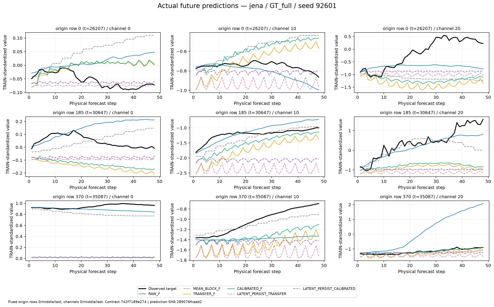

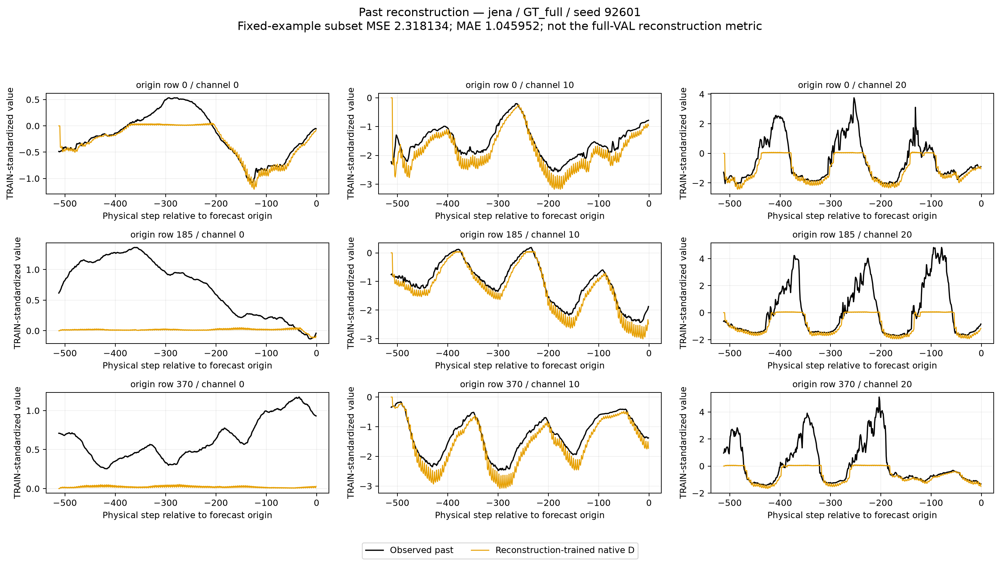

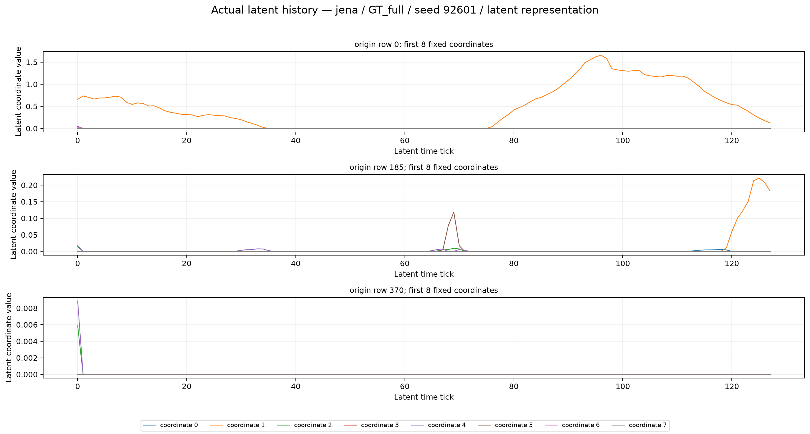

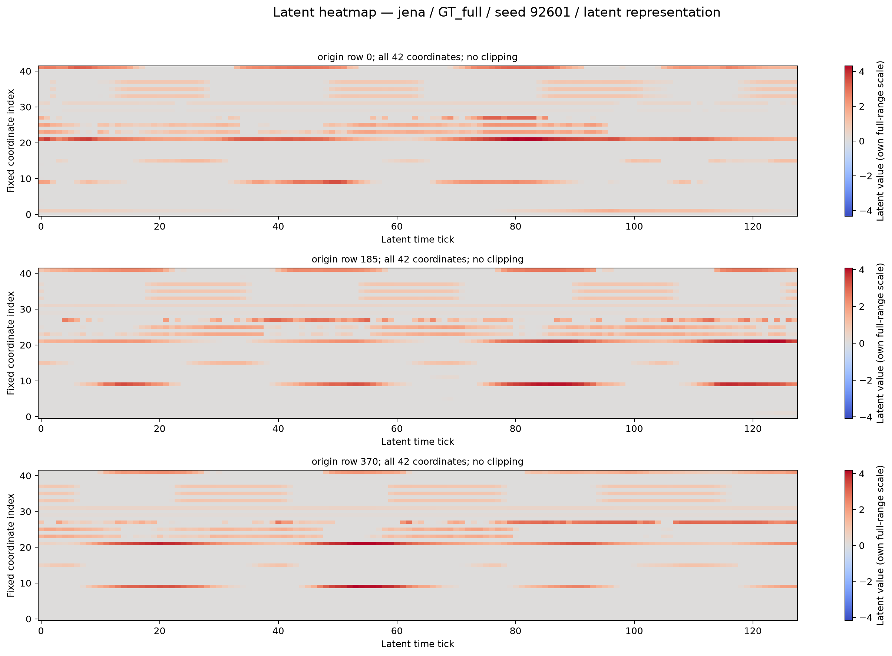

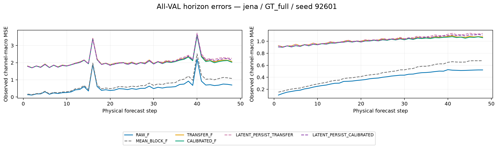

### jena_GT_full_s92602

[actual result](../runs/jena_GT_full_s92602/result.json)

```text
stage                      epochs  selected_epoch  max_epochs  updates   seconds
joint_GT_E_D               100     100             100         2600      84.959735
forecast_calibration_D     19      9               50          494       8.403175
```

[확인] selected checkpoint가 학습 상한에 닿은 단계: joint_GT_E_D. 이 범위에서 실제 학습은 수행했지만 충분한 수렴을 확인했다고 표시하지 않는다.

실제 shape:

```json
{
  "input": [
    512,
    21,
    1
  ],
  "latent": [
    128,
    21,
    2
  ],
  "F_input_rows_per_origin": 42,
  "F_context_length": 128,
  "F_future_length": 12,
  "native_D_output": [
    48,
    21
  ],
  "input_scalars": 10752,
  "latent_scalars": 5376,
  "latent_scalar_ratio": 0.5,
  "alignment": {
    "history_length": 512,
    "history_latent_ticks": 128,
    "physical_horizon": 48,
    "future_latent_ticks": 12,
    "encoder_tick_j_block": "[4*j,4*j+3]; representative timestamp 4*j+3",
    "decoder_zero_insert_phase": "right edge at each factor-two stage (Eq8 one-based t=kr)",
    "forecast_crop_start": 512,
    "forecast_crop_stop_exclusive": 560,
    "target_padding": false,
    "future_blocks": [
      {
        "future_latent_tick_zero_based": 0,
        "physical_block_indices_zero_based": [
          512,
          515
        ],
        "representative_timestamp_zero_based": 515,
        "forecast_target_indices_zero_based": [
          0,
          3
        ]
      },
      {
        "future_latent_tick_zero_based": 1,
        "physical_block_indices_zero_based": [
          516,
          519
        ],
        "representative_timestamp_zero_based": 519,
        "forecast_target_indices_zero_based": [
          4,
          7
        ]
      },
      {
        "future_latent_tick_zero_based": 2,
        "physical_block_indices_zero_based": [
          520,
          523
        ],
        "representative_timestamp_zero_based": 523,
        "forecast_target_indices_zero_based": [
          8,
          11
        ]
      },
      {
        "future_latent_tick_zero_based": 3,
        "physical_block_indices_zero_based": [
          524,
          527
        ],
        "representative_timestamp_zero_based": 527,
        "forecast_target_indices_zero_based": [
          12,
          15
        ]
      },
      {
        "future_latent_tick_zero_based": 4,
        "physical_block_indices_zero_based": [
          528,
          531
        ],
        "representative_timestamp_zero_based": 531,
        "forecast_target_indices_zero_based": [
          16,
          19
        ]
      },
      {
        "future_latent_tick_zero_based": 5,
        "physical_block_indices_zero_based": [
          532,
          535
        ],
        "representative_timestamp_zero_based": 535,
        "forecast_target_indices_zero_based": [
          20,
          23
        ]
      },
      {
        "future_latent_tick_zero_based": 6,
        "physical_block_indices_zero_based": [
          536,
          539
        ],
        "representative_timestamp_zero_based": 539,
        "forecast_target_indices_zero_based": [
          24,
          27
        ]
      },
      {
        "future_latent_tick_zero_based": 7,
        "physical_block_indices_zero_based": [
          540,
          543
        ],
        "representative_timestamp_zero_based": 543,
        "forecast_target_indices_zero_based": [
          28,
          31
        ]
      },
      {
        "future_latent_tick_zero_based": 8,
        "physical_block_indices_zero_based": [
          544,
          547
        ],
        "representative_timestamp_zero_based": 547,
        "forecast_target_indices_zero_based": [
          32,
          35
        ]
      },
      {
        "future_latent_tick_zero_based": 9,
        "physical_block_indices_zero_based": [
          548,
          551
        ],
        "representative_timestamp_zero_based": 551,
        "forecast_target_indices_zero_based": [
          36,
          39
        ]
      },
      {
        "future_latent_tick_zero_based": 10,
        "physical_block_indices_zero_based": [
          552,
          555
        ],
        "representative_timestamp_zero_based": 555,
        "forecast_target_indices_zero_based": [
          40,
          43
        ]
      },
      {
        "future_latent_tick_zero_based": 11,
        "physical_block_indices_zero_based": [
          556,
          559
        ],
        "representative_timestamp_zero_based": 559,
        "forecast_target_indices_zero_based": [
          44,
          47
        ]
      }
    ]
  }
}
```

기록된 실제 비용:

```json
[
  {
    "method": "TRANSFER_F",
    "batch": 1,
    "distinct_origins": 1,
    "fixture_origin_positions": [
      0
    ],
    "warmup": 3,
    "timed": 10,
    "seconds": [
      0.016649600118398666,
      0.01728140003979206,
      0.01829029992222786,
      0.015471899881958961,
      0.016176499892026186,
      0.01573630003258586,
      0.01668430003337562,
      0.017527799820527434,
      0.016384900081902742,
      0.015975099988281727
    ],
    "p50_ms": 16.517250100150704,
    "p95_ms": 17.947174876462665,
    "first_forward_seconds": 0.016044100048020482,
    "peak_cuda_allocated_bytes": 223206912,
    "peak_cuda_reserved_bytes": 304087040,
    "sampled_process_rss_bytes": 1647960064,
    "prediction_parity_max_abs": 7.152557373046875e-07,
    "memory_scope": "reset before parity/3warm/10timed; all currently resident prototype modules",
    "boundary": "preloaded physical FP32 past -> CPU normalization -> H2D -> entire method -> D2H -> CUDA sync",
    "excluded": "startup, model load, file I/O, window extraction, scoring",
    "device": "NVIDIA GeForce RTX 4070",
    "precision": "FP32, no AMP, TF32 disabled"
  },
  {
    "method": "TRANSFER_F",
    "batch": 32,
    "distinct_origins": 32,
    "fixture_origin_positions": [
      0,
      1,
      2,
      3,
      4,
      5,
      6,
      7,
      8,
      9,
      10,
      11,
      12,
      13,
      14,
      15,
      16,
      17,
      18,
      19,
      20,
      21,
      22,
      23,
      24,
      25,
      26,
      27,
      28,
      29,
      30,
      31
    ],
    "warmup": 3,
    "timed": 10,
    "seconds": [
      0.1461175000295043,
      0.14095230004750192,
      0.14581430004909635,
      0.1414781000930816,
      0.14167969999834895,
      0.14139999984763563,
      0.13838090002536774,
      0.1452741001266986,
      0.1501352998893708,
      0.16327009978704154
    ],
    "p50_ms": 143.47690006252378,
    "p95_ms": 157.3594398330897,
    "first_forward_seconds": 0.16413559997454286,
    "peak_cuda_allocated_bytes": 331862528,
    "peak_cuda_reserved_bytes": 392167424,
    "sampled_process_rss_bytes": 1649516544,
    "prediction_parity_max_abs": 1.30385160446167e-06,
    "memory_scope": "reset before parity/3warm/10timed; all currently resident prototype modules",
    "boundary": "preloaded physical FP32 past -> CPU normalization -> H2D -> entire method -> D2H -> CUDA sync",
    "excluded": "startup, model load, file I/O, window extraction, scoring",
    "device": "NVIDIA GeForce RTX 4070",
    "precision": "FP32, no AMP, TF32 disabled"
  },
  {
    "method": "CALIBRATED_F",
    "batch": 1,
    "distinct_origins": 1,
    "fixture_origin_positions": [
      0
    ],
    "warmup": 3,
    "timed": 10,
    "seconds": [
      0.0169212999753654,
      0.016518300166353583,
      0.01683390000835061,
      0.016885400051251054,
      0.019841899862512946,
      0.03213889990001917,
      0.03381910012103617,
      0.033157699974253774,
      0.01678370009176433,
      0.017023999942466617
    ],
    "p50_ms": 16.97264995891601,
    "p95_ms": 33.52147005498409,
    "first_forward_seconds": 0.020385100040584803,
    "peak_cuda_allocated_bytes": 223206912,
    "peak_cuda_reserved_bytes": 392167424,
    "sampled_process_rss_bytes": 1648226304,
    "prediction_parity_max_abs": 6.705522537231445e-07,
    "memory_scope": "reset before parity/3warm/10timed; all currently resident prototype modules",
    "boundary": "preloaded physical FP32 past -> CPU normalization -> H2D -> entire method -> D2H -> CUDA sync",
    "excluded": "startup, model load, file I/O, window extraction, scoring",
    "device": "NVIDIA GeForce RTX 4070",
    "precision": "FP32, no AMP, TF32 disabled"
  },
  {
    "method": "CALIBRATED_F",
    "batch": 32,
    "distinct_origins": 32,
    "fixture_origin_positions": [
      0,
      1,
      2,
      3,
      4,
      5,
      6,
      7,
      8,
      9,
      10,
      11,
      12,
      13,
      14,
      15,
      16,
      17,
      18,
      19,
      20,
      21,
      22,
      23,
      24,
      25,
      26,
      27,
      28,
      29,
      30,
      31
    ],
    "warmup": 3,
    "timed": 10,
    "seconds": [
      0.14851749991066754,
      0.151047799969092,
      0.14106099982745945,
      0.1378108998760581,
      0.14720429992303252,
      0.145706299925223,
      0.1480766001623124,
      0.15050019999034703,
      0.14907349995337427,
      0.13961729989387095
    ],
    "p50_ms": 147.64045004267246,
    "p95_ms": 150.80137997865677,
    "first_forward_seconds": 0.13954939995892346,
    "peak_cuda_allocated_bytes": 331862528,
    "peak_cuda_reserved_bytes": 392167424,
    "sampled_process_rss_bytes": 1649606656,
    "prediction_parity_max_abs": 1.255422830581665e-06,
    "memory_scope": "reset before parity/3warm/10timed; all currently resident prototype modules",
    "boundary": "preloaded physical FP32 past -> CPU normalization -> H2D -> entire method -> D2H -> CUDA sync",
    "excluded": "startup, model load, file I/O, window extraction, scoring",
    "device": "NVIDIA GeForce RTX 4070",
    "precision": "FP32, no AMP, TF32 disabled"
  }
]
```

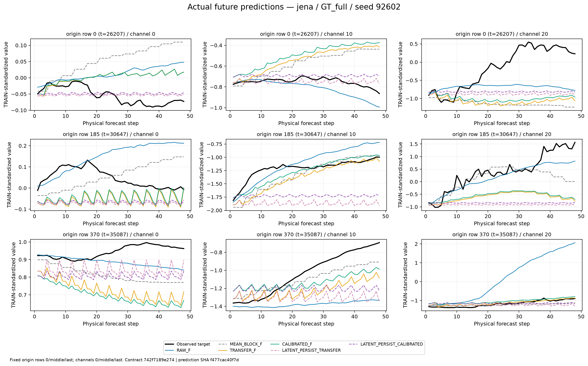

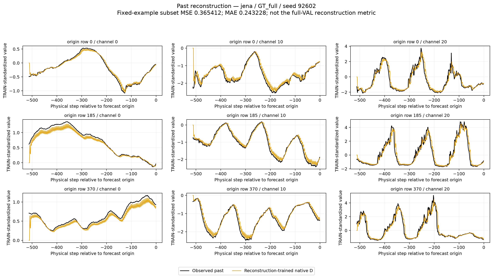

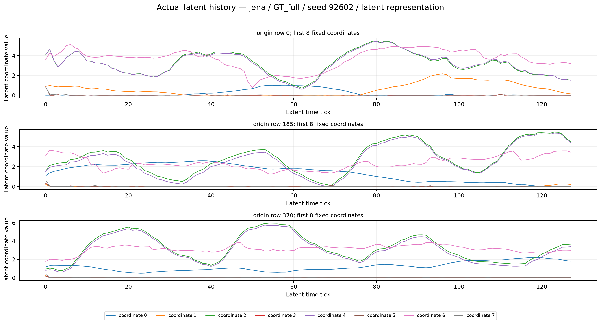

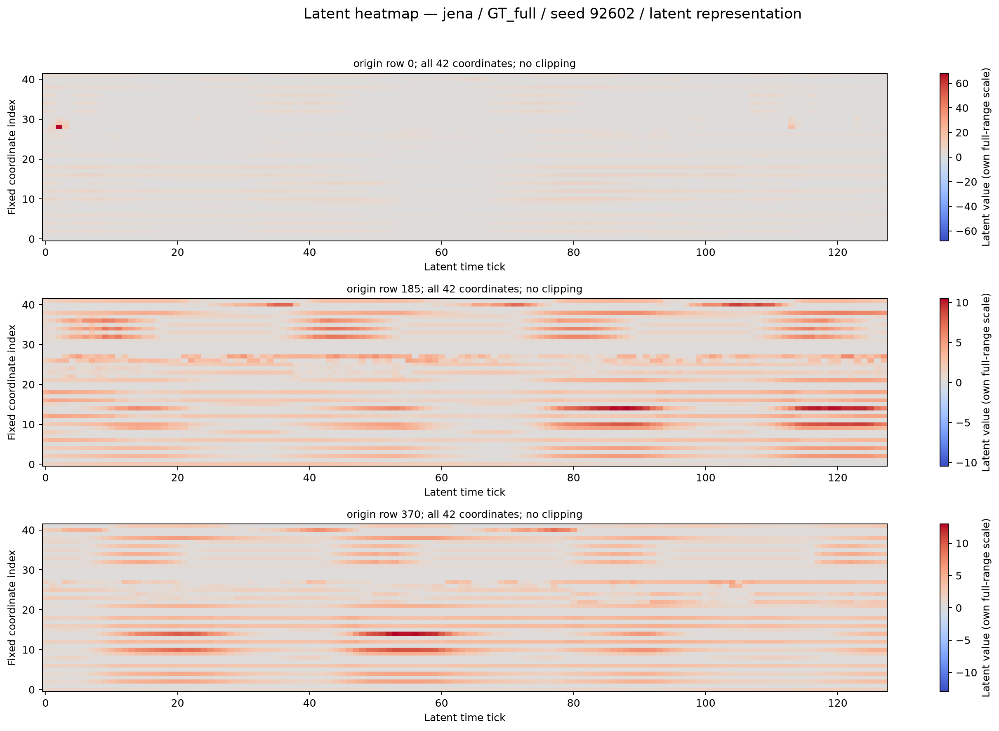

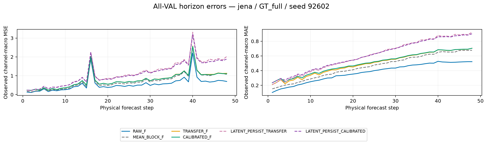

### jena_GT_no_spatial_s92601

[actual result](../runs/jena_GT_no_spatial_s92601/result.json)

```text
stage                      epochs  selected_epoch  max_epochs  updates   seconds
joint_GT_E_D               44      29              100         1144      25.183384
forecast_calibration_D     10      0               50          260       3.090246
```

실제 shape:

```json
{
  "input": [
    512,
    21,
    1
  ],
  "latent": [
    128,
    21,
    2
  ],
  "F_input_rows_per_origin": 42,
  "F_context_length": 128,
  "F_future_length": 12,
  "native_D_output": [
    48,
    21
  ],
  "input_scalars": 10752,
  "latent_scalars": 5376,
  "latent_scalar_ratio": 0.5,
  "alignment": {
    "history_length": 512,
    "history_latent_ticks": 128,
    "physical_horizon": 48,
    "future_latent_ticks": 12,
    "encoder_tick_j_block": "[4*j,4*j+3]; representative timestamp 4*j+3",
    "decoder_zero_insert_phase": "right edge at each factor-two stage (Eq8 one-based t=kr)",
    "forecast_crop_start": 512,
    "forecast_crop_stop_exclusive": 560,
    "target_padding": false,
    "future_blocks": [
      {
        "future_latent_tick_zero_based": 0,
        "physical_block_indices_zero_based": [
          512,
          515
        ],
        "representative_timestamp_zero_based": 515,
        "forecast_target_indices_zero_based": [
          0,
          3
        ]
      },
      {
        "future_latent_tick_zero_based": 1,
        "physical_block_indices_zero_based": [
          516,
          519
        ],
        "representative_timestamp_zero_based": 519,
        "forecast_target_indices_zero_based": [
          4,
          7
        ]
      },
      {
        "future_latent_tick_zero_based": 2,
        "physical_block_indices_zero_based": [
          520,
          523
        ],
        "representative_timestamp_zero_based": 523,
        "forecast_target_indices_zero_based": [
          8,
          11
        ]
      },
      {
        "future_latent_tick_zero_based": 3,
        "physical_block_indices_zero_based": [
          524,
          527
        ],
        "representative_timestamp_zero_based": 527,
        "forecast_target_indices_zero_based": [
          12,
          15
        ]
      },
      {
        "future_latent_tick_zero_based": 4,
        "physical_block_indices_zero_based": [
          528,
          531
        ],
        "representative_timestamp_zero_based": 531,
        "forecast_target_indices_zero_based": [
          16,
          19
        ]
      },
      {
        "future_latent_tick_zero_based": 5,
        "physical_block_indices_zero_based": [
          532,
          535
        ],
        "representative_timestamp_zero_based": 535,
        "forecast_target_indices_zero_based": [
          20,
          23
        ]
      },
      {
        "future_latent_tick_zero_based": 6,
        "physical_block_indices_zero_based": [
          536,
          539
        ],
        "representative_timestamp_zero_based": 539,
        "forecast_target_indices_zero_based": [
          24,
          27
        ]
      },
      {
        "future_latent_tick_zero_based": 7,
        "physical_block_indices_zero_based": [
          540,
          543
        ],
        "representative_timestamp_zero_based": 543,
        "forecast_target_indices_zero_based": [
          28,
          31
        ]
      },
      {
        "future_latent_tick_zero_based": 8,
        "physical_block_indices_zero_based": [
          544,
          547
        ],
        "representative_timestamp_zero_based": 547,
        "forecast_target_indices_zero_based": [
          32,
          35
        ]
      },
      {
        "future_latent_tick_zero_based": 9,
        "physical_block_indices_zero_based": [
          548,
          551
        ],
        "representative_timestamp_zero_based": 551,
        "forecast_target_indices_zero_based": [
          36,
          39
        ]
      },
      {
        "future_latent_tick_zero_based": 10,
        "physical_block_indices_zero_based": [
          552,
          555
        ],
        "representative_timestamp_zero_based": 555,
        "forecast_target_indices_zero_based": [
          40,
          43
        ]
      },
      {
        "future_latent_tick_zero_based": 11,
        "physical_block_indices_zero_based": [
          556,
          559
        ],
        "representative_timestamp_zero_based": 559,
        "forecast_target_indices_zero_based": [
          44,
          47
        ]
      }
    ]
  }
}
```

기록된 실제 비용:

```json
[
  {
    "method": "TRANSFER_F",
    "batch": 1,
    "distinct_origins": 1,
    "fixture_origin_positions": [
      0
    ],
    "warmup": 3,
    "timed": 10,
    "seconds": [
      0.013351100031286478,
      0.016086400020867586,
      0.01622260012663901,
      0.014002999989315867,
      0.014113500015810132,
      0.01494350004941225,
      0.013864499982446432,
      0.014235400129109621,
      0.013413000153377652,
      0.013883399777114391
    ],
    "p50_ms": 14.058250002563,
    "p95_ms": 16.16131007904187,
    "first_forward_seconds": 0.01578980009071529,
    "peak_cuda_allocated_bytes": 223205888,
    "peak_cuda_reserved_bytes": 291504128,
    "sampled_process_rss_bytes": 1648353280,
    "prediction_parity_max_abs": 1.3133103493601084e-09,
    "memory_scope": "reset before parity/3warm/10timed; all currently resident prototype modules",
    "boundary": "preloaded physical FP32 past -> CPU normalization -> H2D -> entire method -> D2H -> CUDA sync",
    "excluded": "startup, model load, file I/O, window extraction, scoring",
    "device": "NVIDIA GeForce RTX 4070",
    "precision": "FP32, no AMP, TF32 disabled"
  },
  {
    "method": "TRANSFER_F",
    "batch": 32,
    "distinct_origins": 32,
    "fixture_origin_positions": [
      0,
      1,
      2,
      3,
      4,
      5,
      6,
      7,
      8,
      9,
      10,
      11,
      12,
      13,
      14,
      15,
      16,
      17,
      18,
      19,
      20,
      21,
      22,
      23,
      24,
      25,
      26,
      27,
      28,
      29,
      30,
      31
    ],
    "warmup": 3,
    "timed": 10,
    "seconds": [
      0.14000240014865994,
      0.13000659993849695,
      0.13246600003913045,
      0.13465520017780364,
      0.1364350998774171,
      0.13527049985714257,
      0.1337404998484999,
      0.1455987999215722,
      0.15305750002153218,
      0.1383475000038743
    ],
    "p50_ms": 135.85279986727983,
    "p95_ms": 149.7010849765502,
    "first_forward_seconds": 0.1779356999322772,
    "peak_cuda_allocated_bytes": 293031424,
    "peak_cuda_reserved_bytes": 329252864,
    "sampled_process_rss_bytes": 1649917952,
    "prediction_parity_max_abs": 2.106389729306102e-09,
    "memory_scope": "reset before parity/3warm/10timed; all currently resident prototype modules",
    "boundary": "preloaded physical FP32 past -> CPU normalization -> H2D -> entire method -> D2H -> CUDA sync",
    "excluded": "startup, model load, file I/O, window extraction, scoring",
    "device": "NVIDIA GeForce RTX 4070",
    "precision": "FP32, no AMP, TF32 disabled"
  },
  {
    "method": "CALIBRATED_F",
    "batch": 1,
    "distinct_origins": 1,
    "fixture_origin_positions": [
      0
    ],
    "warmup": 3,
    "timed": 10,
    "seconds": [
      0.013380599906668067,
      0.013228100026026368,
      0.013171499827876687,
      0.013149599777534604,
      0.013671499909833074,
      0.012778399977833033,
      0.013646000064909458,
      0.012785600032657385,
      0.014123599976301193,
      0.014095199992880225
    ],
    "p50_ms": 13.304349966347218,
    "p95_ms": 14.110819983761758,
    "first_forward_seconds": 0.014333500061184168,
    "peak_cuda_allocated_bytes": 223205888,
    "peak_cuda_reserved_bytes": 329252864,
    "sampled_process_rss_bytes": 1648578560,
    "prediction_parity_max_abs": 1.3133103493601084e-09,
    "memory_scope": "reset before parity/3warm/10timed; all currently resident prototype modules",
    "boundary": "preloaded physical FP32 past -> CPU normalization -> H2D -> entire method -> D2H -> CUDA sync",
    "excluded": "startup, model load, file I/O, window extraction, scoring",
    "device": "NVIDIA GeForce RTX 4070",
    "precision": "FP32, no AMP, TF32 disabled"
  },
  {
    "method": "CALIBRATED_F",
    "batch": 32,
    "distinct_origins": 32,
    "fixture_origin_positions": [
      0,
      1,
      2,
      3,
      4,
      5,
      6,
      7,
      8,
      9,
      10,
      11,
      12,
      13,
      14,
      15,
      16,
      17,
      18,
      19,
      20,
      21,
      22,
      23,
      24,
      25,
      26,
      27,
      28,
      29,
      30,
      31
    ],
    "warmup": 3,
    "timed": 10,
    "seconds": [
      0.13715920015238225,
      0.13882589992135763,
      0.14159090002067387,
      0.14397420012392104,
      0.13888340000994503,
      0.13886119984090328,
      0.13809169991873205,
      0.13859159988351166,
      0.13725739996880293,
      0.13393939984962344
    ],
    "p50_ms": 138.70874990243465,
    "p95_ms": 142.9017150774598,
    "first_forward_seconds": 0.13401510007679462,
    "peak_cuda_allocated_bytes": 293031424,
    "peak_cuda_reserved_bytes": 329252864,
    "sampled_process_rss_bytes": 1649963008,
    "prediction_parity_max_abs": 2.106389729306102e-09,
    "memory_scope": "reset before parity/3warm/10timed; all currently resident prototype modules",
    "boundary": "preloaded physical FP32 past -> CPU normalization -> H2D -> entire method -> D2H -> CUDA sync",
    "excluded": "startup, model load, file I/O, window extraction, scoring",
    "device": "NVIDIA GeForce RTX 4070",
    "precision": "FP32, no AMP, TF32 disabled"
  }
]
```

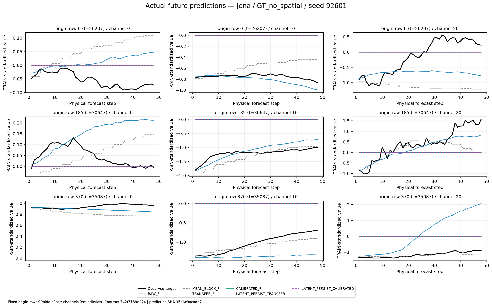

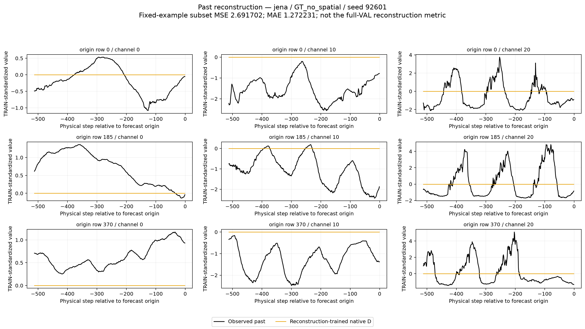

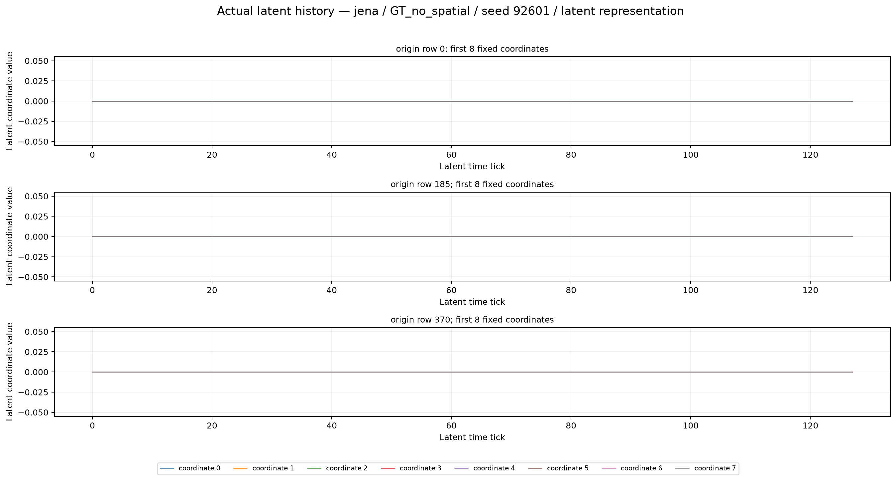

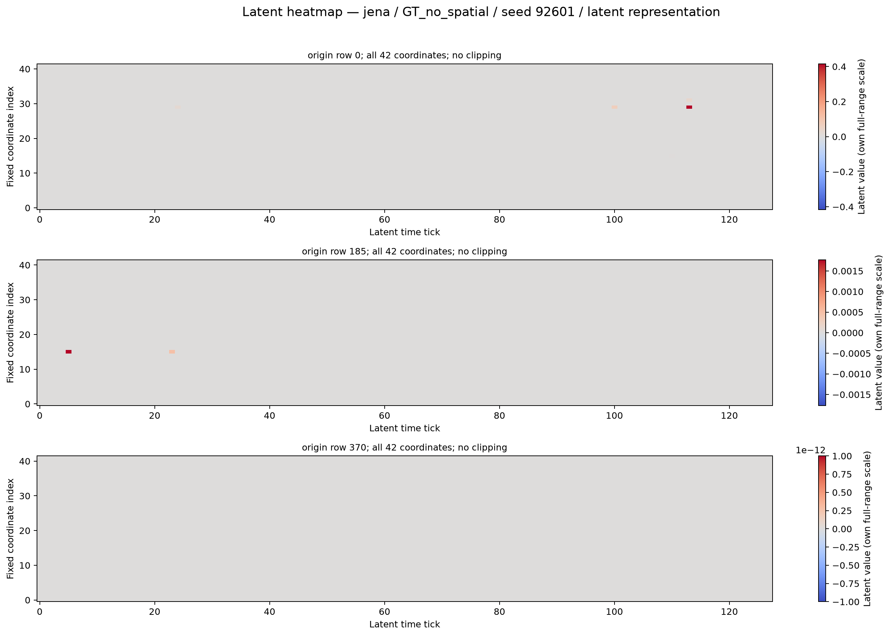

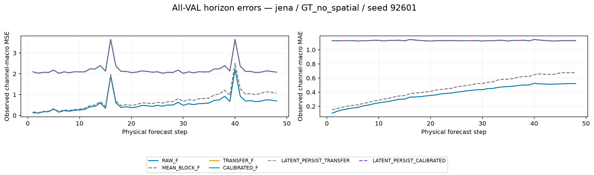

### jena_GT_no_spatial_s92602

[actual result](../runs/jena_GT_no_spatial_s92602/result.json)

```text
stage                      epochs  selected_epoch  max_epochs  updates   seconds
joint_GT_E_D               100     98              100         2600      69.091927
forecast_calibration_D     50      47              50          1300      21.218866
```

실제 shape:

```json
{
  "input": [
    512,
    21,
    1
  ],
  "latent": [
    128,
    21,
    2
  ],
  "F_input_rows_per_origin": 42,
  "F_context_length": 128,
  "F_future_length": 12,
  "native_D_output": [
    48,
    21
  ],
  "input_scalars": 10752,
  "latent_scalars": 5376,
  "latent_scalar_ratio": 0.5,
  "alignment": {
    "history_length": 512,
    "history_latent_ticks": 128,
    "physical_horizon": 48,
    "future_latent_ticks": 12,
    "encoder_tick_j_block": "[4*j,4*j+3]; representative timestamp 4*j+3",
    "decoder_zero_insert_phase": "right edge at each factor-two stage (Eq8 one-based t=kr)",
    "forecast_crop_start": 512,
    "forecast_crop_stop_exclusive": 560,
    "target_padding": false,
    "future_blocks": [
      {
        "future_latent_tick_zero_based": 0,
        "physical_block_indices_zero_based": [
          512,
          515
        ],
        "representative_timestamp_zero_based": 515,
        "forecast_target_indices_zero_based": [
          0,
          3
        ]
      },
      {
        "future_latent_tick_zero_based": 1,
        "physical_block_indices_zero_based": [
          516,
          519
        ],
        "representative_timestamp_zero_based": 519,
        "forecast_target_indices_zero_based": [
          4,
          7
        ]
      },
      {
        "future_latent_tick_zero_based": 2,
        "physical_block_indices_zero_based": [
          520,
          523
        ],
        "representative_timestamp_zero_based": 523,
        "forecast_target_indices_zero_based": [
          8,
          11
        ]
      },
      {
        "future_latent_tick_zero_based": 3,
        "physical_block_indices_zero_based": [
          524,
          527
        ],
        "representative_timestamp_zero_based": 527,
        "forecast_target_indices_zero_based": [
          12,
          15
        ]
      },
      {
        "future_latent_tick_zero_based": 4,
        "physical_block_indices_zero_based": [
          528,
          531
        ],
        "representative_timestamp_zero_based": 531,
        "forecast_target_indices_zero_based": [
          16,
          19
        ]
      },
      {
        "future_latent_tick_zero_based": 5,
        "physical_block_indices_zero_based": [
          532,
          535
        ],
        "representative_timestamp_zero_based": 535,
        "forecast_target_indices_zero_based": [
          20,
          23
        ]
      },
      {
        "future_latent_tick_zero_based": 6,
        "physical_block_indices_zero_based": [
          536,
          539
        ],
        "representative_timestamp_zero_based": 539,
        "forecast_target_indices_zero_based": [
          24,
          27
        ]
      },
      {
        "future_latent_tick_zero_based": 7,
        "physical_block_indices_zero_based": [
          540,
          543
        ],
        "representative_timestamp_zero_based": 543,
        "forecast_target_indices_zero_based": [
          28,
          31
        ]
      },
      {
        "future_latent_tick_zero_based": 8,
        "physical_block_indices_zero_based": [
          544,
          547
        ],
        "representative_timestamp_zero_based": 547,
        "forecast_target_indices_zero_based": [
          32,
          35
        ]
      },
      {
        "future_latent_tick_zero_based": 9,
        "physical_block_indices_zero_based": [
          548,
          551
        ],
        "representative_timestamp_zero_based": 551,
        "forecast_target_indices_zero_based": [
          36,
          39
        ]
      },
      {
        "future_latent_tick_zero_based": 10,
        "physical_block_indices_zero_based": [
          552,
          555
        ],
        "representative_timestamp_zero_based": 555,
        "forecast_target_indices_zero_based": [
          40,
          43
        ]
      },
      {
        "future_latent_tick_zero_based": 11,
        "physical_block_indices_zero_based": [
          556,
          559
        ],
        "representative_timestamp_zero_based": 559,
        "forecast_target_indices_zero_based": [
          44,
          47
        ]
      }
    ]
  }
}
```

기록된 실제 비용:

```json
[
  {
    "method": "TRANSFER_F",
    "batch": 1,
    "distinct_origins": 1,
    "fixture_origin_positions": [
      0
    ],
    "warmup": 3,
    "timed": 10,
    "seconds": [
      0.016735400073230267,
      0.018434499856084585,
      0.017444700002670288,
      0.015191099839285016,
      0.015001799911260605,
      0.0169792000669986,
      0.015503300121054053,
      0.01560740009881556,
      0.01598670007660985,
      0.015061300015076995
    ],
    "p50_ms": 15.797050087712705,
    "p95_ms": 17.989089922048148,
    "first_forward_seconds": 0.02199149993248284,
    "peak_cuda_allocated_bytes": 223205888,
    "peak_cuda_reserved_bytes": 291504128,
    "sampled_process_rss_bytes": 1649102848,
    "prediction_parity_max_abs": 3.2782554626464844e-07,
    "memory_scope": "reset before parity/3warm/10timed; all currently resident prototype modules",
    "boundary": "preloaded physical FP32 past -> CPU normalization -> H2D -> entire method -> D2H -> CUDA sync",
    "excluded": "startup, model load, file I/O, window extraction, scoring",
    "device": "NVIDIA GeForce RTX 4070",
    "precision": "FP32, no AMP, TF32 disabled"
  },
  {
    "method": "TRANSFER_F",
    "batch": 32,
    "distinct_origins": 32,
    "fixture_origin_positions": [
      0,
      1,
      2,
      3,
      4,
      5,
      6,
      7,
      8,
      9,
      10,
      11,
      12,
      13,
      14,
      15,
      16,
      17,
      18,
      19,
      20,
      21,
      22,
      23,
      24,
      25,
      26,
      27,
      28,
      29,
      30,
      31
    ],
    "warmup": 3,
    "timed": 10,
    "seconds": [
      0.13983620004728436,
      0.14525679987855256,
      0.17823450011201203,
      0.14965090015903115,
      0.14906529989093542,
      0.14702669996768236,
      0.13980569993145764,
      0.13977620005607605,
      0.13747459999285638,
      0.13931300002150238
    ],
    "p50_ms": 142.54649996291846,
    "p95_ms": 165.3718801331706,
    "first_forward_seconds": 0.18541759997606277,
    "peak_cuda_allocated_bytes": 293031424,
    "peak_cuda_reserved_bytes": 329252864,
    "sampled_process_rss_bytes": 1650774016,
    "prediction_parity_max_abs": 5.960464477539062e-07,
    "memory_scope": "reset before parity/3warm/10timed; all currently resident prototype modules",
    "boundary": "preloaded physical FP32 past -> CPU normalization -> H2D -> entire method -> D2H -> CUDA sync",
    "excluded": "startup, model load, file I/O, window extraction, scoring",
    "device": "NVIDIA GeForce RTX 4070",
    "precision": "FP32, no AMP, TF32 disabled"
  },
  {
    "method": "CALIBRATED_F",
    "batch": 1,
    "distinct_origins": 1,
    "fixture_origin_positions": [
      0
    ],
    "warmup": 3,
    "timed": 10,
    "seconds": [
      0.015605899970978498,
      0.013352000154554844,
      0.015557499835267663,
      0.014410899952054024,
      0.018073200015351176,
      0.013772099977359176,
      0.01372239994816482,
      0.014297799905762076,
      0.014791300054639578,
      0.013551099924370646
    ],
    "p50_ms": 14.35434992890805,
    "p95_ms": 16.962914995383468,
    "first_forward_seconds": 0.01627809996716678,
    "peak_cuda_allocated_bytes": 223205888,
    "peak_cuda_reserved_bytes": 329252864,
    "sampled_process_rss_bytes": 1649479680,
    "prediction_parity_max_abs": 2.682209014892578e-07,
    "memory_scope": "reset before parity/3warm/10timed; all currently resident prototype modules",
    "boundary": "preloaded physical FP32 past -> CPU normalization -> H2D -> entire method -> D2H -> CUDA sync",
    "excluded": "startup, model load, file I/O, window extraction, scoring",
    "device": "NVIDIA GeForce RTX 4070",
    "precision": "FP32, no AMP, TF32 disabled"
  },
  {
    "method": "CALIBRATED_F",
    "batch": 32,
    "distinct_origins": 32,
    "fixture_origin_positions": [
      0,
      1,
      2,
      3,
      4,
      5,
      6,
      7,
      8,
      9,
      10,
      11,
      12,
      13,
      14,
      15,
      16,
      17,
      18,
      19,
      20,
      21,
      22,
      23,
      24,
      25,
      26,
      27,
      28,
      29,
      30,
      31
    ],
    "warmup": 3,
    "timed": 10,
    "seconds": [
      0.13725739996880293,
      0.1418725000694394,
      0.14463979983702302,
      0.14329369994811714,
      0.1470399999525398,
      0.14401269983500242,
      0.1399826998822391,
      0.14095759997144341,
      0.1462435000576079,
      0.1396000999957323
    ],
    "p50_ms": 142.58310000877827,
    "p95_ms": 146.68157499982044,
    "first_forward_seconds": 0.13886839989572763,
    "peak_cuda_allocated_bytes": 293031424,
    "peak_cuda_reserved_bytes": 329252864,
    "sampled_process_rss_bytes": 1650860032,
    "prediction_parity_max_abs": 4.76837158203125e-07,
    "memory_scope": "reset before parity/3warm/10timed; all currently resident prototype modules",
    "boundary": "preloaded physical FP32 past -> CPU normalization -> H2D -> entire method -> D2H -> CUDA sync",
    "excluded": "startup, model load, file I/O, window extraction, scoring",
    "device": "NVIDIA GeForce RTX 4070",
    "precision": "FP32, no AMP, TF32 disabled"
  }
]
```

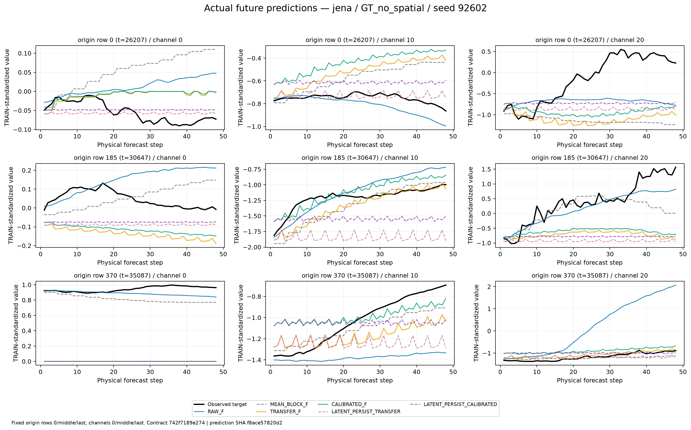

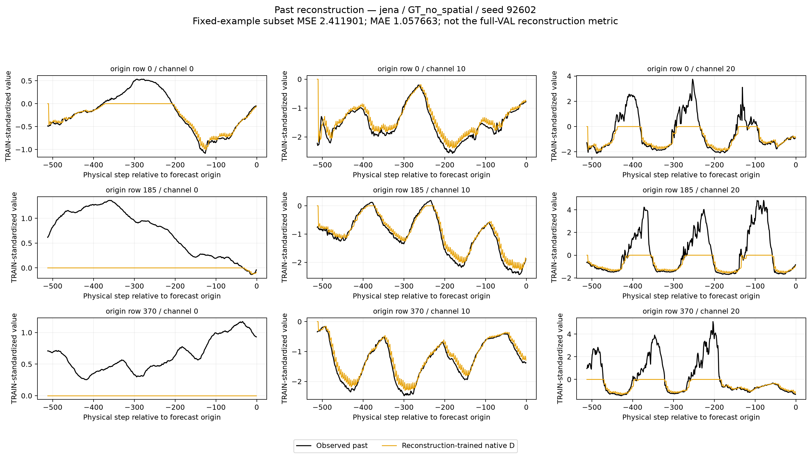

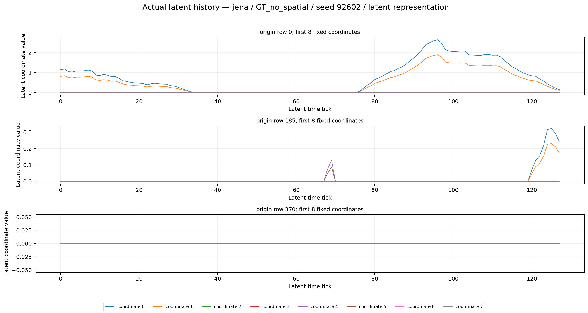

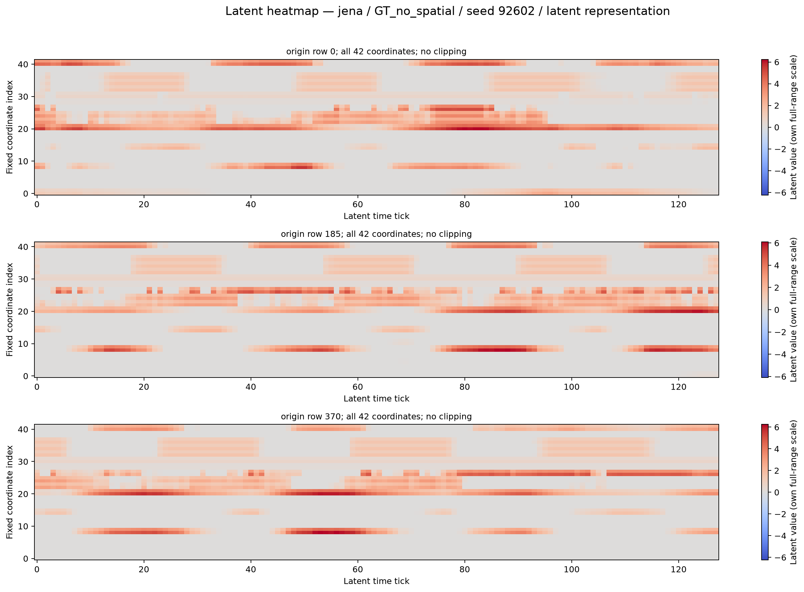

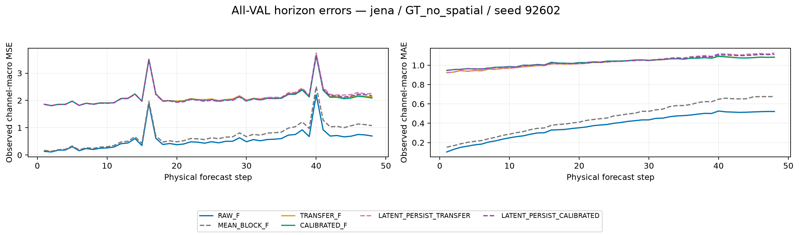

### jena_TS2_d16_s92601_retry_batch4_v4

[actual result](../runs/jena_TS2_d16_s92601_retry_batch4_v4/result.json)

```text
stage                      epochs  selected_epoch  max_epochs  updates   seconds
TS2_encoder                None    None            None        600       51.656287
reconstruction_D           100     99              100         2600      40.109004
forecast_calibration_D     50      47              50          1300      11.969578
```

실제 shape:

```json
{
  "past": [
    512,
    21
  ],
  "latent": [
    512,
    16
  ],
  "latent_future": [
    48,
    16
  ],
  "output": [
    48,
    21
  ],
  "input_scalar_count_per_origin": 10752,
  "latent_scalar_count_per_origin": 8192,
  "F_rows_per_origin": 16,
  "F_context_length": 512,
  "physical_future_horizon": 48,
  "temporal_downsampling": 1,
  "representation_category": "channel_dimensional_reduction",
  "online_encoder_residence_during_inference": "CPU frozen, separate full SWA encoder on CUDA",
  "decoder_parameters": 4885,
  "prototype_resident_decoder_copies": 2,
  "deployment_transfer": "official NumPy encode includes D2H input, H2D encoder, D2H repr and H2D F; costs include these transfers"
}
```

기록된 실제 비용:

```json
[
  {
    "method": "TRANSFER_F",
    "batch": 1,
    "distinct_origins": 1,
    "fixture_origin_positions": [
      0
    ],
    "warmup": 3,
    "timed": 10,
    "seconds": [
      0.01876500016078353,
      0.019648100016638637,
      0.019246899988502264,
      0.017984800040721893,
      0.01933080004528165,
      0.01974659995175898,
      0.016001200070604682,
      0.014125499874353409,
      0.015446700155735016,
      0.014455399941653013
    ],
    "p50_ms": 18.37490010075271,
    "p95_ms": 19.702274980954826,
    "first_forward_seconds": 0.019808800192549825,
    "peak_cuda_allocated_bytes": 229935104,
    "peak_cuda_reserved_bytes": 8501854208,
    "sampled_process_rss_bytes": 2131795968,
    "prediction_parity_max_abs": 1.430511474609375e-06,
    "memory_scope": "reset before parity/3warm/10timed; all currently resident prototype modules",
    "boundary": "preloaded physical FP32 past -> CPU normalization -> H2D -> entire method -> D2H -> CUDA sync",
    "excluded": "startup, model load, file I/O, window extraction, scoring",
    "device": "NVIDIA GeForce RTX 4070",
    "precision": "FP32, no AMP, TF32 disabled"
  },
  {
    "method": "TRANSFER_F",
    "batch": 32,
    "distinct_origins": 32,
    "fixture_origin_positions": [
      0,
      1,
      2,
      3,
      4,
      5,
      6,
      7,
      8,
      9,
      10,
      11,
      12,
      13,
      14,
      15,
      16,
      17,
      18,
      19,
      20,
      21,
      22,
      23,
      24,
      25,
      26,
      27,
      28,
      29,
      30,
      31
    ],
    "warmup": 3,
    "timed": 10,
    "seconds": [
      0.10287140007130802,
      0.10527619998902082,
      0.10534110013395548,
      0.10265280003659427,
      0.09975950000807643,
      0.10275640012696385,
      0.10346820019185543,
      0.10470830020494759,
      0.10560709983110428,
      0.10713219991885126
    ],
    "p50_ms": 104.08825019840151,
    "p95_ms": 106.44590487936512,
    "first_forward_seconds": 0.16007370012812316,
    "peak_cuda_allocated_bytes": 357979648,
    "peak_cuda_reserved_bytes": 8501854208,
    "sampled_process_rss_bytes": 2132934656,
    "prediction_parity_max_abs": 1.5795230865478516e-06,
    "memory_scope": "reset before parity/3warm/10timed; all currently resident prototype modules",
    "boundary": "preloaded physical FP32 past -> CPU normalization -> H2D -> entire method -> D2H -> CUDA sync",
    "excluded": "startup, model load, file I/O, window extraction, scoring",
    "device": "NVIDIA GeForce RTX 4070",
    "precision": "FP32, no AMP, TF32 disabled"
  },
  {
    "method": "CALIBRATED_F",
    "batch": 1,
    "distinct_origins": 1,
    "fixture_origin_positions": [
      0
    ],
    "warmup": 3,
    "timed": 10,
    "seconds": [
      0.019880699925124645,
      0.014002399984747171,
      0.013684799894690514,
      0.014554099878296256,
      0.012830100022256374,
      0.013896000105887651,
      0.012922400142997503,
      0.01338490005582571,
      0.016190700000151992,
      0.014350000070407987
    ],
    "p50_ms": 13.949200045317411,
    "p95_ms": 18.220199958886948,
    "first_forward_seconds": 0.014973899815231562,
    "peak_cuda_allocated_bytes": 229935104,
    "peak_cuda_reserved_bytes": 8501854208,
    "sampled_process_rss_bytes": 2131554304,
    "prediction_parity_max_abs": 1.3113021850585938e-06,
    "memory_scope": "reset before parity/3warm/10timed; all currently resident prototype modules",
    "boundary": "preloaded physical FP32 past -> CPU normalization -> H2D -> entire method -> D2H -> CUDA sync",
    "excluded": "startup, model load, file I/O, window extraction, scoring",
    "device": "NVIDIA GeForce RTX 4070",
    "precision": "FP32, no AMP, TF32 disabled"
  },
  {
    "method": "CALIBRATED_F",
    "batch": 32,
    "distinct_origins": 32,
    "fixture_origin_positions": [
      0,
      1,
      2,
      3,
      4,
      5,
      6,
      7,
      8,
      9,
      10,
      11,
      12,
      13,
      14,
      15,
      16,
      17,
      18,
      19,
      20,
      21,
      22,
      23,
      24,
      25,
      26,
      27,
      28,
      29,
      30,
      31
    ],
    "warmup": 3,
    "timed": 10,
    "seconds": [
      0.10226319986395538,
      0.11544159986078739,
      0.10352499992586672,
      0.1050468001049012,
      0.11212319997139275,
      0.1056345000397414,
      0.11192639986984432,
      0.10948639991693199,
      0.11026180000044405,
      0.1128510998096317
    ],
    "p50_ms": 109.87409995868802,
    "p95_ms": 114.27587483776733,
    "first_forward_seconds": 0.12209140020422637,
    "peak_cuda_allocated_bytes": 357979648,
    "peak_cuda_reserved_bytes": 8501854208,
    "sampled_process_rss_bytes": 2132934656,
    "prediction_parity_max_abs": 1.430511474609375e-06,
    "memory_scope": "reset before parity/3warm/10timed; all currently resident prototype modules",
    "boundary": "preloaded physical FP32 past -> CPU normalization -> H2D -> entire method -> D2H -> CUDA sync",
    "excluded": "startup, model load, file I/O, window extraction, scoring",
    "device": "NVIDIA GeForce RTX 4070",
    "precision": "FP32, no AMP, TF32 disabled"
  },
  {
    "method": "TS2_NATIVE_RIDGE",
    "batch": 1,
    "distinct_origins": 1,
    "fixture_origin_positions": [
      0
    ],
    "warmup": 3,
    "timed": 10,
    "seconds": [
      0.0015940000303089619,
      0.002293500117957592,
      0.0029559999238699675,
      0.0018297000788152218,
      0.0020015998743474483,
      0.0019938999321311712,
      0.003033099928870797,
      0.001878000097349286,
      0.003157899947836995,
      0.002159200143069029
    ],
    "p50_ms": 2.0804000087082386,
    "p95_ms": 3.101739939302206,
    "first_forward_seconds": 0.011409400030970573,
    "peak_cuda_allocated_bytes": 211068416,
    "peak_cuda_reserved_bytes": 8501854208,
    "sampled_process_rss_bytes": 2131574784,
    "prediction_parity_max_abs": 6.556510925292969e-07,
    "memory_scope": "reset before parity/3warm/10timed; all currently resident prototype modules",
    "boundary": "preloaded physical FP32 past -> CPU normalization -> H2D -> entire method -> D2H -> CUDA sync",
    "excluded": "startup, model load, file I/O, window extraction, scoring",
    "device": "NVIDIA GeForce RTX 4070",
    "precision": "FP32, no AMP, TF32 disabled"
  },
  {
    "method": "TS2_NATIVE_RIDGE",
    "batch": 32,
    "distinct_origins": 32,
    "fixture_origin_positions": [
      0,
      1,
      2,
      3,
      4,
      5,
      6,
      7,
      8,
      9,
      10,
      11,
      12,
      13,
      14,
      15,
      16,
      17,
      18,
      19,
      20,
      21,
      22,
      23,
      24,
      25,
      26,
      27,
      28,
      29,
      30,
      31
    ],
    "warmup": 3,
    "timed": 10,
    "seconds": [
      0.0031479999888688326,
      0.0035153001081198454,
      0.0034374999813735485,
      0.004147700034081936,
      0.004695400130003691,
      0.0036879999097436666,
      0.004702399950474501,
      0.0036969000939279795,
      0.003014700021594763,
      0.0029227999038994312
    ],
    "p50_ms": 3.601650008931756,
    "p95_ms": 4.699250031262636,
    "first_forward_seconds": 0.011825900059193373,
    "peak_cuda_allocated_bytes": 219743232,
    "peak_cuda_reserved_bytes": 8501854208,
    "sampled_process_rss_bytes": 2134331392,
    "prediction_parity_max_abs": 9.5367431640625e-07,
    "memory_scope": "reset before parity/3warm/10timed; all currently resident prototype modules",
    "boundary": "preloaded physical FP32 past -> CPU normalization -> H2D -> entire method -> D2H -> CUDA sync",
    "excluded": "startup, model load, file I/O, window extraction, scoring",
    "device": "NVIDIA GeForce RTX 4070",
    "precision": "FP32, no AMP, TF32 disabled"
  }
]
```

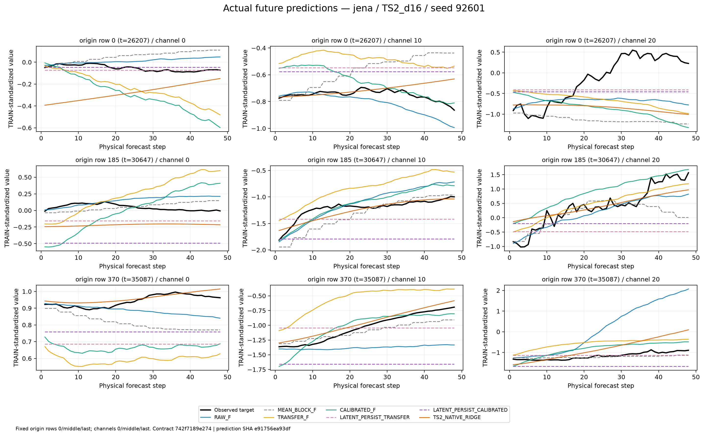

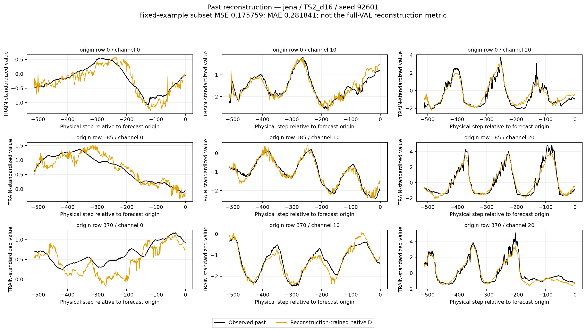

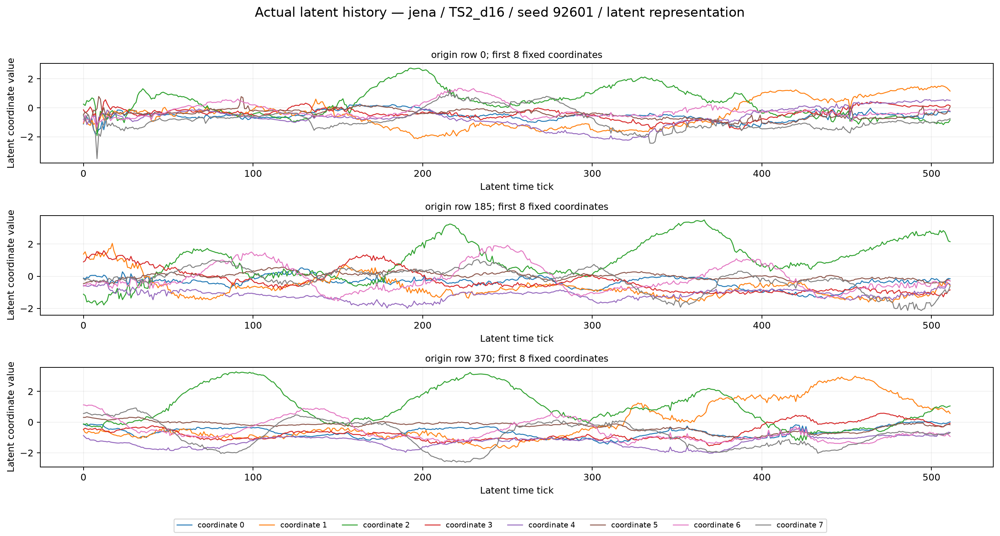

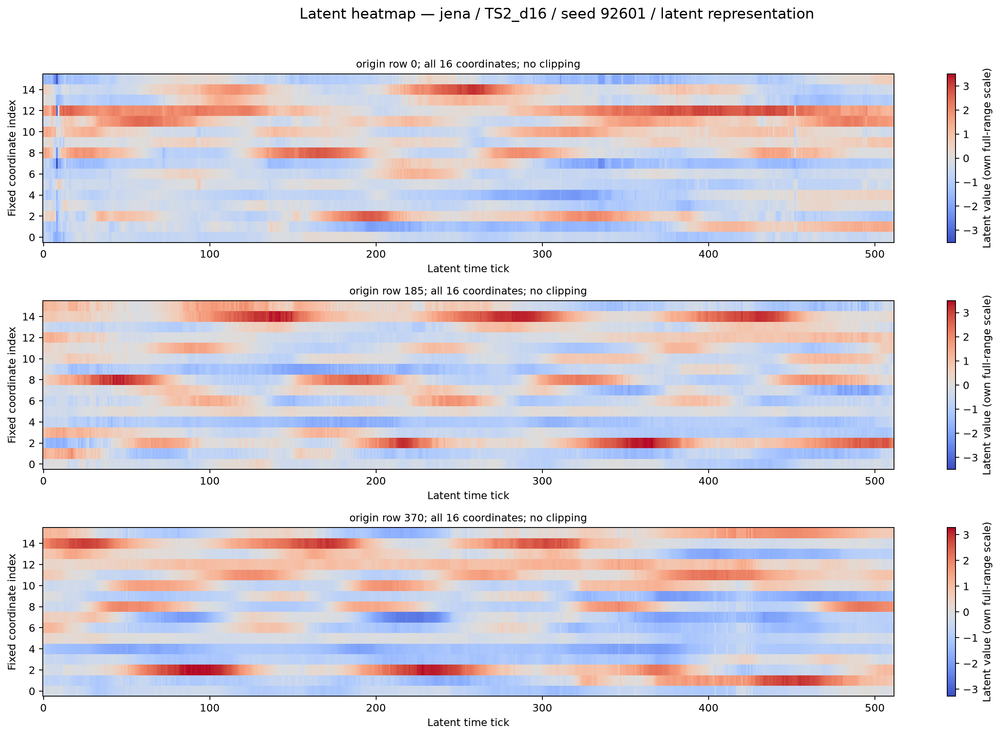

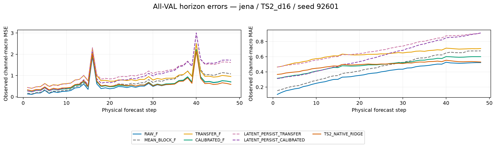

### jena_TS2_d16_s92602_retry_batch4_v4

[actual result](../runs/jena_TS2_d16_s92602_retry_batch4_v4/result.json)

```text
stage                      epochs  selected_epoch  max_epochs  updates   seconds
TS2_encoder                None    None            None        600       54.831596
reconstruction_D           100     100             100         2600      42.284149
forecast_calibration_D     50      50              50          1300      12.847035
```

[확인] selected checkpoint가 학습 상한에 닿은 단계: reconstruction_D, forecast_calibration_D. 이 범위에서 실제 학습은 수행했지만 충분한 수렴을 확인했다고 표시하지 않는다.

실제 shape:

```json
{
  "past": [
    512,
    21
  ],
  "latent": [
    512,
    16
  ],
  "latent_future": [
    48,
    16
  ],
  "output": [
    48,
    21
  ],
  "input_scalar_count_per_origin": 10752,
  "latent_scalar_count_per_origin": 8192,
  "F_rows_per_origin": 16,
  "F_context_length": 512,
  "physical_future_horizon": 48,
  "temporal_downsampling": 1,
  "representation_category": "channel_dimensional_reduction",
  "online_encoder_residence_during_inference": "CPU frozen, separate full SWA encoder on CUDA",
  "decoder_parameters": 4885,
  "prototype_resident_decoder_copies": 2,
  "deployment_transfer": "official NumPy encode includes D2H input, H2D encoder, D2H repr and H2D F; costs include these transfers"
}
```

기록된 실제 비용:

```json
[
  {
    "method": "TRANSFER_F",
    "batch": 1,
    "distinct_origins": 1,
    "fixture_origin_positions": [
      0
    ],
    "warmup": 3,
    "timed": 10,
    "seconds": [
      0.025020600063726306,
      0.017964799888432026,
      0.0165159001480788,
      0.017296900041401386,
      0.020970100071281195,
      0.01793950004503131,
      0.01737060002051294,
      0.015750100137665868,
      0.01486169989220798,
      0.015640500001609325
    ],
    "p50_ms": 17.333750030957162,
    "p95_ms": 23.197875067126002,
    "first_forward_seconds": 0.021197899943217635,
    "peak_cuda_allocated_bytes": 229640192,
    "peak_cuda_reserved_bytes": 12140412928,
    "sampled_process_rss_bytes": 2606551040,
    "prediction_parity_max_abs": 9.238719940185547e-07,
    "memory_scope": "reset before parity/3warm/10timed; all currently resident prototype modules",
    "boundary": "preloaded physical FP32 past -> CPU normalization -> H2D -> entire method -> D2H -> CUDA sync",
    "excluded": "startup, model load, file I/O, window extraction, scoring",
    "device": "NVIDIA GeForce RTX 4070",
    "precision": "FP32, no AMP, TF32 disabled"
  },
  {
    "method": "TRANSFER_F",
    "batch": 32,
    "distinct_origins": 32,
    "fixture_origin_positions": [
      0,
      1,
      2,
      3,
      4,
      5,
      6,
      7,
      8,
      9,
      10,
      11,
      12,
      13,
      14,
      15,
      16,
      17,
      18,
      19,
      20,
      21,
      22,
      23,
      24,
      25,
      26,
      27,
      28,
      29,
      30,
      31
    ],
    "warmup": 3,
    "timed": 10,
    "seconds": [
      0.19551069987937808,
      0.1899035000242293,
      0.19080570014193654,
      0.19055029982700944,
      0.18163620005361736,
      0.18895509978756309,
      0.19477379997260869,
      0.19284750008955598,
      0.18755550007335842,
      0.19078060006722808
    ],
    "p50_ms": 190.66544994711876,
    "p95_ms": 195.17909492133185,
    "first_forward_seconds": 0.23169549996964633,
    "peak_cuda_allocated_bytes": 359384576,
    "peak_cuda_reserved_bytes": 12140412928,
    "sampled_process_rss_bytes": 2607673344,
    "prediction_parity_max_abs": 1.6689300537109375e-06,
    "memory_scope": "reset before parity/3warm/10timed; all currently resident prototype modules",
    "boundary": "preloaded physical FP32 past -> CPU normalization -> H2D -> entire method -> D2H -> CUDA sync",
    "excluded": "startup, model load, file I/O, window extraction, scoring",
    "device": "NVIDIA GeForce RTX 4070",
    "precision": "FP32, no AMP, TF32 disabled"
  },
  {
    "method": "CALIBRATED_F",
    "batch": 1,
    "distinct_origins": 1,
    "fixture_origin_positions": [
      0
    ],
    "warmup": 3,
    "timed": 10,
    "seconds": [
      0.014349000062793493,
      0.012994900112971663,
      0.014068800024688244,
      0.013651900226250291,
      0.013361699879169464,
      0.014579799957573414,
      0.014624600065872073,
      0.015598300145938993,
      0.014722000109031796,
      0.01365610002540052
    ],
    "p50_ms": 14.208900043740869,
    "p95_ms": 15.203965129330753,
    "first_forward_seconds": 0.01469450001604855,
    "peak_cuda_allocated_bytes": 229640192,
    "peak_cuda_reserved_bytes": 12140412928,
    "sampled_process_rss_bytes": 2606292992,
    "prediction_parity_max_abs": 8.344650268554688e-07,
    "memory_scope": "reset before parity/3warm/10timed; all currently resident prototype modules",
    "boundary": "preloaded physical FP32 past -> CPU normalization -> H2D -> entire method -> D2H -> CUDA sync",
    "excluded": "startup, model load, file I/O, window extraction, scoring",
    "device": "NVIDIA GeForce RTX 4070",
    "precision": "FP32, no AMP, TF32 disabled"
  },
  {
    "method": "CALIBRATED_F",
    "batch": 32,
    "distinct_origins": 32,
    "fixture_origin_positions": [
      0,
      1,
      2,
      3,
      4,
      5,
      6,
      7,
      8,
      9,
      10,
      11,
      12,
      13,
      14,
      15,
      16,
      17,
      18,
      19,
      20,
      21,
      22,
      23,
      24,
      25,
      26,
      27,
      28,
      29,
      30,
      31
    ],
    "warmup": 3,
    "timed": 10,
    "seconds": [
      0.19319120002910495,
      0.20465780002996325,
      0.20373549987562,
      0.20097710005939007,
      0.21068369993008673,
      0.20078309997916222,
      0.19390120008029044,
      0.19156949990428984,
      0.2074031000956893,
      0.19229880021885037
    ],
    "p50_ms": 200.88010001927614,
    "p95_ms": 209.20743000460786,
    "first_forward_seconds": 0.19693730003200471,
    "peak_cuda_allocated_bytes": 359384576,
    "peak_cuda_reserved_bytes": 12140412928,
    "sampled_process_rss_bytes": 2607673344,
    "prediction_parity_max_abs": 1.5497207641601562e-06,
    "memory_scope": "reset before parity/3warm/10timed; all currently resident prototype modules",
    "boundary": "preloaded physical FP32 past -> CPU normalization -> H2D -> entire method -> D2H -> CUDA sync",
    "excluded": "startup, model load, file I/O, window extraction, scoring",
    "device": "NVIDIA GeForce RTX 4070",
    "precision": "FP32, no AMP, TF32 disabled"
  },
  {
    "method": "TS2_NATIVE_RIDGE",
    "batch": 1,
    "distinct_origins": 1,
    "fixture_origin_positions": [
      0
    ],
    "warmup": 3,
    "timed": 10,
    "seconds": [
      0.0018539000302553177,
      0.0022298002149909735,
      0.002588900038972497,
      0.0023066001012921333,
      0.0021814999636262655,
      0.0019351998344063759,
      0.0021426999010145664,
      0.00209019985049963,
      0.0027237001340836287,
      0.0018253999296575785
    ],
    "p50_ms": 2.162099932320416,
    "p95_ms": 2.6630400912836194,
    "first_forward_seconds": 0.012648700037971139,
    "peak_cuda_allocated_bytes": 211042816,
    "peak_cuda_reserved_bytes": 12140412928,
    "sampled_process_rss_bytes": 2606051328,
    "prediction_parity_max_abs": 4.172325134277344e-07,
    "memory_scope": "reset before parity/3warm/10timed; all currently resident prototype modules",
    "boundary": "preloaded physical FP32 past -> CPU normalization -> H2D -> entire method -> D2H -> CUDA sync",
    "excluded": "startup, model load, file I/O, window extraction, scoring",
    "device": "NVIDIA GeForce RTX 4070",
    "precision": "FP32, no AMP, TF32 disabled"
  },
  {
    "method": "TS2_NATIVE_RIDGE",
    "batch": 32,
    "distinct_origins": 32,
    "fixture_origin_positions": [
      0,
      1,
      2,
      3,
      4,
      5,
      6,
      7,
      8,
      9,
      10,
      11,
      12,
      13,
      14,
      15,
      16,
      17,
      18,
      19,
      20,
      21,
      22,
      23,
      24,
      25,
      26,
      27,
      28,
      29,
      30,
      31
    ],
    "warmup": 3,
    "timed": 10,
    "seconds": [
      0.002900499850511551,
      0.002878699917346239,
      0.002996399998664856,
      0.003014200134202838,
      0.002963599981740117,
      0.003162299981340766,
      0.0027389000169932842,
      0.003002400044351816,
      0.0028917999006807804,
      0.0029551000334322453
    ],
    "p50_ms": 2.959350007586181,
    "p95_ms": 3.0956550501286983,
    "first_forward_seconds": 0.010985000059008598,
    "peak_cuda_allocated_bytes": 219896832,
    "peak_cuda_reserved_bytes": 12140412928,
    "sampled_process_rss_bytes": 2609070080,
    "prediction_parity_max_abs": 5.960464477539062e-07,
    "memory_scope": "reset before parity/3warm/10timed; all currently resident prototype modules",
    "boundary": "preloaded physical FP32 past -> CPU normalization -> H2D -> entire method -> D2H -> CUDA sync",
    "excluded": "startup, model load, file I/O, window extraction, scoring",
    "device": "NVIDIA GeForce RTX 4070",
    "precision": "FP32, no AMP, TF32 disabled"
  }
]
```

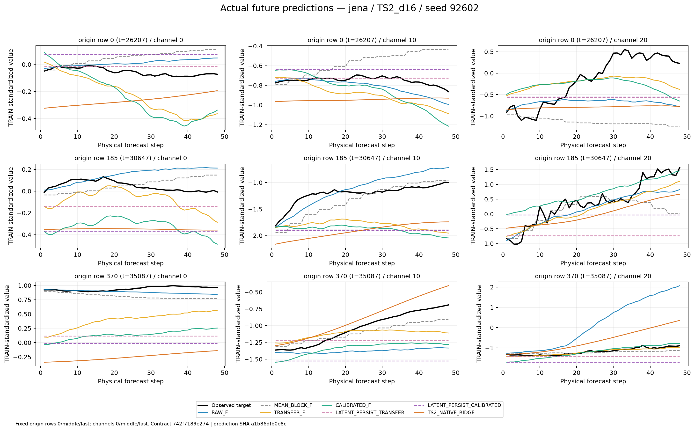

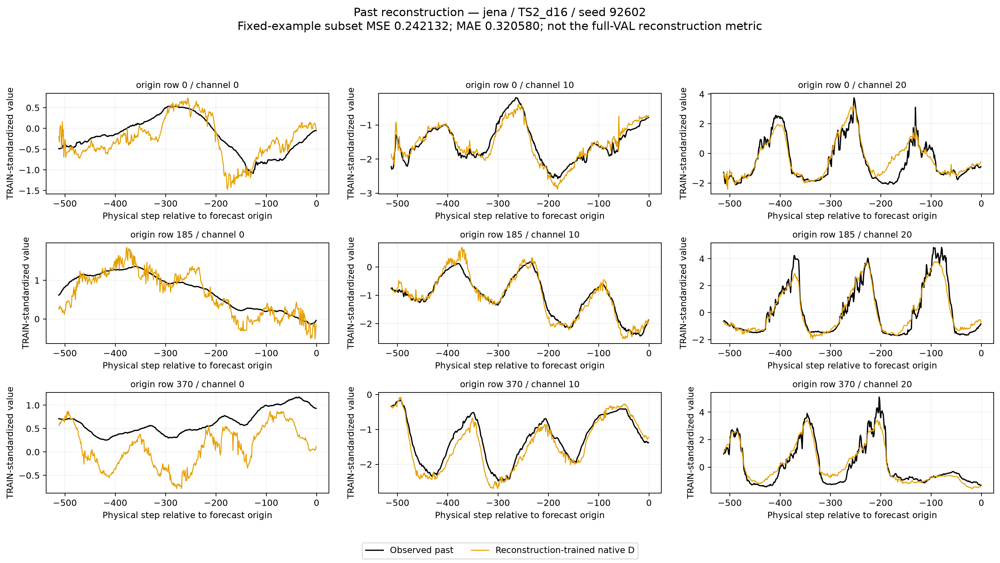

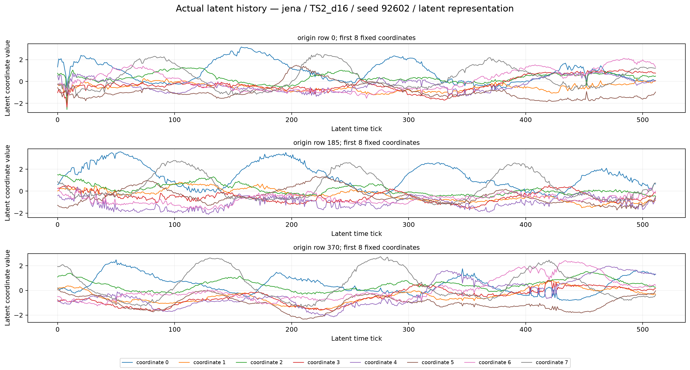

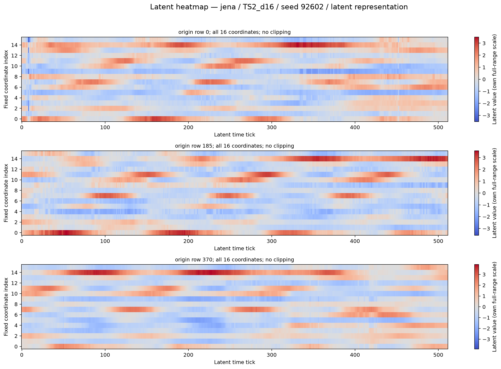

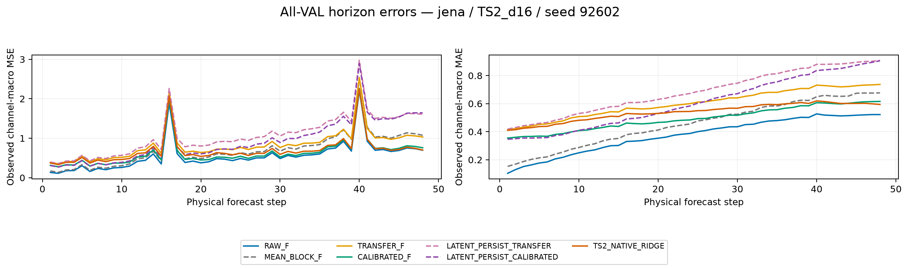

### jena_TS2_d320_s92601_retry_batch4_v4

[actual result](../runs/jena_TS2_d320_s92601_retry_batch4_v4/result.json)

```text
stage                      epochs  selected_epoch  max_epochs  updates   seconds
TS2_encoder                None    None            None        600       58.605055
reconstruction_D           100     100             100         2600      47.969778
forecast_calibration_D     50      47              50          1300      12.475615
```

[확인] selected checkpoint가 학습 상한에 닿은 단계: reconstruction_D. 이 범위에서 실제 학습은 수행했지만 충분한 수렴을 확인했다고 표시하지 않는다.

실제 shape:

```json
{
  "past": [
    512,
    21
  ],
  "latent": [
    512,
    320
  ],
  "latent_future": [
    48,
    320
  ],
  "output": [
    48,
    21
  ],
  "input_scalar_count_per_origin": 10752,
  "latent_scalar_count_per_origin": 163840,
  "F_rows_per_origin": 320,
  "F_context_length": 512,
  "physical_future_horizon": 48,
  "temporal_downsampling": 1,
  "representation_category": "expansion",
  "online_encoder_residence_during_inference": "CPU frozen, separate full SWA encoder on CUDA",
  "decoder_parameters": 43797,
  "prototype_resident_decoder_copies": 2,
  "deployment_transfer": "official NumPy encode includes D2H input, H2D encoder, D2H repr and H2D F; costs include these transfers"
}
```

기록된 실제 비용:

```json
[
  {
    "method": "TRANSFER_F",
    "batch": 1,
    "distinct_origins": 1,
    "fixture_origin_positions": [
      0
    ],
    "warmup": 3,
    "timed": 10,
    "seconds": [
      0.07903330004774034,
      0.07492960011586547,
      0.0687639000825584,
      0.0685887997969985,
      0.07089500012807548,
      0.0685850998852402,
      0.0804419000633061,
      0.07865729997865856,
      0.06744159990921617,
      0.06590920011512935
    ],
    "p50_ms": 69.82945010531694,
    "p95_ms": 79.8080300563015,
    "first_forward_seconds": 0.08158100000582635,
    "peak_cuda_allocated_bytes": 358319616,
    "peak_cuda_reserved_bytes": 8594128896,
    "sampled_process_rss_bytes": 2967109632,
    "prediction_parity_max_abs": 9.5367431640625e-07,
    "memory_scope": "reset before parity/3warm/10timed; all currently resident prototype modules",
    "boundary": "preloaded physical FP32 past -> CPU normalization -> H2D -> entire method -> D2H -> CUDA sync",
    "excluded": "startup, model load, file I/O, window extraction, scoring",
    "device": "NVIDIA GeForce RTX 4070",
    "precision": "FP32, no AMP, TF32 disabled"
  },
  {
    "method": "TRANSFER_F",
    "batch": 32,
    "distinct_origins": 32,
    "fixture_origin_positions": [
      0,
      1,
      2,
      3,
      4,
      5,
      6,
      7,
      8,
      9,
      10,
      11,
      12,
      13,
      14,
      15,
      16,
      17,
      18,
      19,
      20,
      21,
      22,
      23,
      24,
      25,
      26,
      27,
      28,
      29,
      30,
      31
    ],
    "warmup": 3,
    "timed": 10,
    "seconds": [
      1.943524699890986,
      1.9275142999831587,
      1.9442407002206892,
      1.9731252000201494,
      1.9761071000248194,
      1.9476187999825925,
      1.948003500001505,
      1.9425778998993337,
      1.9494423000141978,
      1.9861333000008017
    ],
    "p50_ms": 1947.8111499920487,
    "p95_ms": 1981.6215100116096,
    "first_forward_seconds": 2.1829586001113057,
    "peak_cuda_allocated_bytes": 423975424,
    "peak_cuda_reserved_bytes": 8598323200,
    "sampled_process_rss_bytes": 2992680960,
    "prediction_parity_max_abs": 1.1324882507324219e-06,
    "memory_scope": "reset before parity/3warm/10timed; all currently resident prototype modules",
    "boundary": "preloaded physical FP32 past -> CPU normalization -> H2D -> entire method -> D2H -> CUDA sync",
    "excluded": "startup, model load, file I/O, window extraction, scoring",
    "device": "NVIDIA GeForce RTX 4070",
    "precision": "FP32, no AMP, TF32 disabled"
  },
  {
    "method": "CALIBRATED_F",
    "batch": 1,
    "distinct_origins": 1,
    "fixture_origin_positions": [
      0
    ],
    "warmup": 3,
    "timed": 10,
    "seconds": [
      0.0745514000300318,
      0.06846949993632734,
      0.06869069999083877,
      0.06966949999332428,
      0.06787359993904829,
      0.06984329991973937,
      0.07308460003696382,
      0.06801199982874095,
      0.06778259994462132,
      0.06767490017227829
    ],
    "p50_ms": 68.58009996358305,
    "p95_ms": 73.89134003315121,
    "first_forward_seconds": 0.06966760009527206,
    "peak_cuda_allocated_bytes": 358319616,
    "peak_cuda_reserved_bytes": 8598323200,
    "sampled_process_rss_bytes": 2969346048,
    "prediction_parity_max_abs": 7.152557373046875e-07,
    "memory_scope": "reset before parity/3warm/10timed; all currently resident prototype modules",
    "boundary": "preloaded physical FP32 past -> CPU normalization -> H2D -> entire method -> D2H -> CUDA sync",
    "excluded": "startup, model load, file I/O, window extraction, scoring",
    "device": "NVIDIA GeForce RTX 4070",
    "precision": "FP32, no AMP, TF32 disabled"
  },
  {
    "method": "CALIBRATED_F",
    "batch": 32,
    "distinct_origins": 32,
    "fixture_origin_positions": [
      0,
      1,
      2,
      3,
      4,
      5,
      6,
      7,
      8,
      9,
      10,
      11,
      12,
      13,
      14,
      15,
      16,
      17,
      18,
      19,
      20,
      21,
      22,
      23,
      24,
      25,
      26,
      27,
      28,
      29,
      30,
      31
    ],
    "warmup": 3,
    "timed": 10,
    "seconds": [
      1.9931887001730502,
      1.9506520999129862,
      1.9575026000384241,
      1.9596271999180317,
      1.968394999857992,
      1.9696907000616193,
      1.9880007000174373,
      2.0233897999860346,
      1.9964829999953508,
      1.973492099903524
    ],
    "p50_ms": 1971.5913999825716,
    "p95_ms": 2011.2817399902267,
    "first_forward_seconds": 1.9691251998301595,
    "peak_cuda_allocated_bytes": 423975424,
    "peak_cuda_reserved_bytes": 8598323200,
    "sampled_process_rss_bytes": 2992680960,
    "prediction_parity_max_abs": 1.0728836059570312e-06,
    "memory_scope": "reset before parity/3warm/10timed; all currently resident prototype modules",
    "boundary": "preloaded physical FP32 past -> CPU normalization -> H2D -> entire method -> D2H -> CUDA sync",
    "excluded": "startup, model load, file I/O, window extraction, scoring",
    "device": "NVIDIA GeForce RTX 4070",
    "precision": "FP32, no AMP, TF32 disabled"
  },
  {
    "method": "TS2_NATIVE_RIDGE",
    "batch": 1,
    "distinct_origins": 1,
    "fixture_origin_positions": [
      0
    ],
    "warmup": 3,
    "timed": 10,
    "seconds": [
      0.0017345999367535114,
      0.0018619999755173922,
      0.0021923999302089214,
      0.0020703000482171774,
      0.0019289001356810331,
      0.00191430002450943,
      0.0019308999180793762,
      0.002085799816995859,
      0.002638000063598156,
      0.002507600001990795
    ],
    "p50_ms": 2.000599983148277,
    "p95_ms": 2.5793200358748436,
    "first_forward_seconds": 0.010684299981221557,
    "peak_cuda_allocated_bytes": 216785920,
    "peak_cuda_reserved_bytes": 8598323200,
    "sampled_process_rss_bytes": 2991382528,
    "prediction_parity_max_abs": 4.5299530029296875e-06,
    "memory_scope": "reset before parity/3warm/10timed; all currently resident prototype modules",
    "boundary": "preloaded physical FP32 past -> CPU normalization -> H2D -> entire method -> D2H -> CUDA sync",
    "excluded": "startup, model load, file I/O, window extraction, scoring",
    "device": "NVIDIA GeForce RTX 4070",
    "precision": "FP32, no AMP, TF32 disabled"
  },
  {
    "method": "TS2_NATIVE_RIDGE",
    "batch": 32,
    "distinct_origins": 32,
    "fixture_origin_positions": [
      0,
      1,
      2,
      3,
      4,
      5,
      6,
      7,
      8,
      9,
      10,
      11,
      12,
      13,
      14,
      15,
      16,
      17,
      18,
      19,
      20,
      21,
      22,
      23,
      24,
      25,
      26,
      27,
      28,
      29,
      30,
      31
    ],
    "warmup": 3,
    "timed": 10,
    "seconds": [
      0.003029200015589595,
      0.0034624000545591116,
      0.0034662000834941864,
      0.0033084999304264784,
      0.004525699885562062,
      0.0032770000398159027,
      0.0033331001177430153,
      0.0035896000918000937,
      0.003540199948474765,
      0.0036470999475568533
    ],
    "p50_ms": 3.464300069026649,
    "p95_ms": 4.130329913459717,
    "first_forward_seconds": 0.011191800003871322,
    "peak_cuda_allocated_bytes": 246624768,
    "peak_cuda_reserved_bytes": 8598323200,
    "sampled_process_rss_bytes": 2992766976,
    "prediction_parity_max_abs": 4.0531158447265625e-06,
    "memory_scope": "reset before parity/3warm/10timed; all currently resident prototype modules",
    "boundary": "preloaded physical FP32 past -> CPU normalization -> H2D -> entire method -> D2H -> CUDA sync",
    "excluded": "startup, model load, file I/O, window extraction, scoring",
    "device": "NVIDIA GeForce RTX 4070",
    "precision": "FP32, no AMP, TF32 disabled"
  }
]
```

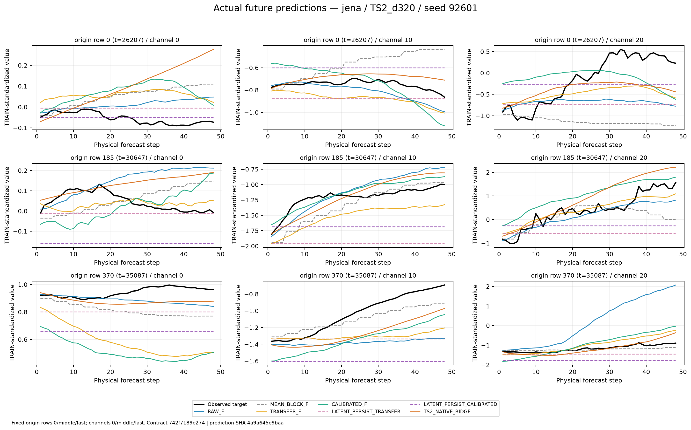

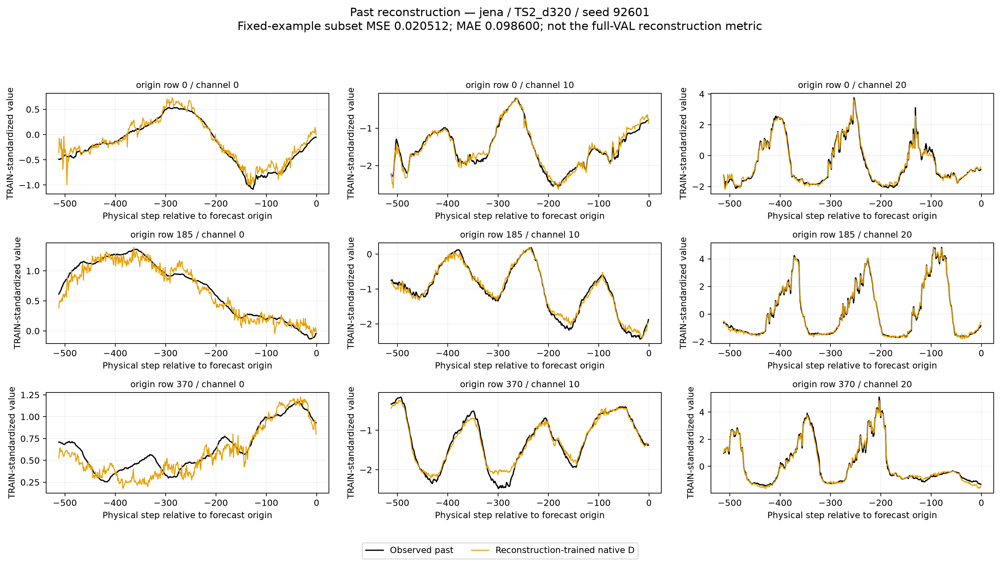

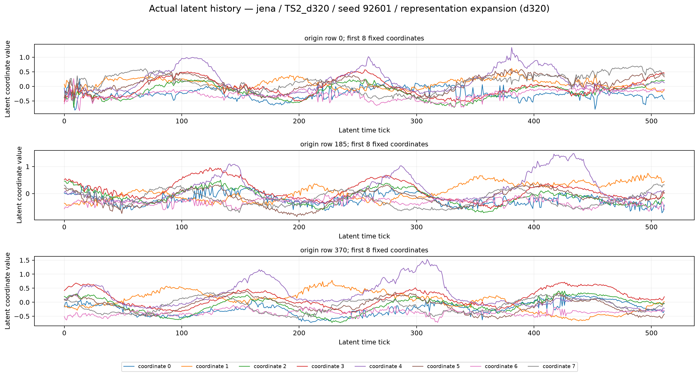

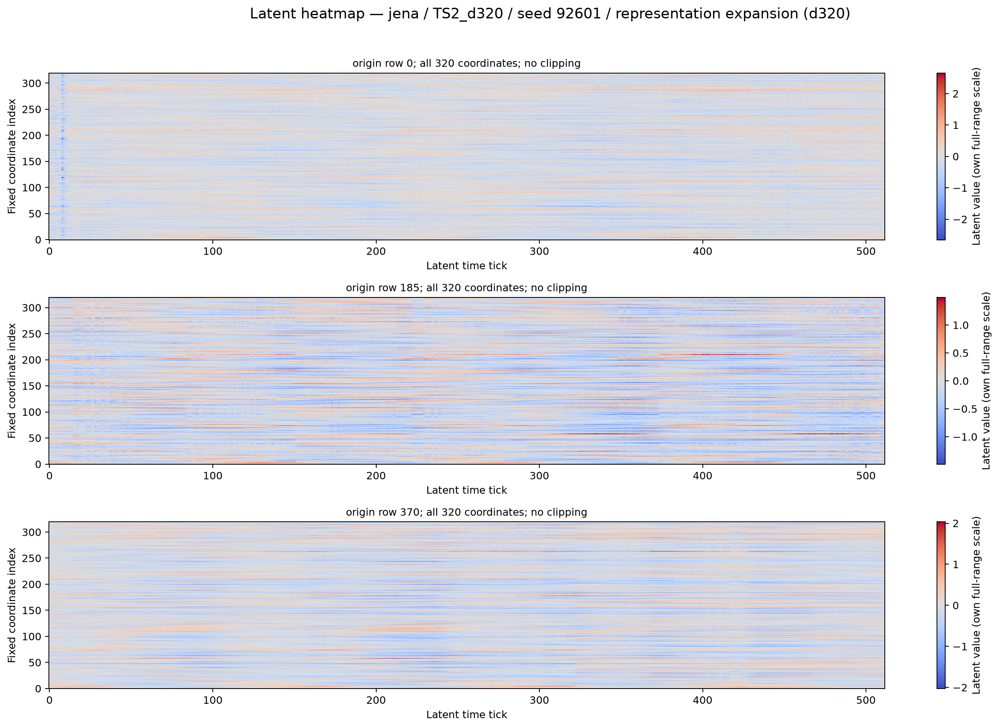

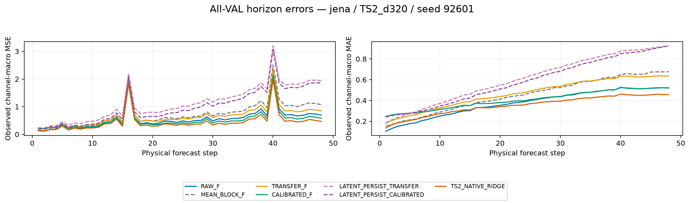

### jena_TS2_d320_s92602_retry_batch4_v4

[actual result](../runs/jena_TS2_d320_s92602_retry_batch4_v4/result.json)

```text
stage                      epochs  selected_epoch  max_epochs  updates   seconds
TS2_encoder                None    None            None        600       62.449345
reconstruction_D           100     100             100         2600      53.453936
forecast_calibration_D     50      47              50          1300      14.813255
```

[확인] selected checkpoint가 학습 상한에 닿은 단계: reconstruction_D. 이 범위에서 실제 학습은 수행했지만 충분한 수렴을 확인했다고 표시하지 않는다.

실제 shape:

```json
{
  "past": [
    512,
    21
  ],
  "latent": [
    512,
    320
  ],
  "latent_future": [
    48,
    320
  ],
  "output": [
    48,
    21
  ],
  "input_scalar_count_per_origin": 10752,
  "latent_scalar_count_per_origin": 163840,
  "F_rows_per_origin": 320,
  "F_context_length": 512,
  "physical_future_horizon": 48,
  "temporal_downsampling": 1,
  "representation_category": "expansion",
  "online_encoder_residence_during_inference": "CPU frozen, separate full SWA encoder on CUDA",
  "decoder_parameters": 43797,
  "prototype_resident_decoder_copies": 2,
  "deployment_transfer": "official NumPy encode includes D2H input, H2D encoder, D2H repr and H2D F; costs include these transfers"
}
```

기록된 실제 비용:

```json
[
  {
    "method": "TRANSFER_F",
    "batch": 1,
    "distinct_origins": 1,
    "fixture_origin_positions": [
      0
    ],
    "warmup": 3,
    "timed": 10,
    "seconds": [
      0.13814790011383593,
      0.13699590018950403,
      0.14479799987748265,
      0.13227719999849796,
      0.13880900014191866,
      0.13456469983793795,
      0.13601319980807602,
      0.12497760006226599,
      0.13545549986883998,
      0.1604261000175029
    ],
    "p50_ms": 136.50454999879003,
    "p95_ms": 153.39345495449376,
    "first_forward_seconds": 0.13756860001012683,
    "peak_cuda_allocated_bytes": 358954496,
    "peak_cuda_reserved_bytes": 12289310720,
    "sampled_process_rss_bytes": 3588399104,
    "prediction_parity_max_abs": 1.430511474609375e-06,
    "memory_scope": "reset before parity/3warm/10timed; all currently resident prototype modules",
    "boundary": "preloaded physical FP32 past -> CPU normalization -> H2D -> entire method -> D2H -> CUDA sync",
    "excluded": "startup, model load, file I/O, window extraction, scoring",
    "device": "NVIDIA GeForce RTX 4070",
    "precision": "FP32, no AMP, TF32 disabled"
  },
  {
    "method": "TRANSFER_F",
    "batch": 32,
    "distinct_origins": 32,
    "fixture_origin_positions": [
      0,
      1,
      2,
      3,
      4,
      5,
      6,
      7,
      8,
      9,
      10,
      11,
      12,
      13,
      14,
      15,
      16,
      17,
      18,
      19,
      20,
      21,
      22,
      23,
      24,
      25,
      26,
      27,
      28,
      29,
      30,
      31
    ],
    "warmup": 3,
    "timed": 10,
    "seconds": [
      4.125388900050893,
      4.156771600013599,
      4.364744700025767,
      4.764851100044325,
      4.412652000086382,
      4.300471300026402,
      4.137491500005126,
      4.161864900030196,
      4.301329999929294,
      4.181825200095773
    ],
    "p50_ms": 4241.148250061087,
    "p95_ms": 4606.361505063251,
    "first_forward_seconds": 4.219894399866462,
    "peak_cuda_allocated_bytes": 424816128,
    "peak_cuda_reserved_bytes": 12293505024,
    "sampled_process_rss_bytes": 3596992512,
    "prediction_parity_max_abs": 1.1920928955078125e-06,
    "memory_scope": "reset before parity/3warm/10timed; all currently resident prototype modules",
    "boundary": "preloaded physical FP32 past -> CPU normalization -> H2D -> entire method -> D2H -> CUDA sync",
    "excluded": "startup, model load, file I/O, window extraction, scoring",
    "device": "NVIDIA GeForce RTX 4070",
    "precision": "FP32, no AMP, TF32 disabled"
  },
  {
    "method": "CALIBRATED_F",
    "batch": 1,
    "distinct_origins": 1,
    "fixture_origin_positions": [
      0
    ],
    "warmup": 3,
    "timed": 10,
    "seconds": [
      0.14061110001057386,
      0.12446720013394952,
      0.12753319996409118,
      0.14245059993118048,
      0.143231000052765,
      0.13549939985387027,
      0.14408709993585944,
      0.13607610017061234,
      0.13062930013984442,
      0.12412740010768175
    ],
    "p50_ms": 135.7877500122413,
    "p95_ms": 143.70185498846695,
    "first_forward_seconds": 0.1486137001775205,
    "peak_cuda_allocated_bytes": 358954496,
    "peak_cuda_reserved_bytes": 12293505024,
    "sampled_process_rss_bytes": 3590631424,
    "prediction_parity_max_abs": 1.0728836059570312e-06,
    "memory_scope": "reset before parity/3warm/10timed; all currently resident prototype modules",
    "boundary": "preloaded physical FP32 past -> CPU normalization -> H2D -> entire method -> D2H -> CUDA sync",
    "excluded": "startup, model load, file I/O, window extraction, scoring",
    "device": "NVIDIA GeForce RTX 4070",
    "precision": "FP32, no AMP, TF32 disabled"
  },
  {
    "method": "CALIBRATED_F",
    "batch": 32,
    "distinct_origins": 32,
    "fixture_origin_positions": [
      0,
      1,
      2,
      3,
      4,
      5,
      6,
      7,
      8,
      9,
      10,
      11,
      12,
      13,
      14,
      15,
      16,
      17,
      18,
      19,
      20,
      21,
      22,
      23,
      24,
      25,
      26,
      27,
      28,
      29,
      30,
      31
    ],
    "warmup": 3,
    "timed": 10,
    "seconds": [
      4.206510299816728,
      4.127979000099003,
      4.109804400010034,
      4.202894400106743,
      4.173865600023419,
      4.17315120017156,
      4.1664877000730485,
      4.192210000008345,
      4.150826700031757,
      4.162441899999976
    ],
    "p50_ms": 4169.819450122304,
    "p95_ms": 4204.8831449472345,
    "first_forward_seconds": 4.3508260999806225,
    "peak_cuda_allocated_bytes": 424816128,
    "peak_cuda_reserved_bytes": 12293505024,
    "sampled_process_rss_bytes": 3597086720,
    "prediction_parity_max_abs": 9.5367431640625e-07,
    "memory_scope": "reset before parity/3warm/10timed; all currently resident prototype modules",
    "boundary": "preloaded physical FP32 past -> CPU normalization -> H2D -> entire method -> D2H -> CUDA sync",
    "excluded": "startup, model load, file I/O, window extraction, scoring",
    "device": "NVIDIA GeForce RTX 4070",
    "precision": "FP32, no AMP, TF32 disabled"
  },
  {
    "method": "TS2_NATIVE_RIDGE",
    "batch": 1,
    "distinct_origins": 1,
    "fixture_origin_positions": [
      0
    ],
    "warmup": 3,
    "timed": 10,
    "seconds": [
      0.002804399933665991,
      0.0022144000977277756,
      0.0022388999350368977,
      0.0021045999601483345,
      0.001898299902677536,
      0.002329999813809991,
      0.0030247000977396965,
      0.001961600035429001,
      0.0024486000183969736,
      0.0018675001338124275
    ],
    "p50_ms": 2.2266500163823366,
    "p95_ms": 2.925565023906529,
    "first_forward_seconds": 0.012315500061959028,
    "peak_cuda_allocated_bytes": 217626624,
    "peak_cuda_reserved_bytes": 12293505024,
    "sampled_process_rss_bytes": 3595784192,
    "prediction_parity_max_abs": 4.664063453674316e-06,
    "memory_scope": "reset before parity/3warm/10timed; all currently resident prototype modules",
    "boundary": "preloaded physical FP32 past -> CPU normalization -> H2D -> entire method -> D2H -> CUDA sync",
    "excluded": "startup, model load, file I/O, window extraction, scoring",
    "device": "NVIDIA GeForce RTX 4070",
    "precision": "FP32, no AMP, TF32 disabled"
  },
  {
    "method": "TS2_NATIVE_RIDGE",
    "batch": 32,
    "distinct_origins": 32,
    "fixture_origin_positions": [
      0,
      1,
      2,
      3,
      4,
      5,
      6,
      7,
      8,
      9,
      10,
      11,
      12,
      13,
      14,
      15,
      16,
      17,
      18,
      19,
      20,
      21,
      22,
      23,
      24,
      25,
      26,
      27,
      28,
      29,
      30,
      31
    ],
    "warmup": 3,
    "timed": 10,
    "seconds": [
      0.0031620000954717398,
      0.00413080002181232,
      0.005395399872213602,
      0.003952699946239591,
      0.004548999946564436,
      0.005919199902564287,
      0.005091400118544698,
      0.005467799957841635,
      0.003972399979829788,
      0.007188000017777085
    ],
    "p50_ms": 4.820200032554567,
    "p95_ms": 6.617039965931324,
    "first_forward_seconds": 0.012602200033143163,
    "peak_cuda_allocated_bytes": 246613504,
    "peak_cuda_reserved_bytes": 12293505024,
    "sampled_process_rss_bytes": 3598548992,
    "prediction_parity_max_abs": 9.775161743164062e-06,
    "memory_scope": "reset before parity/3warm/10timed; all currently resident prototype modules",
    "boundary": "preloaded physical FP32 past -> CPU normalization -> H2D -> entire method -> D2H -> CUDA sync",
    "excluded": "startup, model load, file I/O, window extraction, scoring",
    "device": "NVIDIA GeForce RTX 4070",
    "precision": "FP32, no AMP, TF32 disabled"
  }
]
```

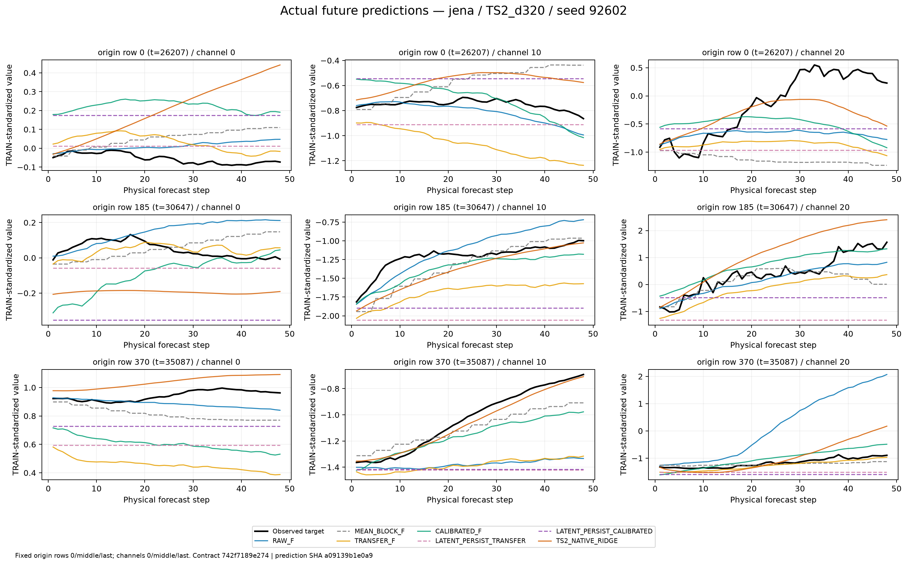

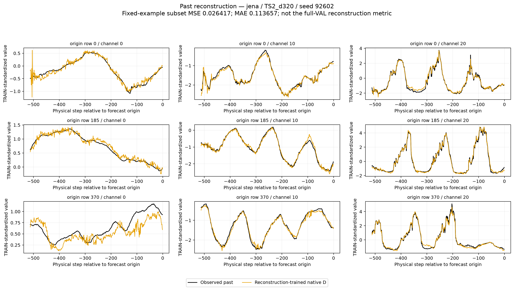

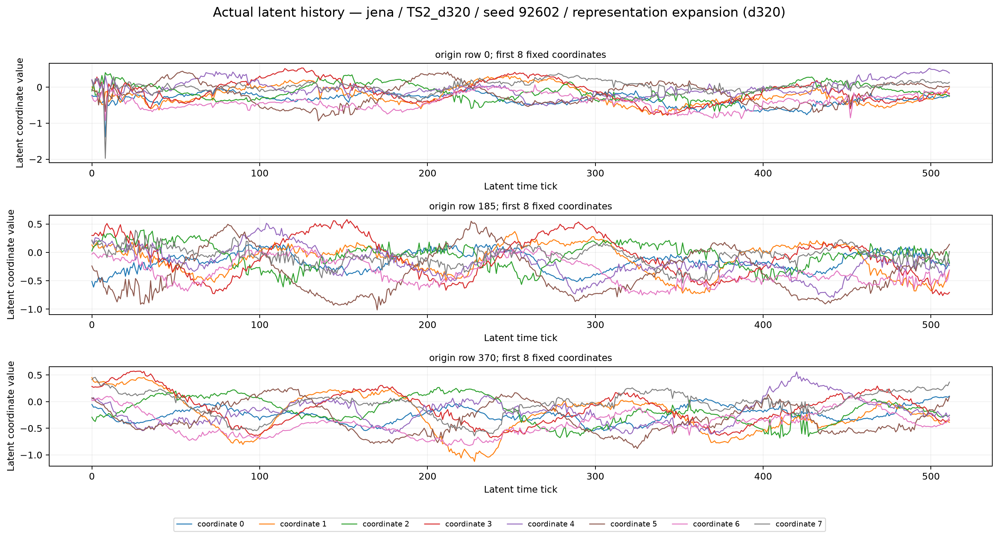

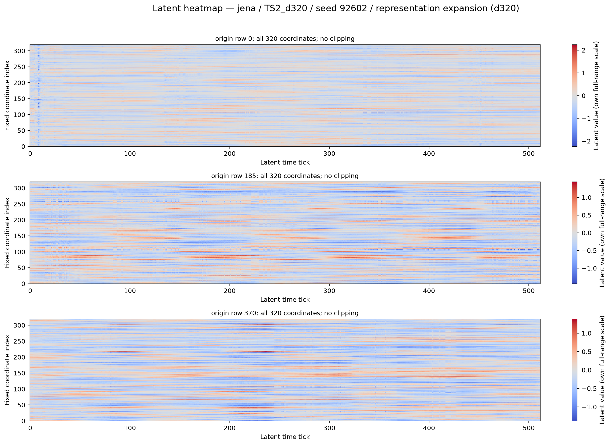

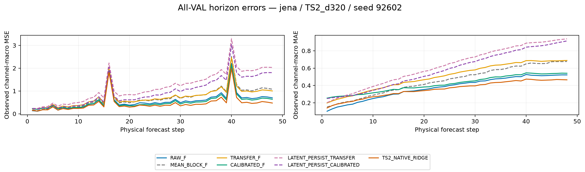

### robin_GT_full_s92601

[actual result](../runs/robin_GT_full_s92601/result.json)

```text
stage                      epochs  selected_epoch  max_epochs  updates   seconds
joint_GT_E_D               100     100             100         200       7.311047
forecast_calibration_D     50      50              50          100       1.309015
```

[확인] selected checkpoint가 학습 상한에 닿은 단계: joint_GT_E_D, forecast_calibration_D. 이 범위에서 실제 학습은 수행했지만 충분한 수렴을 확인했다고 표시하지 않는다.

실제 shape:

```json
{
  "input": [
    512,
    17,
    1
  ],
  "latent": [
    128,
    17,
    2
  ],
  "F_input_rows_per_origin": 34,
  "F_context_length": 128,
  "F_future_length": 12,
  "native_D_output": [
    48,
    17
  ],
  "input_scalars": 8704,
  "latent_scalars": 4352,
  "latent_scalar_ratio": 0.5,
  "alignment": {
    "history_length": 512,
    "history_latent_ticks": 128,
    "physical_horizon": 48,
    "future_latent_ticks": 12,
    "encoder_tick_j_block": "[4*j,4*j+3]; representative timestamp 4*j+3",
    "decoder_zero_insert_phase": "right edge at each factor-two stage (Eq8 one-based t=kr)",
    "forecast_crop_start": 512,
    "forecast_crop_stop_exclusive": 560,
    "target_padding": false,
    "future_blocks": [
      {
        "future_latent_tick_zero_based": 0,
        "physical_block_indices_zero_based": [
          512,
          515
        ],
        "representative_timestamp_zero_based": 515,
        "forecast_target_indices_zero_based": [
          0,
          3
        ]
      },
      {
        "future_latent_tick_zero_based": 1,
        "physical_block_indices_zero_based": [
          516,
          519
        ],
        "representative_timestamp_zero_based": 519,
        "forecast_target_indices_zero_based": [
          4,
          7
        ]
      },
      {
        "future_latent_tick_zero_based": 2,
        "physical_block_indices_zero_based": [
          520,
          523
        ],
        "representative_timestamp_zero_based": 523,
        "forecast_target_indices_zero_based": [
          8,
          11
        ]
      },
      {
        "future_latent_tick_zero_based": 3,
        "physical_block_indices_zero_based": [
          524,
          527
        ],
        "representative_timestamp_zero_based": 527,
        "forecast_target_indices_zero_based": [
          12,
          15
        ]
      },
      {
        "future_latent_tick_zero_based": 4,
        "physical_block_indices_zero_based": [
          528,
          531
        ],
        "representative_timestamp_zero_based": 531,
        "forecast_target_indices_zero_based": [
          16,
          19
        ]
      },
      {
        "future_latent_tick_zero_based": 5,
        "physical_block_indices_zero_based": [
          532,
          535
        ],
        "representative_timestamp_zero_based": 535,
        "forecast_target_indices_zero_based": [
          20,
          23
        ]
      },
      {
        "future_latent_tick_zero_based": 6,
        "physical_block_indices_zero_based": [
          536,
          539
        ],
        "representative_timestamp_zero_based": 539,
        "forecast_target_indices_zero_based": [
          24,
          27
        ]
      },
      {
        "future_latent_tick_zero_based": 7,
        "physical_block_indices_zero_based": [
          540,
          543
        ],
        "representative_timestamp_zero_based": 543,
        "forecast_target_indices_zero_based": [
          28,
          31
        ]
      },
      {
        "future_latent_tick_zero_based": 8,
        "physical_block_indices_zero_based": [
          544,
          547
        ],
        "representative_timestamp_zero_based": 547,
        "forecast_target_indices_zero_based": [
          32,
          35
        ]
      },
      {
        "future_latent_tick_zero_based": 9,
        "physical_block_indices_zero_based": [
          548,
          551
        ],
        "representative_timestamp_zero_based": 551,
        "forecast_target_indices_zero_based": [
          36,
          39
        ]
      },
      {
        "future_latent_tick_zero_based": 10,
        "physical_block_indices_zero_based": [
          552,
          555
        ],
        "representative_timestamp_zero_based": 555,
        "forecast_target_indices_zero_based": [
          40,
          43
        ]
      },
      {
        "future_latent_tick_zero_based": 11,
        "physical_block_indices_zero_based": [
          556,
          559
        ],
        "representative_timestamp_zero_based": 559,
        "forecast_target_indices_zero_based": [
          44,
          47
        ]
      }
    ]
  }
}
```

기록된 실제 비용:

```json
[
  {
    "method": "TRANSFER_F",
    "batch": 1,
    "distinct_origins": 1,
    "fixture_origin_positions": [
      0
    ],
    "warmup": 3,
    "timed": 10,
    "seconds": [
      0.015973599860444665,
      0.01575829996727407,
      0.016813900088891387,
      0.016645600087940693,
      0.015895300079137087,
      0.015699600102379918,
      0.01809019991196692,
      0.01671550003811717,
      0.015605600085109472,
      0.016766699962317944
    ],
    "p50_ms": 16.30959997419268,
    "p95_ms": 17.51586499158293,
    "first_forward_seconds": 0.015393600100651383,
    "peak_cuda_allocated_bytes": 221046272,
    "peak_cuda_reserved_bytes": 278921216,
    "sampled_process_rss_bytes": 1553866752,
    "prediction_parity_max_abs": 3.725290298461914e-08,
    "memory_scope": "reset before parity/3warm/10timed; all currently resident prototype modules",
    "boundary": "preloaded physical FP32 past -> CPU normalization -> H2D -> entire method -> D2H -> CUDA sync",
    "excluded": "startup, model load, file I/O, window extraction, scoring",
    "device": "NVIDIA GeForce RTX 4070",
    "precision": "FP32, no AMP, TF32 disabled"
  },
  {
    "method": "TRANSFER_F",
    "batch": 32,
    "distinct_origins": 30,
    "fixture_origin_positions": [
      0,
      1,
      2,
      3,
      4,
      5,
      6,
      7,
      8,
      9,
      10,
      11,
      12,
      13,
      14,
      15,
      16,
      17,
      18,
      19,
      20,
      21,
      22,
      23,
      24,
      25,
      26,
      27,
      28,
      29,
      0,
      1
    ],
    "warmup": 3,
    "timed": 10,
    "seconds": [
      0.11269310000352561,
      0.11473759985528886,
      0.10976489982567728,
      0.1122167999856174,
      0.11731650005094707,
      0.11857150006107986,
      0.12158040003851056,
      0.11873710015788674,
      0.11858650017529726,
      0.11705200001597404
    ],
    "p50_ms": 117.18425003346056,
    "p95_ms": 120.30091509222984,
    "first_forward_seconds": 0.12811430008150637,
    "peak_cuda_allocated_bytes": 306493952,
    "peak_cuda_reserved_bytes": 341835776,
    "sampled_process_rss_bytes": 1555124224,
    "prediction_parity_max_abs": 1.4901161193847656e-07,
    "memory_scope": "reset before parity/3warm/10timed; all currently resident prototype modules",
    "boundary": "preloaded physical FP32 past -> CPU normalization -> H2D -> entire method -> D2H -> CUDA sync",
    "excluded": "startup, model load, file I/O, window extraction, scoring",
    "device": "NVIDIA GeForce RTX 4070",
    "precision": "FP32, no AMP, TF32 disabled"
  },
  {
    "method": "CALIBRATED_F",
    "batch": 1,
    "distinct_origins": 1,
    "fixture_origin_positions": [
      0
    ],
    "warmup": 3,
    "timed": 10,
    "seconds": [
      0.015350000001490116,
      0.01585459988564253,
      0.014577199937775731,
      0.0166680000256747,
      0.015238200081512332,
      0.01463850005529821,
      0.014910600148141384,
      0.01695499988272786,
      0.016169599955901504,
      0.01547870016656816
    ],
    "p50_ms": 15.414350084029138,
    "p95_ms": 16.82584994705394,
    "first_forward_seconds": 0.018139999825507402,
    "peak_cuda_allocated_bytes": 221046272,
    "peak_cuda_reserved_bytes": 341835776,
    "sampled_process_rss_bytes": 1554055168,
    "prediction_parity_max_abs": 2.60770320892334e-08,
    "memory_scope": "reset before parity/3warm/10timed; all currently resident prototype modules",
    "boundary": "preloaded physical FP32 past -> CPU normalization -> H2D -> entire method -> D2H -> CUDA sync",
    "excluded": "startup, model load, file I/O, window extraction, scoring",
    "device": "NVIDIA GeForce RTX 4070",
    "precision": "FP32, no AMP, TF32 disabled"
  },
  {
    "method": "CALIBRATED_F",
    "batch": 32,
    "distinct_origins": 30,
    "fixture_origin_positions": [
      0,
      1,
      2,
      3,
      4,
      5,
      6,
      7,
      8,
      9,
      10,
      11,
      12,
      13,
      14,
      15,
      16,
      17,
      18,
      19,
      20,
      21,
      22,
      23,
      24,
      25,
      26,
      27,
      28,
      29,
      0,
      1
    ],
    "warmup": 3,
    "timed": 10,
    "seconds": [
      0.11954199988394976,
      0.11401999997906387,
      0.11353820003569126,
      0.11313099996186793,
      0.11522800009697676,
      0.11540200002491474,
      0.11499040015041828,
      0.11799679999239743,
      0.11567270010709763,
      0.11955820000730455
    ],
    "p50_ms": 115.31500006094575,
    "p95_ms": 119.55090995179489,
    "first_forward_seconds": 0.11554360017180443,
    "peak_cuda_allocated_bytes": 306493952,
    "peak_cuda_reserved_bytes": 341835776,
    "sampled_process_rss_bytes": 1555177472,
    "prediction_parity_max_abs": 1.7881393432617188e-07,
    "memory_scope": "reset before parity/3warm/10timed; all currently resident prototype modules",
    "boundary": "preloaded physical FP32 past -> CPU normalization -> H2D -> entire method -> D2H -> CUDA sync",
    "excluded": "startup, model load, file I/O, window extraction, scoring",
    "device": "NVIDIA GeForce RTX 4070",
    "precision": "FP32, no AMP, TF32 disabled"
  }
]
```

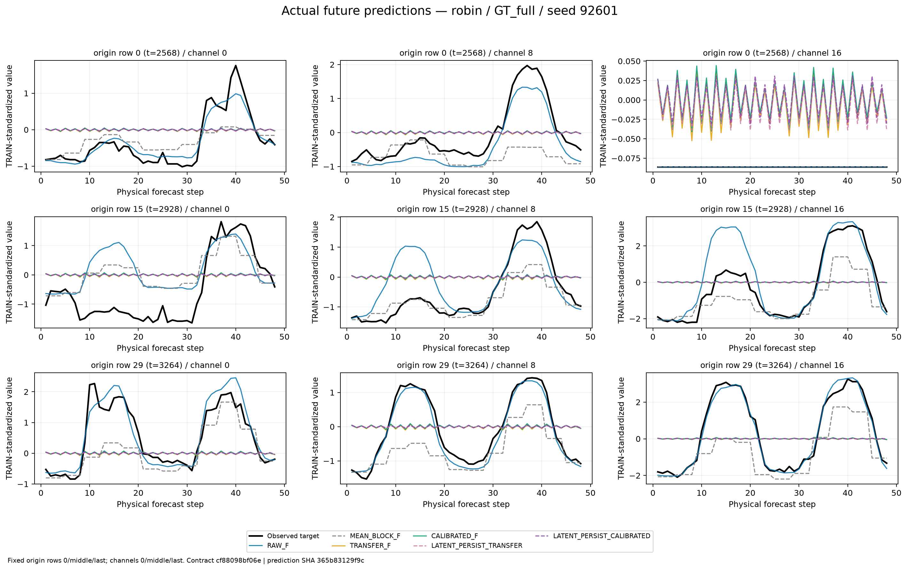

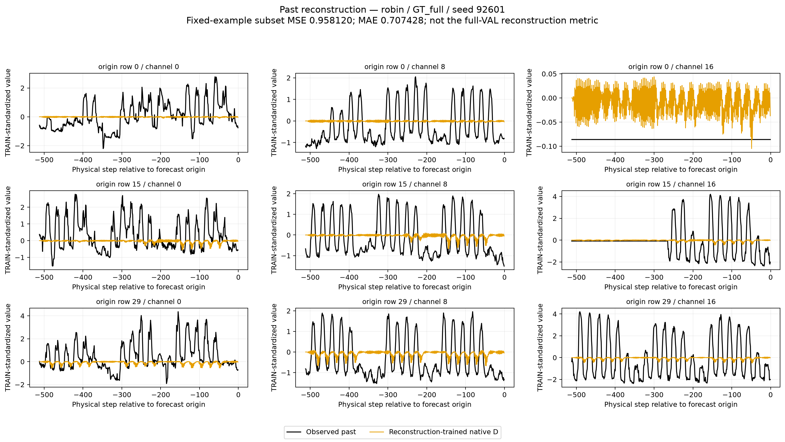

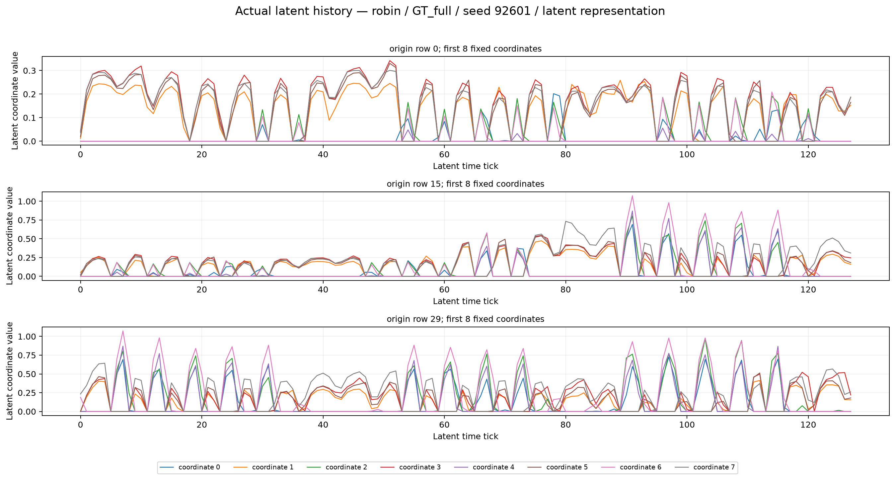

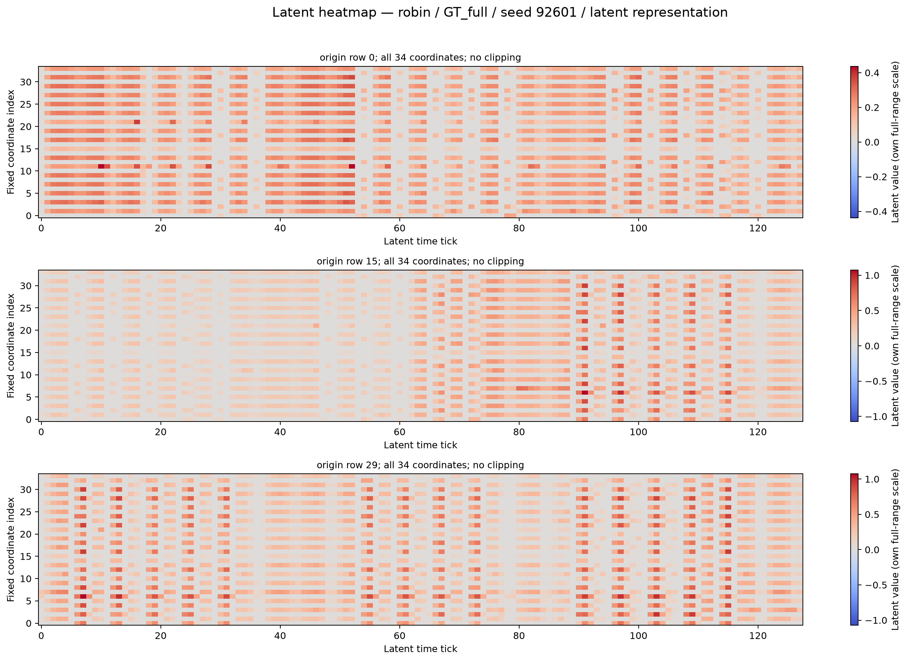

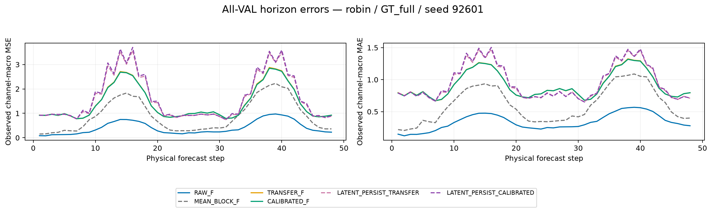

### robin_GT_full_s92602

[actual result](../runs/robin_GT_full_s92602/result.json)

```text
stage                      epochs  selected_epoch  max_epochs  updates   seconds
joint_GT_E_D               100     100             100         200       8.686939
forecast_calibration_D     50      50              50          100       1.663908
```

[확인] selected checkpoint가 학습 상한에 닿은 단계: joint_GT_E_D, forecast_calibration_D. 이 범위에서 실제 학습은 수행했지만 충분한 수렴을 확인했다고 표시하지 않는다.

실제 shape:

```json
{
  "input": [
    512,
    17,
    1
  ],
  "latent": [
    128,
    17,
    2
  ],
  "F_input_rows_per_origin": 34,
  "F_context_length": 128,
  "F_future_length": 12,
  "native_D_output": [
    48,
    17
  ],
  "input_scalars": 8704,
  "latent_scalars": 4352,
  "latent_scalar_ratio": 0.5,
  "alignment": {
    "history_length": 512,
    "history_latent_ticks": 128,
    "physical_horizon": 48,
    "future_latent_ticks": 12,
    "encoder_tick_j_block": "[4*j,4*j+3]; representative timestamp 4*j+3",
    "decoder_zero_insert_phase": "right edge at each factor-two stage (Eq8 one-based t=kr)",
    "forecast_crop_start": 512,
    "forecast_crop_stop_exclusive": 560,
    "target_padding": false,
    "future_blocks": [
      {
        "future_latent_tick_zero_based": 0,
        "physical_block_indices_zero_based": [
          512,
          515
        ],
        "representative_timestamp_zero_based": 515,
        "forecast_target_indices_zero_based": [
          0,
          3
        ]
      },
      {
        "future_latent_tick_zero_based": 1,
        "physical_block_indices_zero_based": [
          516,
          519
        ],
        "representative_timestamp_zero_based": 519,
        "forecast_target_indices_zero_based": [
          4,
          7
        ]
      },
      {
        "future_latent_tick_zero_based": 2,
        "physical_block_indices_zero_based": [
          520,
          523
        ],
        "representative_timestamp_zero_based": 523,
        "forecast_target_indices_zero_based": [
          8,
          11
        ]
      },
      {
        "future_latent_tick_zero_based": 3,
        "physical_block_indices_zero_based": [
          524,
          527
        ],
        "representative_timestamp_zero_based": 527,
        "forecast_target_indices_zero_based": [
          12,
          15
        ]
      },
      {
        "future_latent_tick_zero_based": 4,
        "physical_block_indices_zero_based": [
          528,
          531
        ],
        "representative_timestamp_zero_based": 531,
        "forecast_target_indices_zero_based": [
          16,
          19
        ]
      },
      {
        "future_latent_tick_zero_based": 5,
        "physical_block_indices_zero_based": [
          532,
          535
        ],
        "representative_timestamp_zero_based": 535,
        "forecast_target_indices_zero_based": [
          20,
          23
        ]
      },
      {
        "future_latent_tick_zero_based": 6,
        "physical_block_indices_zero_based": [
          536,
          539
        ],
        "representative_timestamp_zero_based": 539,
        "forecast_target_indices_zero_based": [
          24,
          27
        ]
      },
      {
        "future_latent_tick_zero_based": 7,
        "physical_block_indices_zero_based": [
          540,
          543
        ],
        "representative_timestamp_zero_based": 543,
        "forecast_target_indices_zero_based": [
          28,
          31
        ]
      },
      {
        "future_latent_tick_zero_based": 8,
        "physical_block_indices_zero_based": [
          544,
          547
        ],
        "representative_timestamp_zero_based": 547,
        "forecast_target_indices_zero_based": [
          32,
          35
        ]
      },
      {
        "future_latent_tick_zero_based": 9,
        "physical_block_indices_zero_based": [
          548,
          551
        ],
        "representative_timestamp_zero_based": 551,
        "forecast_target_indices_zero_based": [
          36,
          39
        ]
      },
      {
        "future_latent_tick_zero_based": 10,
        "physical_block_indices_zero_based": [
          552,
          555
        ],
        "representative_timestamp_zero_based": 555,
        "forecast_target_indices_zero_based": [
          40,
          43
        ]
      },
      {
        "future_latent_tick_zero_based": 11,
        "physical_block_indices_zero_based": [
          556,
          559
        ],
        "representative_timestamp_zero_based": 559,
        "forecast_target_indices_zero_based": [
          44,
          47
        ]
      }
    ]
  }
}
```

기록된 실제 비용:

```json
[
  {
    "method": "TRANSFER_F",
    "batch": 1,
    "distinct_origins": 1,
    "fixture_origin_positions": [
      0
    ],
    "warmup": 3,
    "timed": 10,
    "seconds": [
      0.016637299908325076,
      0.017118699848651886,
      0.018014400033280253,
      0.015871400013566017,
      0.015599299920722842,
      0.015966499922797084,
      0.01756539987400174,
      0.015911699971184134,
      0.01623829989694059,
      0.019295800011605024
    ],
    "p50_ms": 16.437799902632833,
    "p95_ms": 18.719170021358877,
    "first_forward_seconds": 0.017481400165706873,
    "peak_cuda_allocated_bytes": 221046272,
    "peak_cuda_reserved_bytes": 278921216,
    "sampled_process_rss_bytes": 1557499904,
    "prediction_parity_max_abs": 4.470348358154297e-08,
    "memory_scope": "reset before parity/3warm/10timed; all currently resident prototype modules",
    "boundary": "preloaded physical FP32 past -> CPU normalization -> H2D -> entire method -> D2H -> CUDA sync",
    "excluded": "startup, model load, file I/O, window extraction, scoring",
    "device": "NVIDIA GeForce RTX 4070",
    "precision": "FP32, no AMP, TF32 disabled"
  },
  {
    "method": "TRANSFER_F",
    "batch": 32,
    "distinct_origins": 30,
    "fixture_origin_positions": [
      0,
      1,
      2,
      3,
      4,
      5,
      6,
      7,
      8,
      9,
      10,
      11,
      12,
      13,
      14,
      15,
      16,
      17,
      18,
      19,
      20,
      21,
      22,
      23,
      24,
      25,
      26,
      27,
      28,
      29,
      0,
      1
    ],
    "warmup": 3,
    "timed": 10,
    "seconds": [
      0.11020269989967346,
      0.11235429998487234,
      0.11093580001033843,
      0.11151499999687076,
      0.11122900014743209,
      0.11386899999342859,
      0.11700809979811311,
      0.11574719985947013,
      0.11550389998592436,
      0.11126290005631745
    ],
    "p50_ms": 111.93464999087155,
    "p95_ms": 116.44069482572377,
    "first_forward_seconds": 0.1426382998470217,
    "peak_cuda_allocated_bytes": 306493952,
    "peak_cuda_reserved_bytes": 341835776,
    "sampled_process_rss_bytes": 1558712320,
    "prediction_parity_max_abs": 7.450580596923828e-08,
    "memory_scope": "reset before parity/3warm/10timed; all currently resident prototype modules",
    "boundary": "preloaded physical FP32 past -> CPU normalization -> H2D -> entire method -> D2H -> CUDA sync",
    "excluded": "startup, model load, file I/O, window extraction, scoring",
    "device": "NVIDIA GeForce RTX 4070",
    "precision": "FP32, no AMP, TF32 disabled"
  },
  {
    "method": "CALIBRATED_F",
    "batch": 1,
    "distinct_origins": 1,
    "fixture_origin_positions": [
      0
    ],
    "warmup": 3,
    "timed": 10,
    "seconds": [
      0.015087799867615104,
      0.015654100105166435,
      0.015835300087928772,
      0.015206800075247884,
      0.01596109988167882,
      0.01564579992555082,
      0.01574149983935058,
      0.01734980009496212,
      0.015568000031635165,
      0.017080799909308553
    ],
    "p50_ms": 15.697799972258508,
    "p95_ms": 17.228750011418015,
    "first_forward_seconds": 0.016345999902114272,
    "peak_cuda_allocated_bytes": 221046272,
    "peak_cuda_reserved_bytes": 341835776,
    "sampled_process_rss_bytes": 1557671936,
    "prediction_parity_max_abs": 4.0978193283081055e-08,
    "memory_scope": "reset before parity/3warm/10timed; all currently resident prototype modules",
    "boundary": "preloaded physical FP32 past -> CPU normalization -> H2D -> entire method -> D2H -> CUDA sync",
    "excluded": "startup, model load, file I/O, window extraction, scoring",
    "device": "NVIDIA GeForce RTX 4070",
    "precision": "FP32, no AMP, TF32 disabled"
  },
  {
    "method": "CALIBRATED_F",
    "batch": 32,
    "distinct_origins": 30,
    "fixture_origin_positions": [
      0,
      1,
      2,
      3,
      4,
      5,
      6,
      7,
      8,
      9,
      10,
      11,
      12,
      13,
      14,
      15,
      16,
      17,
      18,
      19,
      20,
      21,
      22,
      23,
      24,
      25,
      26,
      27,
      28,
      29,
      0,
      1
    ],
    "warmup": 3,
    "timed": 10,
    "seconds": [
      0.11335020000115037,
      0.1162160998210311,
      0.11214639991521835,
      0.1139950999058783,
      0.11325459997169673,
      0.11236679996363819,
      0.11193220014683902,
      0.11729010008275509,
      0.11122349998913705,
      0.11592060001567006
    ],
    "p50_ms": 113.30239998642355,
    "p95_ms": 116.80679996497929,
    "first_forward_seconds": 0.10922089987434447,
    "peak_cuda_allocated_bytes": 306493952,
    "peak_cuda_reserved_bytes": 341835776,
    "sampled_process_rss_bytes": 1558790144,
    "prediction_parity_max_abs": 5.960464477539063e-08,
    "memory_scope": "reset before parity/3warm/10timed; all currently resident prototype modules",
    "boundary": "preloaded physical FP32 past -> CPU normalization -> H2D -> entire method -> D2H -> CUDA sync",
    "excluded": "startup, model load, file I/O, window extraction, scoring",
    "device": "NVIDIA GeForce RTX 4070",
    "precision": "FP32, no AMP, TF32 disabled"
  }
]
```

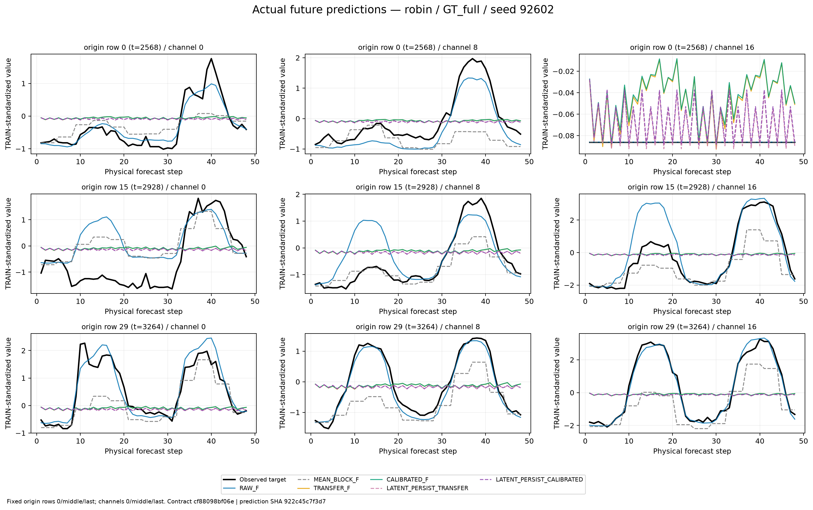

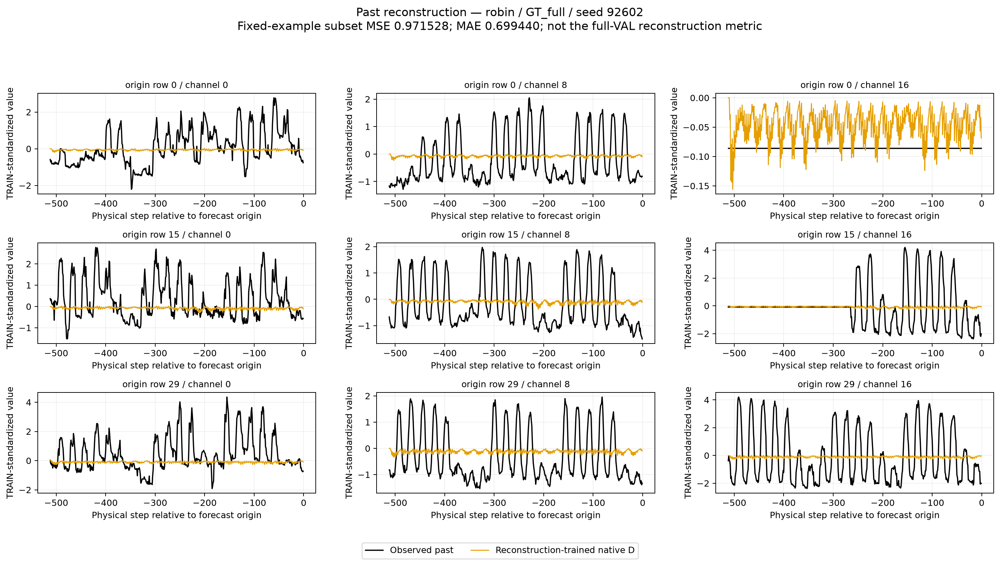

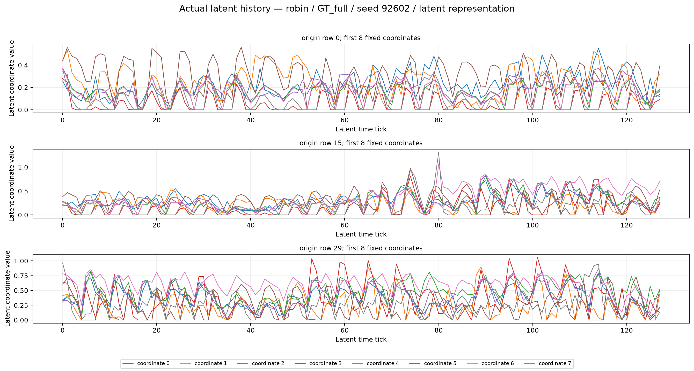

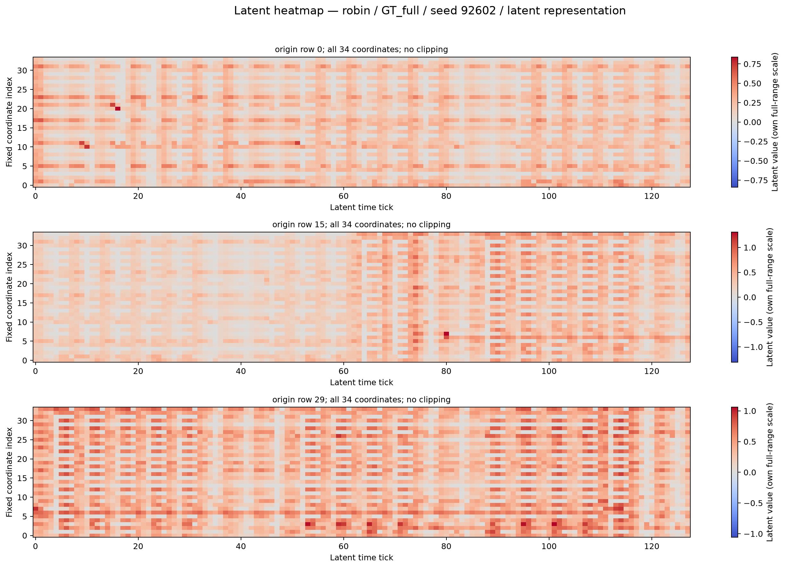

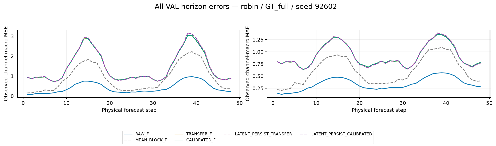

### robin_GT_no_spatial_s92601

[actual result](../runs/robin_GT_no_spatial_s92601/result.json)

```text
stage                      epochs  selected_epoch  max_epochs  updates   seconds
joint_GT_E_D               100     100             100         200       6.286872
forecast_calibration_D     10      0               50          20        0.236815
```

[확인] selected checkpoint가 학습 상한에 닿은 단계: joint_GT_E_D. 이 범위에서 실제 학습은 수행했지만 충분한 수렴을 확인했다고 표시하지 않는다.

실제 shape:

```json
{
  "input": [
    512,
    17,
    1
  ],
  "latent": [
    128,
    17,
    2
  ],
  "F_input_rows_per_origin": 34,
  "F_context_length": 128,
  "F_future_length": 12,
  "native_D_output": [
    48,
    17
  ],
  "input_scalars": 8704,
  "latent_scalars": 4352,
  "latent_scalar_ratio": 0.5,
  "alignment": {
    "history_length": 512,
    "history_latent_ticks": 128,
    "physical_horizon": 48,
    "future_latent_ticks": 12,
    "encoder_tick_j_block": "[4*j,4*j+3]; representative timestamp 4*j+3",
    "decoder_zero_insert_phase": "right edge at each factor-two stage (Eq8 one-based t=kr)",
    "forecast_crop_start": 512,
    "forecast_crop_stop_exclusive": 560,
    "target_padding": false,
    "future_blocks": [
      {
        "future_latent_tick_zero_based": 0,
        "physical_block_indices_zero_based": [
          512,
          515
        ],
        "representative_timestamp_zero_based": 515,
        "forecast_target_indices_zero_based": [
          0,
          3
        ]
      },
      {
        "future_latent_tick_zero_based": 1,
        "physical_block_indices_zero_based": [
          516,
          519
        ],
        "representative_timestamp_zero_based": 519,
        "forecast_target_indices_zero_based": [
          4,
          7
        ]
      },
      {
        "future_latent_tick_zero_based": 2,
        "physical_block_indices_zero_based": [
          520,
          523
        ],
        "representative_timestamp_zero_based": 523,
        "forecast_target_indices_zero_based": [
          8,
          11
        ]
      },
      {
        "future_latent_tick_zero_based": 3,
        "physical_block_indices_zero_based": [
          524,
          527
        ],
        "representative_timestamp_zero_based": 527,
        "forecast_target_indices_zero_based": [
          12,
          15
        ]
      },
      {
        "future_latent_tick_zero_based": 4,
        "physical_block_indices_zero_based": [
          528,
          531
        ],
        "representative_timestamp_zero_based": 531,
        "forecast_target_indices_zero_based": [
          16,
          19
        ]
      },
      {
        "future_latent_tick_zero_based": 5,
        "physical_block_indices_zero_based": [
          532,
          535
        ],
        "representative_timestamp_zero_based": 535,
        "forecast_target_indices_zero_based": [
          20,
          23
        ]
      },
      {
        "future_latent_tick_zero_based": 6,
        "physical_block_indices_zero_based": [
          536,
          539
        ],
        "representative_timestamp_zero_based": 539,
        "forecast_target_indices_zero_based": [
          24,
          27
        ]
      },
      {
        "future_latent_tick_zero_based": 7,
        "physical_block_indices_zero_based": [
          540,
          543
        ],
        "representative_timestamp_zero_based": 543,
        "forecast_target_indices_zero_based": [
          28,
          31
        ]
      },
      {
        "future_latent_tick_zero_based": 8,
        "physical_block_indices_zero_based": [
          544,
          547
        ],
        "representative_timestamp_zero_based": 547,
        "forecast_target_indices_zero_based": [
          32,
          35
        ]
      },
      {
        "future_latent_tick_zero_based": 9,
        "physical_block_indices_zero_based": [
          548,
          551
        ],
        "representative_timestamp_zero_based": 551,
        "forecast_target_indices_zero_based": [
          36,
          39
        ]
      },
      {
        "future_latent_tick_zero_based": 10,
        "physical_block_indices_zero_based": [
          552,
          555
        ],
        "representative_timestamp_zero_based": 555,
        "forecast_target_indices_zero_based": [
          40,
          43
        ]
      },
      {
        "future_latent_tick_zero_based": 11,
        "physical_block_indices_zero_based": [
          556,
          559
        ],
        "representative_timestamp_zero_based": 559,
        "forecast_target_indices_zero_based": [
          44,
          47
        ]
      }
    ]
  }
}
```

기록된 실제 비용:

```json
[
  {
    "method": "TRANSFER_F",
    "batch": 1,
    "distinct_origins": 1,
    "fixture_origin_positions": [
      0
    ],
    "warmup": 3,
    "timed": 10,
    "seconds": [
      0.012733399868011475,
      0.01859369990415871,
      0.01377780013717711,
      0.01455710013397038,
      0.021197800058871508,
      0.015540099935606122,
      0.0140754000749439,
      0.013460800051689148,
      0.017213999992236495,
      0.013923000078648329
    ],
    "p50_ms": 14.31625010445714,
    "p95_ms": 20.025954989250746,
    "first_forward_seconds": 0.016419999999925494,
    "peak_cuda_allocated_bytes": 221569536,
    "peak_cuda_reserved_bytes": 287309824,
    "sampled_process_rss_bytes": 1553166336,
    "prediction_parity_max_abs": 2.419255906715989e-10,
    "memory_scope": "reset before parity/3warm/10timed; all currently resident prototype modules",
    "boundary": "preloaded physical FP32 past -> CPU normalization -> H2D -> entire method -> D2H -> CUDA sync",
    "excluded": "startup, model load, file I/O, window extraction, scoring",
    "device": "NVIDIA GeForce RTX 4070",
    "precision": "FP32, no AMP, TF32 disabled"
  },
  {
    "method": "TRANSFER_F",
    "batch": 32,
    "distinct_origins": 30,
    "fixture_origin_positions": [
      0,
      1,
      2,
      3,
      4,
      5,
      6,
      7,
      8,
      9,
      10,
      11,
      12,
      13,
      14,
      15,
      16,
      17,
      18,
      19,
      20,
      21,
      22,
      23,
      24,
      25,
      26,
      27,
      28,
      29,
      0,
      1
    ],
    "warmup": 3,
    "timed": 10,
    "seconds": [
      0.10873149987310171,
      0.11069189989939332,
      0.11426239996217191,
      0.10861689993180335,
      0.107530000153929,
      0.11156760016456246,
      0.10985190002247691,
      0.10993479983881116,
      0.10764049994759262,
      0.11157980002462864
    ],
    "p50_ms": 109.89334993064404,
    "p95_ms": 113.05522999027744,
    "first_forward_seconds": 0.11244469997473061,
    "peak_cuda_allocated_bytes": 278142464,
    "peak_cuda_reserved_bytes": 308281344,
    "sampled_process_rss_bytes": 1554403328,
    "prediction_parity_max_abs": 1.4624674804508686e-09,
    "memory_scope": "reset before parity/3warm/10timed; all currently resident prototype modules",
    "boundary": "preloaded physical FP32 past -> CPU normalization -> H2D -> entire method -> D2H -> CUDA sync",
    "excluded": "startup, model load, file I/O, window extraction, scoring",
    "device": "NVIDIA GeForce RTX 4070",
    "precision": "FP32, no AMP, TF32 disabled"
  },
  {
    "method": "CALIBRATED_F",
    "batch": 1,
    "distinct_origins": 1,
    "fixture_origin_positions": [
      0
    ],
    "warmup": 3,
    "timed": 10,
    "seconds": [
      0.013324599945917726,
      0.013449899852275848,
      0.014021300012245774,
      0.01341040013357997,
      0.014632700011134148,
      0.01436870009638369,
      0.013302000006660819,
      0.013430400053039193,
      0.013340199831873178,
      0.014133900171145797
    ],
    "p50_ms": 13.44014995265752,
    "p95_ms": 14.513900049496442,
    "first_forward_seconds": 0.013991500018164515,
    "peak_cuda_allocated_bytes": 221569536,
    "peak_cuda_reserved_bytes": 308281344,
    "sampled_process_rss_bytes": 1553416192,
    "prediction_parity_max_abs": 2.419255906715989e-10,
    "memory_scope": "reset before parity/3warm/10timed; all currently resident prototype modules",
    "boundary": "preloaded physical FP32 past -> CPU normalization -> H2D -> entire method -> D2H -> CUDA sync",
    "excluded": "startup, model load, file I/O, window extraction, scoring",
    "device": "NVIDIA GeForce RTX 4070",
    "precision": "FP32, no AMP, TF32 disabled"
  },
  {
    "method": "CALIBRATED_F",
    "batch": 32,
    "distinct_origins": 30,
    "fixture_origin_positions": [
      0,
      1,
      2,
      3,
      4,
      5,
      6,
      7,
      8,
      9,
      10,
      11,
      12,
      13,
      14,
      15,
      16,
      17,
      18,
      19,
      20,
      21,
      22,
      23,
      24,
      25,
      26,
      27,
      28,
      29,
      0,
      1
    ],
    "warmup": 3,
    "timed": 10,
    "seconds": [
      0.10739980009384453,
      0.1071218999568373,
      0.1114303998183459,
      0.10808050003834069,
      0.11060650018043816,
      0.10847870004363358,
      0.11044449987821281,
      0.11703579989261925,
      0.11021469999104738,
      0.10751169989816844
    ],
    "p50_ms": 109.34670001734048,
    "p95_ms": 114.51336985919625,
    "first_forward_seconds": 0.11713840020820498,
    "peak_cuda_allocated_bytes": 277218816,
    "peak_cuda_reserved_bytes": 308281344,
    "sampled_process_rss_bytes": 1554542592,
    "prediction_parity_max_abs": 1.4624674804508686e-09,
    "memory_scope": "reset before parity/3warm/10timed; all currently resident prototype modules",
    "boundary": "preloaded physical FP32 past -> CPU normalization -> H2D -> entire method -> D2H -> CUDA sync",
    "excluded": "startup, model load, file I/O, window extraction, scoring",
    "device": "NVIDIA GeForce RTX 4070",
    "precision": "FP32, no AMP, TF32 disabled"
  }
]
```


### robin_GT_no_spatial_s92602

[actual result](../runs/robin_GT_no_spatial_s92602/result.json)

```text
stage                      epochs  selected_epoch  max_epochs  updates   seconds
joint_GT_E_D               100     100             100         200       6.923662
forecast_calibration_D     50      50              50          100       1.593152
```

[확인] selected checkpoint가 학습 상한에 닿은 단계: joint_GT_E_D, forecast_calibration_D. 이 범위에서 실제 학습은 수행했지만 충분한 수렴을 확인했다고 표시하지 않는다.

실제 shape:

```json
{
  "input": [
    512,
    17,
    1
  ],
  "latent": [
    128,
    17,
    2
  ],
  "F_input_rows_per_origin": 34,
  "F_context_length": 128,
  "F_future_length": 12,
  "native_D_output": [
    48,
    17
  ],
  "input_scalars": 8704,
  "latent_scalars": 4352,
  "latent_scalar_ratio": 0.5,
  "alignment": {
    "history_length": 512,
    "history_latent_ticks": 128,
    "physical_horizon": 48,
    "future_latent_ticks": 12,
    "encoder_tick_j_block": "[4*j,4*j+3]; representative timestamp 4*j+3",
    "decoder_zero_insert_phase": "right edge at each factor-two stage (Eq8 one-based t=kr)",
    "forecast_crop_start": 512,
    "forecast_crop_stop_exclusive": 560,
    "target_padding": false,
    "future_blocks": [
      {
        "future_latent_tick_zero_based": 0,
        "physical_block_indices_zero_based": [
          512,
          515
        ],
        "representative_timestamp_zero_based": 515,
        "forecast_target_indices_zero_based": [
          0,
          3
        ]
      },
      {
        "future_latent_tick_zero_based": 1,
        "physical_block_indices_zero_based": [
          516,
          519
        ],
        "representative_timestamp_zero_based": 519,
        "forecast_target_indices_zero_based": [
          4,
          7
        ]
      },
      {
        "future_latent_tick_zero_based": 2,
        "physical_block_indices_zero_based": [
          520,
          523
        ],
        "representative_timestamp_zero_based": 523,
        "forecast_target_indices_zero_based": [
          8,
          11
        ]
      },
      {
        "future_latent_tick_zero_based": 3,
        "physical_block_indices_zero_based": [
          524,
          527
        ],
        "representative_timestamp_zero_based": 527,
        "forecast_target_indices_zero_based": [
          12,
          15
        ]
      },
      {
        "future_latent_tick_zero_based": 4,
        "physical_block_indices_zero_based": [
          528,
          531
        ],
        "representative_timestamp_zero_based": 531,
        "forecast_target_indices_zero_based": [
          16,
          19
        ]
      },
      {
        "future_latent_tick_zero_based": 5,
        "physical_block_indices_zero_based": [
          532,
          535
        ],
        "representative_timestamp_zero_based": 535,
        "forecast_target_indices_zero_based": [
          20,
          23
        ]
      },
      {
        "future_latent_tick_zero_based": 6,
        "physical_block_indices_zero_based": [
          536,
          539
        ],
        "representative_timestamp_zero_based": 539,
        "forecast_target_indices_zero_based": [
          24,
          27
        ]
      },
      {
        "future_latent_tick_zero_based": 7,
        "physical_block_indices_zero_based": [
          540,
          543
        ],
        "representative_timestamp_zero_based": 543,
        "forecast_target_indices_zero_based": [
          28,
          31
        ]
      },
      {
        "future_latent_tick_zero_based": 8,
        "physical_block_indices_zero_based": [
          544,
          547
        ],
        "representative_timestamp_zero_based": 547,
        "forecast_target_indices_zero_based": [
          32,
          35
        ]
      },
      {
        "future_latent_tick_zero_based": 9,
        "physical_block_indices_zero_based": [
          548,
          551
        ],
        "representative_timestamp_zero_based": 551,
        "forecast_target_indices_zero_based": [
          36,
          39
        ]
      },
      {
        "future_latent_tick_zero_based": 10,
        "physical_block_indices_zero_based": [
          552,
          555
        ],
        "representative_timestamp_zero_based": 555,
        "forecast_target_indices_zero_based": [
          40,
          43
        ]
      },
      {
        "future_latent_tick_zero_based": 11,
        "physical_block_indices_zero_based": [
          556,
          559
        ],
        "representative_timestamp_zero_based": 559,
        "forecast_target_indices_zero_based": [
          44,
          47
        ]
      }
    ]
  }
}
```

기록된 실제 비용:

```json
[
  {
    "method": "TRANSFER_F",
    "batch": 1,
    "distinct_origins": 1,
    "fixture_origin_positions": [
      0
    ],
    "warmup": 3,
    "timed": 10,
    "seconds": [
      0.012525700032711029,
      0.014287600060924888,
      0.014621199807152152,
      0.014505099970847368,
      0.014686400070786476,
      0.01413490017876029,
      0.016076400177553296,
      0.015543699963018298,
      0.015503000002354383,
      0.014223100151866674
    ],
    "p50_ms": 14.56314988899976,
    "p95_ms": 15.836685081012547,
    "first_forward_seconds": 0.014613599982112646,
    "peak_cuda_allocated_bytes": 221569536,
    "peak_cuda_reserved_bytes": 287309824,
    "sampled_process_rss_bytes": 1557659648,
    "prediction_parity_max_abs": 2.0489096641540527e-08,
    "memory_scope": "reset before parity/3warm/10timed; all currently resident prototype modules",
    "boundary": "preloaded physical FP32 past -> CPU normalization -> H2D -> entire method -> D2H -> CUDA sync",
    "excluded": "startup, model load, file I/O, window extraction, scoring",
    "device": "NVIDIA GeForce RTX 4070",
    "precision": "FP32, no AMP, TF32 disabled"
  },
  {
    "method": "TRANSFER_F",
    "batch": 32,
    "distinct_origins": 30,
    "fixture_origin_positions": [
      0,
      1,
      2,
      3,
      4,
      5,
      6,
      7,
      8,
      9,
      10,
      11,
      12,
      13,
      14,
      15,
      16,
      17,
      18,
      19,
      20,
      21,
      22,
      23,
      24,
      25,
      26,
      27,
      28,
      29,
      0,
      1
    ],
    "warmup": 3,
    "timed": 10,
    "seconds": [
      0.1165024999063462,
      0.12188009987585247,
      0.1133177001029253,
      0.1185083999298513,
      0.11340979998931289,
      0.11432030005380511,
      0.11702580004930496,
      0.12046639993786812,
      0.11354990000836551,
      0.12436689995229244
    ],
    "p50_ms": 116.76414997782558,
    "p95_ms": 123.24783991789445,
    "first_forward_seconds": 0.13655270007438958,
    "peak_cuda_allocated_bytes": 278142464,
    "peak_cuda_reserved_bytes": 308281344,
    "sampled_process_rss_bytes": 1558867968,
    "prediction_parity_max_abs": 5.960464477539063e-08,
    "memory_scope": "reset before parity/3warm/10timed; all currently resident prototype modules",
    "boundary": "preloaded physical FP32 past -> CPU normalization -> H2D -> entire method -> D2H -> CUDA sync",
    "excluded": "startup, model load, file I/O, window extraction, scoring",
    "device": "NVIDIA GeForce RTX 4070",
    "precision": "FP32, no AMP, TF32 disabled"
  },
  {
    "method": "CALIBRATED_F",
    "batch": 1,
    "distinct_origins": 1,
    "fixture_origin_positions": [
      0
    ],
    "warmup": 3,
    "timed": 10,
    "seconds": [
      0.012969299918040633,
      0.013430899940431118,
      0.014613500097766519,
      0.014278299873694777,
      0.015293400036171079,
      0.014684600057080388,
      0.015015200013294816,
      0.015254499856382608,
      0.015524999937042594,
      0.014461299870163202
    ],
    "p50_ms": 14.649050077423453,
    "p95_ms": 15.42077998165041,
    "first_forward_seconds": 0.01549010002054274,
    "peak_cuda_allocated_bytes": 221569536,
    "peak_cuda_reserved_bytes": 308281344,
    "sampled_process_rss_bytes": 1557823488,
    "prediction_parity_max_abs": 2.2351741790771484e-08,
    "memory_scope": "reset before parity/3warm/10timed; all currently resident prototype modules",
    "boundary": "preloaded physical FP32 past -> CPU normalization -> H2D -> entire method -> D2H -> CUDA sync",
    "excluded": "startup, model load, file I/O, window extraction, scoring",
    "device": "NVIDIA GeForce RTX 4070",
    "precision": "FP32, no AMP, TF32 disabled"
  },
  {
    "method": "CALIBRATED_F",
    "batch": 32,
    "distinct_origins": 30,
    "fixture_origin_positions": [
      0,
      1,
      2,
      3,
      4,
      5,
      6,
      7,
      8,
      9,
      10,
      11,
      12,
      13,
      14,
      15,
      16,
      17,
      18,
      19,
      20,
      21,
      22,
      23,
      24,
      25,
      26,
      27,
      28,
      29,
      0,
      1
    ],
    "warmup": 3,
    "timed": 10,
    "seconds": [
      0.1129205001052469,
      0.1156314997933805,
      0.11823830008506775,
      0.11422739992849529,
      0.11179309990257025,
      0.11983710015192628,
      0.11819649999961257,
      0.11095779994502664,
      0.1143729998730123,
      0.11445480003021657
    ],
    "p50_ms": 114.41389995161444,
    "p95_ms": 119.11764012183994,
    "first_forward_seconds": 0.11625339998863637,
    "peak_cuda_allocated_bytes": 277218816,
    "peak_cuda_reserved_bytes": 308281344,
    "sampled_process_rss_bytes": 1558949888,
    "prediction_parity_max_abs": 5.960464477539063e-08,
    "memory_scope": "reset before parity/3warm/10timed; all currently resident prototype modules",
    "boundary": "preloaded physical FP32 past -> CPU normalization -> H2D -> entire method -> D2H -> CUDA sync",
    "excluded": "startup, model load, file I/O, window extraction, scoring",
    "device": "NVIDIA GeForce RTX 4070",
    "precision": "FP32, no AMP, TF32 disabled"
  }
]
```


### robin_TS2_d16_s92601_retry_epoch0_v2

[actual result](../runs/robin_TS2_d16_s92601_retry_epoch0_v2/result.json)

```text
stage                      epochs  selected_epoch  max_epochs  updates   seconds
TS2_encoder                None    None            None        200       11.720646
reconstruction_D           100     100             100         200       3.784554
forecast_calibration_D     10      0               50          20        0.149942
```

[확인] selected checkpoint가 학습 상한에 닿은 단계: reconstruction_D. 이 범위에서 실제 학습은 수행했지만 충분한 수렴을 확인했다고 표시하지 않는다.

실제 shape:

```json
{
  "past": [
    512,
    17
  ],
  "latent": [
    512,
    16
  ],
  "latent_future": [
    48,
    16
  ],
  "output": [
    48,
    17
  ],
  "input_scalar_count_per_origin": 8704,
  "latent_scalar_count_per_origin": 8192,
  "F_rows_per_origin": 16,
  "F_context_length": 512,
  "physical_future_horizon": 48,
  "temporal_downsampling": 1,
  "representation_category": "channel_dimensional_reduction",
  "online_encoder_residence_during_inference": "CPU frozen, separate full SWA encoder on CUDA",
  "decoder_parameters": 4369,
  "prototype_resident_decoder_copies": 2,
  "deployment_transfer": "official NumPy encode includes D2H input, H2D encoder, D2H repr and H2D F; costs include these transfers"
}
```

기록된 실제 비용:

```json
[
  {
    "method": "TRANSFER_F",
    "batch": 1,
    "distinct_origins": 1,
    "fixture_origin_positions": [
      0
    ],
    "warmup": 3,
    "timed": 10,
    "seconds": [
      0.013051100075244904,
      0.013956600101664662,
      0.015120900003239512,
      0.014365799957886338,
      0.014427299844101071,
      0.012960399966686964,
      0.013792800018563867,
      0.0162559999153018,
      0.013662799960002303,
      0.014426900073885918
    ],
    "p50_ms": 14.1612000297755,
    "p95_ms": 15.745204954873769,
    "first_forward_seconds": 0.014058399945497513,
    "peak_cuda_allocated_bytes": 229721088,
    "peak_cuda_reserved_bytes": 824180736,
    "sampled_process_rss_bytes": 2248499200,
    "prediction_parity_max_abs": 4.76837158203125e-07,
    "memory_scope": "reset before parity/3warm/10timed; all currently resident prototype modules",
    "boundary": "preloaded physical FP32 past -> CPU normalization -> H2D -> entire method -> D2H -> CUDA sync",
    "excluded": "startup, model load, file I/O, window extraction, scoring",
    "device": "NVIDIA GeForce RTX 4070",
    "precision": "FP32, no AMP, TF32 disabled"
  },
  {
    "method": "TRANSFER_F",
    "batch": 32,
    "distinct_origins": 30,
    "fixture_origin_positions": [
      0,
      1,
      2,
      3,
      4,
      5,
      6,
      7,
      8,
      9,
      10,
      11,
      12,
      13,
      14,
      15,
      16,
      17,
      18,
      19,
      20,
      21,
      22,
      23,
      24,
      25,
      26,
      27,
      28,
      29,
      0,
      1
    ],
    "warmup": 3,
    "timed": 10,
    "seconds": [
      0.10466829990036786,
      0.10665869992226362,
      0.10312160011380911,
      0.1071253998670727,
      0.10407890006899834,
      0.10397180006839335,
      0.1056347000412643,
      0.10564710013568401,
      0.10412360006012022,
      0.10408130008727312
    ],
    "p50_ms": 104.39594998024404,
    "p95_ms": 106.91538489190862,
    "first_forward_seconds": 0.10643399995751679,
    "peak_cuda_allocated_bytes": 357234176,
    "peak_cuda_reserved_bytes": 828375040,
    "sampled_process_rss_bytes": 2243682304,
    "prediction_parity_max_abs": 3.5762786865234375e-07,
    "memory_scope": "reset before parity/3warm/10timed; all currently resident prototype modules",
    "boundary": "preloaded physical FP32 past -> CPU normalization -> H2D -> entire method -> D2H -> CUDA sync",
    "excluded": "startup, model load, file I/O, window extraction, scoring",
    "device": "NVIDIA GeForce RTX 4070",
    "precision": "FP32, no AMP, TF32 disabled"
  },
  {
    "method": "CALIBRATED_F",
    "batch": 1,
    "distinct_origins": 1,
    "fixture_origin_positions": [
      0
    ],
    "warmup": 3,
    "timed": 10,
    "seconds": [
      0.014261400094255805,
      0.013855600031092763,
      0.014058199943974614,
      0.014074299950152636,
      0.01638070004992187,
      0.01644099992699921,
      0.01948300004005432,
      0.017342699924483895,
      0.019486100180074573,
      0.016933999955654144
    ],
    "p50_ms": 16.41084998846054,
    "p95_ms": 19.48470511706546,
    "first_forward_seconds": 0.01399690005928278,
    "peak_cuda_allocated_bytes": 229721088,
    "peak_cuda_reserved_bytes": 828375040,
    "sampled_process_rss_bytes": 2242564096,
    "prediction_parity_max_abs": 4.76837158203125e-07,
    "memory_scope": "reset before parity/3warm/10timed; all currently resident prototype modules",
    "boundary": "preloaded physical FP32 past -> CPU normalization -> H2D -> entire method -> D2H -> CUDA sync",
    "excluded": "startup, model load, file I/O, window extraction, scoring",
    "device": "NVIDIA GeForce RTX 4070",
    "precision": "FP32, no AMP, TF32 disabled"
  },
  {
    "method": "CALIBRATED_F",
    "batch": 32,
    "distinct_origins": 30,
    "fixture_origin_positions": [
      0,
      1,
      2,
      3,
      4,
      5,
      6,
      7,
      8,
      9,
      10,
      11,
      12,
      13,
      14,
      15,
      16,
      17,
      18,
      19,
      20,
      21,
      22,
      23,
      24,
      25,
      26,
      27,
      28,
      29,
      0,
      1
    ],
    "warmup": 3,
    "timed": 10,
    "seconds": [
      0.10383190005086362,
      0.10925229988060892,
      0.10576439998112619,
      0.10511660017073154,
      0.10788150015287101,
      0.10720909992232919,
      0.10806160001084208,
      0.1083791998680681,
      0.10408259998075664,
      0.10693689994513988
    ],
    "p50_ms": 107.07299993373454,
    "p95_ms": 108.85940487496555,
    "first_forward_seconds": 0.12322270008735359,
    "peak_cuda_allocated_bytes": 357234176,
    "peak_cuda_reserved_bytes": 828375040,
    "sampled_process_rss_bytes": 2243727360,
    "prediction_parity_max_abs": 3.5762786865234375e-07,
    "memory_scope": "reset before parity/3warm/10timed; all currently resident prototype modules",
    "boundary": "preloaded physical FP32 past -> CPU normalization -> H2D -> entire method -> D2H -> CUDA sync",
    "excluded": "startup, model load, file I/O, window extraction, scoring",
    "device": "NVIDIA GeForce RTX 4070",
    "precision": "FP32, no AMP, TF32 disabled"
  },
  {
    "method": "TS2_NATIVE_RIDGE",
    "batch": 1,
    "distinct_origins": 1,
    "fixture_origin_positions": [
      0
    ],
    "warmup": 3,
    "timed": 10,
    "seconds": [
      0.001707300078123808,
      0.0021236001048237085,
      0.0020177001133561134,
      0.0019725000020116568,
      0.002261099871248007,
      0.002162100048735738,
      0.0021702998783439398,
      0.0022736999671906233,
      0.002056499943137169,
      0.0021971999667584896
    ],
    "p50_ms": 2.142850076779723,
    "p95_ms": 2.268029924016446,
    "first_forward_seconds": 0.010786700062453747,
    "peak_cuda_allocated_bytes": 210561024,
    "peak_cuda_reserved_bytes": 828375040,
    "sampled_process_rss_bytes": 2242752512,
    "prediction_parity_max_abs": 1.7881393432617188e-07,
    "memory_scope": "reset before parity/3warm/10timed; all currently resident prototype modules",
    "boundary": "preloaded physical FP32 past -> CPU normalization -> H2D -> entire method -> D2H -> CUDA sync",
    "excluded": "startup, model load, file I/O, window extraction, scoring",
    "device": "NVIDIA GeForce RTX 4070",
    "precision": "FP32, no AMP, TF32 disabled"
  },
  {
    "method": "TS2_NATIVE_RIDGE",
    "batch": 32,
    "distinct_origins": 30,
    "fixture_origin_positions": [
      0,
      1,
      2,
      3,
      4,
      5,
      6,
      7,
      8,
      9,
      10,
      11,
      12,
      13,
      14,
      15,
      16,
      17,
      18,
      19,
      20,
      21,
      22,
      23,
      24,
      25,
      26,
      27,
      28,
      29,
      0,
      1
    ],
    "warmup": 3,
    "timed": 10,
    "seconds": [
      0.0031250999309122562,
      0.0031298999674618244,
      0.0029329999815672636,
      0.003130599856376648,
      0.002890500007197261,
      0.00301939994096756,
      0.0028077999595552683,
      0.0030106999911367893,
      0.002894700039178133,
      0.0028511998243629932
    ],
    "p50_ms": 2.9718499863520265,
    "p95_ms": 3.1302849063649774,
    "first_forward_seconds": 0.011675399960950017,
    "peak_cuda_allocated_bytes": 219357184,
    "peak_cuda_reserved_bytes": 828375040,
    "sampled_process_rss_bytes": 2244984832,
    "prediction_parity_max_abs": 2.384185791015625e-07,
    "memory_scope": "reset before parity/3warm/10timed; all currently resident prototype modules",
    "boundary": "preloaded physical FP32 past -> CPU normalization -> H2D -> entire method -> D2H -> CUDA sync",
    "excluded": "startup, model load, file I/O, window extraction, scoring",
    "device": "NVIDIA GeForce RTX 4070",
    "precision": "FP32, no AMP, TF32 disabled"
  }
]
```


### robin_TS2_d16_s92602

[actual result](../runs/robin_TS2_d16_s92602/result.json)

```text
stage                      epochs  selected_epoch  max_epochs  updates   seconds
TS2_encoder                None    None            None        200       12.561668
reconstruction_D           100     100             100         200       4.601077
forecast_calibration_D     21      11              50          42        0.690511
```

[확인] selected checkpoint가 학습 상한에 닿은 단계: reconstruction_D. 이 범위에서 실제 학습은 수행했지만 충분한 수렴을 확인했다고 표시하지 않는다.

실제 shape:

```json
{
  "past": [
    512,
    17
  ],
  "latent": [
    512,
    16
  ],
  "latent_future": [
    48,
    16
  ],
  "output": [
    48,
    17
  ],
  "input_scalar_count_per_origin": 8704,
  "latent_scalar_count_per_origin": 8192,
  "F_rows_per_origin": 16,
  "F_context_length": 512,
  "physical_future_horizon": 48,
  "temporal_downsampling": 1,
  "representation_category": "channel_dimensional_reduction",
  "online_encoder_residence_during_inference": "CPU frozen, separate full SWA encoder on CUDA",
  "decoder_parameters": 4369,
  "prototype_resident_decoder_copies": 2,
  "deployment_transfer": "official NumPy encode includes D2H input, H2D encoder, D2H repr and H2D F; costs include these transfers"
}
```

기록된 실제 비용:

```json
[
  {
    "method": "TRANSFER_F",
    "batch": 1,
    "distinct_origins": 1,
    "fixture_origin_positions": [
      0
    ],
    "warmup": 3,
    "timed": 10,
    "seconds": [
      0.027639900101348758,
      0.017793100094422698,
      0.024113500025123358,
      0.029417299898341298,
      0.0182137000374496,
      0.03160989983007312,
      0.018377500120550394,
      0.02311709988862276,
      0.026084600016474724,
      0.02353799995034933
    ],
    "p50_ms": 23.825749987736344,
    "p95_ms": 30.623229860793796,
    "first_forward_seconds": 0.023438399890437722,
    "peak_cuda_allocated_bytes": 230147072,
    "peak_cuda_reserved_bytes": 1310720000,
    "sampled_process_rss_bytes": 2266095616,
    "prediction_parity_max_abs": 5.662441253662109e-07,
    "memory_scope": "reset before parity/3warm/10timed; all currently resident prototype modules",
    "boundary": "preloaded physical FP32 past -> CPU normalization -> H2D -> entire method -> D2H -> CUDA sync",
    "excluded": "startup, model load, file I/O, window extraction, scoring",
    "device": "NVIDIA GeForce RTX 4070",
    "precision": "FP32, no AMP, TF32 disabled"
  },
  {
    "method": "TRANSFER_F",
    "batch": 32,
    "distinct_origins": 30,
    "fixture_origin_positions": [
      0,
      1,
      2,
      3,
      4,
      5,
      6,
      7,
      8,
      9,
      10,
      11,
      12,
      13,
      14,
      15,
      16,
      17,
      18,
      19,
      20,
      21,
      22,
      23,
      24,
      25,
      26,
      27,
      28,
      29,
      0,
      1
    ],
    "warmup": 3,
    "timed": 10,
    "seconds": [
      0.11485140002332628,
      0.12318510003387928,
      0.10991649981588125,
      0.11195939988829195,
      0.1176233000587672,
      0.10910390014760196,
      0.11541830003261566,
      0.11488340003415942,
      0.11948300013318658,
      0.1183352000080049
    ],
    "p50_ms": 115.15085003338754,
    "p95_ms": 121.51915507856756,
    "first_forward_seconds": 0.11871140007860959,
    "peak_cuda_allocated_bytes": 357234176,
    "peak_cuda_reserved_bytes": 1314914304,
    "sampled_process_rss_bytes": 2261262336,
    "prediction_parity_max_abs": 4.76837158203125e-07,
    "memory_scope": "reset before parity/3warm/10timed; all currently resident prototype modules",
    "boundary": "preloaded physical FP32 past -> CPU normalization -> H2D -> entire method -> D2H -> CUDA sync",
    "excluded": "startup, model load, file I/O, window extraction, scoring",
    "device": "NVIDIA GeForce RTX 4070",
    "precision": "FP32, no AMP, TF32 disabled"
  },
  {
    "method": "CALIBRATED_F",
    "batch": 1,
    "distinct_origins": 1,
    "fixture_origin_positions": [
      0
    ],
    "warmup": 3,
    "timed": 10,
    "seconds": [
      0.016564599936828017,
      0.01658060005865991,
      0.02526010014116764,
      0.01701029995456338,
      0.017761999974027276,
      0.03164120018482208,
      0.032695400062948465,
      0.027032299898564816,
      0.01699059992097318,
      0.029576800065115094
    ],
    "p50_ms": 21.51105005759746,
    "p95_ms": 32.22101011779159,
    "first_forward_seconds": 0.035360699985176325,
    "peak_cuda_allocated_bytes": 230147072,
    "peak_cuda_reserved_bytes": 1314914304,
    "sampled_process_rss_bytes": 2260144128,
    "prediction_parity_max_abs": 6.556510925292969e-07,
    "memory_scope": "reset before parity/3warm/10timed; all currently resident prototype modules",
    "boundary": "preloaded physical FP32 past -> CPU normalization -> H2D -> entire method -> D2H -> CUDA sync",
    "excluded": "startup, model load, file I/O, window extraction, scoring",
    "device": "NVIDIA GeForce RTX 4070",
    "precision": "FP32, no AMP, TF32 disabled"
  },
  {
    "method": "CALIBRATED_F",
    "batch": 32,
    "distinct_origins": 30,
    "fixture_origin_positions": [
      0,
      1,
      2,
      3,
      4,
      5,
      6,
      7,
      8,
      9,
      10,
      11,
      12,
      13,
      14,
      15,
      16,
      17,
      18,
      19,
      20,
      21,
      22,
      23,
      24,
      25,
      26,
      27,
      28,
      29,
      0,
      1
    ],
    "warmup": 3,
    "timed": 10,
    "seconds": [
      0.1216093001421541,
      0.11508479993790388,
      0.12666199984960258,
      0.13096729991957545,
      0.12653280002996325,
      0.1197985999751836,
      0.10588609986007214,
      0.11018620012328029,
      0.10534469992853701,
      0.1059341998770833
    ],
    "p50_ms": 117.44169995654374,
    "p95_ms": 129.02991488808766,
    "first_forward_seconds": 0.10821640002541244,
    "peak_cuda_allocated_bytes": 357234176,
    "peak_cuda_reserved_bytes": 1314914304,
    "sampled_process_rss_bytes": 2261327872,
    "prediction_parity_max_abs": 4.76837158203125e-07,
    "memory_scope": "reset before parity/3warm/10timed; all currently resident prototype modules",
    "boundary": "preloaded physical FP32 past -> CPU normalization -> H2D -> entire method -> D2H -> CUDA sync",
    "excluded": "startup, model load, file I/O, window extraction, scoring",
    "device": "NVIDIA GeForce RTX 4070",
    "precision": "FP32, no AMP, TF32 disabled"
  },
  {
    "method": "TS2_NATIVE_RIDGE",
    "batch": 1,
    "distinct_origins": 1,
    "fixture_origin_positions": [
      0
    ],
    "warmup": 3,
    "timed": 10,
    "seconds": [
      0.0022475000005215406,
      0.0031244999263435602,
      0.002071700058877468,
      0.0019755999092012644,
      0.0018613999709486961,
      0.0019591001328080893,
      0.0017974998336285353,
      0.0017651000525802374,
      0.0026314998976886272,
      0.002257999964058399
    ],
    "p50_ms": 2.0236499840393662,
    "p95_ms": 2.90264991344884,
    "first_forward_seconds": 0.011361700017005205,
    "peak_cuda_allocated_bytes": 210561024,
    "peak_cuda_reserved_bytes": 1314914304,
    "sampled_process_rss_bytes": 2260234240,
    "prediction_parity_max_abs": 2.8312206268310547e-07,
    "memory_scope": "reset before parity/3warm/10timed; all currently resident prototype modules",
    "boundary": "preloaded physical FP32 past -> CPU normalization -> H2D -> entire method -> D2H -> CUDA sync",
    "excluded": "startup, model load, file I/O, window extraction, scoring",
    "device": "NVIDIA GeForce RTX 4070",
    "precision": "FP32, no AMP, TF32 disabled"
  },
  {
    "method": "TS2_NATIVE_RIDGE",
    "batch": 32,
    "distinct_origins": 30,
    "fixture_origin_positions": [
      0,
      1,
      2,
      3,
      4,
      5,
      6,
      7,
      8,
      9,
      10,
      11,
      12,
      13,
      14,
      15,
      16,
      17,
      18,
      19,
      20,
      21,
      22,
      23,
      24,
      25,
      26,
      27,
      28,
      29,
      0,
      1
    ],
    "warmup": 3,
    "timed": 10,
    "seconds": [
      0.0023668999783694744,
      0.00254829996265471,
      0.0027429000474512577,
      0.0028711999766528606,
      0.0033585000783205032,
      0.0033179998863488436,
      0.004015600075945258,
      0.0028168000280857086,
      0.0027924999594688416,
      0.0032167001627385616
    ],
    "p50_ms": 2.8440000023692846,
    "p95_ms": 3.7199050770141175,
    "first_forward_seconds": 0.010246100137010217,
    "peak_cuda_allocated_bytes": 219996160,
    "peak_cuda_reserved_bytes": 1314914304,
    "sampled_process_rss_bytes": 2262462464,
    "prediction_parity_max_abs": 2.980232238769531e-07,
    "memory_scope": "reset before parity/3warm/10timed; all currently resident prototype modules",
    "boundary": "preloaded physical FP32 past -> CPU normalization -> H2D -> entire method -> D2H -> CUDA sync",
    "excluded": "startup, model load, file I/O, window extraction, scoring",
    "device": "NVIDIA GeForce RTX 4070",
    "precision": "FP32, no AMP, TF32 disabled"
  }
]
```


### robin_TS2_d320_s92601

[actual result](../runs/robin_TS2_d320_s92601/result.json)

```text
stage                      epochs  selected_epoch  max_epochs  updates   seconds
TS2_encoder                None    None            None        200       12.577153
reconstruction_D           100     100             100         200       4.401734
forecast_calibration_D     11      1               50          22        0.164155
```

[확인] selected checkpoint가 학습 상한에 닿은 단계: reconstruction_D. 이 범위에서 실제 학습은 수행했지만 충분한 수렴을 확인했다고 표시하지 않는다.

실제 shape:

```json
{
  "past": [
    512,
    17
  ],
  "latent": [
    512,
    320
  ],
  "latent_future": [
    48,
    320
  ],
  "output": [
    48,
    17
  ],
  "input_scalar_count_per_origin": 8704,
  "latent_scalar_count_per_origin": 163840,
  "F_rows_per_origin": 320,
  "F_context_length": 512,
  "physical_future_horizon": 48,
  "temporal_downsampling": 1,
  "representation_category": "expansion",
  "online_encoder_residence_during_inference": "CPU frozen, separate full SWA encoder on CUDA",
  "decoder_parameters": 43281,
  "prototype_resident_decoder_copies": 2,
  "deployment_transfer": "official NumPy encode includes D2H input, H2D encoder, D2H repr and H2D F; costs include these transfers"
}
```

기록된 실제 비용:

```json
[
  {
    "method": "TRANSFER_F",
    "batch": 1,
    "distinct_origins": 1,
    "fixture_origin_positions": [
      0
    ],
    "warmup": 3,
    "timed": 10,
    "seconds": [
      0.06433520000427961,
      0.06700939987786114,
      0.06620350014418364,
      0.06733250012621284,
      0.06620949995703995,
      0.0644612000323832,
      0.06736400001682341,
      0.06623140000738204,
      0.0658721998333931,
      0.06569420010782778
    ],
    "p50_ms": 66.2065000506118,
    "p95_ms": 67.34982506604865,
    "first_forward_seconds": 0.06509449984878302,
    "peak_cuda_allocated_bytes": 360070656,
    "peak_cuda_reserved_bytes": 1031798784,
    "sampled_process_rss_bytes": 2304593920,
    "prediction_parity_max_abs": 3.5762786865234375e-07,
    "memory_scope": "reset before parity/3warm/10timed; all currently resident prototype modules",
    "boundary": "preloaded physical FP32 past -> CPU normalization -> H2D -> entire method -> D2H -> CUDA sync",
    "excluded": "startup, model load, file I/O, window extraction, scoring",
    "device": "NVIDIA GeForce RTX 4070",
    "precision": "FP32, no AMP, TF32 disabled"
  },
  {
    "method": "TRANSFER_F",
    "batch": 32,
    "distinct_origins": 30,
    "fixture_origin_positions": [
      0,
      1,
      2,
      3,
      4,
      5,
      6,
      7,
      8,
      9,
      10,
      11,
      12,
      13,
      14,
      15,
      16,
      17,
      18,
      19,
      20,
      21,
      22,
      23,
      24,
      25,
      26,
      27,
      28,
      29,
      0,
      1
    ],
    "warmup": 3,
    "timed": 10,
    "seconds": [
      1.9838747999165207,
      1.9922458999790251,
      1.9789993001613766,
      1.9539714001584798,
      1.9747715000994503,
      2.0181166999973357,
      2.007325700018555,
      1.9512120999861509,
      1.9553134001325816,
      1.9673117999918759
    ],
    "p50_ms": 1976.8854001304135,
    "p95_ms": 2013.2607500068843,
    "first_forward_seconds": 1.962753999978304,
    "peak_cuda_allocated_bytes": 425801216,
    "peak_cuda_reserved_bytes": 1054867456,
    "sampled_process_rss_bytes": 2348650496,
    "prediction_parity_max_abs": 0.0,
    "memory_scope": "reset before parity/3warm/10timed; all currently resident prototype modules",
    "boundary": "preloaded physical FP32 past -> CPU normalization -> H2D -> entire method -> D2H -> CUDA sync",
    "excluded": "startup, model load, file I/O, window extraction, scoring",
    "device": "NVIDIA GeForce RTX 4070",
    "precision": "FP32, no AMP, TF32 disabled"
  },
  {
    "method": "CALIBRATED_F",
    "batch": 1,
    "distinct_origins": 1,
    "fixture_origin_positions": [
      0
    ],
    "warmup": 3,
    "timed": 10,
    "seconds": [
      0.0688285999931395,
      0.06663149991072714,
      0.0664286999963224,
      0.06560740014538169,
      0.06558510009199381,
      0.06736469990573823,
      0.0658166001085192,
      0.06601450010202825,
      0.07386959996074438,
      0.06687480001710355
    ],
    "p50_ms": 66.53009995352477,
    "p95_ms": 71.60114997532219,
    "first_forward_seconds": 0.0730059000197798,
    "peak_cuda_allocated_bytes": 360070656,
    "peak_cuda_reserved_bytes": 1054867456,
    "sampled_process_rss_bytes": 2340192256,
    "prediction_parity_max_abs": 3.5762786865234375e-07,
    "memory_scope": "reset before parity/3warm/10timed; all currently resident prototype modules",
    "boundary": "preloaded physical FP32 past -> CPU normalization -> H2D -> entire method -> D2H -> CUDA sync",
    "excluded": "startup, model load, file I/O, window extraction, scoring",
    "device": "NVIDIA GeForce RTX 4070",
    "precision": "FP32, no AMP, TF32 disabled"
  },
  {
    "method": "CALIBRATED_F",
    "batch": 32,
    "distinct_origins": 30,
    "fixture_origin_positions": [
      0,
      1,
      2,
      3,
      4,
      5,
      6,
      7,
      8,
      9,
      10,
      11,
      12,
      13,
      14,
      15,
      16,
      17,
      18,
      19,
      20,
      21,
      22,
      23,
      24,
      25,
      26,
      27,
      28,
      29,
      0,
      1
    ],
    "warmup": 3,
    "timed": 10,
    "seconds": [
      2.3201384998392314,
      2.4974655001424253,
      2.039933399995789,
      1.932243000017479,
      1.9470071999821812,
      1.9349873999599367,
      2.013226700015366,
      1.946769000031054,
      1.9467527999076992,
      1.9576357000041753
    ],
    "p50_ms": 1952.3214499931782,
    "p95_ms": 2417.6683500059876,
    "first_forward_seconds": 1.9914882997982204,
    "peak_cuda_allocated_bytes": 425801216,
    "peak_cuda_reserved_bytes": 1054867456,
    "sampled_process_rss_bytes": 2348670976,
    "prediction_parity_max_abs": 0.0,
    "memory_scope": "reset before parity/3warm/10timed; all currently resident prototype modules",
    "boundary": "preloaded physical FP32 past -> CPU normalization -> H2D -> entire method -> D2H -> CUDA sync",
    "excluded": "startup, model load, file I/O, window extraction, scoring",
    "device": "NVIDIA GeForce RTX 4070",
    "precision": "FP32, no AMP, TF32 disabled"
  },
  {
    "method": "TS2_NATIVE_RIDGE",
    "batch": 1,
    "distinct_origins": 1,
    "fixture_origin_positions": [
      0
    ],
    "warmup": 3,
    "timed": 10,
    "seconds": [
      0.0015602000057697296,
      0.0016981998924165964,
      0.0016962999943643808,
      0.002413900103420019,
      0.0019223999697715044,
      0.0020105999428778887,
      0.0019145000260323286,
      0.0019930999260395765,
      0.001810499932616949,
      0.0019253999926149845
    ],
    "p50_ms": 1.9184499979019165,
    "p95_ms": 2.23241503117606,
    "first_forward_seconds": 0.011292899958789349,
    "peak_cuda_allocated_bytes": 218169856,
    "peak_cuda_reserved_bytes": 1054867456,
    "sampled_process_rss_bytes": 2347597824,
    "prediction_parity_max_abs": 1.1920928955078125e-07,
    "memory_scope": "reset before parity/3warm/10timed; all currently resident prototype modules",
    "boundary": "preloaded physical FP32 past -> CPU normalization -> H2D -> entire method -> D2H -> CUDA sync",
    "excluded": "startup, model load, file I/O, window extraction, scoring",
    "device": "NVIDIA GeForce RTX 4070",
    "precision": "FP32, no AMP, TF32 disabled"
  },
  {
    "method": "TS2_NATIVE_RIDGE",
    "batch": 32,
    "distinct_origins": 30,
    "fixture_origin_positions": [
      0,
      1,
      2,
      3,
      4,
      5,
      6,
      7,
      8,
      9,
      10,
      11,
      12,
      13,
      14,
      15,
      16,
      17,
      18,
      19,
      20,
      21,
      22,
      23,
      24,
      25,
      26,
      27,
      28,
      29,
      0,
      1
    ],
    "warmup": 3,
    "timed": 10,
    "seconds": [
      0.002916600089520216,
      0.0037106999661773443,
      0.0030580998864024878,
      0.0031487001106142998,
      0.0034906999208033085,
      0.0034571001306176186,
      0.003786499844864011,
      0.003439800115302205,
      0.003383699804544449,
      0.0032800999470055103
    ],
    "p50_ms": 3.411749959923327,
    "p95_ms": 3.752389899455011,
    "first_forward_seconds": 0.01047080010175705,
    "peak_cuda_allocated_bytes": 247163392,
    "peak_cuda_reserved_bytes": 1054867456,
    "sampled_process_rss_bytes": 2348703744,
    "prediction_parity_max_abs": 2.384185791015625e-07,
    "memory_scope": "reset before parity/3warm/10timed; all currently resident prototype modules",
    "boundary": "preloaded physical FP32 past -> CPU normalization -> H2D -> entire method -> D2H -> CUDA sync",
    "excluded": "startup, model load, file I/O, window extraction, scoring",
    "device": "NVIDIA GeForce RTX 4070",
    "precision": "FP32, no AMP, TF32 disabled"
  }
]
```


### robin_TS2_d320_s92602

[actual result](../runs/robin_TS2_d320_s92602/result.json)

```text
stage                      epochs  selected_epoch  max_epochs  updates   seconds
TS2_encoder                None    None            None        200       12.896047
reconstruction_D           100     100             100         200       4.974472
forecast_calibration_D     10      0               50          20        0.188488
```

[확인] selected checkpoint가 학습 상한에 닿은 단계: reconstruction_D. 이 범위에서 실제 학습은 수행했지만 충분한 수렴을 확인했다고 표시하지 않는다.

실제 shape:

```json
{
  "past": [
    512,
    17
  ],
  "latent": [
    512,
    320
  ],
  "latent_future": [
    48,
    320
  ],
  "output": [
    48,
    17
  ],
  "input_scalar_count_per_origin": 8704,
  "latent_scalar_count_per_origin": 163840,
  "F_rows_per_origin": 320,
  "F_context_length": 512,
  "physical_future_horizon": 48,
  "temporal_downsampling": 1,
  "representation_category": "expansion",
  "online_encoder_residence_during_inference": "CPU frozen, separate full SWA encoder on CUDA",
  "decoder_parameters": 43281,
  "prototype_resident_decoder_copies": 2,
  "deployment_transfer": "official NumPy encode includes D2H input, H2D encoder, D2H repr and H2D F; costs include these transfers"
}
```

기록된 실제 비용:

```json
[
  {
    "method": "TRANSFER_F",
    "batch": 1,
    "distinct_origins": 1,
    "fixture_origin_positions": [
      0
    ],
    "warmup": 3,
    "timed": 10,
    "seconds": [
      0.06998950010165572,
      0.06657829997129738,
      0.0723369000479579,
      0.06856409995816648,
      0.07052970002405345,
      0.06584599986672401,
      0.06828029989264905,
      0.06765590002760291,
      0.06886789994314313,
      0.07075910014100373
    ],
    "p50_ms": 68.7159999506548,
    "p95_ms": 71.62689008982852,
    "first_forward_seconds": 0.07011900003999472,
    "peak_cuda_allocated_bytes": 360201728,
    "peak_cuda_reserved_bytes": 1539309568,
    "sampled_process_rss_bytes": 2314973184,
    "prediction_parity_max_abs": 3.5762786865234375e-07,
    "memory_scope": "reset before parity/3warm/10timed; all currently resident prototype modules",
    "boundary": "preloaded physical FP32 past -> CPU normalization -> H2D -> entire method -> D2H -> CUDA sync",
    "excluded": "startup, model load, file I/O, window extraction, scoring",
    "device": "NVIDIA GeForce RTX 4070",
    "precision": "FP32, no AMP, TF32 disabled"
  },
  {
    "method": "TRANSFER_F",
    "batch": 32,
    "distinct_origins": 30,
    "fixture_origin_positions": [
      0,
      1,
      2,
      3,
      4,
      5,
      6,
      7,
      8,
      9,
      10,
      11,
      12,
      13,
      14,
      15,
      16,
      17,
      18,
      19,
      20,
      21,
      22,
      23,
      24,
      25,
      26,
      27,
      28,
      29,
      0,
      1
    ],
    "warmup": 3,
    "timed": 10,
    "seconds": [
      2.0112622000742704,
      2.02969010011293,
      2.0079611998517066,
      2.041232699993998,
      2.0530106998048723,
      2.0368792999070138,
      2.035994900157675,
      2.0355866998434067,
      2.0648626000620425,
      2.0528560001403093
    ],
    "p50_ms": 2036.4371000323445,
    "p95_ms": 2059.529244946316,
    "first_forward_seconds": 2.009089299943298,
    "peak_cuda_allocated_bytes": 426063360,
    "peak_cuda_reserved_bytes": 1558183936,
    "sampled_process_rss_bytes": 2358865920,
    "prediction_parity_max_abs": 0.0,
    "memory_scope": "reset before parity/3warm/10timed; all currently resident prototype modules",
    "boundary": "preloaded physical FP32 past -> CPU normalization -> H2D -> entire method -> D2H -> CUDA sync",
    "excluded": "startup, model load, file I/O, window extraction, scoring",
    "device": "NVIDIA GeForce RTX 4070",
    "precision": "FP32, no AMP, TF32 disabled"
  },
  {
    "method": "CALIBRATED_F",
    "batch": 1,
    "distinct_origins": 1,
    "fixture_origin_positions": [
      0
    ],
    "warmup": 3,
    "timed": 10,
    "seconds": [
      0.07200200017541647,
      0.07101840013638139,
      0.07169270003214478,
      0.07062910008244216,
      0.07211840013042092,
      0.07040309999138117,
      0.0672613000497222,
      0.07034129998646677,
      0.07012809999287128,
      0.07032920001074672
    ],
    "p50_ms": 70.51610003691167,
    "p95_ms": 72.06602015066892,
    "first_forward_seconds": 0.06706849997863173,
    "peak_cuda_allocated_bytes": 360201728,
    "peak_cuda_reserved_bytes": 1558183936,
    "sampled_process_rss_bytes": 2350477312,
    "prediction_parity_max_abs": 3.5762786865234375e-07,
    "memory_scope": "reset before parity/3warm/10timed; all currently resident prototype modules",
    "boundary": "preloaded physical FP32 past -> CPU normalization -> H2D -> entire method -> D2H -> CUDA sync",
    "excluded": "startup, model load, file I/O, window extraction, scoring",
    "device": "NVIDIA GeForce RTX 4070",
    "precision": "FP32, no AMP, TF32 disabled"
  },
  {
    "method": "CALIBRATED_F",
    "batch": 32,
    "distinct_origins": 30,
    "fixture_origin_positions": [
      0,
      1,
      2,
      3,
      4,
      5,
      6,
      7,
      8,
      9,
      10,
      11,
      12,
      13,
      14,
      15,
      16,
      17,
      18,
      19,
      20,
      21,
      22,
      23,
      24,
      25,
      26,
      27,
      28,
      29,
      0,
      1
    ],
    "warmup": 3,
    "timed": 10,
    "seconds": [
      2.038989500142634,
      2.018752000061795,
      2.0601149001158774,
      2.0712564000859857,
      2.05334009998478,
      2.0354418999049813,
      2.0703437000047415,
      2.0634528000373393,
      2.0548603998031467,
      2.090741500025615
    ],
    "p50_ms": 2057.487649959512,
    "p95_ms": 2081.973205052782,
    "first_forward_seconds": 2.0418257999699563,
    "peak_cuda_allocated_bytes": 426063360,
    "peak_cuda_reserved_bytes": 1558183936,
    "sampled_process_rss_bytes": 2358980608,
    "prediction_parity_max_abs": 0.0,
    "memory_scope": "reset before parity/3warm/10timed; all currently resident prototype modules",
    "boundary": "preloaded physical FP32 past -> CPU normalization -> H2D -> entire method -> D2H -> CUDA sync",
    "excluded": "startup, model load, file I/O, window extraction, scoring",
    "device": "NVIDIA GeForce RTX 4070",
    "precision": "FP32, no AMP, TF32 disabled"
  },
  {
    "method": "TS2_NATIVE_RIDGE",
    "batch": 1,
    "distinct_origins": 1,
    "fixture_origin_positions": [
      0
    ],
    "warmup": 3,
    "timed": 10,
    "seconds": [
      0.001626199809834361,
      0.0026616998948156834,
      0.0031858000438660383,
      0.002011100063100457,
      0.0019529000855982304,
      0.00252770003862679,
      0.002151499968022108,
      0.0021383001003414392,
      0.0020673000253736973,
      0.002211199840530753
    ],
    "p50_ms": 2.1449000341817737,
    "p95_ms": 2.949954976793378,
    "first_forward_seconds": 0.011238900013267994,
    "peak_cuda_allocated_bytes": 218300928,
    "peak_cuda_reserved_bytes": 1558183936,
    "sampled_process_rss_bytes": 2357895168,
    "prediction_parity_max_abs": 2.384185791015625e-07,
    "memory_scope": "reset before parity/3warm/10timed; all currently resident prototype modules",
    "boundary": "preloaded physical FP32 past -> CPU normalization -> H2D -> entire method -> D2H -> CUDA sync",
    "excluded": "startup, model load, file I/O, window extraction, scoring",
    "device": "NVIDIA GeForce RTX 4070",
    "precision": "FP32, no AMP, TF32 disabled"
  },
  {
    "method": "TS2_NATIVE_RIDGE",
    "batch": 32,
    "distinct_origins": 30,
    "fixture_origin_positions": [
      0,
      1,
      2,
      3,
      4,
      5,
      6,
      7,
      8,
      9,
      10,
      11,
      12,
      13,
      14,
      15,
      16,
      17,
      18,
      19,
      20,
      21,
      22,
      23,
      24,
      25,
      26,
      27,
      28,
      29,
      0,
      1
    ],
    "warmup": 3,
    "timed": 10,
    "seconds": [
      0.002887899987399578,
      0.004611500073224306,
      0.003917499911040068,
      0.004196600057184696,
      0.00385520001873374,
      0.003671499900519848,
      0.0034095998853445053,
      0.003363399999216199,
      0.0031531001441180706,
      0.003923799842596054
    ],
    "p50_ms": 3.763349959626794,
    "p95_ms": 4.424795066006481,
    "first_forward_seconds": 0.011272399919107556,
    "peak_cuda_allocated_bytes": 247425536,
    "peak_cuda_reserved_bytes": 1558183936,
    "sampled_process_rss_bytes": 2359021568,
    "prediction_parity_max_abs": 1.1920928955078125e-07,
    "memory_scope": "reset before parity/3warm/10timed; all currently resident prototype modules",
    "boundary": "preloaded physical FP32 past -> CPU normalization -> H2D -> entire method -> D2H -> CUDA sync",
    "excluded": "startup, model load, file I/O, window extraction, scoring",
    "device": "NVIDIA GeForce RTX 4070",
    "precision": "FP32, no AMP, TF32 disabled"
  }
]
```


## Canonical 집계 밖에 보존한 실제 실행

다음 값은 원래 result receipt의 보존 수치이며 이번 canonical 예측 검산·seed 평균·16fit 완료 수에 포함하지 않는다. epoch0 selection 수정 전 TS2 실행은 재학습으로 대체되며 원래 파일과 그림을 보존한다.

```text
actual_run_id                                                 status       REC_MSE      A_MSE        B_MSE
robin_TS2_d16_s92601                                          complete        0.398737    0.971811    0.973839
```

- [robin_TS2_d16_s92601 actual receipt](../runs/robin_TS2_d16_s92601/result.json): implementation pilot before epoch0 selection fix; 현재 요구 ID `robin_TS2_d16_s92601_retry_epoch0_v2`; result SHA `7379ae0b9977f13a0b3c72b22a4d9c2bed5b7ee34932f8cd5f8f7545c32ae6d0`.

## 실패와 부분 학습을 보존한 attempt

다음 attempt는 실제 완료 미래 성능이 없어 metric을 만들거나 성공 fit으로 세지 않는다. protocol이 새 retry ID로 바뀌어도 원래 실패·자원 사용·부분 iteration을 계속 표시한다. 메모리 원인은 receipt의 RAM/allocated VRAM 값을 각각 읽으며 guard 문구만으로 VRAM 단독 초과를 단정하지 않는다.

```text
actual_run_id                                                status                 iters/planned   batch   peak_RSS_MiB  peak_alloc_MiB
jena_TS2_d16_s92601                                          FAILED_PRESERVED_PATH  63/600          8        11571.683594    4937.774414
jena_TS2_d16_s92601_retry_cache_v3                           FAILED_PRESERVED_PATH  63/600          8        11388.304688    4937.774414
jena_TS2_d16_s92602                                          FAILED_PRESERVED_PATH  107/600         8         9248.730469    4867.140137
jena_TS2_d16_s92602_retry_cache_v3                           FAILED_PRESERVED_PATH  107/600         8         8991.855469    4867.140137
jena_TS2_d320_s92601                                         FAILED_PRESERVED_PATH  63/600          8        10819.726562    5231.983398
jena_TS2_d320_s92601_retry_cache_v3                          FAILED_PRESERVED_PATH  63/600          8        10763.476562    5231.983398
jena_TS2_d320_s92602                                         FAILED_PRESERVED_PATH  107/600         8         9448.683594    5164.581543
jena_TS2_d320_s92602_retry_cache_v3                          FAILED_PRESERVED_PATH  107/600         8         9150.812500    5164.581543
```

- [jena_TS2_d16_s92601 preserved receipt](../runs/jena_TS2_d16_s92601/failure.json): BudgetExceeded('process RAM/allocated VRAM cap'). Iteration 근거: failure receipt actual iterations. 현재 요구 ID `jena_TS2_d16_s92601_retry_batch4_v4`; 재개 안내: Preserve this attempt; new --retry-tag and, for CUDA OOM, --encoder-batch 4. Official SWA-only checkpoint is not optimizer resume..
- [jena_TS2_d16_s92601_retry_cache_v3 preserved receipt](../runs/jena_TS2_d16_s92601_retry_cache_v3/failure.json): BudgetExceeded('process RAM/allocated VRAM cap'). Iteration 근거: failure receipt actual iterations. 현재 요구 ID `jena_TS2_d16_s92601_retry_batch4_v4`; 재개 안내: Preserve this attempt; new --retry-tag and, for CUDA OOM, --encoder-batch 4. Official SWA-only checkpoint is not optimizer resume..
- [jena_TS2_d16_s92602 preserved receipt](../runs/jena_TS2_d16_s92602/failure.json): BudgetExceeded('process RAM/allocated VRAM cap'). Iteration 근거: failure receipt actual iterations. 현재 요구 ID `jena_TS2_d16_s92602_retry_batch4_v4`; 재개 안내: Preserve this attempt; new --retry-tag and, for CUDA OOM, --encoder-batch 4. Official SWA-only checkpoint is not optimizer resume..
- [jena_TS2_d16_s92602_retry_cache_v3 preserved receipt](../runs/jena_TS2_d16_s92602_retry_cache_v3/failure.json): BudgetExceeded('process RAM/allocated VRAM cap'). Iteration 근거: failure receipt actual iterations. 현재 요구 ID `jena_TS2_d16_s92602_retry_batch4_v4`; 재개 안내: Preserve this attempt; new --retry-tag and, for CUDA OOM, --encoder-batch 4. Official SWA-only checkpoint is not optimizer resume..
- [jena_TS2_d320_s92601 preserved receipt](../runs/jena_TS2_d320_s92601/failure.json): BudgetExceeded('process RAM/allocated VRAM cap'). Iteration 근거: failure receipt actual iterations. 현재 요구 ID `jena_TS2_d320_s92601_retry_batch4_v4`; 재개 안내: Preserve this attempt; new --retry-tag and, for CUDA OOM, --encoder-batch 4. Official SWA-only checkpoint is not optimizer resume..
- [jena_TS2_d320_s92601_retry_cache_v3 preserved receipt](../runs/jena_TS2_d320_s92601_retry_cache_v3/failure.json): BudgetExceeded('process RAM/allocated VRAM cap'). Iteration 근거: failure receipt actual iterations. 현재 요구 ID `jena_TS2_d320_s92601_retry_batch4_v4`; 재개 안내: Preserve this attempt; new --retry-tag and, for CUDA OOM, --encoder-batch 4. Official SWA-only checkpoint is not optimizer resume..
- [jena_TS2_d320_s92602 preserved receipt](../runs/jena_TS2_d320_s92602/failure.json): BudgetExceeded('process RAM/allocated VRAM cap'). Iteration 근거: failure receipt actual iterations. 현재 요구 ID `jena_TS2_d320_s92602_retry_batch4_v4`; 재개 안내: Preserve this attempt; new --retry-tag and, for CUDA OOM, --encoder-batch 4. Official SWA-only checkpoint is not optimizer resume..
- [jena_TS2_d320_s92602_retry_cache_v3 preserved receipt](../runs/jena_TS2_d320_s92602_retry_cache_v3/failure.json): BudgetExceeded('process RAM/allocated VRAM cap'). Iteration 근거: failure receipt actual iterations. 현재 요구 ID `jena_TS2_d320_s92602_retry_batch4_v4`; 재개 안내: Preserve this attempt; new --retry-tag and, for CUDA OOM, --encoder-batch 4. Official SWA-only checkpoint is not optimizer resume..

## 실행 상태와 남은 작업

```text
dataset  method           seed    actual_status
robin    GT_full          92601   complete_saved_predictions_verified
robin    TS2_d16          92601   complete_saved_predictions_verified
robin    TS2_d320         92601   complete_saved_predictions_verified
robin    GT_no_spatial    92601   complete_saved_predictions_verified
jena     GT_full          92601   complete_saved_predictions_verified
jena     TS2_d16          92601   complete_saved_predictions_verified
jena     TS2_d320         92601   complete_saved_predictions_verified
jena     GT_no_spatial    92601   complete_saved_predictions_verified
robin    GT_full          92602   complete_saved_predictions_verified
robin    TS2_d16          92602   complete_saved_predictions_verified
robin    TS2_d320         92602   complete_saved_predictions_verified
robin    GT_no_spatial    92602   complete_saved_predictions_verified
jena     GT_full          92602   complete_saved_predictions_verified
jena     TS2_d16          92602   complete_saved_predictions_verified
jena     TS2_d320         92602   complete_saved_predictions_verified
jena     GT_no_spatial    92602   complete_saved_predictions_verified
```

[전체 실행 목록](../runs.json), [실행 CSV](../runs.csv), [seed별 metric CSV](../metrics.csv), [그림의 입력 hash와 고정 선택 규칙](../FIGURE_MANIFEST.json), [집계 밖 실제 실행 기록](../EXTRA_ACTUAL_RUNS.json), [실패·부분 attempt 기록](../EXTRA_FAILED_ATTEMPTS.json).

독립 저장 예측 검산: PASS_SAVED_PREDICTIONS_SCOPE; errors 0, warnings 0. 미실행·실행중·실패·artifact 불일치는 완료 수에 넣지 않는다. 모든16 representation fit, 두 자료 baseline, A/B/persistence/native head, 비용과 최종 검산을 모으기 전에는 전체 완료라고 표시하지 않는다. 점수가 나쁘다는 이유로 다른 주 방법을 생략하거나 LEVEL로 복귀하지 않는다.
