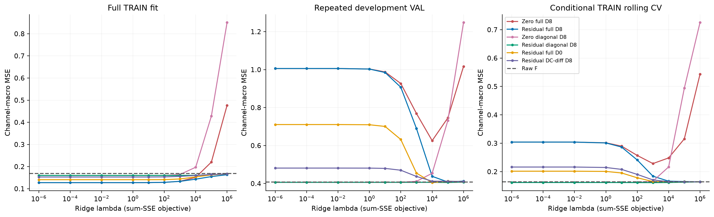
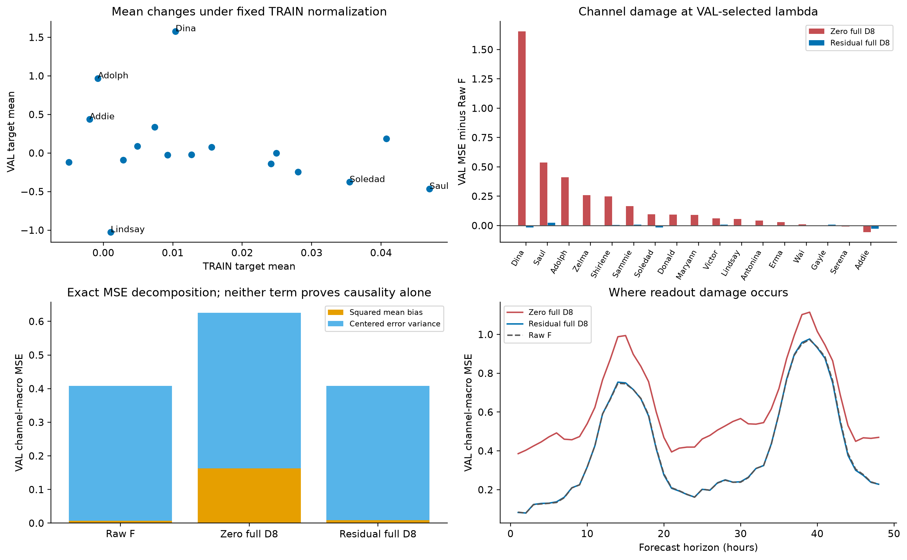
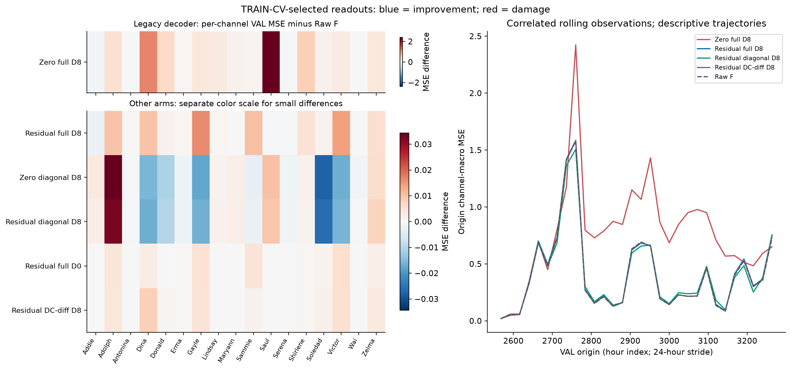

# Robin: 압축 없는 디코더의 성능 악화 원인과 같은 조건의 개선 비교

**[확인] 기존 D8의 큰 악화는 압축 없이도 발생하며, 규제 prior와 full cross-channel readout 구조를 바꾸면 대부분 없어진다. 그러나 Raw F 대비 얻은 MSE 개선은 1% 미만이고 선택된 모든 디코더의 MAE는 더 높다. 현재 Robin의 배포·논문 비교 기준선은 Raw F를 유지하는 판단이 타당하다.**

이 보고서는 사용자의 후속 요청에 따른 새 실험이다. [이전 K·압축기 연구](../level_k_tradeoff_20261011/REPORT_KO.md)와 결과·캐시를 보존했고, 실험 완료 단계에는 commit/push를 하지 않았다. 이후 승인된 GitHub 게시 범위와 경로 검증은 [게시 안내](PUBLICATION_KO.md)에 따로 기록했다. TSFM은 다양한 시계열로 사전학습된 time-series foundation model이며, 여기서는 고정된 TSFM의 저장된 채널별 48시간 예측에 선형 readout만 붙인다. 압축기 E, 원채널 대비 K 축소, LEVEL의 후속 모듈 G는 이번 비교에 없다.

## 1. 무엇을 확인하려 했는가

기존 Robin 결과는 Raw F TRAIN MSE 0.169016/VAL 0.408587에 비해 Raw+C-channel D8 TRAIN 0.151228/VAL 0.625913이었다. TRAIN MSE를 낮추는 적응이 VAL에서는 53.19%의 손해를 만들었다. 원예측/디코더 예측의 시작점과 스케일이 다르다는 설명부터 배제하고, 그다음 **0으로 수축하는 규제, 채널 혼합 용량, 지연 입력, 평균 수준 보존**을 실제로 개입해 비교했다.

사전 고정한 [계획](PLAN.md)·[protocol](protocol.json)은 새 후보의 VAL 결과를 보기 전에 작성했다. 다음 질문이 핵심이다.

1. 같은 함수 클래스와 같은 λ에서 규제 중심만 identity로 바꾸면 손상이 줄어드는가?
2. full cross-channel 혼합을 자기 채널로 제한하면, direct/residual 두 prior에서 같은 효과가 있는가?
3. 잔차 D에서 lag를 없애거나 DC gain을 고정하면 원예측보다 유리한가?
4. 기존 VAL 선택과 TRAIN 내부 시간순 λ 선택에서 결과가 유지되는가?

## 2. 같은 조건과 실제 비교 방법

고정 조건은 Robin C17, context512, horizon48, 동일 TRAIN512/VAL30 시작점·target·관측 마스크·TSFM 예측이다. 기존 데이터의 TRAIN 평균/표준편차로 정규화한 값의 오차이며 채널별 관측 MSE/MAE를 동등 가중한 macro 지표다. 누락 target은 loss/metric에서 제외한다. TRAIN은 대부분 채널 24,576 관측값, Soledad 24,569이며 VAL은 채널마다 1,440이다. Standardization과 F 추론을 바꾼 비교가 아니다.

```text
Method              구조                                              학습 계수
RAW_F               원래 F 예측 그대로                                        0
ZERO_FULL_D8        전체 채널 × lag0..8 → 원 target, zero prior              2601
RES_FULL_D8         같은 입력 → target−F, F에 잔차 추가                      2601
ZERO_DIAG_D8        자기 채널 × lag0..8 → 원 target                           153
RES_DIAG_D8         자기 채널 × lag0..8 → target−F                            153
RES_FULL_D0         현재 F의 전체 채널만 → target−F                           289
RES_DC_DIFF_D8      전체 채널 lag1..8−현재 F → target−F                     2312
```

미래 lag 입력은 실제 미래 관측을 쓰지 않는다. 예측 h에서 이미 계산된 F의 h−ℓ 예측 또는 origin 이전 관측 history만 쓴다. D0의 “현재”도 관측 시점의 실제 미래값이 아니라 해당 horizon의 F 예측이다.

각 입력 특징 $X$의 TRAIN RMS를 $S$, $X_s=XS^{-1}$라 하면, 관측 마스크를 출력별로 적용한 두 목적은 다음이다.

$$
\text{direct:}\quad \min_U\ \|Y-X_sU\|_{\mathrm{obs}}^2+\lambda\|U\|_F^2,
$$
$$
\text{residual:}\quad \min_{\Delta U}\ \|(Y-F)-X_s\Delta U\|_{\mathrm{obs}}^2+\lambda\|\Delta U\|_F^2,\qquad \widehat Y=F+X_s\Delta U.
$$

잔차의 identity selector를 $B_0$라 하면 같은 full D8 클래스에서 두 번째 식은 $\lambda\|U-SB_0\|^2$로 규제 중심만 바꾼 것이다. RMS 좌표의 identity prior는 단순 $I$가 아니다. λ→∞일 때 direct는 0, residual은 원래 F로 향한다. 이 차이는 선형대수로 도출한 구조적 성질이며 residual/ridge 자체를 새 알고리즘으로 주장하지 않는다. 표준 zero-centered ridge 목적은 [scikit-learn 공식 문서](https://scikit-learn.org/stable/modules/generated/sklearn.linear_model.Ridge.html)로 확인했다.

모든 조건은 intercept·centering 없이 **sum SSE**, 동일 10개 λ=[1e−6,1e−4,.01,1,10,100,1e3,1e4,1e5,1e6]를 쓴다. Feature/stat/coeff는 FP64, readout branch는 FP32, residual은 원래 FP32 F에 branch를 더한다. 다른 prior를 비교하면서 intercept나 loss도 바꾸지 않았다. Diagonal은 각 출력의 다른 채널 계수를 정확히 0으로 제한한다. DC-diff는 history와 forecast 전체에 같은 채널별 상수 벡터를 더하면 출력도 그 벡터만큼 이동하도록 보장한다. **다른 채널이 변할 때 개별 상수 채널의 무오차까지 보장하지는 않는다.** D0/DC-diff는 차원과 penalty 기하도 달라져 순수 단일 요인이라고 부르지 않는다.

### 선택 규칙과 데이터의 독립성

- `VAL_EXPLORATORY`: 공통 grid의 가장 작은 VAL macro MSE, 동률이면 앞 index. 이전 연구에서도 사용한 반복 개발 VAL이다.
- `TRAIN_ROLLING_CV`: TRAIN 내 세 chronological fold의 macro MSE를 동등 가중하여 λ만 선택한 뒤 all-TRAIN 계수를 사용한다. VAL target을 이 λ 선택에 쓰지 않는다.
- Raw F는 별도 비교자다. identity를 λ 선택 후보에 넣는 fallback은 하지 않아 개선을 선택 규칙으로 보장하지 않았다. 여섯 학습 방법을 모두 보고하며 최종 family를 자동 선택하지 않았다.

```text
TRAIN timestamp bounds [528,2520), cuts [528,1026,1524,2022,2520]
Fold    Fit origins    Heldout origins    Fit 마지막 origin    Heldout 첫 origin
1            114                119                    972                  1026
2            243                125                   1461                  1531
3            380                123                   1974                  2024
```

Fit origin+48≤cut, heldout origin≥cut 및 origin+48≤next_cut으로 **target window**를 분리했다. 과거 context가 겹치는 것은 이미 알려진 history다. RMS는 fold의 fit 부분에서만 계산했다. 시계열 CV의 시간 순서와 gap 원칙은 [공식 TimeSeriesSplit 문서](https://scikit-learn.org/stable/modules/generated/sklearn.model_selection.TimeSeriesSplit.html)를 참고했지만, 불규칙하게 샘플링한 origin 때문에 구현은 실제 timestamp cut으로 했다.

**이 CV는 완전히 독립적인 end-to-end rolling backtest가 아니다.** 부모 x/F trace는 full-TRAIN 평균·표준편차를 이미 사용했다. 따라서 fold 내 미래 TRAIN 구간의 전처리 통계가 고정 trace에 들어 있는 **조건부 decoder CV**다. 새 D의 계수·RMS에는 fold heldout target이나 VAL/TEST target이 들어가지 않는다. 이 한계는 기존 캐시로 가능한 진단 범위이며 감추지 않는다.

TRAIN512 시작점의 24,576 horizon rows는 unique timestamp **1,989개**, 평균 중복 **12.36회**, 최대20회다. VAL30의 1,440 rows는 unique744개, 평균1.94회, 최대2회다. 이를 독립 샘플 24,576/1,440개로 해석하지 않고 유의확률·독립 표본 CI도 제시하지 않았다.

## 3. 비교 결과


같은 기존 VAL 선택 규칙:

```text
Method                 Params      lambda    TRAIN MSE    VAL MSE    VAL MAE    ΔMSE%    ΔMAE%
RAW_F                       0           —     0.169016   0.408587   0.339458     0.00     0.00
ZERO_FULL_D8             2601       10000     0.151228   0.625913   0.538596    53.19    58.66
RES_FULL_D8              2601      100000     0.154803   0.408152   0.349317    -0.11     2.90
ZERO_DIAG_D8              153      0.0001     0.159966   0.406398   0.354707    -0.54     4.49
RES_DIAG_D8               153      100000     0.163044   0.405729   0.345053    -0.70     1.65
RES_FULL_D0               289       10000     0.153458   0.404730   0.353563    -0.94     4.16
RES_DC_DIFF_D8           2312       1e+06     0.166942   0.410396   0.341207     0.44     0.52
```

TRAIN 내부 시간순 선택 후 동일 VAL 평가:

```text
Method                 Params      lambda    TRAIN MSE    VAL MSE    VAL MAE    ΔMSE%    ΔMAE%
RAW_F                       0           —     0.169016   0.408587   0.339458     0.00     0.00
ZERO_FULL_D8             2601        1000     0.133585   0.768690   0.600956    88.13    77.03
RES_FULL_D8              2601       1e+06     0.163438   0.412845   0.345802     1.04     1.87
ZERO_DIAG_D8              153          10     0.159976   0.406413   0.354916    -0.53     4.55
RES_DIAG_D8               153        1000     0.160122   0.406524   0.353889    -0.50     4.25
RES_FULL_D0               289       1e+06     0.166965   0.410151   0.341513     0.38     0.61
RES_DC_DIFF_D8           2312       1e+06     0.166942   0.410396   0.341207     0.44     0.52
```

[확인] 기존 zero/full D8의 MSE+53.19%는 residual/full D8의 −0.11% 또는 zero/diagonal D8의 −0.54%로 대부분 없어졌다. 다만 “기존 D보다 크게 좋아졌다”와 “Raw F보다 유리하다”는 다른 결론이다. VAL 최저는 residual/full D0의 MSE−0.94%지만 MAE+4.16%이고, TRAIN-CV 선택 시 MSE+0.38%로 뒤집힌다. 두 diagonal D8은 CV 선택에서도 MSE 약−0.5%를 보이지만 MAE+4.25~4.55%다. **두 지표를 함께 개선한 선택 결과는 없다.**



선택 λ가 달라 생기는 교란을 피하도록 같은 λ의 VAL MSE도 확인했다.

```text
lambda      Zero full D8   Residual full D8   Zero diagonal D8   Residual diagonal D8
1000            0.768690           0.689648           0.411470               0.406524
10000           0.625913           0.437948           0.454130               0.406467
100000          0.745750           0.408152           0.731890               0.405729
1e+06           1.016927           0.412845           1.248429               0.407552
```

[확인] λ=1e4에서 full D8의 규제 중심만 바꾸면 0.625913→0.437948로 내려간다. λ=1e5에서도 0.745750→0.408152다. 이는 zero prior의 손상 기여를 뒷받침하지만 낮은 λ의 residual/full D8은 여전히 크게 나쁘다(λ=1e3에서0.689648). λ=1e3에서 자기 채널 제한은 direct0.768690→0.411470, residual0.689648→0.406524로 개선한다. **prior만 바꾸거나 “시간을 잘 본다”는 설명만으로 충분하지 않고 혼합 용량과 규제 강도도 함께 작동한다.** 같은 λ라도 support 변경은 모델 차원·effective capacity를 바꾸는 개입이다.

λ=1e6은 residual/full D8·D0의 CV 선택과 DC-diff의 VAL/CV 선택에서 grid 상한이다. 실제 전역 최적 λ 또는 이미 충분한 규제로 부르지 않는다. 사전 grid를 이번 결과에 맞춰 늘리지는 않았다. identity limit은 수학적 성질과 fixture로 확인했으며 실제 λ=∞ 후보 성능을 실험한 것은 아니다.

## 4. 악화가 생긴 위치와 구조



기존 선택 D8에서 손상이 큰 다섯 채널:

```text
Channel     TRAIN mean   VAL mean   Raw bias    D8 bias    Raw MSE     D8 MSE   Self DC gain
Dina            0.0104     1.5782    -0.1350    -1.2495     1.1296     2.7853        0.1687
Saul            0.0470    -0.4649     0.0299     0.6261     0.1115     0.6496        0.6692
Adolph         -0.0008     0.9679    -0.2205    -0.5980     0.8674     1.2776        0.2299
Zelma          -0.0049    -0.1177    -0.1154     0.1177     0.8747     1.1337        0.5028
Shirlene        0.0074     0.3346    -0.1014    -0.4135     0.5226     0.7708        0.3043
```

Signed bias는 prediction−target이다. 이 다섯 채널이 합산 MSE 악화의 **84.2%**를 차지한다. 특히 Dina의 TRAIN target 평균0.0104→VAL1.5782 변화에 원래 F의 VAL 평균은1.4432였지만 기존 D8은0.3287로 낮췄다. Dina bias−0.1350→−1.2495, summed-lag 자기 gain≈0.1687이다. 이것은 기존 D가 원예측의 수준을 보존하지 못한 구체적 증상이다. 자기 gain만으로 실제 평균을 예측할 수는 없고 다른 채널 gain과 시간 변동도 함께 영향을 준다.

Lindsay는 VAL에서 거의 상수이며 Raw F MSE≈1.3×10^−14인데 D8은≈0.0547이다. Raw에서 이미 맞춘 신호에 readout이 오차를 추가한 사례다. 이전 NPZ와 재계산한 F·D 예측은 모두 bitwise 동일해 origin/scale 구현 차이로 이 결과를 설명할 수 없다. h1–8의 기존 D MSE 악화≈+0.3121, h9–48≈+0.1984로 초기 horizon 손상이 더 컸다.

각 채널의 MSE를 평균 bias² + centered error variance로 분해하면 기존 D의 macro 악화 0.217327 중 bias² 증가는 0.155096, centered variance 증가는 0.062231다. 즉 **71.4%가 평균 오차 증가에 해당한다.** 이는 정확한 오차 분해이지 평균 이동의 독립적 인과 효과를 추정한 비율은 아니다.

보정 $\delta=\widehat Y_D-F$, 원모델 잔차 $e_F=Y-F$를 쓰면:

$$
\operatorname{MSE}(D)-\operatorname{MSE}(F)=\mathbb E_{\mathrm{masked\ macro}}[\delta^2]-2\mathbb E_{\mathrm{masked\ macro}}[\delta e_F].
$$

```text
Method                correction energy   2 × alignment     excess MSE    Δbias²       Δcentered variance
ZERO_FULL_D8                    0.354650        0.137323      0.217327     0.155096             0.062231
RES_FULL_D8                     0.004423        0.004857     -0.000434     0.001534            -0.001969
ZERO_DIAG_D8                    0.010029        0.012217     -0.002189     0.006730            -0.008919
RES_DIAG_D8                     0.002396        0.005254     -0.002858     0.002810            -0.005668
RES_FULL_D0                     0.007333        0.011190     -0.003857     0.005890            -0.009747
RES_DC_DIFF_D8                  0.000203       -0.001606      0.001809    -0.000008             0.001817
```

기존 D의 correction energy0.354650에 비해 원래 오차를 줄이는 alignment 항은0.137323뿐이다. 보정이 크지만 방향이 충분히 맞지 않았다. Residual/full D8은 보정을 훨씬 작게 하고, 작은 MSE 감소는 centered variance 감소에서 온다. 그 방법도 bias²는 증가했으므로 평균 이동 문제를 완전히 해결했다고 말할 수 없다.

DC-diff는 summed temporal gain을 정확히 identity로 고정하지만 VAL/CV 모두 MSE+0.44%, MAE+0.52%다. **상수 이동 보존만으로 이익이 나오지 않은 반례**다. Channel mixing의 시간 변동·예측 오차 방향·과적합 등과 결합된 일반화 문제로 해석해야 한다.



VAL origin을 even/odd 각15개로 나누면 각 subset 내부 target window는 겹치지 않는다. 전체 조건의 계수·λ를 고정하고 다시 채점했으며 새 선택은 없다.

```text
Subset       Raw F MSE   Zero diagonal D8   Residual diagonal D8
even         0.428628           0.422666               0.423178
odd          0.388545           0.390160               0.389869
```

두 diagonal의 작은 MSE 이익은 even subset에서 생기고 odd에서는 손해다. 두 subset은 서로 겹치는 기간을 공유하므로 독립 replication이 아니지만, 약0.5% 평균 개선을 안정적 이익으로 과장하지 말아야 할 근거다.

## 5. 원인 판단과 적용 결정

**[확인]** 저장 예측/마스크/target/origin 구현의 불일치는 발견되지 않았다. 원본 TRAIN/VAL future target timestamp도 겹치지 않는다. 모든 기존 λ가 Raw F보다 나쁘고, TRAIN MSE만 낮추면서 TRAIN MAE도 나빠진다. 기존 full D8은 원예측의 정보를 그대로 보존하는 보정기보다 새 채널·시간 조합으로 재예측하는 구조였다.

**[판단]** 이번 개입이 뒷받침하는 원인은 **zero-centered shrinkage와 unrestricted channel-lag readout이 함께 만든 일반화 손상**이다. 평균 수준 변화는 손상이 나타나는 주요 경로이고 과적합 가능성도 크지만, 한 dataset에서 이것들을 유일한 독립 인과 요인으로 분리해 확정할 수는 없다. Residual prior·diagonal 제약은 기존 실패를 고쳤으나 DC 보존 하나로는 충분하지 않았다.

MSE 기준의 작은 이익을 위해 더 큰 MAE를 허용할 연구 목적이 먼저 정의되어 있지 않다. 따라서 현재 Robin은 **Raw F를 기본 기준선으로 유지**한다. Diagonal/residual은 후속 연구용 대조군으로 남기되, VAL MSE만 골라 제안 방법이 우월하다고 발표하지 않는다. Raw를 선택 후보로 포함하는 개발상의 fallback은 해당 VAL에서 손해를 피할 수 있지만 미지의 미래 성능 보장은 아니다.

## 6. 연구 문제와 기여 후보를 좁히면

기존 큰 목적은 채널 압축으로 frozen TSFM의 전체 추론 비용을 줄이면서 예측 오차를 통제하는 것이다. 이번 결과로 목적을 새 주제로 바꾸기보다, 그 목적에 앞서는 조건을 분명히 해야 한다.

**문제정의 후보:** “제한된 채널 예산에서 다변량 시계열을 frozen TSFM에 연결할 때, 압축 표현과 출력 readout이 각각 원모델의 예측을 얼마나 훼손하는지 분리하고, 사전 정의한 지표별 오차 한도와 전체 추론 비용을 함께 만족하는 적용 조건을 찾는다.”

현재 자료로 쓸 수 있는 기여 후보는 (1) 압축 없는 identity E/K=C 대조로 readout 손상을 분리하는 평가 설계, (2) 같은 trace/prior×channel-support 및 lag/DC 비교로 성능 악화의 구조적 조건을 보여주는 진단, (3) 오차 방향·MSE/MAE·시간 구간 민감성을 함께 보고 작은 VAL 개선과 큰 실패 복구를 구분하는 기준이다. **실험 설계·증거의 기여 후보이며 신규 알고리즘이나 일반적 안전 적응의 기여가 확립되었다는 뜻은 아니다.** 기존 adapter/readout 연구와의 신규성 대조와 더 넓은 검증이 필요하다.

특히 이번 residual skip은 **K=C의 원채널 F가 이미 있는 조건**에서 가능했다. K<C 압축 경로에 이를 적용하려고 별도 C-channel F를 한 번 더 호출하면 압축의 비용 이익을 훼손한다. 다음 압축 비교에서는 기존 K-channel F 출력의 PCA inverse 또는 TRAIN-only reconstruction readout을 고정 기준 $D_{base}$로 두고 $\widehat Y=D_{base}F(E(X))+\Delta D(F(E(X)))$처럼 기준 readout 주변의 forecast 잔차를 학습하는 대조를 검토할 수 있다. **이번에는 이 압축 경로를 실행하지 않았고, Raw F 보존 보장도 아니다.** Encoder마다 고정 base가 다를 수 있어 같은 학습·K·평가 계약과 비압축 Raw F/Raw+D 대조가 계속 필요하다.

후속 순서는 작은 decoder 이익을 더 추구하는 것보다, 지표별 허용 손실(MSE와 MAE)을 먼저 정한 뒤 기존 압축 trace에서 base-prior 대조를 수행하고 최종 고정 방법을 독립 기간·추가 자료에서 확인하는 것이다. GTConvAE나 큰 encoder로 교체하는 것만으로 현재 Robin 문제가 해결된다고 가정하면 안 된다. 현재 연구의 원형 GTConvAE 미실행 상태도 그대로다.

## 7. 실행·독립 검증·재현 자료

CPU science wall **19.63초**, process CPU **19.12초**. 새 all-TRAIN5×10=50 + CV6×3×10=180 → **230 후보/3,910 output별 solve**, 기존 full-TRAIN10 후보는 재사용했다. F/backbone 호출·TEST 예측·GPU job·encoder 학습은 모두0이다. 예측 branch timing이나 전체 E→F→D 추론 비용 benchmark는 이번에 실행하지 않았으므로 계수 수를 실제 속도·GPU 메모리 이익으로 바꾸어 말하지 않는다.

합성 invariant **10개 PASS**: residual zero identity, λ prior limit, scaled identity equivalence, diagonal support, DC translation, causal lag, mask/RMS, target purge, protocol drift 등. 독립 [verify.py](verify.py)는 과학 코드의 helper/solver를 가져오지 않고 원본 NPZ부터 feature·normal equation·metrics·선택·SHA를 재계산했다. [verification.json](verification.json) **21,415 checks PASS/실패0**, grid 상한 경고4건을 유지했다. `240 saved grids` 검증에는 기존 재사용10개와 신규230개가 포함되어 신규 fitting 수와 구분한다.

기존4,945개 파일·Git HEAD26a5593·history prefix를 별도 보존 기준으로 기록했다. 실험 완료 시점의 확인은 [final_audit.json](final_audit.json)에 저장했다. 그 시점에는 Git HEAD와 부모 실험 소스·수치·캐시를 유지했고 새 폴더/cache와 history append만 추가했다. 이 감사는 게시 전 로컬 snapshot이다. 게시 문서의 경로는 [별도 게시 검사](publication_checks.json)로 확인하며, 실제 원격 main SHA는 push 이후 따로 확인한다.

- 계약과 코드: [protocol](protocol.json), [run](run.py), [tests](test_run.py), [source seal](source_seal.json), [fixtures](fixture_receipt.json)
- 수치: [result](result.json), [오차·DC·origin 진단](summary.json), [독립 검증](verification.json), [최종 감사](final_audit.json)
- 분석·문서 생성: [analyze](analyze.py), [write_report](write_report.py), [실행 기록](EXECUTION_NOTE_KO.md)
- 그림 PDF: [비교](figures/01_comparison.pdf), [ridge 경로](figures/02_ridge_paths.pdf), [원인](figures/03_mechanisms.pdf), [채널·시점](figures/04_channel_origin_sensitivity.pdf)

원자료·model weight·예측 NPZ는 GitHub 문서에 포함하지 않는다. cache를 보유한 이 workspace의 exact-trace 재현과, 해당 데이터/모델 준비가 필요한 새 환경의 재현을 구분해야 한다. 모든 그림·문서 링크는 GitHub에서도 쓸 수 있는 상대경로다.
