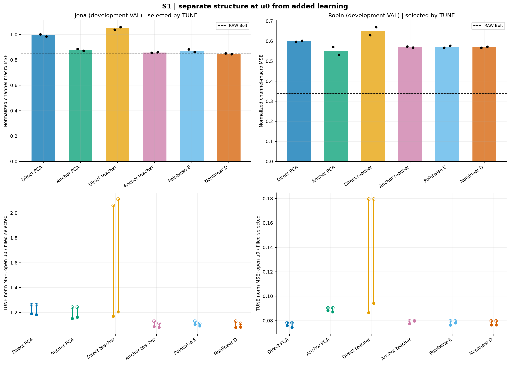
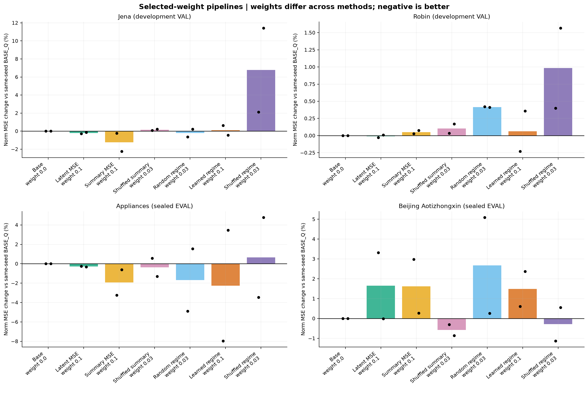
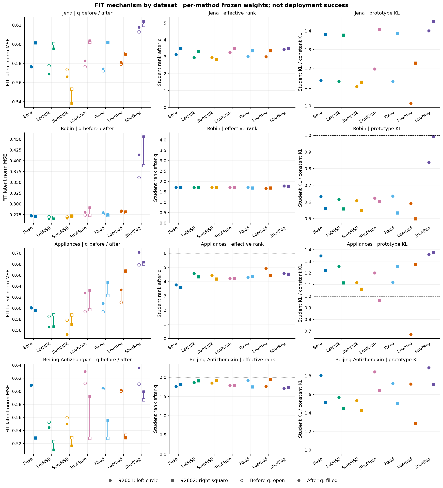
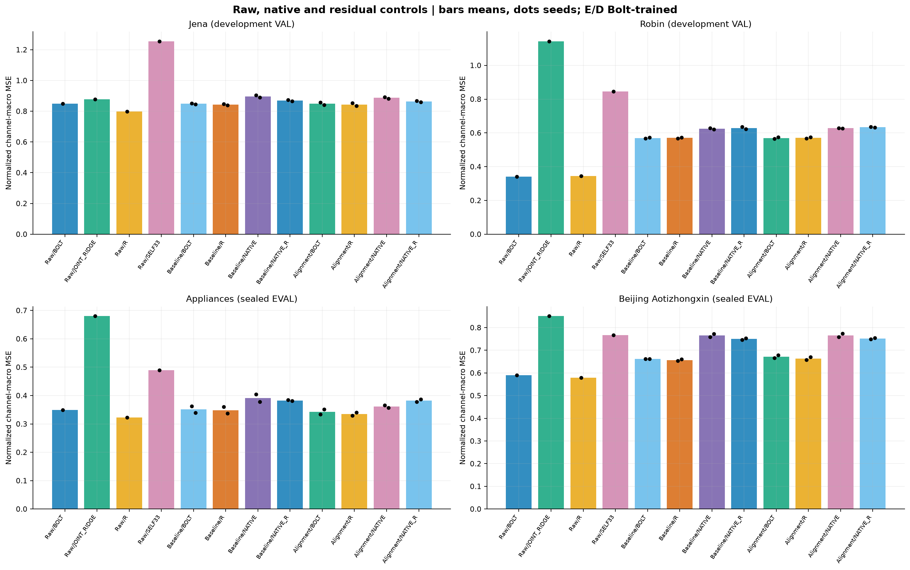
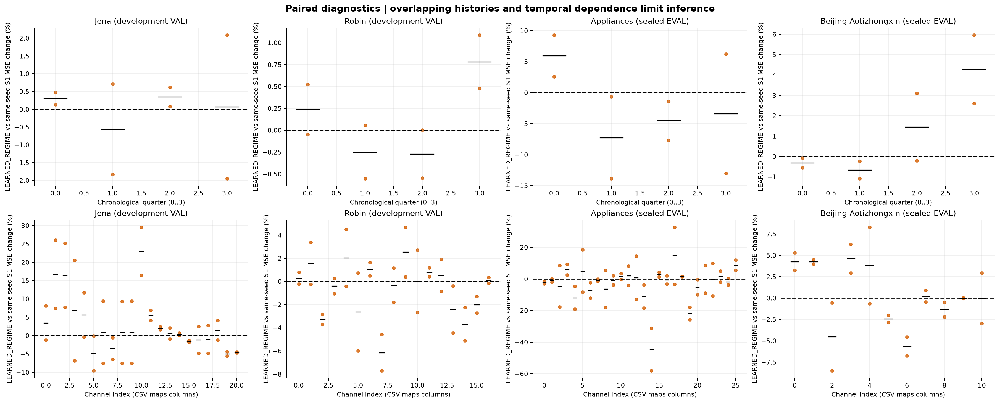
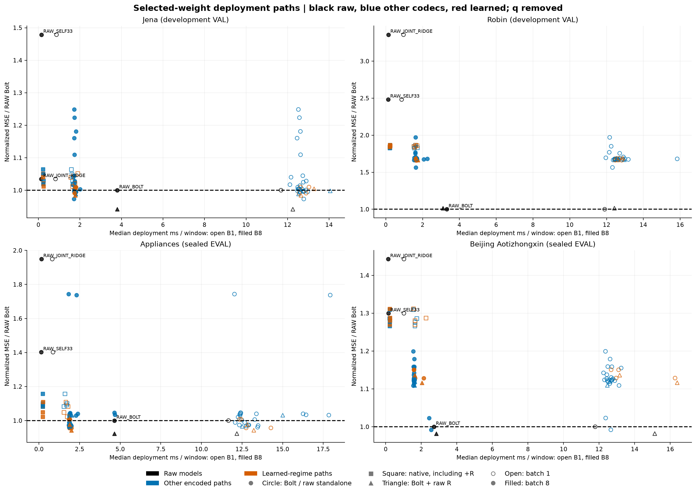

> 게시용 링크 복사본입니다. 아래 원수치·본문은 원 보고서를 유지하고 링크 경로만 정리했습니다. 데이터·모델·NPZ는 로컬 재현 자산입니다. [봉인된 원본](../../../smallk_predictive_alignment_20261013/report_v2/REPORT_KO.md) SHA256 `0c7369a82304d35d5b21fdb7d8df1245702f9934999c807dc4d97d609d61eab7`.

# 작은 K의 상태 보존·미래 정렬·새 자료 검증 결과

[확인] 정규화 관측 channel-macro MSE가 주지표다. 각 모델의 checkpoint와 보조 weight는 미래 TUNE로 선택했다. 두 seed는 최적화 변동의 제한된 반복이며 독립 자료 표본 두 개를 뜻하지 않는다.

**[확인] 원 계획의 두 새자료 공동 모델 선택 barrier는 충족되지 않았다. Appliances EVAL을 먼저 개봉한 후 Beijing 원자료 로더를 수리했다. 아래는 동일 사전 방법과 자료별 lock을 유지한 결과이며 원 공동 평가 순서를 통과한 실험으로 쓰지 않는다.**

## 질문에 대한 답

### 작은 K의 문제를 해결했는가?

- [확인] jena: 사전 TUNE 선택 구조 `ANCHOR_NONLINEAR_D`의 VAL normMSE 평균 0.848224944, RAW Bolt 0.848631966, 변화 -0.05%. normMAE 평균 0.424275374, RAW 0.416058388. seed별 normMSE는 92601:0.851638574, 92602:0.844811314.
- [확인] robin: 사전 TUNE 선택 구조 `ANCHOR_NONLINEAR_D`의 VAL normMSE 평균 0.569546544, RAW Bolt 0.340401887, 변화 +67.32%. normMAE 평균 0.447338898, RAW 0.313192123. seed별 normMSE는 92601:0.567146384, 92602:0.571946704.
- [확인] appliances: 사전 TUNE 선택 구조 `ANCHOR_NONLINEAR_D`의 EVAL normMSE 평균 0.351293598, RAW Bolt 0.348920468, 변화 +0.68%. normMAE 평균 0.374918879, RAW 0.343643728. seed별 normMSE는 92601:0.362793528, 92602:0.339793668.
- [확인] beijing_aotizhongxin: 사전 TUNE 선택 구조 `ANCHOR_NONLINEAR_D`의 EVAL normMSE 평균 0.661957198, RAW Bolt 0.589575414, 변화 +12.28%. normMAE 평균 0.470010232, RAW 0.407916509. seed별 normMSE는 92601:0.661344557, 92602:0.662569839.

**[판단] 작은 K의 문제가 전반적으로 해결됐다는 결론은 지지되지 않는다. 개선된 압축 baseline과 원채널 RAW/RAW+R 기준을 구분해야 한다.**

- [확인] appliances LEARNED_REGIME의 EVAL normMSE 0.342723827는 RAW 0.348920468 대비 -1.78%, normMAE 0.367625077는 RAW 0.343643728 대비 +6.98%다.
  같은 raw R을 붙이면 LEARNED+R normMSE 0.334940889, RAW+R 0.322202447로 +3.95%이며 normMAE는 0.365573422 대 0.345093601다. 작은 MSE 차이가 MAE나 강한 기준군 우위까지 뜻하지 않는다.
- [확인] beijing_aotizhongxin LEARNED_REGIME의 EVAL normMSE 0.671836507는 RAW 0.589575414 대비 +13.95%, normMAE 0.472973566는 RAW 0.407916509 대비 +15.95%다.
  같은 raw R을 붙이면 LEARNED+R normMSE 0.663998488, RAW+R 0.578874852로 +14.71%이며 normMAE는 0.475899328 대 0.420859544다. 작은 MSE 차이가 MAE나 강한 기준군 우위까지 뜻하지 않는다.

[판단] 이 수치가 작아졌다는 사실과 모든 채널·자료의 문제가 해결됐다는 주장은 다르다. anchor는 원채널 현재 상태 C개를 우회로 보존하고 K성분의 변화만 복원한다. TSFM 입력은 K채널이지만 strict K-only 압축은 아니다. 기존 VAL은 반복 개발 자료이고 새 EVAL만 방법 개발과 분리했다.

### 미래 표현 정렬이 필요한가?

**jena — VAL, BASE_Q normMSE=0.848224944**

```text
방법               개발봉인weight  normMSE평균  BASE대비  normMAE평균
LATENT_FUTURE_MSE  0.1             0.846517699  -0.20%    0.423173885
SUMMARY_MSE        0.1             0.837700377  -1.24%    0.418978674
SHUFFLED_SUMMARY   0.03            0.849467199  +0.15%    0.424687262
FIXED_REGIME       0.03            0.846469111  -0.21%    0.423534822
LEARNED_REGIME     0.1             0.849049159  +0.10%    0.427131754
SHUFFLED_REGIME    0.03            0.905484431  +6.75%    0.447570252
```

**robin — VAL, BASE_Q normMSE=0.569546544**

```text
방법               개발봉인weight  normMSE평균  BASE대비  normMAE평균
LATENT_FUTURE_MSE  0.1             0.569495570  -0.01%    0.447230807
SUMMARY_MSE        0.1             0.569833779  +0.05%    0.447309879
SHUFFLED_SUMMARY   0.03            0.570131512  +0.10%    0.446878363
FIXED_REGIME       0.03            0.571913103  +0.42%    0.448028021
LEARNED_REGIME     0.1             0.569913911  +0.06%    0.446691006
SHUFFLED_REGIME    0.03            0.575164664  +0.99%    0.447094398
```

**appliances — EVAL, BASE_Q normMSE=0.351293598**

```text
방법               개발봉인weight  normMSE평균  BASE대비  normMAE평균
LATENT_FUTURE_MSE  0.1             0.350286660  -0.29%    0.374448441
SUMMARY_MSE        0.1             0.344336610  -1.98%    0.371385303
SHUFFLED_SUMMARY   0.03            0.350077895  -0.35%    0.375079196
FIXED_REGIME       0.03            0.345029115  -1.78%    0.371486900
LEARNED_REGIME     0.1             0.342723827  -2.44%    0.367625077
SHUFFLED_REGIME    0.03            0.353102992  +0.52%    0.373881829
```

**beijing_aotizhongxin — EVAL, BASE_Q normMSE=0.661957198**

```text
방법               개발봉인weight  normMSE평균  BASE대비  normMAE평균
LATENT_FUTURE_MSE  0.1             0.672894166  +1.65%    0.475799445
SUMMARY_MSE        0.1             0.672703647  +1.62%    0.473907089
SHUFFLED_SUMMARY   0.03            0.658122421  -0.58%    0.468103054
FIXED_REGIME       0.03            0.679627847  +2.67%    0.474217858
LEARNED_REGIME     0.1             0.671836507  +1.49%    0.472973566
SHUFFLED_REGIME    0.03            0.660070616  -0.29%    0.467490530
```

[판단] 위 표와 S2 그림은 방법별로 TUNE 선택한 weight를 쓰므로 summary 대 shuffled summary, learned 대 shuffled regime의 weight가 다를 수 있다. 같은 선택 절차를 거친 전체 pipeline 비교이며 pairing 하나의 순수 인과 효과로 읽지 않는다. 기전 비교는 아래 개발 자료의 동일 weight 표와 전체 sweep 원수치에서 따로 본다. continuous latent/summary 회귀와 learned/fixed/shuffled 목적을 함께 비교했다. learned가 더 좋아도 Gaussian 고정 중심과 KMeans 중심의 norm·거리·teacher entropy·gradient scale이 다르므로 학습된 경계만의 인과 효과를 분리했다고 쓰지 않는다. SHUFFLED_SUMMARY와 SHUFFLED_REGIME은 유효 FIT origins subset에서 horizon 중첩 없는 bijection으로 정답을 바꾸는 대조다. q 이후의 정렬 loss 감소가 q 이전 잠재 예측이나 배포 예측 개선을 뜻하지 않는다.

### 누출이 있었는가? 무엇이 독립적인 검증인가?

[확인] 기존 보호 TEST를 새로 사용하지 않는 계약을 유지했다. 정렬 teacher의 미래 정답은 FIT 보조 목적에서 사용한다. 주 예측 학습은 FIT 미래 정답을 쓰고 checkpoint 선택은 TUNE 미래 정답으로 평가한다. 추론 입력은 원점 이전 실제 과거 창이다. 구현 fixture의 prefix/미래 perturbation 통과는 검사한 경로의 정보 경계를 확인하는 근거이며 성능 개선이나 모든 누출 부재의 일반 증명은 아니다.

[확인] 새 UCI 자료는 METHOD_LOCK 뒤 다운로드·분리 저장하고 자료별 FIT/TUNE로 모델을 다시 학습했다. 원 CSV ingestion에서 EVAL 값도 split 저장을 위해 읽었다. 학습 loader는 FIT/TUNE payload만 반환하고 자료별 최종 model/source/contract lock 뒤 EVAL target을 개봉한다. 다만 Beijing 자료 준비가 실패한 상태에서 Appliances 평가를 먼저 진행해 공동 barrier는 실제 위반했다. 수리로 이 과거 사실을 없애지 않는다. 방법·weight·seed·자료 규칙을 바꾸지 않은 자료별 봉인 검증과 원 공동 protocol 준수 여부를 구분한다. 이 검증은 기존 가중치의 zero-shot transfer가 아니며 Chronos-Bolt 사전학습 자료와의 중복은 미확정이다.

### Chronos-Bolt를 유지할 근거가 있는가?

```text
자료                  E/D조건      seed   예측경로         normMSE      normMAE      원단위MAE
jena                  raw          None   RAW_BOLT         0.848631966  0.416058388  30.391203742
jena                  raw          None   RAW_JOINT_RIDGE  0.878198823  0.511135054  34.265814841
jena                  raw          None   RAW_BOLT_RAW_R   0.799031892  0.410571996  30.261762254
jena                  raw          None   RAW_SELF33       1.254875681  0.606400003  47.063061826
jena                  selected-S1  92601  BOLT             0.851638574  0.425287200  35.031250529
jena                  selected-S1  92601  BOLT_RAW_R       0.846990333  0.427876616  34.908541051
jena                  selected-S1  92601  NATIVE           0.903101040  0.451536031  35.846346595
jena                  selected-S1  92601  NATIVE_RAW_R     0.874303174  0.435686340  33.488843949
jena                  learned      92601  BOLT             0.857020658  0.433818366  36.107752270
jena                  learned      92601  BOLT_RAW_R       0.852332483  0.434190221  35.741164096
jena                  learned      92601  NATIVE           0.892317620  0.450079033  36.576039722
jena                  learned      92601  NATIVE_RAW_R     0.866477442  0.434284963  33.812318169
jena                  selected-S1  92602  BOLT             0.844811314  0.423263549  34.063498046
jena                  selected-S1  92602  BOLT_RAW_R       0.838964310  0.427847689  34.208665870
jena                  selected-S1  92602  NATIVE           0.890417137  0.452352616  35.505707288
jena                  selected-S1  92602  NATIVE_RAW_R     0.864827844  0.435033681  33.888566021
jena                  learned      92602  BOLT             0.841077659  0.420445142  33.907168294
jena                  learned      92602  BOLT_RAW_R       0.835346607  0.423811065  33.934954425
jena                  learned      92602  NATIVE           0.882418559  0.445747648  35.993178442
jena                  learned      92602  NATIVE_RAW_R     0.858617746  0.431036931  33.263181468
robin                 raw          None   RAW_BOLT         0.340401887  0.313192123  5.938975296
robin                 raw          None   RAW_JOINT_RIDGE  1.142710811  0.795741172  16.889846830
robin                 raw          None   RAW_BOLT_RAW_R   0.345159404  0.322689273  6.192047271
robin                 raw          None   RAW_SELF33       0.844782547  0.612346204  12.369288128
robin                 selected-S1  92601  BOLT             0.567146384  0.447670118  9.199254748
robin                 selected-S1  92601  BOLT_RAW_R       0.567925260  0.446886150  9.194089443
robin                 selected-S1  92601  NATIVE           0.628873611  0.490627150  10.288681703
robin                 selected-S1  92601  NATIVE_RAW_R     0.635432694  0.491763079  10.380530930
robin                 learned      92601  BOLT             0.565834148  0.446571093  9.164929754
robin                 learned      92601  BOLT_RAW_R       0.566940375  0.446240776  9.176084480
robin                 learned      92601  NATIVE           0.628945826  0.490396602  10.269618466
robin                 learned      92601  NATIVE_RAW_R     0.635797153  0.491513248  10.368308772
robin                 selected-S1  92602  BOLT             0.571946704  0.447007678  9.097554326
robin                 selected-S1  92602  BOLT_RAW_R       0.573123386  0.447022704  9.117236189
robin                 selected-S1  92602  NATIVE           0.621609570  0.487727407  10.119653709
robin                 selected-S1  92602  NATIVE_RAW_R     0.623020211  0.487172956  10.101792912
robin                 learned      92602  BOLT             0.573993673  0.446810919  9.073031873
robin                 learned      92602  BOLT_RAW_R       0.575374681  0.447222228  9.108188825
robin                 learned      92602  NATIVE           0.626170272  0.488651248  10.096958336
robin                 learned      92602  NATIVE_RAW_R     0.632536056  0.485848171  10.128129664
appliances            raw          None   RAW_BOLT         0.348920468  0.343643728  3.509692825
appliances            raw          None   RAW_JOINT_RIDGE  0.680103098  0.612204199  5.792761373
appliances            raw          None   RAW_BOLT_RAW_R   0.322202447  0.345093601  3.675169281
appliances            raw          None   RAW_SELF33       0.489210027  0.447408717  4.479850325
appliances            selected-S1  92601  BOLT             0.362793528  0.379515959  4.181318654
appliances            selected-S1  92601  BOLT_RAW_R       0.359901584  0.381561997  4.279748973
appliances            selected-S1  92601  NATIVE           0.403951740  0.413586257  4.832035502
appliances            selected-S1  92601  NATIVE_RAW_R     0.384246395  0.419395477  5.329361563
appliances            learned      92601  BOLT             0.333904912  0.364289324  4.030359684
appliances            learned      92601  BOLT_RAW_R       0.329052936  0.363406743  4.141512603
appliances            learned      92601  NATIVE           0.365962018  0.396398001  4.648151801
appliances            learned      92601  NATIVE_RAW_R     0.377903816  0.417386458  5.253767342
appliances            selected-S1  92602  BOLT             0.339793668  0.370321799  4.221569052
appliances            selected-S1  92602  BOLT_RAW_R       0.337082369  0.371293321  4.318907727
appliances            selected-S1  92602  NATIVE           0.377944198  0.402587087  4.774400961
appliances            selected-S1  92602  NATIVE_RAW_R     0.381254416  0.420119029  5.228712857
appliances            learned      92602  BOLT             0.351542742  0.370960831  4.227522560
appliances            learned      92602  BOLT_RAW_R       0.340828842  0.367740100  4.317845157
appliances            learned      92602  NATIVE           0.356939671  0.389536010  4.478243319
appliances            learned      92602  NATIVE_RAW_R     0.386990304  0.421211877  5.336780113
beijing_aotizhongxin  raw          None   RAW_BOLT         0.589575414  0.407916509  73.534518568
beijing_aotizhongxin  raw          None   RAW_JOINT_RIDGE  0.850735096  0.564766121  94.796021461
beijing_aotizhongxin  raw          None   RAW_BOLT_RAW_R   0.578874852  0.420859544  74.459707988
beijing_aotizhongxin  raw          None   RAW_SELF33       0.766255346  0.513064022  88.459825144
beijing_aotizhongxin  selected-S1  92601  BOLT             0.661344557  0.466472476  76.253675505
beijing_aotizhongxin  selected-S1  92601  BOLT_RAW_R       0.654027511  0.470576685  76.279549088
beijing_aotizhongxin  selected-S1  92601  NATIVE           0.758266351  0.518522201  82.707290860
beijing_aotizhongxin  selected-S1  92601  NATIVE_RAW_R     0.746428543  0.517206515  81.841839183
beijing_aotizhongxin  learned      92601  BOLT             0.665391220  0.467008343  76.571760786
beijing_aotizhongxin  learned      92601  BOLT_RAW_R       0.658141558  0.471136281  76.730028775
beijing_aotizhongxin  learned      92601  NATIVE           0.759097409  0.524638966  83.637960657
beijing_aotizhongxin  learned      92601  NATIVE_RAW_R     0.748804457  0.521999016  82.920795133
beijing_aotizhongxin  selected-S1  92602  BOLT             0.662569839  0.473547987  77.745647613
beijing_aotizhongxin  selected-S1  92602  BOLT_RAW_R       0.659981882  0.478612015  77.545858624
beijing_aotizhongxin  selected-S1  92602  NATIVE           0.772090232  0.532819771  86.865500177
beijing_aotizhongxin  selected-S1  92602  NATIVE_RAW_R     0.753181901  0.526120742  85.383494212
beijing_aotizhongxin  learned      92602  BOLT             0.678281794  0.478938790  79.975344897
beijing_aotizhongxin  learned      92602  BOLT_RAW_R       0.669855419  0.480662375  79.163339127
beijing_aotizhongxin  learned      92602  NATIVE           0.773193756  0.535590073  87.648290403
beijing_aotizhongxin  learned      92602  NATIVE_RAW_R     0.755147446  0.529378752  86.404227880
```

[판단] native는 Bolt로 학습된 E/D를 고정하고 shared linear 미래 예측기만 추가 600 updates로 적합했다. native에 최적화한 E/D를 쓰는 최선의 native 비교가 아니므로 Bolt의 보편적 우월성을 주장할 수 없다. 원자료 SELF33와 joint ridge 및 동일 raw residual R을 함께 확인해, 작은 K와 큰 백본의 비용을 지불할 실익이 실제 존재하는지 판단해야 한다.

## 비교 계약과 실제 실행 범위

개발 S1 전 자료 공통 선택 구조는 `ANCHOR_NONLINEAR_D`다. 선택 규칙은 자료×두 seed의 TUNE normMSE/RAW TUNE normMSE 비율 log 평균이며 VAL/EVAL을 선택에 사용하지 않는다. S2 global TUNE 선택은 `LATENT_FUTURE_MSE`이며 방법별 weight는 개발에서 한 개로 봉인했다. 새 자료에서는 이 winner 하나만 평가하지 않고 사전 지정한 전체 대조를 유지했다.

공통 L512/H48, quarter K=max(1,floor(C/4)), FIT256/TUNE64, seeds92601/92602, batch4, AdamW lr0.001/decay0, gradient clip1, updates600, checkpoints0/100/200/400/600이다. 새 자료는 시간순60/20/20, EVAL origins stride48이다. 정답 horizon은 중첩되지 않지만 입력 과거 창은 겹치며 시간 자기상관도 남아 있다. Appliances는10분, Beijing은1시간이므로 L/H의 실제 시간 길이가 다르다.

```text
입력receipt      상태                                                core학습fit  case수
개발             COMPLETE                                            76           78
새자료/controls  COMPLETE_RESOLVED_WITH_DECLARED_PROTOCOL_DEVIATION  44           64
최종비용         COMPLETE                                            0            0
```

독립 검산 integrity 상태: `PASS`, checks=86681, failed=0다. 별도 completion 상태는 `INCOMPLETE_OR_PROTOCOL_DEVIATION`이며 원 공동 barrier 미충족을 integrity PASS로 지우지 않는다. 부분 실행·실패 기록은 성공한 case와 합쳐 완료라고 부르지 않는다.

```text
자료   C항등anchor parity maxAbs  활성temporal 미래변경maxAbs  이전direct checkpoint parity  전결측reset  F hash보존
jena   1.1920928955078125e-07     0.0                          0.0                           True         True
robin  2.384185791015625e-07      0.0                          0.0                           True         True
```

고정 초기 D에서 같은 실제 미래를 두 방식으로 투영한 개발 VAL 진단은 다음과 같다. teacher output의 분산을 잘 설명하는 basis가 실제 미래 변화의 고정-D projection residual까지 줄인다고 보장되지 않는다. 원수치를 보고 두 명제를 분리한다.

```text
자료   초기부분공간    seed   직접Y projection normMSE  현재값+Δ projection normMSE
jena   DIRECT_PCA      92601  0.455414129               0.384001201
jena   DIRECT_TEACHER  92601  1.891598239               0.428894703
jena   DIRECT_PCA      92602  0.455414129               0.384001201
jena   DIRECT_TEACHER  92602  1.961074445               0.420131108
robin  DIRECT_PCA      92601  0.440175106               0.342878142
robin  DIRECT_TEACHER  92601  0.584563784               0.428255510
robin  DIRECT_PCA      92602  0.440175106               0.342878142
robin  DIRECT_TEACHER  92602  0.584563784               0.428255510
```

## S1: 구조 효과와 학습 효과

```text
자료                  방법                seed끝자리  선택u    TUNE normMSE  VAL/EVAL normMSE  VAL/EVAL normMAE  seed별normMSE      보조weight
jena                  DIRECT_PCA          1,2         600,400  1.186693      0.993492          0.583758          1.002280,0.984703  -
jena                  ANCHOR_PCA          1,2         600,600  1.157140      0.879620          0.440790          0.886521,0.872718  -
jena                  DIRECT_TEACHER      1,2         600,400  1.188504      1.048911          0.615330          1.038258,1.059563  -
jena                  ANCHOR_TEACHER      1,2         400,600  1.083313      0.858691          0.429937          0.856720,0.860662  -
jena                  ANCHOR_POINTWISE    1,2         200,200  1.099274      0.872959          0.436819          0.882636,0.863282  -
jena                  ANCHOR_NONLINEAR_D  1,2         200,100  1.081935      0.848225          0.424275          0.851639,0.844811  -
robin                 DIRECT_PCA          1,2         200,200  0.075238      0.599845          0.530572          0.597512,0.602179  -
robin                 ANCHOR_PCA          1,2         400,100  0.087639      0.551798          0.456049          0.571145,0.532451  -
robin                 DIRECT_TEACHER      1,2         600,600  0.090364      0.650262          0.563316          0.629839,0.670686  -
robin                 ANCHOR_TEACHER      1,2         100,0    0.078626      0.570493          0.448948          0.572806,0.568179  -
robin                 ANCHOR_POINTWISE    1,2         400,100  0.077245      0.571787          0.446750          0.566753,0.576821  -
robin                 ANCHOR_NONLINEAR_D  1,2         100,100  0.076528      0.569547          0.447339          0.567146,0.571947  -
appliances            DIRECT_PCA          1,2         600,600  0.403208      0.607212          0.578915          0.606195,0.608230  -
appliances            ANCHOR_PCA          1,2         600,600  0.346083      0.359692          0.378032          0.360087,0.359297  -
appliances            ANCHOR_NONLINEAR_D  1,2         600,400  0.320563      0.351294          0.374919          0.362794,0.339794  -
beijing_aotizhongxin  DIRECT_PCA          1,2         400,600  0.832430      0.672036          0.516823          0.673480,0.670592  -
beijing_aotizhongxin  ANCHOR_PCA          1,2         600,600  0.931076      0.695011          0.488973          0.683021,0.707001  -
beijing_aotizhongxin  ANCHOR_NONLINEAR_D  1,2         400,600  0.878921      0.661957          0.470010          0.661345,0.662570  -
```

anchor 단독 구조 대조는 같은 PCA 초기 E/D를 쓰는 DIRECT_PCA와 ANCHOR_PCA에서 따로 확인한다. DIRECT_PCA와 선택 teacher+nonlinear decoder anchor의 전체 차이를 anchor 하나의 효과로 부르지 않는다.

```text
자료                  평가  DIRECT_PCA MSE  ANCHOR_PCA MSE  anchor MSE변화  DIRECT MAE   ANCHOR MAE   anchor MAE변화
jena                  val   0.993491614     0.879619533     -11.46%         0.583757963  0.440789879  -24.49%
robin                 val   0.599845490     0.551798381     -8.01%          0.530572356  0.456049217  -14.05%
appliances            eval  0.607212465     0.359691950     -40.76%         0.578915336  0.378032363  -34.70%
beijing_aotizhongxin  eval  0.672036001     0.695011368     +3.42%          0.516822574  0.488973428  -5.39%
```

[확인] Beijing의 anchor PCA는 직접 PCA보다 MSE가 커지고 MAE가 작아지는 방향이다. 네 자료에서 anchor 하나가 주오차를 일괄 해결했다고 말할 수 없다. 선택 baseline은 teacher basis와 nonlinear D도 함께 바뀌는 구조이므로 전체 pipeline의 결과로 해석한다.



u0의 고정 projection/anchor 효과와 선택 checkpoint의 추가 학습 효과를 따로 확인한다. Pointwise E는 각 시점 RF1이지만 F는 여전히512시점 latent 과거를 본다. 전체 예측기가 현재값만 보는 비교가 아니다. TCN E와 linear pointwise E는 시간 결합뿐 아니라 비선형성·파라미터 용량도 달라 시간 정보 하나의 순수 인과 효과를 분리한 실험이라고 부르지 않는다. Nonlinear D는 K→32→C residual로 파라미터가 늘어난 대조다. affine decoder bias는 anchor에서 취소되므로 등록 수와 실제 구조적 활성 수를 구분한다.

실제 미래를 고정 D의 열공간에 투영한 [oracle_projection.csv](../../../smallk_predictive_alignment_20261013/report_v2/oracle_projection.csv)는 배포할 수 없는 원인 진단이다. 미래마다 정답을 보고 최소제곱 좌표를 맞췄으며 배포 순위나 보편적 lower bound에 섞지 않는다.

## S2: 보조 미래 정렬 전체 결과

```text
자료                  방법               seed끝자리  선택u    TUNE normMSE  VAL/EVAL normMSE  VAL/EVAL normMAE  seed별normMSE      보조weight
jena                  BASE_Q             1,2         200,100  1.081935      0.848225          0.424275          0.851639,0.844811  0.0
jena                  LATENT_FUTURE_MSE  1,2         200,100  1.080880      0.846518          0.423174          0.849333,0.843702  0.1
jena                  SUMMARY_MSE        1,2         200,600  1.080137      0.837700          0.418979          0.849640,0.825760  0.1
jena                  SHUFFLED_SUMMARY   1,2         200,100  1.082682      0.849467          0.424687          0.852240,0.846694  0.03
jena                  FIXED_REGIME       1,2         200,100  1.080525      0.846469          0.423535          0.846210,0.846728  0.03
jena                  LEARNED_REGIME     1,2         200,200  1.078770      0.849049          0.427132          0.857021,0.841078  0.1
jena                  SHUFFLED_REGIME    1,2         100,100  1.106200      0.905484          0.447570          0.869582,0.941387  0.03
robin                 BASE_Q             1,2         100,100  0.076528      0.569547          0.447339          0.567146,0.571947  0.0
robin                 LATENT_FUTURE_MSE  1,2         100,100  0.076518      0.569496          0.447231          0.566984,0.572007  0.1
robin                 SUMMARY_MSE        1,2         100,100  0.076631      0.569834          0.447310          0.567297,0.572370  0.1
robin                 SHUFFLED_SUMMARY   1,2         100,100  0.076553      0.570132          0.446878          0.567341,0.572922  0.03
robin                 FIXED_REGIME       1,2         100,100  0.077032      0.571913          0.448028          0.569530,0.574296  0.03
robin                 LEARNED_REGIME     1,2         100,100  0.076810      0.569914          0.446691          0.565834,0.573994  0.1
robin                 SHUFFLED_REGIME    1,2         100,100  0.077760      0.575165          0.447094          0.569413,0.580916  0.03
appliances            BASE_Q             1,2         600,400  0.320563      0.351294          0.374919          0.362794,0.339794  0.0
appliances            LATENT_FUTURE_MSE  1,2         400,400  0.323604      0.350287          0.374448          0.361887,0.338686  0.1
appliances            SUMMARY_MSE        1,2         600,400  0.321054      0.344337          0.371385          0.351007,0.337667  0.1
appliances            SHUFFLED_SUMMARY   1,2         400,400  0.324479      0.350078          0.375079          0.364809,0.335347  0.03
appliances            FIXED_REGIME       1,2         600,400  0.321779      0.345029          0.371487          0.345017,0.345041  0.03
appliances            LEARNED_REGIME     1,2         600,100  0.326300      0.342724          0.367625          0.333905,0.351543  0.1
appliances            SHUFFLED_REGIME    1,2         200,100  0.335129      0.353103          0.373882          0.350195,0.356011  0.03
beijing_aotizhongxin  BASE_Q             1,2         400,600  0.878921      0.661957          0.470010          0.661345,0.662570  0.0
beijing_aotizhongxin  LATENT_FUTURE_MSE  1,2         600,600  0.870243      0.672894          0.475799          0.683273,0.662516  0.1
beijing_aotizhongxin  SUMMARY_MSE        1,2         600,600  0.887330      0.672704          0.473907          0.681029,0.664378  0.1
beijing_aotizhongxin  SHUFFLED_SUMMARY   1,2         400,600  0.875294      0.658122          0.468103          0.659356,0.656889  0.03
beijing_aotizhongxin  FIXED_REGIME       1,2         400,600  0.901087      0.679628          0.474218          0.694990,0.664266  0.03
beijing_aotizhongxin  LEARNED_REGIME     1,2         400,600  0.897998      0.671837          0.472974          0.665391,0.678282  0.1
beijing_aotizhongxin  SHUFFLED_REGIME    1,2         400,200  0.894734      0.660071          0.467491          0.653868,0.666273  0.03
```



선택된 weight가 다른 결과를 pairing의 기전으로 해석하지 않기 위해 개발 자료 전체 sweep에서 weight0.03/0.1을 각각 고정해 비교했다. 같은 초기 E/D·배치 순서·600 updates·TUNE checkpoint 규칙이며 각 군이 선택한 checkpoint는 다를 수 있다.

```text
자료   정렬군          대조군            동일weight  정렬VAL normMSE  대조VAL normMSE  정렬/대조변화  seed별변화
jena   SUMMARY_MSE     SHUFFLED_SUMMARY  0.03        0.848149706      0.849467199      -0.16%         92601:-0.06%,92602:-0.25%
jena   SUMMARY_MSE     SHUFFLED_SUMMARY  0.1         0.837700377      0.855516351      -2.08%         92601:-1.33%,92602:-2.84%
jena   LEARNED_REGIME  SHUFFLED_REGIME   0.03        0.843052432      0.905484431      -6.89%         92601:-2.90%,92602:-10.59%
jena   LEARNED_REGIME  SHUFFLED_REGIME   0.1         0.849049159      0.894692579      -5.10%         92601:-2.53%,92602:-7.59%
jena   LEARNED_REGIME  FIXED_REGIME      0.03        0.843052432      0.846469111      -0.40%         92601:-0.22%,92602:-0.59%
jena   LEARNED_REGIME  FIXED_REGIME      0.1         0.849049159      0.851253390      -0.26%         92601:+0.70%,92602:-1.22%
robin  SUMMARY_MSE     SHUFFLED_SUMMARY  0.03        0.569669227      0.570131512      -0.08%         92601:-0.01%,92602:-0.15%
robin  SUMMARY_MSE     SHUFFLED_SUMMARY  0.1         0.569833779      0.580952380      -1.91%         92601:-3.16%,92602:-0.65%
robin  LEARNED_REGIME  SHUFFLED_REGIME   0.03        0.570409388      0.575164664      -0.83%         92601:-0.53%,92602:-1.12%
robin  LEARNED_REGIME  SHUFFLED_REGIME   0.1         0.569913911      0.568179170      +0.31%         92601:-0.41%,92602:+1.02%
robin  LEARNED_REGIME  FIXED_REGIME      0.03        0.570409388      0.571913103      -0.26%         92601:-0.55%,92602:+0.02%
robin  LEARNED_REGIME  FIXED_REGIME      0.1         0.569913911      0.571368861      -0.25%         92601:-0.90%,92602:+0.39%
```

[same_weight_alignment_contrasts.csv](../../../smallk_predictive_alignment_20261013/report_v2/same_weight_alignment_contrasts.csv)에 FIT/TUNE/VAL·정규화/원단위 MSE/MAE·초기 hash·배치 순서·선택u를 모두 보존했다. 새 EVAL은 개발에서 선택한 weight만 실행했으므로 이 동일-weight 기전 대조를 새 자료에서 반복했다고 쓰지 않는다.



FIT future coordinates는 관측 채널만으로 rank K 최소제곱을 적합했다. valid horizon과 complete3K summary 수, basis condition quantiles, target latent 극값을 [alignment_diagnostics.csv](../../../smallk_predictive_alignment_20261013/report_v2/alignment_diagnostics.csv)에 보존했다. rank 통과를 안정성 보장으로 해석하지 않는다. teacher/prototype/FIT 표준화는 고정하고 q는 학습에서만 사용한다. BASE_Q의 q는 등록되지만 보조 loss weight0으로 활성 학습 gradient를 받지 않는다.

prototype 점유율·중심 norm·pairwise 거리·entropy는 [prototype_geometry.csv](../../../smallk_predictive_alignment_20261013/report_v2/prototype_geometry.csv), 주·보조 gradient norm/cosine은 [training_curves.csv](../../../smallk_predictive_alignment_20261013/report_v2/training_curves.csv)에 있다. 상수 분포 KL보다 나쁜 FIT 분할 정렬이나 effective rank 감소는 기전상의 경고이며 단독 성능 결론으로 바꾸지 않는다. 분산이 모두0인 경우도 구현의 entropy convention으로 effective rank1이 나올 수 있어 채널별 student variance를 함께 확인한다.

```text
자료                  보조목적           q전 latent MSE  q후 latent MSE  q전 summary MSE  q후 summary MSE  q후 effective rank
jena                  BASE_Q             0.588940        0.588940        0.541476         0.541476         3.305982
jena                  LATENT_FUTURE_MSE  0.589182        0.581979        0.540981         0.534068         3.127809
jena                  SUMMARY_MSE        0.563510        0.552260        0.513533         0.498337         2.902295
jena                  SHUFFLED_SUMMARY   0.589438        0.593060        0.541244         0.544740         3.380325
jena                  FIXED_REGIME       0.586968        0.588123        0.537616         0.537901         3.180965
jena                  LEARNED_REGIME     0.584880        0.585247        0.533773         0.534213         3.173671
jena                  SHUFFLED_REGIME    0.616296        0.620819        0.576915         0.582650         3.460621
robin                 BASE_Q             0.271621        0.271621        0.360923         0.360923         1.716156
robin                 LATENT_FUTURE_MSE  0.269362        0.265276        0.359031         0.353463         1.708616
robin                 SUMMARY_MSE        0.270749        0.269164        0.355344         0.351329         1.707248
robin                 SHUFFLED_SUMMARY   0.273970        0.285818        0.363576         0.378273         1.719795
robin                 FIXED_REGIME       0.275264        0.277579        0.361997         0.362723         1.708462
robin                 LEARNED_REGIME     0.281414        0.282148        0.360662         0.361490         1.672229
robin                 SHUFFLED_REGIME    0.374751        0.434719        0.464574         0.534044         1.779648
appliances            BASE_Q             0.598453        0.598453        0.561067         0.561067         3.678221
appliances            LATENT_FUTURE_MSE  0.586616        0.566019        0.545921         0.529013         4.451989
appliances            SUMMARY_MSE        0.582974        0.561426        0.531817         0.506982         4.313677
appliances            SHUFFLED_SUMMARY   0.595532        0.630011        0.554940         0.593432         4.218211
appliances            FIXED_REGIME       0.608284        0.627648        0.561104         0.582354         4.337088
appliances            LEARNED_REGIME     0.638795        0.650660        0.591731         0.605936         4.672936
appliances            SHUFFLED_REGIME    0.679531        0.692725        0.643785         0.660412         4.546844
beijing_aotizhongxin  BASE_Q             0.568978        0.568978        0.655361         0.655361         1.786719
beijing_aotizhongxin  LATENT_FUTURE_MSE  0.537990        0.527426        0.618605         0.606821         1.881734
beijing_aotizhongxin  SUMMARY_MSE        0.544393        0.533187        0.611879         0.598215         1.884239
beijing_aotizhongxin  SHUFFLED_SUMMARY   0.570237        0.611258        0.656059         0.683440         1.786719
beijing_aotizhongxin  FIXED_REGIME       0.566159        0.580155        0.640320         0.650459         1.828702
beijing_aotizhongxin  LEARNED_REGIME     0.566591        0.565264        0.623352         0.618689         1.857659
beijing_aotizhongxin  SHUFFLED_REGIME    0.599052        0.617555        0.681624         0.696074         1.716214
```

[판단] q가 추론에서 제거되므로 q후 오차만 줄었다면 보조 head가 좌표 매핑을 흡수했을 가능성을 먼저 본다. q전 잠재 미래 오차·본 예측 오차·새 EVAL이 함께 좋아지는지 확인해야 한다. 반대로 q전 오차가 줄어도 원채널 decoder와의 결합 또는 채널 가중에 따라 본 오차는 나빠질 수 있다. 이 표는 FIT 정답을 사용한 기전 진단이다.

## 새 두 자료의 자료별 봉인 평가와 공동 순서 편차

원 Beijing UCI ZIP SHA는 `b04da438b2f331ac0ffd45aebdfec0d20d2367feb5f6948c4b1f7ce1191e33c4`다. 정상 중첩 PRSA ZIP과 무관한 최상위 `data.csv`·`test.csv`가 함께 있었다. 초기 진단은 최상위 CSV만 보고 정상 PRSA가 없다고 잘못 판단했다. 정정 v2 진단은 중첩 ZIP의 사전 고정 Aotizhongxin member1개·35064행·시간당시각·내부중복0을 확인했다. 원 loader가 station 없는 두503행 CSV까지 붙여1006 NaT가 생겼고 duplicate1005로 실패했다. 정상 관측 행을 지울 문제로 해석하지 않았다.

별도 `newdata_repair.py`는 member별 필수 schema·station·시각으로 같은 원 ZIP의 Aotizhongxin PRSA만 선택한다. 원 source·실패 결과를 보존했으며 임의 중복 삭제·보간·다른 station·새 원자료·새 weight 탐색을 추가하지 않았다. 수리 전 봉인 note에서 동일11채널·60/20/20·K2·L512/H48·FIT/TUNE origin 규칙·두 seed·600 updates·METHOD_LOCK weight를 유지하도록 고정했다. 기존 legacy/Appliances 성공 fit은 재학습하지 않았다.

- [수리 전 봉인 실행 note](../../../smallk_predictive_alignment_20261013/BEIJING_REPAIR_EXECUTION_NOTE_KO.md)
- [초기 진단 v1: 잘못된 결론 보존](../../../smallk_predictive_alignment_20261013/beijing_data_diagnosis/current_raw_metadata.json)
- [정정 진단 v2: 중첩 member/schema/날짜 확인](../../../smallk_predictive_alignment_20261013/beijing_data_diagnosis/current_raw_metadata_v2.json)

최종 resolved manifest는 원 PARTIAL과 Beijing 수리 결과의 SHA·시간·추가 비용을 연결한다. 원 공동 barrier `joint_models_before_any_new_EVAL=false`는 완료 범위와 별개로 남긴다. Appliances EVAL 후에 원자료 로더 수리가 이루어졌다는 편차가 있으므로 “두 새자료가 어떤 EVAL도 보기 전에 공동으로 모두 봉인됐다”는 문장을 쓰지 않는다.






이 paired 그림은 사전에 고정한 S1 선택 baseline과 LEARNED_REGIME을 같은 seed·정답·관측 mask·origin에서 비교한다. EVAL에서 좋아 보이는 다른 정렬 방법으로 대조를 바꾸지 않았다. 네 시간 구간과 채널 차이는 탐색 진단이며 유의성 검정이나 독립 표본 추론으로 쓰지 않는다.

## 정확도·MAE·실제 비용



비용은 모든 Python GPU 학습 이후 batch1/8, warmup2/repeat7/synchronize로 CPU512 causal FF/FIT 정규화/H2D/E/F/D/anchor/선택R/역정규화/D2H 전체 경로를 측정한다. 모델 로드와 disk read는 제외하고 로드 시간은 terminal receipt에 남긴다. alignment teacher/q/prototype은 추론에서 제거하지만 학습 및 적합 시간은 별도 포함한다. 공존 Bolt/model의 allocated VRAM·RSS를 exclusive 증분 메모리 절감이라고 주장하지 않는다.

비용 측정의 실제 output 배열은 저장하지 않았다. timing-path parity는 producer 실제 실행·source·model binding·receipt의 기록 maxdiff를 검산한 것이며 timing output 배열을 독립적으로 다시 재채점한 것과 다르다. 저장 science prediction NPZ와 CP/q 재추론 NPZ는 별도로 독립 재채점했다.

제공된 비용 receipt의 실제 방법 경로 수는 200, batch1/8 측정 row 수는 400다. 개발 RAW stage의 Jena/Robin RAW_BOLT2개는 RAW_CONTROLS의 같은 배포 경로와 중복되어 비용은 canonical RAW_CONTROLS에 연결한다. 전체 science 방법 기록에서 이2개를 삭제하거나 별개 학습으로 세지 않는다. 짧은7회 벤치마크는 운영 환경의 장기 처리량·동시 부하 성능을 보장하지 않는다.

원단위 channel macro는 서로 다른 단위의 채널을 평균한 보조 수치다. 사용자가 선택한 정규화 MSE 우위가 정규화 MAE 또는 원단위 MAE 우위를 보장하지 않는다. [all_methods.csv](../../../smallk_predictive_alignment_20261013/report_v2/all_methods.csv), [training.csv](../../../smallk_predictive_alignment_20261013/report_v2/training.csv), [control_training.csv](../../../smallk_predictive_alignment_20261013/report_v2/control_training.csv), [batch_cost.csv](../../../smallk_predictive_alignment_20261013/report_v2/batch_cost.csv)에서 모두 확인한다.

```text
자료                  고정비교경로    B1 median ms/window 평균  B8 median ms/window 평균
jena                  RAW_BOLT        11.685100                 3.798175
jena                  selected S1     12.738650                 1.733537
jena                  LEARNED_REGIME  12.594450                 1.765125
robin                 RAW_BOLT        11.896400                 3.307137
robin                 selected S1     12.455500                 1.634544
robin                 LEARNED_REGIME  12.507650                 1.627869
appliances            RAW_BOLT        11.666600                 4.646250
appliances            selected S1     12.666400                 1.904319
appliances            LEARNED_REGIME  12.544950                 1.852369
beijing_aotizhongxin  RAW_BOLT        11.779200                 2.713100
beijing_aotizhongxin  selected S1     12.592150                 1.577756
beijing_aotizhongxin  LEARNED_REGIME  13.026750                 1.624125
```

선택 S1과 LEARNED_REGIME은 두 seed 경로의 median 평균이며 RAW_BOLT는 canonical 한 개 경로의 median이다. 각 경로는7회 실제 wall 측정이다. 이 반복을 독립 자료 표본이나 통계적 유의성으로 해석하지 않는다. 정확도·MAE 손해와 batch별 지연 차이를 함께 판단한다.


## 모든 checkpoint의 실제 재추론 검산

[확인] 실제 재추론 receipt 상태는 `COMPLETE`다. 새 학습 update 수는 `0`다. 기존 saved checkpoint를 다시 읽고 미래 TUNE를 실제 F/native forward로 예측했으며, 정렬 q전·후는 선택 checkpoint의 FIT 잠재 미래를 다시 추론해 NPZ로 저장했다.

```text
검산범위                실제record  scope기대  불통과record
core TUNE checkpoint    600         600        0
native TUNE checkpoint  80          80         0
FIT q전후 잠재좌표      80          80         0
```

core/native metric parity 허용은 absolute1e-6+relative2e-6, FIT q전후 진단은 absolute2e-5+relative2e-6이다. tolerance 내 통과를 bitwise 모델 등가, checkpoint 선택의 미래 성능 개선 또는 독립 일반화 증명으로 바꾸어 부르지 않는다. 이 pass는 saved artifact/source·실제 추론·기록 점수의 수치 일관성을 검사한 것이다. 실패한 재추론 경로는 PARTIAL로 존중하며 다시 학습한 성공 모델로 바꾸지 않는다.

- [core/native checkpoint 실제 재추론 원수치](../../../smallk_predictive_alignment_20261013/report_v2/checkpoint_reinference.csv)
- [선택 FIT q전후 실제 재추론 원수치](../../../smallk_predictive_alignment_20261013/report_v2/alignment_reinference.csv)

- 재추론 입력 RESULT `research\smallk_predictive_alignment_20261013\run_dev_v1\RESULT.json`, SHA256 `7cbb19cf333211a77869726a73fbd4ee3f1a32d407688f4ca454122a6afb92c9`
- 재추론 입력 RESULT `research\smallk_predictive_alignment_20261013\run_new_resolved_v1\RESULT.json`, SHA256 `45e14c4852174267babe76116f3e380e6450b981f6c09f7e84b928a6d271d858`
- 재추론 구현/source `research\smallk_predictive_alignment_20261013\checkpoint_audit.py`, SHA256 `87d97745025b4c13bf7cc08d1ac69dffe262d09f5fc339cab65164f6c30e1fb5`
- 재추론 구현/source `research\smallk_predictive_alignment_20261013\engine.py`, SHA256 `05f2cf63b3f7f6a01bf722c51771455be9c73c21ab301d7eb950b3dd58bab817`
- 재추론 구현/source `research\smallk_predictive_alignment_20261013\controls.py`, SHA256 `324c75a65a001ac0cae30610abb148499718cbad838a69e0012df4a85bd83393`
- 재추론 구현/source `research\smallk_predictive_alignment_20261013\newdata.py`, SHA256 `ccef24b64c9beef0e6e31f9bc49dbad4e8e6ad57a6ce7c99973ccbce691de3bd`
- 재추론 구현/source `research\smallk_predictive_alignment_20261013\newdata_repair.py`, SHA256 `8cc75ffc4c86329939ae5155192afa03494f7bfff70fcf1ab2946c8c13f83900`

```text
terminal단계              GPU사용process wall초  peak sampled RSS bytes  peak allocated VRAM bytes  새출력 bytes
개발                      1727.818451500032      2046611456              398320128                  270396119
새자료·controls resolved  1199.9929114000406     2970611712              777789952                  908046061
checkpoint 재추론         131.1588701000437      1718771712              436022784                  1257581676
최종비용                  46.352427900070325     1667792896              442628608                  1300912771
```

제공된 위 terminal 단계의 GPU사용 process wall 합은 3105.323초다. 이전 preflight·보존 attempt도 포함하는 마지막 resource ledger의 누적값 최대는 3108.695초다. checkpoint 재추론 추가 process wall은 131.1588701000437초이며 새 학습을 더한 비용이 아니다.

기록된 audit CPU wall 합(최종audit 포함)은 315.8307127999142초다. 이 합은 기록된 receipts만 더한 값이며 짧은 test/read와 receipt 없는 중단 시도의 CPU wall은 포함하지 않는다. 보고 생성기의 별도 CPU-only wall/RSS·새파일 저장량은 REPORT_MANIFEST에 남긴다.

이 process wall은 GPU kernel busy time과 같지 않으며 inference·CPU 보조처리·checkpoint 저장도 포함한다. core 학습 wall에는 각 fit의 중간 FIT/TUNE 평가와 저장이 포함된다. teacher 추출·prototype 적합·native/ridge 추가 학습·재추론을 숨기지 않는다.

## 실패·미완료 경로

제공된 terminal receipt에는 failed_paths가 없다. 별도 중단 attempt와 필수 scope 누락 여부는 독립 검산 receipt의 범위를 함께 확인한다.

원 attempt의 실패는 아래처럼 별도 보존했다. 후속 수리 결과가 있어도 원 PARTIAL을 COMPLETE로 고치지 않았다.

```text
원attempt   자료                  경로              원상태                 원실패이유
run_new_v1  beijing_aotizhongxin  DATA_PREPARATION  FAILED_PATH_PRESERVED  Duplicate timestamps are not allowed for this time-series contract: 1005
```


```text
검산attempt                         실제상태  check수  실패수  CPU wall초
validation_final_v1                 PASS      86681    0       78.5812160000205
validation_preflight_v1             PASS      260      0       0.35311190015636384
validation_S1_v1                    FAIL      4481     321     4.293815900105983
validation_S1_v2                    PASS      4481     0       4.494509299984202
validation_S2_completed_partial_v1  FAIL      7458     1       31.072975700022653
validation_dev_v1                   PASS      14635    0       40.815841499948874
validation_dev_final                PASS      14646    0       40.44328229990788
```

[확인] S1 v1의 FP32 관련 엄격한 수치 tolerance 검사 실패 기록과 S1 v2 통과 기록을 모두 보존했다. 두 결과의 차이 원인을 완전히 확정했다고 쓰지 않는다. 중간 S2 일부case 검사에서 전체52개 scope가 아직 없었던 실패와 완성 후 검산을 구분한다. 검산 통과는 저장 숫자·계약·선택 일관성의 근거이며 독립 일반화 성과를 뜻하지 않는다.

## 남은 원인과 다음 판단

[판단] 현재값 bypass가 도움이 된다면 작은 K가 원채널 수준 자체까지 복원하던 부담이 실용적 병목이었다는 근거가 된다. 그러나 고정-D oracle·teacher basis·nonlinear D·pointwise E의 결과를 함께 보아야 표현, 잠재 미래 예측, decoder 중 단일 원인을 확정할 수 있다. 학습된 미래 정렬이 continuous regression와 shuffle 대조를 이기지 못하면 복잡한 분할을 추가할 근거는 약하다. 새 자료에서 방향이 뒤집히면 기존 개발 자료의 개선을 일반적 해결로 쓰지 않는다.

문제 정의는 “작은 K에서도 TSFM이 사용할 미래 변화 성분을 만들고 현재 원채널 상태 보존과 결합했을 때 정확도·비용의 교환이 개선되는가”로 좁힐 수 있다. 향후 논문 기여는 실제 새자료 결과가 지지한 부분에 한정하며, ExoTimer Bi-Hash 재현이나 대조학습보다 본질적으로 우월하다는 주장을 넣지 않는다.

## 자료·실행·검산 근거

- [실험 목적·사전 계약](../../../smallk_predictive_alignment_20261013/PLAN_KO.md)
- [실제 자산 preflight](../../../smallk_predictive_alignment_20261013/PREFLIGHT.json)
- [선행 방법과 독립성 주장 범위](../../../smallk_predictive_alignment_20261013/SOURCE_NOTES_KO.md)
- [보고서 파일 SHA manifest](../../../smallk_predictive_alignment_20261013/report_v2/REPORT_MANIFEST.json)
- [전체 원수치](../../../smallk_predictive_alignment_20261013/report_v2/all_methods.csv)
- [checkpoint 선택 경로](../../../smallk_predictive_alignment_20261013/report_v2/checkpoints.csv)
- [학습·보조 gradient curves](../../../smallk_predictive_alignment_20261013/report_v2/training_curves.csv)
- [채널 원수치](../../../smallk_predictive_alignment_20261013/report_v2/channel_metrics.csv)
- [time/channel paired 비교](../../../smallk_predictive_alignment_20261013/report_v2/paired_diagnostics.csv)

- [개발실행](../../../smallk_predictive_alignment_20261013/run_dev_v1/RESULT.json), SHA256 `7cbb19cf333211a77869726a73fbd4ee3f1a32d407688f4ca454122a6afb92c9`
- [새자료·control실행](../../../smallk_predictive_alignment_20261013/run_new_resolved_v1/RESULT.json), SHA256 `45e14c4852174267babe76116f3e380e6450b981f6c09f7e84b928a6d271d858`
- [최종비용](../../../smallk_predictive_alignment_20261013/run_clean_cost_v1/RESULT.json), SHA256 `7f2b22a597560cc68b56f2ed38ff516e34674f36364263472278661fadc2ee31`
- [독립검산](../../../smallk_predictive_alignment_20261013/validation_final_v1/audit.json), SHA256 `e4a88bf2f95d321548d4c870dbf97315f0de8492fcb0a175d48c1799f507caf0`
- [checkpoint 실제재추론](../../../smallk_predictive_alignment_20261013/run_checkpoint_audit_v1/RESULT.json), SHA256 `131b6e9cc9f9c711dd0f685b926affe0f7ea3946004b5f136867eba7394916ca`
- [보존된검산 validation_preflight_v1](../../../smallk_predictive_alignment_20261013/validation_preflight_v1/audit.json), SHA256 `f9b145a49205e0859a69a96cb3ba060db2664cb8861acac3c1ce025fbb020e7d`
- [보존된검산 validation_S1_v1](../../../smallk_predictive_alignment_20261013/validation_S1_v1/audit.json), SHA256 `d79b510dfb8d2af5c2060aaf5fd863c82458a56ef77e919d1fcd46bc4f926ce6`
- [보존된검산 validation_S1_v2](../../../smallk_predictive_alignment_20261013/validation_S1_v2/audit.json), SHA256 `75f0b168bf7967ab56dd43cdfabc94095477e2b01ab12df476184617fac1c4aa`
- [보존된검산 validation_S2_completed_partial_v1](../../../smallk_predictive_alignment_20261013/validation_S2_completed_partial_v1/audit.json), SHA256 `6f6b9af4424f8ca88fec47c6b5df63b3703747e6790ff71476d205ca160cc899`
- [보존된검산 validation_dev_v1](../../../smallk_predictive_alignment_20261013/validation_dev_v1/audit.json), SHA256 `0074d3eb0530fc96479dccfc12f85f488b1eba480402db65e39ff2f7057c6a37`
- [보존된검산 validation_dev_final](../../../smallk_predictive_alignment_20261013/validation_dev_final/audit.json), SHA256 `51c46a5730cb4a843805e058b06f343127e1e4acbea61a8d59a416229db96cc9`
- [원 새자료 PARTIAL 보존](../../../smallk_predictive_alignment_20261013/run_new_v1/RESULT.json), SHA256 `115dc6e7f5508e0b729acaf6118c906a83de311720a16fdc1d27321a44dba5e3`
- [Beijing 수리 실행](../../../smallk_predictive_alignment_20261013/run_beijing_repair_v1/RESULT.json), SHA256 `692c2bee884fefd55f2dbbdc00daaf34805b856f115517a47d415b430899df77`
- [수리전 봉인 note](../../../smallk_predictive_alignment_20261013/BEIJING_REPAIR_EXECUTION_NOTE_KO.md), SHA256 `293bed78826fbadf9730520229a77368a592e84107c9356f47c92d4cf5f09e49`
- [Beijing 초기진단 v1](../../../smallk_predictive_alignment_20261013/beijing_data_diagnosis/current_raw_metadata.json), SHA256 `a9e6406b57d9ec498e1532113d5ddef1de28da7f460bfcf9e4b803a9b5fe3077`
- [Beijing 정정진단 v2](../../../smallk_predictive_alignment_20261013/beijing_data_diagnosis/current_raw_metadata_v2.json), SHA256 `1405e03257d2952c38bedd61a9c91b4c7b6a4892a3b364db6cfa7b7ade1fcd30`

공식 자료 출처: [UCI Appliances374](https://archive.ics.uci.edu/dataset/374/appliances+energy+prediction), [UCI Beijing501](https://archive.ics.uci.edu/dataset/501/beijing+multi+site+air+quality+data), 두 자료 CC BY4.0. 사전 고정 Appliances random rv1/rv2 제외, Beijing Aotizhongxin11수치 채널만 사용했다.

방법 관점 출처: [NLinear 공식 마지막값 보존 코드](https://github.com/cure-lab/LTSF-Linear/blob/main/models/NLinear.py), [ExoTimer 공식 논문](https://ojs.aaai.org/index.php/AAAI/article/view/39908/43869), [CPC 원저](https://arxiv.org/abs/1807.03748). 이번 방식은 ExoTimer에서 착안한 continuous future-regime 보조 정렬이며 Bi-Hash 재현이 아니다.
