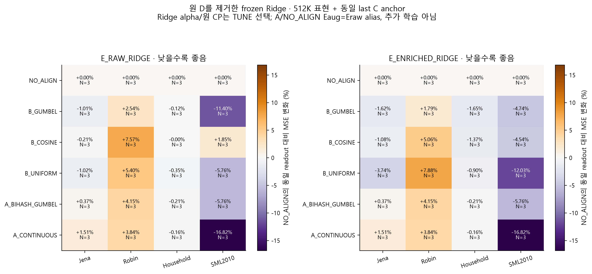
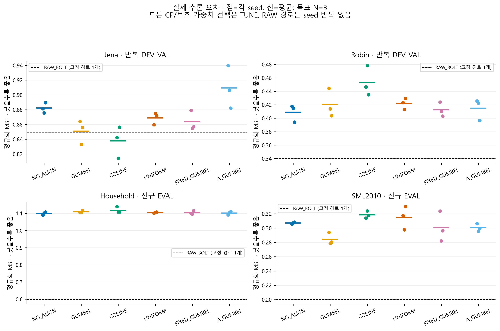
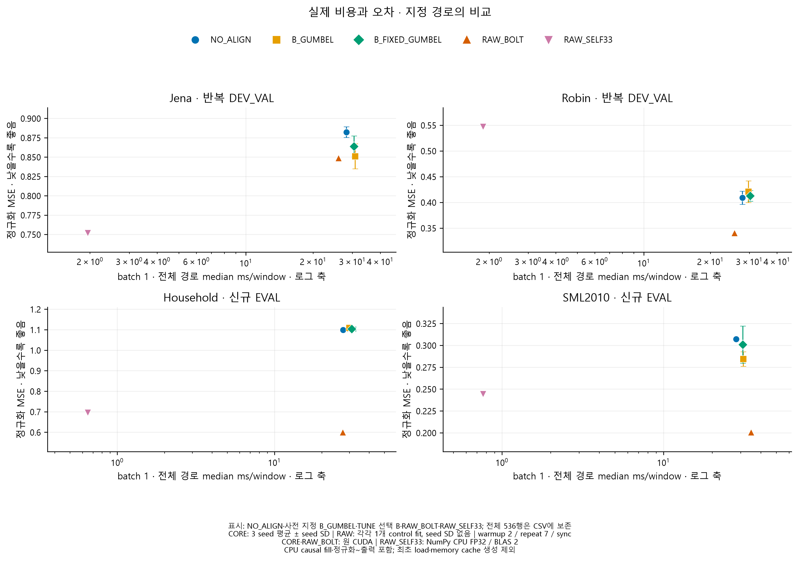
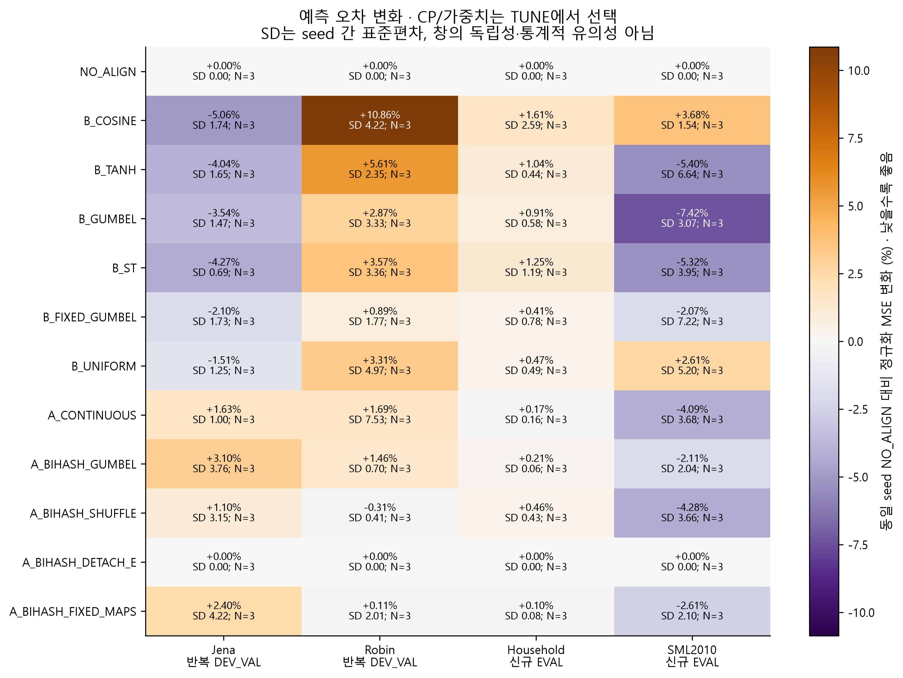
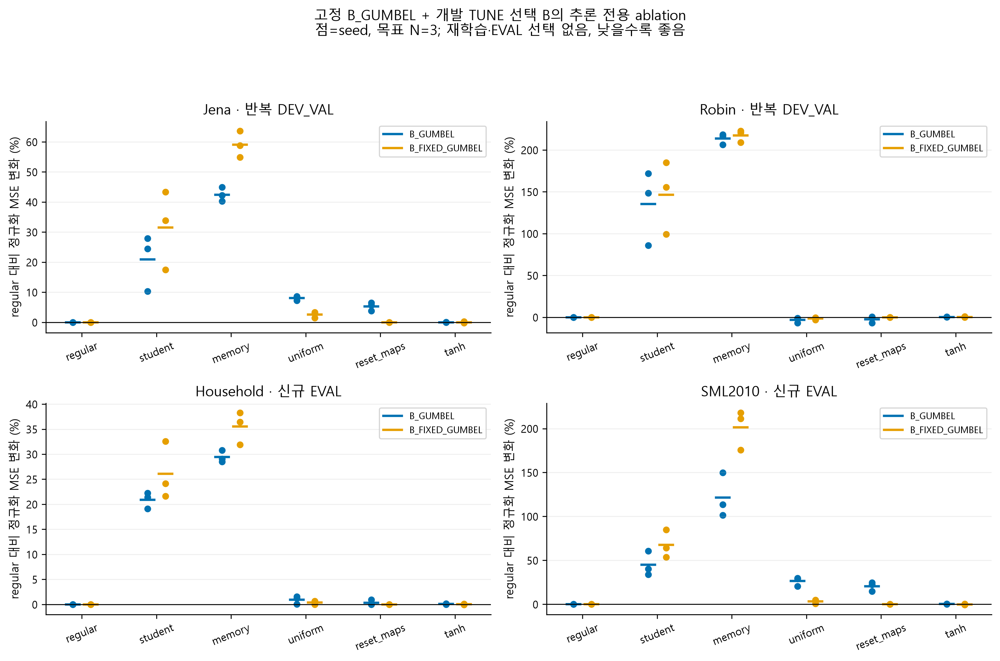
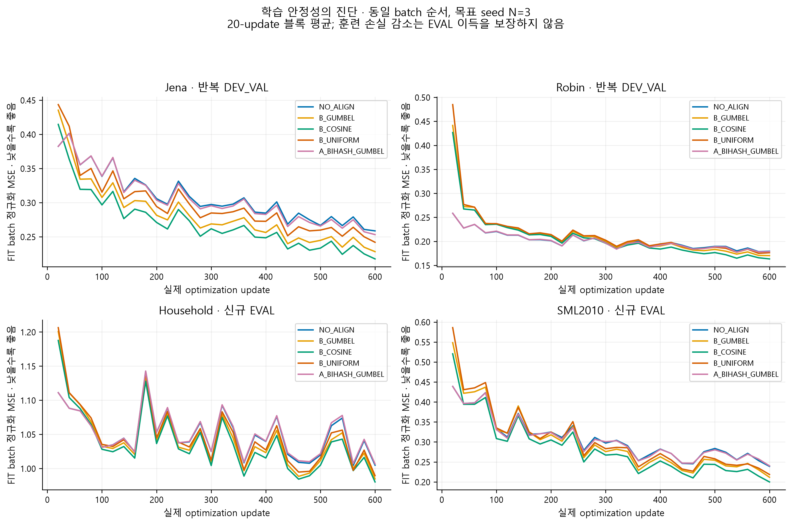

> 게시용 링크 복사본입니다. 아래 원수치·본문은 원 보고서를 유지하고 링크 경로만 정리했습니다. 데이터·모델·NPZ는 로컬 재현 자산입니다. [봉인된 원본](../../../bihash_future_prediction_20261013/report_canonical_final_v2/REPORT_KO.md) SHA256 `951525f9ef3c883c56f0195482ba0b6bf6b5c9fd17feca46f58d75d6b00092e9`.

# 과거 전용 Bi-Hash 미래 표현 실험 결과

**실제 상태: 실행 목록 충족, 감사의 선언된 범위에서 통과.**

이 실험은 ExoTimer 원형 전체 재현이 아니다. 논문 식 13–16의 두 학습 가능한 hash 경계, continuous feature 조회, 양방향 fusion, 두 예측 결합을 FIT의 historical future-pattern memory에 적용한 **adaptation**이다. 원 텍스트 입력·LLM·공식 학습 코드를 재현했다고 주장하지 않는다.

이 문서는 Bi-Hash 하위 실험의 결과다. 기존 smallK의 모든 미해결 오류·지표 충돌·비용 문제나 전체 연구 목표의 완료를 뜻하지 않는다.

이번 FIT 통계는 복원한 physical FP32에서 다시 계산했고 core는 3 seed/batch8이다. 이전 smallK의 통계·2 seed/batch4 조건과 달라 서로 다른 보고서의 정규화 점수 차이를 측정된 방법 개선으로 해석하지 않는다. 같은 연구 안의 새 NO_ALIGN 및 RAW controls와만 대응 비교한다.

## 질문에 대한 답과 판단 범위

### 학습 가능한 경계와 표현이 예측에 도움이 되었는가?

TUNE에서 고정한 주 B 방법은 `B_FIXED_GUMBEL`이며, 사전 지정한 학습 가능 경계 `B_GUMBEL`과 구분한다. 선택 방법의 결과가 학습 가능한 maps의 효용을 대신 증명하지 않는다.

선택 B 대 동일 NO_ALIGN:

```text
jena: 0.863613 vs 0.882166; 대응 변화 -2.099%, seed SD 1.730%, N=3
robin: 0.412393 vs 0.408861; 대응 변화 +0.886%, seed SD 1.770%, N=3
uci235_household_hourly: 1.103674 vs 1.099155; 대응 변화 +0.412%, seed SD 0.776%, N=3
uci274_sml2010: 0.300658 vs 0.307057; 대응 변화 -2.069%, seed SD 7.219%, N=3
```

선택 B의 자료 안 효과: 신규 자료 간 평균 MSE 변화 방향이 다르다. 효과가 자료에 의존하며 일관된 개선으로 결론내릴 수 없다. jena: 대응 seed 개선 3/3; robin: 대응 seed 개선 1/3; uci235_household_hourly: 대응 seed 개선 1/3; uci274_sml2010: 대응 seed 개선 2/3.

사전 지정 B_GUMBEL 대 동일 NO_ALIGN의 실제 정규화 MSE 원수치 및 대응 seed 변화:

```text
jena: 0.850986 vs 0.882166; 대응 변화 -3.537%, seed SD 1.474%, N=3
robin: 0.420644 vs 0.408861; 대응 변화 +2.866%, seed SD 3.335%, N=3
uci235_household_hourly: 1.109166 vs 1.099155; 대응 변화 +0.912%, seed SD 0.576%, N=3
uci274_sml2010: 0.284261 vs 0.307057; 대응 변화 -7.417%, seed SD 3.067%, N=3
```

**자료 안의 효과 판단:** 신규 자료 간 평균 MSE 변화 방향이 다르다. 효과가 자료에 의존하며 일관된 개선으로 결론내릴 수 없다. jena: 대응 seed 개선 3/3; robin: 대응 seed 개선 1/3; uci235_household_hourly: 대응 seed 개선 0/3; uci274_sml2010: 대응 seed 개선 3/3.

정규화 MAE도 별도로 비교한다. 주 MSE 개선을 모든 오차 지표 개선으로 바꾸어 말하지 않는다:

```text
jena: 0.431452 vs 0.439682; 대응 변화 -1.866%, seed SD 2.095%, N=3
robin: 0.416749 vs 0.410269; 대응 변화 +1.596%, seed SD 1.384%, N=3
uci235_household_hourly: 0.677595 vs 0.668616; 대응 변화 +1.344%, seed SD 0.644%, N=3
uci274_sml2010: 0.322071 vs 0.336962; 대응 변화 -4.426%, seed SD 1.412%, N=3
```

양 hash 경계의 실제 gradient/parameter update gate: **PASS (선언된 검사 범위 안에서)**. 구현·gradient 검사 통과와 예측 이득은 별개다. 작은 3 seed 실험은 가능/불가능의 보편 증명이 아니며, 동일 조건 안의 효과 크기·반례를 판단하는 증거다.

### 실제 미래 누출이 있었는가?

독립 causality gate: **PASS (선언된 검사 범위 안에서)**. 신규 두 자료의 joint 선택 barrier: **PASS (선언된 검사 범위 안에서)**. 현재 query의 미래 정답·미래 missingness mask는 prediction forward에 들어가지 않으며, FIT memory는 `s+48 <= tau+1`을 만족할 때만 조회하도록 구현했다. 검사 판정은 실제 아래 감사 파일의 범위에 한정한다. 전용 gate가 없으면 누출 부재를 확정하지 않는다.

과거 입력 불변성 검사는 제공된 timestamp의 수치적 정보 가용성을 검사한다. 원 자료의 issued forecast 채널이 실제 언제 발행됐는지, 모든 채널의 의미적 가용성, Chronos-Bolt 사전학습 자료와의 중복까지 보증하지 않는다. 보호된 TEST를 새로 쓰지 않았다.

### 표현·잠재 예측·복원 중 어디에 문제가 남았는가?

동일 선택 CP의 Eraw 및 B의 Eaug를 고정하고, 원 D를 제거한 동일 Ridge로 미래 delta를 예측했다. 원 경로와 readout 경로를 나누어 아래 수치로 확인한다. Eraw+Ridge 이득은 frozen encoder의 이 readout에서의 예측 적합성, Eaug 대 Eraw 이득은 memory-enriched feature의 추가 유용성에 해당한다. 이 차이만으로 Bolt 단독 또는 D 단독을 원인으로 확정할 수 없다. E와 D가 이미 Bolt를 통해 최적화됐다는 조건도 남는다.

```text
jena:
  B_GUMBEL Bolt+D=0.850986 (N=3)
  B_GUMBEL Eraw+Ridge=1.023286 (N=3)
  B_GUMBEL Eaug+Ridge=1.017202 (N=3)
  RAW_BOLT=0.848632 (N=1)
  RAW_JOINT_RIDGE=0.947935 (N=1)
  RAW_BOLT_RAW_R=0.954765 (N=1)
  RAW_SELF33=0.751827 (N=1)
robin:
  B_GUMBEL Bolt+D=0.420644 (N=3)
  B_GUMBEL Eraw+Ridge=0.546929 (N=3)
  B_GUMBEL Eaug+Ridge=0.542332 (N=3)
  RAW_BOLT=0.340402 (N=1)
  RAW_JOINT_RIDGE=0.649439 (N=1)
  RAW_BOLT_RAW_R=0.430403 (N=1)
  RAW_SELF33=0.546924 (N=1)
uci235_household_hourly:
  B_GUMBEL Bolt+D=1.109166 (N=3)
  B_GUMBEL Eraw+Ridge=1.035810 (N=3)
  B_GUMBEL Eaug+Ridge=1.019975 (N=3)
  RAW_BOLT=0.599034 (N=1)
  RAW_JOINT_RIDGE=0.944393 (N=1)
  RAW_BOLT_RAW_R=0.726068 (N=1)
  RAW_SELF33=0.695652 (N=1)
uci274_sml2010:
  B_GUMBEL Bolt+D=0.284261 (N=3)
  B_GUMBEL Eraw+Ridge=0.606038 (N=3)
  B_GUMBEL Eaug+Ridge=0.652524 (N=3)
  RAW_BOLT=0.200380 (N=1)
  RAW_JOINT_RIDGE=0.459488 (N=1)
  RAW_BOLT_RAW_R=0.475793 (N=1)
  RAW_SELF33=0.244205 (N=1)
```



미래 AE의 full FIT/TUNE reconstruction·variance·rank는 [pretrain 진단](../../../bihash_future_prediction_20261013/report_canonical_final_v2/tables/future_ae_diagnostics.csv)에, 선택 CP의 소표본 진단은 [checkpoint 진단](../../../bihash_future_prediction_20261013/report_canonical_final_v2/tables/selected_diagnostics.csv)에 분리했다. 후자는 최대 8창/R32이므로 중심화 rank 상한이 최대 7이다. rank 7을 표현 붕괴로 해석하지 않는다. reconstruction 감소는 미래 예측 적합성의 보장이 아니다.

이번 REC는 FIT 미래 delta를 복원하는 phi 교사 AE의 손실이다. 과거 E를 입력 재구성만으로 학습한 실험이 아니며, E는 미래 forecast loss와 A의 정렬 목적 또는 B의 조회·fusion을 통해 학습된다. 따라서 이번 결과를 이전 입력 재구성 표현의 실패 원인에 대한 단독 인과 확인으로 바꾸어 말하지 않는다.

### 이산 Bi-Hash·대조 정렬이 꼭 필요한가?

B_COSINE, B_UNIFORM, B_FIXED_GUMBEL은 조회·fusion 용량을 맞춘 반례다. 고정 W_s/W_f에서도 E/phi/P가 학습되므로 전체 partition이 고정됐다는 뜻은 아니다. 경계의 gradient/update가 확인되어도 안정적인 예측 이득은 대응 결과로 별도 판단해야 한다. A_SHUFFLE과 DETACH_E는 미래 대응 관계와 encoder auxiliary gradient의 기여를 따로 확인한다. InfoNCE는 원 논문의 공식 loss가 아니라 이번에 추가한 목적이며, 비슷한 미래 패턴을 false negative로 만드는 문제가 남는다.

조회는 512 query rows × 최대 128 memory entries × 32 code dimensions의 dense 계산이다. 실제 bit packing·subquadratic 검색을 구현한 것이 아니므로 hash라는 이름에서 비용 절감을 추론하지 않는다. 서로 다른 learnable projection+bias에 무작위 공유 Gaussian LSH의 거리 보존 보장을 그대로 적용하지 않는다.

B_GUMBEL 대 B_COSINE:

```text
jena: 0.850986 vs 0.837596; 대응 변화 +1.616%, seed SD 1.439%, N=3
robin: 0.420644 vs 0.453273; 대응 변화 -7.049%, seed SD 6.499%, N=3
uci235_household_hourly: 1.109166 vs 1.116747; 대응 변화 -0.655%, seed SD 2.135%, N=3
uci274_sml2010: 0.284261 vs 0.318357; 대응 변화 -10.671%, seed SD 3.931%, N=3
```

B_GUMBEL 대 B_UNIFORM:

```text
jena: 0.850986 vs 0.868781; 대응 변화 -2.033%, seed SD 2.655%, N=3
robin: 0.420644 vs 0.421970; 대응 변화 -0.283%, seed SD 5.490%, N=3
uci235_household_hourly: 1.109166 vs 1.104249; 대응 변화 +0.445%, seed SD 0.525%, N=3
uci274_sml2010: 0.284261 vs 0.315072; 대응 변화 -9.641%, seed SD 4.681%, N=3
```

B_GUMBEL 대 B_FIXED_GUMBEL:

```text
jena: 0.850986 vs 0.863613; 대응 변화 -1.461%, seed SD 1.255%, N=3
robin: 0.420644 vs 0.412393; 대응 변화 +1.959%, seed SD 2.514%, N=3
uci235_household_hourly: 1.109166 vs 1.103674; 대응 변화 +0.499%, seed SD 0.263%, N=3
uci274_sml2010: 0.284261 vs 0.300658; 대응 변화 -5.270%, seed SD 3.977%, N=3
```

연속 kernel 대비: 두 신규 자료의 평균 MSE는 모두 감소했다. 이 두 분할에서의 긍정 증거이며, 전체 자료·목표 지표의 일관된 개선이나 보편적 가능성 증명은 아니다. jena: 대응 seed 개선 1/3; robin: 대응 seed 개선 3/3; uci235_household_hourly: 대응 seed 개선 2/3; uci274_sml2010: 대응 seed 개선 3/3.

균등 memory 대비: 신규 자료 간 평균 MSE 변화 방향이 다르다. 효과가 자료에 의존하며 일관된 개선으로 결론내릴 수 없다. jena: 대응 seed 개선 2/3; robin: 대응 seed 개선 1/3; uci235_household_hourly: 대응 seed 개선 1/3; uci274_sml2010: 대응 seed 개선 3/3.



A 학습 정렬의 예측 변화는 [선택된 core 원수치](../../../bihash_future_prediction_20261013/report_canonical_final_v2/tables/core_seed_metrics.csv)와 [대응 변화](../../../bihash_future_prediction_20261013/report_canonical_final_v2/tables/paired_changes.csv)에서 true/shuffle/detach/fixed를 함께 읽어야 한다. A의 미래 교사/phi/hash heads는 prediction forward에서 미사용이며 활성 추론 parameter에서 제외했다. 물리적으로 checkpoint/GPU 객체에서 삭제한 것은 아니고 registered parameters/bank buffers가 코레지던트 상태로 측정 peak memory에 남는다. B의 historical bank·fusion은 실제 예측 경로에서 사용한다.

A의 올바른 미래 대응 대 shuffle: 신규 자료 간 평균 MSE 변화 방향이 다르다. 효과가 자료에 의존하며 일관된 개선으로 결론내릴 수 없다. jena: 대응 seed 개선 1/3; robin: 대응 seed 개선 0/3; uci235_household_hourly: 대응 seed 개선 2/3; uci274_sml2010: 대응 seed 개선 1/3.

A의 encoder auxiliary gradient 대 DETACH_E: 신규 자료 간 평균 MSE 변화 방향이 다르다. 효과가 자료에 의존하며 일관된 개선으로 결론내릴 수 없다. jena: 대응 seed 개선 1/3; robin: 대응 seed 개선 0/3; uci235_household_hourly: 대응 seed 개선 0/3; uci274_sml2010: 대응 seed 개선 2/3.

선택 A_CONTINUOUS weight .1과 A hash군 weight .03은 auxiliary 강도가 다르다. 선택된 두 결과의 차이를 이산화 하나의 순수 인과 효과로 해석하지 않는다.

### Chronos-Bolt를 유지할 근거가 있는가?

RAW_BOLT, RAW_BOLT_RAW_R, RAW_JOINT_RIDGE, RAW_SELF33과 각 encoder Ridge의 실측 오차·전체 추론 비용을 함께 비교한다. native Ridge는 별도 predictor를 FIT/TUNE으로 학습하므로 동일 함수의 Bolt 제거 ablation은 아니다. 단순 predictor가 더 좋으면 이 설정에서 백본 유지의 효용이 약해지는 근거가 되지만, 모든 TSFM의 일반적 무용성을 뜻하지 않는다.

표현 간 readout 비교는 동일 512K+last C 폭을 사용한다. RAW_JOINT_RIDGE/RAW_SELF33은 32개 과거 block mean+last value를 쓰므로 표현 readout과 feature 폭·시간 해상도·head parameter 수가 같지 않다. 이 raw controls는 실용 대안이며, capacity를 완전히 맞춘 단일 원인 검사가 아니다.



## 비교 조건과 선택 절차

모든 core: L512/H48, K=max(1,floor(C/4)), 동일 trainable causal encoder·nonlinear decoder·last C anchor, frozen Chronos-Bolt-small, AdamW lr .001/wd0, batch8, 실제 600 update, 별도 codec/side clip1, 동일 비중첩 future batch order. future AE는 FIT만으로 400 update/batch64 pretrain하고 core REC weight .1을 공통 적용했다. PCA는 초기화이고 이후 E는 학습된다. strict K-only 배포를 주장하지 않는다.

CP 0/100/200/400/600은 실제 TUNE 관측 채널 균등 정규화 MSE로 선택하고 tie는 이른 CP다. A weight .03/.1 및 주 B 방법도 Jena/Robin TUNE에서만 고정했다. DEV_VAL은 이미 반복 확인한 개발 결과다. 신규 Household/SML2010은 두 자료의 core/readout/control을 모두 고정한 joint barrier 이후 EVAL을 열어야 한다. joint 감사 없이는 신규 독립 검증 통과를 주장하지 않는다.

실제 TUNE 선택 B: `B_FIXED_GUMBEL`. 실제 A weights: `{"NO_ALIGN": 0.0, "A_BIHASH_DETACH_E": 0.03, "A_BIHASH_FIXED_MAPS": 0.03, "A_BIHASH_GUMBEL": 0.03, "A_BIHASH_SHUFFLE": 0.03, "A_CONTINUOUS": 0.1, "B_COSINE": 0.0, "B_FIXED_GUMBEL": 0.0, "B_GUMBEL": 0.0, "B_ST": 0.0, "B_TANH": 0.0, "B_UNIFORM": 0.0}`.

주지표는 FIT 통계로 정규화한 관측 채널 균등 MSE다. 원단위 channel macro는 한 자료 안의 진단이며, 서로 다른 단위의 채널·자료를 원단위로 합산해 순위를 만들지 않는다. SD는 3개 seed의 기술 통계이고 겹치는 시계열 창이 독립 표본이라는 뜻이 아니다.

SML2010의 실제 제공 평가 origin 수는 seed당 `[19]`창이다. 3 seed가 같은 평가 창을 쓰므로 3배의 독립 시계열 표본으로 계산하지 않는다.

L/H는 step 수다. 시간별 Household의 H48은 48시간, 15분 SML2010의 H48은 12시간이므로 동일한 실시간 예측 horizon이 아니다. Jena/Robin의 실제 빈도는 보존된 계약 범위를 확인하며 미확인 빈도를 추정하지 않는다. 자료 간 절대 수치보다 각 자료 안의 동일 조건 대응 비교를 해석한다.

## 실제 결과와 진단





hash군의 배포 regular는 deterministic sign이고, B_COSINE은 연속 projected cosine, B_UNIFORM은 eligible memory 균등 조회다. inference-only tanh는 동일 선택 모델의 sign 조회를 noise-free tanh(I/.25) 조회로 바꾼 민감도 진단이다. 이 tanh 변형 자체는 실제 Gumbel-noise train mode와 배포의 차이를 직접 측정한 것이 아니며, 별도 실제 gap의 제공 여부·측정 범위는 아래에서 구분한다. EVAL에서 재학습·최선 variant 선택을 하지 않는다. Tanh가 더 좋아도 새 deployment 선택의 독립 검증이 아니다. student/memory 단독은 branch 제거 효과를 보여주며 모든 차이를 hash 하나에 귀속시키지 않는다.

B의 student-only 분기도 이미 memory를 조회해 보강한 Eaug를 Bolt에 넣는다. student와 memory 분기는 결합 손실로 공동 학습됐으므로, 단독 분기의 높은 오차와 fused의 낮은 오차는 공동 적응과 상보적 결합을 함께 반영한다. 각 분기의 독립적인 예측 적합성이나 bare E→Bolt 경로의 효과로 해석하지 않는다.

### 실제 학습 코드와 배포 sign 차이: FIT 진단

별도 실제 status `COMPLETE`, coverage `COMPLETE_ACTUAL_48X8_FIT_DIAGNOSTIC`: 완료 조건 `48/48`, 실제 training-mode draw `384/384`, 실패 기록 `0`개다. 부분·불일치 coverage는 전체 완료로 읽지 않는다.

같은 선택 CP, 사전 고정 마지막 8 FIT 창(248..255), 동일 target/mask에서 원 모델의 full train mode와 frozen eval Chronos-Bolt를 실제 연결해 예측했다. optimizer·가중치 갱신·새 CP 선택은 없다. primary 온도는 `temperature(selected_update)`로 u100=.875, u200=.75, u400=.5, u600=.25다. 선택된 고정 가중치와 CP noise counter를 이어 쓴 forward 진단이며, 과거 마지막 optimizer step(update-1)의 재연은 아니다. 고정 .25 inference-only tanh와 이 선택-update 학습 tanh를 구분한다.

```text
dataset                  method          N  sign_MSE       train_MSE      train-sign(%)  query_flip(%)
jena                     B_GUMBEL        3  0.417802935    0.4281347211   2.47288501     14.75118001  
jena                     B_ST            3  0.4223130609   0.436791081    3.428267187    14.42543666  
jena                     B_FIXED_GUMBEL  3  0.4365468816   0.4565659731   4.58578273     20.9839503   
jena                     B_TANH          3  0.3872790751   0.3771023361   -2.627753375   0            
robin                    B_GUMBEL        3  0.08328237356  0.08463809385  1.627859808    24.67590968  
robin                    B_ST            3  0.08273142459  0.08413524283  1.696837978    23.51214091  
robin                    B_FIXED_GUMBEL  3  0.08579610806  0.08644827487  0.7601356632   29.75931168  
robin                    B_TANH          3  0.08714807978  0.08151142173  -6.467908495   0            
uci235_household_hourly  B_GUMBEL        3  0.8676304231   0.8696336328   0.2308828371   18.18796794  
uci235_household_hourly  B_ST            3  0.8638726047   0.8673652501   0.4043009778   16.71444575  
uci235_household_hourly  B_FIXED_GUMBEL  3  0.8610339294   0.8678284853   0.7891159303   26.97703044  
uci235_household_hourly  B_TANH          3  0.8805431426   0.8795230037   -0.1158533702  0            
uci274_sml2010           B_GUMBEL        3  0.09557832727  0.09630295001  0.7581454412   14.56209819  
uci274_sml2010           B_ST            3  0.09297004173  0.09407738096  1.191071022    14.76949056  
uci274_sml2010           B_FIXED_GUMBEL  3  0.1002675034   0.1008951842   0.6260061629   25.84511439  
uci274_sml2010           B_TANH          3  0.09826766964  0.09648224306  -1.816901314   0            
```

여기서 training-vs-sign(%)는 자료별 seed 평균 MSE의 비율이다. 실제 코드 flip·예측 차이는 train/deploy 불일치의 존재를 보여주지만, 이 차이가 기존 성능 실패의 원인임을 증명하지 않는다. noisy training보다 sign의 FIT MSE가 낮은 경우는 sign 전환이 오차를 악화시킨다는 주장에 대한 반례다. B_TANH에서는 sign flip이 0이어도 코드 크기·cosine 각도가 달라질 수 있다.

실제 train-mode의 memory 재계산과 cached sign 예측의 최대 차이 `0`. 원 저장 선택 FIT NPZ와 새 sign 예측의 최대 차이는 연결된 worker 수치 재검산에 기록된 `0`이다. 미기록 수치를 0으로 대체하지 않는다. 각 draw 후 CP state/buffer/counter 복구와 backbone/source SHA 검사는 원 결과의 evidence를 따른다.

구현 worker의 CPU 원수치 재검산 status `PASS`, checks `1915`, 해당 RESULT SHA 연결 일치 `True`. 이는 별도 agent의 최종 독립 validator를 대신하지 않으며 전체 감사 gate의 판정과 구분한다.

두 범주의 logits `[I,-I]`와 독립 표준 Gumbel에서 sign flip의 이론 확률은 `sigmoid(-2|I|)`다. 공통 양의 온도 감소는 argmax noise flip을 제거하지 않는다. 원 구현의 uniform clamp·FP32 rounding 및 유한 draw 변동을 함께 기록한다.

이 표는 FIT mechanism 진단이며 heldout/EVAL 예측 성능 검증이나 새 배포 방식 선택이 아니다. 8 noise draw는 독립 학습 seed가 아니고 FIT 창은 시간 중첩을 가질 수 있다. 기존 입력 재구성 실패·전체 방법의 가능/불가능·모든 데이터의 원인을 이 결과로 확정하지 않는다. EVAL target/TEST를 이 진단에서 열거나 hash하지 않았다. shared legacy TRAIN/DEVVAL 및 fresh FIT/TUNE 압축 컨테이너의 물리적 decompress 범위와 FIT 창 사용을 원 기록에서 구분했다.

관련 원본: [원 RESULT](../../../bihash_future_prediction_20261013/train_deploy_gap_v1/actual_selected_v1/RESULT.json), [한국어 상세 분석](../../../bihash_future_prediction_20261013/train_deploy_gap_v1/actual_selected_v1/ANALYSIS_KO.md), [조건별 원수치](../../../bihash_future_prediction_20261013/train_deploy_gap_v1/actual_selected_v1/CONDITION_METRICS_v1.csv), [자료·방법별 요약](../../../bihash_future_prediction_20261013/train_deploy_gap_v1/actual_selected_v1/GROUP_SUMMARY_v1.csv), [worker CPU 수치 재검산](../../../bihash_future_prediction_20261013/train_deploy_gap_v1/actual_selected_v1/NUMERIC_RECHECK_v1.json), [실제 실행 소스](../../../bihash_future_prediction_20261013/measure_train_deploy_gap.py), [별도 GPU process receipt](../../../bihash_future_prediction_20261013/resources/15692_1791917206960735400_train_deploy_gap_actual_selected_v1.json).

추가 GPU/CPU terminal receipts는 기존 자원 표에서 실제 경로당 한 번만 계산한다. 원 결과/수치 재검산의 인용이나 function-body wall을 해당 process receipt에 다시 더하지 않는다.



실제 raw curve·gradient norm·main/aux gradient cosine·hash entropy/occupancy·retrieval weights·alpha는 아래 CSV에 남긴다. 진단 중 일부는 선택 CP의 첫 8창이므로 전체 분포의 추정으로 확대하지 않는다.

FIT memory-key 진단 실제 status `COMPLETE_INPUT_COVERAGE`, 제공된 core case `174/174`.

선택적 [전체 FIT memory-key 진단](../../../bihash_future_prediction_20261013/report_canonical_final_v2/tables/hash_memory_diagnostics.csv)은 미래 AE의 동일 초기 clone, bank 불변, W_s/W_f/phi 변화, positive fraction·bit entropy·collision·sign margin·CPU/GPU cache 일치를 구분한다. collision 감소나 경계 parameter update는 그 자체로 forecast utility가 아니다. NO_ALIGN/A/B_UNIFORM의 hard keys는 배포에서 사용하지 않으며, B_COSINE의 hard-code 값은 counterfactual 진단이다. 전체 coverage가 없으면 부분 진단으로만 읽는다.

## 추가 진단: 확인한 현상과 아직 확인하지 않은 원인

### 디코더 bias: 수학적 취소와 실제 FP32 update는 다르다

진단 status `COMPLETE`. 실제 Jena NO_ALIGN CP0→600에서 두 최종 affine bias의 변경 scalar 합 `42`, 최대 절대 drift `0.008123568259`를 기록했다. `x_last+D(future)-D(last)`의 정확한 실수 연산에서 최종 bias 미분은 0이지만, FP32의 flat(B×H) 합과 nested(H→B) 합 순서가 다른 경우 작은 gradient와 AdamW update가 남았다.

- CP600/B8/torch.float32/저장 FIT residual Jacobian replay: bias gradient 최대 `9.313225746e-10`, fresh AdamW 1 step 변화 최대 `8.519762196e-05`.
- CP600/B8/torch.float64/저장 FIT residual Jacobian replay: bias gradient 최대 `1.734723476e-18`, fresh AdamW 1 step 변화 최대 `1.734723476e-13`.

저장 tensor readout 감사 status `PASS`, 검사 수 `144`. 실제 decoder와 FIT residual을 사용했지만 K latent는 synthetic이며 실제 E/F 출력이 아니다. 과거 GPU gradient tensor/kernel replay가 아니고, 600-step drift 전체 원인·예측 실패 원인·bias 제거의 성능 이득을 확정하지 않는다. restored AdamW 조건은 기존 momentum 자체로 update를 만들 수도 있다.

structural active parameter 계산에서 bias를 수학적으로 빼는 것은 실제 FP32 parameter가 불변이거나 관련 연산 비용이 0이라는 뜻이 아니다. 이번 진단에서 과학 학습 소스·체크포인트를 수정하지 않았다.

[상세 보고서](../../../bihash_future_prediction_20261013/decision_checks_v1/decoder_bias_v1/reproduction_v1/REPORT_KO.md) · [원수치/SHA](../../../bihash_future_prediction_20261013/decision_checks_v1/decoder_bias_v1/reproduction_v1/RESULT.json) · [저장 배열 감사](../../../bihash_future_prediction_20261013/decision_checks_v1/decoder_bias_v1/reproduction_v1/ARRAY_READOUT_AUDIT.json)

### PCA와 median: 변환 순서만으로 MSE·MAE가 갈릴 수 있다

합성 진단 status `PASS`, 실제 true checks `9/9`. 모든 예측이 **같은 과거 조건 X를 이미 알고 있다**고 가정한 정확한 조건부 미래 분포의 반례다. 실제 과거 압축으로 인한 conditioning 정보 손실과 Chronos 모델 오차는 포함하지 않았다.

원 채널별 median의 MSE/MAE `35/3.5`가 latent median 선형 복원에서는 `25/5`였다. RAW point forecast가 rank1로 정확히 표현돼도 투영된 분포의 median을 그대로 역투영하면 같아지지 않는다.

동일 조건부 분포에서는 선형 P에 대해 `E[P Y | X]=P E[Y | X]`가 성립한다. 이 사실은 실제 학습된 예측기에 대한 `F(PX)=P F(X)`를 보장하지 않는다. 평균과 분위수 목적 차이를 구분하는 반례이며, 실제 Robin/Beijing/Appliances 실패 원인을 확인한 것이 아니다. D 학습이나 calibration으로 보정할 가능성이 남으므로 구조적 복원 불가능성으로 결론내리지 않는다.

[합성 반례 보고서](../../../bihash_future_prediction_20261013/decision_checks_v1/quantile_projection_example_v1/REPORT_KO.md) · [정확한 분포·원수치·소스 SHA](../../../bihash_future_prediction_20261013/decision_checks_v1/quantile_projection_example_v1/RESULT.json)

### 기존 자산 보존: 중간 시점 receipt

보존 검사 status `PASS`, 실제 checked artifacts `2347/2347`, HEAD `95585946f99da9b50cbdadcadd7441ccbf6ff2e5`. 이 중간 시점 검사는 최종 보고서 시점의 보존 재검사를 대신하지 않는다. 전체 working tree가 깨끗하다는 의미나 연구 전체 완료로 확대하지 않는다.

[중간 시점 보존 검사 원문](../../../bihash_future_prediction_20261013/decision_checks_v1/preservation_current_v1/RESULT.json)

### 기존 자산 보존: 최종 역할 receipt

보존 검사 status `PASS`, 실제 checked artifacts `2347/2347`, HEAD `95585946f99da9b50cbdadcadd7441ccbf6ff2e5`. 최종 역할로 제공된 receipt가 검사한 파일 범위와 status에 한정한다. 전체 working tree가 깨끗하다는 의미나 연구 전체 완료로 확대하지 않는다.

[최종 역할 보존 검사 원문](../../../bihash_future_prediction_20261013/decision_checks_v1/preservation_final_v1/RESULT.json)

### Query 해시 차원: 연속 Linear의 affine 경계

실제 진단 status `COMPLETE_AVAILABLE_CASE_DIAGNOSTIC`, 해당 실행 시점 필수 DEV/SML `18/18`, 당시 존재한 Household `3/6`조건만 읽었다. 나중에 생성된 조건으로 당시 범위를 채우지 않는다.

K→R32 projection과 R32→32 hash 사이에 비선형 함수가 없으므로 effective map은 WsP이고 rank≤K다. B는 WsP z+Ws bP+bs, A의 last+mean auxiliary는 WsP(z_last+mean z)+2Ws bP+bs다. R32가 affine query 입력 정보 차원을 증가시키지 않는다는 구조적 확인이다.

K1의 32-bit deterministic sign은 정확 산술에서 최대 33 query code다. 학습된 memory keys와 가용성 mask를 고정한 검색 점수 경로의 경계이며 Gumbel noise 학습에는 적용되지 않는다. 일반 K의 전체 hyperplane code 수를 주장하지 않는다.

아래 code 수와 parity는 모두 synthetic latent이다. 실제 데이터 code coverage·독립 일반화·성능 실패 원인 검사가 아니다. 임계값 근처 FP32 rounding으로 sign이 달라질 수 있다. 전체 예측은 시간 encoder, continuous S/fusion, raw-last anchor와 시점별 memory mask도 사용하므로 전체 forecasting capacity 붕괴를 뜻하지 않는다. A hash는 학습 보조 경로이며 배포 때 제거된다.

```text
dataset                  method           seed   K  rank  FP32_gap                synthetic_codes_FP32
jena                     B_GUMBEL         92601  5  5     1.2689907364915598e-06  238                 
jena                     A_BIHASH_GUMBEL  92601  5  5     1.680501509504495e-06   245                 
jena                     B_GUMBEL         92602  5  5     1.071440903110954e-06   236                 
jena                     A_BIHASH_GUMBEL  92602  5  5     1.6594274176995327e-06  246                 
jena                     B_GUMBEL         92603  5  5     9.490723376082144e-07   246                 
jena                     A_BIHASH_GUMBEL  92603  5  5     1.566464305824411e-06   234                 
robin                    B_GUMBEL         92601  4  4     1.0249019428698602e-06  228                 
robin                    A_BIHASH_GUMBEL  92601  4  4     2.4982179098742563e-06  191                 
robin                    B_GUMBEL         92602  4  4     6.025699055278722e-07   231                 
robin                    A_BIHASH_GUMBEL  92602  4  4     1.5727927404896036e-06  231                 
robin                    B_GUMBEL         92603  4  4     7.199665599255667e-07   236                 
robin                    A_BIHASH_GUMBEL  92603  4  4     8.632473429415199e-07   215                 
uci274_sml2010           B_GUMBEL         92601  5  5     1.844820769925093e-06   231                 
uci274_sml2010           A_BIHASH_GUMBEL  92601  5  5     9.600383226171516e-07   230                 
uci274_sml2010           B_GUMBEL         92602  5  5     7.978199079161641e-07   222                 
uci274_sml2010           A_BIHASH_GUMBEL  92602  5  5     1.7665999116900366e-06  220                 
uci274_sml2010           B_GUMBEL         92603  5  5     1.5210281727462416e-06  236                 
uci274_sml2010           A_BIHASH_GUMBEL  92603  5  5     1.6752308997780574e-06  227                 
uci235_household_hourly  B_GUMBEL         92601  1  1     6.430777311550173e-06   33                  
uci235_household_hourly  A_BIHASH_GUMBEL  92601  1  1     1.1369638102110002e-05  33                  
uci235_household_hourly  B_GUMBEL         92602  1  1     2.100675592942025e-05   33                  
```

진단의 raw dataset load `0`, EVAL target open `False`, GPU 실행 `False`. [상세 synthetic 진단](../../../bihash_future_prediction_20261013/decision_checks_v1/hash_query_capacity_v1/selected_maps_v2/REPORT_KO.md) · [원수치/SHA](../../../bihash_future_prediction_20261013/decision_checks_v1/hash_query_capacity_v1/selected_maps_v2/RESULT.json)

첫 `selected_maps_v1` 진단은 source snapshot 경로의 run_ prefix 실수로 `PARTIAL_OR_FAILED_DIAGNOSTIC_PRESERVED`, 실제 조건 `0`개였다. 이를 과학적 실패 결과로 쓰지 않고 실패 원문과 당시 source copy를 보존했다. 성공 v2와 실패 v1의 CPU 영수증은 각 실행을 한 번만 계산하며, 포함된 main wall을 process wall에 다시 더하지 않는다. [원 v1 기록](../../../bihash_future_prediction_20261013/decision_checks_v1/hash_query_capacity_v1/selected_maps_v1/RESULT.json)

[실패 시점 source copy/SHA 보존](../../../bihash_future_prediction_20261013/decision_checks_v1/hash_query_capacity_v1/selected_maps_v1/SOURCE_PRESERVATION.json)

추가 진단들은 [추가 근거 provenance](../../../bihash_future_prediction_20261013/report_canonical_final_v2/tables/additional_evidence_provenance.csv)에 파일 SHA·선언된 소스 SHA·현재 파일 일치를 남겼다. 진단 상태와 적용 범위를 Bi-Hash의 실제 예측 유용성이나 독립 일반화 gate 대신 사용하지 않았다.

## Fresh 복구 계보: 원 실패와 새 완료를 함께 보존

병합 결과의 COMPLETE는 검산된 과학 실행 범위의 합집합을 뜻한다. 원 실행의 FAILED_PRESERVED를 COMPLETE로 바꾸지 않았으며, 과거 실패를 미해결 실패와 구분한다.

```text
tag                    original_terminal_status  case_count  future_AE_count  GPU_wall_seconds    result_sha256                                                   
fresh_v1               FAILED_PRESERVED          36          3                1764.0517187900841  5f3a79224f6bb01265c369150027c5499e6e9d6cdbf6505a8b6fd608dd034a0a
household_recovery_v1  COMPLETE                  36          3                1755.1209463495761  6ad69bf599fd41356f20865052d39be92a3fa8b7d25ffcdc4858a68d7a1a110f
```

SML의 원 실행 결과는 재학습 없이 재사용했다. Household는 동일 봉인 코드·METHOD_LOCK 조건에서 별도 실행한 결과다. 병합은 새 모델 학습이나 선택을 하지 않으며, source snapshot·각 원 RESULT·case JSON SHA를 계보 표에 남겼다.

병합의 새 학습 update `0`, 원 GPU wall 합계 요약 `3519.172665`초, 별도 CPU 병합 receipt `22.25272812`초. GPU 합계 요약은 새로운 자원 사용이 아니며 두 원 GPU 영수증은 실제 경로당 한 번만 계산하고 CPU 병합과 분리했다.

[원 producer 계보](../../../bihash_future_prediction_20261013/report_canonical_final_v2/tables/recovery_producers.csv), [case 계보](../../../bihash_future_prediction_20261013/report_canonical_final_v2/tables/recovery_case_lineage.csv), [AE 계보](../../../bihash_future_prediction_20261013/report_canonical_final_v2/tables/recovery_AE_lineage.csv), [복구된 과거 실패](../../../bihash_future_prediction_20261013/report_canonical_final_v2/tables/recovered_failed_paths.csv).

추적 가능한 [원 자료 수리 receipt](../../../bihash_future_prediction_20261013/ingest_repairs_v1/household_download_v1_TERMINAL.json): status `COMPLETE`, tag `household_download_v1`, SHA `4b5c115fdec8f1298324ba64d0ef835a4956a3f50d93d6068f7f083170fc1846`, 기록된 non-GPU phase wall `3.121155739`초. 이는 자료 다운로드/메타데이터 수리이며 새 학습·EVAL 검사가 아니다.

- `fresh_v1`: [원 RESULT](../../../bihash_future_prediction_20261013/run_fresh_v1/RESULT.json) status `FAILED_PRESERVED`, SHA `5f3a79224f6bb01265c369150027c5499e6e9d6cdbf6505a8b6fd608dd034a0a` · [원 GPU receipt](../../../bihash_future_prediction_20261013/resources/15532_1791911272885376500_fresh_v1.json)

- `household_recovery_v1`: [원 RESULT](../../../bihash_future_prediction_20261013/run_household_recovery_v1/RESULT.json) status `COMPLETE`, SHA `6ad69bf599fd41356f20865052d39be92a3fa8b7d25ffcdc4858a68d7a1a110f` · [원 GPU receipt](../../../bihash_future_prediction_20261013/resources/43424_1791913067341925900_household_recovery_v1.json)

## 실행 범위·감사·자원·미완료

```text
item                           actual  planned
DEV core fits                  102     102    
Fresh core fits                72      72     
Core fits at 600 updates       174     174    
Future AE fits at 400 updates  12      12     
Saved core TUNE CP arrays      870     870    
Readout conditions             72      72     
Unique Ridge readout fits      108     108    
Scientific readout outputs     144     144    
Evaluated selected core cases  144     144    
Raw control paths              16      16     
Cost rows                      536     536    
```

```text
stage     status  
dev       COMPLETE
fresh     COMPLETE
probes    COMPLETE
evaluate  COMPLETE
cost      COMPLETE
```

독립 감사 status `PASS_WITH_DECLARED_BATCH_REFERENCE_AND_CPU_HEAD_IMPLEMENTATION_ADAPTER`, check_count `194985`, failed_count `0`. 보고서 자체는 저장 NPZ를 다시 채점하고 SHA를 확인하지만, 이를 별도의 독립 일반화 검증이라고 부르지 않는다.

[사용한 최종 감사 원문](../../../bihash_future_prediction_20261013/report_canonical_final_v2/AUDIT_RESULT.json)과 [보고서 생성 manifest](../../../bihash_future_prediction_20261013/report_canonical_final_v2/MANIFEST.json)에 실제 입력 SHA·출력 SHA·재채점 범위를 기록했다.

### 전체 감사의 원 실패와 metadata 계약 수정

첫 전체 감사 v1은 감사 코드가 기존 자료에도 신규 평가 개봉 기록을 요구한 범위 오류와 진단 영수증의 상태 이름 불일치로 `3`개 검사가 실패했다. 동일 범위 오류가 원 검사와 gate에 각각 기록된 것이므로 서로 다른 원인 3개로 해석하지 않으며, 원 `FAIL` 영수증·로그·감사 소스를 보존했다.

전체 144개 모델의 사전 잠금은 유지하고 fresh 2자료의 최초 개봉 및 진단 입력범위 상태를 정확히 검사하도록 감사 코드만 수정했다. v2 전체 재검산 status `PASS_WITH_DECLARED_BATCH_REFERENCE_AND_CPU_HEAD_IMPLEMENTATION_ADAPTER`, 검사 `194985`, 실패 `0`이며 본 보고서 입력과 최종 감사 SHA 일치 `True`다.

별도의 `14`개 검사 supplement status `PASS_WITH_LIMITATIONS`, 실패 `0`는 v1/v2의 원 결과·원수치·배포/비용 증거가 동일하고 학습·자료·허용오차가 바뀌지 않았음을 확인한다. 원 v1 자체를 PASS로 바꾸지 않으며 예측 개선이나 일반화의 추가 증거로 사용하지 않는다.

[원 v1 FAIL 감사/SHA](../../../bihash_future_prediction_20261013/validation_v1/PRIMARY_FULL_AUDIT_v1.json) · [최종 v2 감사/SHA](../../../bihash_future_prediction_20261013/validation_v1/PRIMARY_FULL_AUDIT_v2.json) · [수정 검산·CPU accounting supplement/SHA](../../../bihash_future_prediction_20261013/validation_v1/PRIMARY_FULL_AUDIT_REPAIR_AND_CPU_ACCOUNTING_v1.json) · [감사 수정 계보](../../../bihash_future_prediction_20261013/report_canonical_final_v2/tables/full_audit_repair_provenance.csv).

기록된 독립 CPU audit/test body 합 `405.34144`초, supplement 자체 body `2.5342845`초, 별도 runtime CPU process 합 `163.2851401`초를 구분한다. 원 실패 실행도 한 번씩 계산하며 summary의 body 합을 각 원 영수증에 다시 더하지 않는다. 미계측 ad-hoc startup/test overhead는 추정하지 않는다.

비용은 batch1/8, warmup2/repeat7, CUDA sync의 median과 실제 repeat 값을 저장했다. CPU causal fill/FIT normalization/H2D/활성 경로/inverse normalization/D2H를 포함한다. 최초 disk/model load와 FIT memory-key precomputation은 측정 밖이므로 공짜라고 주장하지 않는다. VRAM/RSS는 백본과 전체 checkpoint가 함께 올라간 process 총량이며 경로의 전용 증가량이 아니다. parameter 수치는 adaptation module의 registered/학습 시작 시 trainable/deployment-active를 구분하며 frozen Bolt 본체 parameter 수를 포함하지 않는다. 추론 모드 requires_grad=False의 0을 학습 당시 trainable 수로 쓰지 않았다. deployment memory bytes도 별도로 남겼다.

canonical 비용의 선언 status `COMPLETE`, 보고서 계보·저장 출력 검산 범위 `VERIFIED_CANONICAL_536_WITH_RECORDED_RECEIPTS`.

현재 원 row 객체와 동일함을 검산한 CUDA CORE/RAW_BOLT `296/296`행과 CPU Ridge `240/240`행을 제공했다. 배포 계약은 모든 120 Ridge 경로 × batch1/8에 `cpu_numpy_fp32_ridge_v1` / NumPy CPU FP32 head / BLAS 2를 적용한다. 실패했던 일부 경로만 backend를 바꾸는 계약이 아니다. 백본·표현 경로의 CUDA 실행은 유지하며 backend와 thread 차이를 비용 비교 조건으로 공개한다.

원 404행 비용 실행 status `FAILED_PRESERVED`와 132행 보충 후 536행 CUDA 실행의 `40`개 Ridge physical FAIL / `FAILED_PRESERVED`는 원문·SHA와 함께 보존했다. 새 canonical COMPLETE는 새 배포 구현의 검산 범위이며 과거 FAIL을 PASS로 다시 표시하지 않는다.

physical parity는 independent 동일 batch 과학 API 참조에 기존 atol .002 / rtol 2e-5를 그대로 적용한다. 동일 batch 참조와 기존 bulk 예측은 기존 normalized atol 1e-5 / rtol 2e-6로 연결한다. 기존 bulk에 대한 physical FAIL은 별도 결과로 남기며 accuracy NPZ·점수·모델 선택을 바꾸지 않는다.

canonical의 가용 7회 timed 출력에서 기존 bulk physical 비교가 실패한 행은 `49`개다. 원 CUDA 536행의 40개 physical FAIL과 참조·구현·검사 모집단이 다르므로 같은 실패 개수로 합치거나 대체하지 않는다.

7회 실제 timed array 보존·재검산 가능 행: CPU Ridge `240/240`, 재사용 CUDA `72/296`. 첫 실행의 저장되지 않은 timed array를 별도 재추론으로 복원했다고 주장하지 않는다. [구현·timing producer 계보](../../../bihash_future_prediction_20261013/report_canonical_final_v2/tables/canonical_cost_timing_provenance.csv), [원 producer 상태](../../../bihash_future_prediction_20261013/report_canonical_final_v2/tables/canonical_cost_producers.csv), [원 CUDA 실패](../../../bihash_future_prediction_20261013/report_canonical_final_v2/tables/canonical_cost_preserved_failures.csv), [7회 출력 가용 범위](../../../bihash_future_prediction_20261013/report_canonical_final_v2/tables/cost_timed_output_availability.csv).

원 404행 비용 실행은 7회 timing/assert를 남겼지만 timed array를 모두 저장하지 않았다. 원 132행 보충 실행과 새 240행 CPU Ridge 실행은 7회 timed arrays를 저장했으며 canonical에서는 실제 채택한 원 row의 가용 범위만 계산한다.

원 실패·보충·새 CPU-head 비용 GPU process receipt `3/3`개와 별도 CPU merge receipt를 각각 한 번만 계산한다. timing mapping의 반복 receipt·원 wall 요약·median은 추가 process 비용이 아니다.

별도 deployment 출력 보존 실행 status `COMPLETE`, 실제 제공 경로 `536/536`; 독립 출력 parity gate: **PASS (선언된 검사 범위 안에서)**.

보고서가 실제 저장 출력으로 다시 계산한 critical parity `True`, 기존 bulk 대비 physical FAIL `49`행. 이 physical FAIL은 동일 batch 참조의 PASS와 별도로 보존하며, 새 참조 때문에 과거 bulk 판정이 바뀌었다고 쓰지 않는다. 실제 terminal GPU receipt 확인 `True`.

### 출력 검증의 runtime 제한 조정과 원 부분 실행

원 v2 출력 검증은 local `300`초 guard에서 `BUDGET_HELD_PRESERVED`로 종료했다. 저장 출력 `402/536`, 미완료 `134`개, 저장된 출력의 critical gate 모두 통과 `True`, failed_routes `0`개다. 이는 부분 출력의 상태이며 전체 경로 완료를 뜻하지 않는다.

원 부분 실행의 F-after SHA 존재 `False`, 한 process의 백본 before/after closure 확인 `False`. 누락된 F-after를 새 실행의 해시로 채우거나 이 원 기록을 COMPLETE로 승격하지 않는다.

조정은 새 단일 process의 local cap `600`초만 바꾸었다. 공유 GPU/campaign wall cap `14400/28800`초와 기록된 source16·수학·자료·모델 선택·허용오차 계약은 유지했다. 원 402개 출력과 새 출력을 합치지 않으며, 새 실행의 실제 terminal status `COMPLETE`, 저장 출력 `536/536`만 별도 판정한다.

원 부분 실행의 GPU process wall `300.9563533`초는 최종 실행의 성공 여부와 관계없이 영수증당 한 번 계산한다. 새 출력 검증 process의 비용도 별도 영수증으로 한 번 계산하며 536행 cost median에는 넣지 않는다. [cap 조정 원문/SHA](../../../bihash_future_prediction_20261013/DEPLOYMENT_PROOF_WALL_CAP_ADJUSTMENT_v1.json) · [원 부분 RESULT/SHA](../../../bihash_future_prediction_20261013/deployment_output_audit_batch_v2/outputs_batch_actual_v1/RESULT.json) · [원 GPU receipt](../../../bihash_future_prediction_20261013/resources/84128_1791920809317501000_outputs_batch_actual_v1.json) · [runtime provenance](../../../bihash_future_prediction_20261013/report_canonical_final_v2/tables/deployment_runtime_provenance.csv).

별도 deployment 검산은 동일한 과학 경로의 first 1/8창을 경로마다 한 번 더 추론해 실제 NPZ를 저장하고 독립 CPU로 대조하는 증거다. 이를 원 7회 timed output 전부의 재검산으로 부르지 않으며, 새 재추론 시간은 원 536개 cost rows/median에 섞지 않았다. 실제 참조가 동일 batch인 새 스키마와 기존 저장 prediction인 legacy 스키마를 CSV에서 구분한다. 별도 실행의 GPU 자원은 독립 receipt로 한 번 계산한다.

선행 파일럿은 200-update 보조 정렬과 학습 없는 사후 retrieval뿐이다. 그 NPZ 재채점·joint fusion·분리 gradient·source seal·자원·독립 평가 gate에는 결함이 있으며, 이번 주실험의 완료나 강한 불가능성 근거로 사용하지 않는다. 선행 파일럿 GPU receipt 합 475.524856초와 미계측 fixture reserve60초는 **측정과 예산 reserve를 분리**한다. 이번 실제 terminal 자원 영수증은 [자원 표](../../../bihash_future_prediction_20261013/report_canonical_final_v2/tables/resource_receipts.csv)에 연결했다.

별도 [CPU 자원 기록](../../../bihash_future_prediction_20261013/report_canonical_final_v2/tables/cpu_accounting.csv)은 terminal CPU receipts와 ledger 밖의 partial/final audit·decoder bias 진단을 파일/receipt 단위로 중복 없이 기록했다. 명시된 wall 수치의 누적 하한 `597.7332758`초, wall 지표 미기록/의미 미확정 행 `2`개다. 이는 CPU process time의 완전 계측이나 campaign wall이 아니다.

v1 실패와 v2 재검사는 각각 실제 status·SHA·elapsed를 보존했다. 하나의 CPU receipt에 포함된 function-body elapsed는 다시 합산하지 않으며, GPU producer receipt를 인용한 CPU validator의 별도 body wall은 구분한다. `cpu_seconds`의 의미나 빠진 startup/write 시간은 임의로 wall에 합치지 않는다. 이번 report 생성 함수의 wall은 MANIFEST에 별도로 기록하며, CSV 작성 전의 누적 표에 소급해 추정하지 않는다.

현재 입력의 미해결 failed_paths는 0개이며, 복구된 원 실패 `1`개는 위 계보와 원 FAILED_PRESERVED 기록에 별도로 보존했다. 실행 횟수 충족만으로 누출·수치·일반화 gate 통과를 대신하지 않는다.

## 재현 자료와 링크

GitHub에서 읽을 수 있도록 PNG/SVG·원 CSV·이 MD를 같은 report 폴더 안의 상대 경로로 연결했다. 대형 `.cache`의 PT/NPZ 경로는 CSV에 기록한 로컬 재현용 자산이며 GitHub에 올라갔다고 가정하지 않는다. 현재 보고서 생성은 commit/push를 수행하지 않는다.

- [core_seed_metrics.csv](../../../bihash_future_prediction_20261013/report_canonical_final_v2/tables/core_seed_metrics.csv)
- [core_summary.csv](../../../bihash_future_prediction_20261013/report_canonical_final_v2/tables/core_summary.csv)
- [paired_changes.csv](../../../bihash_future_prediction_20261013/report_canonical_final_v2/tables/paired_changes.csv)
- [checkpoint_tune_scores.csv](../../../bihash_future_prediction_20261013/report_canonical_final_v2/tables/checkpoint_tune_scores.csv)
- [training_curves.csv](../../../bihash_future_prediction_20261013/report_canonical_final_v2/tables/training_curves.csv)
- [selected_diagnostics.csv](../../../bihash_future_prediction_20261013/report_canonical_final_v2/tables/selected_diagnostics.csv)
- [future_ae_diagnostics.csv](../../../bihash_future_prediction_20261013/report_canonical_final_v2/tables/future_ae_diagnostics.csv)
- [representation_readout_metrics.csv](../../../bihash_future_prediction_20261013/report_canonical_final_v2/tables/representation_readout_metrics.csv)
- [raw_control_metrics.csv](../../../bihash_future_prediction_20261013/report_canonical_final_v2/tables/raw_control_metrics.csv)
- [cost_measurements.csv](../../../bihash_future_prediction_20261013/report_canonical_final_v2/tables/cost_measurements.csv)
- [resource_receipts.csv](../../../bihash_future_prediction_20261013/report_canonical_final_v2/tables/resource_receipts.csv)
- [execution_coverage.csv](../../../bihash_future_prediction_20261013/report_canonical_final_v2/tables/execution_coverage.csv)
- [data_contracts.csv](../../../bihash_future_prediction_20261013/report_canonical_final_v2/tables/data_contracts.csv)
- [method_selection.csv](../../../bihash_future_prediction_20261013/report_canonical_final_v2/tables/method_selection.csv)
- [inference_ablation_metrics.csv](../../../bihash_future_prediction_20261013/report_canonical_final_v2/tables/inference_ablation_metrics.csv)
- [audit_checks.csv](../../../bihash_future_prediction_20261013/report_canonical_final_v2/tables/audit_checks.csv)
- [failed_paths.csv](../../../bihash_future_prediction_20261013/report_canonical_final_v2/tables/failed_paths.csv)
- [recovered_failed_paths.csv](../../../bihash_future_prediction_20261013/report_canonical_final_v2/tables/recovered_failed_paths.csv)
- [recovery_producers.csv](../../../bihash_future_prediction_20261013/report_canonical_final_v2/tables/recovery_producers.csv)
- [recovery_case_lineage.csv](../../../bihash_future_prediction_20261013/report_canonical_final_v2/tables/recovery_case_lineage.csv)
- [recovery_AE_lineage.csv](../../../bihash_future_prediction_20261013/report_canonical_final_v2/tables/recovery_AE_lineage.csv)
- [data_repair_receipts.csv](../../../bihash_future_prediction_20261013/report_canonical_final_v2/tables/data_repair_receipts.csv)
- [hash_memory_diagnostics.csv](../../../bihash_future_prediction_20261013/report_canonical_final_v2/tables/hash_memory_diagnostics.csv)
- [deployment_output_records.csv](../../../bihash_future_prediction_20261013/report_canonical_final_v2/tables/deployment_output_records.csv)
- [deployment_runtime_provenance.csv](../../../bihash_future_prediction_20261013/report_canonical_final_v2/tables/deployment_runtime_provenance.csv)
- [full_audit_repair_provenance.csv](../../../bihash_future_prediction_20261013/report_canonical_final_v2/tables/full_audit_repair_provenance.csv)
- [canonical_cost_timing_provenance.csv](../../../bihash_future_prediction_20261013/report_canonical_final_v2/tables/canonical_cost_timing_provenance.csv)
- [canonical_cost_producers.csv](../../../bihash_future_prediction_20261013/report_canonical_final_v2/tables/canonical_cost_producers.csv)
- [canonical_cost_preserved_failures.csv](../../../bihash_future_prediction_20261013/report_canonical_final_v2/tables/canonical_cost_preserved_failures.csv)
- [cost_timed_output_availability.csv](../../../bihash_future_prediction_20261013/report_canonical_final_v2/tables/cost_timed_output_availability.csv)
- [additional_evidence_provenance.csv](../../../bihash_future_prediction_20261013/report_canonical_final_v2/tables/additional_evidence_provenance.csv)
- [cpu_accounting.csv](../../../bihash_future_prediction_20261013/report_canonical_final_v2/tables/cpu_accounting.csv)
- [train_deploy_gap_conditions.csv](../../../bihash_future_prediction_20261013/report_canonical_final_v2/tables/train_deploy_gap_conditions.csv)
- [train_deploy_gap_summary.csv](../../../bihash_future_prediction_20261013/report_canonical_final_v2/tables/train_deploy_gap_summary.csv)

- [01_core_mse_change.svg](../../../bihash_future_prediction_20261013/report_canonical_final_v2/figures/01_core_mse_change.svg)
- [02_hash_controls_seed_errors.svg](../../../bihash_future_prediction_20261013/report_canonical_final_v2/figures/02_hash_controls_seed_errors.svg)
- [03_frozen_readout_changes.svg](../../../bihash_future_prediction_20261013/report_canonical_final_v2/figures/03_frozen_readout_changes.svg)
- [04_inference_ablations.svg](../../../bihash_future_prediction_20261013/report_canonical_final_v2/figures/04_inference_ablations.svg)
- [05_training_main_loss.svg](../../../bihash_future_prediction_20261013/report_canonical_final_v2/figures/05_training_main_loss.svg)
- [06_accuracy_cost.svg](../../../bihash_future_prediction_20261013/report_canonical_final_v2/figures/06_accuracy_cost.svg)

[실험 계약](../../../bihash_future_prediction_20261013/PLAN_KO.md), [원형과 adaptation 구분](../../../bihash_future_prediction_20261013/SOURCE_NOTES_KO.md), [선행 파일럿 감사](../../../bihash_future_prediction_20261013/PILOT_AUDIT_v1.json).

[AAAI 공식 ExoTimer 논문](https://ojs.aaai.org/index.php/AAAI/article/view/39908/43869), [공식 저장소](https://github.com/graceLan1994/ExoTimer), [UCI Household](https://archive.ics.uci.edu/dataset/235/individual%2Bhousehold%2Belectric%2Bpower%2Bconsumption), [UCI SML2010](https://archive.ics.uci.edu/dataset/274/sml2010). 공식 저장소의 확인된 commit에서는 README/source-coming-soon만 확인됐으므로 원 코드 재현을 주장하지 않는다.

그림은 실제 설치를 확인한 `Malgun Gothic` 폰트를 사용했다. scientific-visualization·matplotlib skill의 색각 안전 palette, PNG+SVG, 축 단위/낮을수록 좋음, seed 점·SD·선택 출처 표기 원칙을 적용했다. 최종 과학적 해석은 finite benchmark 결과와 미확인 provenance의 범위를 유지한다.
