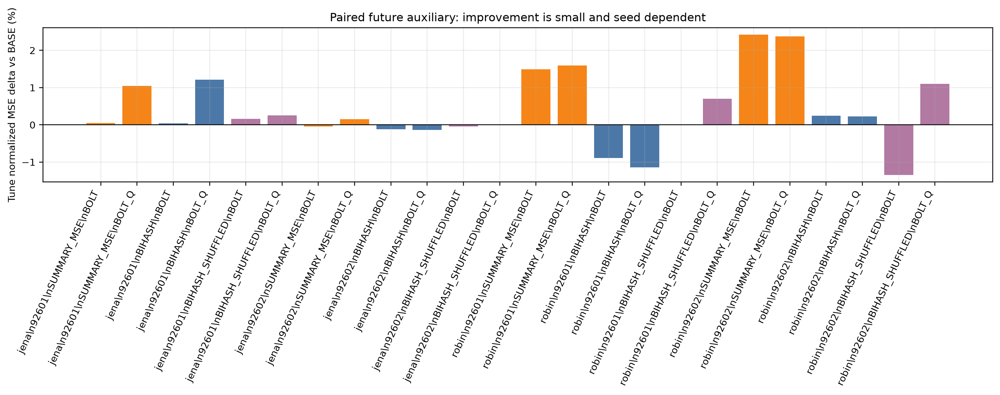
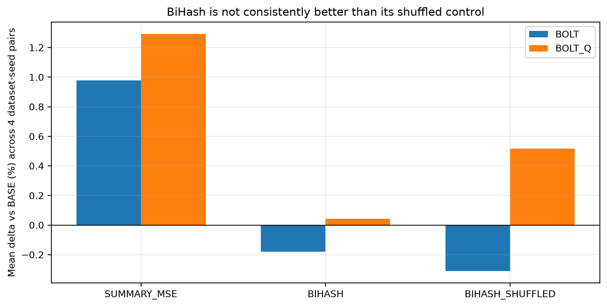
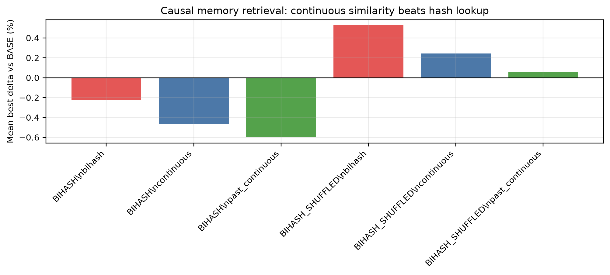
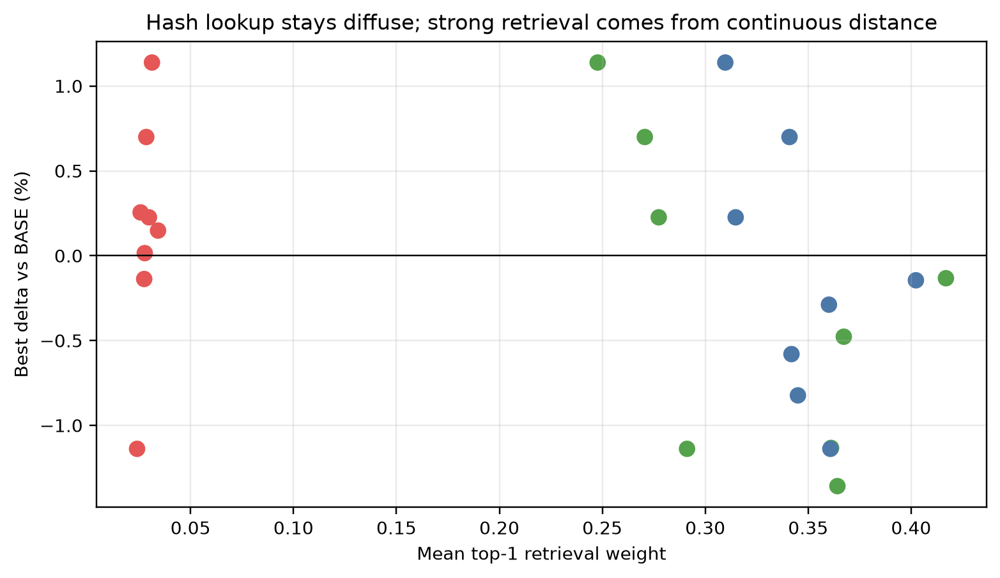

> 게시용 링크 복사본입니다. 아래 원수치·본문은 원 보고서를 유지하고 링크 경로만 정리했습니다. 데이터·모델·NPZ는 로컬 재현 자산입니다. [봉인된 원본](../../../bihash_future_alignment_20261013/report_v1/REPORT_KO.md) SHA256 `b51d650576725be281ed14ca946a4750834d27ce87a6bc2a66189e858c9f4d13`.

# Bi-Hash 미래 표현 정렬 파일럿 결과

## 결론

[확인] 이 실험에서 ExoTimer식 학습 가능한 hash projection은 실제로 학습되고 encoder/decoder에 gradient를 전달했다. fixture에서 hash 모듈 gradient 합은 13.281422, codec gradient 합은 0.838809였다.

[확인] 하지만 현재 설계로는 “미래 예측에 도움이 되는 표현을 안정적으로 만들 수 있다”는 결론까지 가지 못한다. 개발용 Jena/Robin 2자료 x 2seed에서 paired BiHash의 일반 BOLT 경로 평균 delta는 -0.179%이고, shuffled BiHash는 -0.310%였다. 평균만 보면 shuffled가 더 좋아 보이는 형태까지 나온다.

[확인] `BOLT_Q` 경로에서는 BiHash 평균 delta가 0.042%로 거의 0에 가깝지만, Robin seed92601만 -1.138% 개선이고 Robin seed92602는 +0.226% 악화다. seed 하나의 양성 신호는 있으나 반복되지 않았다.

[확인] 추론 때 실제로 쓸 수 있는 causal FIT memory retrieval에서는 hash lookup 자체가 약했다. BiHash mode의 top-1 retrieval weight는 대체로 0.02-0.03 수준이고 entropy는 약 5에 가까워 거의 퍼진 조회에 가깝다. 오히려 continuous similarity나 past-continuous similarity가 더 낫다. 이는 ExoTimer의 “학습 가능한 hash 경계”가 이 과거-미래 표현 문제에서 필요한 핵심 요소라고 보기 어렵다는 근거다.

[판단] 가능한가/불가능한가로 자르면, “구현 가능하고 일부 seed에서 작은 개선은 가능”하지만 “논문 기여로 밀 만큼 안정적인 방법은 현재 증거로는 불가능에 가깝다.” 더 유망한 방향은 BiHash 자체보다 causal memory retrieval 또는 continuous past-future similarity를 단순 baseline으로 먼저 세우는 것이다.

## 실험 계약

- 입력은 과거 512 step, 예측은 미래 48 step이다.
- 주지표는 TUNE normalized observed channel-macro MSE다.
- 보호 TEST는 접근하지 않았다. fixture와 실행 결과에 보호 경로 가드가 기록돼 있다.
- 개발용 Jena/Robin만 사용했다. 이전에 여러 번 본 자료이므로 독립 일반화 검증으로 부르지 않는다.
- 학습은 200 update, checkpoint 0/50/100/200, batch size 4, seed 92601/92602다.
- BASE와 동일한 `ANCHOR_NONLINEAR_D` 예측 경로 위에 보조 목적만 바꿨다.
- BiHash는 ExoTimer의 원래 LLM-text/time-series 모달리티 정렬 재현이 아니라, 과거 latent delta와 FIT 미래 latent summary 사이의 전이 실험이다.

## paired auxiliary 결과





```text
dataset | seed | method | path | mse | delta | hash_top1
--------+------+--------+------+-----+-------+----------
jena | 92601 | BASE | BOLT | 1.149920 | +0.00% | NA
jena | 92601 | BIHASH | BOLT | 1.150394 | +0.04% | 0.0078
jena | 92601 | BIHASH | BOLT_Q | 1.163918 | +1.22% | 0.0078
jena | 92601 | BIHASH_SHUFFLED | BOLT | 1.151756 | +0.16% | 0.0039
jena | 92601 | BIHASH_SHUFFLED | BOLT_Q | 1.152855 | +0.26% | 0.0039
jena | 92602 | BASE | BOLT | 1.163441 | +0.00% | NA
jena | 92602 | BIHASH | BOLT | 1.162096 | -0.12% | 0.0039
jena | 92602 | BIHASH | BOLT_Q | 1.161845 | -0.14% | 0.0039
jena | 92602 | BIHASH_SHUFFLED | BOLT | 1.162940 | -0.04% | 0.0000
jena | 92602 | BIHASH_SHUFFLED | BOLT_Q | 1.163619 | +0.02% | 0.0000
robin | 92601 | BASE | BOLT | 0.081536 | +0.00% | NA
robin | 92601 | BIHASH | BOLT | 0.080811 | -0.89% | 0.0195
robin | 92601 | BIHASH | BOLT_Q | 0.080608 | -1.14% | 0.0195
robin | 92601 | BIHASH_SHUFFLED | BOLT | 0.081529 | -0.01% | 0.0078
robin | 92601 | BIHASH_SHUFFLED | BOLT_Q | 0.082106 | +0.70% | 0.0078
robin | 92602 | BASE | BOLT | 0.082961 | +0.00% | NA
robin | 92602 | BIHASH | BOLT | 0.083166 | +0.25% | 0.0195
robin | 92602 | BIHASH | BOLT_Q | 0.083149 | +0.23% | 0.0195
robin | 92602 | BIHASH_SHUFFLED | BOLT | 0.081843 | -1.35% | 0.0117
robin | 92602 | BIHASH_SHUFFLED | BOLT_Q | 0.083875 | +1.10% | 0.0117
```

해석은 조심해야 한다. BiHash의 FIT hash self-retrieval top1은 0.0039-0.0195 수준이다. 256개 FIT origin에서 무작위 top1이 약 0.0039라는 점을 고려하면, Robin에서는 신호가 조금 있지만 강한 분리라고 보기 어렵고 Jena에서는 사실상 약하다. 또한 latent future MSE가 줄어드는 경우가 반드시 forecast MSE 개선으로 이어지지 않았다.

## causal memory retrieval 결과

paired auxiliary는 학습 시 실제 future target과 짝을 맞춘다. 그러나 추론 시 실제 future target은 없다. 그래서 추가 학습 없이, FIT future pattern bank 중 `fit_origin + H <= tune_origin`인 항목만 조회하는 causal memory retrieval을 계산했다.





```text
dataset | seed | method | mode | alpha | mse | delta | top1_weight | min_end_lag
--------+------+--------+------+-------+-----+-------+-------------+------------
jena | 92601 | BIHASH | bihash | 0.750000 | 1.151625 | +0.15% | 0.0342 | 3591
jena | 92601 | BIHASH | continuous | 0.500000 | 1.148255 | -0.14% | 0.4023 | 2250
jena | 92601 | BIHASH | past_continuous | 0.750000 | 1.148394 | -0.13% | 0.4169 | 1681
jena | 92602 | BIHASH | bihash | 1.000000 | 1.161845 | -0.14% | 0.0275 | 823
jena | 92602 | BIHASH | continuous | 0.750000 | 1.153865 | -0.82% | 0.3450 | 3538
jena | 92602 | BIHASH | past_continuous | 0.750000 | 1.147644 | -1.36% | 0.3642 | 1525
robin | 92601 | BIHASH | bihash | 1.000000 | 0.080608 | -1.14% | 0.0240 | 138
robin | 92601 | BIHASH | continuous | 1.000000 | 0.080608 | -1.14% | 0.3608 | 50
robin | 92601 | BIHASH | past_continuous | 1.000000 | 0.080608 | -1.14% | 0.2911 | 70
robin | 92602 | BIHASH | bihash | 1.000000 | 0.083149 | +0.23% | 0.0298 | 394
robin | 92602 | BIHASH | continuous | 1.000000 | 0.083149 | +0.23% | 0.3148 | 49
robin | 92602 | BIHASH | past_continuous | 1.000000 | 0.083149 | +0.23% | 0.2774 | 70
```

[확인] causal bank는 모든 TUNE query에서 최소 256개 항목을 갖고, nearest item도 query origin 이전에 미래 target이 끝난 항목만 사용했다. 따라서 retrieval 값은 미래 입력 누출 없이 계산됐다.

[판단] hash retrieval은 lookup이 너무 퍼진다. BiHash mode는 Jena에서 BASE보다 낫지 않고, Robin의 양성 seed에서는 사실상 `alpha_q=1.0`이 선택되어 retrieval이 아니라 q path 자체가 결과를 만든다. 반면 Jena에서는 continuous/past-continuous retrieval이 BASE보다 최대 1.36% 낮아진다. 이건 “hash 경계”보다 “과거 표현과 FIT future pattern의 연속 거리”가 더 직접적인 후보라는 뜻이다.

## 무엇을 해결했고 무엇이 남았나

[확인] 해결한 것:

```text
1. 기존 KMeans 고정 regime 변형이 원 BiHash가 아니라는 문제를 분리했다.
2. 학습 가능한 hash projection, Gumbel-softmax relaxation, cross-batch retrieval loss, continuous hybrid head를 구현했다.
3. paired future auxiliary와 shuffled future auxiliary를 같은 조건에서 비교했다.
4. 추론 때 쓸 수 없는 future target 문제를 causal FIT memory retrieval로 따로 검사했다.
5. hash가 실제로 분리되는지 top1 retrieval, entropy, top1 weight를 기록했다.
```

[판단] 남은 문제:

```text
1. BiHash의 이진 hash lookup이 충분히 날카롭지 않다.
2. q로 latent future 좌표를 맞추는 학습이 forecast 개선과 안정적으로 연결되지 않는다.
3. 좋은 결과가 나오는 경우도 shuffled 또는 continuous retrieval로 설명 가능한 부분이 있다.
4. 현재 결과는 반복 사용한 개발자료 TUNE이므로 독립 검증이 아니다.
```

## 다음 판단

[판단] 지금 단계에서 새 independent EVAL을 여는 것은 이르다. 개발 단계에서 BiHash가 shuffled control을 안정적으로 이기지 못했고, 추론 가능한 hash retrieval도 약했다. 다음 실험을 한다면 BiHash 이름으로 밀기보다 다음 두 가지를 먼저 비교해야 한다.

```text
A. causal continuous memory retrieval:
   hash 없이 과거 표현과 FIT future pattern을 연속거리로 조회한다.
   Jena에서 신호가 더 컸으므로 단순 기준군으로 세워야 한다.

B. retrieval-aware training:
   paired future target loss가 아니라, query origin 이전 bank만 조회하는 구조를 학습 중에도 사용한다.
   이때도 shuffled bank, time-shifted bank, alpha=1 q-only 대조가 필요하다.
```

## 산출물

- 원결과: `run_dev_v1/RESULT.json`, `run_retrieval_v2/RESULT.json`
- 정리 CSV: `tables/paired_aux_rows.csv`, `tables/paired_aux_summary.csv`, `tables/retrieval_best_rows.csv`, `tables/retrieval_summary.csv`
- 그림: `figures/paired_aux_delta.png`, `figures/paired_aux_mean_delta.png`, `figures/retrieval_mean_delta.png`, `figures/retrieval_weight_vs_delta.png`
- 코드: `bihash_pilot.py`, `retrieval_posthoc.py`, `make_report.py`

## 재현 정보

```text
HEAD: 95585946f99da9b50cbdadcadd7441ccbf6ff2e5
dev status: COMPLETE
retrieval status: COMPLETE
resource receipt files: 5
total recorded wall seconds including failed smoke attempts: 475.52
```
