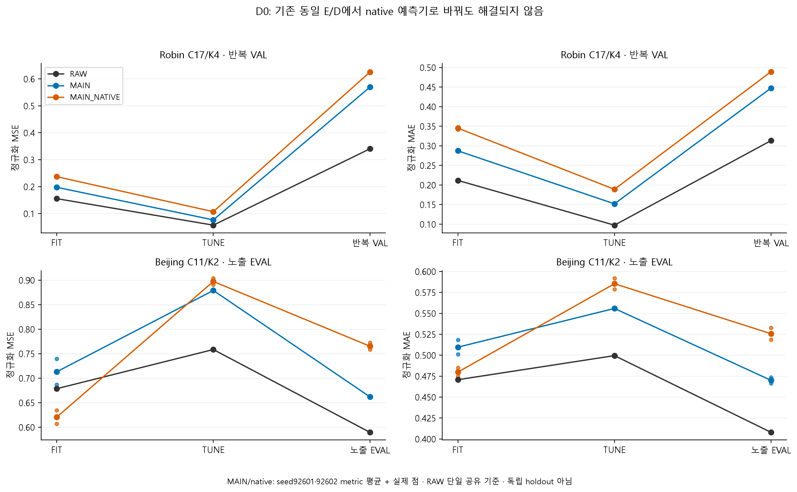
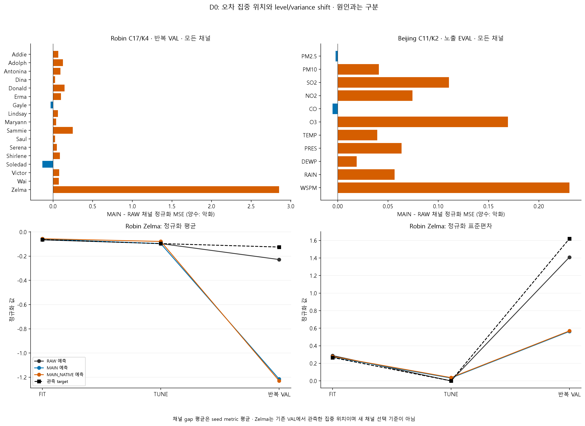
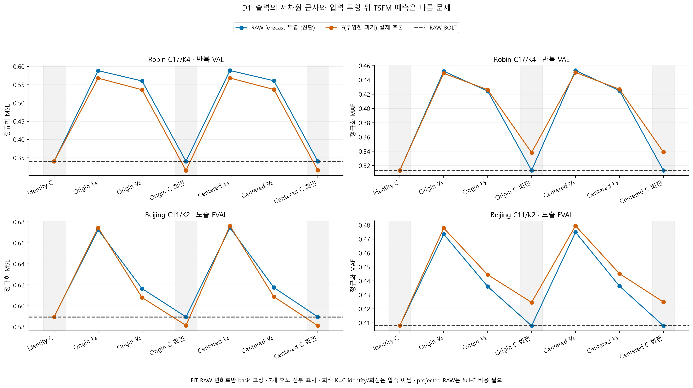
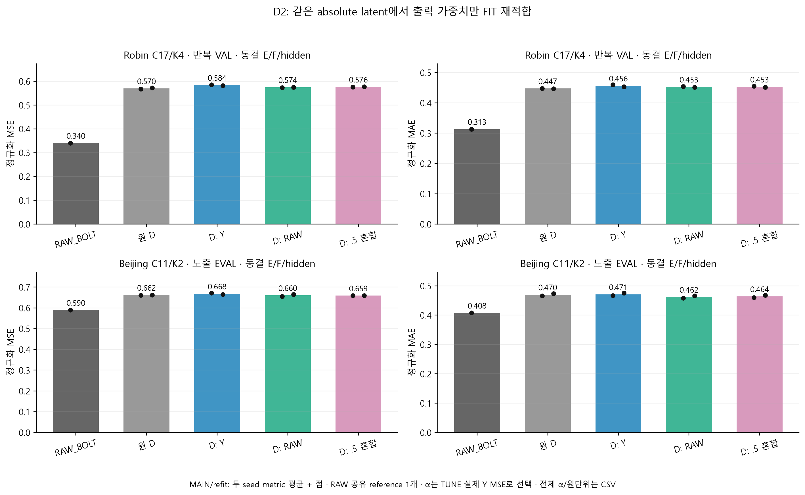
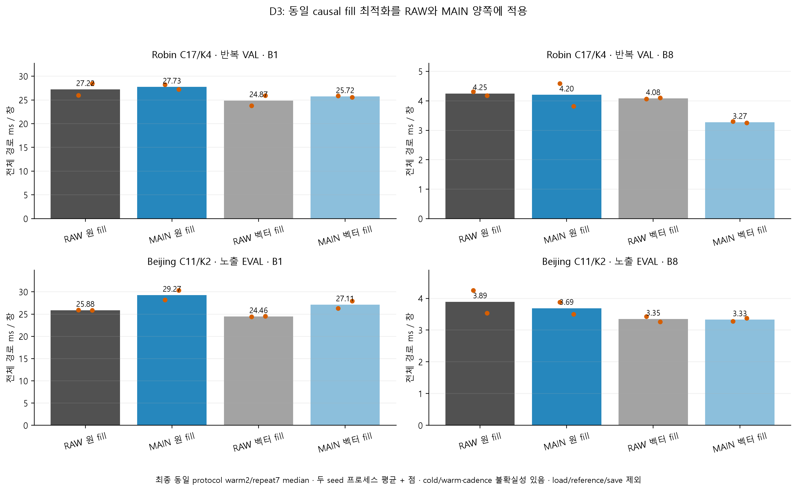
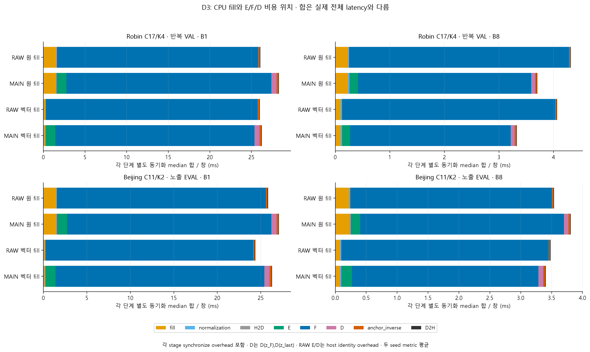

> 게시용 링크 복사본입니다. 아래 원수치·본문은 원 보고서를 유지하고 링크 경로만 정리했습니다. 데이터·모델·NPZ는 로컬 재현 자산입니다. [봉인된 원본](../../report_followup_v3/REPORT_KO.md) SHA256 `58dfcef691353f79012d2407eb66403dfc009e10c80d45cf5d418bfd624206d3`.

# 작은 K 실패의 원인 분리: Robin·Beijing 후속 결과

[확인] 이 보고서는 기존 조건의 저장 출력과 새 실제 추론·decoder 적합·비용 계측을 모은 개발 증거다. Robin VAL은 반복 사용했고 Beijing EVAL은 이미 노출됐다. 보호 TEST와 새 독립 holdout은 사용하지 않았다.

선언한 생산 조건: 12/12 COMPLETE.

## 먼저 답할 질문

**native로 바꾸면 해결되는가?** 같은 MAIN checkpoint의 E/D가 실제 CPU torch.equal로 일치하는 native control도 확인했다. 아래 원수치는 Bolt용 E/D를 고정한 native 비교이며 native용 E/D를 새로 공동 최적화한 최선 성능은 아니다.

```text
자료                    RAW MSE/MAE               MAIN MSE/MAE              MAIN-native MSE/MAE
robin                   0.340401887/0.313192123   0.569546544/0.447338898   0.625241591/0.489177279
beijing_aotizhongxin    0.589575414/0.407916509   0.661957198/0.470010232   0.765178292/0.525670986
```

**FIT의 96% 설명률은 평가 예측을 보장하는가?** 아니다. 아래 값은 FIT RAW forecast−현재 상태로 고정한 centered basis의 분산 설명률이다. 실제 target의 예측 정보 설명률이나 VAL 설명률이 아니다. projected RAW 자체도 full-C RAW 추론을 먼저 필요로 하는 진단이다.

```text
robin fit: K4 FIT retained=0.960106701; projected RAW target MSE=0.192339323, MAE=0.268549035; RAW MSE=0.155467495
robin tune: K4 FIT retained=0.960106701; projected RAW target MSE=0.078276777, MAE=0.151154019; RAW MSE=0.056951091
robin val: K4 FIT retained=0.960106701; projected RAW target MSE=0.589079984, MAE=0.453284866; RAW MSE=0.340401887
beijing_aotizhongxin fit: K2 FIT retained=0.669255813; projected RAW target MSE=0.763933926, MAE=0.527457482; RAW MSE=0.678540336
beijing_aotizhongxin tune: K2 FIT retained=0.669255813; projected RAW target MSE=0.866516574, MAE=0.554113028; RAW MSE=0.758435638
beijing_aotizhongxin eval: K2 FIT retained=0.669255813; projected RAW target MSE=0.674485001, MAE=0.474908229; RAW MSE=0.589575414
```

**예측기와 좌표 변환 중 어디가 남는가?** D1은 7개 고정 basis를 모두 보여준다. K=C 회전은 정보 복원이 거의 정확해도 channel-wise TSFM의 입력 좌표를 바꾸며 결과가 달라질 수 있다. 회전을 압축 방법이나 예측에 유리한 독립 검증으로 부르지 않는다. MSE와 MAE의 변화가 반대면 함께 보고한다.

```text
robin identity_C: MSE=0.340401887, MAE=0.313192124; history reconstruction MSE=0
robin through_origin_full_C_rotated: MSE=0.315272998, MAE=0.338243123; history reconstruction MSE=1.13117377e-14
robin centered_full_C_rotated: MSE=0.315723614, MAE=0.338908164; history reconstruction MSE=1.05148056e-14
beijing_aotizhongxin identity_C: MSE=0.589575414, MAE=0.407916508; history reconstruction MSE=0
beijing_aotizhongxin through_origin_full_C_rotated: MSE=0.581430540, MAE=0.424637248; history reconstruction MSE=1.21535266e-14
beijing_aotizhongxin centered_full_C_rotated: MSE=0.581140497, MAE=0.424921076; history reconstruction MSE=1.13621659e-14
```

**출력 D만 새로 맞추면 해결되는가?** D2는 원 E/F와 decoder GELU hidden을 고정하고 output weights만 재적합했다. Y, 과거 기반 RAW forecast, .5 혼합을 같은 FIT mask로 적합하고 각각 TUNE 실제 Y의 정규화 MSE로 α를 선택했다. 전체 α·원 D·선택 출력·원단위·채널별 값을 모두 보존한다. 이 비교는 모든 nonlinear decoder의 보편적 하한이나 최선 성능을 뜻하지 않는다.

```text
자료                    방법             MSE            MAE (2 seed metric 평균)
robin                   ORIGINAL_D       0.569546544    0.447338898
robin                   RAW              0.340401887    0.313192123
robin                   REFIT_Y          0.583851000    0.456479676
robin                   REFIT_RAW        0.574464976    0.452887377
robin                   REFIT_MIXED      0.576402704    0.452993538
beijing_aotizhongxin    ORIGINAL_D       0.661957198    0.470010232
beijing_aotizhongxin    RAW              0.589575414    0.407916509
beijing_aotizhongxin    REFIT_Y          0.668330841    0.470929906
beijing_aotizhongxin    REFIT_RAW        0.660262560    0.462045283
beijing_aotizhongxin    REFIT_MIXED      0.658940406    0.463998130
```

**batch1은 어디에서 느린가, 공통 전처리 개선은 도움이 되는가?** D3는 동일 raw physical past와 mask를 사용한다. 벡터 causal fill은 stored history와 byte-exact이며 RAW와 MAIN 양쪽에 동일하게 적용한다. 예측 정확도를 바꾸는 개선으로 세지 않는다. 아래 값은 seed별 프로세스의 warm2/repeat7 median 평균이며 독립 장비 반복이 아니다.

```text
자료                    B    방법       원 fill ms/창    벡터 fill ms/창    상대 변화
robin                   1    RAW_BOLT   27.218900          24.871600            -8.62%
robin                   1    MAIN       27.727500          25.718050            -7.25%
robin                   8    RAW_BOLT   4.248619          4.079375            -3.98%
robin                   8    MAIN       4.203225          3.273631            -22.12%
beijing_aotizhongxin    1    RAW_BOLT   25.879650          24.456100            -5.50%
beijing_aotizhongxin    1    MAIN       29.266300          27.110200            -7.37%
beijing_aotizhongxin    8    RAW_BOLT   3.892944          3.347713            -14.01%
beijing_aotizhongxin    8    MAIN       3.689806          3.327950            -9.81%
```

[확인] 원 bulk reference의 physical gate 실패 반복은 0개이며 그대로 별도 보존했다. matching-batch의 실제 원 controls.deployment와 normalized engine.predict를 reference로 사용한 검사와 혼동하지 않는다. 분해 계측은 각 단계 synchronize를 더하므로 단계 합을 실제 전체 경로 latency로 해석하지 않는다.

**측정 protocol을 왜 다시 확인했는가?** 최초 D3 v1 결과와 resource guard 진단을 보존한다. 각 trial/stage에서 수행한 전체 storage/path scan은 timer 밖이어도 추론 사이 cadence와 GPU idle 상태에 영향을 줄 수 있다. 후속 burst v2는 각 route 전후의 전체 CPU/storage 확인과 매 trial/stage의 GPU·RSS·campaign 확인을 분리한다. 원 numerical pipeline·비교 bound를 바꾼 결과로 읽지 않는다. 최초 측정과 protocol 진단은 별도 표와 원문 JSON에 남긴다.

[CPU guard의 실제 측정값](../../report_followup_v3/tables/d3_guard_measurements.csv)은 cadence 문제가 가능한 위치를 보여준다. 이 CPU-only 측정 자체가 GPU cooldown이나 전체 latency 변동의 원인을 입증한 것은 아니다.

현재 warmup2/repeat7만으로 cold start와 안정된 GPU warm 상태를 엄밀히 분리했다고 할 수 없다. timing 순서·clock/power·짧은 반복의 변동 때문에 특정 수치의 감소를 장비 조건 전반의 무조건적인 speedup으로 주장하지 않는다. 주 비교는 최종 동일 protocol에서 RAW/MAIN과 양쪽의 공통 fill을 비교한 개발 계측이다.

**무엇을 해결했다고 말할 수 있는가?** 저장값/실제 경로의 조건을 맞추고 native·projection 순서·동결 D·공통 전처리의 기여를 구분하는 근거가 생겼다. 단순 reconstruction 안정성, latent 예측 적합성, decoder 적합을 하나의 실패 원인으로 단정할 근거는 아직 없다. 현재 결과만으로 대조학습·동적 그래프·Chronos-Bolt의 필요성이나 모든 작은 K 방법의 불가능성을 확정하지 않는다.

## 비교 계약과 불확실성

두 자료 모두 L512/H48, 저장 FIT FP32 mean/std를 그대로 재사용한다. Robin C17/K4와 Beijing C11/K2, seed92601·92602, 원 MAIN batch4 학습과 batch8 저장 추론 조건이다. 현재 상태 C개를 우회 보존하므로 strict K-only 압축이 아니다. D1은 학습 seed 비교가 없는 FIT 고정 선형 진단이다.

이전 Bi-Hash의 새 3-seed 학습 recipe·초기화·통계 조건과 이 old 2-seed 결과를 섞어 Bi-Hash나 후속 방법의 성능 개선으로 읽지 않는다. 채널 단위가 다른 physical MSE/MAE는 데이터셋끼리 합치지 않는다. 평균은 seed별 metric의 산술 평균이며 prediction ensemble이 아니다. 겹치는 창과 작은 seed 수에 독립 표본 CI/유의성을 붙이지 않는다.

Zelma의 gap/level/variance 차이는 관측된 오차 집중 위치다. VAL을 보고 선정한 채널, rank, α를 새 독립 선택으로 부르지 않는다. D2 α 선택은 TUNE이며 보고서가 EVAL 값으로 최적 목적을 다시 고르지 않는다.

## 실제 시각자료



[벡터 SVG](../../report_followup_v3/figures/01_D0_split_metrics.svg)



[벡터 SVG](../../report_followup_v3/figures/02_D0_channel_gap_Zelma.svg)



[벡터 SVG](../../report_followup_v3/figures/03_D1_projection_order.svg)



[벡터 SVG](../../report_followup_v3/figures/04_D2_frozen_decoder.svg)



[벡터 SVG](../../report_followup_v3/figures/05_D3_whole_latency.svg)



[벡터 SVG](../../report_followup_v3/figures/06_D3_synchronized_stages.svg)

## 원수치와 전체 후보

- [D0 전체 split/seed](../../report_followup_v3/tables/d0_summary.csv), [모든 채널](../../report_followup_v3/tables/d0_channels.csv), [tail 기여](../../report_followup_v3/tables/d0_tails.csv)
- [D0 FIT rank 설명률과 투영](../../report_followup_v3/tables/d0_rank.csv), [D1 7개 후보·모든 split](../../report_followup_v3/tables/d1.csv)
- [D2 전체 α/채널/정규화·원단위](../../report_followup_v3/tables/d2.csv), [선택 α](../../report_followup_v3/tables/d2_selection.csv), [선택 metric 평균](../../report_followup_v3/tables/d2_selected_mean.csv)
- [D3 실제 32개 조건](../../report_followup_v3/tables/d3.csv), [동기화 단계별 비용](../../report_followup_v3/tables/d3_stages.csv)
- [최초 D3 v1 비용 보존](../../report_followup_v3/tables/d3_preserved.csv), [최초 v1 단계 비용](../../report_followup_v3/tables/d3_preserved_stages.csv)
- [생산 입력 path·SHA](../../report_followup_v3/provenance/input_manifest.csv), [실제 공유 자원 영수증](../../report_followup_v3/tables/resources.csv)

큰 NPZ·CP는 ignored cache의 literal path+SHA로 provenance CSV에 남긴다. 이 문서는 GitHub에서 존재하지 않는 cache 파일을 hyperlink하지 않는다. 각 copied CSV와 작은 JSON/audit는 이 보고서 폴더의 상대경로로 연결한다.

## 검산 상태

```text
D0_ARRAY_AUDIT_v1.json: COMPLETE; checks=None; failed=None; scope=D0 independent saved-array arithmetic; per-dataset literal PASS; no model forward replay; nested={'robin': 'PASS', 'beijing_aotizhongxin': 'PASS'}
D1_ARRAY_AUDIT_v1.json: PASS_WITHOUT_INDEPENDENT_GPU_REPLAY; checks=13180; failed=0; scope=saved actual arrays, CPU FP32 math replay and independent observed-score recomputation; nested={}
D2_ARRAY_AUDIT_v1.json: PASS_WITHOUT_INDEPENDENT_F_FORWARD_REPLAY; checks=28365; failed=0; scope=scope declared in copied receipt; nested={}
D3_ARRAY_AUDIT_v1.json: PASS_WITHOUT_INDEPENDENT_GPU_REPLAY; checks=1852; failed=0; scope=actual timed output arrays, FP32 matching references, SHA/model-state records, medians and source numeric AST equivalence; no GPU replay or independent hardware trial. Full supplemental/storage guard remains at each row boundary, process/campaign/GPU/RSS/VRAM guard each trial/stage.; nested={}
```

검사 통과는 해당 arithmetic/lineage/원 출력 재현 범위의 근거다. 독립적인 성능 개선이나 일반화의 증명으로 바꾸어 말하지 않는다.

## 비용과 실행 상태

중복 제거한 입력 생산 자원 영수증은 13개다. GPU process wall=654.842935s; CPU process wall=19.676859s.
이 합은 이 보고서에 포함한 D0/D1/D2/D3 및 보존한 최초 protocol producer 영수증만의 합이다. 이전 Bi 캠페인 전체 비용이나 독립 검산·보고서 비용을 포함한다고 하지 않는다. 현재 보고서 생성은 FollowupLimit CPU 영수증에 별도로 기록하며 미계측 startup/write overhead는 unknown이다.

미완료 조건: []

실패·미완료 경로는 원 terminal RESULT의 상태·error·partial coverage와 함께 provenance에 보존한다. 재개는 같은 완료 파일을 덮는 방식이 아니라 남은 경로에 새 tag를 사용하고 기존 공유 예산과 자산 SHA를 다시 확인하는 방식이다.

검산 영수증 원문:

- [D0_ARRAY_AUDIT_v1.json](../../report_followup_v3/provenance/audits/01_D0_ARRAY_AUDIT_v1.json)
- [D1_ARRAY_AUDIT_v1.json](../../report_followup_v3/provenance/audits/02_D1_ARRAY_AUDIT_v1.json)
- [D2_ARRAY_AUDIT_v1.json](../../report_followup_v3/provenance/audits/03_D2_ARRAY_AUDIT_v1.json)
- [D3_ARRAY_AUDIT_v1.json](../../report_followup_v3/provenance/audits/04_D3_ARRAY_AUDIT_v1.json)

측정 protocol 진단 원문:

- [D3_GUARD_TIMING_DIAGNOSTIC_v1.json](../../report_followup_v3/provenance/measurement_diagnostic_01_D3_GUARD_TIMING_DIAGNOSTIC_v1.json)

최초 D3 producer 보존:

- [원 v1 #1](../../report_followup_v3/provenance/producers/D3_original_preserved_01.json)
