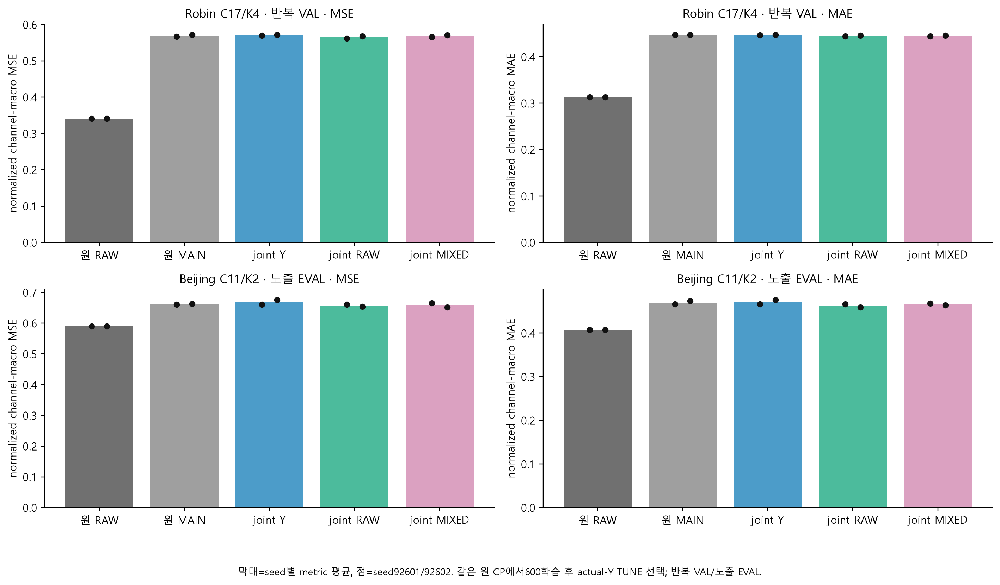
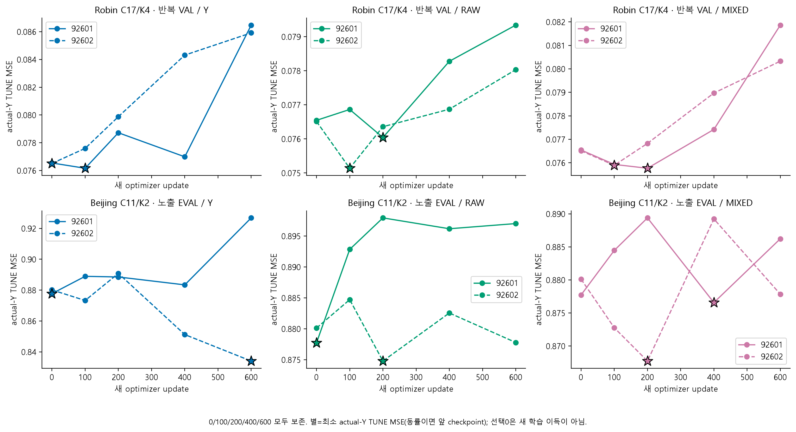
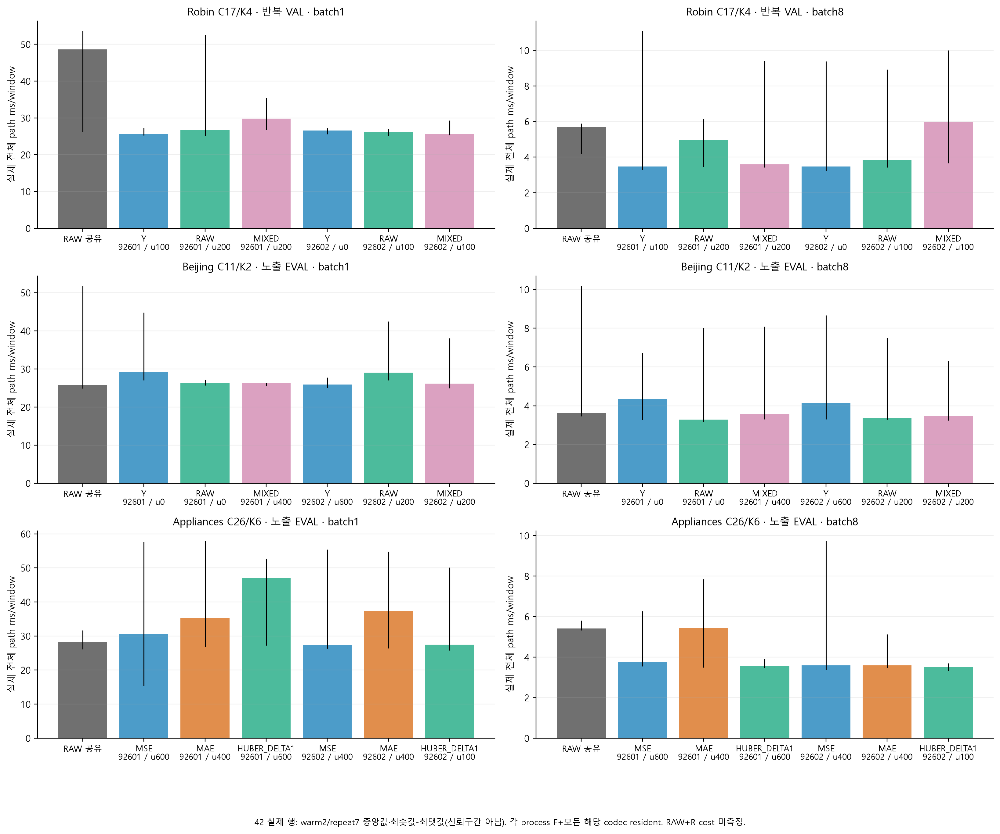
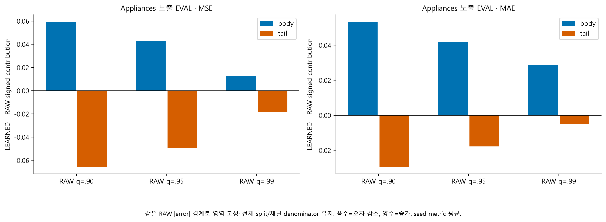
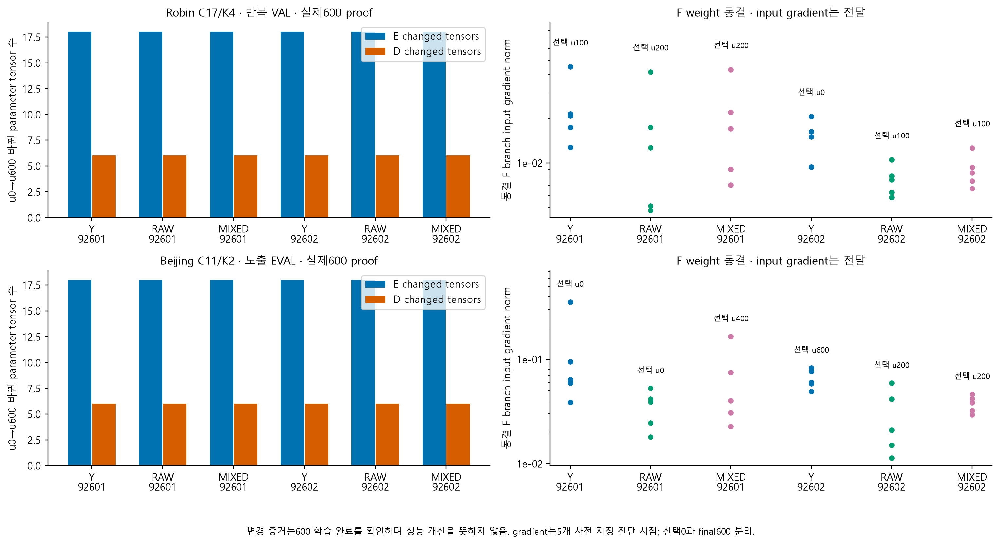
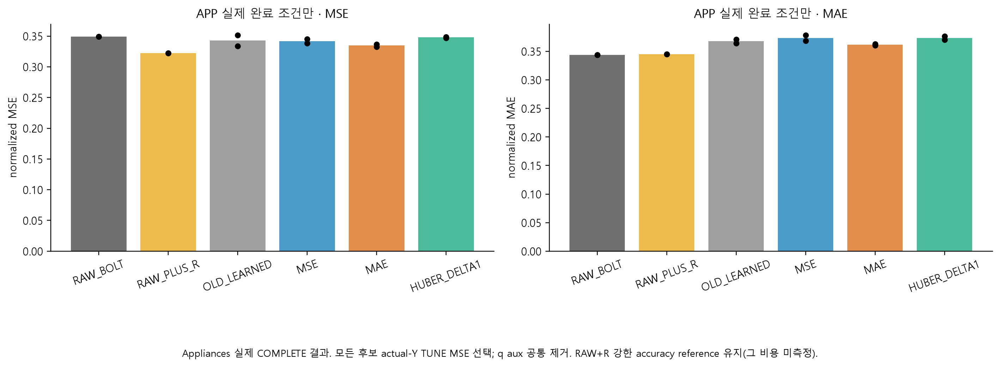

# 작은 K 후속 진단: joint 목적과 실제 배포 비용

같은 원 MAIN checkpoint에서 FIT600 updates를 수행하고 actual-Y TUNE으로 선택한 결과다. seed2개·반복 Robin VAL·이미 노출된 Beijing EVAL이며 독립 일반화 검증이 아니다. 새 학습을 모두 수행한 것과 선택 checkpoint가 개선한 것은 구분한다.

## 먼저 답하는 여섯 질문

1. 표현을 갱신하고 RAW teacher를 쓰면 원 RAW와의 격차를 닫았나?

```text
자료                방법      normalized MSE / MAE          MSE gap vs RAW
robin                 RAW_BOLT   0.340401887 / 0.313192123  +0.000000000
robin                 OLD_MAIN   0.569546544 / 0.447338898  +0.229144657
robin                 Y          0.570809212 / 0.446676232  +0.230407325
robin                 RAW        0.564730029 / 0.444972238  +0.224328142
robin                 MIXED      0.567976186 / 0.445309110  +0.227574299
beijing_aotizhongxin  RAW_BOLT   0.589575414 / 0.407916509  +0.000000000
beijing_aotizhongxin  OLD_MAIN   0.661957198 / 0.470010232  +0.072381784
beijing_aotizhongxin  Y          0.668486762 / 0.471314669  +0.078911348
beijing_aotizhongxin  RAW        0.657546431 / 0.462822793  +0.067971017
beijing_aotizhongxin  MIXED      0.658559269 / 0.466140833  +0.068983855
```
원수치는 seed별 표에 보존한다. RAW 목적의 개선 여부는 actual-Y로 읽으며 teacher 모방 손실 감소만으로 실제 예측 개선이라 부르지 않는다.

[확인] robin: joint RAW teacher의 actual-Y MSE gap은 +0.224328142, MAE gap은 +0.131780114이다. 이 점추정에서 MSE 격차가 남았다.

[확인] beijing_aotizhongxin: joint RAW teacher의 actual-Y MSE gap은 +0.067971017, MAE gap은 +0.054906285이다. 이 점추정에서 MSE 격차가 남았다.

2. decoder만 바꿀 때와 joint E/D 학습의 차이는?

동결 E/F/hidden-D의 output ridge 재학습은 이전 D2이고, 이번에는 E와 D를 모두 갱신했다. 비교할 D2 원수치는 [동결 decoder 표](tables/context_d2_selected_mean.csv)에 복사했다. D2의 REFIT_RAW는 teacher 목적의 출력 head 재학습이며 원 RAW_BOLT baseline과 다르다. 최종600 변화 증거와 실제 선택 checkpoint를 함께 보아야 한다.

robin Y: frozen-output-refit MSE/MAE 0.583851000/0.456479676 → joint 0.570809212/0.446676232.

robin RAW: frozen-output-refit MSE/MAE 0.574464976/0.452887377 → joint 0.564730029/0.444972238.

robin MIXED: frozen-output-refit MSE/MAE 0.576402704/0.452993538 → joint 0.567976186/0.445309110.

beijing_aotizhongxin Y: frozen-output-refit MSE/MAE 0.668330841/0.470929906 → joint 0.668486762/0.471314669.

beijing_aotizhongxin RAW: frozen-output-refit MSE/MAE 0.660262560/0.462045283 → joint 0.657546431/0.462822793.

beijing_aotizhongxin MIXED: frozen-output-refit MSE/MAE 0.658940406/0.463998130 → joint 0.658559269/0.466140833.

3. MSE 개선과 MAE 악화는 어디서 생겼나?

Appliances 기존 LEARNED와 RAW의 차이를 같은 RAW-error 경계 body/tail로 분해했다. [signed contribution 표](tables/simple_tail_region_comparisons.csv)는 q=.9/.95/.99·MSE/MAE·전체 split denominator를 보존한다. 이는 오차 분포의 위치를 보여주며 학습 문제의 인과 원인을 확정하지 않는다. 신규 APP 목표 비교 상태는 아래에 따로 기록한다.

Appliances q=.95 MSE: body signed gap +0.042926031, tail signed gap -0.049122672.

Appliances q=.95 MAE: body signed gap +0.041751644, tail signed gap -0.017770294.

4. 물리 채널 K개만 배분하는 대안은 가능한가?

FIT 고정·과거128 분산·미래 oracle 선택을 같은 RAW/LAST 메뉴에서 모두 보존했다. [채널 예산 표](tables/channel_budget_ALL_METRICS.csv)를 기준으로 gate를 판단했다. FUTURE_ORACLE는 실제 미래가 필요해 배포할 수 없다. 현재 단순 물리 routing 실제 구현은 진행하지 않았으며 다른 잠재 표현의 가능성을 닫는 결과로 읽지 않는다.

robin: LAST MSE 1.308464, FIT_FIXED_TOPK MSE 0.954398, PAST_VARIANCE_TOPK MSE 0.843501, FUTURE_ORACLE_TOPK MSE 0.741191, FULL_C_RAW_REFERENCE MSE 0.340402; full RAW 0.340402.

beijing_aotizhongxin: LAST MSE 0.908442, FIT_FIXED_TOPK MSE 0.729971, PAST_VARIANCE_TOPK MSE 0.717124, FUTURE_ORACLE_TOPK MSE 0.599581, FULL_C_RAW_REFERENCE MSE 0.589575; full RAW 0.589575.

5. batch1에서 실제 효율 이득이 있었나?

```text
자료                 B    조건/seed             whole ms/window  raw ratio
robin                 1 None   /None      48.575200  1.0000
robin                 8 None   /None       5.677025  1.0000
robin                 1 Y      /92601     25.558600  0.5262
robin                 8 Y      /92601      3.471437  0.6115
robin                 1 RAW    /92601     26.673200  0.5491
robin                 8 RAW    /92601      4.967588  0.8750
robin                 1 MIXED  /92601     29.769500  0.6129
robin                 8 MIXED  /92601      3.587412  0.6319
robin                 1 Y      /92602     26.541600  0.5464
robin                 8 Y      /92602      3.474212  0.6120
robin                 1 RAW    /92602     26.089300  0.5371
robin                 8 RAW    /92602      3.835012  0.6755
robin                 1 MIXED  /92602     25.555900  0.5261
robin                 8 MIXED  /92602      5.985338  1.0543
beijing_aotizhongxin  1 None   /None      25.845300  1.0000
beijing_aotizhongxin  8 None   /None       3.635925  1.0000
beijing_aotizhongxin  1 Y      /92601     29.275700  1.1327
beijing_aotizhongxin  8 Y      /92601      4.343075  1.1945
beijing_aotizhongxin  1 RAW    /92601     26.393400  1.0212
beijing_aotizhongxin  8 RAW    /92601      3.277138  0.9013
beijing_aotizhongxin  1 MIXED  /92601     26.188100  1.0133
beijing_aotizhongxin  8 MIXED  /92601      3.575000  0.9832
beijing_aotizhongxin  1 Y      /92602     25.940500  1.0037
beijing_aotizhongxin  8 Y      /92602      4.154625  1.1427
beijing_aotizhongxin  1 RAW    /92602     29.002400  1.1222
beijing_aotizhongxin  8 RAW    /92602      3.369000  0.9266
beijing_aotizhongxin  1 MIXED  /92602     26.161800  1.0122
beijing_aotizhongxin  8 MIXED  /92602      3.456400  0.9506
```
비율1 미만이 이 계측에서 빠른 경로다. warm2/repeat7의 동일 batch 비교이며 단일 장비·한 프로세스·모두 co-resident 조건이다. load/reference 준비·teacher 생성·학습 비용을 제외했고 반복 범위를 신뢰구간이라 하지 않는다. batch8 처리량을 batch1 응답 속도로 바꾸어 말하지 않는다.

robin: batch1 selected6개/공유 RAW latency 비율 범위 0.5261~0.6129. 개별 조건과 반복 범위는 비용 표에 보존했다.

beijing_aotizhongxin: batch1 selected6개/공유 RAW latency 비율 범위 1.0037~1.1327. 개별 조건과 반복 범위는 비용 표에 보존했다.

robin RAW batch1: 이전 D3 seed 평균 24.871600 ms/window → 이번 공유 RAW 48.575200 ms/window.

beijing_aotizhongxin RAW batch1: 이전 D3 seed 평균 24.456100 ms/window → 이번 공유 RAW 25.845300 ms/window.

이번 공유 RAW는 고정된 단일 순서에서 먼저 측정했다. 특히 Robin RAW 기준의 측정 차이가 크다. warm2/repeat7만으로 thermal·clock·route-order 영향을 배제하지 못했으며 원인은 확인하지 않았다. 현재 RAW 대비 비율만으로 batch1 효율 문제가 해결됐다고 주장할 수 없다. 재측정은 이번 상한에서 수행하지 않았다.

6. 무엇이 남았고 다음 판단은?

실제600 E/D 학습, 동결 F input gradient, 원 CP 보존과 selected inference를 검사했다. 표현의 미래 예측 적합성·동결 F와 표현 좌표의 호환성·복원 오차를 완전히 분리한 인과 결론은 아직 아니다. 가장 작은 목적 변경으로 격차가 닫히는지, MAE tradeoff가 달라지는지, batch1 비용을 포함해 유지할 가치가 있는지 판단한다. Chronos-Bolt 유지나 새 대조학습을 실행 횟수만으로 정당화하지 않는다.

## APP 신규 목표 비교의 실제 상태

```text
seed    objective status                    reason
92601  MSE      COMPLETE                 None
92601  MAE      COMPLETE                 None
92601  HUBER_DELTA1 COMPLETE                 None
92602  MSE      COMPLETE                 None
92602  MAE      COMPLETE                 None
92602  HUBER_DELTA1 COMPLETE                 None
```
미실행/부분 실패는 완료 실험으로 집계하지 않는다. APP가 없을 때 여섯 번째 그림은 기존 캐시의 채널 예산 진단이다.

APP actual-Y TUNE MSE로 선택된 노출 EVAL 결과(seed metric 평균):

```text
방법             normalized MSE / MAE
RAW_BOLT         0.348920468 / 0.343643728
RAW_PLUS_R       0.322202447 / 0.345093601
OLD_LEARNED      0.342723827 / 0.367625077
MSE              0.341510171 / 0.373230585
MAE              0.334655105 / 0.361573650
HUBER_DELTA1     0.347853548 / 0.373093258
```
모든 신규 loss는 actual Y만 학습하며 RAW forecast는 진단 reference다. 원 CP는 LEARNED_REGIME(q auxiliary w=.1로 과거 학습됨), 신규6개에서는 q를 공통 제거했다. original_MAIN이라는 저장 key를 새 MAIN baseline으로 부르지 않는다.

APP 신규14행 전체 비용을 [실제 APP 비용 표](tables/app_cost.csv)에 보존했다. RAW+R 비용은 **NOT_MEASURED**다.

```text
B  조건/seed                    whole ms/window
1  None         /None  28.198100
8  None         /None  5.417788
1  MSE          /92601 30.620400
8  MSE          /92601 3.743850
1  MAE          /92601 35.248400
8  MAE          /92601 5.449888
1  HUBER_DELTA1 /92601 47.055500
8  HUBER_DELTA1 /92601 3.564438
1  MSE          /92602 27.330300
8  MSE          /92602 3.598738
1  MAE          /92602 37.438400
8  MAE          /92602 3.592275
1  HUBER_DELTA1 /92602 27.421000
8  HUBER_DELTA1 /92602 3.503675
```

## 학습·비용·검산의 범위

원 joint v1은150초 process cap에서510 updates까지만 진행한 기록과 약151초 실패 비용을 보존했다. v2는 안전 검사 cadence만 바꿨으며 원수치·손실·batch order·상한을 바꾸거나 u400부터 이어 학습하지 않았다. full guard CPU/wall은 GPU kernel 시간과 다르다. 현재 FIT 유한성 원수치를 [학습 proof 표](tables/joint_learning.csv)에 보존하며, NaN masking 구현 수정이 기존 나쁜 MSE의 원인이었다고 주장하지 않는다.

원 full-C teacher precompute 비용은 unknown이며 이번 비용 영수증에 포함되지 않았다. 모든 방법에 현재 C anchor가 있어 strict K-only 병목이 아니다. 검사 통과는 누출 부재·성능 개선·독립 일반화의 증명이 아니다. 이전 D0의 입력 복원과 예측 호환성, D1의 full-C rotation/압축 구분, D2/D3 계측 맥락은 [이전 D0-D3 보고서](../report_followup_v3/REPORT_KO.md)에서 확인한다.

## 그림과 원수치



[SVG](figures/01_joint_actual_scores.svg)



[SVG](figures/02_actual_Y_TUNE_selection.svg)



[SVG](figures/03_selected_whole_cost.svg)



[SVG](figures/04_appliances_RAW_fixed_body_tail.svg)



[SVG](figures/05_learning_and_selection_proof.svg)



[SVG](figures/06_APP_or_channel_menu.svg)

[입력 경로·SHA 목록](provenance/input_manifest.csv) · [28행 비용](tables/joint_cost.csv) · [seed별 모든 split](tables/joint_scores.csv) · [checkpoint 선택](tables/joint_checkpoints.csv)

검산 원문과 작은 producer JSON은 provenance 아래 복사한다. scientific NPZ/checkpoint는 ignored cache에 있으므로 GitHub 링크를 만들지 않고 원 path/SHA를 표와 JSON의 literal 값으로 보존한다. 보고서 생성은 CPU 집계이며 모델 추론을 재실행하지 않는다.

검산 원문: [APP.json](provenance/audits/APP.json) · [APP_COST14.json](provenance/audits/APP_COST14.json) · [CHANNEL_BUDGET.json](provenance/audits/CHANNEL_BUDGET.json) · [CONTEXT_01_D0_ARRAY_AUDIT_v1.json](provenance/audits/CONTEXT_01_D0_ARRAY_AUDIT_v1.json) · [CONTEXT_02_D1_ARRAY_AUDIT_v1.json](provenance/audits/CONTEXT_02_D1_ARRAY_AUDIT_v1.json) · [CONTEXT_03_D2_ARRAY_AUDIT_v1.json](provenance/audits/CONTEXT_03_D2_ARRAY_AUDIT_v1.json) · [CONTEXT_04_D3_ARRAY_AUDIT_v1.json](provenance/audits/CONTEXT_04_D3_ARRAY_AUDIT_v1.json) · [COST28.json](provenance/audits/COST28.json) · [JOINT.json](provenance/audits/JOINT.json)

추가 자원 근거: [사용자 승인](provenance/CONTINUATION_AUTHORIZATION.json) · [고정 실행 manifest](provenance/CONTINUATION_RUN_MANIFEST.json) · [고정 core runtime](provenance/source_continuation_runtime_v1.py) · [실제 runtime v2](provenance/source_continuation_runtime_v2.py) · [동일 byte 계수 scanner](provenance/source_fast_storage_scan_v1.py)
