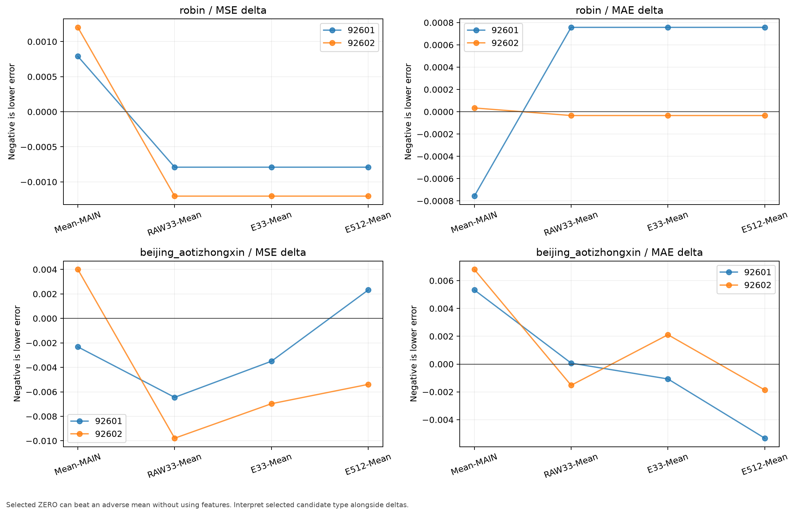
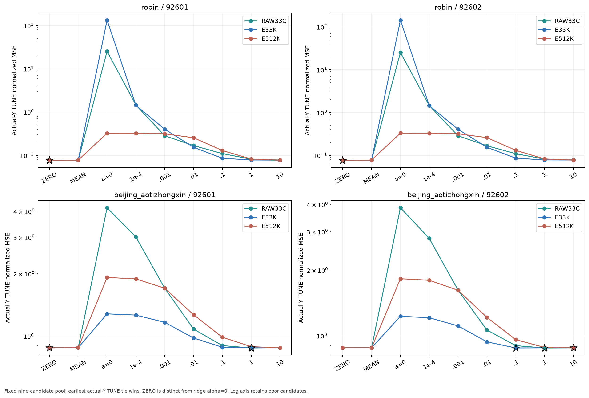
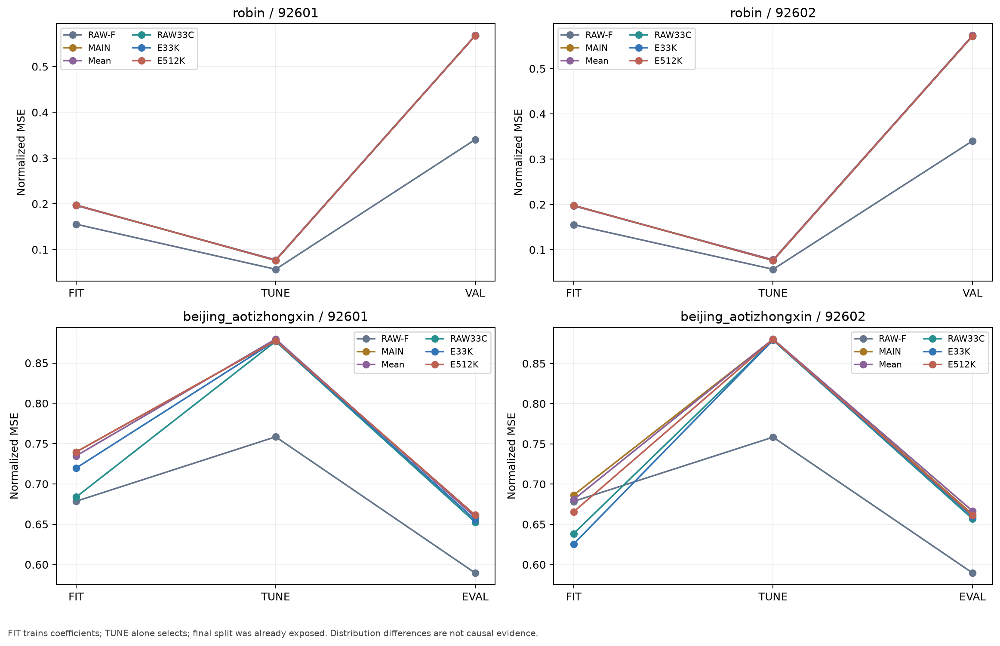
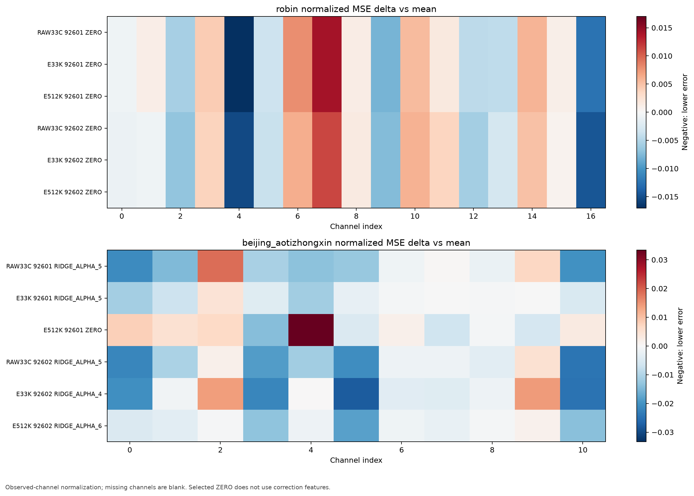

# MAIN 예측을 유지한 과거 정보 기반 잔차 보정

이번 실험은 기존 인코더·Chronos-Bolt·디코더와 MAIN 예측을 고정하고, 과거 표현이 그 예측의 오차를 추가로 줄일 수 있는지 확인했다. TUNE에서 보정을 거부할 수 있게 원 MAIN 그대로인 ZERO를 항상 포함했다. 성능의 조건부 개선, 단순 평균 보정, 표현의 추가 효과를 분리한다.

[확인] 실제 조건 4개, 새 ridge 계수 84개, 고정 후보 비교 108개, 선택 예측 36개를 수행했다. 독립 CPU 수치 검산 상태는 `PASS`이며 비용은 whole-path 24행이다. 검산 통과는 성능 개선이나 새로운 데이터 일반화 검증을 뜻하지 않는다.

## 먼저 답해야 할 질문

### robin

```text
방법       최종 정규화 MSE   최종 정규화 MAE   (원 인코더 seed 2개 평균)
RAW-F      0.3404018870       0.3131921235
MAIN       0.5695465439       0.4473388982
Mean       0.5705431794       0.4469772860
RAW33C     0.5695465439       0.4473388982
E33K       0.5695465439       0.4473388982
E512K      0.5695465439       0.4473388982
```

- seed 92601 RAW33C: `ZERO_CORRECTION` (α=None), TUNE MSE 여유 ZERO 대비 0, MEAN 대비 0.001080488146; 최종 MSE 변화 MAIN 대비 +0, MEAN 대비 -0.0007903852762; MAE 변화 MAIN 대비 +0, MEAN 대비 +0.0007572562406.
- seed 92601 E33K: `ZERO_CORRECTION` (α=None), TUNE MSE 여유 ZERO 대비 0, MEAN 대비 0.001080488146; 최종 MSE 변화 MAIN 대비 +0, MEAN 대비 -0.0007903852762; MAE 변화 MAIN 대비 +0, MEAN 대비 +0.0007572562406.
- seed 92601 E512K: `ZERO_CORRECTION` (α=None), TUNE MSE 여유 ZERO 대비 0, MEAN 대비 0.001080488146; 최종 MSE 변화 MAIN 대비 +0, MEAN 대비 -0.0007903852762; MAE 변화 MAIN 대비 +0, MEAN 대비 +0.0007572562406.
- seed 92602 RAW33C: `ZERO_CORRECTION` (α=None), TUNE MSE 여유 ZERO 대비 0, MEAN 대비 0.001431894877; 최종 MSE 변화 MAIN 대비 +0, MEAN 대비 -0.001202885735; MAE 변화 MAIN 대비 +0, MEAN 대비 -3.403184306e-05.
- seed 92602 E33K: `ZERO_CORRECTION` (α=None), TUNE MSE 여유 ZERO 대비 0, MEAN 대비 0.001431894877; 최종 MSE 변화 MAIN 대비 +0, MEAN 대비 -0.001202885735; MAE 변화 MAIN 대비 +0, MEAN 대비 -3.403184306e-05.
- seed 92602 E512K: `ZERO_CORRECTION` (α=None), TUNE MSE 여유 ZERO 대비 0, MEAN 대비 0.001431894877; 최종 MSE 변화 MAIN 대비 +0, MEAN 대비 -0.001202885735; MAE 변화 MAIN 대비 +0, MEAN 대비 -3.403184306e-05.

[확인] 이 데이터의 세 경로·두 seed 모두 TUNE에서 새 표현 보정을 선택하지 않았다. ZERO 선택은 기존 예측을 그대로 보존했다는 뜻이다. 이 결과만으로 과거 표현에 정보가 없거나 더 나은 학습이 불가능하다고 결론낼 수 없다.

### beijing_aotizhongxin

```text
방법       최종 정규화 MSE   최종 정규화 MAE   (원 인코더 seed 2개 평균)
RAW-F      0.5895754138       0.4079165085
MAIN       0.6619571979       0.4700102317
Mean       0.6627945472       0.4760787260
RAW33C     0.6546750713       0.4753505010
E33K       0.6575606665       0.4765983790
E512K      0.6612625765       0.4724813984
```

- seed 92601 RAW33C: `RIDGE_ALPHA_5` (α=1.0), TUNE MSE 여유 ZERO 대비 0.0008816596467, MEAN 대비 0.002830586209; 최종 MSE 변화 MAIN 대비 -0.00877628402, MEAN 대비 -0.006450327558; MAE 변화 MAIN 대비 +0.005400956859, MEAN 대비 +6.963406887e-05.
- seed 92601 E33K: `RIDGE_ALPHA_5` (α=1.0), TUNE MSE 여유 ZERO 대비 1.118813315e-05, MEAN 대비 0.001960114695; 최종 MSE 변화 MAIN 대비 -0.005824664684, MEAN 대비 -0.003498708222; MAE 변화 MAIN 대비 +0.004261092538, MEAN 대비 -0.001070230252.
- seed 92601 E512K: `ZERO_CORRECTION` (α=None), TUNE MSE 여유 ZERO 대비 0, MEAN 대비 0.001948926562; 최종 MSE 변화 MAIN 대비 +0, MEAN 대비 +0.002325956462; MAE 변화 MAIN 대비 +0, MEAN 대비 -0.00533132279.
- seed 92602 RAW33C: `RIDGE_ALPHA_5` (α=1.0), TUNE MSE 여유 ZERO 대비 0.001130922534, MEAN 대비 0.001365213765; 최종 MSE 변화 MAIN 대비 -0.005787969241, MEAN 대비 -0.009788624156; MAE 변화 MAIN 대비 +0.005279581612, MEAN 대비 -0.001526084113.
- seed 92602 E33K: `RIDGE_ALPHA_4` (α=0.1), TUNE MSE 여유 ZERO 대비 0.001023968034, MEAN 대비 0.001258259266; 최종 MSE 변화 MAIN 대비 -0.002968398234, MEAN 대비 -0.006969053149; MAE 변화 MAIN 대비 +0.008915202067, MEAN 대비 +0.002109536342.
- seed 92602 E512K: `RIDGE_ALPHA_6` (α=10.0), TUNE MSE 여유 ZERO 대비 0.0003522970909, MEAN 대비 0.0005865883223; 최종 MSE 변화 MAIN 대비 -0.001389242785, MEAN 대비 -0.0053898977; MAE 변화 MAIN 대비 +0.004942333409, MEAN 대비 -0.001863332316.

[판단] 일부 ridge 보정은 MSE를 줄였지만 원수치와 MAE를 함께 봐야 한다. RAW33C는 원 채널을 사용하며 p가 다르므로 E33K 대비 우위를 인코더 실패의 단독 원인으로 해석할 수 없다. 아주 작은 TUNE 선택 여유는 조건부 결과이며 반복 사용한 평가 구간에서의 안정성은 미확정이다.

## 비교 계약과 남는 한계

동일한 원 MAIN 체크포인트와 FIT/TUNE/기존 노출 최종 구간을 사용했다. Robin C=17,K=4, Beijing C=11,K=2, L=512,H=48이다. RAW33C는 원 C 채널의 32개 블록 평균과 마지막 값, E33K는 같은 요약의 K 표현, E512K는 전체 과거 표현이다. FIT 중심·스케일만 사용하며 실제 Y−MAIN 잔차는 FP32로 먼저 계산했다. 관측 마스크의 채널 전체 N_c를 사용하는 정규화 채널 macro MSE ridge이며 절편은 벌점에서 제외했다.

후보 순서는 ZERO → 공유 FIT 평균 잔차 MEAN → α=0,10⁻⁴,10⁻³,10⁻²,10⁻¹,1,10의 ridge다. 실제-Y TUNE MSE만으로 선택하며 동률이면 앞 후보다. ZERO는 ridge α=0과 다르다. 모든 새 계수를 학습한 뒤 ZERO를 선택할 수 있다. MEAN 우위는 평균 오차 보정이며 표현의 추가 효과와 구분한다.

원 MAIN 자체가 현재 C 채널 anchor를 사용한다. 따라서 세 보정 경로 모두 엄격한 K-only 배포가 아니다. RAW33C는 추가 원 채널 과거 정보를 제공한다. p, 계수 개수, rank 및 정규화가 다르므로 같은 α가 같은 용량·같은 prior를 보장하지 않는다. 원 인코더·F·D는 이번 CPU 계수 학습에서 로드하거나 갱신하지 않았다.

보호 TEST를 사용하지 않았다. 최종 구간은 이미 노출된 Robin VAL/Beijing EVAL이며 독립 holdout이 아니다. RAW 입력은 두 인코더 seed에서 동일한 결정적 경로이므로 두 RAW 결과를 독립 데이터셋 두 개로 세지 않는다. 시점별 인코더 인과성, 대조학습·그래프 필요성, Chronos-Bolt의 일반적 유용성은 이번 보정 비교로 입증되지 않는다.

## 그림과 원자료

### 최종 MSE·MAE와 두 seed 원수치


[SVG](figures/01_final_seed_scores.svg)

### MEAN의 변화와 선택 보정의 추가 변화



[SVG](figures/02_mean_and_MAIN_deltas.svg)

### 고정 9개 후보의 TUNE 점수와 선택



[SVG](figures/03_candidate_tune_grid.svg)

### FIT/TUNE/기존 최종 구간의 차이



[SVG](figures/04_fit_tune_final.svg)

### 채널별 MSE 변화: MEAN 대비



[SVG](figures/05_channel_delta_vs_mean.svg)

### whole-path 비용: 같은 batch와 균형 순서


[SVG](figures/06_whole_path_cost.svg)

- [전체 점수·채널 관측 수](METRICS.csv)
- [108개 후보](CANDIDATE_GRID.csv)
- [용량·rank·선택 여유](CAPACITY_SELECTION.csv)
- [새 계수 학습 CPU 비용](CPU_COST.csv)
- [whole-path 24행](WHOLE_COST.csv)

## 비용 해석과 보존한 실패

새 FIT factorization, 경로 전체 CPU 실행, 프로세스 wall 비용을 따로 남겼다. 과거 E/MAIN 캐시 생성과 원 학습 비용은 알 수 없으므로 0으로 쓰지 않았다. whole-path는 seed92601, B1/B8, Latin6 순서, warmup2/repeat6이다. CPU fill·전송·E/F/D·선택 보정·복원까지 포함하지만 로드·SHA·검산·저장·timer 밖 guard는 제외한다. stage 분해나 GPU kernel 시간으로 해석하지 않는다. ZERO는 추가 feature·CPU 전송을 생략한다. ZERO로 선택된 RAW33C/E33K/E512K 비용 라벨은 MAIN과 동일한 계산 경로다. 이들 수치의 작은 차이는 별개의 학습 방법 차이로 해석하지 않는다. 같은 batch 원시 예측과의 출력 parity를 검산했고 thermal/carryover 영향을 완전히 제거했다고 주장하지 않는다. 이번 B1/B8 실행의 원수치이며 이전 세션의 RAW 비용과 차이가 있어 안정적 속도 우위를 일반화하지 않는다. 독점 연구 job lease는 병행 연구 프로세스를 막지만 Windows WDDM·데스크톱의 배경 GPU 활동까지 제거한 것은 아니다.

- 보존한 시도 `main_residual_robin_s92601_v1`: `FAILED_PRESERVED`, 새 ridge 0, 비교 0. 실패 설명: {'type': 'KeyError', 'message': "'role'"}. [원 JSON](provenance/inputs/ATTEMPT_0.json)
- 보존한 시도 `main_residual_beijing_aotizhongxin_s92601_v2`: `FAILED_PRESERVED`, 새 ridge 0, 비교 0. 실패 설명: {'type': 'FileNotFoundError', 'message': "[Errno 2] No such file or directory: 'E:\\\\CODING\\\\proj\\\\hierarchical-tsfm-peft\\\\.cache\\\\smallk_failure_followup_20261014\\\\matched_readout_v1\\\\matched_beijing_aotizhongxin_s92601_v1\\\\RESULT.json'"}. [원 JSON](provenance/inputs/ATTEMPT_1.json)
- 보존한 시도 `main_residual_beijing_aotizhongxin_s92602_v2`: `FAILED_PRESERVED`, 새 ridge 0, 비교 0. 실패 설명: {'type': 'FileNotFoundError', 'message': "[Errno 2] No such file or directory: 'E:\\\\CODING\\\\proj\\\\hierarchical-tsfm-peft\\\\.cache\\\\smallk_failure_followup_20261014\\\\matched_readout_v1\\\\matched_beijing_aotizhongxin_s92602_v1\\\\RESULT.json'"}. [원 JSON](provenance/inputs/ATTEMPT_2.json)

이 시도들은 완료 조건 4개와 84/108 개수에 포함하지 않는다. `scientific_execution=true` 표시는 프로세스 진입이며 그 자체가 자산 로드·학습·추론을 실행했다는 증거가 아니다. 자산 전 경로 오류와 실제 학습 실패를 구분해 보존했다.

## 출처와 실행 상태

[독립 수치 검산](provenance/inputs/INDEPENDENT_AUDIT.json), [비용 검산](provenance/inputs/COST_AUDIT.json), [승인](provenance/inputs/AUTHORIZATION.json), [고정 실행 manifest](provenance/inputs/RUN_MANIFEST.json), [보고서 manifest](MANIFEST.json), [보고서 실제 종료 상태](RESULT.json).

provenance/sources의 계획·lock에 있는 SOURCE_ONLY 문구는 실행 전 역사적 snapshot을 그대로 보존한 것이다. 실제 완료 여부는 승인·실행 manifest·생산자·검산·보고서 RESULT의 종료 상태로 판단한다. 보고서 생성기는 종료 JSON과 코드만 읽었으며 별도 검증기가 저장 예측 배열→CSV를 CPU로 검산한다.

다음 판단은 조건부다. Robin은 새 보정의 TUNE 근거가 없어 원 MAIN을 보존했다. Beijing에서 작은 MSE 변화와 MAE 악화를 분리해 보고, 단순 MEAN과 원 채널 RAW33C를 넘어서는 일관된 표현의 추가 이득이 있는지 확인해야 한다. 현재 결과는 전체 연구 방법을 해결했다는 증거가 아니다.
