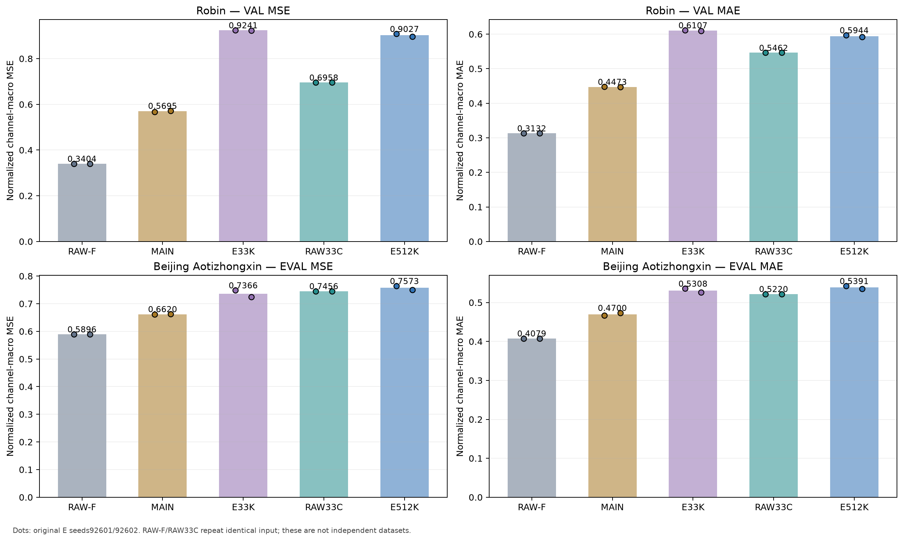
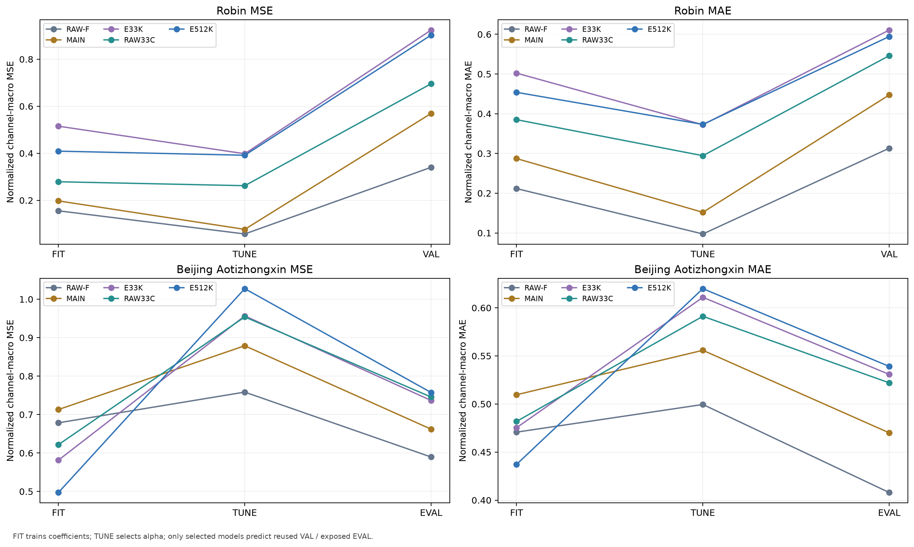
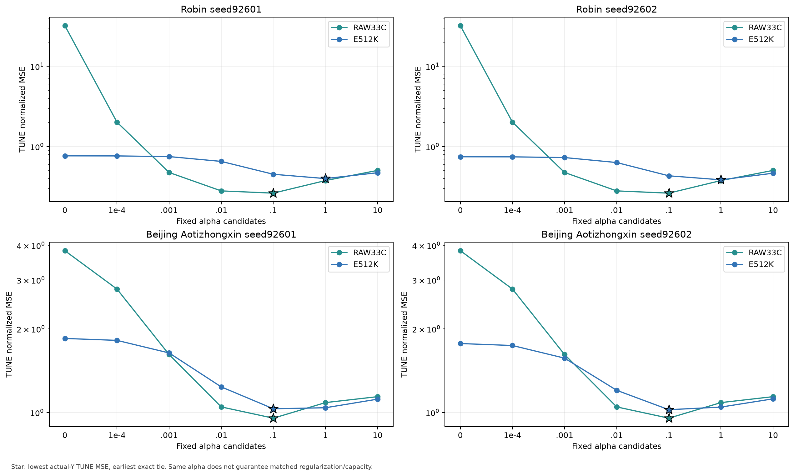
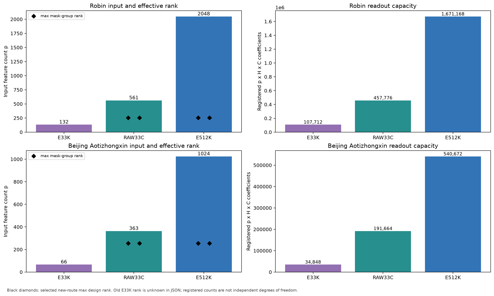
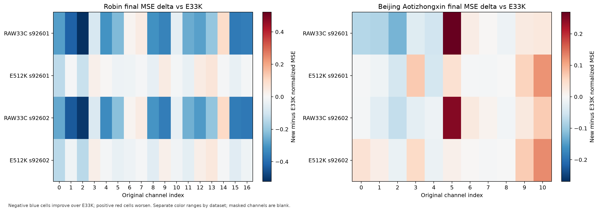
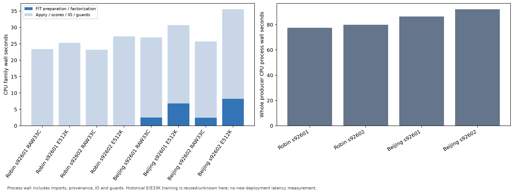

# 원 C·K 표현·시간 요약을 같은 direct-C readout으로 비교

[확인] 목적은 현재 고정 인코더가 만든 정보와 시간 요약의 조건부 예측 유용성을 좁히는 것이다. 미래 oracle 없이 원 과거 데이터와 cached 과거 latent만 사용했다.

RAW33C는 원 C 과거의 32개16-point 평균과 마지막 값, E33K는 기존 N2의 동일 요약, E512K는 512개 latent 시점 전체를 사용한다. 세 경로 모두 actual-Y innovation 목표·current-C anchor·intercept·FIT 정규화·채널별 관측 수 기반 ridge를 사용했다. 입력 차원과 readout 용량은 서로 다르다.

current-C anchor는 원 C 채널의 현재값 전체를 예측 경로에 제공한다. 따라서 세 경로는 모두 엄격한 K 전용 배포가 아니며, K 표현만으로 미래 전체 C를 복원했다는 해석은 적용하지 않는다.

주지표는 정규화 observed-channel macro MSE이고 MAE도 함께 보고한다. 아래 평균은 원 E seed 두 개의 기술 통계이며 독립 데이터셋 반복이나 유의성 검정 결과가 아니다. RAW-F와 RAW33C는 같은 데이터의 결정적인 계산을 두 E seed 조건에서 반복했다.

```text
dataset / method          normalized MSE      normalized MAE
Robin    RAW-F              0.34040189          0.31319212
Robin    MAIN               0.56954654          0.44733890
Robin    E33K               0.92409283          0.61065756
Robin    RAW33C             0.69578854          0.54622343
Robin    E512K              0.90270308          0.59441266
Beijing  RAW-F              0.58957541          0.40791651
Beijing  MAIN               0.66195720          0.47001023
Beijing  E33K               0.73662621          0.53075375
Beijing  RAW33C             0.74559667          0.52199221
Beijing  E512K              0.75732091          0.53907530
```

각 질문의 원수치와 판단:

- Robin: RAW33C−E33K MSE는 `-0.22830429`, E512K−E33K는 `-0.02138975`, E512K−RAW33C는 `+0.20691454`이다. 음수는 앞 경로의 오차가 더 작다는 뜻이다. RAW33C 비교는 원 채널 요약 경로, E512K 비교는 더 많은 과거 latent와 더 큰 readout을 유지한 경로의 조건부 유용성을 보여준다. 이 수치만으로 encoder가 정보를 잃었다거나 압축이 불필요하다고 확정하지 않는다.
- Beijing Aotizhongxin: RAW33C−E33K MSE는 `+0.00897046`, E512K−E33K는 `+0.02069470`, E512K−RAW33C는 `+0.01172424`이다. 음수는 앞 경로의 오차가 더 작다는 뜻이다. RAW33C 비교는 원 채널 요약 경로, E512K 비교는 더 많은 과거 latent와 더 큰 readout을 유지한 경로의 조건부 유용성을 보여준다. 이 수치만으로 encoder가 정보를 잃었다거나 압축이 불필요하다고 확정하지 않는다.

다음 판단은 단독 encoder 효과보다 같은 조건에서 어떤 경로가 남는지를 기준으로 해야 한다. E512K가 더 좋아도 시간 정보 보존과 계수 용량 증가가 함께 변했고, 더 나빠도 현재 ridge와 표본·정규화·규제의 한계가 남는다. 대조학습·지연 그래프의 필요성이나 불필요성은 이 실험으로 판정하지 않는다.


[SVG](figures/01_eval_seed_dots.svg)


[SVG](figures/02_fit_tune_final.svg)


[SVG](figures/03_alpha_tune_grid.svg)


[SVG](figures/04_capacity_rank.svg)


[SVG](figures/05_channel_delta.svg)


[SVG](figures/06_cpu_cost.svg)

비교 조건과 한계:

- Robin C17/K4, Beijing Aotizhongxin C11/K2, 원 selected MAIN seeds92601/92602를 유지했다. L512/H48, FIT256/TUNE64, 원 FIT 통계·origin·Y/past mask·current-C anchor를 유지했다.
- Robin VAL30은 반복 개발 자료이고 Beijing EVAL146은 이미 노출된 평가 자료다. 보호 TEST와 새 독립 holdout은 사용하지 않았다. 기존 E/D/F를 새로 load·forward·update하지 않았다.
- 신규8 route fits에서 고정7 alpha의 56 후보를 계산하고 FIT/TUNE을 저장했다. 선택은 TUNE actual-Y MSE 최솟값, exact tie는 앞 alpha다. 선택 모델만 원 VAL/EVAL에 적용했다. E33K는 기존 계수와 결과를 검증해 재사용했다.
- 고차원 solver는 동일 mask의 centered thin SVD를 공유한다. alpha0은 minimum-norm이며 intercept는 penalize하지 않는다. penalty는 alpha*Nc이고 horizon별 count가 아니다. FP32 Y−last → solver FP64 → innovation FP32 → current-C FP32 anchor 순서를 유지했다.
- 같은 alpha도 입력 차원·전체 feature energy가 달라 같은 capacity나 규제 효과를 보장하지 않는다. 계수 수는 독립 자유도와 같지 않다. 기존 E33K rank는 JSON에서 확인할 수 없어 빈 값으로 남겼다.
- 원단위 오차는 채널별 단위가 달라 진단 자료다. 이질 단위의 macro 값을 주순위로 사용하지 않는다. 관측0인 출력은 innovation0이며 미학습으로 표시한다.

독립 검산은 `PASS`, 실패 `0`이며 새 후보 `56`, FIT/TUNE 후보 예측 `112`, 선택 예측 `36`를 확인했다. 범위는 저장 배열·계수·통계·mask·선택·점수 재계산이다. E/F 재추론이나 SVD/lstsq 재학습을 독립 검산했다고 확대하지 않는다.

provenance에 복사된 계획·고정 조건의 SOURCE_ONLY 및 승인 대기 문구는 실행 전 당시의 원문을 그대로 보존한 것이다. 현재 완료 여부는 별도 승인 기록, 고정 실행 manifest, 각 producer 결과, 독립 검산과 이 보고서 실행 결과에 근거한다.

실제 네 producer의 CPU process wall 합은 `336.0387`초다. factorization/family 비용은 아래 CSV에 별도로 남겼다. 원 E 표현 생성·기존 E33K 학습 비용을 새 학습 비용이나 0초로 바꾸어 쓰지 않는다. 이 단계에서 새 GPU 추론이나 deployment latency는 측정하지 않았다.

[모든 seed·split 정규화/원단위·채널별 점수](METRICS.csv) · [56 후보 선택 정보](ALPHA_GRID.csv) · [용량·rank](CAPACITY.csv) · [비용](COST.csv)

[검산 입력 사본](provenance/inputs/INDEPENDENT_AUDIT.json) · [원 조건 결과 사본](provenance/inputs/) · [계획](provenance/sources/PLAN_MATCHED_READOUT_INFORMATION_KO_v1.md) · [고정 조건](provenance/sources/METHOD_LOCK_MATCHED_READOUT_v1.md)

[산출물 manifest](MANIFEST.json) · [보고서 실행 상태와 자원 receipt](RESULT.json)
