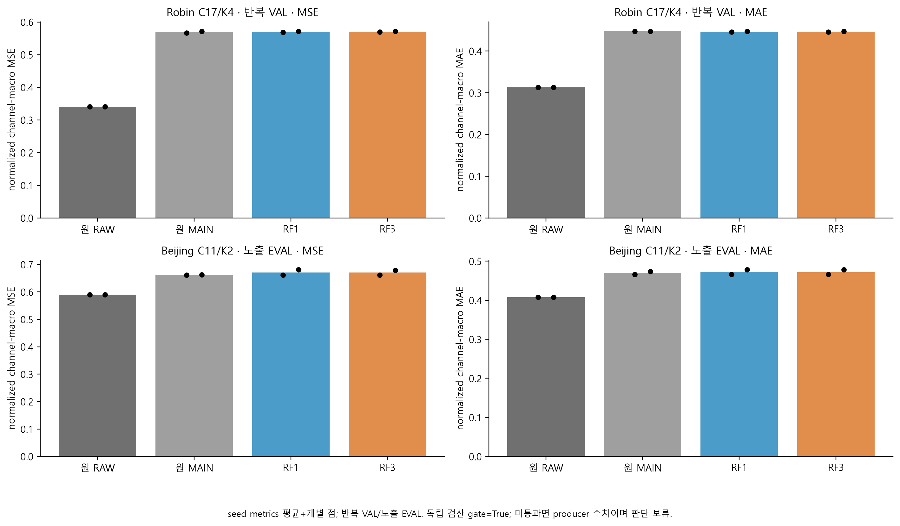
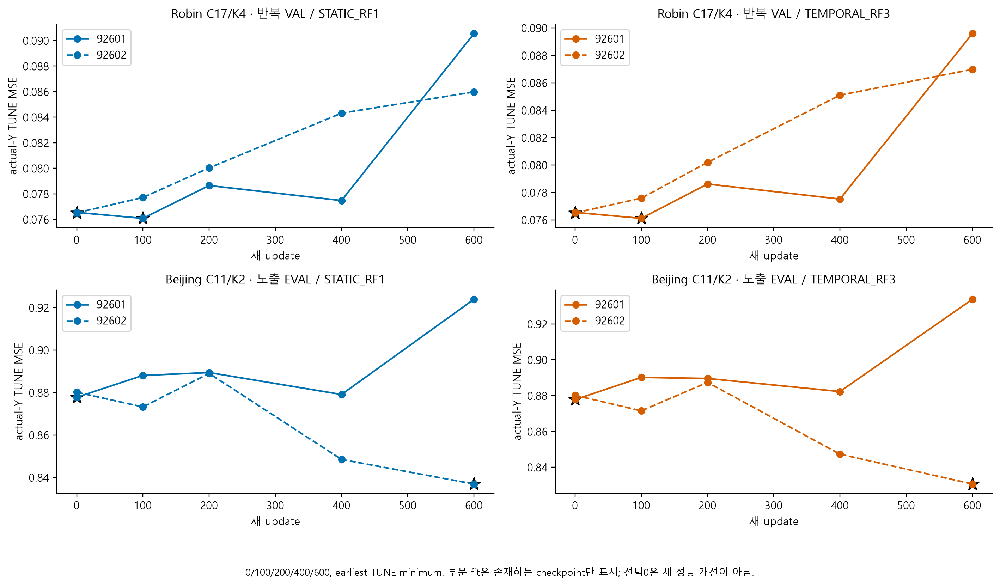
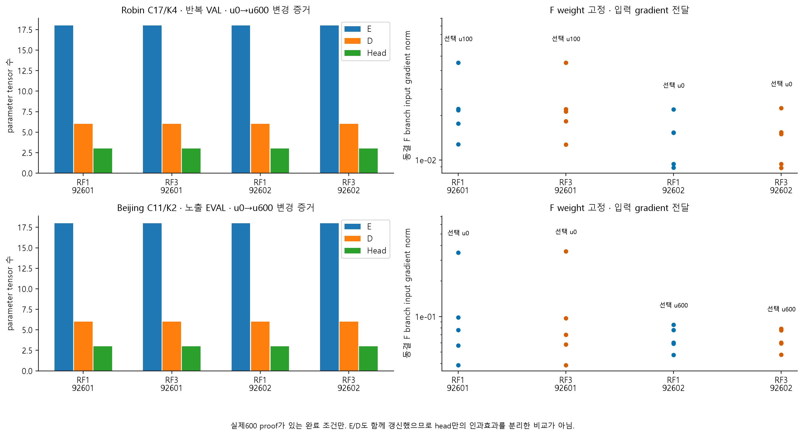
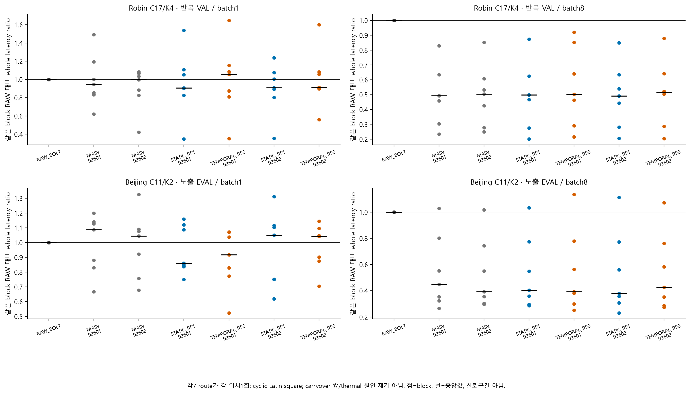
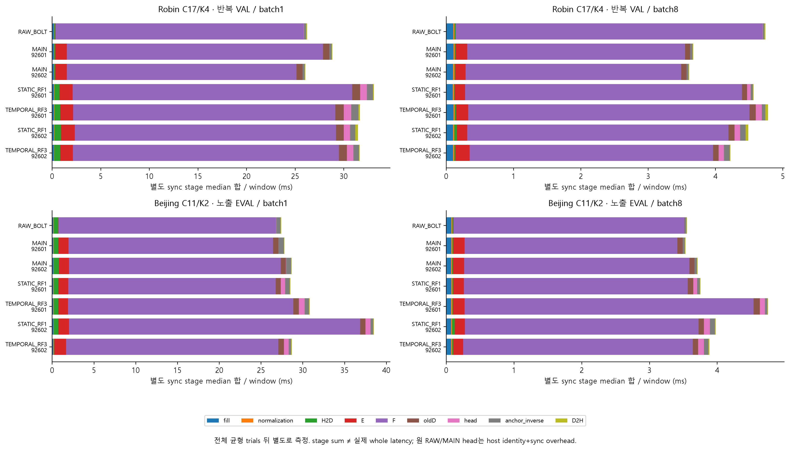

# RF1/RF3 예측 시퀀스 복원의 실제 후속 결과

과학검산 gate: True. 모델8개를 실행한 것과 성능 개선·독립 일반화를 확인한 것은 다르다. 아래 평가는 반복 개발 Robin VAL30·이미 노출된 Beijing EVAL146·seed2개이며 추가 holdout을 만들지 않았다.

## 1. 시간 정보를 보는 residual decoder가 성능 격차를 닫았나?

```text
자료                   방법          n  normalized MSE / MAE
robin                  RAW_BOLT        2  0.340401887 / 0.313192123
robin                  ORIGINAL_MAIN   2  0.569546544 / 0.447338898
robin                  STATIC_RF1      2  0.570502375 / 0.446364465
robin                  TEMPORAL_RF3    2  0.570643031 / 0.446396710
beijing_aotizhongxin   RAW_BOLT        2  0.589575414 / 0.407916509
beijing_aotizhongxin   ORIGINAL_MAIN   2  0.661957198 / 0.470010232
beijing_aotizhongxin   STATIC_RF1      2  0.671287383 / 0.472423976
beijing_aotizhongxin   TEMPORAL_RF3    2  0.670447334 / 0.472248619
```
각 seed와 모든 split은 [점수 표](tables/scores.csv)에 보존한다. 검산 gate 미통과 시 이 값은 producer 기록이며 성능 판단을 보류한다. RAW의 n=2는 같은 저장 RAW 예측을 두 seed 비교에 재사용한 것이며 독립 RAW 학습·추론 2회를 뜻하지 않는다.

동일 seed의 RF3−대조군 차이(음수=낮은 오차):

```text
자료                   대조군          n   ΔMSE / ΔMAE
robin                  STATIC_RF1      2   +0.000140656 / +0.000032246
robin                  RAW_BOLT        2   +0.230241144 / +0.133204587
robin                  ORIGINAL_MAIN   2   +0.001096487 / -0.000942188
beijing_aotizhongxin   STATIC_RF1      2   -0.000840049 / -0.000175357
beijing_aotizhongxin   RAW_BOLT        2   +0.080871920 / +0.064332111
beijing_aotizhongxin   ORIGINAL_MAIN   2   +0.008490136 / +0.002238387
```
Robin C17/K4 · 반복 VAL: 평균 MSE에서 RAW 격차를 닫지 못했다. 같은 seed 2개 ΔMSE=+0.230241144, ΔMAE=+0.133204587.
Beijing C11/K2 · 노출 EVAL: 평균 MSE에서 RAW 격차를 닫지 못했다. 같은 seed 2개 ΔMSE=+0.080871920, ΔMAE=+0.064332111.

seed2개 차이로 일반화 불확실성을 추정하기 어렵다. RF3가 RF1 또는 RAW보다 낮더라도 반복 개발 split 개선으로 범위를 제한한다. 다음 판단은 두 seed의 방향과 MSE/MAE tradeoff 및 비용을 함께 확인하는 것이다.

## 2. 학습을 못 했나, 선택된 상태가 개선을 못 했나?

완료된 fit의 실제600 update·E/D/head 변화·동결 F branch gradient를 확인한다. final600와 selected checkpoint는 다르며 선택0은 원 MAIN 출력 유지다. 같은 dataset/seed 두 head는 동일 원 CP와 batch order를 사용하지만 E/D도 함께 학습하므로 temporal head의 순수 인과효과로 읽지 않는다. 새 head 등록 capacity 차이는 약2% 이내이고 Beijing의 output-bias 제외 active capacity 차이는 약2.06%이다.

완료600 학습 proof가 있는 조건=8/8, 선택0=4/8. 학습이 실행됐다는 증거와 예측 적합성 개선 증거를 분리한다. TUNE 선택은 독립 EVAL 개선을 보장하지 않는다. [모든 선택 checkpoint](tables/checkpoints.csv)를 원 MAIN과 함께 남겼다.

## 3. RF3 비교 자체에 어떤 구조적 한계가 있나?

과거 prefix와 예측 future에 적용한 R에서, 같은 과거 prefix와 마지막 latent를 반복한 R을 뺀다. future latent가 마지막 값으로 지속하면 residual은 강제로0이다. 그러나 실제 지연 채널은 latent가 지속해도 첫 미래 시점에서 갱신될 수 있다. 이 반례는 reference residual의 조건부 제약이며, 전체 E가 지연 정보를 K에 표현할 수 없다는 증거도 실제 실패 원인 확정도 아니다. RF3의 실패를 모든 temporal decoder의 실패로 일반화하거나 성공을 지연 원인 해결의 증거로 쓰지 않는다. [반례·적용 범위 메모](provenance/TEMPORAL_REFERENCE_COUNTEREXAMPLE_KO.md)

저장 latent의 flat 빈도는 [24개 split 진단](tables/flat_latents.csv)에 기록했다. threshold는 encoder 간 정규화하지 않은 absolute latent 1e-5이며 E/F 독립 replay·원인 검증이 아니다.

## 4. 같은 순서 조건에서 batch1 효율은 해결됐나?

whole cost 상태: COMPLETE / actual producer. stage 상태: COMPLETE / separate protocol.

7경로 위치를 균형화하고 같은 block RAW와 비교한다. RAW absolute latency와 원 MAIN·선택 head의 whole 시간은 [비용 표](tables/whole_cost.csv)에 보존한다. 이전 Robin RAW가24.87ms에서48.58ms로 달라진 기준 변동을 숨기지 않는다. 위치 균형만으로 clock/thermal/carryover 원인을 배제하지 못하며 batch8 처리량을 batch1 latency로 바꾸어 말하지 않는다. 별도 synchronized stage sum은 whole latency가 아니다.

## 5. APP에서는 강한 단순 RAW+R 대안까지 이겼나?

이번 새8 fit에 APP를 추가한 것이 아니다. [이전 joint·APP 실제 보고서](../report_joint_followup_v2/REPORT_KO.md)의 실제 APP6 MSE/MAE/Huber_delta1 및 RAW/RAW+R/원 LEARNED 결과를 [APP 맥락 표](tables/APP_context.csv)와 마지막 그림에 복사했다. 강한 RAW+R accuracy reference를 유지하며 그 배포 비용은 NOT_MEASURED다. MSE 개선과 MAE 악화, RAW-error-fixed body/tail의 결과를 함께 읽는다.

## 6. 무엇이 남았고 Chronos-Bolt를 유지할 근거는 무엇인가?

RAW Chronos-Bolt가 원 MAIN보다 강했던 근거는 남지만, 이것이 압축된 latent에서의 예측 적합성이나 경량화를 입증하지 않는다. E가 보존한 정보·F의 latent 미래 예측·현재 reference를 가진 복원 함수의 제약을 분리해 판단해야 한다. 새 비교의 양·음성 결과와 비용으로 다음 가설을 좁히며, 대조학습·dynamic graph·큰 decoder가 필요하다고 자동 결론 내리지 않는다.

독립 CPU audit는 저장 latent와 CP로 D/head 산술·관측 mask 기반 점수·selection·SHA를 재구성했다. F/past E 재추론과 매 update forward를 독립 replay했다고 하지 않는다. CP/NPZ는 ignored cache literal path+SHA만 보존하고 존재하지 않는 GitHub 링크를 만들지 않는다.

## 실제 완료·미완료 상태

```text
자료                   seed   head            status                 updates selected
robin                  92601  STATIC_RF1      COMPLETE                600 100
robin                  92601  TEMPORAL_RF3    COMPLETE                600 100
robin                  92602  STATIC_RF1      COMPLETE                600 0
robin                  92602  TEMPORAL_RF3    COMPLETE                600 0
beijing_aotizhongxin   92601  STATIC_RF1      COMPLETE                600 0
beijing_aotizhongxin   92601  TEMPORAL_RF3    COMPLETE                600 0
beijing_aotizhongxin   92602  STATIC_RF1      COMPLETE                600 600
beijing_aotizhongxin   92602  TEMPORAL_RF3    COMPLETE                600 600
```
[실패·재개 정보](tables/status.csv)에는 원수치와 미완료 이유를 남긴다. 같은 tag/CP에서 자동 재개하지 않으며 추가 자원이 필요하면 승인 범위와 새 실행 조건부터 확인한다.



[SVG](figures/01_selected_forecast_scores.svg)



[SVG](figures/02_actual_Y_TUNE_checkpoints.svg)



[SVG](figures/03_E_D_head_learning_proof.svg)



[SVG](figures/04_position_balanced_whole_cost.svg)



[SVG](figures/05_separate_synchronized_stages.svg)


[SVG](figures/06_APP_stronger_RAW_R_context.svg)

[입력 SHA 목록](provenance/input_manifest.csv) · [checkpoint](tables/checkpoints.csv) · [학습 proof](tables/learning.csv) · [별도 stages](tables/stages.csv)

검산 원문: [BALANCED_COST.json](provenance/audits/BALANCED_COST.json) · [FLAT_LATENTS.json](provenance/audits/FLAT_LATENTS.json) · [SEQUENCE.json](provenance/audits/SEQUENCE.json)

[사용자 자원 승인](provenance/AUTHORIZATION.json) · [고정 실행 manifest](provenance/RUN_MANIFEST.json)
