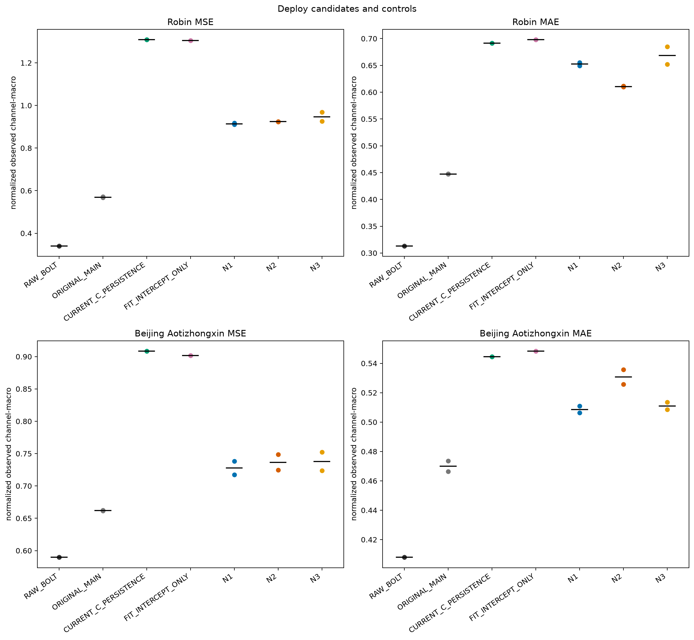
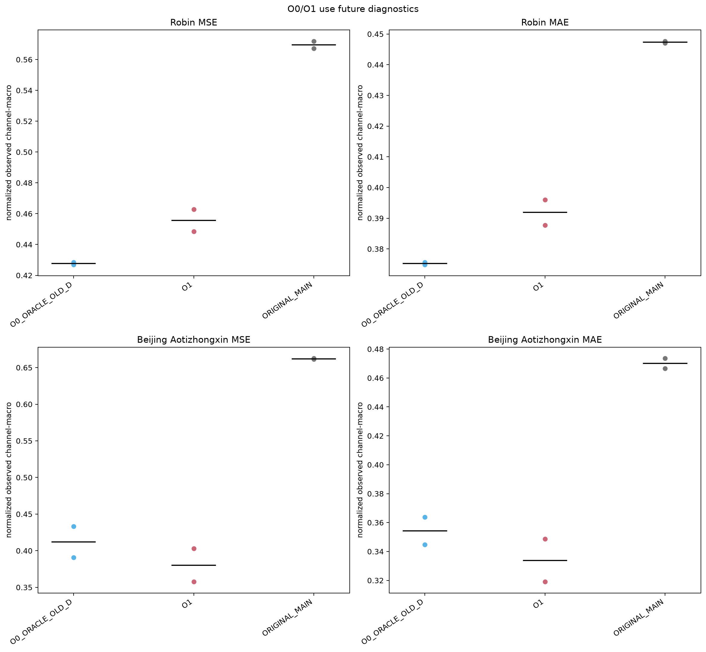
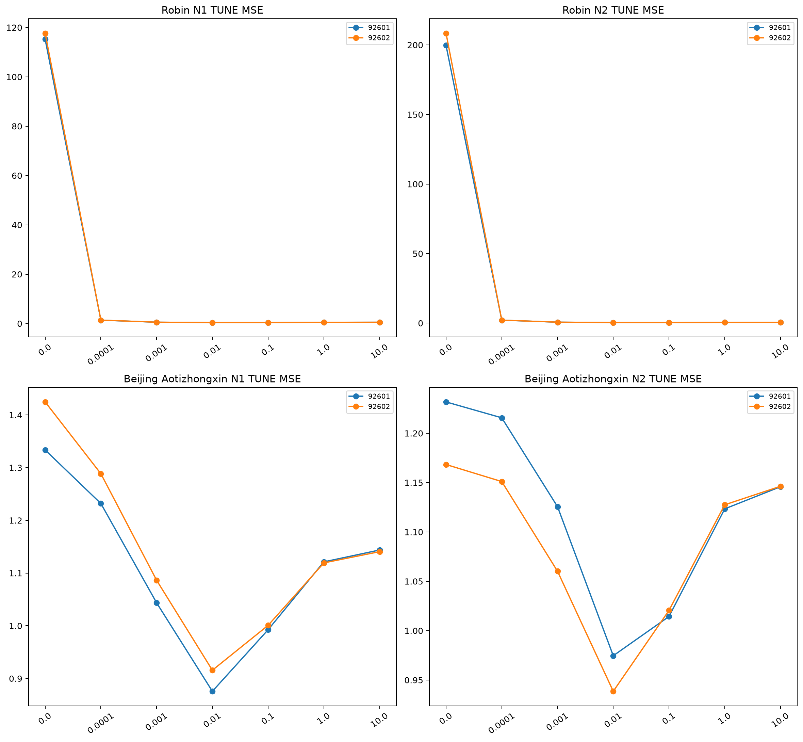
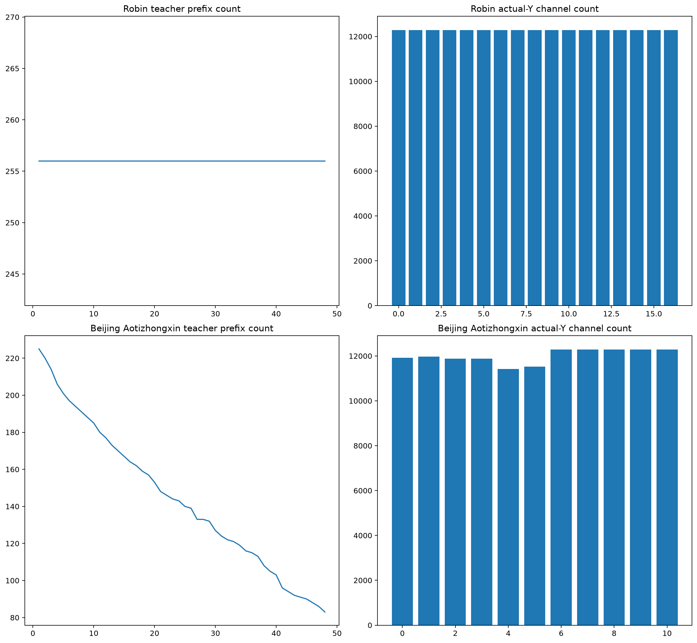
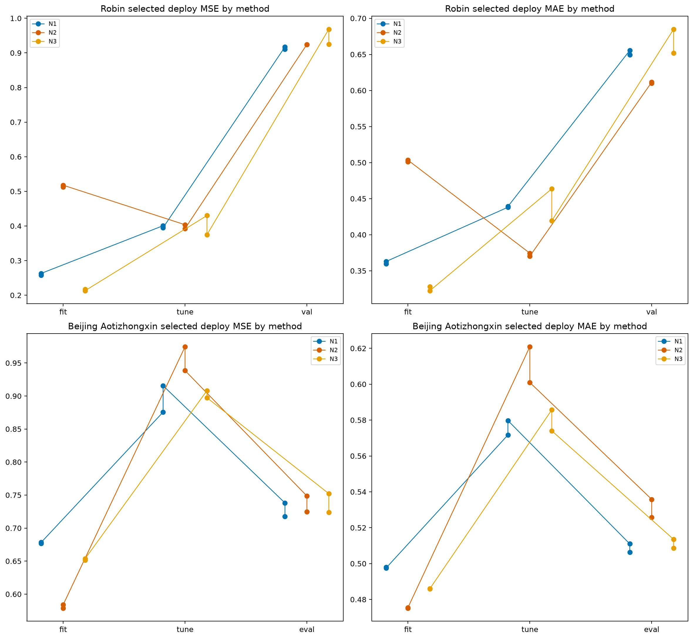
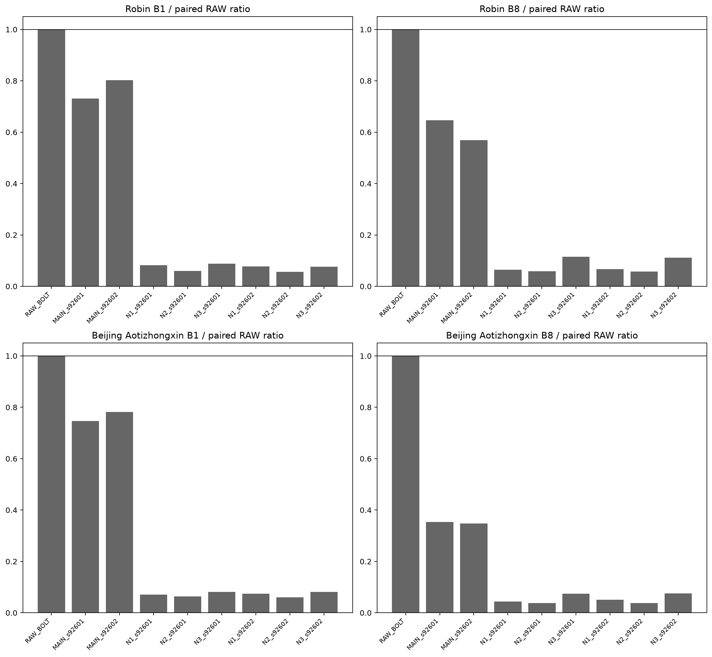

# Stage separation 실제 결과 보고서

[확인] 이 보고서는 terminal JSON만 읽어 작성되며, 과학 NPZ·checkpoint·F 모델을 열지 않는다. 하류 결정은 `E-F-D` 경로를 배포에 유지할 근거가 있는지와 future oracle 진단을 deploy 후보와 혼동하지 않는 것이다.

과학 감사 gate: native audit `PASS`, failed_count `0`. 비용 gate: `COMPLETE`, audit_passed `True`.

## 먼저 답해야 할 여섯 질문

```text
질문                         Robin seed평균                         Beijing seed평균
1 deploy 후보 MSE             N1 0.914009333 / N2 0.924092831 / N3 0.946789769    N1 0.727792542 / N2 0.736626208 / N3 0.737977838
2 N2−PERSISTENCE ΔMSE         -0.384371243                         -0.171815669
2 N2−FIT_INTERCEPT ΔMSE       -0.381040493                         -0.165007949
2 N2−RAW_BOLT ΔMSE            0.583690944                         0.147050794
3 O0/O1 future diag MSE        O0 0.427725422 / O1 0.455677971       O0 0.411923670 / O1 0.380216925
4 N3−N1 fixed predictor ΔMSE   0.032780436                         0.010185296
5 delayed-info lag ablation     NOT_IDENTIFIED_IN_THIS_REPORT        NOT_IDENTIFIED_IN_THIS_REPORT
6 contrastive/dynamic graph     NOT_ESTABLISHED_BY_THIS_EXPERIMENT   NOT_ESTABLISHED_BY_THIS_EXPERIMENT
```

개별 seed와 split별 숫자는 [scores.csv](tables/scores.csv)와 [stagedeltas.csv](tables/stagedeltas.csv)에 있다. causal prefix check는 producer/audit의 특정 입력 스코프 검산이며 보편적 누수 부재 증명이 아니다. N2가 PERSISTENCE/FIT_INTERCEPT/RAW 또는 재사용 RAW readout control을 이기면 이 조건의 past 33K readout usefulness를 지지하지만, encoder class 필요성·독립 일반화·contrastive/dynamic graph 필요성을 증명하지 않는다. Chronos/고정 E 교체의 가치는 이 fixed split 비교 범위에 한정한다.

## 1. 배포 후보 N1/N2/N3와 원 RAW/MAIN 비교

```text
dataset                  method                 n   final normalized MSE / MAE
robin                    RAW_BOLT               2   0.340401887 / 0.313192123
robin                    ORIGINAL_MAIN          2   0.569546544 / 0.447338898
robin                    CURRENT_C_PERSISTENCE  2   1.308464073 / 0.691485989
robin                    FIT_INTERCEPT_ONLY     2   1.305133324 / 0.697852289
robin                    N1                     2   0.914009333 / 0.652398720
robin                    N2                     2   0.924092831 / 0.610657563
robin                    N3                     2   0.946789769 / 0.668453655
robin                    OLD_SAME_MAIN_NATIVE   2   0.625241591 / 0.489177279
robin                    OLD_F_REFIT_D_Y        2   0.583851000 / 0.456479676
beijing_aotizhongxin     RAW_BOLT               2   0.589575414 / 0.407916509
beijing_aotizhongxin     ORIGINAL_MAIN          2   0.661957198 / 0.470010232
beijing_aotizhongxin     CURRENT_C_PERSISTENCE  2   0.908441877 / 0.544506711
beijing_aotizhongxin     FIT_INTERCEPT_ONLY     2   0.901634157 / 0.548318082
beijing_aotizhongxin     N1                     2   0.727792542 / 0.508623760
beijing_aotizhongxin     N2                     2   0.736626208 / 0.530753754
beijing_aotizhongxin     N3                     2   0.737977838 / 0.511030720
beijing_aotizhongxin     OLD_SAME_MAIN_NATIVE   2   0.765178292 / 0.525670986
beijing_aotizhongxin     OLD_F_REFIT_D_Y        2   0.668330841 / 0.470929906
```

세부 split/seed 수치는 [scores.csv](tables/scores.csv)에 보존한다. RAW의 seed 반복은 같은 저장 RAW 예측 reference를 각 seed 비교에 붙인 것이며 독립 RAW 재학습 2회가 아니다.

- Robin: final split 평균 MSE 기준 최저 배포 후보는 `N1`이고 원 MAIN 대비 ΔMSE는 `+0.344462789`다.
- Beijing Aotizhongxin: final split 평균 MSE 기준 최저 배포 후보는 `N1`이고 원 MAIN 대비 ΔMSE는 `+0.065835344`다.

old RAW readout reuse control도 native audit supplement에서 들어온 경우만 별도 표시한다. 이는 새 훈련 비용이나 matched-anchor/readout capacity 주장이 아니다.

```text
dataset                  method                 n   final normalized MSE / MAE
robin                    RAW_BOLT_RAW_R         1   0.345159404 / 0.322689273
robin                    RAW_JOINT_RIDGE        1   1.142710811 / 0.795741172
robin                    RAW_SELF33             1   0.844782547 / 0.612346204
beijing_aotizhongxin     RAW_BOLT_RAW_R         1   0.578874852 / 0.420859544
beijing_aotizhongxin     RAW_JOINT_RIDGE        1   0.850735096 / 0.564766121
beijing_aotizhongxin     RAW_SELF33             1   0.766255346 / 0.513064022
```

## 2. O0/O1은 actual future를 쓰는 진단이다

O0_ORACLE_OLD_D와 O1은 actual future oracle latent 또는 actual future prefix를 쓰는 diagnostic branch다. 배포 후보 N1/N2/N3와 같은 입력 조건이 아니므로 같은 축의 원인 주장으로 읽지 않는다.

## 3. N2 우세가 말하는 범위

N2는 past latent에서 C-space innovation을 직접 예측한다. 같은 anchor와 FIT 통계 아래에서 N2가 PERSISTENCE/FIT_INTERCEPT/RAW보다 낮은 오류를 보이면 이 조건의 past 33K readout usefulness는 지지한다. 다만 그 결과만으로 encoder class 필요성, 독립 일반화, delayed-information 원인, contrastive/dynamic graph 필요성을 주장하지 않는다. N1 latent objective도 actual-Y loss와 다르고 complete-future-prefix mask 표본과 actual-Y 관측 표본이 다를 수 있다.

## 4. teacher coverage와 zero-output 위험

N1 teacher는 complete future prefix mask로 학습된다. FIT teacher count와 actual-Y channel count는 [coverage.csv](tables/coverage.csv), zero-output 수는 [zero_outputs.csv](tables/zero_outputs.csv)에 보존한다. zero-output teacher output은 학습된 출력이 아니므로 성공 사례로 해석하지 않는다.

## 5. 비용 측정의 범위

비용 상태는 `COMPLETE`다. cost rows는 [cost.csv](tables/cost.csv)에 둔다. 비용 producer는 B1/B8 whole route paired RAW 비교이며, hybrid transfer와 staged decomposition 부재 때문에 원인 분해나 최적 구현 비용으로 일반화하지 않는다.

## 6. 제한

- 반복 개발 Robin VAL30과 이미 노출된 Beijing EVAL146, seed 2개만 포함한다. 독립 holdout 주장이 아니다.
- 원래 MAIN은 E/D/F/Y end-to-end 예측기로 훈련된 것이며 autoencoder가 아니다. stage separation 수치로 F의 인과 실패를 직접 증명하지 않는다.
- PERSISTENCE와 FIT_INTERCEPT는 단순 배포 control로 포함하지만 새 모델 선택 기준을 바꾸지 않는다.
- 본 생성기는 terminal JSON만 읽는다. NPZ 배열과 checkpoint byte-level 검증은 native audit 결과에 의존한다.

## 산출물

- 표: [scores.csv](tables/scores.csv), [alphagrid.csv](tables/alphagrid.csv), [coverage.csv](tables/coverage.csv), [zero_outputs.csv](tables/zero_outputs.csv), [cost.csv](tables/cost.csv), [status.csv](tables/status.csv), [stagedeltas.csv](tables/stagedeltas.csv)






- manifest: `MANIFEST.json`
