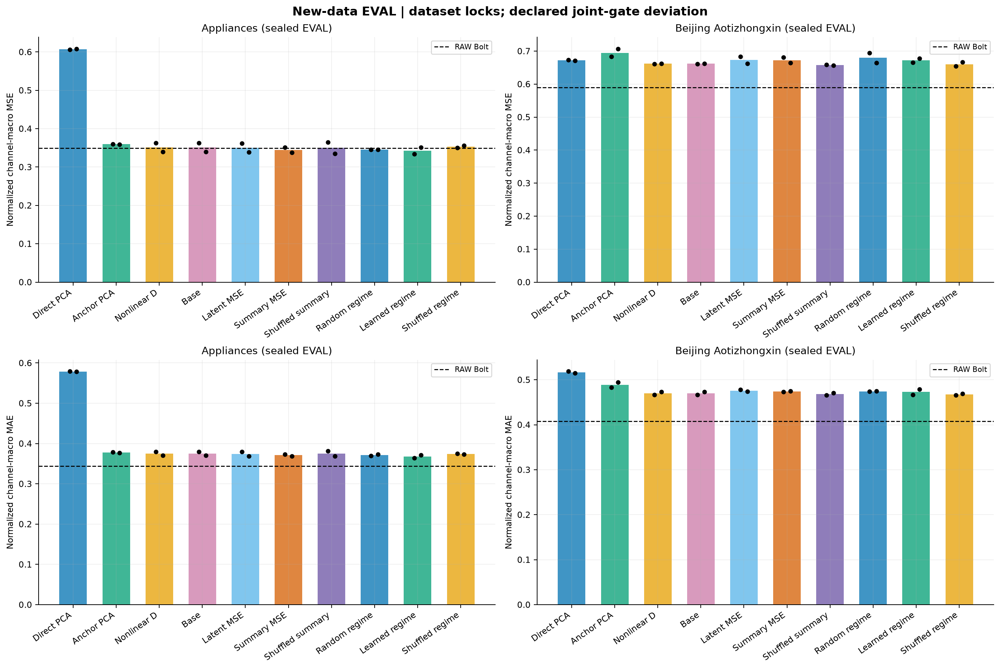

# 작은 K의 예측 손실과 미래 표현 정렬

작은 잠재 채널 K에서 생기는 예측 오차를 줄일 수 있는지, 미래 정답으로 표현을 정렬하면 추가 이득이 있는지, 개발에서 정한 방법이 새 자료에서도 통하는지 실제 학습과 추론으로 확인한 연구다. 주평가지표는 FIT 통계로 정규화한 관측 채널별 MSE의 균등 평균이다. MAE·원단위 오차·실제 배포 비용도 함께 확인한다.

[결과 보고서](report_v2/REPORT_KO.md)에서 질문별 답과 원수치를 먼저 확인할 수 있다. [전체 방법별 수치](report_v2/all_methods.csv), [동일 보조 weight 대조](report_v2/same_weight_alignment_contrasts.csv), [전체 경로 비용](report_v2/batch_cost.csv), [최종 감사](FINAL_AUDIT_V2.json)를 연결한다. [첫 보고서](report_v1/REPORT_KO.md)는 보존했고, v2는 같은 수치에서 그림의 라벨과 기호 설명을 개선했다.

현재 채널 상태 C개를 보존하고 K개 성분으로 미래 변화를 예측하는 일부 구조는 직접 복원보다 손실을 줄였다. 동일한 PCA 초기화에서 현재 상태만 보존한 비교는 Jena·Robin·Appliances의 MSE를 낮췄지만 Beijing의 MSE는 높였다. 선택한 teacher 초기화·비선형 디코더를 함께 사용해도 압축 없는 예측기보다 안정적으로 정확해진 것은 아니다. 미래 정렬의 작은 MSE 이득은 자료·seed·지표에 따라 달랐고, 학습한 미래 패턴 분할의 보편적 필요성도 입증하지 못했다. 모델 순위는 [보고서의 조건과 한계](report_v2/REPORT_KO.md)와 함께 읽어야 한다.

## 실행 범위와 평가 순서

- S0: 고정 디코더의 실제 미래 투영 진단, 과거 전용 인코더·gradient·동결 백본·결측 처리 검사.
- S1: 현재 상태 보존, teacher 부분공간, pointwise 인코더, 비선형 디코더의 24개 학습 조건.
- S2: 연속 미래 정렬·미래 요약·고정/학습 분할·shuffled 대조의 52개 학습 조건.
- S3: 사전에 지정한 UCI Appliances와 Beijing Aotizhongxin에서 44개 학습 조건과 16개 native 예측기 학습. 원자료 Bolt/ridge 및 보정 대조도 포함.
- 실제 재추론: core 체크포인트 600개, native 체크포인트 80개, 선택 모델 FIT의 보조 head 적용 전후 80개.
- 비용: 정본 200개 방법의 batch 1·8 전체 배포 경로 400행. 데이터 창 전처리와 전송을 포함하고 모델 로드·disk read는 제외.

**평가 순서에 편차가 있다.** 최초 Beijing loader가 정상 PRSA 자료와 무관한 CSV를 합쳐 실패했고, Appliances 평가는 먼저 끝났다. 따라서 두 새 자료의 모든 모델을 어떤 EVAL도 보기 전에 함께 봉인한다는 원래 공동 barrier는 충족하지 못했다. 같은 원 ZIP에서 사전 지정 PRSA member만 읽도록 별도 loader를 수리한 뒤, 방법·weight·관측소·학습 조건을 유지해 Beijing을 실행했다. 자료별 모델 봉인 뒤 최초 평가한 사실과 원래 공동 순서의 위반을 구분한다. 원 실패 결과는 보존했다.

근거는 [사전 계획](PLAN_KO.md), [개발 선택 봉인](METHOD_LOCK.json), [수리 전 실행 메모](BEIJING_REPAIR_EXECUTION_NOTE_KO.md), [원 PARTIAL 결과](run_new_v1/RESULT.json), [Beijing 수리 결과](run_beijing_repair_v1/RESULT.json), [출처를 연결한 결과](run_new_resolved_v1/RESULT.json)에 있다. 최종 검증 통과를 원래 공동 protocol의 통과로 바꾸어 읽으면 안 된다.

## 코드와 검산

학습은 [engine.py](engine.py)와 [alignment.py](alignment.py), 새 자료 적합은 [new_run.py](new_run.py)와 [beijing_run.py](beijing_run.py), 자료 계약은 [newdata.py](newdata.py)와 [별도 수리 loader](newdata_repair.py)에 있다. [checkpoint_audit.py](checkpoint_audit.py)는 저장된 가중치의 실제 재추론을, [cost_run.py](cost_run.py)는 학습 종료 후 비용을 측정한다. [validation_contracts.py](validation_contracts.py)는 원본·통계·origin·mask·예측 배열·점수·선택·봉인·비용을 CPU에서 독립 검산한다.

[선행 방법과 독립성의 한계](SOURCE_NOTES_KO.md)를 따로 기록했다. 이번 분할 정렬은 ExoTimer의 Bi-Hash 재현이 아니다. 새 자료에서는 자료별 FIT/TUNE로 다시 학습했으며, Chronos-Bolt 사전학습 자료와의 비중첩은 증명하지 못했다. 기존 Jena/Robin VAL은 반복 사용한 개발 진단이다.

현재 이 연구의 변경은 로컬에 있다. 자동 commit/push는 수행하지 않았다. 원자료·가중치·예측 NPZ는 같은 이름의 로컬 `.cache`와 기존 봉인된 자산에 의존한다. source snapshot은 당시 코드의 감사 증거이며 실행 진입점은 위의 상위 스크립트다. 원본 실험과 결과를 덮어쓰지 않도록 재실행에는 새로운 tag와 출력 폴더를 사용해야 한다.
