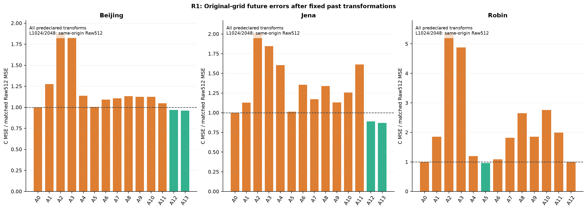
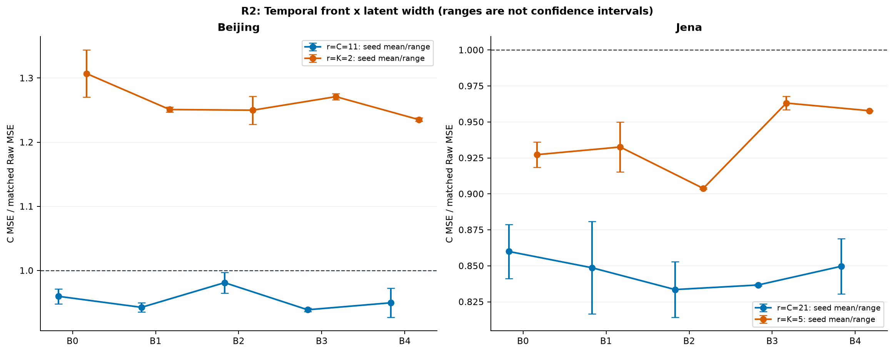
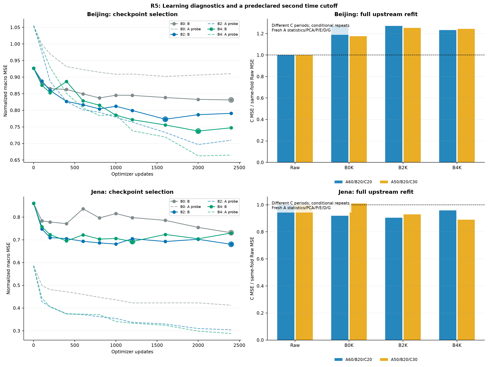
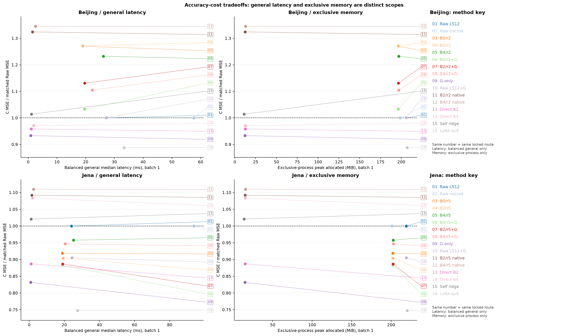
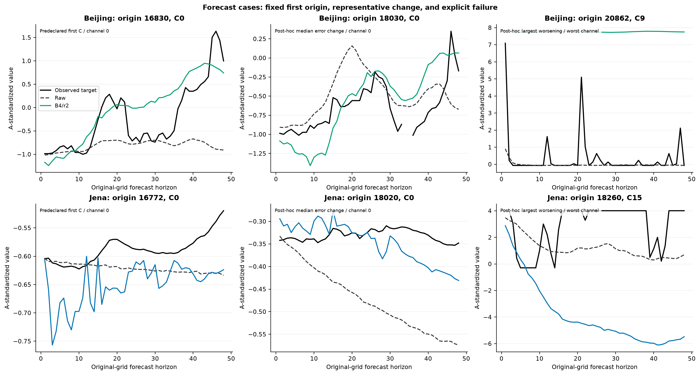

# 고정 Bolt의 시간 앞단: 실제 R1–R5 결과

이 보고서는 새 과거→과거 시간 앞단을 실제 학습한 이번 캠페인의 결과다. 이전 LEVEL/PCA/ForeCA 결과를 새 학습으로 재명명하지 않았다. 주평가는 fold A 관측값으로 표준화한 원채널·원미래 H48의 관측 mask 전용 채널 macro MSE다. 모든 비교는 같은 dataset/fold/target cohort를 검사한다.

## 먼저 답해야 할 질문

**Beijing — 단순 시간 변환으로 충분한가:** B에서 선정된 A7는 C에서 MSE 0.726034 대 0.655904, 상대 차이 +10.69%(크다). 이는 해당 고정 설정의 결과이며 모든 평활·재표본화의 최적성을 증명하지 않는다.

**학습형 P의 추가 값:** B로 선택한 B4/r2와 같은 K의 B0는 C에서 MSE 0.808416 대 0.833102, 상대 차이 -2.96%(작다). 선택 seed는 92601이며 다른 seed도 아래 표·그림에 전부 남긴다. 훈련 상태는 `COMPLETE_VALID`다. 수렴 미확정 경로를 구조적 불가능성으로 바꾸지 않는다.

**B2의 C/K:** K2 대 C11는 MSE 0.834189 대 0.632933, 상대 차이 +31.80%(크다). 각각 B로 선택한 seed는 K=92601, C=92602다. C/K를 바꾸면 F stream 수뿐 아니라 E/D의 파라미터 수와 복원 공간도 함께 달라진다. 공간 제약·용량·최적화·예측기와 D의 결합이 함께 달라지는 진단이므로 정보 압축 단독의 인과 효과로 확정하지 않는다.

**B4의 C/K:** K2 대 C11는 MSE 0.808416 대 0.608003, 상대 차이 +32.96%(크다). 각각 B로 선택한 seed는 K=92601, C=92602다. C/K를 바꾸면 F stream 수뿐 아니라 E/D의 파라미터 수와 복원 공간도 함께 달라진다. 공간 제약·용량·최적화·예측기와 D의 결합이 함께 달라지는 진단이므로 정보 압축 단독의 인과 효과로 확정하지 않는다.

**B2+G의 남는 값:** G-only 대비 MSE 0.741679 대 0.612079, 상대 차이 +21.17%(크다); Raw+G 대비 MSE 0.741679 대 0.656638, 상대 차이 +12.95%(크다); B0K+G 대비 MSE 0.741679 대 0.677443, 상대 차이 +9.48%(크다). G는 동일 과거 C innovation·클래스·초기화 원칙이며 주 fold 한 seed의 탐색 비교다.

**B4+G의 남는 값:** G-only 대비 MSE 0.724497 대 0.612079, 상대 차이 +18.37%(크다); Raw+G 대비 MSE 0.724497 대 0.656638, 상대 차이 +10.33%(크다); B0K+G 대비 MSE 0.724497 대 0.677443, 상대 차이 +6.95%(크다). G는 동일 과거 C innovation·클래스·초기화 원칙이며 주 fold 한 seed의 탐색 비교다.

**Bolt를 유지할 근거:** 고정 B4/r2의 C MSE는 0.808416다. B2/r2 native 0.868617 / B4/r2 native 0.882322 / Direct B2 0.628473 / Direct B4 0.636643 / Self ridge 0.665046 / LoRA qv8 0.582379. 이 비교에서 native는 같은 P/E/D를 고정한 actual-Y 적합이고 direct는 별도 전체 예측기다. 단, native/ridge는 모든 합법 A origin을 쓰고 신경망은 같은 A 범위의 minibatch prefix이므로 실제 노출·추정법까지 같지는 않다. Bolt의 유지 판단은 이 원수치·노출표·전체 비용을 함께 보며, 표현의 분포 부적합이나 디코더 오류 중 하나를 자동 확정하지 않는다.

**시간 재적합과 불확실성:** 두 번째 경계에서 전체 upstream을 A부터 다시 학습한 B4/r2는 MSE 0.849096 대 0.682349, 상대 차이 +24.44%(크다). 첫 fold와 C 기간이 다르며 같은 시계열의 조건부 반복이다. 어느 fold도 과거 이력 전체에서 미노출인 독립 자료가 아니다.

**Jena — 단순 시간 변환으로 충분한가:** B에서 선정된 A0는 C에서 MSE 1.223530 대 1.223530, 상대 차이 +0.00%(같다). 이는 해당 고정 설정의 결과이며 모든 평활·재표본화의 최적성을 증명하지 않는다.

**학습형 P의 추가 값:** B로 선택한 B2/r5와 같은 K의 B0는 C에서 MSE 1.106624 대 1.123924, 상대 차이 -1.54%(작다). 선택 seed는 92602이며 다른 seed도 아래 표·그림에 전부 남긴다. 훈련 상태는 `UNDERTRAINED_OR_UNRESOLVED`다. 수렴 미확정 경로를 구조적 불가능성으로 바꾸지 않는다.

**B2의 C/K:** K5 대 C21는 MSE 1.106624 대 0.996148, 상대 차이 +11.09%(크다). 각각 B로 선택한 seed는 K=92602, C=92602다. C/K를 바꾸면 F stream 수뿐 아니라 E/D의 파라미터 수와 복원 공간도 함께 달라진다. 공간 제약·용량·최적화·예측기와 D의 결합이 함께 달라지는 진단이므로 정보 압축 단독의 인과 효과로 확정하지 않는다.

**B4의 C/K:** K5 대 C21는 MSE 1.171961 대 1.016098, 상대 차이 +15.34%(크다). 각각 B로 선택한 seed는 K=92602, C=92602다. C/K를 바꾸면 F stream 수뿐 아니라 E/D의 파라미터 수와 복원 공간도 함께 달라진다. 공간 제약·용량·최적화·예측기와 D의 결합이 함께 달라지는 진단이므로 정보 압축 단독의 인과 효과로 확정하지 않는다.

**B2+G의 남는 값:** G-only 대비 MSE 1.084841 대 1.017580, 상대 차이 +6.61%(크다); Raw+G 대비 MSE 1.084841 대 1.107781, 상대 차이 -2.07%(작다); B0K+G 대비 MSE 1.084841 대 1.080649, 상대 차이 +0.39%(크다). G는 동일 과거 C innovation·클래스·초기화 원칙이며 주 fold 한 seed의 탐색 비교다.

**B4+G의 남는 값:** G-only 대비 MSE 1.158366 대 1.017580, 상대 차이 +13.84%(크다); Raw+G 대비 MSE 1.158366 대 1.107781, 상대 차이 +4.57%(크다); B0K+G 대비 MSE 1.158366 대 1.080649, 상대 차이 +7.19%(크다). G는 동일 과거 C innovation·클래스·초기화 원칙이며 주 fold 한 seed의 탐색 비교다.

**Bolt를 유지할 근거:** 고정 B2/r5의 C MSE는 1.106624다. B2/r5 native 1.336227 / B4/r5 native 1.357798 / Direct B2 1.085352 / Direct B4 1.325950 / Self ridge 1.249032 / LoRA qv8 0.914889. 이 비교에서 native는 같은 P/E/D를 고정한 actual-Y 적합이고 direct는 별도 전체 예측기다. 단, native/ridge는 모든 합법 A origin을 쓰고 신경망은 같은 A 범위의 minibatch prefix이므로 실제 노출·추정법까지 같지는 않다. Bolt의 유지 판단은 이 원수치·노출표·전체 비용을 함께 보며, 표현의 분포 부적합이나 디코더 오류 중 하나를 자동 확정하지 않는다.

**시간 재적합과 불확실성:** 두 번째 경계에서 전체 upstream을 A부터 다시 학습한 B2/r5는 MSE 1.249886 대 1.344957, 상대 차이 -7.07%(작다). 첫 fold와 C 기간이 다르며 같은 시계열의 조건부 반복이다. 어느 fold도 과거 이력 전체에서 미노출인 독립 자료가 아니다.

결과의 방향은 위 원수치에 한정된다. 두 seed의 범위는 신뢰구간이 아니며 겹치는 창·채널·seed를 독립 반복으로 세어 유의성을 주장하지 않는다. C를 본 뒤 새 구조·checkpoint·alpha·데이터를 다시 선택하지 않았다.

## 무엇을 실제로 실행했고 어디까지 완료했는가

[SCORE_COMPLETE](SCORE_COMPLETE.json)는 `COMPLETE_VALID`, [COST_LOCK](COST_LOCK.json)는 `COMPLETE_VALID`다. 실제 score행은 296개이고 실행 index행은 862개다. 이는 새 학습 모델 수와 같은 숫자가 아니다. B/C 재평가·무학습 변환·비용 trial·ridge alpha 적합·학습 update를 구분한 원기록은 [RUN_INDEX](RUN_INDEX_v2.csv), [SCORES](SCORES.csv), [COST](COST.csv)에 있다.

저장 산출물 감사는 `PASS`, ERROR 0, warning 0다. 선정·data 계약·학습 receipt·저장 예측/mask·비용 원수치를 검산한 범위이며 독립 학습 재실행 0, 타이머 재실행 0다. PASS는 성능 개선/충분 수렴/새 독립 일반화의 증거가 아니며 PATH_FINDINGS는 해당 경로의 한계를 그대로 남긴다. [현재 전체 감사](AUDIT_v2.json), [현재 실행 목록](RUN_INDEX_v2.csv).

첫 감사는 CSV 기본 field 한도131,072자로 큰 비용 메타데이터를 읽지 못해 `PATH_FINDINGS`·ERROR 156를 기록했다. reader 실패4개와 그에 따른 종속 finding152개를 방법/비용 성능 실패로 해석하지 않는다. 원 감사·실행 목록·로그를 덮지 않고 16MiB reader 한도와 합성 회귀 후 새 이름으로 저장 산출물을 실제 재검산했다. 과학 SOURCE·예측·비용 원수치는 바꾸지 않았으며, 현재 보고서는 이름으로 최신 파일을 추측하지 않고 [명시적 감사 manifest](AUDIT_LATEST.json)가 지정한 v2 파일과 SHA를 검증해 사용한다. 이 metadata reader 수선도 학습/타이머의 독립 재실행은 아니다. 보존 기록: [AUDIT.json](AUDIT.json), [RUN_INDEX.csv](RUN_INDEX.csv), [AUDIT_EXECUTION_01.log](AUDIT_EXECUTION_01.log).

별도 프로세스 비용의 첫 queue는 Windows venv launcher 부모를 경쟁 작업으로 오탐해 모델 로드·정밀 trial 전에 정지했다. [실패 attempt·잔여 로그·수선 기록](EXECUTION_REPAIR_KO.md)을 보존했고 이를 성공 trial이나 방법 성능 실패로 세지 않는다. 같은 실제 base Python과 기존 venv 모듈의 경로·버전을 확인해 직접 재실행했으며 동결 과학 SOURCE·선정·통계·guard는 바꾸지 않았다. 환경 경로/버전 확인은 수치의 bitwise 동등성 증명이 아니다. 재시도의 최종 비용 성공 근거는 첫 실패 로그가 아니라 유효한 COST_LOCK과 그에 연결된 원 trial이다. C 확인이나 모델 재선택을 위한 수선이 아니었다.

R1은 GPU queue 운영상 R2 본학습 뒤에 실제 실행했다. 설정과 SOURCE는 R2 동안 준비됐고, R1 결과가 나쁘다는 이유로 R2 가족을 취소하지 않았다. R4는 사전 고정 ceiling16을 지켜 swap 2alpha(0,.01)×2가족×2자료=8, direct 2가족×2자료×1seed=4, LoRA1구성×2자료=2, raw ridge alpha .01×2자료=2로 합계16 적합이다. ZERO는 추가 적합이 아니다. 코드의 범용 ALPHAS 상수를 실제 실행 메뉴로 읽지 않는다. G는 첫 fold10+둘째 fold10=20이며 첫 fold G의 seed는 하나다. LoRA의 configured_lr는 기존 SOURCE에서 사전에 선정한 .0001이고 나머지 Adam 조건은 .001이다. 실제 학습률은 각 fit receipt와 아래 lr 열에서 확인하며 ridge에는 Adam 학습률을 붙이지 않는다.

R1 미실행·무효 경로: robin/A13 `BLOCKED`: NO_COMMON_ORIGIN_WITH_THIS_LOOKBACK.

## 데이터 계약과 평가 범위

Beijing C11/K2와 Jena C21/K5가 주 자료이며 Robin C17/K4는 짧은 기간의 스트레스 진단이다. 기존 허용 FIT 안에서 첫 fold A/B/C=60/20/20, 둘째=50/20/30을 결과 전에 고정했다. 각 fold의 scaler·초기값·PCA·E/D·G는 A에서 새로 적합하고 checkpoint·alpha·가지 선택은 B까지만 사용한다. A는 모든 합법 origin을 pool로 두고 B/C는 stride48+끝 origin의 고정 cohort다. 마지막 두 창은 겹칠 수 있다. A와 B, B와 C 사이 target은 겹치지 않고 뒤 구간 history에 앞 구간의 이미 관측된 값이 들어가는 것은 허용한다.

Jena/Robin은 옛 전체 TRAIN 정규화 FP32 x를 역변환한 계보가 남으므로 무손실 raw A-only라고 부르지 않는다. safe NPZ의 member 압축 해제는 옛 TUNE/VAL을 포함할 수 있지만 새 반환·통계·학습에서는 원래 FIT만 사용한다. 보호 TEST 및 원 CSV/ZIP 전체 재파싱은 이번 실행 범위 밖이다. C는 이번 알고리즘의 선택에서 잠갔지만 과거 캠페인에 노출된 시간이며 `historically_unseen=False`다. 독립 holdout 검증으로 바꾸어 말하지 않는다. [상세 자산·계보](DATA_ASSET_REVIEW.md), [새 계약](DATA_CONTRACT.json).

## 방법과 공통 비교 조건

기본 경로는 과거 X→P(과거→원격자 과거)→E(C→r)→frozen Bolt→같은 origin-reference lag-linear D→현재 원 C anchor→원미래다. 모든 핵심 D는 lag0/1/2/4/8/16/32를 쓰며 r=C는 항등, r=K는 A-only PCA에서 시작한다. P는 최종 잔차층만 zero로 초기화해 CP0 no-op을 만들고 나머지 층의 초기값을 유지했다. B0는 점별 어댑터, B1은 채널 독립 단일 해상도 시간 MLP, B2는 시간/채널 혼합, B3는 분해 없는 다중해상도, B4는 성분 분해와 반대 방향 다중해상도 혼합을 사용한 Bolt용 변형이다. 내부 coarse/fine를 원격자로 융합한 뒤 r개 stream만 F에 보낸다.

B2/B4 앞단은 Google TSMixer/TimeMixer의 전체 논문 성능 재현이 아니다. AdaPTS의 앞뒤 어댑터와 예측 목적 E/D 학습 자체도 신규성으로 주장하지 않는다. SPRINT-on-Bolt는 공식 기본 T5 wrapper를 Bolt q0.5로 바꾼 이식 대조다. 기간24/144는 기존 metadata에서 고정했으며 SPRINT 유효 lookback504/432의 Raw도 별도로 재계산했다. [공식 자료·고정 revision 대응](LITERATURE_MAPPING.md).

F 가중치는 고정하지만 P/E로의 입력 gradient는 유지한다. 원 InstanceNorm의 양의 분산 순방향/미분을 유지하고 0-variance sqrt gradient만 유한한0으로 정의했다. 실제 Raw/microbatch/CP0 parity는 [ACTUAL_PARITY](ACTUAL_PARITY.json)의 허용오차와 범위를 확인한다. q0.5 예측의 MSE 비교이며 조건부 평균이나 확률예측 전체의 우위를 의미하지 않는다.

## R1: 단순 시간 조작



A0 Raw; A1/2 F(trailing trend)+마지막 residual(폭5/25); A3/4 F(residual)+마지막 trend; A5/6 F(trend)+F(residual); A7/8 endpoint stride2/4; A9/10 block-mean stride2/4; A11 SPRINT-on-Bolt; A12/13 Raw L1024/2048이다. A5/6의 두 배 streams를 숨기지 않는다. R=X−T의 운영적 분해를 실제 계절·잡음 정답으로 해석하지 않는다. endpoint의 물리 미래 좌표와 block 평균의 반복 복원은 별개다. 긴 L은 같은 origin의 Raw512로 나누고, SPRINT의 유효 lookback 대조도 score 원표에 별도로 남는다.

```text
dataset  setting  physical_past_L  F_context_L  F           r   C_origins  cohort_prefix
beijing  A0       512              512          Bolt-small  11  88         fc3bd09ab7a1 
beijing  A1       512              512          Bolt-small  11  88         fc3bd09ab7a1 
beijing  A2       512              512          Bolt-small  11  88         fc3bd09ab7a1 
beijing  A3       512              512          Bolt-small  11  88         fc3bd09ab7a1 
beijing  A4       512              512          Bolt-small  11  88         fc3bd09ab7a1 
beijing  A5       512              512          Bolt-small  11  88         fc3bd09ab7a1 
beijing  A6       512              512          Bolt-small  11  88         fc3bd09ab7a1 
beijing  A7       512              256          Bolt-small  11  88         fc3bd09ab7a1 
beijing  A8       512              128          Bolt-small  11  88         fc3bd09ab7a1 
beijing  A9       512              256          Bolt-small  11  88         fc3bd09ab7a1 
beijing  A10      512              128          Bolt-small  11  88         fc3bd09ab7a1 
beijing  A11      512              84           Bolt-small  11  88         fc3bd09ab7a1 
beijing  A12      1024             1024         Bolt-small  11  88         fc3bd09ab7a1 
beijing  A13      2048             2048         Bolt-small  11  88         fc3bd09ab7a1 
jena     A0       512              512          Bolt-small  21  88         018f42011927 
jena     A1       512              512          Bolt-small  21  88         018f42011927 
jena     A2       512              512          Bolt-small  21  88         018f42011927 
jena     A3       512              512          Bolt-small  21  88         018f42011927 
jena     A4       512              512          Bolt-small  21  88         018f42011927 
jena     A5       512              512          Bolt-small  21  88         018f42011927 
jena     A6       512              512          Bolt-small  21  88         018f42011927 
jena     A7       512              256          Bolt-small  21  88         018f42011927 
jena     A8       512              128          Bolt-small  21  88         018f42011927 
jena     A9       512              256          Bolt-small  21  88         018f42011927 
jena     A10      512              128          Bolt-small  21  88         018f42011927 
jena     A11      512              12           Bolt-small  21  88         018f42011927 
jena     A12      1024             1024         Bolt-small  21  88         018f42011927 
jena     A13      2048             2048         Bolt-small  21  88         018f42011927 
robin    A0       512              512          Bolt-small  17  7          a9279a0abf0c 
robin    A1       512              512          Bolt-small  17  7          a9279a0abf0c 
robin    A2       512              512          Bolt-small  17  7          a9279a0abf0c 
robin    A3       512              512          Bolt-small  17  7          a9279a0abf0c 
robin    A4       512              512          Bolt-small  17  7          a9279a0abf0c 
robin    A5       512              512          Bolt-small  17  7          a9279a0abf0c 
robin    A6       512              512          Bolt-small  17  7          a9279a0abf0c 
robin    A7       512              256          Bolt-small  17  7          a9279a0abf0c 
robin    A8       512              128          Bolt-small  17  7          a9279a0abf0c 
robin    A9       512              256          Bolt-small  17  7          a9279a0abf0c 
robin    A10      512              128          Bolt-small  17  7          a9279a0abf0c 
robin    A11      512              84           Bolt-small  17  7          a9279a0abf0c 
robin    A12      1024             1024         Bolt-small  17  7          a9279a0abf0c 
```

physical_past_L은 원격자 과거 관측 범위이고 F_context_L은 시간 변환 이후 F에 전달한 격자의 행 수다. 이는 예측 horizon과 다른 숫자이며 F의 고정 head를 crop했다고 head 전체 계산량이 줄었다고 해석하지 않는다. cohort prefix는 표시용이며 실제 paired 검사는 full hash·관측수·origin 수로 한다.

## R2: 학습형 P와 C/K



```text
dataset  method  r   seed   lr       updates  CP    MSE       MAE       RawRatio  score_status    training_status           
beijing  B0/r11  11  92601  0.00100  1200     800   0.621826  0.484554  0.9480    COMPLETE_VALID  COMPLETE_VALID            
beijing  B0/r11  11  92602  0.00100  2400     2400  0.637263  0.492535  0.9716    COMPLETE_VALID  UNDERTRAINED_OR_UNRESOLVED
beijing  B0/r2   2   92601  0.00100  2400     2400  0.833102  0.550203  1.2702    COMPLETE_VALID  UNDERTRAINED_OR_UNRESOLVED
beijing  B0/r2   2   92602  0.00100  600      400   0.881364  0.572628  1.3437    COMPLETE_VALID  COMPLETE_VALID            
beijing  B1/r11  11  92601  0.00100  1200     600   0.622941  0.489892  0.9497    COMPLETE_VALID  COMPLETE_VALID            
beijing  B1/r11  11  92602  0.00100  2400     400   0.613597  0.492715  0.9355    COMPLETE_VALID  COMPLETE_VALID            
beijing  B1/r2   2   92601  0.00100  2400     1600  0.817760  0.546270  1.2468    COMPLETE_VALID  COMPLETE_VALID            
beijing  B1/r2   2   92602  0.00100  600      400   0.823225  0.548691  1.2551    COMPLETE_VALID  COMPLETE_VALID            
beijing  B2/r11  11  92601  0.00100  1200     800   0.654065  0.513210  0.9972    COMPLETE_VALID  COMPLETE_VALID            
beijing  B2/r11  11  92602  0.00100  2400     1200  0.632933  0.487414  0.9650    COMPLETE_VALID  COMPLETE_VALID            
beijing  B2/r2   2   92601  0.00100  2400     1600  0.834189  0.554091  1.2718    COMPLETE_VALID  COMPLETE_VALID            
beijing  B2/r2   2   92602  0.00100  600      400   0.805492  0.544886  1.2281    COMPLETE_VALID  COMPLETE_VALID            
beijing  B3/r11  11  92601  0.00100  1200     400   0.614043  0.491106  0.9362    COMPLETE_VALID  COMPLETE_VALID            
beijing  B3/r11  11  92602  0.00100  2400     400   0.617521  0.495221  0.9415    COMPLETE_VALID  COMPLETE_VALID            
beijing  B3/r2   2   92601  0.00100  2400     2400  0.836832  0.560650  1.2758    COMPLETE_VALID  UNDERTRAINED_OR_UNRESOLVED
beijing  B3/r2   2   92602  0.00100  600      400   0.830537  0.551895  1.2662    COMPLETE_VALID  COMPLETE_VALID            
beijing  B4/r11  11  92601  0.00100  1200     600   0.637800  0.491920  0.9724    COMPLETE_VALID  COMPLETE_VALID            
beijing  B4/r11  11  92602  0.00100  2400     400   0.608003  0.491520  0.9270    COMPLETE_VALID  COMPLETE_VALID            
beijing  B4/r2   2   92601  0.00100  2400     2000  0.808416  0.546440  1.2325    COMPLETE_VALID  COMPLETE_VALID            
beijing  B4/r2   2   92602  0.00100  600      400   0.811885  0.545689  1.2378    COMPLETE_VALID  COMPLETE_VALID            
jena     B0/r21  21  92601  0.00100  600      400   1.075269  0.511955  0.8788    COMPLETE_VALID  COMPLETE_VALID            
jena     B0/r21  21  92602  0.00100  1200     800   1.029128  0.483657  0.8411    COMPLETE_VALID  COMPLETE_VALID            
jena     B0/r5   5   92601  0.00100  2400     2400  1.123924  0.521333  0.9186    COMPLETE_VALID  UNDERTRAINED_OR_UNRESOLVED
jena     B0/r5   5   92602  0.00100  2400     2400  1.145178  0.532420  0.9360    COMPLETE_VALID  UNDERTRAINED_OR_UNRESOLVED
jena     B1/r21  21  92601  0.00100  600      400   1.077694  0.546564  0.8808    COMPLETE_VALID  COMPLETE_VALID            
jena     B1/r21  21  92602  0.00100  1200     1000  0.999036  0.507540  0.8165    COMPLETE_VALID  COMPLETE_VALID            
jena     B1/r5   5   92601  0.00100  2400     1600  1.119788  0.553681  0.9152    COMPLETE_VALID  COMPLETE_VALID            
jena     B1/r5   5   92602  0.00100  2400     600   1.162289  0.569273  0.9499    COMPLETE_VALID  COMPLETE_VALID            
jena     B2/r21  21  92601  0.00100  600      400   1.043455  0.503402  0.8528    COMPLETE_VALID  COMPLETE_VALID            
jena     B2/r21  21  92602  0.00100  1200     600   0.996148  0.473053  0.8142    COMPLETE_VALID  COMPLETE_VALID            
jena     B2/r5   5   92601  0.00100  2400     1600  1.105052  0.525534  0.9032    COMPLETE_VALID  COMPLETE_VALID            
jena     B2/r5   5   92602  0.00100  2400     2400  1.106624  0.527777  0.9045    COMPLETE_VALID  UNDERTRAINED_OR_UNRESOLVED
jena     B3/r21  21  92601  0.00100  600      200   1.023047  0.495536  0.8361    COMPLETE_VALID  COMPLETE_VALID            
jena     B3/r21  21  92602  0.00100  1200     600   1.024325  0.503777  0.8372    COMPLETE_VALID  COMPLETE_VALID            
jena     B3/r5   5   92601  0.00100  2400     1600  1.172827  0.588937  0.9586    COMPLETE_VALID  COMPLETE_VALID            
jena     B3/r5   5   92602  0.00100  2400     600   1.183997  0.593038  0.9677    COMPLETE_VALID  UNDERTRAINED_OR_UNRESOLVED
jena     B4/r21  21  92601  0.00100  600      400   1.063116  0.533408  0.8689    COMPLETE_VALID  COMPLETE_VALID            
jena     B4/r21  21  92602  0.00100  1200     600   1.016098  0.498748  0.8305    COMPLETE_VALID  COMPLETE_VALID            
jena     B4/r5   5   92601  0.00100  2400     800   1.171818  0.579565  0.9577    COMPLETE_VALID  COMPLETE_VALID            
jena     B4/r5   5   92602  0.00100  2400     1200  1.171961  0.592841  0.9579    COMPLETE_VALID  COMPLETE_VALID            
robin    B0/r4   4   92601  0.00100  600      0     0.154799  0.236544  2.0878    COMPLETE_VALID  COMPLETE_VALID            
robin    B4/r4   4   92601  0.00100  600      100   0.152357  0.244870  2.0548    COMPLETE_VALID  COMPLETE_VALID            
```

위 표의 status는 추론·점수 계산의 유효성과 별개인 실제 훈련 상태를 유지한다. seed 두 개의 평균·범위와 B로 선택한 개별 checkpoint를 구분한다. C가 좋은 seed만 골라 전반적 성공으로 보고하지 않는다.

C/K 대조에서 r을 바꾸면 F stream 수, E(C×r)와 D(7r×C)의 trainable 파라미터 수, 고정 D가 표현할 수 있는 복원 공간이 함께 바뀐다. 따라서 이 차이를 정보 압축만의 순수 인과 효과로 부르지 않는다. 같은 C/r/seed/예산에서 B3/B4는 같은 파라미터 구조·개수를 가진 P-family 대조이므로 위 C/K 용량 변화와 구분한다. B3는 원신호 반분, B4는 residual/trend 분해를 사용하며 그 대조도 학습 동역학이나 최적화 난도가 같다는 보장은 아니다.

## R3: 동일 G에서 남는 값


```text
dataset  method      r   seed   lr       updates  CP    MSE       MAE       RawRatio  score_status    training_status           
beijing  B0/r2+G     2   92601  0.00100  1200     1000  0.677443  0.515982  1.0328    COMPLETE_VALID  COMPLETE_VALID            
beijing  B2/r2+G     2   92601  0.00100  1200     1000  0.741679  0.542114  1.1308    COMPLETE_VALID  COMPLETE_VALID            
beijing  B4/r2+G     2   92601  0.00100  1200     1000  0.724497  0.533496  1.1046    COMPLETE_VALID  COMPLETE_VALID            
beijing  G-only      11  92601  0.00100  1200     1000  0.612079  0.491553  0.9332    COMPLETE_VALID  COMPLETE_VALID            
beijing  Raw L512+G  11  92601  0.00100  1200     600   0.656638  0.498419  1.0011    COMPLETE_VALID  COMPLETE_VALID            
jena     B0/r5+G     5   92601  0.00100  2400     2400  1.080649  0.521740  0.8832    COMPLETE_VALID  UNDERTRAINED_OR_UNRESOLVED
jena     B2/r5+G     5   92601  0.00100  2400     1600  1.084841  0.520258  0.8866    COMPLETE_VALID  COMPLETE_VALID            
jena     B4/r5+G     5   92601  0.00100  2400     1600  1.158366  0.595143  0.9467    COMPLETE_VALID  COMPLETE_VALID            
jena     G-only      21  92601  0.00100  2400     2400  1.017580  0.481502  0.8317    COMPLETE_VALID  UNDERTRAINED_OR_UNRESOLVED
jena     Raw L512+G  21  92601  0.00100  2400     600   1.107781  0.496159  0.9054    COMPLETE_VALID  COMPLETE_VALID            
```

G 입력은 모든 경로에서 같은 원 C past-current innovation이고 hidden32·zero-output·같은 B 선택 원칙이다. G-only, Raw+G, B0K+G보다 전체 결합이 실제로 나은지가 판별 대상이다. 압축 단독 실패는 이 결합 실험을 생략하는 gate가 아니었다.

## R4: 예측기와 복원을 분리하는 대조

```text
dataset  method        r   seed   lr       updates  CP    MSE       MAE       RawRatio  score_status    training_status
beijing  B2/r2 native  2   0      NA       0        0     0.868617  0.577298  1.3243    COMPLETE_VALID  COMPLETE_VALID 
beijing  B4/r2 native  2   0      NA       0        0     0.882322  0.586195  1.3452    COMPLETE_VALID  COMPLETE_VALID 
beijing  Direct B2     11  92601  0.00100  1200     1000  0.628473  0.515249  0.9582    COMPLETE_VALID  COMPLETE_VALID 
beijing  Direct B4     11  92601  0.00100  1200     1000  0.636643  0.518734  0.9706    COMPLETE_VALID  COMPLETE_VALID 
beijing  LoRA qv8      11  92601  0.00010  1200     1000  0.582379  0.463907  0.8879    COMPLETE_VALID  COMPLETE_VALID 
beijing  Self ridge    11  0      NA       0        0     0.665046  0.514665  1.0139    COMPLETE_VALID  COMPLETE_VALID 
jena     B2/r5 native  5   0      NA       0        0     1.336227  0.611170  1.0921    COMPLETE_VALID  COMPLETE_VALID 
jena     B4/r5 native  5   0      NA       0        0     1.357798  0.645281  1.1097    COMPLETE_VALID  COMPLETE_VALID 
jena     Direct B2     21  92601  0.00100  1200     800   1.085352  0.572804  0.8871    COMPLETE_VALID  COMPLETE_VALID 
jena     Direct B4     21  92601  0.00100  1200     1000  1.325950  0.674617  1.0837    COMPLETE_VALID  COMPLETE_VALID 
jena     LoRA qv8      21  92601  0.00010  1200     1000  0.914889  0.431432  0.7477    COMPLETE_VALID  COMPLETE_VALID 
jena     Self ridge    21  0      NA       0        0     1.249032  0.582749  1.0208    COMPLETE_VALID  COMPLETE_VALID 
```

native는 고정된 같은 P/E/D에서 latent의 마지막8/64/512 평균−현재값 세 특징으로 H48을 예측하는 shared144계수다. 원채널 actual-Y에 선형인 결합 design의 FP64 sufficient statistics로 적합하며 B에서 alpha/ZERO를 선택한다. direct ridge는 채널별 16행 평균32개+현재값을 현재 anchor에 대해 중심화한33특징이다. 마지막 특징은 항등0이어서 최대 rank32이며 이를 숨기지 않는다. 선형 닫힌형 적합에도 rank/normal-equation 잔차·수치 unresolved를 기록하고, 닫힌형이라는 이유만으로 임의 비선형 모델까지 최적이라고 부르지 않는다.

**R4의 학습 정보·노출 차이:** ridge/native는 모든 합법 A origin을 한 번씩 순회해 sufficient statistics를 누적한 닫힌형 해법이다. 신경망은 동일 A 범위의 전체 legal pool에서 사전 고정한 최대2400-update minibatch schedule의 해당 endpoint prefix를 사용한다. 따라서 같은 A 시간 범위를 허용하지만 optimizer update 수나 실제 origin/target 노출이 정확히 같은 비교는 아니다. origin을 더 촘촘히 쓰는 것과 새로 관측된 시간 범위를 늘리는 것도 다르다.

```text
dataset  route         estimator         legal_A_pool  distinct_origins  origin_uses  Adam_updates  unique_Y_times  unique_obs_Y  alpha
beijing  B2/r2         minibatch_prefix  12063         9600              9600         2400          12110           130891        NA   
beijing  B2/r2 native  all_A_sufficient  12063         12063             12063        0             12110           130891        0.0  
beijing  B4/r2         minibatch_prefix  12063         9600              9600         2400          12110           130891        NA   
beijing  B4/r2 native  all_A_sufficient  12063         12063             12063        0             12110           130891        0.0  
beijing  Direct B2     minibatch_prefix  12063         4800              4800         1200          12108           130869        NA   
beijing  Direct B4     minibatch_prefix  12063         4800              4800         1200          12108           130869        NA   
beijing  LoRA qv8      minibatch_prefix  12063         4800              4800         1200          12108           130869        NA   
beijing  Self ridge    all_A_sufficient  12063         12063             12063        0             12110           130891        0.01 
jena     B2/r5         minibatch_prefix  12020         9600              9600         2400          12067           253407        NA   
jena     B2/r5 native  all_A_sufficient  12020         12020             12020        0             12067           253407        0.0  
jena     B4/r5         minibatch_prefix  12020         9600              9600         2400          12067           253407        NA   
jena     B4/r5 native  all_A_sufficient  12020         12020             12020        0             12067           253407        0.0  
jena     Direct B2     minibatch_prefix  12020         4800              4800         1200          12065           253365        NA   
jena     Direct B4     minibatch_prefix  12020         4800              4800         1200          12065           253365        NA   
jena     LoRA qv8      minibatch_prefix  12020         4800              4800         1200          12065           253365        NA   
jena     Self ridge    all_A_sufficient  12020         12020             12020        0             12067           253407        0.01 
```

표의 neural 수치는 최종 학습 endpoint의 실제 노출이며 B로 채택한 CP는 더 이를 수 있다. 닫힌형 경로는 alpha별로 같은 통계를 재사용하고 ZERO가 선택돼도 이미 실행한 다른 alpha의 적합/비용을 지우지 않는다. native가 Bolt보다 좋아도 감독 노출·추정법 차이를 제거한 예측기 단독의 인과 효과나 모든 조건에서 native가 충분하다는 결론으로 확대하지 않는다.

### 고정 D의 미래 잠재값 진단 — 실제 예측 성능과 분리

진단 전체 상태는 `COMPLETE_VALID`다. primary fold의 B2/B4 작은 K 후보를 locked B MSE로 고른 뒤 같은 C cohort의 canonical Raw보다 오차가 큰 경로에만 시행한다. C의 비교는 진단 시행 여부를 정할 뿐 새 checkpoint·손실·표현·배포 selector를 선택하지 않는다. trigger margin0은 유의성 검정이 아니다.

고정된 origin-reference lag7 D와 이미 아는 과거/현재 C anchor를 유지하고 H×K개의 **자유로운 미래 latent를 실제 미래 Y로 직접 적합**한다. 전역 C 관측수의 macro MSE 가중과 원 mask를 쓰며 누락 output 때문에 다른 horizon의 미지 latent 좌표를 삭제하지 않는다. 이는 E(Y)도, 과거 P/E가 예측한 미래도 아니다. F는 로드/호출하지 않았다.

```text
dataset  family  K  seed   diagnostic_status  actual_C_MSE  Raw_C_MSE  FP64_diag_MSE  FP32_replay_MSE  free_z_maxabs  observed
beijing  B2      2  92601  COMPLETE_VALID     0.834189      0.655904   4.655e-01      4.655e-01        8.095e+00      45951   
beijing  B4      2  92601  COMPLETE_VALID     0.808416      0.655904   4.788e-01      4.788e-01        8.757e+00      45951   
robin    B4      4  92601  COMPLETE_VALID     0.152357      0.074146   1.075e-01      1.075e-01        3.258e+00      5712    
```

```text
dataset  family  map_shape  mask_patterns  rank_min  rank_max  condition_max  normal_resid_max  weighted_obj_parity  feasible_inequality  replay_status   FP32minusFP64_MSE
beijing  B2      528x96     42             96        96        5.887e+00      5.171e-19         True                 True                 COMPLETE_VALID  2.132e-10        
beijing  B4      528x96     42             96        96        3.734e+00      6.804e-19         True                 True                 COMPLETE_VALID  -1.173e-10       
robin    B4      816x192    1              192       192       1.354e+00      1.766e-18         True                 True                 COMPLETE_VALID  1.721e-09        
```

- jena/B2: `NOT_NEEDED` — C_MSE_NOT_GREATER_THAN_CANONICAL_RAW
- jena/B4: `NOT_NEEDED` — C_MSE_NOT_GREATER_THAN_CANONICAL_RAW
- robin/B2: `NOT_NEEDED` — NO_LOCKED_CANDIDATE_IN_THIS_FAMILY_SCOPE

FP64 값은 고정 rcond1e-12로 유지된 가중 SVD 수치 공간에서 얻은 진단치다. 절단하지 않은 모든 실수 해 또는 모든 FP32 출력의 엄격한 하한이라고 부르지 않는다. FP32 replay는 같은 작은 D의 CPU trace이고 GPU bitwise 동등성 주장이 아니다. 자유 latent의 큰 진폭·conditioning·재생 차이와 미해결 status를 함께 읽는다. 진단 오차가 작아도 과거 표현의 예측 정보가 충분하거나 F가 그 미래 latent에 도달할 수 있다는 뜻은 아니다. 진단 오차가 커도 해당 고정 D와 남긴 수치 공간의 제약일 뿐 다른 decoder·모든 작은 K 방법의 불가능성으로 확대하지 않는다. [진단 조건·원수치·certificate](ORACLE_DIAGNOSTIC.json).

**자료별 고정 D 진단의 의미:** Beijing B2/B4의 자유 미래 latent 진단 MSE는 각각 0.465465/0.478792로 Raw 0.655904보다 작다. 따라서 이번에 유지한 FP64 수치 공간에서 선정된 고정 D의 출력 공간만으로 Raw 패배가 불가피하다고 할 수는 없다. 실제 과거 입력에서 그 자유 latent를 얻을 수 있는지는 별개다. Robin B4의 같은 진단은 0.107488로 Raw 0.074146보다 커서 해당 선정 고정 D와 유지된 수치 공간의 제약이 남는다. 이 값도 rcond 절단 없는 모든 실수/모든 FP32 출력의 엄격 하한으로 확대하지 않는다. 둘 다 실제 미래 정답을 사용한 진단이므로 과거 표현의 예측 충분성·F 또는 native head의 학습 가능성을 입증하지 않는다. 다른 decoder나 모든 작은 K 방법에 대한 불가능성 주장도 아니다.

## R5: 학습·시간 경계·가지 제거·오차 구간



Adam 계열 원 condition 80개, 최종 endpoint 기준 합계 121,200 update다. 연장분을 별도 새 모델처럼 중복 합산하지 않았다. 이 중 `12`개는 최대 endpoint에서도 마지막 최적/지속 하강 조건이 남아 미수렴·미해결이다.

```text
dataset  P   r   seed   updates  CP    seen_origins  legal_A_pool  unique_Y_times  clip_frac  status                    
beijing  B0  11  92601  1200     800   4800          12063         12108           0.301      COMPLETE_VALID            
beijing  B0  11  92602  2400     2400  9600          12063         12110           0.307      UNDERTRAINED_OR_UNRESOLVED
beijing  B0  2   92601  2400     2400  9600          12063         12110           0.201      UNDERTRAINED_OR_UNRESOLVED
beijing  B0  2   92602  600      400   2400          12063         12089           0.260      COMPLETE_VALID            
beijing  B1  11  92601  1200     600   4800          12063         12108           0.748      COMPLETE_VALID            
beijing  B1  11  92602  2400     400   9600          12063         12110           0.805      COMPLETE_VALID            
beijing  B1  2   92601  2400     1600  9600          12063         12110           0.798      COMPLETE_VALID            
beijing  B1  2   92602  600      400   2400          12063         12089           0.835      COMPLETE_VALID            
beijing  B2  11  92601  1200     800   4800          12063         12108           0.765      COMPLETE_VALID            
beijing  B2  11  92602  2400     1200  9600          12063         12110           0.819      COMPLETE_VALID            
beijing  B2  2   92601  2400     1600  9600          12063         12110           0.777      COMPLETE_VALID            
beijing  B2  2   92602  600      400   2400          12063         12089           0.787      COMPLETE_VALID            
beijing  B3  11  92601  1200     400   4800          12063         12108           0.507      COMPLETE_VALID            
beijing  B3  11  92602  2400     400   9600          12063         12110           0.442      COMPLETE_VALID            
beijing  B3  2   92601  2400     2400  9600          12063         12110           0.539      UNDERTRAINED_OR_UNRESOLVED
beijing  B3  2   92602  600      400   2400          12063         12089           0.615      COMPLETE_VALID            
beijing  B4  11  92601  1200     600   4800          12063         12108           0.534      COMPLETE_VALID            
beijing  B4  11  92602  2400     400   9600          12063         12110           0.498      COMPLETE_VALID            
beijing  B4  2   92601  2400     2000  9600          12063         12110           0.575      COMPLETE_VALID            
beijing  B4  2   92602  600      400   2400          12063         12089           0.632      COMPLETE_VALID            
jena     B0  21  92601  600      400   2400          12020         12057           0.443      COMPLETE_VALID            
jena     B0  21  92602  1200     800   4800          12020         12066           0.443      COMPLETE_VALID            
jena     B0  5   92601  2400     2400  9600          12020         12067           0.238      UNDERTRAINED_OR_UNRESOLVED
jena     B0  5   92602  2400     2400  9600          12020         12067           0.229      UNDERTRAINED_OR_UNRESOLVED
jena     B1  21  92601  600      400   2400          12020         12057           0.478      COMPLETE_VALID            
jena     B1  21  92602  1200     1000  4800          12020         12066           0.455      COMPLETE_VALID            
jena     B1  5   92601  2400     1600  9600          12020         12067           0.622      COMPLETE_VALID            
jena     B1  5   92602  2400     600   9600          12020         12067           0.626      COMPLETE_VALID            
jena     B2  21  92601  600      400   2400          12020         12057           0.493      COMPLETE_VALID            
jena     B2  21  92602  1200     600   4800          12020         12066           0.481      COMPLETE_VALID            
jena     B2  5   92601  2400     1600  9600          12020         12067           0.598      COMPLETE_VALID            
jena     B2  5   92602  2400     2400  9600          12020         12067           0.567      UNDERTRAINED_OR_UNRESOLVED
jena     B3  21  92601  600      200   2400          12020         12057           0.298      COMPLETE_VALID            
jena     B3  21  92602  1200     600   4800          12020         12066           0.266      COMPLETE_VALID            
jena     B3  5   92601  2400     1600  9600          12020         12067           0.294      COMPLETE_VALID            
jena     B3  5   92602  2400     600   9600          12020         12067           0.292      UNDERTRAINED_OR_UNRESOLVED
jena     B4  21  92601  600      400   2400          12020         12057           0.293      COMPLETE_VALID            
jena     B4  21  92602  1200     600   4800          12020         12066           0.261      COMPLETE_VALID            
jena     B4  5   92601  2400     800   9600          12020         12067           0.273      COMPLETE_VALID            
jena     B4  5   92602  2400     1200  9600          12020         12067           0.282      COMPLETE_VALID            
```

미수렴·미해결 ID: `primary_beijing_B0_r11_s92602`, `primary_beijing_B0_r2_s92601`, `primary_beijing_B3_r2_s92601`, `primary_beijing_B4_r2_s92601_without_seasonal_mix`, `primary_beijing_B4_r2_s92601_without_trend_mix`, `primary_jena_B0_r5_s92601`, `primary_jena_B0_r5_s92601_G_s92601`, `primary_jena_B0_r5_s92602`, `primary_jena_B2_r5_s92602`, `primary_jena_B3_r5_s92602`, `primary_jena_B4_r5_s92602_without_trend_mix`, `primary_jena_Current_G_s92601`. 유한 gradient는 최적화 완료 증거가 아니다.

A 학습곡선은 고정된 최대32개 고르게 배치한 A probe의 점수이며 전체 A 점수와 같지 않다. 업데이트 minibatch loss, B checkpoint 점수, 실제 관측 고유 시점과 반복 노출을 각각 구분한다. 두 번째 fold는 scaler/PCA/P/E/D/G의 전체 upstream 재적합이며 서로 다른 C 기간의 조건부 반복이다.

```text
dataset  refit_id                                           updates  C_MSE     RawRatio  training_status           
beijing  primary_beijing_B4_r2_s92601_without_seasonal_mix  2400     0.828889  1.2637    UNDERTRAINED_OR_UNRESOLVED
beijing  primary_beijing_B4_r2_s92601_without_trend_mix     2400     0.831475  1.2677    UNDERTRAINED_OR_UNRESOLVED
beijing  primary_beijing_B2_intermediate_r4                 1200     0.703273  1.0722    COMPLETE_VALID            
beijing  primary_beijing_B4_intermediate_r4                 1200     0.722983  1.1023    COMPLETE_VALID            
jena     primary_jena_B4_r5_s92602_without_seasonal_mix     2400     1.112904  0.9096    COMPLETE_VALID            
jena     primary_jena_B4_r5_s92602_without_trend_mix        2400     1.161604  0.9494    UNDERTRAINED_OR_UNRESOLVED
```

- `B4_decomposition_removed`: `REUSED_VERIFIED`, `primary_beijing_B3_r2_s92601` 대 `primary_beijing_B4_r2_s92601`. Same initialization/schedule/model class, B3 equals decomposition=False; CP budget may differ only at matched group endpoints
- `B4_decomposition_removed`: `REUSED_VERIFIED`, `primary_jena_B3_r5_s92602` 대 `primary_jena_B4_r5_s92602`. Same initialization/schedule/model class, B3 equals decomposition=False; CP budget may differ only at matched group endpoints

가지 제거는 원 B4와 같은 endpoint 예산의 재학습 대조다. 재사용 B3의 분해 제거 대응은 위 지정 조건에서만 쓰며 단일 추론 ablation을 순수 성분 효과나 인과 증거로 바꾸지 않는다.

```text
dataset  method    horizon  MSE       MAE       observed
beijing  Raw L512  1-12     0.355137  0.335668  11418   
beijing  Raw L512  13-24    0.722342  0.516813  11591   
beijing  Raw L512  25-48    0.771742  0.543391  22942   
beijing  B0/r2     1-12     0.506391  0.392129  11418   
beijing  B0/r2     13-24    0.886724  0.565839  11591   
beijing  B0/r2     25-48    0.968239  0.620757  22942   
beijing  B2/r2     1-12     0.509341  0.412187  11418   
beijing  B2/r2     13-24    0.858860  0.560530  11591   
beijing  B2/r2     25-48    0.982751  0.621171  22942   
beijing  B4/r2     1-12     0.491458  0.402192  11418   
beijing  B4/r2     13-24    0.843798  0.559294  11591   
beijing  B4/r2     25-48    0.947850  0.611494  22942   
jena     Raw L512  1-12     1.603274  0.278366  22174   
jena     Raw L512  13-24    0.791168  0.434805  22176   
jena     Raw L512  25-48    1.249793  0.670153  44352   
jena     B0/r5     1-12     1.643274  0.320183  22174   
jena     B0/r5     13-24    0.751804  0.476885  22176   
jena     B0/r5     25-48    1.050295  0.644121  44352   
jena     B2/r5     1-12     1.651183  0.334746  22174   
jena     B2/r5     13-24    0.767390  0.484876  22176   
jena     B2/r5     25-48    1.003958  0.645736  44352   
jena     B4/r5     1-12     1.693915  0.434947  22174   
jena     B4/r5     13-24    0.848134  0.553692  22176   
jena     B4/r5     25-48    1.072891  0.691355  44352   
```

### 과거 패턴 그룹: 선정 K 가족과 같은 cohort Raw

아래 Δ는 model MSE−Raw MSE이며 음수일 때 오차가 작다. low/high/unavailable를 모두 표시하고 관측이 없는 그룹은 NA로 남긴다. 그룹 경계는 A 전체 창이 아니라 사전 고정한 시간 균일 최대32개 A 과거 창의 finite median이다. A의 실제 학습 pool·고유 감독 노출·B 첫32 latent 진단 cohort와도 다른 수다. 두 번째 fold에서는 첫 fold B에서 고른 같은 가족을 새 A/B로 재적합한 모델을 비교한다.

```text
dataset  fold       model  indicator                       group        origins  observed  active_C  A32_median  Raw_MSE   model_MSE  delta    
beijing  primary    B4/r2  acf_lag1                        low          43       22451     11        0.8799      0.634497  0.852975   0.218478 
beijing  primary    B4/r2  acf_lag1                        high         45       23500     11        0.8799      0.676224  0.765761   0.089536 
beijing  primary    B4/r2  acf_lag1                        unavailable  0        0         0         0.8799      NA        NA         NA       
beijing  primary    B4/r2  acf_period                      low          50       26173     11        0.3229      0.665959  0.748670   0.082711 
beijing  primary    B4/r2  acf_period                      high         38       19778     11        0.3229      0.642359  0.886858   0.244500 
beijing  primary    B4/r2  acf_period                      unavailable  0        0         0         0.3229      NA        NA         NA       
beijing  primary    B4/r2  cross_channel_lag_max_abs_corr  low          58       30256     11        0.8608      0.649214  0.848236   0.199023 
beijing  primary    B4/r2  cross_channel_lag_max_abs_corr  high         30       15695     11        0.8608      0.667860  0.730636   0.062776 
beijing  primary    B4/r2  cross_channel_lag_max_abs_corr  unavailable  0        0         0         0.8608      NA        NA         NA       
beijing  primary    B4/r2  seasonal_strength_stl           low          49       25639     11        0.5492      0.695637  0.791751   0.096114 
beijing  primary    B4/r2  seasonal_strength_stl           high         39       20312     11        0.5492      0.605078  0.828491   0.223413 
beijing  primary    B4/r2  seasonal_strength_stl           unavailable  0        0         0         0.5492      NA        NA         NA       
beijing  primary    B4/r2  trend_strength_stl              low          42       21917     11        0.7063      0.608247  0.819070   0.210823 
beijing  primary    B4/r2  trend_strength_stl              high         46       24034     11        0.7063      0.699103  0.798506   0.099404 
beijing  primary    B4/r2  trend_strength_stl              unavailable  0        0         0         0.7063      NA        NA         NA       
beijing  primary    B4/r2  volatility_std                  low          43       22469     11        0.7239      0.600068  0.814914   0.214846 
beijing  primary    B4/r2  volatility_std                  high         45       23482     11        0.7239      0.709320  0.802308   0.092988 
beijing  primary    B4/r2  volatility_std                  unavailable  0        0         0         0.7239      NA        NA         NA       
beijing  secondary  B4/r2  acf_lag1                        low          69       35303     11        0.8869      0.709481  0.904276   0.194796 
beijing  secondary  B4/r2  acf_lag1                        high         63       31700     11        0.8869      0.652571  0.787972   0.135401 
beijing  secondary  B4/r2  acf_lag1                        unavailable  0        0         0         0.8869      NA        NA         NA       
beijing  secondary  B4/r2  acf_period                      low          71       35129     11        0.3042      0.704887  0.828804   0.123918 
beijing  secondary  B4/r2  acf_period                      high         61       31874     11        0.3042      0.659273  0.870961   0.211688 
beijing  secondary  B4/r2  acf_period                      unavailable  0        0         0         0.3042      NA        NA         NA       
beijing  secondary  B4/r2  cross_channel_lag_max_abs_corr  low          45       23467     11        0.8434      0.632452  0.867704   0.235252 
beijing  secondary  B4/r2  cross_channel_lag_max_abs_corr  high         87       43536     11        0.8434      0.712805  0.842253   0.129448 
beijing  secondary  B4/r2  cross_channel_lag_max_abs_corr  unavailable  0        0         0         0.8434      NA        NA         NA       
beijing  secondary  B4/r2  seasonal_strength_stl           low          71       35137     11        0.5295      0.724468  0.845129   0.120661 
beijing  secondary  B4/r2  seasonal_strength_stl           high         61       31866     11        0.5295      0.643263  0.860519   0.217256 
beijing  secondary  B4/r2  seasonal_strength_stl           unavailable  0        0         0         0.5295      NA        NA         NA       
beijing  secondary  B4/r2  trend_strength_stl              low          39       20340     11        0.7016      0.606525  0.788865   0.182340 
beijing  secondary  B4/r2  trend_strength_stl              high         93       46663     11        0.7016      0.719716  0.879958   0.160242 
beijing  secondary  B4/r2  trend_strength_stl              unavailable  0        0         0         0.7016      NA        NA         NA       
beijing  secondary  B4/r2  volatility_std                  low          50       24914     11        0.7137      0.723994  0.858231   0.134236 
beijing  secondary  B4/r2  volatility_std                  high         82       42089     11        0.7137      0.658215  0.844376   0.186161 
beijing  secondary  B4/r2  volatility_std                  unavailable  0        0         0         0.7137      NA        NA         NA       
jena     primary    B2/r5  acf_lag1                        low          68       68542     21        0.9403      0.940042  0.788277   -0.151765
jena     primary    B2/r5  acf_lag1                        high         20       20160     21        0.9403      2.187388  2.189019   0.001631 
jena     primary    B2/r5  acf_lag1                        unavailable  0        0         0         0.9403      NA        NA         NA       
jena     primary    B2/r5  acf_period                      low          22       22175     21        0.1579      2.313950  2.154344   -0.159606
jena     primary    B2/r5  acf_period                      high         66       66527     21        0.1579      0.860069  0.757389   -0.102679
jena     primary    B2/r5  acf_period                      unavailable  0        0         0         0.1579      NA        NA         NA       
jena     primary    B2/r5  cross_channel_lag_max_abs_corr  low          86       86686     21        0.9977      1.234939  1.117327   -0.117612
jena     primary    B2/r5  cross_channel_lag_max_abs_corr  high         2        2016      21        0.9977      0.733005  0.646429   -0.086576
jena     primary    B2/r5  cross_channel_lag_max_abs_corr  unavailable  0        0         0         0.9977      NA        NA         NA       
jena     primary    B2/r5  seasonal_strength_stl           low          16       16128     21        0.7763      2.609734  2.363124   -0.246611
jena     primary    B2/r5  seasonal_strength_stl           high         72       72574     21        0.7763      0.915472  0.827393   -0.088079
jena     primary    B2/r5  seasonal_strength_stl           unavailable  0        0         0         0.7763      NA        NA         NA       
jena     primary    B2/r5  trend_strength_stl              low          77       77614     21        0.7065      1.277111  1.184592   -0.092519
jena     primary    B2/r5  trend_strength_stl              high         11       11088     21        0.7065      0.848450  0.560849   -0.287601
jena     primary    B2/r5  trend_strength_stl              unavailable  0        0         0         0.7065      NA        NA         NA       
jena     primary    B2/r5  volatility_std                  low          0        0         0         0.7118      NA        NA         NA       
jena     primary    B2/r5  volatility_std                  high         88       88702     21        0.7118      1.223530  1.106624   -0.116906
jena     primary    B2/r5  volatility_std                  unavailable  0        0         0         0.7118      NA        NA         NA       
jena     secondary  B2/r5  acf_lag1                        low          104      104830    21        0.9409      1.433913  1.345862   -0.088051
jena     secondary  B2/r5  acf_lag1                        high         28       28224     21        0.9409      1.014578  0.893427   -0.121151
jena     secondary  B2/r5  acf_lag1                        unavailable  0        0         0         0.9409      NA        NA         NA       
jena     secondary  B2/r5  acf_period                      low          21       21167     21        0.1177      2.372734  2.176693   -0.196041
jena     secondary  B2/r5  acf_period                      high         111      111887    21        0.1177      1.150526  1.074548   -0.075978
jena     secondary  B2/r5  acf_period                      unavailable  0        0         0         0.1177      NA        NA         NA       
jena     secondary  B2/r5  cross_channel_lag_max_abs_corr  low          126      127006    21        0.9978      1.363724  1.273233   -0.090491
jena     secondary  B2/r5  cross_channel_lag_max_abs_corr  high         6        6048      21        0.9978      0.950881  0.759629   -0.191252
jena     secondary  B2/r5  cross_channel_lag_max_abs_corr  unavailable  0        0         0         0.9978      NA        NA         NA       
jena     secondary  B2/r5  seasonal_strength_stl           low          31       31247     21        0.7739      1.967431  1.835618   -0.131813
jena     secondary  B2/r5  seasonal_strength_stl           high         101      101807    21        0.7739      1.153910  1.070117   -0.083793
jena     secondary  B2/r5  seasonal_strength_stl           unavailable  0        0         0         0.7739      NA        NA         NA       
jena     secondary  B2/r5  trend_strength_stl              low          107      107855    21        0.6896      1.369147  1.331287   -0.037859
jena     secondary  B2/r5  trend_strength_stl              high         25       25199     21        0.6896      1.241492  0.901515   -0.339976
jena     secondary  B2/r5  trend_strength_stl              unavailable  0        0         0         0.6896      NA        NA         NA       
jena     secondary  B2/r5  volatility_std                  low          0        0         0         0.6926      NA        NA         NA       
jena     secondary  B2/r5  volatility_std                  high         132      133054    21        0.6926      1.344957  1.249886   -0.095072
jena     secondary  B2/r5  volatility_std                  unavailable  0        0         0         0.6926      NA        NA         NA       
robin    primary    B4/r4  acf_lag1                        low          7        5712      17        0.9409      0.074146  0.152357   0.078211 
robin    primary    B4/r4  acf_lag1                        high         0        0         0         0.9409      NA        NA         NA       
robin    primary    B4/r4  acf_lag1                        unavailable  0        0         0         0.9409      NA        NA         NA       
robin    primary    B4/r4  acf_period                      low          7        5712      17        0.6658      0.074146  0.152357   0.078211 
robin    primary    B4/r4  acf_period                      high         0        0         0         0.6658      NA        NA         NA       
robin    primary    B4/r4  acf_period                      unavailable  0        0         0         0.6658      NA        NA         NA       
robin    primary    B4/r4  cross_channel_lag_max_abs_corr  low          7        5712      17        0.9781      0.074146  0.152357   0.078211 
robin    primary    B4/r4  cross_channel_lag_max_abs_corr  high         0        0         0         0.9781      NA        NA         NA       
robin    primary    B4/r4  cross_channel_lag_max_abs_corr  unavailable  0        0         0         0.9781      NA        NA         NA       
robin    primary    B4/r4  seasonal_strength_stl           low          7        5712      17        0.8747      0.074146  0.152357   0.078211 
robin    primary    B4/r4  seasonal_strength_stl           high         0        0         0         0.8747      NA        NA         NA       
robin    primary    B4/r4  seasonal_strength_stl           unavailable  0        0         0         0.8747      NA        NA         NA       
robin    primary    B4/r4  trend_strength_stl              low          7        5712      17        0.7427      0.074146  0.152357   0.078211 
robin    primary    B4/r4  trend_strength_stl              high         0        0         0         0.7427      NA        NA         NA       
robin    primary    B4/r4  trend_strength_stl              unavailable  0        0         0         0.7427      NA        NA         NA       
robin    primary    B4/r4  volatility_std                  low          7        5712      17        0.9743      0.074146  0.152357   0.078211 
robin    primary    B4/r4  volatility_std                  high         0        0         0         0.9743      NA        NA         NA       
robin    primary    B4/r4  volatility_std                  unavailable  0        0         0         0.9743      NA        NA         NA       
```

과거 변동·계절성·상관과 상대 오차의 관계는 위 전체 행을 함께 읽는다. 그룹별 음수 Δ가 보여도 해당 패턴이 개선의 원인이라는 증거가 아니며, 그룹을 고르는 추가 selector를 학습하지 않았다. 전체 5328개 그룹 행과 채널별 오차·관측수는 [PATTERN_GROUPS](PATTERN_GROUPS.csv)에 있다.

### peak 위치·진폭·급변 시점의 오차

peak 시간은 관측된 미래 H48 위치의 argmax 차이이며 물리학적 주기/위상을 추정한 값이 아니다. 동률이면 가장 이른 관측 argmax를 쓴다. 진폭은 같은 관측 격자에서 max−min 범위의 절대 오차다. 두 값 모두 origin×channel에 정답 관측이 최소2개 있을 때만 세고 channel macro로 요약한다.

```text
dataset  fold       model  origins  observed  peak_steps  peak_seconds  range_amp_err  valid_pairs  spike_MSE  spike_n  nonspike_MSE  nonspike_n  unavailable_MSE  unavail_n
beijing  primary    Raw    88       45951     15.127      54457.4       1.161230       968          3.074247   2645     0.507315      43015       0.906504         291      
beijing  primary    B4/r2  88       45951     15.282      55015.3       1.254968       968          3.453355   2645     0.634870      43015       0.977910         291      
beijing  secondary  Raw    132      67003     14.816      53338.8       1.151530       1416         2.963449   4828     0.546495      61800       0.840732         375      
beijing  secondary  B4/r2  132      67003     14.702      52928.6       1.217174       1416         2.948488   4828     0.723392      61800       0.831658         375      
jena     primary    Raw    88       88702     12.939      7763.3        1.264159       1848         7.291107   11474    0.669024      77226       4.320673         2        
jena     primary    B2/r5  88       88702     12.915      7748.7        1.102951       1848         6.844392   11474    0.592383      77226       1.448202         2        
jena     secondary  Raw    132      133054    13.769      8261.7        1.256992       2772         6.025647   18455    0.788873      114597      30.743803        2        
jena     secondary  B2/r5  132      133054    11.156      6693.7        1.113330       2772         5.479202   18455    0.785387      114597      17.310481        2        
robin    primary    Raw    7        5712      13.521      48675.6       0.160049       119          0.178324   73       0.073708      5639        NA               0        
robin    primary    B4/r4  7        5712      18.605      66978.2       0.659112       119          0.412673   73       0.149170      5639        NA               0        
```

Δ는 선정 모델−Raw이며 각 열의 단위가 다르다.

```text
dataset  fold       model  peak_step_delta  amplitude_delta  spike_MSE_delta
beijing  primary    B4/r2  0.155            0.093738         0.379108       
beijing  secondary  B4/r2  -0.114           0.065644         -0.014961      
jena     primary    B2/r5  -0.024           -0.161207        -0.446715      
jena     secondary  B2/r5  -2.613           -0.143663        -0.546446      
robin    primary    B4/r4  5.084            0.499062         0.234350       
```

spike는 실제 미래 인접 차이가 A의 관측된 연속 시점 차이 95% 분위수를 넘는지를 사후 분류한다. 첫 horizon은 원래 o−1이 관측됐을 때만 분류하며 미분류 관측도 별도 행수·MSE로 남긴다. 이는 **미래로 정의한 사후 오차 진단**이며 과거 입력·모델 선택·배포 selector의 정보가 아니다. spike 개선과 일반화·인과성을 동일시하지 않는다. [전체 원수치](ERROR_DIAGNOSTICS.csv).

### 잠재 표현의 수치 상태

각 모델의 선정 CP를 CPU에서 다시 구성하고 B의 첫 최대32개 origin만 사용했다. 아래는 같은 구조/r에서 B로 고른 seed를 보여주며 전체 seed·singular value·tolerance는 원 CSV에 남긴다. E/D rank는 FP32 상대 SVD tolerance이고 잠재 rank는 반복 과거를 포함한 centered latent 행렬의 수치 rank다.

```text
dataset  fold       P   r   seed   B_first_n  E_rank  D_rank  z_rank  z_var_mean  z_var_min    var_lt1e-8  var_eq0  training_status           
beijing  primary    B0  11  92602  32         11      11      11      0.352020    0.083561815  0           0        UNDERTRAINED_OR_UNRESOLVED
beijing  primary    B1  11  92602  32         11      11      11      0.427518    0.096808530  0           0        COMPLETE_VALID            
beijing  primary    B2  11  92602  32         11      11      11      0.596910    0.115573883  0           0        COMPLETE_VALID            
beijing  primary    B3  11  92602  32         11      11      11      0.414567    0.073759690  0           0        COMPLETE_VALID            
beijing  primary    B4  11  92602  32         11      11      11      0.420715    0.085218050  0           0        COMPLETE_VALID            
beijing  primary    B0  2   92601  32         2       11      2       1.358845    0.970349431  0           0        UNDERTRAINED_OR_UNRESOLVED
beijing  primary    B1  2   92601  32         2       11      2       1.671442    1.620773792  0           0        COMPLETE_VALID            
beijing  primary    B2  2   92601  32         2       11      2       1.922765    1.689755797  0           0        COMPLETE_VALID            
beijing  primary    B3  2   92602  32         2       11      2       1.291523    0.947985351  0           0        COMPLETE_VALID            
beijing  primary    B4  2   92601  32         2       11      2       1.472187    1.244559646  0           0        COMPLETE_VALID            
beijing  secondary  B0  2   92601  32         2       11      2       1.486267    1.254007101  0           0        COMPLETE_VALID            
beijing  secondary  B2  2   92601  32         2       11      2       2.971381    2.673557758  0           0        COMPLETE_VALID            
beijing  secondary  B4  2   92601  32         2       11      2       1.817413    1.754702568  0           0        COMPLETE_VALID            
jena     primary    B0  21  92602  32         21      21      16      0.969418    0.032007098  0           0        COMPLETE_VALID            
jena     primary    B1  21  92602  32         21      21      20      0.915959    0.103589147  0           0        COMPLETE_VALID            
jena     primary    B2  21  92602  32         21      21      20      0.871861    0.071298726  0           0        COMPLETE_VALID            
jena     primary    B3  21  92602  32         21      21      21      0.919718    0.123062864  0           0        COMPLETE_VALID            
jena     primary    B4  21  92602  32         21      21      21      0.945952    0.141946867  0           0        COMPLETE_VALID            
jena     primary    B0  5   92601  32         5       21      5       3.526023    0.965830386  0           0        UNDERTRAINED_OR_UNRESOLVED
jena     primary    B1  5   92601  32         5       21      5       4.357717    2.025447130  0           0        COMPLETE_VALID            
jena     primary    B2  5   92602  32         5       21      5       3.684013    1.632794619  0           0        UNDERTRAINED_OR_UNRESOLVED
jena     primary    B3  5   92602  32         5       21      5       4.993241    2.008860588  0           0        UNDERTRAINED_OR_UNRESOLVED
jena     primary    B4  5   92602  32         5       21      5       4.549111    1.952833295  0           0        COMPLETE_VALID            
jena     secondary  B0  5   92601  32         5       21      5       3.552021    0.724339902  0           0        COMPLETE_VALID            
jena     secondary  B2  5   92601  32         5       21      5       3.826377    0.829989552  0           0        COMPLETE_VALID            
jena     secondary  B4  5   92601  32         5       21      5       3.740701    0.871558487  0           0        COMPLETE_VALID            
robin    primary    B0  4   92601  7          4       4       4       3.357984    0.350805521  0           0        COMPLETE_VALID            
robin    primary    B4  4   92601  7          4       17      4       3.292899    0.288566977  0           0        COMPLETE_VALID            
```

`var_lt1e-8`은 A-표준화 입력에서 얻은 잠재 stream variance를 탐색적으로 표시하는 고정 수치 기준이다. 스케일 선택에 의존하며 극소 분산이나 rank 저하만으로 표현 붕괴·예측 실패·방법 불가능성을 확정하지 않는다. 반대로 rank가 가득 차거나 gradient가 유한하다는 검사도 예측 성능·수렴의 증거가 아니다. 작은 모델만 CPU로 열었고 이 분석은 F를 로드/호출하지 않았다. [전체 latent 진단](LATENT_DIAGNOSTICS.csv).

[ANALYSIS_COMPLETE](ANALYSIS_COMPLETE.json)의 검산은 저장 예측·cohort·정답 mask·원수치 재계산과 고정 source/artifact 확인 범위다. T+R 항등·좌표 일치·mask 검사 PASS와 위 성능 원수치는 다른 증거다. 이 후처리 분석이 학습·타이머 전체를 독립 재실행했다는 뜻은 아니다.

패턴 그룹은 과거 창만으로 계산하고 A의 median 경계로 나눈 설명적 분석이다. 미래 오차로 그룹 기준을 고르거나 그룹 결과를 배포 선택기로 다시 쓰지 않는다. 높은 지연 상관은 인과성이나 추가 예측 정보의 증거가 아니다.

## 실제 전체 비용과 메모리



```text
dataset  route         batch  scope      whole_s_median  whole_s2_var  trials  peak_alloc_MiB  peak_reserv_MiB  F_resid_MiB  active_MiB
beijing  Raw L512      1      general    0.027095        0.000027094   37      205.78          276.00           182.03       0.00      
beijing  Raw L512+G    1      general    0.027320        0.000060492   37      205.85          276.00           182.03       0.07      
beijing  G-only        1      general    0.000862        0.000000038   37      194.16          260.00           182.03       0.07      
beijing  B0/r2+G       1      general    0.019644        0.000031210   37      196.27          262.00           182.03       0.07      
beijing  B2/r2+G       1      general    0.019649        0.000063584   37      196.40          262.00           182.03       0.20      
beijing  B4/r2+G       1      general    0.022225        0.000055486   37      196.87          262.00           182.03       0.66      
beijing  Direct B2     1      general    0.001063        0.000000080   37      194.48          260.00           182.03       0.22      
beijing  Direct B4     1      general    0.001865        0.000000333   37      194.73          260.00           182.03       0.45      
beijing  B2/r2 native  1      general    0.001498        0.000000161   37      194.39          262.00           182.03       0.13      
beijing  B4/r2 native  1      general    0.002509        0.000000423   37      194.87          262.00           182.03       0.59      
beijing  LoRA qv8      1      general    0.033398        0.000171172   37      206.90          278.00           182.03       1.12      
beijing  Self ridge    1      general    0.001126        0.000000827   37      194.14          260.00           182.03       0.07      
beijing  B0/r2         1      general    0.019028        0.000051812   37      196.20          262.00           182.03       0.00      
beijing  B2/r2         1      general    0.018983        0.000099649   37      196.33          262.00           182.03       0.13      
beijing  B4/r2         1      general    0.026149        0.000180859   37      196.80          262.00           182.03       0.59      
beijing  Raw micro4    1      general    0.057594        0.000166706   37      198.34          264.00           182.03       0.00      
beijing  Raw L512      1      exclusive  0.012485        0.000000244   10      205.76          276.00           182.03       0.00      
beijing  Raw micro4    1      exclusive  0.032720        0.000004210   10      198.32          264.00           182.03       0.00      
beijing  B0/r2         1      exclusive  0.011424        0.000007540   10      196.19          262.00           182.03       0.00      
beijing  B0/r2+G       1      exclusive  0.011234        0.000000156   10      196.26          262.00           182.03       0.07      
beijing  B2/r2         1      exclusive  0.011647        0.000017583   10      196.32          262.00           182.03       0.13      
beijing  B2/r2+G       1      exclusive  0.012210        0.000000537   10      196.39          262.00           182.03       0.20      
beijing  B2/r2 native  1      exclusive  0.000999        0.000000004   10      12.34           24.00            0.00         0.13      
beijing  B4/r2         1      exclusive  0.011943        0.000000100   10      196.78          262.00           182.03       0.59      
beijing  B4/r2+G       1      exclusive  0.012417        0.000000340   10      196.85          262.00           182.03       0.66      
beijing  B4/r2 native  1      exclusive  0.002031        0.000000008   10      12.82           24.00            0.00         0.59      
beijing  G-only        1      exclusive  0.000532        0.000000003   10      12.11           24.00            0.00         0.07      
beijing  Direct B2     1      exclusive  0.000768        0.000000012   10      12.43           24.00            0.00         0.22      
beijing  Direct B4     1      exclusive  0.001438        0.000000006   10      12.68           24.00            0.00         0.45      
beijing  LoRA qv8      1      exclusive  0.014462        0.000000271   10      206.89          278.00           182.03       1.12      
beijing  Raw L512+G    1      exclusive  0.012596        0.000003278   10      205.83          276.00           182.03       0.07      
beijing  Self ridge    1      exclusive  0.000630        0.000000002   10      11.09           22.00            0.00         0.07      
beijing  Raw L512      8      general    0.023406        0.000002627   37      288.07          308.00           182.03       0.00      
beijing  Raw L512+G    8      general    0.023850        0.000002759   37      288.14          308.00           182.03       0.07      
beijing  G-only        8      general    0.000898        0.000000009   37      194.64          260.00           182.03       0.07      
beijing  B0/r2+G       8      general    0.012004        0.000000840   37      212.07          264.00           182.03       0.07      
beijing  B2/r2+G       8      general    0.012128        0.000003581   37      212.21          264.00           182.03       0.20      
beijing  B4/r2+G       8      general    0.013100        0.000003453   37      212.67          264.00           182.03       0.66      
beijing  Direct B2     8      general    0.001350        0.000000019   37      195.96          262.00           182.03       0.22      
beijing  Direct B4     8      general    0.002127        0.000000067   37      196.32          262.00           182.03       0.45      
beijing  B2/r2 native  8      general    0.001374        0.000000028   37      195.87          262.00           182.03       0.13      
beijing  B4/r2 native  8      general    0.002367        0.000000167   37      196.46          262.00           182.03       0.59      
beijing  LoRA qv8      8      general    0.026479        0.000002842   37      289.20          310.00           182.03       1.12      
beijing  Self ridge    8      general    0.000954        0.000000006   37      194.32          260.00           182.03       0.07      
beijing  B0/r2         8      general    0.011649        0.000002754   37      212.00          262.00           182.03       0.00      
beijing  B2/r2         8      general    0.013947        0.000003156   37      212.14          264.00           182.03       0.13      
beijing  B4/r2         8      general    0.015907        0.000001868   37      212.60          264.00           182.03       0.59      
beijing  Raw micro4    8      general    0.230212        0.000193590   37      198.83          264.00           182.03       0.00      
beijing  Raw L512      8      exclusive  0.020326        0.000000261   10      288.06          308.00           182.03       0.00      
beijing  Raw micro4    8      exclusive  0.227513        0.000061104   10      198.82          264.00           182.03       0.00      
beijing  B0/r2         8      exclusive  0.011549        0.000000523   10      211.30          264.00           182.03       0.00      
beijing  B0/r2+G       8      exclusive  0.011616        0.000000134   10      211.37          264.00           182.03       0.07      
beijing  B2/r2         8      exclusive  0.012423        0.000000829   10      211.43          264.00           182.03       0.13      
beijing  B2/r2+G       8      exclusive  0.012475        0.000003203   10      211.50          264.00           182.03       0.20      
beijing  B2/r2 native  8      exclusive  0.001353        0.000000025   10      13.82           24.00            0.00         0.13      
beijing  B4/r2         8      exclusive  0.013411        0.000000811   10      211.90          264.00           182.03       0.59      
beijing  B4/r2+G       8      exclusive  0.013255        0.000000161   10      211.96          264.00           182.03       0.66      
beijing  B4/r2 native  8      exclusive  0.002587        0.000000143   10      14.41           26.00            0.00         0.59      
beijing  G-only        8      exclusive  0.000890        0.000000002   10      12.59           24.00            0.00         0.07      
beijing  Direct B2     8      exclusive  0.001484        0.000000026   10      13.91           26.00            0.00         0.22      
beijing  Direct B4     8      exclusive  0.002161        0.000000066   10      14.27           26.00            0.00         0.45      
beijing  LoRA qv8      8      exclusive  0.022082        0.000000280   10      289.18          310.00           182.03       1.12      
beijing  Raw L512+G    8      exclusive  0.019796        0.000000897   10      288.13          308.00           182.03       0.07      
beijing  Self ridge    8      exclusive  0.001055        0.000000030   10      11.27           22.00            0.00         0.07      
jena     Raw L512      1      general    0.024079        0.000022121   37      221.91          262.00           182.03       0.00      
jena     Raw L512+G    1      general    0.024311        0.000020710   37      221.98          262.00           182.03       0.07      
jena     G-only        1      general    0.000883        0.000000029   37      199.66          260.00           182.03       0.07      
jena     B0/r5+G       1      general    0.018915        0.000007814   37      204.96          266.00           182.03       0.07      
jena     B2/r5+G       1      general    0.019068        0.000008427   37      205.09          266.00           182.03       0.20      
jena     B4/r5+G       1      general    0.020506        0.000009323   37      205.56          266.00           182.03       0.67      
jena     Direct B2     1      general    0.001118        0.000000443   37      200.02          260.00           182.03       0.23      
jena     Direct B4     1      general    0.001859        0.000000112   37      200.29          260.00           182.03       0.46      
jena     B2/r5 native  1      general    0.001436        0.000000044   37      199.93          260.00           182.03       0.14      
jena     B4/r5 native  1      general    0.002480        0.000000202   37      200.43          260.00           182.03       0.60      
jena     LoRA qv8      1      general    0.027514        0.000030556   37      223.03          264.00           182.03       1.12      
jena     Self ridge    1      general    0.001072        0.000000179   37      199.68          260.00           182.03       0.13      
jena     B0/r5         1      general    0.018833        0.000007753   37      204.89          266.00           182.03       0.00      
jena     B2/r5         1      general    0.019282        0.000008058   37      205.02          266.00           182.03       0.14      
jena     B4/r5         1      general    0.025241        0.000055163   37      205.49          266.00           182.03       0.60      
jena     Raw micro4    1      general    0.093666        0.000124214   37      203.84          264.00           182.03       0.00      
jena     Raw L512      1      exclusive  0.011399        0.000000164   10      219.02          260.00           182.03       0.00      
jena     Raw micro4    1      exclusive  0.062072        0.000000386   10      200.95          264.00           182.03       0.00      
jena     B0/r5         1      exclusive  0.011389        0.000000031   10      202.00          264.00           182.03       0.00      
jena     B0/r5+G       1      exclusive  0.012301        0.000001011   10      202.07          264.00           182.03       0.07      
jena     B2/r5         1      exclusive  0.012446        0.000000247   10      202.13          264.00           182.03       0.14      
jena     B2/r5+G       1      exclusive  0.012772        0.000004873   10      202.20          264.00           182.03       0.20      
jena     B2/r5 native  1      exclusive  0.001100        0.000000024   10      15.01           42.00            0.00         0.14      
jena     B4/r5         1      exclusive  0.013021        0.000000187   10      202.60          266.00           182.03       0.60      
jena     B4/r5+G       1      exclusive  0.014968        0.000001937   10      202.67          266.00           182.03       0.67      
jena     B4/r5 native  1      exclusive  0.002026        0.000000025   10      15.51           44.00            0.00         0.60      
jena     G-only        1      exclusive  0.000553        0.000000002   10      14.74           22.00            0.00         0.07      
jena     Direct B2     1      exclusive  0.000868        0.000000022   10      15.10           22.00            0.00         0.23      
jena     Direct B4     1      exclusive  0.001557        0.000000064   10      15.36           24.00            0.00         0.46      
jena     LoRA qv8      1      exclusive  0.015251        0.000004770   10      220.14          262.00           182.03       1.12      
jena     Raw L512+G    1      exclusive  0.011544        0.000000109   10      219.09          260.00           182.03       0.07      
jena     Self ridge    1      exclusive  0.000738        0.000000004   10      13.76           22.00            0.00         0.13      
jena     Raw L512      8      general    0.032854        0.000000670   37      379.38          402.00           182.03       0.00      
jena     Raw L512+G    8      general    0.032864        0.000031341   37      379.45          402.00           182.03       0.07      
jena     G-only        8      general    0.001269        0.000000019   37      200.28          262.00           182.03       0.07      
jena     B0/r5+G       8      general    0.013937        0.000001436   37      242.65          262.00           182.03       0.07      
jena     B2/r5+G       8      general    0.013867        0.000001813   37      242.79          264.00           182.03       0.20      
jena     B4/r5+G       8      general    0.015028        0.000001905   37      243.25          264.00           182.03       0.67      
jena     Direct B2     8      general    0.001597        0.000000014   37      202.05          264.00           182.03       0.23      
jena     Direct B4     8      general    0.002317        0.000000099   37      202.52          264.00           182.03       0.46      
jena     B2/r5 native  8      general    0.001860        0.000000052   37      201.96          264.00           182.03       0.14      
jena     B4/r5 native  8      general    0.002746        0.000000135   37      202.67          264.00           182.03       0.60      
jena     LoRA qv8      8      general    0.035192        0.000015462   37      380.50          402.00           182.03       1.12      
jena     Self ridge    8      general    0.001179        0.000000010   37      200.04          260.00           182.03       0.13      
jena     B0/r5         8      general    0.014346        0.000004463   37      242.58          262.00           182.03       0.00      
jena     B2/r5         8      general    0.017444        0.000002208   37      242.72          264.00           182.03       0.14      
jena     B4/r5         8      general    0.018812        0.000003932   37      243.18          264.00           182.03       0.60      
jena     Raw micro4    8      general    0.431632        0.000566994   37      204.46          266.00           182.03       0.00      
jena     Raw L512      8      exclusive  0.032488        0.000043944   10      376.49          400.00           182.03       0.00      
jena     Raw micro4    8      exclusive  0.431386        0.000022573   10      201.57          264.00           182.03       0.00      
jena     B0/r5         8      exclusive  0.013928        0.000000268   10      239.69          262.00           182.03       0.00      
jena     B0/r5+G       8      exclusive  0.014130        0.000000217   10      239.76          262.00           182.03       0.07      
jena     B2/r5         8      exclusive  0.014441        0.000000231   10      239.83          262.00           182.03       0.14      
jena     B2/r5+G       8      exclusive  0.015682        0.000004890   10      239.89          262.00           182.03       0.20      
jena     B2/r5 native  8      exclusive  0.002148        0.000000048   10      17.04           46.00            0.00         0.14      
jena     B4/r5         8      exclusive  0.014950        0.000000138   10      240.29          262.00           182.03       0.60      
jena     B4/r5+G       8      exclusive  0.016383        0.000000744   10      240.36          262.00           182.03       0.67      
jena     B4/r5 native  8      exclusive  0.002622        0.000000287   10      17.75           46.00            0.00         0.60      
jena     G-only        8      exclusive  0.001357        0.000000009   10      15.36           24.00            0.00         0.07      
jena     Direct B2     8      exclusive  0.001859        0.000000015   10      17.13           26.00            0.00         0.23      
jena     Direct B4     8      exclusive  0.002298        0.000000022   10      17.60           26.00            0.00         0.46      
jena     LoRA qv8      8      exclusive  0.036446        0.000000882   10      377.61          400.00           182.03       1.12      
jena     Raw L512+G    8      exclusive  0.032298        0.000000410   10      376.56          400.00           182.03       0.07      
jena     Self ridge    8      exclusive  0.001212        0.000000001   10      14.11           22.00            0.00         0.13      
```

**비용 scope 간 차이는 해결된 원인이 아니다.** 아래 동일 Raw route도 balanced general-session과 fresh exclusive-process의 latency가 다를 수 있다. 그림05의 시간축·경로 간 속도 판단은 사전 계획의 같은 session/balanced general 값만 사용하고, 메모리축은 별도 process의 exclusive peak만 사용한다. 두 scope 중 빠른 값을 골라 속도를 주장하지 않는다.

```text
dataset  Raw_route   batch  general_median_ms  exclusive_median_ms  general_over_exclusive
beijing  Raw L512    1      27.095             12.485               2.170                 
beijing  Raw micro4  1      57.594             32.720               1.760                 
beijing  Raw L512    8      23.406             20.326               1.151                 
beijing  Raw micro4  8      230.212            227.513              1.012                 
jena     Raw L512    1      24.079             11.399               2.112                 
jena     Raw micro4  1      93.666             62.072               1.509                 
jena     Raw L512    8      32.854             32.488               1.011                 
jena     Raw micro4  8      431.632            431.386              1.001                 
robin    Raw L512    1      27.064             11.607               2.332                 
robin    Raw micro4  1      86.021             53.821               1.598                 
robin    Raw L512    8      28.563             27.046               1.056                 
robin    Raw micro4  8      347.889            362.942              0.959                 
```

두 scope의 시간 차이 원인은 현재 미확정이다. fresh-process 시간은 보조 진단으로만 남기며 변동·warmup·장치 부하·환경의 특정 원인을 확인 없이 붙이지 않는다. 이 표·그림의 scope 구분은 기존 COST/선정/예측 원수치를 변경한 재실험이 아니다.

whole은 physical CPU 입력→과거 방향 결측 채움/A 표준화→P/E→실제 F→D/G→역표준화·CPU 반환·동기화를 포함한다. warmup5와 최소 repeat10(균형 순서를 위한 완전 rotation으로 실제 횟수가 늘 수 있음)의 원 sample/median/variance, batch1/8 및 동일 trial stage는 [COST](COST.csv)와 cost/ 원기록에서 확인한다. 저장 cache 읽기를 F 추론 비용으로 세지 않는다. 실제 Raw 채널 microbatch parity도 검사했다. R1의 긴 lookback을 포함한 비용 provider는 자료별 공통 legal origin의 최대 필요 과거를 전달하고, 각 Route는 자기 physical_past_L로 먼저 자른 뒤 채움/표준화한다. 따라서 같은 큰 배열을 전달받은 Raw512가 2048행 정보를 쓰는 것은 아니다. 비용 표의 scope 열이 일반 균형 순서/별도 exclusive 프로세스 중 무엇인지 규정한다. 활성 후보는 parameters+buffers의 unique storage 합계이며 중첩 참조를 중복 세지 않는다. 상주 F, 활성 후보 저장량, peak allocated/reserved는 다른 숫자다. peak−resident 차이를 순수 activation이라고 단정하지 않는다. 정밀 GPU 비용 중 이 캠페인의 학습을 동시에 돌리지 않았지만 외부 장치 부하는 비용 한계로 남는다.

### 실제 학습·적합에 사용한 시간

신경망 update 시간은 logical condition별 마지막 learning_curve[].seconds를 한 번만 합산했다. 600→1200→2400 receipt마다 반복 저장된 이전 curve prefix를 다시 더하지 않는다. 반면 segment_wall_seconds는 각 endpoint 파일이 새로 실행한 구간만 기록하므로 endpoint 전체의 값을 합한다.

```text
block            dataset  logical_fits  segment_receipts  Adam_updates  update_seconds_sum  segment_wall_seconds_sum
R2               beijing  20            45                33000         1085.161            1142.438                
R2               jena     20            45                33000         1179.485            1248.995                
R3               beijing  5             10                6000          75.492              84.665                  
R3               jena     5             15                12000         161.852             178.391                 
R4               beijing  3             6                 3600          70.552              74.982                  
R4               jena     3             6                 3600          81.426              87.253                  
R5_ABLATION      beijing  2             2                 4800          159.015             165.229                 
R5_ABLATION      jena     2             2                 4800          159.870             166.581                 
R5_INTERMEDIATE  beijing  2             4                 2400          75.131              79.249                  
R5_STRESS        robin    2             2                 1200          37.516              38.664                  
R5_TIME_REFIT    beijing  8             14                10200         257.597             272.039                 
R5_TIME_REFIT    jena     8             11                6600          148.380             161.414                 
TOTAL            all      80            162               121200        3491.476            3699.900                
```

update 시간은 해당 forward/backward/optimizer와 동기화를 포함한 host wall이며 GPU kernel 시간이라고 부르지 않는다. segment wall은 각 새 학습 loop와 CP 평가·저장을 포함하고, 그 이후 최종 선정 checkpoint load와 모델 준비를 포함한 전체 process wall은 아니다. 기록이 없는 실패·중단 구간의 시간을 추정해서 더하지 않는다. 위 합계에서 probe는 별도다.

```text
block  dataset  ridge_logical_routes  alpha_fits  fit_wall_seconds_sum
R4     beijing  3                     5           19.495              
R4     jena     3                     5           34.404              
TOTAL  all      6                     10          53.899              
```

ridge/native의 fit_wall은 각 logical route의 all-A 통계 누적, 실제 alpha 적합과 B 평가·ZERO 비교 등을 포함한 함수 범위다. 여러 alpha가 같은 통계를 재사용하므로 각 alpha에 전체 함수 wall을 반복 배분하지 않는다. 이 CPU/GPU 혼합 실행 구간을 순수 CPU 시간이나 순수 GPU 시간이라고 부르지 않는다.

```text
phase     end_event       phase_wall_seconds
core      PHASE_COMPLETE  2398.169          
followup  PHASE_COMPLETE  1382.938          
```

EVENTS의 core/followup start→end 차이는 모델·자료 준비, CP 평가, 학습 외 작업까지 포함하는 보조 phase wall이다. section 합계와 범위가 다르며 두 수치를 더해 총 소요시간으로 만들지 않는다. [EVENTS 원기록](EVENTS.jsonl).

## 사전 고정 및 실패 사례



첫 열은 C 첫 origin·채널0을 사전에 고정한 사례다. 가운데는 전체 원채널 macro 오차 변화의 중앙 origin에서 채널0을, 마지막은 오차 변화가 가장 큰 origin에서 채널별 변화가 가장 큰 채널을 사후 선택한 진단이다. 최대 변화도 음수라면 악화 사례로 부르지 않고 least improvement라고 표시한다. 뒤 두 선택을 사전 예측 성공이나 새로운 일반화 검증으로 쓰지 않는다. 관측되지 않은 정답은 선에서 제외한다. 정확한 ID·origin·채널·선택 이유는 [그림 provenance](figures/DATA_PROVENANCE_v2.json)에 남긴다.

물리 단위 오차는 scores/의 `physical_per_channel`에서 원 physical target을 직접 비교한 값이다. 정답을 표준화 후 역변환한 값을 원 정답 대신 사용하지 않았다. 예측 NPZ의 B/C_target_physical에도 이 관측 정답을 남겼다. 단위가 다른 채널들의 물리 MSE를 단순 평균해 주성능 수치로 사용하지 않으며 주표·사례 그림은 A-표준화 단위다.

## 현재 유지·보류와 다음 판단

이번 원수치가 지지하는 범위는 같은 허용 A 시간 범위와 지정한 경로별 적합 예산에서 표준 단순 대안과 시간 앞단을 비교한 조건부 결과다. 학습형 P가 B0를 이겨도 시간 정보의 어느 종류가 유효한지 단독 확정하지 않고, 작은 K가 지면 전체 표현 학습의 불가능성으로 확대하지 않는다. +G가 좋아도 G-only/Raw+G/B0+G를 이기지 못하면 새 앞단 또는 Bolt 경로의 추가 기여는 보류한다. native/direct가 같은 정확도·비용에서 유리하면 현재 Bolt 연결의 유지 근거가 약해진다. 반대로 해당 원수치·비용에서 이득이 남아도 새 독립 시간/자료 검증 전에는 확증 기여로 올리지 않는다. 최대 endpoint 미수렴 경로, FP32 물리값 복구 계보, 적은 seed와 짧은 Robin 기간은 미해결로 남긴다.

새 contrastive/동적 graph 패키지·대형 모델 재학습·자료 교체를 이번 음성 결과의 자동 후속으로 추가하지 않았다. 논문/PPT 파일 작성이나 자동 commit/push도 이번 실행 범위에 포함하지 않았다. [교수님 설명용 7장안](PROFESSOR_BRIEF_v3.md), [선택·가지 판단 근거](DECISION_LOG_v3.md).
